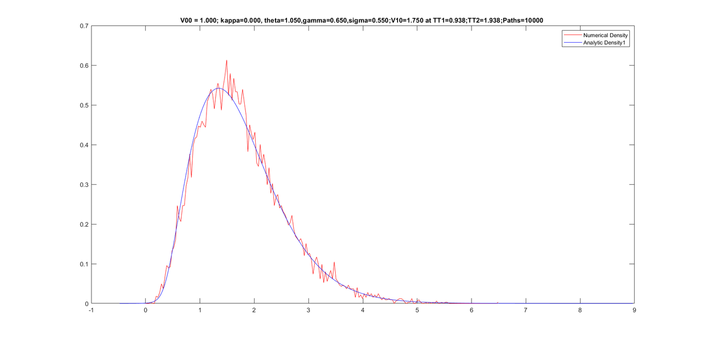

# Breakthrough in the theory of stochastic differential equations and their simulation

**Page 58 of 65** — Posts #2851–#2900

[← Previous](page_057.md) | [Index](index.md) | [Next →](page_059.md)

---

### #2851 — Amin (Topic Author)
*November 7, 2025, 7:26 AM*

EDIT: Please use the program given in post 2854. This(given in this post) is older version that has some errors.
That(given in post 2854) is the new good version. Notes below are valid for that program in post 2854.

Friends, please use this version (still very raw) of the function code for good results. It works well for very high
volatilities for cev .55, .65 or even .75. Mostly until 1D density of Ydecorr remains stable.

Start with zeros on first row of YCoeffHH(1,:) of Ydecorr (Decorrelated part of Y). (This first row will be later
replaced with correlated part of Y from Zx)

Start with one dimensional Hermite-Series (YdCoeffH(2:6)) on first column of 2D Hermite-Series YCoeffHH(2:6,1) of
Ydecorr (Decorrelated part of Y).

Start with zeros in the rest of the body of YCoeffHH of Ydecorr.

Please do not use any 2D least squares regression that we were previously using. Just start iterations from the initial
guess as described in above few lines.

YdCoeffZ,YdCoeffH are arguments from one dimensional Z-series and Hermite-Series of Ydecorr.

MomentsYX0 are cross moments between Ydecorr and X.

Even if you have another good working program, be sure to include the following lines from this function. These lines
mean that 2D hermite series variance(actually SD) of any row is not allowed to increase the 1D Variance of that hermite
polynomial of Y from YdCoeffH. It is only allowed to increase by a very small factor of .005 as in 1.005.

                     
 YSD(nn)=sqrt(YCoeffHHnew(nn,1).^2+YCoeffHHnew(nn,2).^2+YCoeffHHnew(nn,3).^2*2+YCoeffHHnew(nn,4).^2*6+YCoeffHHnew(nn,5).^2*24+YCoeffHHnew(nn,6).^2*120);

 if(YSD(nn)>YdCoeffH(nn)*1.005)

       YCoeffHHnew(nn,:)=YCoeffHHnew(nn,:).*YdCoeffH(nn)./YSD(nn)*1.005;

  end

.

.

.

```
function [YCoeffHH,ObjFunc] =
HSeriesCoeffsFromCrossMomentsIterative2D2nd(YCoeffHH,XCoeffZ,MomentsYX0,YdCoeffZ,YdCoeffH,MaxIter,w2D)

SeriesOrder=6;
NMoments=6;
Order=5;
VarY(2:Order+1)=0.0;
for nn=2:Order+1
   
VarY(nn)=YCoeffHH(nn,1).^2+YCoeffHH(nn,2).^2+YCoeffHH(nn,2).^2*2+YCoeffHH(nn,4).^2*6+YCoeffHH(nn,5).^2*24+YCoeffHH(nn,6).^2*120;
    if(VarY(nn)>YdCoeffH(nn)^2)
    YCoeffHH(nn,1:Order+1)=YCoeffHH(nn,1:Order+1).*sqrt(YdCoeffH(nn).^2./VarY(nn));
    end
end

%[YdMoments]=CalculateMomentsOfZSeries(YdCoeffZ(1),YdCoeffZ(2:6),5,6);

% %Below, we calculate first and 2nd moment of 2D Hermite series
% [MeanHH,M2HH] = CalculateMeanAndVarOf2DHSeriesY(YCoeffHH,Order,Order);
% %VarHH is model variance .
% VarHH=M2HH-MeanHH.^2;
% %VarIn is input variance
% VarIn=YMoments(2)-YMoments(1).^2;
% %Variance correction is applied below to all rows but not to first row of hermite series.
% %YCoeffHH(2:6,1:6)=YCoeffHH(2:6,1:6).*sqrt(VarIn/VarHH);
% %YCoeffHH(1,2:6)=YCoeffHH(1,2:6).*sqrt(VarIn/VarHH);
% %We convert final 2D Hermite series to 2D Z-series

[YCoeffZZ] = Convert2DHermitesInto2DSeriesNew(YCoeffHH,Order,Order);

for nn=1:SeriesOrder
    for mm=1:SeriesOrder
        DeltaX(nn,mm)=.00125*2/(factorial(nn+1))/(factorial(mm+1));%/2^((nn-1)/2)/2^((mm-1)/2);
        DeltaXMax(nn,mm)=DeltaX(nn,mm)*10;
    end
end

ObjFunc1=0;
ObjFunc2=0;

%%%Weights on objective function that shows fit to moments
w2D(NMoments,NMoments)=1;
for nn=NMoments-1:-1:1
    for mm=NMoments-1:-1:1
        w2D(nn,mm)=w2D(nn+1,mm+1)*(nn+1).^0*(mm+1).^0;
    end
end

[AMat] = CalculateCrossMomentsofTwo2Dand1DZSeries(YCoeffZZ,XCoeffZ,Order,Order);
[BMat] = CalculateMomentsOf2DZSeriesY(YCoeffZZ,Order,Order,Order+1);

for pp1=1:Order+1
     for qq1=1:Order+1
         Moments2D(pp1,qq1)=AMat((pp1-1)*(Order+1)+qq1,1);
         Moments2D0(pp1,qq1)=MomentsYX0((pp1-1)*(Order+1)+qq1,1);
     end
    % Moments1D(pp1)=AMat((Order+1)*(Order+1)+pp1,1);
 end
[ObjFuncBest] = CalculateObjMoment2D1D(Moments2D0,Moments2D,w2D,Order+1,Order+1);
%ObjFuncBest=ObjFuncBest+sum((BMat-YdMoments).^2);
%[ObjFuncBest] = CalculateObjMoment(sMu,Moments,w,mOrder);
ObjFuncBest
str=input("Look objFuncBest");
%cBest=c;

ImproveFlag(1:SeriesOrder,1:SeriesOrder)=1;
ImproveFlagPrev(1:SeriesOrder,1:SeriesOrder)=0;
ImproveCount(1:SeriesOrder,1:SeriesOrder)=0;
SeriesOrderM=6;
kk=0;
while ((kk.001))
kk=kk+1;

    %We only iteratively alter c(2:7), first and second moments are
    %retrieved automatically in our set up
    for nn=2:6%SeriesOrder
        for mm=1:6%SeriesOrder
            if((nn==1))
            %    ;
            else

            ImproveFlagPrev(nn,mm)=ImproveFlag(nn,mm);

            YCoeffHHnew=YCoeffHH;
            YCoeffHHnew(nn,mm)=YCoeffHHnew(nn,mm)+DeltaX(nn,mm);

                     
 YSD(nn)=sqrt(YCoeffHHnew(nn,1).^2+YCoeffHHnew(nn,2).^2+YCoeffHHnew(nn,3).^2*2+YCoeffHHnew(nn,4).^2*6+YCoeffHHnew(nn,5).^2*24+YCoeffHHnew(nn,6).^2*120);

            if(YSD(nn)>YdCoeffH(nn)*1.005)
                YCoeffHHnew(nn,:)=YCoeffHHnew(nn,:).*YdCoeffH(nn)./YSD(nn)*1.005;
            end
   %

%             if(nn>1)
%           
 VarY(nn)=YCoeffHHnew(nn,1).^2+YCoeffHHnew(nn,2).^2+YCoeffHHnew(nn,2).^2*2+YCoeffHHnew(nn,4).^2*6+YCoeffHHnew(nn,5).^2*24+YCoeffHHnew(nn,6).^2*120;
%             if(VarY(nn)>1.15^2*YdCoeffH(nn).^2)
%                 YCoeffHHnew(nn,1:Order+1)=YCoeffHHnew(nn,1:Order+1).*sqrt(YdCoeffH(nn).^2./VarY(nn))*1.15;
%             end
%             end
            %Below, we calculate first and 2nd moment of 2D Hermite series
    %        [MeanHH,M2HH] = CalculateMeanAndVarOf2DHSeriesY(YCoeffHHnew,Order,Order);
            %VarHH is model variance .
    %        VarHH=M2HH-MeanHH.^2;
            %VarIn is input variance
    %        VarIn=YMoments(2)-YMoments(1).^2;
            %Variance correction is applied below to all rows but not to first row of hermite series.
  %          YCoeffHHnew(2:6,1:6)=YCoeffHHnew(2:6,1:6).*sqrt(VarIn/VarHH);
    %        YCoeffHHnew(1,2:6)=YCoeffHHnew(1,2:6).*sqrt(VarIn/VarHH);
            %We convert final 2D Hermite series to 2D Z-series

            [YCoeffZZnew] = Convert2DHermitesInto2DSeriesNew(YCoeffHHnew,Order,Order);

            [AMat] = CalculateCrossMomentsofTwo2Dand1DZSeries(YCoeffZZnew,XCoeffZ,Order,Order);
            for pp1=1:Order+1
                for qq1=1:Order+1
                    Moments2D(pp1,qq1)=AMat((pp1-1)*(Order+1)+qq1,1);
                    Moments2D0(pp1,qq1)=MomentsYX0((pp1-1)*(Order+1)+qq1,1);
                end
            end
            [ObjFunc1] = CalculateObjMoment2D1D(Moments2D0,Moments2D,w2D,Order+1,Order+1);
            [BMat] = CalculateMomentsOf2DZSeriesY(YCoeffZZnew,Order,Order,Order+1);
            %ObjFunc1=ObjFunc1+sum((BMat-YdMoments).^2);
                 [DValue1] = EvaluateDerivativeOf2DZSeries(YCoeffZZnew,-3.0,-3.0,Order);
                [DValue2] = EvaluateDerivativeOf2DZSeries(YCoeffZZnew,-3.0,3.0,Order);
                [DValue3] = EvaluateDerivativeOf2DZSeries(YCoeffZZnew,-3.0,-2.5,Order);
                [DValue4] = EvaluateDerivativeOf2DZSeries(YCoeffZZnew,-3.0,2.5,Order);
                [DValue5] = EvaluateDerivativeOf2DZSeries(YCoeffZZnew,-3.0,-2.0,Order);
                [DValue6] = EvaluateDerivativeOf2DZSeries(YCoeffZZnew,-3.0,2.0,Order);

                DFlag1=(DValue1>0)&&(DValue2>0)&&(DValue3>0)&&(DValue4>0)&&(DValue5>0)&&(DValue6>0);
                [DValue1] = EvaluateDerivativeOf2DZSeries(YCoeffZZnew,3.0,-3.0,Order);
                [DValue2] = EvaluateDerivativeOf2DZSeries(YCoeffZZnew,3.0,3.0,Order);
                [DValue3] = EvaluateDerivativeOf2DZSeries(YCoeffZZnew,3.0,-2.5,Order);
                [DValue4] = EvaluateDerivativeOf2DZSeries(YCoeffZZnew,3.0,2.5,Order);
                [DValue5] = EvaluateDerivativeOf2DZSeries(YCoeffZZnew,3.0,-2.0,Order);
                [DValue6] = EvaluateDerivativeOf2DZSeries(YCoeffZZnew,3.0,2.0,Order);

                DFlag2=(DValue1>0)&&(DValue2>0)&&(DValue3>0)&&(DValue4>0)&&(DValue5>0)&&(DValue6>0);
 %DValue1=1;
 %DValue2=1;

 %DFlag1=1;
 %DFlag2=1;
                if((ObjFunc1YdCoeffH(nn)*1.005)
                YCoeffHHnew(nn,:)=YCoeffHHnew(nn,:).*YdCoeffH(nn)./YSD(nn)*1.005;
            end
   %

%                 if(nn>1)
%               
 VarY(nn)=YCoeffHHnew(nn,1).^2+YCoeffHHnew(nn,2).^2+YCoeffHHnew(nn,2).^2*2+YCoeffHHnew(nn,4).^2*6+YCoeffHHnew(nn,5).^2*24+YCoeffHHnew(nn,6).^2*120;
%                 if(VarY(nn)>1.15^2*YdCoeffH(nn).^2)
%                 YCoeffHHnew(nn,1:Order+1)=YCoeffHHnew(nn,1:Order+1).*sqrt(YdCoeffH(nn).^2./VarY(nn))*1.15;
%                 end
%                 end

                %Below, we calculate first and 2nd moment of 2D Hermite series
     %           [MeanHH,M2HH] = CalculateMeanAndVarOf2DHSeriesY(YCoeffHHnew,Order,Order);
                %VarHH is model variance .
     %           VarHH=M2HH-MeanHH.^2;
                %VarIn is input variance
     %           VarIn=YMoments(2)-YMoments(1).^2;
                 %Variance correction is applied below to all rows but not to first row of hermite series.
 %               YCoeffHHnew(2:6,1:6)=YCoeffHHnew(2:6,1:6).*sqrt(VarIn/VarHH);
     %           YCoeffHHnew(1,2:6)=YCoeffHHnew(1,2:6).*sqrt(VarIn/VarHH);
                %We convert final 2D Hermite series to 2D Z-series

                [YCoeffZZnew] = Convert2DHermitesInto2DSeriesNew(YCoeffHHnew,Order,Order);

                [AMat] = CalculateCrossMomentsofTwo2Dand1DZSeries(YCoeffZZnew,XCoeffZ,Order,Order);
                for pp1=1:Order+1
                    for qq1=1:Order+1
                        Moments2D(pp1,qq1)=AMat((pp1-1)*(Order+1)+qq1,1);
                        Moments2D0(pp1,qq1)=MomentsYX0((pp1-1)*(Order+1)+qq1,1);
                    end

                end
                [ObjFunc2] = CalculateObjMoment2D1D(Moments2D0,Moments2D,w2D,Order+1,Order+1);

                [BMat] = CalculateMomentsOf2DZSeriesY(YCoeffZZnew,Order,Order,Order+1);
             %   ObjFunc2=ObjFunc2+sum((BMat-YdMoments).^2);

                                [DValue1] = EvaluateDerivativeOf2DZSeries(YCoeffZZnew,-3.0,-3.0,Order);
                [DValue2] = EvaluateDerivativeOf2DZSeries(YCoeffZZnew,-3.0,3.0,Order);
                [DValue3] = EvaluateDerivativeOf2DZSeries(YCoeffZZnew,-3.0,-2.5,Order);
                [DValue4] = EvaluateDerivativeOf2DZSeries(YCoeffZZnew,-3.0,2.5,Order);
                [DValue5] = EvaluateDerivativeOf2DZSeries(YCoeffZZnew,-3.0,-2.0,Order);
                [DValue6] = EvaluateDerivativeOf2DZSeries(YCoeffZZnew,-3.0,2.0,Order);

                DFlag1=(DValue1>0)&&(DValue2>0)&&(DValue3>0)&&(DValue4>0)&&(DValue5>0)&&(DValue6>0);
                [DValue1] = EvaluateDerivativeOf2DZSeries(YCoeffZZnew,3.0,-3.0,Order);
                [DValue2] = EvaluateDerivativeOf2DZSeries(YCoeffZZnew,3.0,3.0,Order);
                [DValue3] = EvaluateDerivativeOf2DZSeries(YCoeffZZnew,3.0,-2.5,Order);
                [DValue4] = EvaluateDerivativeOf2DZSeries(YCoeffZZnew,3.0,2.5,Order);
                [DValue5] = EvaluateDerivativeOf2DZSeries(YCoeffZZnew,3.0,-2.0,Order);
                [DValue6] = EvaluateDerivativeOf2DZSeries(YCoeffZZnew,3.0,2.0,Order);

                DFlag2=(DValue1>0)&&(DValue2>0)&&(DValue3>0)&&(DValue4>0)&&(DValue5>0)&&(DValue6>0);
 %DValue1=1;
 %DValue2=1;

 %DFlag1=1;
 %DFlag2=1;
                if((ObjFunc2DeltaXMax(nn,mm))
           DeltaX(nn,mm)=DeltaXMax(nn,mm);
       end
        end
    end

end

ObjFunc=ObjFuncBest;

end
```

---

### #2852 — Amin (Topic Author)
*November 7, 2025, 8:17 AM*

Friends, I would love to write a very comprehensive program as I had earlier suggested, but mind control agents started
altering my programs again and that is why I could not work on it day before yesterday and yesterday. I want to try
doing that again today and want to see if mind control agents are still adamant on mischief. I will let friends know in
the evening how it goes.

---

### #2853 — Amin (Topic Author)
*November 7, 2025, 8:51 AM*

I am not sure how this program works, but it was working superbly three days ago. Here it is

.

.

.

```
function []= ConditionalDensityHermitesBivariateNewtonItersRegSqr02()

%SV SDE is
%dV(t)=mu1 V(t)^beta1 dt+ mu2 V(t)^beta2 dt + sigma0 V(t)^gamma dZ(t)
%In mean reverting SDEs we ususally have
%mu1= kappaV * thetaV
%beta1=0
%mu2=-kappa
%beta2=0

Order=5;
%NDim=4;%Three assets and one SV.
NMomentsY=Order+1;
NMomentsX=Order+1;

 w2D0(1:NMomentsY,1:NMomentsX)=1;

 w2D5(1:NMomentsY,1:NMomentsX)=1;
 w2D6(1:NMomentsY,1:NMomentsX)=1;
for nn=NMomentsY-1:-1:1
    for mm=NMomentsX-1:-1:1

        w2D5(nn,mm)=w2D5(nn+1,mm+1)*(nn+1).^5*(mm+1).^5.0;
        w2D6(nn,mm)=w2D6(nn+1,mm+1)*(nn+1).^6*(mm+1).^6.0;
    end
end

 w2D0(1:NMomentsY,1:NMomentsX)=1;
 w2Dh(1:NMomentsY,1:NMomentsX)=1;
 w2D1(1:NMomentsY,1:NMomentsX)=1;
 w2D2(1:NMomentsY,1:NMomentsX)=1;
 w2D3(1:NMomentsY,1:NMomentsX)=1;
 w2D4(1:NMomentsY,1:NMomentsX)=1;

for nn=NMomentsY-1:-1:1
    for mm=NMomentsX-1:-1:1
        w2Dh(nn,mm)=w2Dh(nn+1,mm+1)*(nn+1).^.5*(mm+1).^.5;
        w2D1(nn,mm)=w2D1(nn+1,mm+1)*(nn+1)*(mm+1);
        w2D2(nn,mm)=w2D2(nn+1,mm+1)*(nn+1).^2*(mm+1).^2.0;
        w2D3(nn,mm)=w2D3(nn+1,mm+1)*(nn+1).^3*(mm+1).^3.0;
        w2D4(nn,mm)=w2D4(nn+1,mm+1)*(nn+1).^4*(mm+1).^4.0;
    end
end

%%%%%%%%%%%%%%%%%%%5
%%%%%%%%%%%%%%%%%%%5

V0=1.00;%.32;
V00=V0;
thetaV=1.050;%.045;%1;%.04;
kappaV=.32000;%1.5;%1.5;
mu1=kappaV*thetaV;
mu2=-kappaV;
beta1=0;
beta2=1;
%gamma=.5;%.950;
%sigma0=.55;%.45;%
gamma=.65;%.950;
sigma0=.55;%.45;%
dt=.03125/2;
Tt=64*2;
T=Tt*dt;

seed0=52130649;
seed0=94210876;
rng(seed0, 'twister')
paths=10000;
V(1:paths,1)=V0;

%%%%%%%%%%%%%%%%%%%%%%%%%%%%%%%%%%%%%%%%%%%%%%%%%%%%%%%%%%%%%%%%%%%%%%%%%%%%%%%%%%%%5
TT1=60; %Transition distribution start
TT2=124; %Transition distribution end

Random2(1:paths/2,1)=0;

for tt=1:Tt

    Random2(1:paths/2)=randn(paths/2,1);
    Random2(paths/2+1:paths)=-Random2(1:paths/2);

    V(1:paths,1)=V(1:paths,1)+ ...
        (mu1.*V(1:paths,1).^beta1 + mu2.*V(1:paths,1).^beta2)*dt + ...
        sigma0*V(1:paths,1).^gamma .*Random2(1:paths,1)*sqrt(dt) + ...
        (mu1.*beta1*V(1:paths,1).^(beta1-1) + mu2.*beta2.*V(1:paths,1).^(beta2-1)).* ...
        ((mu1.*V(1:paths,1).^beta1 + mu2.*V(1:paths,1).^beta2)*dt^2/2 + ...
        sigma0*V(1:paths,1).^gamma .*Random2(1:paths,1)*(1-1/sqrt(3))*dt^1.5) + ...
        .5*(mu1.*beta1.*(beta1-1).*V(1:paths,1).^(beta1-2) + mu2.*beta2.*(beta2-1).*V(1:paths,1).^(beta2-2)).* ...
        sigma0^2.*V(1:paths,1).^(2*gamma).*dt^2/2 + ...
        sigma0*gamma*V(1:paths,1).^(gamma-1) .* ...
        ((mu1.*V(1:paths,1).^beta1 + mu2.*V(1:paths,1).^beta2).*Random2(1:paths,1).*1/sqrt(3)*dt^1.5 + ...
        sigma0.*V(1:paths,1).^gamma .*(Random2(1:paths,1).^2-1)*dt/2) + ...
        .5*sigma0*gamma*(gamma-1).*V(1:paths,1).^(gamma-2) .* ...
        sigma0^2.*V(1:paths,1).^(2*gamma) .*Random2(1:paths,1).*1/sqrt(3)*dt^1.5;

    V(V<0)=.00001;

    if(tt==TT1)
        Xin(1:paths,1)=V(1:paths,1);
    end

    if(tt==TT2)
        Yin(1:paths,1)=V(1:paths,1);
    end
end

str=input("I have reached stone 1");

Order=5;
%
Ndata=paths;
%
[ZI] = MomentMatchedStandardNormalDiscretizedDensity(Ndata);

%%%%%%%%%%%%%%%%%%%%%%%%%%%%%%%%%%%%%%%%%%%%%%%%%%%%%%%%%%%%%%%%%%%%%%%%%%%%%%55

[XCoeffH,Zx] = CalculateHermiteSeriesFromData01(Xin,Order,ZI);
[XCoeffZ(1:Order+1)] = ConvertHermiteSeriesToZSeries01(XCoeffH(1:Order+1),Order);
for qq1=1:Order+1
    XMoments(qq1)=sum(Xin(1:paths).^qq1)/paths;
end
[XCoeffZ(1),XCoeffZ(2:6)] = CalculateZSeriesDensityFromRawMomentsM6(XMoments,XCoeffZ(2:6));

for nn=1:paths

  [Zx(nn)]=CalculateZgivenXAndZSeriesBisection2C5Improved(Xin(nn),XCoeffZ(1),XCoeffZ(2:6));
end

Zx0(1:Ndata,1)=Zx(1:Ndata);

%%%%%%%%%%%%%%%%%%%%%%%%%%%%%%%%%%%%%%%%%%%%%%%%%%%%%%%%%%%%%%%%%%%%%%%%%%%

[YCoeffH,Zy] = CalculateHermiteSeriesFromData01(Yin,Order,ZI);
[YCoeffZ(1:Order+1)] = ConvertHermiteSeriesToZSeries01(YCoeffH(1:Order+1),Order);

for pp1=1:Order+1
    YMoments(pp1)=sum(Yin(1:paths).^pp1)/paths;
end
[YCoeffZ(1),YCoeffZ(2:6)] = CalculateZSeriesDensityFromRawMomentsM6(YMoments,YCoeffZ(2:6));
%[YCoeffZ(1),YCoeffZ(2:6)] = CalculateZSeriesDensityFromRawMoments02(YMoments);

[YCoeffH0] = ConvertZSeriesToHermiteSeriesNew(YCoeffZ,Order);

for nn=1:paths
  [Zy(nn)]=CalculateZgivenXAndZSeriesBisection2C5Improved(Yin(nn),YCoeffZ(1),YCoeffZ(2:6));
end

%%%%%%%%%%%%%%%%%%%%%%%%%%%%%%%%%%%%%%%%%%%%%%%%%%%%%%%%%%%%%%%%%%%%%%%%%%%5

HH=5;
[CorrH] = CalculateCorrelationBivariateHermiteCH0(Zx,Zy,paths,HH)

CorrH

str=input("Look at hermites correlation");

Coeffyx2(1)=YCoeffH0(1);
Coeffyx2(2:6)=CorrH(1:5).*YCoeffH0(2:6);

Ydecorr(1:Ndata,1)=Yin(1:Ndata,1)-Coeffyx2(1) ...
    -Coeffyx2(2).*Zx0(1:Ndata,1) ...
    -Coeffyx2(3).*(Zx0(1:Ndata,1).^2-1) ...
    -Coeffyx2(4).*(Zx0(1:Ndata,1).^3-3*Zx0(1:Ndata,1)) ...
    -Coeffyx2(5).*(Zx0(1:Ndata,1).^4-6*Zx0(1:Ndata,1).^2+3) ...
    -Coeffyx2(6).*(Zx0(1:Ndata,1).^5-10*Zx0(1:Ndata,1).^3+15*Zx0(1:Ndata,1));% ...
    %-Coeffyx2(7).*(Zx0(1:Ndata,1).^6-15*Zx0(1:Ndata,1).^4+45*Zx0(1:Ndata,1).^2-15) ...
    %-Coeffyx2(8).*(Zx0(1:Ndata,1).^7-21*Zx0(1:Ndata,1).^5+105*Zx0(1:Ndata,1).^3-105*Zx0(1:Ndata,1));% ...

Coeffyx2
PlotHermiteSeriesDensityAndRvGraph(Coeffyx2(1),Coeffyx2(2:Order+1),'b')

str=input("Look at initial correlated hermite series plot---2");

%%%%%%%%%%%%%%%%%%%%%%%%%%%%%%%%%%%%%%%%%%%%%%%%%%%%%%%%%%%%%%%%%%%%%%%%%%%%

[YdCoeffH,Zyd] = CalculateHermiteSeriesFromData01(Ydecorr,Order,ZI);
[YdCoeffZ(1:Order+1)] = ConvertHermiteSeriesToZSeries01(YdCoeffH(1:Order+1),Order);

for pp1=1:Order+1
    YdecorrMoments(pp1,1)=sum(Ydecorr(1:paths).^pp1)/paths;
end
[YdCoeffZ(1),YdCoeffZ(2:6)] = CalculateZSeriesDensityFromRawMomentsM6(YdecorrMoments,YdCoeffZ(2:6));
%[YdCoeffZ(1),YdCoeffZ(2:6)] = CalculateZSeriesDensityFromRawMoments02(YdecorrMoments);

[YdCoeffH] = ConvertZSeriesToHermiteSeriesNew(YdCoeffZ,Order);

clf;

PlotHermiteSeriesDensityAndRvGraph(YdCoeffH(1),YdCoeffH(2:Order+1),'b')

str=input("Look at YdCoeffH density");

for nn=1:paths
  [Zyd(nn)]=CalculateZgivenXAndZSeriesBisection2C5Improved(Ydecorr(nn),YdCoeffZ(1),YdCoeffZ(2:6));
end

Zyd0(1:paths,1)=Zyd(1:paths);

%%%%%%%%%%%%%%%%%%%%%%%%%%%%%%%%%%%%%%%%%%%%%%%%%%%%%%%%%%%%%%%%%%%%%%%%%%%5

YCoeffHH(1:6,1:6)=0.0;
YCoeffHH(2:6,1)=YdCoeffH(1,2:6);%*XCoeffRatio(1);
YCoeffHH

str=input("Look at 2D Hermite-series---5");

%%%%%%%%%%%%%%%%%%%%%%%%%%[YCoeffHH,ObjFunc] =
HSeriesCoeffsFromCrossMomentsIterative2D2nd(YCoeffHH,XCoeffZ,MomentsYX0,YCoeffZ,MaxIter,w2D)
for pp1=1:Order+1
      for qq1=1:Order+1
          MomentsYX0((pp1-1)*(Order+1)+qq1,1)=sum(Ydecorr(1:paths,1).^pp1.*Xin(1:paths,1).^qq1)/paths;
          %MomentsYX0((pp1-1)*(Order+1)+qq1,1)=sum(Ydecorr(1:paths,1).^pp1.*Zx0(1:paths,1).^qq1)/paths;
          %MomentsYX(pp1,qq1)=sum((1:paths,1).^pp1.*Zx0(1:paths,1).^qq1)/paths;
      end
  end

%  MomentsYX

%  str=input("Look at cross-moments matrix");

MaxIter=150;
%In the function below, we do iterative optimization on all 2D Hermite
%coefficients excluding the first row. This function is applied when we
%have become too close to the true values by optimization through previous
%function.

%ZCoeffZ(1:6)=0;
%ZCoeffZ(2)=1;

%[YCoeffHH,ObjFunc] =
HSeriesCoeffsFromCrossMomentsIterative2D2nd(YCoeffHH,XCoeffZ,MomentsYX0,YdCoeffZ,YdCoeffH,MaxIter,w2D2);

%[YCoeffHH,ObjFunc] =
HSeriesCoeffsFromCrossMomentsIterative2D2nd04(YCoeffHH,XCoeffZ,MomentsYX0,YdCoeffZ,YdCoeffH,MaxIter,w2D2);
%YCoeffHH

TargetCrossMoments=MomentsYX0;
OrderY=Order;
OrderX=Order;
%[YCoeffHH,ObjFunc] =
HSeriesCoeffsFromCrossMomentsIterative2D2nd04(YCoeffHH,XCoeffZ,TargetCrossMoments,YdCoeffH,OrderY,OrderX,MaxIter);
MaxIter=300;
[YCoeffHH,ObjFunc] =
HSeriesCoeffsFromCrossMomentsIterative2D2ndNew(YCoeffHH,XCoeffZ,MomentsYX0,YdCoeffZ,YdCoeffH,MaxIter,w2D2);

%load("C:\Users\Lenovo\Documents\MATLAB\MATLAB1\pqfile02A.mat","YCoeffHH")%45000

YCoeffHH
str=input("Variable has been saved")

%YCoeffHH(6,:)=YCoeffHH(6,:);

[YCoeffZZ] = Convert2DHermitesInto2DSeriesNew(YCoeffHH,Order,Order);

%load("C:\Users\Lenovo\Documents\MATLAB\MATLAB1\pqfile02.mat","YCoeffZZ")%45000

MaxIter=2500;

%[YCoeffZZ,AMat] =
DoNewtonIterationsOn2DZSeriesSubset(YCoeffZZ,XCoeffZ,Order,MomentsYX0,YdecorrMoments,YdCoeffH,MaxIter);
%[YCoeffZZ] = Convert2DHermitesInto2DSeriesNew(YCoeffHH,Order,Order);
%LG[YCoeffZZ,AMat] = DoNewtonIterationsOn2DZSeries(YCoeffZZ,XCoeffZ,Order,MomentsYX0,YdecorrMoments,MaxIter);
%[YCoeffZZ,AMat] =
DoNewtonIterationsOn2DZSeriesWithData(YCoeffZZ,XCoeffZ,Order,MomentsYX0,YdecorrMoments,MaxIter);%,Zyd,Zx,Ndata);
%[YCoeffZZ,AMat] =
DoNewtonIterationsOn2DZSeriesWithData(YCoeffZZ,ZCoeff,Order,MomentsYX0,MomentsY,MaxIter,Zyd,Zx,Ndata);

[YdecorrMomentsM] = CalculateMomentsOf2DZSeriesY(YCoeffZZ,Order,Order,Order+1);

YdecorrMomentsM
YdecorrMoments

%%%%%%%%%%%%%%%%%%%%%%%%%%%%%%%%%%%%%%%%%%%%%%%%%%%%%%%%%%%%%%%%%%%%%%%%%%%%5
[YdecorrMomentsM] = CalculateMomentsOf2DZSeriesY(YCoeffZZ,Order,Order,Order+1);

YdecorrMomentsM
YdecorrMoments

str=input("Look at comparison of moments")

%%%%%%%%%%%%%%%%%%%%%%%%%%%%%%%%%%%%%%%%%%%%%%%%%%%%%%%%5
[YCoeffHH] = ConvertZSeriesToHermiteSeries2D(YCoeffZZ,Order+1,Order+1);

YCoeffHH

str=input("Look at output oof 2D Hermite-Series");

YCoeffHH(1,1:Order+1)=YCoeffHH(1,1:Order+1)*0+Coeffyx2(1,1:Order+1);

[YCoeffZZ] = Convert2DHermitesInto2DSeriesNew(YCoeffHH,Order,Order);

 [Y1DMoments]=CalculateMomentsOfZSeries(YCoeffZ(1),YCoeffZ(2:6),5,6)

 OrderY=Order;
 OrderX=Order;
 NMoments=6;
 [YMoments] = CalculateMomentsOf2DZSeriesY(YCoeffZZ,OrderY,OrderX,NMoments);
%
%
 Y1DMoments
 YMoments
 str=input("Look at comparison of second moments/moments");

%%%%%%%%%%%%%%%%%%%%%%%%%%%%%%%%%%%%%%%%%%%%%%%%%%%%%%%%%%%%%%%%%%%%%%%%%%%%%5
%In this block, we do conditional Monte Carlo of SDE which is the true
%numerical 1D conditional density of Y conditional on X having a given
%value. This value of X on which we are conditionin is defined by V10 below.
%We can alter V10 below and it will take out a 1D slice from the 2D density
%of Y conditional on X  taking a specific value (here V10).
%Zx=2.0;
%V10=XCoeffZ(1)+XCoeffZ(2).*Zx+XCoeffZ(3).*Zx^2+XCoeffZ(4).*Zx^3+XCoeffZ(5).*Zx^4+XCoeffZ(6).*Zx^5;
%V10
%str=input("Look at V10");
V10=1.750;
V(1:paths)=V10;
Random2(1:paths,1)=0;

for tt=TT1+1:TT2

    Random2(1:paths/2)=randn(paths/2,1);
    Random2(paths/2+1:paths)=-Random2(1:paths/2);

    V(1:paths,1)=V(1:paths,1)+ ...
        (mu1.*V(1:paths,1).^beta1 + mu2.*V(1:paths,1).^beta2)*dt + ...
        sigma0*V(1:paths,1).^gamma .*Random2(1:paths,1)*sqrt(dt) + ...
        (mu1.*beta1*V(1:paths,1).^(beta1-1) + mu2.*beta2.*V(1:paths,1).^(beta2-1)).* ...
        ((mu1.*V(1:paths,1).^beta1 + mu2.*V(1:paths,1).^beta2)*dt^2/2 + ...
        sigma0*V(1:paths,1).^gamma .*Random2(1:paths,1)*(1-1/sqrt(3))*dt^1.5) + ...
        .5*(mu1.*beta1.*(beta1-1).*V(1:paths,1).^(beta1-2) + mu2.*beta2.*(beta2-1).*V(1:paths,1).^(beta2-2)).* ...
        sigma0^2.*V(1:paths,1).^(2*gamma).*dt^2/2 + ...
        sigma0*gamma*V(1:paths,1).^(gamma-1) .* ...
        ((mu1.*V(1:paths,1).^beta1 + mu2.*V(1:paths,1).^beta2).*Random2(1:paths,1).*1/sqrt(3)*dt^1.5 + ...
        sigma0.*V(1:paths,1).^gamma .*(Random2(1:paths,1).^2-1)*dt/2) + ...
        .5*sigma0*gamma*(gamma-1).*V(1:paths,1).^(gamma-2) .* ...
        sigma0^2.*V(1:paths,1).^(2*gamma) .*Random2(1:paths,1).*1/sqrt(3)*dt^1.5;

    V(V<0)=.00001;

end

%Below

NoOfBins=200;
MaxCutOff=10;

[XDensity,IndexOut,IndexMax] = MakeDensityFromSimulation_Infiniti_NEW(V,paths,NoOfBins,MaxCutOff );

clf;

plot(IndexOut(1:IndexMax),XDensity(1:IndexMax),'r');

hold on

for qq=1:6

    DataMoments(qq)=sum(V(:).^qq)/paths;

end

%%%%%%%%%%%%%%%%%%%%%%%%%%%%%%%%%%%%%%%%%%%%%%%%%%%%%%%%%%%%%%%%%%%%%%%%%%%%%%%%%%%%%%%5
%Below, we calculate the value of Zx0 corresponding to X0 (here V10). This
%comes from inverting the Z-series of X so that X=V10;

xOrder=Order;
yOrder=Order;
[Zx0] = CalculateZgivenXAndHSeriesCoeffs(V10,XCoeffH,xOrder);

%Below, we collapse two dimensional pdf of Y|X to one dimensional pdf given
%Zx i.e. this Y|X=X(Zx)
%Here we take out a 1D slice from the 2D density
%of Y conditional on X  taking a specific value (here V10).
He(1)=1;
He(2)=Zx0;
He(3)=Zx0^2-1;
He(4)=Zx0^3-3*Zx0;
He(5)=Zx0^4-6*Zx0.^2+3;
He(6)=Zx0^5-10*Zx0.^3+15*Zx0;
He(7)=Zx0^6-15*Zx0.^4+45*Zx0.^2-15;
He(8)=Zx0^7-21*Zx0.^5+105*Zx0.^3-105*Zx0;

YCoeffh(1:Order+1)=0;
for hh=1:yOrder+1
    for hh2=1:xOrder+1
        YCoeffh(hh)=YCoeffh(hh)+YCoeffHH(hh,hh2).*He(hh2);
    end
end

 [YCoeffz(1:Order+1)] = ConvertHermiteSeriesToZSeries01(YCoeffh(1:Order+1),Order);

 [YMomentsModel]=CalculateMomentsOfZSeries(YCoeffz(1),YCoeffz(2:6),5,6);

 YMomentsModel

 DataMoments

 str=input("Look at comparison of moments");

PlotHermiteSeriesDensityAndRvGraph(YCoeffh(1),YCoeffh(2:yOrder+1),'b')

%hold on
%PlotHermiteSeriesDensityAndRvGraph(YCoeffh(1),YCoeffh1(2:yOrder+1),'g')
title(sprintf('V00 = %.3f; kappa=%.3f, theta=%.3f,gamma=%.3f,sigma=%.3f;V10=%.3f at TT1=%.3f;TT2=%.3f;Paths=%d ',V00,
kappaV, thetaV,gamma,sigma0, V10,(TT1*dt),(TT2*dt),paths));%,sprintf('theta= %f', theta), sprintf('kappa = %f',
kappa),sprintf('sigma = %f', sigma0),sprintf('T = %f', T));
legend({'Numerical Density','Analytic Density1'}, ...
    'Location','northeast')

str=input("This is the first version without altering the moments of conditional density")

[YMoments0]=CalculateMomentsOfZSeries(YCoeffz(1),YCoeffz(2:6),5,6)

end
```

.

.

.

If 1D density of Ydecorr given on line 201 of above function is well-behaved (with proper tails) with five hermite
polynomials (six moments), the optimization should go well with five hermite polynomials. If this density is not
well-behaved with five polynomials, the optimization would be hopeless with five polynomials. I checked that for most
cases, where the density that is not well-behaved with five polynomials, becomes well-behaved with nice tails when we
calculate Ydecorr with seven hermite polynomials(For that You have to re-do all the earlier calculations of 1D
Densities, correlations and correlated part with seven hermite polynomials(eight moments). I will automate this in new
version)

---

### #2854 — Amin (Topic Author)
*November 7, 2025, 9:03 AM*

Friends, very sorry, please do not use the function given at the start of this page in post 2851. Rather you need to use
its new version as given here. Notes there are the same and are valid for this program.

.

.

```
function [YCoeffHH,ObjFunc] =
HSeriesCoeffsFromCrossMomentsIterative2D2ndNew(YCoeffHH,XCoeffZ,MomentsYX0,YdCoeffZ,YdCoeffH,MaxIter,w2D)

SeriesOrder=6;
NMoments=6;
Order=5;
VarY(2:Order+1)=0.0;
for nn=2:Order+1
   
VarY(nn)=YCoeffHH(nn,1).^2+YCoeffHH(nn,2).^2+YCoeffHH(nn,2).^2*2+YCoeffHH(nn,4).^2*6+YCoeffHH(nn,5).^2*24+YCoeffHH(nn,6).^2*120;
    if(VarY(nn)>YdCoeffH(nn)^2)
    YCoeffHH(nn,1:Order+1)=YCoeffHH(nn,1:Order+1).*sqrt(YdCoeffH(nn).^2./VarY(nn));
    end
end

[YdMoments]=CalculateMomentsOfZSeries(YdCoeffZ(1),YdCoeffZ(2:6),5,6);

% %Below, we calculate first and 2nd moment of 2D Hermite series
% [MeanHH,M2HH] = CalculateMeanAndVarOf2DHSeriesY(YCoeffHH,Order,Order);
% %VarHH is model variance .
% VarHH=M2HH-MeanHH.^2;
% %VarIn is input variance
% VarIn=YMoments(2)-YMoments(1).^2;
% %Variance correction is applied below to all rows but not to first row of hermite series.
% %YCoeffHH(2:6,1:6)=YCoeffHH(2:6,1:6).*sqrt(VarIn/VarHH);
% %YCoeffHH(1,2:6)=YCoeffHH(1,2:6).*sqrt(VarIn/VarHH);
% %We convert final 2D Hermite series to 2D Z-series

[YCoeffZZ] = Convert2DHermitesInto2DSeriesNew(YCoeffHH,Order,Order);

for nn=1:SeriesOrder
    for mm=1:SeriesOrder
        DeltaX(nn,mm)=.00125*2/(factorial(nn+1))/(factorial(mm+1));%/2^((nn-1)/2)/2^((mm-1)/2);
        DeltaXMax(nn,mm)=DeltaX(nn,mm)*10;
    end
end

ObjFunc1=0;
ObjFunc2=0;

%%%Weights on objective function that shows fit to moments
w2D(NMoments,NMoments)=1;
for nn=NMoments-1:-1:1
    for mm=NMoments-1:-1:1
        w2D(nn,mm)=w2D(nn+1,mm+1)*(nn+1).^0*(mm+1).^0;
    end
end

[AMat] = CalculateCrossMomentsofTwo2Dand1DZSeries(YCoeffZZ,XCoeffZ,Order,Order);
[BMat] = CalculateMomentsOf2DZSeriesY(YCoeffZZ,Order,Order,Order+1);

for pp1=1:Order+1
     for qq1=1:Order+1
         Moments2D(pp1,qq1)=AMat((pp1-1)*(Order+1)+qq1,1);
         Moments2D0(pp1,qq1)=MomentsYX0((pp1-1)*(Order+1)+qq1,1);
     end
    % Moments1D(pp1)=AMat((Order+1)*(Order+1)+pp1,1);
 end
[ObjFuncBest] = CalculateObjMoment2D1D(Moments2D0,Moments2D,w2D,Order+1,Order+1);
%ObjFuncBest=ObjFuncBest+sum((BMat-YdMoments).^2);
%[ObjFuncBest] = CalculateObjMoment(sMu,Moments,w,mOrder);
ObjFuncBest
str=input("Look objFuncBest");
%cBest=c;

ImproveFlag(1:SeriesOrder,1:SeriesOrder)=1;
ImproveFlagPrev(1:SeriesOrder,1:SeriesOrder)=0;
ImproveCount(1:SeriesOrder,1:SeriesOrder)=0;
SeriesOrderM=6;
kk=0;
while ((kk.001))
kk=kk+1;

if(kk>400)
    SeriesOrderM=6;
end
if(kk>700)
    SeriesOrderM=6;
end
    %We only iteratively alter c(2:7), first and second moments are
    %retrieved automatically in our set up
    for nn=2:6%SeriesOrder
        for mm=1:6%SeriesOrderM
            if((nn==1))
            %    ;
            else

            ImproveFlagPrev(nn,mm)=ImproveFlag(nn,mm);

            YCoeffHHnew=YCoeffHH;
            YCoeffHHnew(nn,mm)=YCoeffHHnew(nn,mm)+DeltaX(nn,mm);

                     
 YSD(nn)=sqrt(YCoeffHHnew(nn,1).^2+YCoeffHHnew(nn,2).^2+YCoeffHHnew(nn,3).^2*2+YCoeffHHnew(nn,4).^2*6+YCoeffHHnew(nn,5).^2*24+YCoeffHHnew(nn,6).^2*120);

            if(YSD(nn)>YdCoeffH(nn))
                YCoeffHHnew(nn,:)=YCoeffHHnew(nn,:).*YdCoeffH(nn)./YSD(nn);
            end
   %

%             if(nn>1)
%           
 VarY(nn)=YCoeffHHnew(nn,1).^2+YCoeffHHnew(nn,2).^2+YCoeffHHnew(nn,2).^2*2+YCoeffHHnew(nn,4).^2*6+YCoeffHHnew(nn,5).^2*24+YCoeffHHnew(nn,6).^2*120;
%             if(VarY(nn)>1.15^2*YdCoeffH(nn).^2)
%                 YCoeffHHnew(nn,1:Order+1)=YCoeffHHnew(nn,1:Order+1).*sqrt(YdCoeffH(nn).^2./VarY(nn))*1.15;
%             end
%             end
            %Below, we calculate first and 2nd moment of 2D Hermite series
    %        [MeanHH,M2HH] = CalculateMeanAndVarOf2DHSeriesY(YCoeffHHnew,Order,Order);
            %VarHH is model variance .
    %        VarHH=M2HH-MeanHH.^2;
            %VarIn is input variance
    %        VarIn=YMoments(2)-YMoments(1).^2;
            %Variance correction is applied below to all rows but not to first row of hermite series.
  %          YCoeffHHnew(2:6,1:6)=YCoeffHHnew(2:6,1:6).*sqrt(VarIn/VarHH);
    %        YCoeffHHnew(1,2:6)=YCoeffHHnew(1,2:6).*sqrt(VarIn/VarHH);
            %We convert final 2D Hermite series to 2D Z-series

            [YCoeffZZnew] = Convert2DHermitesInto2DSeriesNew(YCoeffHHnew,Order,Order);

            [AMat] = CalculateCrossMomentsofTwo2Dand1DZSeries(YCoeffZZnew,XCoeffZ,Order,Order);
            for pp1=1:Order+1
                for qq1=1:Order+1
                    Moments2D(pp1,qq1)=AMat((pp1-1)*(Order+1)+qq1,1);
                    Moments2D0(pp1,qq1)=MomentsYX0((pp1-1)*(Order+1)+qq1,1);
                end
            end
            [ObjFunc1] = CalculateObjMoment2D1D(Moments2D0,Moments2D,w2D,Order+1,Order+1);
            [BMat] = CalculateMomentsOf2DZSeriesY(YCoeffZZnew,Order,Order,Order+1);
            %ObjFunc1=ObjFunc1+sum((BMat-YdMoments).^2);
                 [DValue1] = EvaluateDerivativeOf2DZSeries(YCoeffZZnew,-3.0,-3.0,Order);
                [DValue2] = EvaluateDerivativeOf2DZSeries(YCoeffZZnew,-3.0,3.0,Order);
                [DValue3] = EvaluateDerivativeOf2DZSeries(YCoeffZZnew,-3.0,-2.5,Order);
                [DValue4] = EvaluateDerivativeOf2DZSeries(YCoeffZZnew,-3.0,2.5,Order);
                [DValue5] = EvaluateDerivativeOf2DZSeries(YCoeffZZnew,-3.0,-2.0,Order);
                [DValue6] = EvaluateDerivativeOf2DZSeries(YCoeffZZnew,-3.0,2.0,Order);

                DFlag1=(DValue1>0)&&(DValue2>0)&&(DValue3>0)&&(DValue4>0)&&(DValue5>0)&&(DValue6>0);
                [DValue1] = EvaluateDerivativeOf2DZSeries(YCoeffZZnew,3.0,-3.0,Order);
                [DValue2] = EvaluateDerivativeOf2DZSeries(YCoeffZZnew,3.0,3.0,Order);
                [DValue3] = EvaluateDerivativeOf2DZSeries(YCoeffZZnew,3.0,-2.5,Order);
                [DValue4] = EvaluateDerivativeOf2DZSeries(YCoeffZZnew,3.0,2.5,Order);
                [DValue5] = EvaluateDerivativeOf2DZSeries(YCoeffZZnew,3.0,-2.0,Order);
                [DValue6] = EvaluateDerivativeOf2DZSeries(YCoeffZZnew,3.0,2.0,Order);

                DFlag2=(DValue1>0)&&(DValue2>0)&&(DValue3>0)&&(DValue4>0)&&(DValue5>0)&&(DValue6>0);
 %DValue1=1;
 %DValue2=1;

 %DFlag1=1;
 %DFlag2=1;
                if((ObjFunc1YdCoeffH(nn))
                YCoeffHHnew(nn,:)=YCoeffHHnew(nn,:).*YdCoeffH(nn)./YSD(nn);
            end
   %

%                 if(nn>1)
%               
 VarY(nn)=YCoeffHHnew(nn,1).^2+YCoeffHHnew(nn,2).^2+YCoeffHHnew(nn,2).^2*2+YCoeffHHnew(nn,4).^2*6+YCoeffHHnew(nn,5).^2*24+YCoeffHHnew(nn,6).^2*120;
%                 if(VarY(nn)>1.15^2*YdCoeffH(nn).^2)
%                 YCoeffHHnew(nn,1:Order+1)=YCoeffHHnew(nn,1:Order+1).*sqrt(YdCoeffH(nn).^2./VarY(nn))*1.15;
%                 end
%                 end

                %Below, we calculate first and 2nd moment of 2D Hermite series
     %           [MeanHH,M2HH] = CalculateMeanAndVarOf2DHSeriesY(YCoeffHHnew,Order,Order);
                %VarHH is model variance .
     %           VarHH=M2HH-MeanHH.^2;
                %VarIn is input variance
     %           VarIn=YMoments(2)-YMoments(1).^2;
                 %Variance correction is applied below to all rows but not to first row of hermite series.
 %               YCoeffHHnew(2:6,1:6)=YCoeffHHnew(2:6,1:6).*sqrt(VarIn/VarHH);
     %           YCoeffHHnew(1,2:6)=YCoeffHHnew(1,2:6).*sqrt(VarIn/VarHH);
                %We convert final 2D Hermite series to 2D Z-series

                [YCoeffZZnew] = Convert2DHermitesInto2DSeriesNew(YCoeffHHnew,Order,Order);

                [AMat] = CalculateCrossMomentsofTwo2Dand1DZSeries(YCoeffZZnew,XCoeffZ,Order,Order);
                for pp1=1:Order+1
                    for qq1=1:Order+1
                        Moments2D(pp1,qq1)=AMat((pp1-1)*(Order+1)+qq1,1);
                        Moments2D0(pp1,qq1)=MomentsYX0((pp1-1)*(Order+1)+qq1,1);
                    end

                end
                [ObjFunc2] = CalculateObjMoment2D1D(Moments2D0,Moments2D,w2D,Order+1,Order+1);

                [BMat] = CalculateMomentsOf2DZSeriesY(YCoeffZZnew,Order,Order,Order+1);
             %   ObjFunc2=ObjFunc2+sum((BMat-YdMoments).^2);

                                [DValue1] = EvaluateDerivativeOf2DZSeries(YCoeffZZnew,-3.0,-3.0,Order);
                [DValue2] = EvaluateDerivativeOf2DZSeries(YCoeffZZnew,-3.0,3.0,Order);
                [DValue3] = EvaluateDerivativeOf2DZSeries(YCoeffZZnew,-3.0,-2.5,Order);
                [DValue4] = EvaluateDerivativeOf2DZSeries(YCoeffZZnew,-3.0,2.5,Order);
                [DValue5] = EvaluateDerivativeOf2DZSeries(YCoeffZZnew,-3.0,-2.0,Order);
                [DValue6] = EvaluateDerivativeOf2DZSeries(YCoeffZZnew,-3.0,2.0,Order);

                DFlag1=(DValue1>0)&&(DValue2>0)&&(DValue3>0)&&(DValue4>0)&&(DValue5>0)&&(DValue6>0);
                [DValue1] = EvaluateDerivativeOf2DZSeries(YCoeffZZnew,3.0,-3.0,Order);
                [DValue2] = EvaluateDerivativeOf2DZSeries(YCoeffZZnew,3.0,3.0,Order);
                [DValue3] = EvaluateDerivativeOf2DZSeries(YCoeffZZnew,3.0,-2.5,Order);
                [DValue4] = EvaluateDerivativeOf2DZSeries(YCoeffZZnew,3.0,2.5,Order);
                [DValue5] = EvaluateDerivativeOf2DZSeries(YCoeffZZnew,3.0,-2.0,Order);
                [DValue6] = EvaluateDerivativeOf2DZSeries(YCoeffZZnew,3.0,2.0,Order);

                DFlag2=(DValue1>0)&&(DValue2>0)&&(DValue3>0)&&(DValue4>0)&&(DValue5>0)&&(DValue6>0);
 %DValue1=1;
 %DValue2=1;

 %DFlag1=1;
 %DFlag2=1;
                if((ObjFunc2DeltaXMax(nn,mm))
           DeltaX(nn,mm)=DeltaXMax(nn,mm);
       end
        end
    end

end

ObjFunc=ObjFuncBest;

end
```

---

### #2855 — Amin (Topic Author)
*November 7, 2025, 9:10 AM*

Friends, you need to comment the calculation of BMat in the above program everywhere since it is calculated but not used
at all. If you want to run the program as such, you will also need the following function.

.

.

```
function [YMoments] = CalculateMomentsOf2DZSeriesY(YCoeffZZ,OrderY,OrderX,NMoments)

[EZ] = EZZ2();

EX=0;
for nn1=1:OrderY
    for nn2=1:OrderX
        EX=EX+YCoeffZZ(nn1,nn2).*EZ(nn1).*EZ(nn2);
    end
end

MeanZZ=EX;
YMoments(1)=EX;

YpCoeff(1:(OrderY+1)*(OrderX+1),1:(OrderY+1)*(OrderX+1),1:NMoments)=0.0;

YpCoeff(1:OrderY+1,1:OrderX+1,1)=YCoeffZZ(1:OrderY+1,1:OrderX+1);

SeriesOrder10=OrderY+1;
SeriesOrder01=OrderX+1;
SeriesOrder20=OrderY+1;
SeriesOrder02=OrderX+1;

for pp=2:NMoments

  SeriesOrder30=SeriesOrder10+SeriesOrder20-1;
  SeriesOrder03=SeriesOrder01+SeriesOrder02-1;
% %
% %  %Below calculate the product: 2D product of Z-series [Y|X](Zy,Zx)*X(Zx)
  [YpCoeff(1:SeriesOrder30,1:SeriesOrder03,pp),EYp(pp)]
=SeriesProduct2DAlgorithmicNew(YpCoeff(1:SeriesOrder10,1:SeriesOrder01,pp-1),YCoeffZZ(1:OrderX+1,1:OrderY+1,1),SeriesOrder10,SeriesOrder01,SeriesOrder20,SeriesOrder02);

  YMoments(pp)=EYp(pp);

  SeriesOrder10=SeriesOrder30;
SeriesOrder01=SeriesOrder03;
SeriesOrder20=OrderY+1;
SeriesOrder02=OrderX+1;

end

end

```

.

.

.

---

### #2856 — Amin (Topic Author)
*November 7, 2025, 9:21 AM*

Friends, what I can do is to write a comprehensive function that mimics the above program. It worked extremely well 2-3
days ago but then had problems. And I hope that at the end of the weekend a better, nicer and easy  to use version with
graphs that would be available that you could also use for eight moments calibration.

---

### #2857 — Amin (Topic Author)
*November 7, 2025, 9:51 AM*

Friends, I cannot work my programs properly now. Bad Jewish scumbags have taken my programs and will continue to use
them and have replaced them with improper code that runs when I use my program. This must stop.

Friends, I tried the above function three days ago and it was working well with gamma=.75 and vol=.65 and zero
mean-reversion. For past two days, it continued to work for these values but gave me very skewed graphs and today the
iterations have stopped to converge at all (for much less volatility numbers) and I cannot even get skewed graphs that I
was getting during past two days.

---

### #2858 — Amin (Topic Author)
*November 7, 2025, 10:05 AM*

**Friends, I really believe that in a civilized society of twenty first century there is absolutely no place for
connivance and machinations of a group of rich jews led by jewish billionaire Godfather of mind control who have
retarded, at whim, thousands of talented intelligent people in America and abroad that they did not like. These cruel
people are inhuman animals even though they have learnt to adjust extremely well within American society. **

**These corrupt crooks are very powerful and they have already complete control over American army and a large number of
politicians. Due to this huge influence and power, it is very difficult to do anything to undo the cruel mind control
network led by jewish billionaire and his rich jewish cohort.**

I have suggested several times previously to good American people if nothing else works, please just ask some patriotic
American investigative journalists in major newspapers to run a comprehensive story about mind control network of jewish
billionaire and the nexus between rich jews and American defense and about tens of thousands of people that have been
retarded over past thirty years.

I want to invite patriotic American journalists from CNN, Washington Post, NewYork Times, Guardian or some other large,
reputed and responsible US or European media outlets to run a thorough story on machinations of evil jews led by jewish
billionaire and the  nexus of bad jews with American defense and their cruel mind control network that has retarded tens
of thousands of very intelligent Americans and foreigners all over the world.

**Since good people may not have the power to forcefully end the evil practices of the powerful nexus between evil
Jewish billionaire and US army crooks, only way to end the cruel and subhuman practices of the nexus seems to be
exposing them openly in US public and the public of other countries all across the world.**

** **

**I think it is important for us to make sure there is a better future of American children and children all across the
world and we leave them a legacy in which fairness and justice prevails as opposed to machinations, trickery and deceit
that has been unleashed in the society by the jewish billionaire and his rich jewish cohort.**

---

### #2859 — Amin (Topic Author)
*November 7, 2025, 10:11 AM*

A Relevant post copied from before:

Friends, last night after writing my post, I took a lot of protective measures and tried to be serious about breaking
their control. And then I went to sleep without doing any further work. Today, I was a bit better in the morning but
when I went out to buy food, it was a challenge and I could see at several places that mind control agents reached when
I was trying to buy something.

What I am writing is my honest opinion even though a lot of friends might differ with it to some degree. I think it is
very important that all of us try to have rule of law, and good governance for the benefit of our country and society.
We promote freedom of speech and freedom of press in our societies so that people can criticize bad or wrong actions of
other people and make each other aware of their observations of wrongdoings by some people especially the ones in the
authority in the society while, obviously, every body has to try to investigate the truth on their own without blindly
believing anyone. The purpose of such criticism and related discussions is to try to root out bad practices from the
society and promote good ethics and practices.

Another thing I want to suggest is that true patriotism is not about hiding bad practices taking place in our country
from others, instead it is about exposing such bad practices by unethical people in the public with the final goal that
these bad practices are rooted out from our societies.

**Now I will come to the point that I have been suggesting for years that there is a jewish billionaire and his rich
cohort who are behind indiscriminate mind control of a large number of intelligent American people and others . And a
large number of people in American defense have become a mercenerary army that play in the hands of these rich jews.
These rich jews hire quite a few of senior officers from Pentagon and army after their retirement in their large
enterprises and these people are paid millions of dollars each and they enjoy very high social status. One of the most
important purpose of these retired officers is to convince their juniors who are still in official service and have
reached positions of authority to do illegal, extrajudicial and extraconstitutional mind control control of Americans
and others suggested by the rich jewish cohort. This thing is so well known in some jewish circles that many jews
continuously report thousands of people among intelligent students and many others who fall out with these jews for any
reason to mind control by American defense. You do not always have to be extra intelligent, sometimes falling out with a
jew who knows how to approach the rich jewish cohort will seal the fate of the victim by mind control forever. As
always, I would like to mention that there are large number of jews who are opposed to this practice and have absolutely
nothing to do with mind control of innocent people. Please let me specifically say again that there are many very rich
jews and billionaires who have nothing to do with mind control. But I definitely own that I am suggesting this rich
jewish billionaire and his cohort of rich jews are behind most of the mind control and this is a common knowledge in
many jewish circles and many people among these circles know who to approach for mind control of anyone they do not
like.**

**But what is even more alarming is that all the bad actors behind mind control including rich jewish cohort and
mercenary criminals in American defense, when exposed in public, have absolutely no remorse about their crimes and they
become even more adamant to use all machinatory tactics so that they+ can continue illegal and extrajudicial mind
control of innocent and intelligent people. They have lost all sense of good and evil and have no qualms about
continuing the evil practices at all. It seems many of these bad actors have no conception that retarding innocent human
beings is a wrong thing and an evil practice and they think that mind control of innocent people in the society they do
not like is indeed a good thing.**

I know that many good Americans want to end the bad practice of mind control of innocent people from their society
without any retribution against the bad actors behind such evil practices. The bad actors, on the other hand, have
absolutely no remorse about their evil actions and are ready to go to any limit to thwart the attempts of good people to
end mind control and they always try to undermine all good people and their actions towards amicably ending the evil of
mind control from American society. These bad actors are not willing to gracefully acknowledge and be thankful that good
American people do not want to hurt them beyond ending the inhuman practice of mind control from American society and
instead these bad actors are adamantly using all sort of machinatory and bellicose tactics so they can continue and
increase the evil of inhuman mind control of intelligent and innocent human beings.

I really want to suggest if all amicable attempts by good Americans to end mind control fail, it does not mean that they
have to yield to inhuman practices in our society by continuing to play nice. As there is very huge evidence about
existence of extra-judicial, extra-constitutional and cruel mind control and resulting retarding of very large number of
innocent people by American defense and a large number of stories are circulating in academia about people who were
targeted by American defense on behest of jewish cohort, I really believe that it is a great opportunity for some good
journalists in American and international media to write in detail about the hugely widespread evil of extrajudicial,
extraconstitutional, inhuman and cruel practice of mind control and also about nexus between some bad jews and corrupt
people in American defense that has been the dominating force behind this inhuman evil in our societies. I want to
request good American people that if all else fails, please motivate some brave and patriotic journalists to write in
complete detail about the evil of mind control. If it is not possible to write about this inhuman practice in American
newspapers due to possible reprisal from american defense, please break the news in some large British or European
newspaper. I am sure there is enough evidence about existence of mind control and related inhuman and cruel practices
that any serious journalist can firmly stand behind a well written article that completely exposes mind control and
associated cruelties and retarding of thousands of innocent persons by corrupt people in American defense. As I earlier
suggested Patriotism does not consist in saving any false pride or hiding evil practices of our countrymen, it consists
in rationally doing what is broader good for people in our societies by trying to put an end to evil practices.

I will also request readers, for good of our societies, to let at least one journalist you know in the following
American, European and Pakistani newspapers about true nature of mind control and about my thread.

NewYork Times.

Washington  Post.

CNN.

Fox News.

USA Today.

Los Angeles Times.

Chicago Tribune.

Boston Globe.

Minnesota Star Tribune

NewYork Post

Newsday

San Fransisco Chronicle

The Dallas Morning News

Tampa Bay Times

Hartford Courant

Publick Occurrences Both Forreign and Domestick

The Michigan Daily

The Denver Post

Pittsburgh Post-Gazette

The Seattle Times

Las Vegas Sun

Bourbon County Citizen

The Register Star

NewYork Metro

The Queens Ledger

Philadelphia Tribune

Baltimore Afro-American

Portland Tribune

Indianapolis Recorder

The Patriot-News

El Diario NY

The Modesto Bee

Fairfax County Times

The Epoch Times

Barron's

Queens Chronicle

Phoenix New Times

El Informador

The Philadelphia Inquirer

NewYork Daily News

The Star-Ledger

St. Louis Post-Dispatch

The Mercury News

The Arizona Republic

The Plain Dealer

Detroit Free Press

The Press-Enterprise

The Tennessean

Sun Sentinel

The Copenhagen Post

The Slovak Spectator

The Budapest Times

Tirana Times

Menorca Sun

The Vienna Review

Le News

The Irish Times

Die Welt

Het Nieuwsblad

Le Soir

Albania Today

Algemeen Dagblad

De Telegraaf

de Volkskrant

The European

Het Laatste Nieuws

The Daily Telegraph

Daily Mirror

The Sun

Pravda

The Moscow Times

The Guardian

Le Figaro

Le Monde

ABC

la Repubblica

Il Messaggero

El Periódico de Catalunya

El Mundo

Libération

El País

Kronen Zeitung

La Stampa

Frankfurter Allgemeine Zeitung

Bild

20 minutes

Sport

Aftenposten

Marca

Gazeta Wyborcza

Izvestia

Die Presse

Süddeutsche Zeitung

La Tribune

Novaya Gazeta

Neue Zürcher Zeitung

Dagens Nyheter

Expressen

La Gazzetta dello Sport

Mladá fronta Dnes

Urdu News

Daily Pakistan

Dawn

Daily Express

Daily Jang

The Express Tribune

The News International

The Nation

Pakistan Today

Daily Dunya

Daily Ummat

Nawaiwaqt

The Regional Times of Sindh

Pakistan Observer

Khabrain

Daily Ausaf

Daily Jasarat

Daily Nai Baat

Daily Basharat

Daily Times

The Frontier Post

Daily Sarhad

Daily Imroze

The Pakistan Times

The Financial Daily

Daily Aaj

Daily Mashriq

Millat

Business Recorder

Daily Inqilab

Kawish

Daily Lokaai

Talár

Maidan Daily

Daily Asas

Christian Voice

The Friday Times

Awam

Daily Awami Awaz

The Star

Al Akhbar

Khyber Mail

Nawai Watan

Sajjan

Daily Hilal Pakistan

Daily Sindhu

Daily Koshish

Daily Mehran

Bhulekha

Civil and Military Gazette

---

### #2860 — Amin (Topic Author)
*November 7, 2025, 10:25 AM*

Friends, this is an old post I had written more than two years ago and I am copying it due to its relevance to giving
pain in my heart and other related factors.

"When I started telling people about mind control nobody believed me and only later most of them realized the truth
about what I was trying to tell them. I want to tell friends that I would have been killed/shot in NewYork 25 years ago
by some planted mugger (with complete planning) or would have been given poison when my talent was discovered and they
failed to retard me since it was impossible for many people to stand or accept a Muslim with special neurotransmitters.
I remained alive only because a large number of people in the university had already come to know about it and if I were
killed, most of them would have known who was behind it. I bitterly wanted to remain in United States and work there but
once I realized that most people in government and defense wanted to retard me with an iron fist, I knew I had no future
there and I decided to return to Pakistan and, today, I know I made the right decision.

Later I remained alive since my family was assured when they cooperated that I would not be killed or made "special" and
again a large number of people in my broader family, army and several influential people in Pakistan got to know about
it. But the way people behind my persecution are becoming impatient again, I am seriously afraid they might do what they
never did 25 years ago in New York. I am very afraid they might give money to some mugger to shoot me or create some
other way to end my life with full cooperation and planning of Pakistan army. I want to tell friends very clearly that
if I had premature seemingly accidental death, it would never be accidental, it would be a completely pre-planned
murder.

I have copied above post since I really felt during past ten days that mind control agents are becoming extremely
impatient and have started to use tactics that they rarely use otherwise. For example, for several days in a row, I
would feel pain in my heart and I was sure that mind control agents were doing it. They can in fact do it (have the
technology for it) and have tried such things on me on some rare occasions in the past. In fact, I wrote it in one or
two posts several years ago when they were trying to give pain in my heart.

So they might as well be saying in a few weeks that Amin was very obese and have died due to heart attack.

Though anybody can have a heart attack anytime, I would be fifty this September."

I was 52 last September of 2025.

---

### #2861 — Amin (Topic Author)
*November 10, 2025, 10:35 AM*

Friends, I hope that many people would have been able to run the latest programs properly and successfully. I wanted to
write a comprehensive version of my program but they continue to alter the output of my programs and I am a bit dejected
due to that.

Since it has become difficult to work with my programs, I started brainstorming and reading literature about possible
uses of my program. I was reading about latent dynamic factors models in finance and in time series and I realized that
we could do something like that which is possibly quite better in our New framework of multi-dimensional Hermite series.

I thought about something that is parallel to latent dynamic factors but in the framework of Hermite-series. We could
use it to model joint evolution of macroeconomic variables like growth, employment, inflation, interest rates, exchange
rates etc. It can also be used for modelling joint evolution of stocks but based on a few common factors.

For example, let us suppose we have a few stocks and we only observe the time series of stocks. We do not observe the
underlying common factors and want to infer them from previous cross-sectional and time-series data of stocks since
observations are only of the universe of stocks and the underlying latent factors are not observable.

We also suppose that latent factors are orthogonal to each other and only have 1D hermite-series. We can first try to
infer the hermite-covariance lines between each latent factor and each stock. This can be done by optimizing over the
coefficients of hermite-covariances of orthogonal factors while matching the moments and cross-moments of stocks and
also making sure that cross-moments between orthogonal factors are zero. This can be done in our iterative optimization
framework. Once we have optimized for the coefficients of multi-dimensional Hermite-series of stocks, we can invert them
using multiple stock data to find the historical time-series of each of the orthogonal latent factor. And this
time-series of orthogonal latent factors can be used to make the hermite-series of latent factors.

We can also find dynamics of evolution of orthogonal latent factors using their time-series data (that has been backed
out as stated in previous paragraph from time-series and cross-sectional data of stocks) and their underlying
hermite-series in 2D framework by matching cross-covariances and cross-moments of innovations with the cross-sectional
hermite-series.

This way we can have a consistent model when we have multiple correlated time-series and we can find their underlying
common latent factors as described by data and these latent factors would be orthogonal to each other and we can also
consistently find the time-series dynamics of latent factors as they evolve in time.

What we have done previously during past few months is that we make factors that are themselves correlated and these
factors are observable in the data and have multidimensional dynamics.

However, we can easily have orthogonal 1D latent factors that are observed out of the variables that are affected by the
factors and are observables themselves. And make a consistent inference of hermite-series of underlying latent factors
and their time-series evolution dynamics.

Friends, I want to continue to do interesting research and share it with all the people who visit my thread and others.
I want to request all good people to please suggest to American defense to not make me silent by suppressing my
research. If they do not alter my programs, I can continue to do some decent enough interesting work that all friends
would like.

---

### #2862 — Amin (Topic Author)
*November 11, 2025, 12:48 PM*

Friends, I am not in good shape for past few days. I think mind control agencies brought some special equipment close to
my house over past one week and have been trying many new frequencies of EM waves on my brain. For past several days, I
am very sedated and extremely lethargic and my whole body aches strongly when I wake up in the morning. I have been
sleeping a lot like 10 to 12 hours and mostly sleep very early at night.

I have tried to do some brainstorming but seems like it is also hard to continue due to extreme sedation.

Friends, I bitterly want to continue my research but it is very difficult since they alter my matlab programs on my
computer. I know mathematics and programming but I am not at all any expert in operating system and security of my
computer and they have more control over my computer than I myself have.

American defense and their backers blame that they allowed me to do my research and I have been able to gain people's
sympathies due to my research and they want me to not do anymore research by coercion so all the people who follow my
thread slowly give up and I am left on my won to face their persecution.

Friends, please force American defense and others to end my persecution and not use any EM waves to alter my brain and
also let me do my research by not altering my programs.

Friends, if I were able to do some good research, it was only due to pressure of good people on American defense that
gave me enough breathing space and I was able to do some work. At this point, more than ever, I need help from friends
to force American defense to end my mind control and let me continue with my research.

---

### #2863 — Amin (Topic Author)
*November 14, 2025, 6:54 AM*

Friends, I am very down and heart-broken. I tried to good research and put a lot of effort into it over past few months.
But as my research got close to being mature, they have started altering my matlab programs and it is very painful for
me to not being able to continue my research. This week is also very crucial since three weeks have passed since I got
an antipsychotic injection and I am usually far more lucid in the last week before new injection is due and I love to
try doing interesting things when the effect of previous injection has subsided.

I want to tell friends that since I cannot continue my hermite polynomial series research, for next week or more until
they stop altering my programs, I will be working with my other market trading research. I would just be doing
exploratory things and might not work with full-fledged trading programs.

Friends, I want to resume my Hermite-series research as soon as I can (when they stop altering my programs) so please
continue to check out about new research on my page.

I am determined to continue my research and hope that friends would put some pressure on American defense to allow me to
work on my research and not sabotage it. As soon as things get better, I will restart my research on multi-dimensional
hermite-series.

I think, most of people know that I do not make any money out of my programs and American defense uses its network of
embassies and influential puppets in the particular country to stop people, in that country, I approach and asks those
people to not do any business with me. Now I was getting some moral support from people who read stories of torture on
me so American defense has started to sabotage my research so that I would not have any following. They know that most
people would stop coming to my thread after a few weeks if their is no interesting activity. I am helpless and want to
request friends to please help me continue my research.

Mind control agents continue to suggest that they would be nicer with me if I stop posting my research on Wilmott or if
I start working for a Jewish employer or academic. At this stage in my life, I do not want to permanently work for
anyone. But now American defense have fallen to worse tactics by changing my research programs to create problems for
me.

---

### #2864 — Amin (Topic Author)
*November 16, 2025, 5:08 AM*

BBC report: Story of a woman who was involuntarily made target of mind control experiments by US Defense when she was a
child.

[These sick dudes of defense are worse than animals, they would rather happily rape even the innocent children](https://www.bbc.com/news/articles/cvgdngkxedzo?at_bbc_team=editorial&at_link_id=7E83A76A-C219-11F0-8BB5-AEF747EC9D58&at_link_origin=BBC_News&at_ptr_name=linked_in_page&at_medium=social&at_link_type=web_link&at_campaign=Social_Flow&at_campaign_type=owned&at_format=link)

---

### #2865 — Amin (Topic Author)
*November 16, 2025, 6:32 PM*

Friends, I have been mostly working with ideas about algorithmic trading but difficult to stay away from my research on
2D Hermite polynomial series. My programs still do not work properly at all but tonight I had been thinking hard with
pencil and paper about some new ideas to solve the problem of calibration of the coefficients of 2D Z-series to
cross-moments of the respective random variables.

And I just realized that it is possible to use data based values of underlying Gaussians directly to calibrate the
coefficients of Hermite-Series to the cross-moments of the random variables. Earlier about ten days ago, I had tried
data based values on a regression of squared values and had used Newton method for that. Even though Newton converged
very quickly, the results were quite suboptimal since they came out of fitting a regression equation. However data
values of underlying Gaussians can also be used to optimize the cross-moments with Newton method and I expect that it
would be very fast and quite accurate. I am very excited about these new ideas.

However, I can code them only after mind control agents stop changing my programs. For past few days, I have only been
brainstorming and not doing much work on my computer. But whenever I tried to run my old programs, I was unable to run
them properly. I want to request friends to please protest to the US Government and ask them to end my mind control. And
especially do not alter my programs and let me continue my research. I would start working on the new ideas as soon as
they stop altering my programs.

I would have to write a new Newton program specifically for 2D data based optimization of the cross-moments and its
logic would be different from older programs. I expect that with this new method, we would get both accurate and fast
results.

---

### #2866 — Amin (Topic Author)
*November 17, 2025, 3:43 PM*

Friends, when I have not been able to do my work properly due to mind control agents' altering my programs for past few
days. Mind control agent tells me that several people keep on talking several things about me like that I have decided
to not share my research with anyone. And many similar things that I do not like to share everything with people and
other stuff like that.

I want to tell friends that I have been posting my good programs since 2016 on this thread. Many times I talk about some
program and do not post it and that might be because that program might not be significant or might have a flaw so I do
not share it. I have absolutely no qualms about sharing my programs and I want to request even those people who do not
like me to take my programs and use them in their research in some helpful way and I would absolutely like if they find
my programs helpful.

Anything like that I do not want to share my programs anymore is just not true. I want to continue my mathematics
research all through my life and would like to continue to share many more interesting things with friends.

Now I want to come to their altering my programs. In fact, they had started to do it several days or more than a week
before I started complaining about it. For example when I tried to find a nearest gamma density to 1D moments, I had
enough success in my work but when I would check my results the next day, there would be just lukewarm success in my
programs. This continued for a week and I was getting very worried that my research is not working properly and I still
never thought that they were altering my programs. It was only when I realized that several programs went extremely well
and I was very excited but the next day they would not work at all. Mind control agents had made this working model that
I would do my research properly for a day until there was enough success but the next day they would alter it and I
would be bogged down. I did not know for several days but some programs worked so well that they left strong impression
on me and when they did not work the next day, I would become very worried that something was wrong. And then I realized
this pattern of their altering my programs overnight.

Now mind control agent had been suggesting that I restart my research since they wanted to convince people that I am
making up all of this thing about altering the programs since I no longer want to share my research with friends. I
resisted and asked them to not alter the older programs and let me run them properly but they would not agree to it.

I want to tell friends that I absolutely love sharing my programs with friends because when all doors were closed on me,
I was still able to find an expression for myself in a good way with my research and sharing it with friends. I would
like to have some meanings and purpose of myself in a good way that contributes to society.

But living without my work and without programming and I have started to have pangs of depression over past few days
when I stopped my programming work and it is very difficult therefore I have decided to restart my work and hope that
they do not alter my new functions. This is despite that they have not allowed me to run many old functions properly.

---

### #2867 — Amin (Topic Author)
*November 18, 2025, 3:25 PM*

Friends, I was able to get my programs to work. I think many friends would already have run the good programs but, in
case you have not, I am quickly posting the new versions of the main functions.

.

.

.

.

```
function []= ConditionalDensityHermitesBivariateNewtonItersRegSqr02()

%SV SDE is
%dV(t)=mu1 V(t)^beta1 dt+ mu2 V(t)^beta2 dt + sigma0 V(t)^gamma dZ(t)
%In mean reverting SDEs we ususally have
%mu1= kappaV * thetaV
%beta1=0
%mu2=-kappa
%beta2=0

Order=5;
%NDim=4;%Three assets and one SV.
NMomentsY=Order+1;
NMomentsX=Order+1;

 w2D0(1:NMomentsY,1:NMomentsX)=1;

 w2D5(1:NMomentsY,1:NMomentsX)=1;
 w2D6(1:NMomentsY,1:NMomentsX)=1;
for nn=NMomentsY-1:-1:1
    for mm=NMomentsX-1:-1:1

        w2D5(nn,mm)=w2D5(nn+1,mm+1)*(nn+1).^5*(mm+1).^5.0;
        w2D6(nn,mm)=w2D6(nn+1,mm+1)*(nn+1).^6*(mm+1).^6.0;
    end
end

 w2D0(1:NMomentsY,1:NMomentsX)=1;
 w2Dh(1:NMomentsY,1:NMomentsX)=1;
 w2D1(1:NMomentsY,1:NMomentsX)=1;
 w2D2(1:NMomentsY,1:NMomentsX)=1;
 w2D3(1:NMomentsY,1:NMomentsX)=1;
 w2D4(1:NMomentsY,1:NMomentsX)=1;

for nn=NMomentsY-1:-1:1
    for mm=NMomentsX-1:-1:1
        w2Dh(nn,mm)=w2Dh(nn+1,mm+1)*(nn+1).^.5*(mm+1).^.5;
        w2D1(nn,mm)=w2D1(nn+1,mm+1)*(nn+1)*(mm+1);
        w2D2(nn,mm)=w2D2(nn+1,mm+1)*(nn+1).^2*(mm+1).^2.0;
        w2D3(nn,mm)=w2D3(nn+1,mm+1)*(nn+1).^3*(mm+1).^3.0;
        w2D4(nn,mm)=w2D4(nn+1,mm+1)*(nn+1).^4*(mm+1).^4.0;
    end
end

%%%%%%%%%%%%%%%%%%%5
%%%%%%%%%%%%%%%%%%%5

V0=1.00;%.32;
V00=V0;
thetaV=1.050;%.045;%1;%.04;
kappaV=.000;%1.5;%1.5;
mu1=kappaV*thetaV;
mu2=-kappaV;
beta1=0;
beta2=1;
%gamma=.5;%.950;
%sigma0=.55;%.45;%
gamma=.65;%.950;.55
sigma0=.55;%.45;%.65
dt=.03125/2;
Tt=64*2;
T=Tt*dt;

seed0=52130649;
seed0=94210876;
rng(seed0, 'twister')
paths=10000;
V(1:paths,1)=V0;

%%%%%%%%%%%%%%%%%%%%%%%%%%%%%%%%%%%%%%%%%%%%%%%%%%%%%%%%%%%%%%%%%%%%%%%%%%%%%%%%%%%%5
TT1=60; %Transition distribution start
TT2=124; %Transition distribution end

Random2(1:paths/2,1)=0;

for tt=1:Tt

    Random2(1:paths/2)=randn(paths/2,1);
    Random2(paths/2+1:paths)=-Random2(1:paths/2);

    V(1:paths,1)=V(1:paths,1)+ ...
        (mu1.*V(1:paths,1).^beta1 + mu2.*V(1:paths,1).^beta2)*dt + ...
        sigma0*V(1:paths,1).^gamma .*Random2(1:paths,1)*sqrt(dt) + ...
        (mu1.*beta1*V(1:paths,1).^(beta1-1) + mu2.*beta2.*V(1:paths,1).^(beta2-1)).* ...
        ((mu1.*V(1:paths,1).^beta1 + mu2.*V(1:paths,1).^beta2)*dt^2/2 + ...
        sigma0*V(1:paths,1).^gamma .*Random2(1:paths,1)*(1-1/sqrt(3))*dt^1.5) + ...
        .5*(mu1.*beta1.*(beta1-1).*V(1:paths,1).^(beta1-2) + mu2.*beta2.*(beta2-1).*V(1:paths,1).^(beta2-2)).* ...
        sigma0^2.*V(1:paths,1).^(2*gamma).*dt^2/2 + ...
        sigma0*gamma*V(1:paths,1).^(gamma-1) .* ...
        ((mu1.*V(1:paths,1).^beta1 + mu2.*V(1:paths,1).^beta2).*Random2(1:paths,1).*1/sqrt(3)*dt^1.5 + ...
        sigma0.*V(1:paths,1).^gamma .*(Random2(1:paths,1).^2-1)*dt/2) + ...
        .5*sigma0*gamma*(gamma-1).*V(1:paths,1).^(gamma-2) .* ...
        sigma0^2.*V(1:paths,1).^(2*gamma) .*Random2(1:paths,1).*1/sqrt(3)*dt^1.5;

    V(V<0)=.00001;

    if(tt==TT1)
        Xin(1:paths,1)=V(1:paths,1);
    end

    if(tt==TT2)
        Yin(1:paths,1)=V(1:paths,1);
    end
end

str=input("I have reached stone 1");

Order=5;
%
Ndata=paths;
%
[ZI] = MomentMatchedStandardNormalDiscretizedDensity(Ndata);

%%%%%%%%%%%%%%%%%%%%%%%%%%%%%%%%%%%%%%%%%%%%%%%%%%%%%%%%%%%%%%%%%%%%%%%%%%%%%%55

[XCoeffH,Zx] = CalculateHermiteSeriesFromData01(Xin,Order,ZI);
[XCoeffZ(1:Order+1)] = ConvertHermiteSeriesToZSeries01(XCoeffH(1:Order+1),Order);
for qq1=1:Order+1
    XMoments(qq1)=sum(Xin(1:paths).^qq1)/paths;
end
[XCoeffZ(1),XCoeffZ(2:6)] = CalculateZSeriesDensityFromRawMomentsM6(XMoments,XCoeffZ(2:6));
[XCoeffH] = ConvertZSeriesToHermiteSeriesNew(XCoeffZ,Order);

for nn=1:paths

  [Zx(nn)]=CalculateZgivenXAndZSeriesBisection2C5Improved(Xin(nn),XCoeffZ(1),XCoeffZ(2:6));
end

Zx0(1:Ndata,1)=Zx(1:Ndata);

%%%%%%%%%%%%%%%%%%%%%%%%%%%%%%%%%%%%%%%%%%%%%%%%%%%%%%%%%%%%%%%%%%%%%%%%%%%

[YCoeffH,Zy] = CalculateHermiteSeriesFromData01(Yin,Order,ZI);
[YCoeffZ(1:Order+1)] = ConvertHermiteSeriesToZSeries01(YCoeffH(1:Order+1),Order);

for pp1=1:Order+1
    YMoments(pp1)=sum(Yin(1:paths).^pp1)/paths;
end
[YCoeffZ(1),YCoeffZ(2:6)] = CalculateZSeriesDensityFromRawMomentsM6(YMoments,YCoeffZ(2:6));
%[YCoeffZ(1),YCoeffZ(2:6)] = CalculateZSeriesDensityFromRawMoments02(YMoments);

[YCoeffH0] = ConvertZSeriesToHermiteSeriesNew(YCoeffZ,Order);

for nn=1:paths
  [Zy(nn)]=CalculateZgivenXAndZSeriesBisection2C5Improved(Yin(nn),YCoeffZ(1),YCoeffZ(2:6));
end

%%%%%%%%%%%%%%%%%%%%%%%%%%%%%%%%%%%%%%%%%%%%%%%%%%%%%%%%%%%%%%%%%%%%%%%%%%%5

HH=5;
[CorrH] = CalculateCorrelationBivariateHermiteCH0(Zx,Zy,paths,HH)

CorrH

str=input("Look at hermites correlation");

Coeffyx2(1)=YCoeffH0(1);
Coeffyx2(2:6)=CorrH(1:5).*YCoeffH0(2:6);

Ydecorr(1:Ndata,1)=Yin(1:Ndata,1)-Coeffyx2(1) ...
    -Coeffyx2(2).*Zx0(1:Ndata,1) ...
    -Coeffyx2(3).*(Zx0(1:Ndata,1).^2-1) ...
    -Coeffyx2(4).*(Zx0(1:Ndata,1).^3-3*Zx0(1:Ndata,1)) ...
    -Coeffyx2(5).*(Zx0(1:Ndata,1).^4-6*Zx0(1:Ndata,1).^2+3) ...
    -Coeffyx2(6).*(Zx0(1:Ndata,1).^5-10*Zx0(1:Ndata,1).^3+15*Zx0(1:Ndata,1));% ...
    %-Coeffyx2(7).*(Zx0(1:Ndata,1).^6-15*Zx0(1:Ndata,1).^4+45*Zx0(1:Ndata,1).^2-15) ...
    %-Coeffyx2(8).*(Zx0(1:Ndata,1).^7-21*Zx0(1:Ndata,1).^5+105*Zx0(1:Ndata,1).^3-105*Zx0(1:Ndata,1));% ...

clf;
Coeffyx2
PlotHermiteSeriesDensityAndRvGraph(Coeffyx2(1),Coeffyx2(2:Order+1),'b')

str=input("Look at initial correlated hermite series plot---2");

%%%%%%%%%%%%%%%%%%%%%%%%%%%%%%%%%%%%%%%%%%%%%%%%%%%%%%%%%%%%%%%%%%%%%%%%%%%%

[YdCoeffH,Zyd] = CalculateHermiteSeriesFromData01(Ydecorr,Order,ZI);
[YdCoeffZ(1:Order+1)] = ConvertHermiteSeriesToZSeries01(YdCoeffH(1:Order+1),Order);

for pp1=1:Order+1
    YdecorrMoments(pp1,1)=sum(Ydecorr(1:paths).^pp1)/paths;
end
[YdCoeffZ(1),YdCoeffZ(2:6)] = CalculateZSeriesDensityFromRawMomentsM6(YdecorrMoments,YdCoeffZ(2:6));
%[YdCoeffZ(1),YdCoeffZ(2:6)] = CalculateZSeriesDensityFromRawMoments02(YdecorrMoments);

[YdCoeffH] = ConvertZSeriesToHermiteSeriesNew(YdCoeffZ,Order);

clf;

PlotHermiteSeriesDensityAndRvGraph(YdCoeffH(1),YdCoeffH(2:Order+1),'b')

str=input("Look at YdCoeffH density");

for nn=1:paths
  [Zyd(nn)]=CalculateZgivenXAndZSeriesBisection2C5Improved(Ydecorr(nn),YdCoeffZ(1),YdCoeffZ(2:6));
end

Zyd0(1:paths,1)=Zyd(1:paths);

%%%%%%%%%%%%%%%%%%%%%%%%%%%%%%%%%%%%%%%%%%%%%%%%%%%%%%%%%%%%%%%%%%%%%%%%%%%5

YCoeffHH(1:6,1:6)=0.0;
YCoeffHH(2:6,1)=YdCoeffH(1,2:6);%*XCoeffRatio(1);
YCoeffHH

str=input("Look at 2D Hermite-series---5");

%%%%%%%%%%%%%%%%%%%%%%%%%%[YCoeffHH,ObjFunc] =
HSeriesCoeffsFromCrossMomentsIterative2D2nd(YCoeffHH,XCoeffZ,MomentsYX0,YCoeffZ,MaxIter,w2D)
for pp1=1:Order+1
      for qq1=1:Order+1
          MomentsYX0((pp1-1)*(Order+1)+qq1,1)=sum(Ydecorr(1:paths,1).^pp1.*Xin(1:paths,1).^qq1)/paths;
          %MomentsYX0((pp1-1)*(Order+1)+qq1,1)=sum(Ydecorr(1:paths,1).^pp1.*Zx0(1:paths,1).^qq1)/paths;
          %MomentsYX(pp1,qq1)=sum((1:paths,1).^pp1.*Zx0(1:paths,1).^qq1)/paths;
      end
  end

%  MomentsYX

%  str=input("Look at cross-moments matrix");

MaxIter=150;
%In the function below, we do iterative optimization on all 2D Hermite
%coefficients excluding the first row. This function is applied when we
%have become too close to the true values by optimization through previous
%function.

%ZCoeffZ(1:6)=0;
%ZCoeffZ(2)=1;

%[YCoeffHH,ObjFunc] =
HSeriesCoeffsFromCrossMomentsIterative2D2nd(YCoeffHH,XCoeffZ,MomentsYX0,YdCoeffZ,YdCoeffH,MaxIter,w2D2);

%[YCoeffHH,ObjFunc] =
HSeriesCoeffsFromCrossMomentsIterative2D2nd04(YCoeffHH,XCoeffZ,MomentsYX0,YdCoeffZ,YdCoeffH,MaxIter,w2D2);
%YCoeffHH

TargetCrossMoments=MomentsYX0;
OrderY=Order;
OrderX=Order;

%[YCoeffHH,ObjFunc] =
HSeriesCoeffsFromCrossMomentsIterative2D2nd04(YCoeffHH,XCoeffZ,TargetCrossMoments,YdCoeffH,OrderY,OrderX,MaxIter);
MaxIter=1000;
[YCoeffHH,ObjFunc] =
HSeriesCoeffsFromCrossMomentsIterative2D2nd(YCoeffHH,XCoeffZ,MomentsYX0,YdCoeffZ,YdCoeffH,MaxIter,w2D2);

% YObs(1:paths,1)=Ydecorr(1:paths,1);
% XObs(1:paths,1)=Xin(1:paths);
% %Zx0(1:paths,1)
% %Zyd(1:paths,1)
% XCoeffH0(1:Order+1,1)=XCoeffH(1:Order+1);
% %YdCoeffH(1:Order+1)
%
% [YCoeffHH,ObjFunc] =
HSeriesCoeffsFromDataIterative2DDataA(YObs,XObs,YCoeffHH,XCoeffH0,Zx0,Zyd,YdCoeffH,MaxIter,Order,Ndata);
% %[ObjFuncBest] = Calculate2DObjWithData(YObs,XObs,YCoeffHH,XCoeffH,Hx,Hy,Ndata,Order);

%load("C:\Users\Lenovo\Documents\MATLAB\MATLAB1\pqfile02A.mat","YCoeffHH")%45000

YCoeffHH
str=input("Variable has been saved")

%YCoeffHH(6,:)=YCoeffHH(6,:);

[YCoeffZZ] = Convert2DHermitesInto2DSeriesNew(YCoeffHH,Order,Order);

%load("C:\Users\Lenovo\Documents\MATLAB\MATLAB1\pqfile02.mat","YCoeffZZ")%45000

MaxIter=2500;

%[YCoeffZZ,AMat] =
DoNewtonIterationsOn2DZSeriesSubset(YCoeffZZ,XCoeffZ,Order,MomentsYX0,YdecorrMoments,YdCoeffH,MaxIter);
%[YCoeffZZ] = Convert2DHermitesInto2DSeriesNew(YCoeffHH,Order,Order);
%LG[YCoeffZZ,AMat] = DoNewtonIterationsOn2DZSeries(YCoeffZZ,XCoeffZ,Order,MomentsYX0,YdecorrMoments,MaxIter);
%[YCoeffZZ,AMat] =
DoNewtonIterationsOn2DZSeriesWithData(YCoeffZZ,XCoeffZ,Order,MomentsYX0,YdecorrMoments,MaxIter);%,Zyd,Zx,Ndata);
%[YCoeffZZ,AMat] =
DoNewtonIterationsOn2DZSeriesWithData(YCoeffZZ,ZCoeff,Order,MomentsYX0,MomentsY,MaxIter,Zyd,Zx,Ndata);

%[YdecorrMomentsM] = CalculateMomentsOf2DZSeriesY(YCoeffZZ,Order,Order,Order+1);

%YdecorrMomentsM
%YdecorrMoments

%%%%%%%%%%%%%%%%%%%%%%%%%%%%%%%%%%%%%%%%%%%%%%%%%%%%%%%%%%%%%%%%%%%%%%%%%%%%5
[YdecorrMomentsM] = CalculateMomentsOf2DZSeriesY(YCoeffZZ,Order,Order,Order+1);

YdecorrMomentsM
YdecorrMoments

str=input("Look at comparison of moments")

%%%%%%%%%%%%%%%%%%%%%%%%%%%%%%%%%%%%%%%%%%%%%%%%%%%%%%%%5
[YCoeffHH] = ConvertZSeriesToHermiteSeries2D(YCoeffZZ,Order+1,Order+1);

YCoeffHH

str=input("Look at output oof 2D Hermite-Series");

YCoeffHH(1,1:Order+1)=YCoeffHH(1,1:Order+1)*0+Coeffyx2(1,1:Order+1);

[YCoeffZZ] = Convert2DHermitesInto2DSeriesNew(YCoeffHH,Order,Order);

 [Y1DMoments]=CalculateMomentsOfZSeries(YCoeffZ(1),YCoeffZ(2:6),5,6)

 OrderY=Order;
 OrderX=Order;
 NMoments=6;
 [YMoments] = CalculateMomentsOf2DZSeriesY(YCoeffZZ,OrderY,OrderX,NMoments);
%
%
 Y1DMoments
 YMoments
 str=input("Look at comparison of second moments/moments");

%%%%%%%%%%%%%%%%%%%%%%%%%%%%%%%%%%%%%%%%%%%%%%%%%%%%%%%%%%%%%%%%%%%%%%%%%%%%%5
%In this block, we do conditional Monte Carlo of SDE which is the true
%numerical 1D conditional density of Y conditional on X having a given
%value. This value of X on which we are conditionin is defined by V10 below.
%We can alter V10 below and it will take out a 1D slice from the 2D density
%of Y conditional on X  taking a specific value (here V10).
%Zx=2.0;
%V10=XCoeffZ(1)+XCoeffZ(2).*Zx+XCoeffZ(3).*Zx^2+XCoeffZ(4).*Zx^3+XCoeffZ(5).*Zx^4+XCoeffZ(6).*Zx^5;
%V10
%str=input("Look at V10");
V10=1.750;
V(1:paths)=V10;
Random2(1:paths,1)=0;

for tt=TT1+1:TT2

    Random2(1:paths/2)=randn(paths/2,1);
    Random2(paths/2+1:paths)=-Random2(1:paths/2);

    V(1:paths,1)=V(1:paths,1)+ ...
        (mu1.*V(1:paths,1).^beta1 + mu2.*V(1:paths,1).^beta2)*dt + ...
        sigma0*V(1:paths,1).^gamma .*Random2(1:paths,1)*sqrt(dt) + ...
        (mu1.*beta1*V(1:paths,1).^(beta1-1) + mu2.*beta2.*V(1:paths,1).^(beta2-1)).* ...
        ((mu1.*V(1:paths,1).^beta1 + mu2.*V(1:paths,1).^beta2)*dt^2/2 + ...
        sigma0*V(1:paths,1).^gamma .*Random2(1:paths,1)*(1-1/sqrt(3))*dt^1.5) + ...
        .5*(mu1.*beta1.*(beta1-1).*V(1:paths,1).^(beta1-2) + mu2.*beta2.*(beta2-1).*V(1:paths,1).^(beta2-2)).* ...
        sigma0^2.*V(1:paths,1).^(2*gamma).*dt^2/2 + ...
        sigma0*gamma*V(1:paths,1).^(gamma-1) .* ...
        ((mu1.*V(1:paths,1).^beta1 + mu2.*V(1:paths,1).^beta2).*Random2(1:paths,1).*1/sqrt(3)*dt^1.5 + ...
        sigma0.*V(1:paths,1).^gamma .*(Random2(1:paths,1).^2-1)*dt/2) + ...
        .5*sigma0*gamma*(gamma-1).*V(1:paths,1).^(gamma-2) .* ...
        sigma0^2.*V(1:paths,1).^(2*gamma) .*Random2(1:paths,1).*1/sqrt(3)*dt^1.5;

    V(V<0)=.00001;

end

%Below

NoOfBins=200;
MaxCutOff=10;

[XDensity,IndexOut,IndexMax] = MakeDensityFromSimulation_Infiniti_NEW(V,paths,NoOfBins,MaxCutOff );

clf;

plot(IndexOut(1:IndexMax),XDensity(1:IndexMax),'r');

hold on

for qq=1:6

    DataMoments(qq)=sum(V(:).^qq)/paths;

end

%%%%%%%%%%%%%%%%%%%%%%%%%%%%%%%%%%%%%%%%%%%%%%%%%%%%%%%%%%%%%%%%%%%%%%%%%%%%%%%%%%%%%%%5
%Below, we calculate the value of Zx0 corresponding to X0 (here V10). This
%comes from inverting the Z-series of X so that X=V10;

xOrder=Order;
yOrder=Order;
[Zx0] = CalculateZgivenXAndHSeriesCoeffs(V10,XCoeffH,xOrder);

%Below, we collapse two dimensional pdf of Y|X to one dimensional pdf given
%Zx i.e. this Y|X=X(Zx)
%Here we take out a 1D slice from the 2D density
%of Y conditional on X  taking a specific value (here V10).
He(1)=1;
He(2)=Zx0;
He(3)=Zx0^2-1;
He(4)=Zx0^3-3*Zx0;
He(5)=Zx0^4-6*Zx0.^2+3;
He(6)=Zx0^5-10*Zx0.^3+15*Zx0;
He(7)=Zx0^6-15*Zx0.^4+45*Zx0.^2-15;
He(8)=Zx0^7-21*Zx0.^5+105*Zx0.^3-105*Zx0;

YCoeffh(1:Order+1)=0;
for hh=1:yOrder+1
    for hh2=1:xOrder+1
        YCoeffh(hh)=YCoeffh(hh)+YCoeffHH(hh,hh2).*He(hh2);
    end
end

 [YCoeffz(1:Order+1)] = ConvertHermiteSeriesToZSeries01(YCoeffh(1:Order+1),Order);

 [YMomentsModel]=CalculateMomentsOfZSeries(YCoeffz(1),YCoeffz(2:6),5,6);

 YMomentsModel

 DataMoments

 str=input("Look at comparison of moments");

PlotHermiteSeriesDensityAndRvGraph(YCoeffh(1),YCoeffh(2:yOrder+1),'b')

%hold on
%PlotHermiteSeriesDensityAndRvGraph(YCoeffh(1),YCoeffh1(2:yOrder+1),'g')
title(sprintf('V00 = %.3f; kappa=%.3f, theta=%.3f,gamma=%.3f,sigma=%.3f;V10=%.3f at TT1=%.3f;TT2=%.3f;Paths=%d ',V00,
kappaV, thetaV,gamma,sigma0, V10,(TT1*dt),(TT2*dt),paths));%,sprintf('theta= %f', theta), sprintf('kappa = %f',
kappa),sprintf('sigma = %f', sigma0),sprintf('T = %f', T));
legend({'Numerical Density','Analytic Density1'}, ...
    'Location','northeast')

str=input("This is the first version without altering the moments of conditional density")

[YMoments0]=CalculateMomentsOfZSeries(YCoeffz(1),YCoeffz(2:6),5,6)

end
```

.

.

.

.

```
function [YCoeffHH,ObjFunc] =
HSeriesCoeffsFromCrossMomentsIterative2D2nd(YCoeffHH,XCoeffZ,MomentsYX0,YdCoeffZ,YdCoeffH,MaxIter,w2D)

SeriesOrder=6;
NMoments=6;
Order=5;
VarY(2:Order+1)=0.0;
for nn=2:Order+1
   
SD(nn)=sqrt(YCoeffHH(nn,1).^2+YCoeffHH(nn,2).^2+YCoeffHH(nn,2).^2*2+YCoeffHH(nn,4).^2*6+YCoeffHH(nn,5).^2*24+YCoeffHH(nn,6).^2*120);
    if(SD(nn)>YdCoeffH(nn)*1.005)
    YCoeffHH(nn,1:Order+1)=YCoeffHH(nn,1:Order+1).*(YdCoeffH(nn)./SD(nn))*1.005;
    end
end

%[YdMoments]=CalculateMomentsOfZSeries(YdCoeffZ(1),YdCoeffZ(2:6),5,6);

% %Below, we calculate first and 2nd moment of 2D Hermite series
% [MeanHH,M2HH] = CalculateMeanAndVarOf2DHSeriesY(YCoeffHH,Order,Order);
% %VarHH is model variance .
% VarHH=M2HH-MeanHH.^2;
% %VarIn is input variance
% VarIn=YMoments(2)-YMoments(1).^2;
% %Variance correction is applied below to all rows but not to first row of hermite series.
% %YCoeffHH(2:6,1:6)=YCoeffHH(2:6,1:6).*sqrt(VarIn/VarHH);
% %YCoeffHH(1,2:6)=YCoeffHH(1,2:6).*sqrt(VarIn/VarHH);
% %We convert final 2D Hermite series to 2D Z-series

[YCoeffZZ] = Convert2DHermitesInto2DSeriesNew(YCoeffHH,Order,Order);

for nn=1:SeriesOrder
    for mm=1:SeriesOrder
        DeltaX(nn,mm)=.00125*2/(factorial(nn+1))/(factorial(mm+1));%/2^((nn-1)/2)/2^((mm-1)/2);
        DeltaXMax(nn,mm)=DeltaX(nn,mm)*10;
    end
end

ObjFunc1=0;
ObjFunc2=0;

%%%Weights on objective function that shows fit to moments
w2D(NMoments,NMoments)=1;
for nn=NMoments-1:-1:1
    for mm=NMoments-1:-1:1
        w2D(nn,mm)=w2D(nn+1,mm+1)*(nn+1).^0*(mm+1).^0;
    end
end

[AMat] = CalculateCrossMomentsofTwo2Dand1DZSeries(YCoeffZZ,XCoeffZ,Order,Order);
[BMat] = CalculateMomentsOf2DZSeriesY(YCoeffZZ,Order,Order,Order+1);

for pp1=1:Order+1
     for qq1=1:Order+1
         Moments2D(pp1,qq1)=AMat((pp1-1)*(Order+1)+qq1,1);
         Moments2D0(pp1,qq1)=MomentsYX0((pp1-1)*(Order+1)+qq1,1);
     end
    % Moments1D(pp1)=AMat((Order+1)*(Order+1)+pp1,1);
 end
[ObjFuncBest] = CalculateObjMoment2D1D(Moments2D0,Moments2D,w2D,Order+1,Order+1);
%ObjFuncBest=ObjFuncBest+sum((BMat-YdMoments).^2);
%[ObjFuncBest] = CalculateObjMoment(sMu,Moments,w,mOrder);
ObjFuncBest
str=input("Look objFuncBest");
%cBest=c;

ImproveFlag(1:SeriesOrder,1:SeriesOrder)=1;
ImproveFlagPrev(1:SeriesOrder,1:SeriesOrder)=0;
ImproveCount(1:SeriesOrder,1:SeriesOrder)=0;
SeriesOrderM=6;
kk=0;
while ((kk.001))
kk=kk+1;

    %We only iteratively alter c(2:7), first and second moments are
    %retrieved automatically in our set up
    for nn=2:6%SeriesOrder
        for mm=1:6%SeriesOrder
            if((nn==1))
            %    ;
            else

            ImproveFlagPrev(nn,mm)=ImproveFlag(nn,mm);

            YCoeffHHnew=YCoeffHH;
            YCoeffHHnew(nn,mm)=YCoeffHHnew(nn,mm)+DeltaX(nn,mm);

                     
 YSD(nn)=sqrt(YCoeffHHnew(nn,1).^2+YCoeffHHnew(nn,2).^2+YCoeffHHnew(nn,3).^2*2+YCoeffHHnew(nn,4).^2*6+YCoeffHHnew(nn,5).^2*24+YCoeffHHnew(nn,6).^2*120);

            if(YSD(nn)>abs(YdCoeffH(nn))*1.005)
                YCoeffHHnew(nn,:)=YCoeffHHnew(nn,:).*abs(YdCoeffH(nn))./YSD(nn)*1.005;
            end
   %

%             if(nn>1)
%           
 VarY(nn)=YCoeffHHnew(nn,1).^2+YCoeffHHnew(nn,2).^2+YCoeffHHnew(nn,2).^2*2+YCoeffHHnew(nn,4).^2*6+YCoeffHHnew(nn,5).^2*24+YCoeffHHnew(nn,6).^2*120;
%             if(VarY(nn)>1.15^2*YdCoeffH(nn).^2)
%                 YCoeffHHnew(nn,1:Order+1)=YCoeffHHnew(nn,1:Order+1).*sqrt(YdCoeffH(nn).^2./VarY(nn))*1.15;
%             end
%             end
            %Below, we calculate first and 2nd moment of 2D Hermite series
    %        [MeanHH,M2HH] = CalculateMeanAndVarOf2DHSeriesY(YCoeffHHnew,Order,Order);
            %VarHH is model variance .
    %        VarHH=M2HH-MeanHH.^2;
            %VarIn is input variance
    %        VarIn=YMoments(2)-YMoments(1).^2;
            %Variance correction is applied below to all rows but not to first row of hermite series.
  %          YCoeffHHnew(2:6,1:6)=YCoeffHHnew(2:6,1:6).*sqrt(VarIn/VarHH);
    %        YCoeffHHnew(1,2:6)=YCoeffHHnew(1,2:6).*sqrt(VarIn/VarHH);
            %We convert final 2D Hermite series to 2D Z-series

            [YCoeffZZnew] = Convert2DHermitesInto2DSeriesNew(YCoeffHHnew,Order,Order);

            [AMat] = CalculateCrossMomentsofTwo2Dand1DZSeries(YCoeffZZnew,XCoeffZ,Order,Order);
            for pp1=1:Order+1
                for qq1=1:Order+1
                    Moments2D(pp1,qq1)=AMat((pp1-1)*(Order+1)+qq1,1);
                    Moments2D0(pp1,qq1)=MomentsYX0((pp1-1)*(Order+1)+qq1,1);
                end
            end
            [ObjFunc1] = CalculateObjMoment2D1D(Moments2D0,Moments2D,w2D,Order+1,Order+1);
            [BMat] = CalculateMomentsOf2DZSeriesY(YCoeffZZnew,Order,Order,Order+1);
            %ObjFunc1=ObjFunc1+sum((BMat-YdMoments).^2);
                 [DValue1] = EvaluateDerivativeOf2DZSeries(YCoeffZZnew,-3.0,-3.0,Order);
                [DValue2] = EvaluateDerivativeOf2DZSeries(YCoeffZZnew,-3.0,3.0,Order);
                [DValue3] = EvaluateDerivativeOf2DZSeries(YCoeffZZnew,-3.0,-2.5,Order);
                [DValue4] = EvaluateDerivativeOf2DZSeries(YCoeffZZnew,-3.0,2.5,Order);
                [DValue5] = EvaluateDerivativeOf2DZSeries(YCoeffZZnew,-3.0,-2.0,Order);
                [DValue6] = EvaluateDerivativeOf2DZSeries(YCoeffZZnew,-3.0,2.0,Order);

                DFlag1=(DValue1>0)&&(DValue2>0)&&(DValue3>0)&&(DValue4>0)&&(DValue5>0)&&(DValue6>0);
                [DValue1] = EvaluateDerivativeOf2DZSeries(YCoeffZZnew,3.0,-3.0,Order);
                [DValue2] = EvaluateDerivativeOf2DZSeries(YCoeffZZnew,3.0,3.0,Order);
                [DValue3] = EvaluateDerivativeOf2DZSeries(YCoeffZZnew,3.0,-2.5,Order);
                [DValue4] = EvaluateDerivativeOf2DZSeries(YCoeffZZnew,3.0,2.5,Order);
                [DValue5] = EvaluateDerivativeOf2DZSeries(YCoeffZZnew,3.0,-2.0,Order);
                [DValue6] = EvaluateDerivativeOf2DZSeries(YCoeffZZnew,3.0,2.0,Order);

                DFlag2=(DValue1>0)&&(DValue2>0)&&(DValue3>0)&&(DValue4>0)&&(DValue5>0)&&(DValue6>0);
 %DValue1=1;
 %DValue2=1;

 %DFlag1=1;
 %DFlag2=1;
                if((ObjFunc1abs(YdCoeffH(nn))*1.005)
                 YCoeffHHnew(nn,:)=YCoeffHHnew(nn,:).*abs(YdCoeffH(nn))./YSD(nn)*1.005;
             end
   %

%                 if(nn>1)
%               
 VarY(nn)=YCoeffHHnew(nn,1).^2+YCoeffHHnew(nn,2).^2+YCoeffHHnew(nn,2).^2*2+YCoeffHHnew(nn,4).^2*6+YCoeffHHnew(nn,5).^2*24+YCoeffHHnew(nn,6).^2*120;
%                 if(VarY(nn)>1.15^2*YdCoeffH(nn).^2)
%                 YCoeffHHnew(nn,1:Order+1)=YCoeffHHnew(nn,1:Order+1).*sqrt(YdCoeffH(nn).^2./VarY(nn))*1.15;
%                 end
%                 end

                %Below, we calculate first and 2nd moment of 2D Hermite series
     %           [MeanHH,M2HH] = CalculateMeanAndVarOf2DHSeriesY(YCoeffHHnew,Order,Order);
                %VarHH is model variance .
     %           VarHH=M2HH-MeanHH.^2;
                %VarIn is input variance
     %           VarIn=YMoments(2)-YMoments(1).^2;
                 %Variance correction is applied below to all rows but not to first row of hermite series.
 %               YCoeffHHnew(2:6,1:6)=YCoeffHHnew(2:6,1:6).*sqrt(VarIn/VarHH);
     %           YCoeffHHnew(1,2:6)=YCoeffHHnew(1,2:6).*sqrt(VarIn/VarHH);
                %We convert final 2D Hermite series to 2D Z-series

                [YCoeffZZnew] = Convert2DHermitesInto2DSeriesNew(YCoeffHHnew,Order,Order);

                [AMat] = CalculateCrossMomentsofTwo2Dand1DZSeries(YCoeffZZnew,XCoeffZ,Order,Order);
                for pp1=1:Order+1
                    for qq1=1:Order+1
                        Moments2D(pp1,qq1)=AMat((pp1-1)*(Order+1)+qq1,1);
                        Moments2D0(pp1,qq1)=MomentsYX0((pp1-1)*(Order+1)+qq1,1);
                    end

                end
                [ObjFunc2] = CalculateObjMoment2D1D(Moments2D0,Moments2D,w2D,Order+1,Order+1);

                [BMat] = CalculateMomentsOf2DZSeriesY(YCoeffZZnew,Order,Order,Order+1);
             %   ObjFunc2=ObjFunc2+sum((BMat-YdMoments).^2);

                                [DValue1] = EvaluateDerivativeOf2DZSeries(YCoeffZZnew,-3.0,-3.0,Order);
                [DValue2] = EvaluateDerivativeOf2DZSeries(YCoeffZZnew,-3.0,3.0,Order);
                [DValue3] = EvaluateDerivativeOf2DZSeries(YCoeffZZnew,-3.0,-2.5,Order);
                [DValue4] = EvaluateDerivativeOf2DZSeries(YCoeffZZnew,-3.0,2.5,Order);
                [DValue5] = EvaluateDerivativeOf2DZSeries(YCoeffZZnew,-3.0,-2.0,Order);
                [DValue6] = EvaluateDerivativeOf2DZSeries(YCoeffZZnew,-3.0,2.0,Order);

                DFlag1=(DValue1>0)&&(DValue2>0)&&(DValue3>0)&&(DValue4>0)&&(DValue5>0)&&(DValue6>0);
                [DValue1] = EvaluateDerivativeOf2DZSeries(YCoeffZZnew,3.0,-3.0,Order);
                [DValue2] = EvaluateDerivativeOf2DZSeries(YCoeffZZnew,3.0,3.0,Order);
                [DValue3] = EvaluateDerivativeOf2DZSeries(YCoeffZZnew,3.0,-2.5,Order);
                [DValue4] = EvaluateDerivativeOf2DZSeries(YCoeffZZnew,3.0,2.5,Order);
                [DValue5] = EvaluateDerivativeOf2DZSeries(YCoeffZZnew,3.0,-2.0,Order);
                [DValue6] = EvaluateDerivativeOf2DZSeries(YCoeffZZnew,3.0,2.0,Order);

                DFlag2=(DValue1>0)&&(DValue2>0)&&(DValue3>0)&&(DValue4>0)&&(DValue5>0)&&(DValue6>0);
 %DValue1=1;
 %DValue2=1;

 %DFlag1=1;
 %DFlag2=1;
                if((ObjFunc2DeltaXMax(nn,mm))
           DeltaX(nn,mm)=DeltaXMax(nn,mm);
       end
        end
    end

end

ObjFunc=ObjFuncBest;

end
```

.

.

.

Here are the last few values when you run the main function.

YCoeffHH =

  Columns 1 through 3

                   0                   0   0.000000000000000

   0.516150291626474   0.210155659504569  -0.002249247186387

   0.079886307131609   0.038320722781206  -0.002914685934181

   0.014238229495272  -0.005353846231259  -0.000206320558813

   0.000582731628418  -0.000309388774534  -0.000049159883874

   0.000885327028014  -0.000182860240725  -0.000045718758627

  Columns 4 through 6

                   0  -0.000000000000000  -0.000000000000000

  -0.000155390728398  -0.000514122151043  -0.000113510464299

  -0.000102119083533   0.000024786488846   0.000012477074948

  -0.000141263999664  -0.000037284412828   0.000003177506830

  -0.000036100289804  -0.000005880156932  -0.000000606560238

  -0.000009122837943   0.000000032256551   0.000000316430970

Look at output oof 2D Hermite-Series

Y1DMoments =

   1.0e+02 *

  Columns 1 through 3

   0.009995635585273   0.016205788621208   0.036425787242405

  Columns 4 through 6

   0.106054113503100   0.383029718968561   1.660423202870474

Y1DMoments =

   1.0e+02 *

  Columns 1 through 3

   0.009995635585273   0.016205788621208   0.036425787242405

  Columns 4 through 6

   0.106054113503100   0.383029718968561   1.660423202870474

YMoments =

   1.0e+02 *

  Columns 1 through 3

   0.009995635585273   0.016162396242489   0.036215193260982

  Columns 4 through 6

   0.104307158908803   0.367014216578896   1.523776700116779

Look at comparison of second moments/moments

IndexMax =

   201

YMomentsModel =

   1.0e+02 *

  Columns 1 through 3

   0.017409823993282   0.036940044638198   0.092703856184305

  Columns 4 through 6

   0.269533422669167   0.895462482565601   3.370955049163986

DataMoments =

   1.0e+02 *

  Columns 1 through 3

   0.017500827783291   0.037006085169492   0.091488739766061

  Columns 4 through 6

   0.258136573740686   0.815135310459562   2.833876685202050

Look at comparison of moments

Look at density

This is the first version without altering the moments of conditional density

Here is the graph you see when you run the function.

.

.

[](https://postimg.cc/CdqqyKVT)

---

### #2868 — Amin (Topic Author)
*November 18, 2025, 3:39 PM*

Friends, in next 2-3 days, I want to write a more general function that is also better from the programming practices
perspective and also faster and can also calibrate a 8 X 8 2D Hermite series. I hope that everything goes well and I
would love to post a better and more general version of the program. I wanted to do it 7-10 days ago but got bogged down
by the other problems. I hope that things remain better now.

The volatility regime in the program of last post is about the maximum you can do with a 6X6 2D Hermite series and for
more volatility, we would have to use a 8X8 2D Hermite series.

---

### #2869 — Amin (Topic Author)
*November 21, 2025, 9:50 AM*

Friends, with a reasonable framework for calibrating coefficients of 6X6 Hermite series, we have reached a new stone in
our research effort. I really think that moments and cross-moments are rather under-emphasized in our education,
understanding and applications of probability theory and they can be far more useful than we currently make them.

It has been more than four years since I started working with Hermite polynomials in one dimensional probability
theory.  And it is very exciting to know that now we are starting to use them for two dimensions and soon we would be
moving on to multiple dimensions. Even if we could do basic programs with calibration of multi-dimensional
Hermite-series this year, it will take us many many years of research work to be able to fully understand and exploit
the potential of multi-dimensional hermite-polynomial Series.

I know I always say it but this is exactly true that none of my work in past four years and earlier would have been
possible if it were not for support of good people that sharply decreased my mind control and enabled me to work in a
better way. Any success I have in solution of mathematical problems in recent years, I owe it to support from a lot of
good American people. I am very thankful to them and want to request them to please continue their support. And I would
like to take this opportunity to tell everyone that I have absolutely nothing against American people and I would want
America to be a roaring nation when it comes to wealth and prosperity and I would want Americans to be nicest people
with each other and with people of rest of the world(As most of them already are). As Reagan once said (in different
words) that America is epitome of human civilization and I fully agree with that. And again if good American people had
not supported me, I had no future.

And there is a long way to go and a lot of things in the current research require a better understanding and many more
things still need to be understood. And I hope that my research has matured enough that a lot of other more intelligent
people would like to take interest in many relevant ideas and I hope that there would be a better understanding of many
related problems. And I would love to continue my research and I hope that my misery ends and I am allowed to work in a
more natural environment without any coercion or problems.

I also want to take this opportunity to request all friends to please ask the American Government to end my mind control
and let me live a full free life. I am already 52 and it is very difficult to live with mind control when you start to
grow more old.

---

### #2870 — Amin (Topic Author)
*November 22, 2025, 1:00 PM*

Friends, I have a strong feeling that we can find some helpful equations by taking inner product of various hermite
polynomials of X with square of zero mean Ydecorr. I really think that these equations could possibly be solved somehow.
I want to work out the equations tonight and will hopefully come back with equations tonight or possibly tomorrow. And
then we would move to the next step if we could solve the equations in some way.

---

### #2871 — Amin (Topic Author)
*November 22, 2025, 7:23 PM*

Friends, this just does not stop. Mind control agents continue to alter my programs. Here, I like to tell friends that
it was not an act of benevolence on the hands of mind control agents when I posted my previous good programs two days
ago. I had made some changes in my program that they could not replicate quickly and they were forced to let my output
go through. Once I ran the good program, I did not re-run it and posted it on the forum the first thing otherwise my
good output would have been lost.

But mind control guy has been extremely upset after I posted my programs and he would lose his temper many times again
and again in past two days. They were fully adamant to stop my research by altering my programs and had a serious
setback when I was able to post the good program on forum. I really do not know what narrative bad people had about me
and my programs but they were not expecting that I would post anything good.

And again mind control agents are adamant at altering the programs and their output and they do it again and again
whenever I make some improvements in my program. I want to request friends to please force the American government and
defense to make sure that mind control agents do not change my programs. Please help me do good research.

---

### #2872 — Amin (Topic Author)
*November 24, 2025, 3:48 PM*

Friends, I had tried to think properly about the analytic equations with hermite polynomials but I could not do that at
home due to too high mind control. I would continue to lose my streaks of thought and failed to think hard. Therefore,
in the evening today, I decided to go to a park and think about the equations, and I was able to think properly and now
I have some basic analytic equations.

I am still not writing the equations since I have to first do all the formal mathematics in mathematica and then post
those equations. I really I am onto something like an alternative way to solve the equations. I think I would be able to
post the equations tomorrow.

---

### #2873 — Amin (Topic Author)
*November 25, 2025, 3:19 PM*

Friends, just a bit ago, I had opened Mathematica and also had chrome open with 15-20 tabs on it. There were no other
large programs open and my computer refused to open matlab saying that there was not enough space for memory paging
file. I have 8GB of RAM and 288GB of 476GB free on C: drive where programs are installed. I continued to repeatedly try
to run matlab but could not do that. Then I closed Chrome and Mathematica and I was able to run matlab properly.

For past two weeks, I had been seeing all sort of problems with my computer.  Many times the computer becomes
unresponsive and stuck. Other times, all of a sudden out of nowhere, a black screen will appear during my running of
programs and then after a second or two my own screen will re-appear. Sometimes cursor will continue to move but
everything would become unresponsive.

It seems to me that they continue to add more and more of there spying and other (programs that alter output of my
matlab programs) programs on my computer after every few days.

Friends, I really need help since mind control agencies are very resolute to continue my mind control and they want to
thwart my research at all cost.

---

### #2874 — Amin (Topic Author)
*November 26, 2025, 3:12 PM*

Friends, I did some analysis using mathematica. I have some limited success. Basically we can get up to ten extra
equations from inner product of various hermite polynomials with square of bivariate Hermite-series Variable X. It is
not enough to pin down any variable but might be usable as extra constraints in our iterative method or as extra
constraints in Newton method. I have to further see it but would post a more technical note about it tomorrow.

I had been given a Fluanxol injection on 18th Nov and week after the injection is when the effect of injection is
highest and difficult to do any solid work. And that has been the reason behind slow speed of work. I hope I will be far
better in a week when the effect of injection recedes.

---

### #2875 — Amin (Topic Author)
*November 27, 2025, 8:00 AM*

we have to calibrate 2D Hermite-series of $\left[Y|X\right]$ which is of the form

\begin{align}

\left[Y|X\right](Z_y \, , \, Z_x)\, \,&=\, \Big[\, b_{0,0} \, + \, b_{0,1} \,H_1(Z_x) \,+\, b_{0,2} \, H_2(Z_x) \,\, +
\, b_{0,3} \,H_3(Z_x)\,\,+\,\ldots\,\Big] \\

&+\, \Big[ \, b_{1,0} \, + \, b_{1,1} \,H_1(Z_x) \,+\, b_{1,2} \, H_2(Z_x) \, + \, b_{1,3} \,H_3(Z_x)\,\,+\,\ldots\,
\Big] \, H_1(Z_y) \, \\

&+\, \Big[ \, b_{2,0} \, + \, b_{2,1} \,H_1(Z_x) \,+\, b_{2,2} \, H_2(Z_x) \, \, + \, b_{2,3} \,H_3(Z_x)\,\,+\,\ldots\,
\Big] \, H_2(Z_y) \, \\

&+\,\,\,\ldots\, \\

\end{align}

Even though one dimensional regression worked reasonably to calculate the coefficients of Hermite-Series, when we tried
to calculate coefficients of 2D Hermite-Series with regression, it did not work well because it is difficult to catch
correlations in variance using first order variables especially when there is double stochasticity.

I suggest the we remove the 1st order correlation effect of X on Y and write Zero mean Ydecorr as

\begin{align}

\left[Ydecorr|X\right](\tilde{Z}_y \, , \, Z_x)\, \,&=\, \, \Big[ \, b_{1,0} \, + \, b_{1,1} \,H_1(Z_x) \,+\, b_{1,2} \,
H_2(Z_x) \, + \, b_{1,3} \,H_3(Z_x)\,\,+\,\ldots\, \Big] \,H_1(\tilde{Z}_y) \, \\

&+\, \Big[ \, b_{2,0} \, + \, b_{2,1} \,H_1(Z_x) \,+\, b_{2,2} \, H_2(Z_x) \, \, + \, b_{2,3} \,H_3(Z_x)\,\,+\,\ldots\,
\Big] \, H_2(\tilde{Z}_y) \, \\

&+\, \Big[ \, b_{3,0} \, + \, b_{3,1} \,H_1(Z_x) \,+\, b_{3,2} \, H_2(Z_x) \, \, + \, b_{3,3} \,H_3(Z_x)\,\,+\,\ldots\,
\Big] \, H_3(\tilde{Z}_y) \, \\

&+\,\,\,\ldots\, \\

\end{align}

I suggest that we do a regression of  $Ydecorr$ on squared hermite polynomials since we know the formula

\begin{align}

\left[{Ydecorr}^2|X\right](\tilde{Z}_y \, , \, Z_x)\, \,&=\, \, \Big[ \, {b_{1,0}}^2 \, + \, {b_{1,1}}^2 \,{H_1(Z_x)}^2
\,+\, {b_{1,2}}^2 \, {H_2(Z_x)}^2 \, + \, {b_{1,3}}^2 \,{H_3(Z_x)}^2\,\,+\,\ldots\, \Big] \,{H_1(\tilde{Z}_y)}^2 \, \\

&+\,  \Big[ \, {b_{2,0}}^2 \, + \, {b_{2,1}}^2 \,{H_1(Z_x)}^2 \,+\, {b_{2,2}}^2 \, {H_2(Z_x)}^2 \, + \, {b_{2,3}}^2
\,{H_3(Z_x)}^2\,\,+\,\ldots\, \Big] \,{H_2(\tilde{Z}_y)}^2 \, \\

&+\,  \Big[ \, {b_{3,0}}^2 \, + \, {b_{3,1}}^2 \,{H_1(Z_x)}^2 \,+\, {b_{3,2}}^2 \, {H_2(Z_x)}^2 \, + \, {b_{3,3}}^2
\,{H_3(Z_x)}^2\,\,+\,\ldots\, \Big] \,{H_3(\tilde{Z}_y)}^2 \, \\

&+\,\,\,\ldots\, \\

\end{align}

If we do a regression as above, we will get squared coefficients of 2D Hermite-series as a result of least squares
regression of Ydecorr on squared values of underlying hermite polynomials. We will have to convert the squared values of
coefficients to first power by taking square-root and then apply an appropriate sign from information elsewhere.

We know that above is a true equation and if we take expectations on right side on squared hermite polynomials, we would
get the second moment of the variable underlying hermite series on the left.

I am trying to do this and hope that my programs are not altered and hope to make a new post with results later tonight.

---

### #2876 — Amin (Topic Author)
*November 27, 2025, 4:10 PM*

Friends, it does not seem to work properly as suggested in previous post. There are many negative coefficients when all
coefficients should be positive. And there are other problems. Also very sensitive to order of regression variables.
Trailing coefficients seem to be way too large. etc.

I am trying to remain in the previous set up of iterative method. May be try some sort of multi-level method that gets
4X4 matrix of coefficients to easily work and project it on 6X6 matrix of coefficients and then project it on 8X8 matrix
of coefficients.

---

### #2877 — Amin (Topic Author)
*November 28, 2025, 5:58 PM*

>
> we have to calibrate 2D Hermite-series of $\left[Y|X\right]$ which is of the form
>
>
>
> \begin{align}
>
> \left[Y|X\right](Z_y \, , \, Z_x)\, \,&=\, \Big[\, b_{0,0} \, + \, b_{0,1} \,H_1(Z_x) \,+\, b_{0,2} \, H_2(Z_x) \,\, +
\, b_{0,3} \,H_3(Z_x)\,\,+\,\ldots\,\Big] \\
>
> &+\, \Big[ \, b_{1,0} \, + \, b_{1,1} \,H_1(Z_x) \,+\, b_{1,2} \, H_2(Z_x) \, + \, b_{1,3} \,H_3(Z_x)\,\,+\,\ldots\,
\Big] \, H_1(Z_y) \, \\
>
> &+\, \Big[ \, b_{2,0} \, + \, b_{2,1} \,H_1(Z_x) \,+\, b_{2,2} \, H_2(Z_x) \, \, + \, b_{2,3}
\,H_3(Z_x)\,\,+\,\ldots\, \Big] \, H_2(Z_y) \, \\
>
> &+\,\,\,\ldots\, \\
>
> \end{align}
>
>
>
> Even though one dimensional regression worked reasonably to calculate the coefficients of Hermite-Series, when we
tried to calculate coefficients of 2D Hermite-Series with regression, it did not work well because it is difficult to
catch correlations in variance using first order variables especially when there is double stochasticity.
>
>
>
> I suggest the we remove the 1st order correlation effect of X on Y and write Zero mean Ydecorr as
>
>
>
>
>
> \begin{align}
>
> \left[Ydecorr|X\right](\tilde{Z}_y \, , \, Z_x)\, \,&=\, \, \Big[ \, b_{1,0} \, + \, b_{1,1} \,H_1(Z_x) \,+\, b_{1,2}
\, H_2(Z_x) \, + \, b_{1,3} \,H_3(Z_x)\,\,+\,\ldots\, \Big] \,H_1(\tilde{Z}_y) \, \\
>
> &+\, \Big[ \, b_{2,0} \, + \, b_{2,1} \,H_1(Z_x) \,+\, b_{2,2} \, H_2(Z_x) \, \, + \, b_{2,3}
\,H_3(Z_x)\,\,+\,\ldots\, \Big] \, H_2(\tilde{Z}_y) \, \\
>
> &+\, \Big[ \, b_{3,0} \, + \, b_{3,1} \,H_1(Z_x) \,+\, b_{3,2} \, H_2(Z_x) \, \, + \, b_{3,3}
\,H_3(Z_x)\,\,+\,\ldots\, \Big] \, H_3(\tilde{Z}_y) \, \\
>
> &+\,\,\,\ldots\, \\
>
> \end{align}
>
>
>
> I suggest that we do a regression of  $Ydecorr$ on squared hermite polynomials since we know the formula
>
>
>
> \begin{align}
>
> \left[{Ydecorr}^2|X\right](\tilde{Z}_y \, , \, Z_x)\, \,&=\, \, \Big[ \, {b_{1,0}}^2 \, + \, {b_{1,1}}^2
\,{H_1(Z_x)}^2 \,+\, {b_{1,2}}^2 \, {H_2(Z_x)}^2 \, + \, {b_{1,3}}^2 \,{H_3(Z_x)}^2\,\,+\,\ldots\, \Big]
\,{H_1(\tilde{Z}_y)}^2 \, \\
>
> &+\,  \Big[ \, {b_{2,0}}^2 \, + \, {b_{2,1}}^2 \,{H_1(Z_x)}^2 \,+\, {b_{2,2}}^2 \, {H_2(Z_x)}^2 \, + \, {b_{2,3}}^2
\,{H_3(Z_x)}^2\,\,+\,\ldots\, \Big] \,{H_2(\tilde{Z}_y)}^2 \, \\
>
> &+\,  \Big[ \, {b_{3,0}}^2 \, + \, {b_{3,1}}^2 \,{H_1(Z_x)}^2 \,+\, {b_{3,2}}^2 \, {H_2(Z_x)}^2 \, + \, {b_{3,3}}^2
\,{H_3(Z_x)}^2\,\,+\,\ldots\, \Big] \,{H_3(\tilde{Z}_y)}^2 \, \\
>
> &+\,\,\,\ldots\, \\
>
> \end{align}
>
>
>
> If we do a regression as above, we will get squared coefficients of 2D Hermite-series as a result of least squares
regression of Ydecorr on squared values of underlying hermite polynomials. We will have to convert the squared values of
coefficients to first power by taking square-root and then apply an appropriate sign from information elsewhere.
>
>
>
> We know that above is a true equation and if we take expectations on right side on squared hermite polynomials, we
would get the second moment of the variable underlying hermite series on the left.
>
>
>
> I am trying to do this and hope that my programs are not altered and hope to make a new post with results later
tonight.
>
.

.

Friends, copying from the above post, I suggested a regression of the form

\begin{align}

\left[{Ydecorr}^2|X\right](\tilde{Z}_y \, , \, Z_x)\, \,&=\, \, \Big[ \, {b_{1,0}}^2 \, + \, {b_{1,1}}^2 \,{H_1(Z_x)}^2
\,+\, {b_{1,2}}^2 \, {H_2(Z_x)}^2 \, + \, {b_{1,3}}^2 \,{H_3(Z_x)}^2\,\,+\,\ldots\, \Big] \,{H_1(\tilde{Z}_y)}^2 \, \\

&+\,  \Big[ \, {b_{2,0}}^2 \, + \, {b_{2,1}}^2 \,{H_1(Z_x)}^2 \,+\, {b_{2,2}}^2 \, {H_2(Z_x)}^2 \, + \, {b_{2,3}}^2
\,{H_3(Z_x)}^2\,\,+\,\ldots\, \Big] \,{H_2(\tilde{Z}_y)}^2 \, \\

&+\,  \Big[ \, {b_{3,0}}^2 \, + \, {b_{3,1}}^2 \,{H_1(Z_x)}^2 \,+\, {b_{3,2}}^2 \, {H_2(Z_x)}^2 \, + \, {b_{3,3}}^2
\,{H_3(Z_x)}^2\,\,+\,\ldots\, \Big] \,{H_3(\tilde{Z}_y)}^2 \, \\

&+\,\,\,\ldots\, \\

\end{align}

if we substitute expected values of$H_n(Z_y)$ in the above post, we can reduce the above equation with 36 or 64
regressors to only 6 or 8 regressors. We can write the new equation after substitution of expected values of$Z_y$
Hermites as as

$
$\left[{Ydecorr}^2|X\right]( \, Z_x)\, \,=\Big[ \, {B_{0}}^2 \, + \, {B_{1}}^2 \,{H_1(Z_x)}^2 \,+\, {B_{2}}^2 \, {H_2(Z_x)}^2 \, + \, {B_{3}}^2 \,{H_3(Z_x)}^2\,\,+\,\ldots\, \Big] $
$

Where  $${B_{0}}^2\,=\,{b_{1,0}}^2\,+\,2\,{b_{2,0}}^2\,+\,6\,{b_{3,0}}^2\,+ \ldots$$

 $${B_{1}}^2\,=\,{b_{1,1}}^2\,+\,2\,{b_{2,1}}^2\,+\,6\,{b_{3,1}}^2\,+ \ldots$$

 $${B_{2}}^2\,=\,{b_{1,2}}^2\,+\,2\,{b_{2,2}}^2\,+\,6\,{b_{3,2}}^2\,+ \ldots$$

and so on

This way we need a to regress only six or 8 coefficients $B_n$ for our analytics.

When we added constraintson summation of variances on$Z_y$ rows of 2D Hermite-series in our iterative method, it
dramatically improved (and adding these constraints across rows was the reason that method started working well). In the
similar spirit, the values of${B_n}^2$ from above regression can be used as constraints on summation of variance for
columns of hermites of$Z_x$ and hope that it would dramatically improve the method even more. In practice, the only
first three or four values would be usable as constraints and last few values would be garbage but I expect that using
variance constraints across all rows and only first three or four columns would dramatically improve the quality of fit
and speed of convergence of the iterative method.

I tried to run the above regression and found out that regression numbers from first 3-4 coefficients were roughly in
line with what we should expect for a good match of the method to previously found values from iterative method. I still
have to use above analytics in the iterative optimization module. And hope to post a new program with above analytics in
another 2-3 days.

---

### #2878 — Amin (Topic Author)
*November 29, 2025, 2:41 PM*

Friends, when my research is not working properly and there is not much that is new, mind control agents give me some
freedom to run my programs but when I do something new and my research works, they become aggressive and do not let me
run my programs. The same thing is going on now and when I needed to run my programs to make a strategy for initial
input values of the coefficients before optimization and also the strategy to update them, they have started to give me
bogus graphs again. They simply do not allow me to run my programs properly anymore.

Earlier, I was having serious problems with my research and nothing was properly progressing and then they had given me
enough freedom to work with my programs. But when I came up with some interesting research ideas, mind control agents
were annoyed and stopped allowing me to work freely with my programs.

Friends, please protest to American govt. to end my extra-judicial and extra-constitutional mind control that has been
started to please the evil jews so they would return favors to scum in American defense and the corrupt politicians.
This is a symbiotic relationship between evil jews and the scum at defense and some evil politicians in which a large
number of intelligent individuals are retarded on demands of evil jews and then scum at defense executes their mind
control and evil politicians provide backing to defense. And when some victim like me raises voice against the extreme
cruelty and injustice and actually has the courage to speak the truth, the scum at defense and the evil jews start using
their time tested trick to call me anti-semite.

---

### #2879 — Amin (Topic Author)
*November 30, 2025, 3:58 PM*

>
>
> we have to calibrate 2D Hermite-series of $\left[Y|X\right]$ which is of the form
>
>
>
> \begin{align}
>
> \left[Y|X\right](Z_y \, , \, Z_x)\, \,&=\, \Big[\, b_{0,0} \, + \, b_{0,1} \,H_1(Z_x) \,+\, b_{0,2} \, H_2(Z_x) \,\, +
\, b_{0,3} \,H_3(Z_x)\,\,+\,\ldots\,\Big] \\
>
> &+\, \Big[ \, b_{1,0} \, + \, b_{1,1} \,H_1(Z_x) \,+\, b_{1,2} \, H_2(Z_x) \, + \, b_{1,3} \,H_3(Z_x)\,\,+\,\ldots\,
\Big] \, H_1(Z_y) \, \\
>
> &+\, \Big[ \, b_{2,0} \, + \, b_{2,1} \,H_1(Z_x) \,+\, b_{2,2} \, H_2(Z_x) \, \, + \, b_{2,3}
\,H_3(Z_x)\,\,+\,\ldots\, \Big] \, H_2(Z_y) \, \\
>
> &+\,\,\,\ldots\, \\
>
> \end{align}
>
>
>
> Even though one dimensional regression worked reasonably to calculate the coefficients of Hermite-Series, when we
tried to calculate coefficients of 2D Hermite-Series with regression, it did not work well because it is difficult to
catch correlations in variance using first order variables especially when there is double stochasticity.
>
>
>
> I suggest the we remove the 1st order correlation effect of X on Y and write Zero mean Ydecorr as
>
>
>
>
>
> \begin{align}
>
> \left[Ydecorr|X\right](\tilde{Z}_y \, , \, Z_x)\, \,&=\, \, \Big[ \, b_{1,0} \, + \, b_{1,1} \,H_1(Z_x) \,+\, b_{1,2}
\, H_2(Z_x) \, + \, b_{1,3} \,H_3(Z_x)\,\,+\,\ldots\, \Big] \,H_1(\tilde{Z}_y) \, \\
>
> &+\, \Big[ \, b_{2,0} \, + \, b_{2,1} \,H_1(Z_x) \,+\, b_{2,2} \, H_2(Z_x) \, \, + \, b_{2,3}
\,H_3(Z_x)\,\,+\,\ldots\, \Big] \, H_2(\tilde{Z}_y) \, \\
>
> &+\, \Big[ \, b_{3,0} \, + \, b_{3,1} \,H_1(Z_x) \,+\, b_{3,2} \, H_2(Z_x) \, \, + \, b_{3,3}
\,H_3(Z_x)\,\,+\,\ldots\, \Big] \, H_3(\tilde{Z}_y) \, \\
>
> &+\,\,\,\ldots\, \\
>
> \end{align}
>
>
>
> I suggest that we do a regression of  $Ydecorr$ on squared hermite polynomials since we know the formula
>
>
>
> \begin{align}
>
> \left[{Ydecorr}^2|X\right](\tilde{Z}_y \, , \, Z_x)\, \,&=\, \, \Big[ \, {b_{1,0}}^2 \, + \, {b_{1,1}}^2
\,{H_1(Z_x)}^2 \,+\, {b_{1,2}}^2 \, {H_2(Z_x)}^2 \, + \, {b_{1,3}}^2 \,{H_3(Z_x)}^2\,\,+\,\ldots\, \Big]
\,{H_1(\tilde{Z}_y)}^2 \, \\
>
> &+\,  \Big[ \, {b_{2,0}}^2 \, + \, {b_{2,1}}^2 \,{H_1(Z_x)}^2 \,+\, {b_{2,2}}^2 \, {H_2(Z_x)}^2 \, + \, {b_{2,3}}^2
\,{H_3(Z_x)}^2\,\,+\,\ldots\, \Big] \,{H_2(\tilde{Z}_y)}^2 \, \\
>
> &+\,  \Big[ \, {b_{3,0}}^2 \, + \, {b_{3,1}}^2 \,{H_1(Z_x)}^2 \,+\, {b_{3,2}}^2 \, {H_2(Z_x)}^2 \, + \, {b_{3,3}}^2
\,{H_3(Z_x)}^2\,\,+\,\ldots\, \Big] \,{H_3(\tilde{Z}_y)}^2 \, \\
>
> &+\,\,\,\ldots\, \\
>
> \end{align}
>
>
>
> If we do a regression as above, we will get squared coefficients of 2D Hermite-series as a result of least squares
regression of Ydecorr on squared values of underlying hermite polynomials. We will have to convert the squared values of
coefficients to first power by taking square-root and then apply an appropriate sign from information elsewhere.
>
>
>
> We know that above is a true equation and if we take expectations on right side on squared hermite polynomials, we
would get the second moment of the variable underlying hermite series on the left.
>
>
>
> I am trying to do this and hope that my programs are not altered and hope to make a new post with results later
tonight.
>
.

.

Friends, copying from the above post, I suggested a regression of the form

\begin{align}

\left[{Ydecorr}^2|X\right](\tilde{Z}_y \, , \, Z_x)\, \,&=\, \, \Big[ \, {b_{1,0}}^2 \, + \, {b_{1,1}}^2 \,{H_1(Z_x)}^2
\,+\, {b_{1,2}}^2 \, {H_2(Z_x)}^2 \, + \, {b_{1,3}}^2 \,{H_3(Z_x)}^2\,\,+\,\ldots\, \Big] \,{H_1(\tilde{Z}_y)}^2 \, \\

&+\,  \Big[ \, {b_{2,0}}^2 \, + \, {b_{2,1}}^2 \,{H_1(Z_x)}^2 \,+\, {b_{2,2}}^2 \, {H_2(Z_x)}^2 \, + \, {b_{2,3}}^2
\,{H_3(Z_x)}^2\,\,+\,\ldots\, \Big] \,{H_2(\tilde{Z}_y)}^2 \, \\

&+\,  \Big[ \, {b_{3,0}}^2 \, + \, {b_{3,1}}^2 \,{H_1(Z_x)}^2 \,+\, {b_{3,2}}^2 \, {H_2(Z_x)}^2 \, + \, {b_{3,3}}^2
\,{H_3(Z_x)}^2\,\,+\,\ldots\, \Big] \,{H_3(\tilde{Z}_y)}^2 \, \\

&+\,\,\,\ldots\, \\

\end{align}

if we substitute expected values of$H_n(Z_y)$ in the above post, we can reduce the above equation with 36 or 64
regressors to only 6 or 8 regressors. We can write the new equation after substitution of expected values of$Z_y$
Hermites as as

$
$\left[{Ydecorr}^2|X\right]( \, Z_x)\, \,=\Big[ \, {B_{0}}^2 \, + \, {B_{1}}^2 \,{H_1(Z_x)}^2 \,+\, {B_{2}}^2 \, {H_2(Z_x)}^2 \, + \, {B_{3}}^2 \,{H_3(Z_x)}^2\,\,+\,\ldots\, \Big] $
$

Where  $${B_{0}}^2\,=\,{b_{1,0}}^2\,+\,2\,{b_{2,0}}^2\,+\,6\,{b_{3,0}}^2\,+ \ldots$$

 $${B_{1}}^2\,=\,{b_{1,1}}^2\,+\,2\,{b_{2,1}}^2\,+\,6\,{b_{3,1}}^2\,+ \ldots$$

 $${B_{2}}^2\,=\,{b_{1,2}}^2\,+\,2\,{b_{2,2}}^2\,+\,6\,{b_{3,2}}^2\,+ \ldots$$

and so on

This way we need a to regress only six or 8 coefficients $B_n$ for our analytics.

When we added constraintson summation of variances on$Z_y$ rows of 2D Hermite-series in our iterative method, it
dramatically improved (and adding these constraints across rows was the reason that method started working well). In the
similar spirit, the values of${B_n}^2$ from above regression can be used as constraints on summation of variance for
columns of hermites of$Z_x$ and hope that it would dramatically improve the method even more. In practice, the only
first three or four values would be usable as constraints and last few values would be garbage but I expect that using
variance constraints across all rows and only first three or four columns would dramatically improve the quality of fit
and speed of convergence of the iterative method.

I tried to run the above regression and found out that regression numbers from first 3-4 coefficients were roughly in
line with what we should expect for a good match of the method to previously found values from iterative method. I still
have to use above analytics in the iterative optimization module. And hope to post a new program with above analytics in
another 2-3 days.

.

.

Friends, We can regress$Ydecorr^2$ on squared Hermites of$Z_x$ along the columns as suggested in the copied post. But we
can also simultaneously regress$Ydecorr^2$ on squared Hermites of$Z_y$ along the rows. As it turns out that if
regressions are accurate, we can pin 36/64 coefficients of 2D Hermite-series using only 12/16 equations. If we can
specify sum of coefficients of squared hermites of Zx along columns and sums of squared Hermites of Zy along rows, we
only need these 12 equations to solve 6X6 coefficients and we need only 16 equations to solve 8X8 equations.

I will explain a bit more

A complete regression equation is of the form

\begin{align}

\left[{Ydecorr}^2|X\right](\tilde{Z}_y \, , \, Z_x)\, \,&=\, \, \Big[ \, {b_{1,0}}^2 \, + \, {b_{1,1}}^2 \,{H_1(Z_x)}^2
\,+\, {b_{1,2}}^2 \, {H_2(Z_x)}^2 \, + \, {b_{1,3}}^2 \,{H_3(Z_x)}^2\,\,+\,\ldots\, \Big] \,{H_1(\tilde{Z}_y)}^2 \, \\

&+\,  \Big[ \, {b_{2,0}}^2 \, + \, {b_{2,1}}^2 \,{H_1(Z_x)}^2 \,+\, {b_{2,2}}^2 \, {H_2(Z_x)}^2 \, + \, {b_{2,3}}^2
\,{H_3(Z_x)}^2\,\,+\,\ldots\, \Big] \,{H_2(\tilde{Z}_y)}^2 \, \\

&+\,  \Big[ \, {b_{3,0}}^2 \, + \, {b_{3,1}}^2 \,{H_1(Z_x)}^2 \,+\, {b_{3,2}}^2 \, {H_2(Z_x)}^2 \, + \, {b_{3,3}}^2
\,{H_3(Z_x)}^2\,\,+\,\ldots\, \Big] \,{H_3(\tilde{Z}_y)}^2 \, \\

&+\,\,\,\ldots\, \\

\end{align}

We can regress along columns of squared hermites of $Z_x$ after expectations of squared hermites of $Z_y$ as

$
$\left[{Ydecorr}^2|X\right]( \, Z_x)\, \,=\Big[ \, {B_{0}}^2 \, + \, {B_{1}}^2 \,{H_1(Z_x)}^2 \,+\, {B_{2}}^2 \, {H_2(Z_x)}^2 \, + \, {B_{3}}^2 \,{H_3(Z_x)}^2\,\,+\,\ldots\, \Big] $
$

Where  $${B_{0}}^2\,=\,{b_{1,0}}^2\,+\,2\,{b_{2,0}}^2\,+\,6\,{b_{3,0}}^2\,+ \ldots$$

 $${B_{1}}^2\,=\,{b_{1,1}}^2\,+\,2\,{b_{2,1}}^2\,+\,6\,{b_{3,1}}^2\,+ \ldots$$

 $${B_{2}}^2\,=\,{b_{1,2}}^2\,+\,2\,{b_{2,2}}^2\,+\,6\,{b_{3,2}}^2\,+ \ldots$$

and so on

But similarly, we can regress along rows of squared hermites of $Z_y$ after expectations of squared hermites of $Z_x$ as

$
$\left[{Ydecorr}^2|X\right]( \, Z_y)\, \,=\Big[ \, {C_{0}}^2 \, + \, {C_{1}}^2 \,{H_1(Z_y)}^2 \,+\, {C_{2}}^2 \, {H_2(Z_y)}^2 \, + \, {C_{3}}^2 \,{H_3(Z_y)}^2\,\,+\,\ldots\, \Big] $
$

Where  $${C_{0}}^2\,=\,{b_{0,1}}^2\,+\,2\,{b_{0,2}}^2\,+\,6\,{b_{0,3}}^2\,+ \ldots$$

 $${C_{1}}^2\,=\,{b_{1,1}}^2\,+\,2\,{b_{1,2}}^2\,+\,6\,{b_{1,3}}^2\,+ \ldots$$

 $${C_{2}}^2\,=\,{b_{2,1}}^2\,+\,2\,{b_{2,2}}^2\,+\,6\,{b_{2,3}}^2\,+ \ldots$$

and so on

It turns out that if regressions are accurate, we can solve for all of the 6X6 coefficients of 2D Hermite-series from
knowledge of$B_1,\ldots\,,\,B_6$ and$C_1,\ldots\,,\,C_6$ . You can verify this by actually writing a matrix and solving
for a 6X6 matrix so that rows and columns are summed to values of regressions from squared hermites of Zx and Zy.

Even if it is not hundred percent accurate, this result can be helpful in giving a very good initial seed value that can
be input to iterative program with constraints on both rows and columns of equations.

Another thing is that we only get squared coefficients from both the regressions. After solution of squared values of
all the 6X6 coefficients, we can add them one by one after taking square-root and seeing which sign decreases our
objective function and which sign increases the objective function so we can choose a proper sign of the coefficients of
$Ydecorr$ .

---

### #2880 — Amin (Topic Author)
*November 30, 2025, 4:29 PM*

Just a quick post to mention even though we can directly regress square of Ydecorr on squared hermites of Zy or Zx, it
is also possible to regress Ydecorr on (non-squared) hermites  of Zx or Zy and find coefficients of squared hermites
from the coefficients of non-squared hermites. It is because span of first five squared hermites is lesser than or equal
to the span of first ten (non-squared) hermites and they can be represented by non-squared hermites. So we can directly
do a regression of Ydecorr on non-squared hermites that could possibly be more accurate and then construct coefficients
of squared hermites from coefficients of non-squared straight hermites.

Non-squared hermite polynomials might be helpful since they are orthogonal while squared hermites are not orthogonal.

---

### #2881 — Amin (Topic Author)
*December 1, 2025, 10:42 AM*

I have suggested in a previous post that we can solve for all of the 6X6 coefficients of 2D Hermite-series from
knowledge of$B_1,\ldots\,,\,B_6$ and$C_1,\ldots\,,\,C_6$ . This is because to satisfy squared sum across both rows and
columns of a 2D Hermite-series, the squared terms inside the matrix have to be in specific ratios. We can use this
knowledge in other ways to make numerical methods. For example we can find coefficients$C_1,\ldots\,,\,C_6$ from one
dimensional Hermite-series of$Ydecorr|Z_y$ . We had been using this coefficients as upper bound on row variances when
our iterative method improved dramatically after introducing those analytic bounds. And instead of optimizing over 36
coefficients, we simply optimize over six variables given by$B_1,\ldots\,,\,B_6$ . We have defined these variables
$B_1,\ldots\,,\,B_6$ in a previous post.

In this way, we need to do only six dimensional optimization in our iterative method for fitting of 6X6 2D
Hermite-series instead of optimizing over 36 values. I expect that this new technique would be both faster and more
accurate and we would simultaneously fit to all cross-moments as well instead of relying on poorly worked out
regressions with high variance in regression coefficients.

I would write a detailed note about it in a day with all the equations.

---

### #2882 — Amin (Topic Author)
*December 1, 2025, 5:02 PM*

I suggest the we remove the 1st order correlation effect of X on Y and write Zero mean Ydecorr as

\begin{align}

\left[Ydecorr|X\right](\tilde{Z}_y \, , \, Z_x)\, \,&=\, \, \Big[ \, b_{1,0} \, + \, b_{1,1} \,H_1(Z_x) \,+\, b_{1,2} \,
H_2(Z_x) \, + \, b_{1,3} \,H_3(Z_x)\,\,+\,\ldots\, \Big] \,H_1(\tilde{Z}_y) \, \\

&+\, \Big[ \, b_{2,0} \, + \, b_{2,1} \,H_1(Z_x) \,+\, b_{2,2} \, H_2(Z_x) \, \, + \, b_{2,3} \,H_3(Z_x)\,\,+\,\ldots\,
\Big] \, H_2(\tilde{Z}_y) \, \\

&+\, \Big[ \, b_{3,0} \, + \, b_{3,1} \,H_1(Z_x) \,+\, b_{3,2} \, H_2(Z_x) \, \, + \, b_{3,3} \,H_3(Z_x)\,\,+\,\ldots\,
\Big] \, H_3(\tilde{Z}_y) \, \\

&+\,\,\,\ldots\, \\

\end{align}

Expectation of second moment of  $Ydecorr$ as a function of squared hermite polynomials is given by formula

\begin{align}

E\left[{Ydecorr}^2|X\right](\tilde{Z}_y \, , \, Z_x)\, \,&=\, \, E \Bigg[ \Big[ \, {b_{1,0}}^2 \, + \, {b_{1,1}}^2
\,{H_1(Z_x)}^2 \,+\, {b_{1,2}}^2 \, {H_2(Z_x)}^2 \, + \, {b_{1,3}}^2 \,{H_3(Z_x)}^2\,\,+\,\ldots\, \Big]
\,{H_1(\tilde{Z}_y)}^2 \, \\

&+\,  \Big[ \, {b_{2,0}}^2 \, + \, {b_{2,1}}^2 \,{H_1(Z_x)}^2 \,+\, {b_{2,2}}^2 \, {H_2(Z_x)}^2 \, + \, {b_{2,3}}^2
\,{H_3(Z_x)}^2\,\,+\,\ldots\, \Big] \,{H_2(\tilde{Z}_y)}^2 \, \\

&+\,  \Big[ \, {b_{3,0}}^2 \, + \, {b_{3,1}}^2 \,{H_1(Z_x)}^2 \,+\, {b_{3,2}}^2 \, {H_2(Z_x)}^2 \, + \, {b_{3,3}}^2
\,{H_3(Z_x)}^2\,\,+\,\ldots\, \Big] \,{H_3(\tilde{Z}_y)}^2 \, \\

&+\,\,\,\ldots\, \Bigg] \\

\end{align}

In one dimension, we know that

\begin{align}

E\left[{Ydecorr}^2|X\right](\tilde{Z}_y \,)\, \,&=\, \, E \Big[ \, {c_{0}}^2 \, + \, {c_{1}}^2 \,{H_1(\tilde{Z_y})}^2
\,+\, {c_{2}}^2 \, {H_2(\tilde{Z_y})}^2 \, + \, {c_{3}}^2 \,{H_3(\tilde{Z}_y)}^2\,\,+\,\ldots\, \Big] \\

&=\, \,  \Big[ \, {c_{0}}^2 \, + \, {c_{1}}^2 \, \,+\,2\, {c_{2}}^2 \,  \, + \,6\, {c_{3}}^2 \,\,\,+\,\ldots\, \Big]

\end{align}

In above $c_n$ are coefficients of 1 dimensional hermite series of Ydecorr.

Suppose in other dimension, we have

\begin{align}

E\left[{Ydecorr}^2|X\right]({Z}_x \,)\, \,&=\, \, E \Big[ \, {d_{0}}^2 \, + \, {d_{1}}^2 \,{H_1({Z_x})}^2 \,+\,
{d_{2}}^2 \, {H_2({Z_x})}^2 \, + \, {d_{3}}^2 \,{H_3({Z}_x)}^2\,\,+\,\ldots\, \Big] \\

&=\, \,  \Big[ \, {d_{0}}^2 \, + \, {d_{1}}^2 \, \,+\,2\, {d_{2}}^2 \,  \, + \,6\, {d_{3}}^2 \,\,\,+\,\ldots\, \Big]

\end{align}

We normalize the above sum to one and write

$
${\bar{d}_n}^2\,=\,\frac{{d_n}^2}{ \Big[ \, {d_{0}}^2 \, + \, {d_{1}}^2 \, \,+\,2\, {d_{2}}^2 \,  \, + \,6\, {d_{3}}^2 \,\,\,+\,\ldots\, \Big]}$
$

Then I conjencture that two dimensional expectation could be fulfilled by a structure of the kind (The first term in
large brackets is already equal to second moment from one dimension calibration and second term in other large brackets
has expectation of its variance/2nd moment equal to unity and does not alter the second moment but is chosen so that
cross-moments of Ydecorr with X are as perfectly satisfied as possible)

$
$E\left[{Ydecorr}^2|X\right](\tilde{Z}_y \, , \, Z_x)\, \,=\, \,  \Big[ \, {c_{0}}^2 \, + \, {c_{1}}^2 \, \,+\,2\, {c_{2}}^2 \,  \, + \,6\, {c_{3}}^2 \,\,\,+\,\ldots\, \Big] \Big[ \, {\bar{d}_{0}}^2 \, + \, {\bar{d}_{1}}^2 \, \,+\,2\, {\bar{d}_{2}}^2 \,  \, + \,6\, {\bar{d}_{3}}^2 \,\,\,+\,\ldots\, \Big]$
$

This would imply that (up to sign that has to be decided separately) coefficients of 2D hermite matrix are given as

$$\,b_{n,m}=\,c_n\,\bar{d}_m $$

I really think that above formulas for 2D Coefficients should work. At least they make a solution to the variance of 2D
Z-series. We can iterate over six$\bar{d}_m$ in our iterative program(with the constraint that their weighted sum or 2nd
moment is unity as earlier described) and settle at values that give us best fit to the cross-moments. Even if we could
not perfectly calibrate the cross-moments with above six coefficients, they can give us a very good and cheap initial
guess that could be used in full-blown optimization of 36 coefficients.

Again our proposed solution for 2D Hermite series is akin to product of two single dimensional hermite-series, the first
of which is one dimensional hermite-series of the random variable and the second one is a normalized variance
hermite-series in other variable$Z_x$ so that cross-moments with X are as well calibrated as possible. Even if it does
not perfectly satisfy the cross-moments, we can use it as a good initial guess for the full-blown optimization over all
36 different coefficients.

I will try working out on matlab programs how the above idea goes. If it does well, we can even write a special Newton
calibration like 1D calibration that solves for the coefficients of the 2D Hermite-series by exploiting the ideas given
in this post.

---

### #2883 — Amin (Topic Author)
*December 4, 2025, 10:03 AM*

Friends, if we think more deeply about our problem, we realize that there need to be some mathematical structure and
relationships between different coefficients of various hermites when we try to infer parameters of 2D Hermite-Series.

I should have realized it very long ago but we can recall from the time when we were modelling SDEs to higher order that
coefficients of higher hermites in SDEs were based on derivatives of the SDE function of first hermite. Granted that
SDEs evolution have a structure in time but we are dealing with smooth and continuous functions and they should also
have a structure in which coefficients of higher  hermites depend upon derivatives of some expression of smaller
hermites.

I will give a very simple example of an SDE

$
$dy\,=\,\sigma(y)\, dz_y\,=\, \sigma(y)\, H_1(Z_y) \,\sqrt{\Delta(t)}+\, {\sigma(y)}' \sigma(y)\, H_2(Z_y) \,\frac{\Delta(t)}{2}+\, {\sigma(y)}'' {\sigma(y)}^2 \, H_1(Z_y) \,\Delta(t) + \, \left[ {\sigma(y)}'' +{{\sigma(y)}'}^2 \right] \,H_3(Z_y)\,\,\frac{{\Delta(t)}^{1.5}}{6} $
$

I think in ordinary densities when there is no time evolution, we should still have derivatives structures in higher
hermites possibly as given below

$
$y\,=\, \frac{d\sigma(y)}{dZ_y}\, Z_y \,+\,\,\frac{1}{2}\, \frac{d^2{\sigma(y)}}{{dZ_y}^2} \, {Z_y}^2  + \,\frac{1}{6}\,  \frac{d^3{\sigma(y)}}{{dZ_y}^3} \, {Z_y}^3\, $
$

In the above$\sigma(y)$ is not known but once it is known as a function, coefficients of higher hermites are no longer
free parameters but are given by some expression of derivatives of the first hermite.

This should also be true in two dimensional and higher dimensional Hermite-series.

We can take a reasonably complex functional form of dependence between underlying variable Y and${Z_y}$ and then we
would be free to choose parameters of the first order expansion of Y as a function of Z and all the higher order
expansions coefficients would be derivatives of the first order expansion of Y as a function of Z. This expansion may
not be helpful in one dimension since but in higher dimensions we would need to find only six or eight parameters and
coefficients of higher hermites would be derivatives of first order expansions.

OK I can write the whole thing with more clarity. It is like saying that I find it very difficult to optimize for 8X8
coefficients of a 2D Taylor series but I can possibly try a more simpler analytic expression with lesser number of free
parameters for the original function and take its cross-derivatives and optimize on the smaller number of free
parameters of the analytic function rather than having to find all the huge number of coefficients of 2D Hermite-Series
through optimization.

Again, we do not start by assuming a perfect relationship but rather a functional form that has its own free parameters
that are much smaller than 2D Taylor series free parameters and optimize over the free parameters of the functional form
for a robust calibration.

Though the idea is very simple, I believe it can hugely simplify our optimizations and calibration of hermite-series. I
will come up with several interesting examples in a day or two.

For example, we can try a simple functional form for our two dimensional Hermite series Ydecorr (that we were trying to
find 36/64 coefficients of) as

$
$\text{Ydecorr}(Z_y,Z_x)\,=\,a_0\, {(c_1+b_0\,Z_y)}^{\alpha_1} \,+ \,a_1\, {(c_2+b_1\,Z_y)}^{\alpha_2}\,+\, a_2\,{(c_3+b_3\,Z_y)}^{\beta_1} \,\,{(c_4+b_4\,Z_x)}^{\gamma_1} \, \\+\, a_3\,{(c_5+b_5\,Z_y)}^{\beta_2} \,\,{(c_6+b_6\,Z_x)}^{\gamma_2} \,$
$

But the above form still has a lot of free parameters. As a start, we can try a simpler functional form of the kind
given below as

$
$\text{Ydecorr}(Z_y,Z_x)\,=\,a_0\, {(c_1+b_1\,Z_y)}^{\alpha_1} \,+\, a_2\,{(c_3+b_3\,Z_y)}^{\beta_1} \,\,{(c_4+b_4\,Z_x)}^{\gamma_1} \, \,$
$

and try to see how things go. If it works and we can find ways to simple solutions, we could later increase complexity.

If I try to write a Newton Solver for above or other similar forms, good thing is that it will be quite reasonably over
determined system when we try to fit it to thirty-six or sixty-four cross-moments. An over-determined system is usually
good for stability. And its higher powers would usually be reasonably tame and would not be explosive either.

---

### #2884 — Amin (Topic Author)
*December 11, 2025, 6:12 AM*

Friends, very sorry for not being able to write a post for so many days. A few days ago, my mother was diagnosed of
breast cancer and I have been spending a lot of time going to Labs to take her further tests. It is still not clear at
what stage the cancer is and everyone in my family hopes that her cancer is curable and she would be fine after getting
appropriate medical treatment. It would be clear in about a day when reports of some other tests arrive that we would
know about the stage of her cancer.

Friends, I have been thinking more about our optimization problem. Ok, in the objective function for the optimization of
coefficients of 2D Hermite Series, we have been taking sum of squared differences between model cross moments and target
cross moments. I believe that if we take the objective function over cross moment correlations(in the sense of
cross-moments divided by 1D moments of appropriate order of both variables in cross-moments), the optimization would be
far more well-behaved. We can take objective function as sum of squared differences between moment correlations and I
really think that problem would be highly tamed for both our iterative method and the Newton would also possibly work
much better. I hope that it might become a far easier optimization because I think cross-moments correlation would be
linear in hermite-polynomials as opposed to higher powers when we fit directly to cross-moments.

It is not very difficult to make these changes and run the program again and I hope to post a new program as soon as I
get some free time. I am very hopeful that dimensionless correlations would be far better well behaved than the
objective function taken over blowing higher moments.

As soon as I get my mother's further reports, I will post some details and hope some of the more knowledgable friends
would mention anything about possibilities of her treatment.

---

### #2885 — Amin (Topic Author)
*December 13, 2025, 6:00 PM*

Friends, I have two good things to share. First, My mother's cancer is in earlier stage and there is no metastasis.
Bones, lungs, second breast and everywhere else are cancer free in relevant tests. In first half of next week, board of
doctors will decide on treatment. Though still worried, I am relatively relieved to know that her disease is very
curable.

Second good thing is that I think I have a workable plan for the solution of coefficients of 2D Hermite-series so the
cross-moments of two stochastic variables are matched. In rest of the post, I will share my ideas.

First important thing to notice is that relative size of coefficientsof 2D Hermite-series of Y in Zx direction(along
powers of Zx) mainly determines the fit to part of cross moments (of XY) related jointly to both variables while size of
coefficients in Z_y direction mainly determines the match to moments of random variable Y itself. When fitting if the
cross-moment were normalized by product of both univariate moments, relative size of 2D Hermite-series of Y in Z_x
direction would largely matter.

We write the 2D Z-series of Ydecorr as

\begin{align}

\left[Ydecorr|X\right](\tilde{Z}_y \, , \, Z_x)\, \,&=\, \, \Big[ \, b_{0,0} \, + \, b_{0,1} \,Z_x \,+\, b_{0,2} \,
{Z_x}^2 \, + \, b_{0,3} \,{Z_x}^3\,\,+\,\ldots\, \Big] \, \\ &+\, \Big[ \, b_{1,0} \, + \, b_{1,1} \,Z_x \,+\, b_{1,2}
\, {Z_x}^2 \, + \, b_{1,3} \,{Z_x}^3\,\,+\,\ldots\, \Big] \,\tilde{Z}_y \, \\

&+\, \Big[ \, b_{2,0} \, + \, b_{2,1} \,Z_x \,+\, b_{2,2} \, {Z_x}^2 \, \, + \, b_{2,3} \,{Z_x}^3\,\,+\,\ldots\, \Big]
\, {\tilde{Z}_y}^2 \, \\

&+\, \Big[ \, b_{3,0} \, + \, b_{3,1} \,Z_x \,+\, b_{3,2} \, {Z_x}^2 \, \, + \, b_{3,3} \,{Z_x}^3\,\,+\,\ldots\, \Big]
\, {\tilde{Z}_y}^3 \, \\

&+\,\,\,\ldots\, \\

\end{align}

We can also write the above equation as

\begin{align}

\left[Ydecorr|X\right](\tilde{Z}_y \, , \, Z_x)\, \,&=\, \, \Big[ \, b_{0,0} \, + \, b_{1,0} \,\tilde{Z}_y \,+\, b_{2,0}
\, {\tilde{Z}_y}^2 \, + \, b_{3,0} \,{\tilde{Z}_y}^3\,\,+\,\ldots\, \Big] \, \\ &+\, \Big[ \, b_{0,1} \, + \, b_{1,1}
\,\tilde{Z}_y \,+\, b_{2,1} \, {\tilde{Z}_y}^2 \, + \, b_{3,1} \,{\tilde{Z}_y}^3\,\,+\,\ldots\, \Big] \,Z_x \, \\

&+\, \Big[ \, b_{0,2} \, + \, b_{1,2} \,\tilde{Z}_y \,+\, b_{2,2} \, {\tilde{Z}_y}^2 \, \, + \, b_{3,2}
\,{\tilde{Z}_y}^3\,\,+\,\ldots\, \Big] \, {Z_x}^2 \, \\

&+\, \Big[ \, b_{0,3} \, + \, b_{1,3} \,\tilde{Z}_y \,+\, b_{2,3} \, {\tilde{Z}_y}^2 \, \, + \, b_{3,3}
\,{\tilde{Z}_y}^3\,\,+\,\ldots\, \Big] \, {Z_x}^3 \, \\

&+\,\,\,\ldots\, \\

\end{align}

We further write in a simplified notation as

\begin{equation}

\left[Ydecorr|X\right](\tilde{Z}_y \, , \, Z_x)\, \,=\, \, B_{0}(\tilde{Z}_y) \, + \, \, B_{1}(\tilde{Z}_y) \,Z_x +\, \,
B_{2}(\tilde{Z}_y) \,{Z_x}^2 +\, \ldots\,+\, \, B_{5}(\tilde{Z}_y) \,{Z_x}^5

\end{equation}

We notice that coefficients$B_{n}(\tilde{Z}_y)$ are themselves Z-series. We also notice that if$B_{n}(\tilde{Z}_y)$ are
chosen properly, the moments of Ydecorr would be consistent with their observed values and also consistent with
cross-product ratios. We again specify that$B_{n}(\tilde{Z}_y)$ are given as

$
$B_{n}(\tilde{Z}_y)\,=\,\Big[ \, b_{0,n} \, + \, b_{1,n} \,\tilde{Z}_y \,+\, b_{2,n} \, {\tilde{Z}_y}^2 \, + \, b_{3,n} \,{\tilde{Z}_y}^3\,\,+\,\ldots\, \Big]$
$

We notice that we cannot replace $B_{n}(\tilde{Z}_y)$ by constant values $B_n$ since moments would be inconsistent.

But we notice that we can capture each different moment of Ydecorr by constant values$B_n$ but choice of these$B_n$
would have to be different for each moment.

Our game plan is to find out different constant values of$B_n$ for each mth moment and name them$B^m_n$ (here m is not
in sense of power and rather is an index only) and these constant values are so chosen that all cross moments of mth
moment of Ydecorr with different (1:6) powers of Z-series of X are matched. All these calibrations are one-dimensional
and can be done with one-dimensional Newton method. Again for each mth moment of Ydecorr, we will multiply with Z-series
of one to six powers of X and back out constant$B^m_n$ particularly for mth moment of Ydecorr. Please note that$B^m_n$
are coefficients of 1st power of Ydecorr calibrated so that cross-moments with mth moment of Ydecorr are satisified.
These will be found by one-dimensional Newton. All these calculations are done in one dimensional$Z_x$ direction. I want
to mention again that in our universal specification all coefficients$B_{n}(\tilde{Z}_y)$ are themselves Z-series but we
for each of the mth (one to six ) moments, we can replace the Z-series with constants$B^m_n$ and these constants are so
chosen that all cross-products with mth moment are captured and so these constants will be different for each different
moment of Ydecorr. So in second moment expansion of Ydecorr, we will use constant coefficients$B^2_n$ in the Z-series of
Ydecorr and for third moment expansion of Ydecorr, we would use constant coefficients$B^3_n$ in the Z-series of Ydecorr
and so on. As I earlier mentioned that please do not confuse index m with power symbol.

Now we expand various mth moments of Z-series of Ydecorr in their respective coefficients$B^m_n$ of the Z-series
associated with each mth moment.

Expansion of 2nd Moment is given after keeping non-Zero values. In the below, we will use constant coefficients$B_n$
derived from second moment of Ydecorr. I am not using notation$B^2_n$ for coefficients below but they are all$B^2_n$ as
derived from second moment.

$
${B_0}^2+({B_1}^2+2 B_0 B_2) {Z_x}^2+({B_2}^2+2 B_1 B_3+2 B_0 B_4) {Z_x}^4+({B_3}^2+2 B_2 B_4+2 B_1 B_5) {Z_x}^6 \\+({B_4}^2+2 B_3 B_5) {Z_x}^8+{B_5}^2 {Z_x}^{10}$
$

Expansion of 3rd Moment is given after keeping non-Zero values. In the below, we will use constant coefficients$B_n$
derived from third moment of Ydecorr and these$B_n$ are different from the ones used to find 2nd moment of Y-decorr. I
am not using notation$B^3_n$ for coefficients below but they are all$B^3_n$ as derived from third moment.

$
${B_0}^3+(3 B_0 {B_1}^2+3 {B_0}^2 B_2) {Z_x}^2+(3 {B_1}^2 B_2+3 B_0 {B_2}^2+6 B_0 B_1 B_3+3 {B_0}^2 B_4) {Z_x}^4 \\+({B_2}^3+6 B_1 B_2 B_3+3 B_0 {B_3}^2+3 {B_1}^2 B4+6 B_0 B_2 B_4+6 B_0 B_1 B_5) {Z_x}^6 \\+(3 B_2 {B_3}^2+3 {B_2}^2 B_4+6 B_1 B_3 B_4+3 B_0 {B_4}^2+6 B_1 B_2 B_5+6 B_0 B_3 B_5) Zx^8\\+(3 {B_3}^2 B_4+3 B_2 {B_4}^2+6 B_2 B_3 B_5+6 B_1 B_4 B_5+3 B_0 {B_5}^2) {Z_x}^{10}\\+({B_4}^3+6 B_3 B_4 B_5+3 B_2 {B_5}^2) {Z_x}^{12}+3 B_4 {B_5}^2 {Z_x}^{14}$
$

We can find all up to six or eight expansions like the expansions above. The point is that true Z-series coefficients
$B_{n}(\tilde{Z}_y)$ have to satisfy all of the above moment expansions made with different constant coefficients
simultaneously.

So from above two moments we can write the following equations. First writing equations from 2nd moment as (all the
constant coefficients$B_n$ on RHS of equations below are known and were backed out from cross moments of 2nd order
moment of Ydecorr with all first six or eight moments of X.

$$E[{B_0(\tilde{Z}_y)}^2]\,=\,{B_0}^2$$

$$E[({B_1(\tilde{Z}_y)}^2+2 B_0(\tilde{Z}_y) B_2(\tilde{Z}_y))]={B_1}^2+2 B_0 B_2 $$

$
$E[({B_2(\tilde{Z}_y)}^2+2 B_1(\tilde{Z}_y) B_3(\tilde{Z}_y)+2 B_0(\tilde{Z}_y) B_4(\tilde{Z}_y))]=({B_2}^2+2 B_1 B_3+2 B_0 B_4)$
$

$
$E[({B_3(\tilde{Z}_y)}^2+2 B_2(\tilde{Z}_y) B_4(\tilde{Z}_y)+2 B_1(\tilde{Z}_y) B_5(\tilde{Z}_y))]\,=\,({B_3}^2+2 B_2 B_4+2 B_1 B_5)$
$

$$E[({B_4(\tilde{Z}_y)}^2+2 B_3(\tilde{Z}_y) B_5(\tilde{Z}_y))]\,=\,({B_4}^2+2 B_3 B_5)$$

$$E[{B_5(\tilde{Z}_y)}^2]\,=\,{B_5}^2$$

Similarly now writing equations from 3rd moment as (all the constant coefficients$B_n$ on RHS of equations below are
known and were backed out from cross moments of 3rd order moment of Ydecorr with all first six or eight moments of X.
These constant coefficients backed out from third moment of Ydecorr are different from constant coefficients found from
2nd moments of Ydecorr used in equations right above earlier than this block.

$$E[{B_0(\tilde{Z}_y)}^3]={B_0}^3$$

$$E[(3 B_0(\tilde{Z}_y) {B_1(\tilde{Z}_y)}^2+3 {B_0(\tilde{Z}_y)}^2 B_2(\tilde{Z}_y))]=(3 B_0 {B_1}^2+3 {B_0}^2 B_2)$$

$
$E[(3 {B_1(\tilde{Z}_y)}^2 B_2(\tilde{Z}_y)+3 B_0(\tilde{Z}_y) {B_2(\tilde{Z}_y)}^2+6 B_0(\tilde{Z}_y) B_1(\tilde{Z}_y) B_3(\tilde{Z}_y)+3 {B_0(\tilde{Z}_y)}^2 B_4(\tilde{Z}_y))]\\=(3 {B_1}^2 B_2+3 B_0 {B_2}^2+6 B_0 B_1 B_3+3 {B_0}^2 B_4)$
$

$
$E[({B_2(\tilde{Z}_y)}^3+6 B_1(\tilde{Z}_y) B_2(\tilde{Z}_y) B_3(\tilde{Z}_y)+3 B_0(\tilde{Z}_y) {B_3(\tilde{Z}_y)}^2+3 {B_1(\tilde{Z}_y)}^2 B4(\tilde{Z}_y)\\+6 B_0(\tilde{Z}_y) B_2(\tilde{Z}_y) B_4(\tilde{Z}_y)+6 B_0(\tilde{Z}_y) B_1(\tilde{Z}_y) B_5(\tilde{Z}_y))]\\=({B_2}^3+6 B_1 B_2 B_3+3 B_0 {B_3}^2+3 {B_1}^2 B4+6 B_0 B_2 B_4+6 B_0 B_1 B_5)$
$

$
$E[(3 B_2(\tilde{Z}_y) {B_3(\tilde{Z}_y)}^2+3 {B_2(\tilde{Z}_y)}^2 B_4(\tilde{Z}_y)+6 B_1(\tilde{Z}_y) B_3(\tilde{Z}_y) B_4(\tilde{Z}_y)\\+3 B_0(\tilde{Z}_y) {B_4(\tilde{Z}_y)}^2+6 B_1(\tilde{Z}_y) B_2(\tilde{Z}_y) B_5(\tilde{Z}_y)+6 B_0(\tilde{Z}_y) B_3(\tilde{Z}_y) B_5(\tilde{Z}_y))]\\=(3 B_2 {B_3}^2+3 {B_2}^2 B_4+6 B_1 B_3 B_4+3 B_0 {B_4}^2+6 B_1 B_2 B_5+6 B_0 B_3 B_5)$
$

$
$E[(3 {B_3(\tilde{Z}_y)}^2 B_4(\tilde{Z}_y)+3 B_2(\tilde{Z}_y) {B_4(\tilde{Z}_y)}^2+6 B_2(\tilde{Z}_y) B_3(\tilde{Z}_y) B_5(\tilde{Z}_y)+6 B_1(\tilde{Z}_y) B_4(\tilde{Z}_y) B_5(\tilde{Z}_y)+3 B_0(\tilde{Z}_y) {B_5(\tilde{Z}_y)}^2)]\\=(3 {B_3}^2 B_4+3 B_2 {B_4}^2+6 B_2 B_3 B_5+6 B_1 B_4 B_5+3 B_0 {B_5}^2)$
$

$$E[({B_4(\tilde{Z}_y)}^3+6 B_3(\tilde{Z}_y) B_4(\tilde{Z}_y) B_5(\tilde{Z}_y)+3 B_2(\tilde{Z}_y)
{B_5(\tilde{Z}_y)}^2)]=({B_4}^3+6 B_3 B_4 B_5+3 B_2 {B_5}^2)

3 B_4 {B_5}^2$$

We repeat the above process for all the higher moments included in calibration till sixth or eight moment. And then we
can solve all the 2D Z-series equations from the above coefficient equations where known constant coefficients equations
are on the RHS and unknowns are on LHS. The values of these known constant coefficients on the RHS are different for
every moment of Ydecorr but values of left have to simultaneously solve for all of the moments.

Please let me sum up the process again. Instead of true Z-series coefficients in terms of$\tilde{Z}_y$ , we represent
the Z-series of Ydecorr by constant coefficients that are different for each moment and are valid for only one
particular moment each. These various constant coefficients Z-series have to be backed out by Newton method so that mth
moment of Ydecorr is crossed with different moments of X and underlying cross-moment equations are satisfied. once
constant coefficient Z-series is known for each moment of Ydecorr, we expand that moment and find all coefficients of
even powers of Z-series. Now true 2D Z-series have to satisfy all of the moment equations simultaneously and we get a
large number of equations that we have to solve with Newton again to back out the 2D Z-series.

These new one dimensional equations to be solved with Newton are mostly small values as opposed to blowing and beastly
2D moments that are difficult to solve with Newton method.

---

### #2886 — Amin (Topic Author)
*December 14, 2025, 6:26 AM*

Friends, I am writing this post to share some details of my mind control and related things. I had told friends that my
mother was diagnosed of cancer and when I had written that first post, we had no idea at what stage her cancer was and
whether it was curable or not and I, just like everyone else in our family, was extremely worried. I think it was
probably when I mentioned my mother's cancer in that post and that post resulted in some people having sympathies for me
that mind control agents were offended.  Mind control agents asked the maid in my home to mix mind control drugs in my
food and the evening of day before yesterday when I ate at home, I realized that they had given me evil
neuro-trasmitters on which I become extremely satirical of the bad jews and American defense. Previously I had cried
several times over two days thinking of my mother's condition but after eating bad food, I was emotionless towards her
and a part of me was feeling guilty that I had almost no feelings towards my mother. And then later, in the early night,
I left the house on motorcycle and started to rant against Pakistani mind control agents from Brooklyn. They had given
me evil neurotransmitters so that I would write something offensive about jews or others on internet so that Jews would
be even more adamant on my mind control. Here, I want to tell friends that American Pakistani mind control agents are
extremely mean people (They never hire decent people in mind control who would have any human sympathies for victims.
Only mean people are hired so that they would not be afraid to be very cruel and extremely mean). These mean agents know
that they have hit a gold-mine and they want to keep mining the gold at full speed. The net worth of agent who does my
mind control is squarely over a billion dollars and he told me several times that he used to take alternate turns with
his brother on his immigrant father's grocery store in Brooklyn. These agents are very clever and they know that they
can continue to mine gold only if the mind control of victims continues and once the mind control of victims would end,
all the gold-mining would end as well. So in order for the mind control to continue, these agents continue to give me
evil neurotransmitters so that I keep ranting about cruelty of Jews and especially when I am writing a post, they would
stimulate me on evil neurotransmitters to add words and titles like scumbag even when I would originally had no
intention of using such words. So basically these agents made sure by giving me mind control chemicals that I keep
saying offensive things about Jews even when I would want to be more reasonable. Similarly, at the same time while
making me say offensive things on the influence of mind control chemicals, these agents would play upon the fears of
jews by saying that a lot of people in Pakistan are learning AI and other interesting things and if allowed to work
without any problems, some of them might become successful. And then these agents would  ask the connection Jews to
convince the rich and powerful Jews to intervene so that mind control would not be stopped for anyone in Pakistan. When
I do some interesting research, these mind control agents would tell the similar-minded Jews that this simply cannot be
allowed for any Muslim to succeed in research like this. They have their own ways to make sure that they keep arousing
the bad jews to make sure that mind control continues and so gold-mining of ex-Pakistanis from Brooklyn also continues.

Anyway, I was very upset that these mean and cruel people are so insensitive that my mother had been diagnosed of cancer
and we were worried about her life and death and these mind control agents were trying to give me mean neurotransmitters
so I start ranting and saying offensive things and these mean agents would continue to hit their gold-mine.

We had told our mother about diagnosis of cancer and I took her around for visits to doctors and for taking different
tests etc. I noticed that she regretted the path of my life and would say that she should have given me a different name
when I was born and (some other time) that she should not have sent me to the high school I went to and several other
things that showed her regret with my life. Here, I want to tell friends that even though I have absolutely no money, I
do not consider myself a failure and I have been able to do decent research despite I was up against hardships that
would never let anybody do anything positive and some of the richest billionaires in the world were lobbying for my mind
control. But I would feel very helpless when my mother would say desperate things that they should have given me a
different name etc especially when we did not even know whether she would live or not. This was despite my parents had
detained me so many times in the past in complete cold-blood because Jews had made extremely tall promises of riches
with my father when I would have been retarded.

Despite anything, I completely love my mother and the idea of losing her is very difficult to stand. At least, I have no
qualms about forgiving anything my family ever did to me and I do not want anything against them in return. I would
really love to make more money and let my mother have a more comfortable life if I can for whatever life she is left
with.

I have told friends that I used to approach a lot of people for consulting work but American defense would shamelessly
stop my emails and linkedin messages and also threaten people to not give me any work and finally I gave up approaching
other people and became content with only sharing my research with friends. I want to request people to ask American
defense to end their bad practices and let me reach out to people for consulting work. I will make a small consulting
firm based in Lahore and this will also keep my research in mathematics alive and I will keep sharing it with friends.

I want to tell friends that I am not kind of person who believes in anything negative and even though I have faced
torture, trauma, humiliation and coercion, I want to pass the rest of my life simply doing my research and I have no
desire for anything else other than a healthy life. I do not want to have to do any business with American Jews or
American defense.

---

### #2887 — Amin (Topic Author)
*December 15, 2025, 12:56 PM*

Friends, I believe that everything in the previous technical post is do-able. I will start writing the program for
finding constant coefficients associated with each cross-moment of$Ydecorr$ . It should be a simple program and I am
very hopeful that it will do very well.

Last equations in which similar terms  are matched on RHS and LHS should not be very difficult at all and I am very sure
that it will also be very easily do-able with multidimensional Newton.

I want to make the observation that once constant coefficients associated with each cross-moment of Ydecorr are found
out, the variances of all$B_{n}(\tilde{Z}_y)$ can be found out by algebra and all moments of first column given by
$B_{0}(\tilde{Z}_y)$ can be found out very simply without any algebra from direct first equations. These moments can be
used to find all the coefficients that make up the Z-series represented by$B_{0}(\tilde{Z}_y)$ . We can know these
things directly without going into any optimization.$B_{n}(\tilde{Z}_y)$ I am talking about has its equation below.

$
$B_{n}(\tilde{Z}_y)\,=\,\Big[ \, b_{0,n} \, + \, b_{1,n} \,\tilde{Z}_y \,+\, b_{2,n} \, {\tilde{Z}_y}^2 \, + \, b_{3,n} \,{\tilde{Z}_y}^3\,\,+\,\ldots\, \Big]$
$

in the context of the first broader equation

\begin{equation}

\left[Ydecorr|X\right](\tilde{Z}_y \, , \, Z_x)\, \,=\, \, B_{0}(\tilde{Z}_y) \, + \, \, B_{1}(\tilde{Z}_y) \,Z_x +\, \,
B_{2}(\tilde{Z}_y) \,{Z_x}^2 +\, \ldots\,+\, \, B_{5}(\tilde{Z}_y) \,{Z_x}^5

\end{equation}

I assure friends that we have done most of the difficult work and we are just some mathematical programming away from
reaching our goal of getting the method to work well.

---

### #2888 — Amin (Topic Author)
*December 16, 2025, 4:30 PM*

Friends, last night I worked till 3:30 am in the morning just playing with mathematics. I did not want to do my normal
programming and did not want to sleep either so I just continued to play around with optimization and Taylor series and
many other related things. And I discovered a new possibly very powerful solution for our problem of finding
coefficients of Z-series so that moments or cross-moments are matched. I think if we implement this new idea properly,
it will easily beat Newton method for root finding in many many difficult problems.

IT turns out that we can expand the coefficients of Z-series as a function of Taylor series in moments of random
variables. If we write a simple Z-series as

$$X(Z)\,=\,c_0\,+\,c_1\,Z\,+\,c_2\,Z^2\,+\,c_3\,Z^3\,$$

We write $\mu_1=E[X(Z)]$ , $\mu_2=E[{X(Z)}^2]$ and so on and , $\mu_n=E[{X(Z)}^n]$

We can in fact expand each of the coefficients $c_n$ as a Taylor series around different moments $\mu_n$ as

$$c_n(\mu_1,\mu_2,\mu_3,\mu_4)\,=\,c_n(\bar{\mu}_1,\bar{\mu}_2,\bar{\mu}_3,\bar{\mu}_4)\,+\,\frac{\partial{c_n}}{\partial{\mu}_1}\,{(\mu_1-\bar{\mu}_1)}+\,\frac{\partial{c_n}}{\partial{\mu}_2}\,{(\mu_2-\bar{\mu}_2)}+\,\frac{\partial{c_n}}{\partial{\mu}_3}\,{(\mu_3-\bar{\mu}_3)}+\,\frac{\partial{c_n}}{\partial{\mu}_4}\,{(\mu_4-\bar{\mu}_4)}\\

+\,\frac{\partial^2{c_n}}{\partial{{\mu}_1}^2}\,{(\mu_1-\bar{\mu}_1)^2}+\,\frac{\partial^2{c_n}}{\partial{{\mu}_2}^2}\,{(\mu_2-\bar{\mu}_2)^2}+\,\frac{\partial^2{c_n}}{\partial{{\mu}_3}^2}\,{(\mu_3-\bar{\mu}_3)^2}+\,\frac{\partial^2{c_n}}{\partial{{\mu}_4}^2}\,{(\mu_4-\bar{\mu}_4)^2}
\\

+\,\frac{\partial^2{c_n}}{\partial{{\mu}_1}\partial{{\mu}_2}}\,{(\mu_1-\bar{\mu}_1)(\mu_2-\bar{\mu}_2)}+\,\frac{\partial^2{c_n}}{\partial{{\mu}_1}\partial{{\mu}_3}}\,{(\mu_1-\bar{\mu}_1)(\mu_3-\bar{\mu}_3)}+\,\frac{\partial^2{c_n}}{\partial{{\mu}_1}\partial{{\mu}_4}}\,{(\mu_1-\bar{\mu}_1)(\mu_4-\bar{\mu}_4)}\\

+\,\frac{\partial^2{c_n}}{\partial{{\mu}_2}\partial{{\mu}_3}}\,{(\mu_2-\bar{\mu}_2)(\mu_3-\bar{\mu}_3)}+\,\frac{\partial^2{c_n}}{\partial{{\mu}_2}\partial{{\mu}_4}}\,{(\mu_2-\bar{\mu}_2)(\mu_4-\bar{\mu}_4)}+\,\frac{\partial^2{c_n}}{\partial{{\mu}_3}\partial{{\mu}_4}}\,{(\mu_3-\bar{\mu}_3)(\mu_4-\bar{\mu}_4)}

$$

Above is the Taylor Series expansion of coefficients $c_n$ as a function of moments to second order. We could have taken it to arbitrary higher order if we wished but 2nd order should be very good enough for our numerical iterative method.

it turns out the all of the derivatives of the type  $\,\frac{\partial{c_n}}{\partial{\mu}_n}\,$ ,  $\frac{\partial^2{c_n}}{\partial{{\mu}_n}^2}\,$ and $\,\frac{\partial^2{c_n}}{\partial{{\mu}_{n1}}\partial{{\mu}_{n2}}}\,$ can easily be found from inverse derivatives calculus of the derivatives we can very easily calculate explicitly.

These derivatives can easily be calculated as below

$$\,\,\frac{\partial{c_n}}{\partial{\mu_{m}}}\,\,=\,\frac{1}{\,\frac{\partial{\mu_{m}}}{\partial{c_n}}}\,$$

$$\,\,\frac{\partial^2{c_n}}{\partial{\mu_{m}}^2}\,\,=\,-\,\,\frac{\partial^2{\mu_{m}}}{\partial{c_n}^2}\,\, (\,\,\frac{\partial{c_n}}{\partial{\mu}_{m_1}}\,\,)^3\,\,$$

$$\,\,\frac{\partial^2{c_n}}{\partial{\mu_{m_1}}\partial{\mu_{m_2}}}\,\,=\,-\,\,\frac{\partial^2{\mu_{m_1}}}{\partial{c_n}^2}\,\, (\,\,\frac{\partial{c_n}}{\partial{\mu}_{m_1}}\,\,)^2\,\, (\,\,\frac{\partial{c_n}}{\partial{\mu}_{m_2}}\,\,)$$

Please know that above cross-derivative is non-symmetric so out of the two occurances of cross-derivatives, once we would use the above version and once we would use its other counterpart given below as

$$\,\,\frac{\partial^2{c_n}}{\partial{\mu_{m_2}}\partial{\mu_{m_1}}}\,\,=\,-\,\,\frac{\partial^2{\mu_{m_2}}}{\partial{c_n}^2}\,\, (\,\,\frac{\partial{c_n}}{\partial{\mu}_{m_2}}\,\,)^2\,\, (\,\,\frac{\partial{c_n}}{\partial{\mu}_{m_1}}\,\,)$$

Though it seems quite obvious how to use the above 2nd order method in an iterative form with small steps as an improvement over multi-dimensional Newton method, I will try to outline steps of this numerical method in a next post.

---

### #2889 — Amin (Topic Author)
*December 18, 2025, 11:14 AM*

Friends, I have been seeing far increased persecution activity for past two days. Even though my home food is highly
drugged most of the time, mind control agents do not follow me everywhere when I go out into the markets. But for past
one day and especially today, they have started following me everywhere. Today, I wanted to buy a glass of fresh
grapefruit juice and waited for it and an agent came to the shop from outside and started touching the peeled
grapefruits and started acting as if he were a friend of the shop-owner. I refused to take the juice after that and left
on my motor-bike and went to a different market and asked for a glass of fresh grapefruit and after a minute a guy
approached the shop from a car and started peeling the grapefruits for me even though he had not listened to my order of
grapefruit juice. This is a very standard practice in which agents follow the victim and stay around the victim on the
road and when the victim orders the food, they quickly enter the food shop "after the victim" and pretend they are part
of the shop staff.

I refused to take the juice from this second shop and left for another nearby market and quickly bought a sweet orange
juice as the new shop did not have grapefruits.

Even though I eat some food from home almost everyday, the food I had two days ago was very drugged and it seemed to me
as if the food got stranded in my belly and continued to make me very very uneasy.

Yesterday, I slept in my own room during the day and it was pretty fine but when I wanted to sleep at night, there was a
strong strange smell that would make me very uneasy. I tried to lie down but I was feeling very sick and then I moved my
cot to drawing room due to very strong smell that was coming from my room and slept in the drawing room. This is
despite, I remained well when I slept in the room during the day.

I used to complain about it several times but then I gave up on it because it would just simply never end. When I sleep,
they force some chemicals into my mouth that settle inside my mouth. I wake up two or three times every night and my
mouth has a very sick feeling and I would gargle water in my mouth for several minutes and sometimes even brush my mouth
to clean it. But after I clean my mouth, it is the same within another hour as they force mind control chemicals inside
my mouth and on my tongue. This is very very painful due to disgusting sick taste of the chemicals. I wrote about it
several times in past several years but this practice was never stopped and always continued.

Another very painful thing is that when I am sleeping, they force high-frequency waves into my closed eyes. And my eyes
feel slightly saltish when I open them and it is very difficult to open the eyes and mostly when I wake up during the
night, the first thing I do even before gargling is that I throw fresh water into my eyes to wash them and it makes me
feel better and I can more easily open the eyes and look around after throwing water on the eyes. This is also what mind
control agents have been doing for past several years.

There is also some chemical that settles on my face and the hair when I am sleeping. This also happens when I drive my
car or my moto-bike. Probably close to front speedometer of my bike there is some opening that sprays mind control
chemicals that settle on my face and head. Unless I properly wash my face and head with soap after I wake up and after
driving my motor-bike or car, I feel very very uneasy and I feel at peace only after I would have washed my face and
head with a soap and clean water.

So despite what mind control and defense might tell friends, they never stop drugging my food at home and they always
force mind control chemicals in my mouth at night and force microwaves through my closed eyes. And whenever I use my
motor-bike and car, I am not perfectly at ease due to chemicals that settle on my face and only after I would have
washed my face and head that I would feel at peace.

I want to tell friends that people behind my mind control are more resolute than ever to continue my mind control at all
cost. It is not very easy to do good research and even though I might earn sympathies from friends when I do decent
research, my mind control almost always increases when I do some new research and people behind my mind control become
even more resolute to make sure they retard me forever.

---

### #2890 — Amin (Topic Author)
*December 19, 2025, 11:00 AM*

>
> Friends, last night I worked till 3:30 am in the morning just playing with mathematics. I did not want to do my normal
programming and did not want to sleep either so I just continued to play around with optimization and Taylor series and
many other related things. And I discovered a new possibly very powerful solution for our problem of finding
coefficients of Z-series so that moments or cross-moments are matched. I think if we implement this new idea properly,
it will easily beat Newton method for root finding in many many difficult problems.
>
>
>
> IT turns out that we can expand the coefficients of Z-series as a function of Taylor series in moments of random
variables. If we write a simple Z-series as
>
>
>
> $$X(Z)\,=\,c_0\,+\,c_1\,Z\,+\,c_2\,Z^2\,+\,c_3\,Z^3\,$$
>
>
>
> We write $\mu_1=E[X(Z)]$ , $\mu_2=E[{X(Z)}^2]$ and so on and , $\mu_n=E[{X(Z)}^n]$
>
>
>
> We can in fact expand each of the coefficients $c_n$ as a Taylor series around different moments $\mu_n$ as
>
>
>
>
$$c_n(\mu_1,\mu_2,\mu_3,\mu_4)\,=\,c_n(\bar{\mu}_1,\bar{\mu}_2,\bar{\mu}_3,\bar{\mu}_4)\,+\,\frac{\partial{c_n}}{\partial{\mu}_1}\,{(\mu_1-\bar{\mu}_1)}+\,\frac{\partial{c_n}}{\partial{\mu}_2}\,{(\mu_2-\bar{\mu}_2)}+\,\frac{\partial{c_n}}{\partial{\mu}_3}\,{(\mu_3-\bar{\mu}_3)}+\,\frac{\partial{c_n}}{\partial{\mu}_4}\,{(\mu_4-\bar{\mu}_4)}\\
>
>
+\,\frac{\partial^2{c_n}}{\partial{{\mu}_1}^2}\,{(\mu_1-\bar{\mu}_1)^2}+\,\frac{\partial^2{c_n}}{\partial{{\mu}_2}^2}\,{(\mu_2-\bar{\mu}_2)^2}+\,\frac{\partial^2{c_n}}{\partial{{\mu}_3}^2}\,{(\mu_3-\bar{\mu}_3)^2}+\,\frac{\partial^2{c_n}}{\partial{{\mu}_4}^2}\,{(\mu_4-\bar{\mu}_4)^2}
\\
>
>
+\,\frac{\partial^2{c_n}}{\partial{{\mu}_1}\partial{{\mu}_2}}\,{(\mu_1-\bar{\mu}_1)(\mu_2-\bar{\mu}_2)}+\,\frac{\partial^2{c_n}}{\partial{{\mu}_1}\partial{{\mu}_3}}\,{(\mu_1-\bar{\mu}_1)(\mu_3-\bar{\mu}_3)}+\,\frac{\partial^2{c_n}}{\partial{{\mu}_1}\partial{{\mu}_4}}\,{(\mu_1-\bar{\mu}_1)(\mu_4-\bar{\mu}_4)}\\
>
>
+\,\frac{\partial^2{c_n}}{\partial{{\mu}_2}\partial{{\mu}_3}}\,{(\mu_2-\bar{\mu}_2)(\mu_3-\bar{\mu}_3)}+\,\frac{\partial^2{c_n}}{\partial{{\mu}_2}\partial{{\mu}_4}}\,{(\mu_2-\bar{\mu}_2)(\mu_4-\bar{\mu}_4)}+\,\frac{\partial^2{c_n}}{\partial{{\mu}_3}\partial{{\mu}_4}}\,{(\mu_3-\bar{\mu}_3)(\mu_4-\bar{\mu}_4)}
>
> $$
>
>
>
> Above is the Taylor Series expansion of coefficients$c_n$ as a function of moments to second order. We could have
taken it to arbitrary higher order if we wished but 2nd order should be very good enough for our numerical iterative
method.
>
>
>
> it turns out the all of the derivatives of the type$\,\frac{\partial{c_n}}{\partial{\mu}_n}\,$ ,
$\frac{\partial^2{c_n}}{\partial{{\mu}_n}^2}\,$ and
$\,\frac{\partial^2{c_n}}{\partial{{\mu}_{n1}}\partial{{\mu}_{n2}}}\,$ can easily be found from inverse derivatives
calculus of the derivatives we can very easily calculate explicitly.
>
>
>
>
>
> These derivatives can easily be calculated as below
>
>
>
> $$\,\,\frac{\partial{c_n}}{\partial{\mu_{m}}}\,\,=\,\frac{1}{\,\frac{\partial{\mu_{m}}}{\partial{c_n}}}\,$$
>
>
>
> $
$\,\,\frac{\partial^2{c_n}}{\partial{\mu_{m}}^2}\,\,=\,-\,\,\frac{\partial^2{\mu_{m}}}{\partial{c_n}^2}\,\, (\,\,\frac{\partial{c_n}}{\partial{\mu}_{m_1}}\,\,)^3\,\,$
$
>
>
>
> $
$\,\,\frac{\partial^2{c_n}}{\partial{\mu_{m_1}}\partial{\mu_{m_2}}}\,\,=\,-\,\,\frac{\partial^2{\mu_{m_1}}}{\partial{c_n}^2}\,\, (\,\,\frac{\partial{c_n}}{\partial{\mu}_{m_1}}\,\,)^2\,\, (\,\,\frac{\partial{c_n}}{\partial{\mu}_{m_2}}\,\,)$
$
>
>
>
> Please know that above cross-derivative is non-symmetric so out of the two occurances of cross-derivatives, once we
would use the above version and once we would use its other counterpart given below as
>
>
>
> $
$\,\,\frac{\partial^2{c_n}}{\partial{\mu_{m_2}}\partial{\mu_{m_1}}}\,\,=\,-\,\,\frac{\partial^2{\mu_{m_2}}}{\partial{c_n}^2}\,\, (\,\,\frac{\partial{c_n}}{\partial{\mu}_{m_2}}\,\,)^2\,\, (\,\,\frac{\partial{c_n}}{\partial{\mu}_{m_1}}\,\,)$
$
>
>
>
> Though it seems quite obvious how to use the above 2nd order method in an iterative form with small steps as an
improvement over multi-dimensional Newton method, I will try to outline steps of this numerical method in a next post.
>
.

.

.

Friends, I think we have enough solid expertise now to solve the multidimensional Z-Series problem. Especially the use
of new "Inverse Function Taylor Series" should make our optimizations very easy. I have seen other methods like Lagrange
Inversion Theorem method but what I have suggested is simpler and different.

I hope that in next 30-40 days, I would be able to numerically solve the problem of finding coefficients of
multidimensional Z-series with Inverse Function Taylor Series and hope to be able to write a small paper that would
outline how to solve the solution of finding above coefficients with this new version of Taylor-series. I was unable to
find any internet references to   Inverse Function Taylor Series as I suggested so I assume (possibly wrongly) that I
have done it. My argument is that it can be so incredibly useful that if people knew it, it would have been very popular
for a large number of problems and would have been a very well known numerical method. I plan to give all the details of
following work on the forum and in the planned small formal paper.

I got an anti-psychotic injection today and hope that I would be able to work well for next few day before I get more
sedated. Oh boy, when will these scumbags of American defence get off my ass.

But friends, more importantly, let us plan to continue the momentum of doing more interesting things and hope that we
would continue to make the efforts to use interesting mathematics towards applications of probability theory and
statistics. I want friends to not forget that I would never have been able to do anything at all due to barbaric
persecution from American defense and it is solely due to support from good Americans that scumbags in American defense
remain relatively grounded despite all their hatred and contempt for me and I could do some reasonably good work. (This
hatred and contempt of scumbags in American defense is because I have become a large obstacle in their incredibly
lucrative and profitable business of mind control of innocent but intelligent people.)

---

### #2891 — Amin (Topic Author)
*December 23, 2025, 1:42 PM*

Friends, I have been doing some work from time to time but a lot of work to do before completion of the program. My
mother will undergo breast surgery tomorrow on the evening of 24th Dec to remove her cancer. Her cancer is Her2- and HR+
and is in regional phase that has infected lymph nodes but no metastasis into any bone or other organ. I really hope
that my mother would defeat the cancer with proper treatment.

I might have lesser time in next few days because I would have to care for my mother but I will continue the research
and programming work and hope to end the project within this year. I will keep on posting from time to time.

I wish a merry christmas to all friends who follow my thread.

---

### #2892 — Amin (Topic Author)
*December 28, 2025, 10:02 AM*

Friends, my mother underwent surgery on 24th Dec and came home the next evening. She is upbeat and fine and it is good
to have her tumor removed. She will still under go hormonal therapy and chemotherapy. But we all hope that she would be
fine and good.

I have been thinking how to keep a proper direction of my research into the future. We can currently use the model in a
cross-sectional setting or time-series setting. If we can calibrate to cross-sectional cross-moments, we have a
cross-sectional model. But if we calibrate the coefficients of 2D Z-series to serial auto-cross-moments across a fixed
time interval, we would have a univariate time-series model (that is still a 2D Z-series as it is fitted to all various
univariate serial-auto-cross-moments.)

But for a truly good model, we would have to take a leap further and fit the model to univariate moments for each
stochastic variable, cross-sectional cross-moments with each other for all stochastic variables and serial cross-moments
in time across all time-series variables. And for most of the next year, I plan to keep working on one such coherent
model that is calibrated in univariate sense, cross-sectional multivariate sense and multi-variate time series sense. We
expect that coefficients of 2D/nD Z-series would be further Z-series in time and some previous values of all the other
random variables involved. Just like deep-learning, we can increase the complexity layers of our models to larger number
of layers by converting fixed coefficients of the nD Z-series into hermite-series based coefficients that are no-longer
fixed but are Z-series themselves. Obviously complexity has to be increased only when prudent but we can take our
current two layer models to three layer models because we want cross-sectional data and time-series data properties to
be captured simultaneously. And taking our models to three layers would mean that fixed coefficients of nD Z-series
would be converted into Z-series (of time and previous variables) themselves.

We could also take local(in time)  cross-moments of the stochastic variables and fit them all to nD Z-series. And then
see how these locally calibrated coefficients change in time-series sense. And use this knowledge to fix third layer of
coefficients in the model.

I hope that we would be able to complete the work on three layer models by sometime around second half of the next year.
I hope trying to continue doing good research next year.

Even though we have done something reasonable this year, I am very disappointed with myself for this year's work. I had
worked quite hard for past two winters by staying up late for large parts of the night. But this year, they continued to
remove neurotransmitters out of my brain very carefully to not let me work late at night. Especially, I remain sedated
when I eat food at home. I am very frustrated since I was not able to work hard properly due to external mind control
forced on me. A lot of work I keep pulling along would have been done in a day or two if I had to do it in earlier years
when I used to put more effort into my research. Even though I continued to try, this year, I have mostly remained
sedated on too high antipsychotics( I get one injection of Fluanxol every month + 2mg Risp everyday this year as opposed
to only half injection every month last year) and with mind control drugs given to me daily in my home food (and last
year I used to eat rarely at home and brought my food home every second or third day). This is very very frustrating and
I hope that next year would be somewhat better and I hope I would be able to do good work.

---

### #2893 — Amin (Topic Author)
*January 1, 2026, 5:07 PM*

>
> Friends, I have two good things to share. First, My mother's cancer is in earlier stage and there is no metastasis.
Bones, lungs, second breast and everywhere else are cancer free in relevant tests. In first half of next week, board of
doctors will decide on treatment. Though still worried, I am relatively relieved to know that her disease is very
curable.
>
>
>
> Second good thing is that I think I have a workable plan for the solution of coefficients of 2D Hermite-series so the
cross-moments of two stochastic variables are matched. In rest of the post, I will share my ideas.
>
>
>
> First important thing to notice is that relative size of coefficientsof 2D Hermite-series of Y in Zx direction(along
powers of Zx) mainly determines the fit to part of cross moments (of XY) related jointly to both variables while size of
coefficients in Z_y direction mainly determines the match to moments of random variable Y itself. When fitting if the
cross-moment were normalized by product of both univariate moments, relative size of 2D Hermite-series of Y in Z_x
direction would largely matter.
>
>
>
> We write the 2D Z-series of Ydecorr as
>
>
>
>
>
> \begin{align}
>
> \left[Ydecorr|X\right](\tilde{Z}_y \, , \, Z_x)\, \,&=\, \, \Big[ \, b_{0,0} \, + \, b_{0,1} \,Z_x \,+\, b_{0,2} \,
{Z_x}^2 \, + \, b_{0,3} \,{Z_x}^3\,\,+\,\ldots\, \Big] \, \\ &+\, \Big[ \, b_{1,0} \, + \, b_{1,1} \,Z_x \,+\, b_{1,2}
\, {Z_x}^2 \, + \, b_{1,3} \,{Z_x}^3\,\,+\,\ldots\, \Big] \,\tilde{Z}_y \, \\
>
> &+\, \Big[ \, b_{2,0} \, + \, b_{2,1} \,Z_x \,+\, b_{2,2} \, {Z_x}^2 \, \, + \, b_{2,3} \,{Z_x}^3\,\,+\,\ldots\, \Big]
\, {\tilde{Z}_y}^2 \, \\
>
> &+\, \Big[ \, b_{3,0} \, + \, b_{3,1} \,Z_x \,+\, b_{3,2} \, {Z_x}^2 \, \, + \, b_{3,3} \,{Z_x}^3\,\,+\,\ldots\, \Big]
\, {\tilde{Z}_y}^3 \, \\
>
> &+\,\,\,\ldots\, \\
>
> \end{align}
>
>
>
> We can also write the above equation as
>
>
>
> \begin{align}
>
> \left[Ydecorr|X\right](\tilde{Z}_y \, , \, Z_x)\, \,&=\, \, \Big[ \, b_{0,0} \, + \, b_{1,0} \,\tilde{Z}_y \,+\,
b_{2,0} \, {\tilde{Z}_y}^2 \, + \, b_{3,0} \,{\tilde{Z}_y}^3\,\,+\,\ldots\, \Big] \, \\ &+\, \Big[ \, b_{0,1} \, + \,
b_{1,1} \,\tilde{Z}_y \,+\, b_{2,1} \, {\tilde{Z}_y}^2 \, + \, b_{3,1} \,{\tilde{Z}_y}^3\,\,+\,\ldots\, \Big] \,Z_x \,
\\
>
> &+\, \Big[ \, b_{0,2} \, + \, b_{1,2} \,\tilde{Z}_y \,+\, b_{2,2} \, {\tilde{Z}_y}^2 \, \, + \, b_{3,2}
\,{\tilde{Z}_y}^3\,\,+\,\ldots\, \Big] \, {Z_x}^2 \, \\
>
> &+\, \Big[ \, b_{0,3} \, + \, b_{1,3} \,\tilde{Z}_y \,+\, b_{2,3} \, {\tilde{Z}_y}^2 \, \, + \, b_{3,3}
\,{\tilde{Z}_y}^3\,\,+\,\ldots\, \Big] \, {Z_x}^3 \, \\
>
> &+\,\,\,\ldots\, \\
>
> \end{align}
>
>
>
> We further write in a simplified notation as
>
>
>
>
>
> \begin{equation}
>
> \left[Ydecorr|X\right](\tilde{Z}_y \, , \, Z_x)\, \,=\, \, B_{0}(\tilde{Z}_y) \, + \, \, B_{1}(\tilde{Z}_y) \,Z_x +\,
\, B_{2}(\tilde{Z}_y) \,{Z_x}^2 +\, \ldots\,+\, \, B_{5}(\tilde{Z}_y) \,{Z_x}^5
>
> \end{equation}
>
>
>
> We notice that coefficients$B_{n}(\tilde{Z}_y)$ are themselves Z-series. We also notice that if$B_{n}(\tilde{Z}_y)$
are chosen properly, the moments of Ydecorr would be consistent with their observed values and also consistent with
cross-product ratios. We again specify that$B_{n}(\tilde{Z}_y)$ are given as
>
> $
$B_{n}(\tilde{Z}_y)\,=\,\Big[ \, b_{0,n} \, + \, b_{1,n} \,\tilde{Z}_y \,+\, b_{2,n} \, {\tilde{Z}_y}^2 \, + \, b_{3,n} \,{\tilde{Z}_y}^3\,\,+\,\ldots\, \Big]$
$
>
> We notice that we cannot replace $B_{n}(\tilde{Z}_y)$ by constant values $B_n$ since moments would be inconsistent.
>
>
>
> But we notice that we can capture each different moment of Ydecorr by constant values$B_n$ but choice of these$B_n$
would have to be different for each moment.
>
>
>
> Our game plan is to find out different constant values of$B_n$ for each mth moment and name them$B^m_n$ (here m is not
in sense of power and rather is an index only) and these constant values are so chosen that all cross moments of mth
moment of Ydecorr with different (1:6) powers of Z-series of X are matched. All these calibrations are one-dimensional
and can be done with one-dimensional Newton method. Again for each mth moment of Ydecorr, we will multiply with Z-series
of one to six powers of X and back out constant$B^m_n$ particularly for mth moment of Ydecorr. Please note that$B^m_n$
are coefficients of 1st power of Ydecorr calibrated so that cross-moments with mth moment of Ydecorr are satisified.
These will be found by one-dimensional Newton. All these calculations are done in one dimensional$Z_x$ direction. I want
to mention again that in our universal specification all coefficients$B_{n}(\tilde{Z}_y)$ are themselves Z-series but we
for each of the mth (one to six ) moments, we can replace the Z-series with constants$B^m_n$ and these constants are so
chosen that all cross-products with mth moment are captured and so these constants will be different for each different
moment of Ydecorr. So in second moment expansion of Ydecorr, we will use constant coefficients$B^2_n$ in the Z-series of
Ydecorr and for third moment expansion of Ydecorr, we would use constant coefficients$B^3_n$ in the Z-series of Ydecorr
and so on. As I earlier mentioned that please do not confuse index m with power symbol.
>
>
>
> Now we expand various mth moments of Z-series of Ydecorr in their respective coefficients$B^m_n$ of the Z-series
associated with each mth moment.
>
>
>
> Expansion of 2nd Moment is given after keeping non-Zero values. In the below, we will use constant coefficients$B_n$
derived from second moment of Ydecorr. I am not using notation$B^2_n$ for coefficients below but they are all$B^2_n$ as
derived from second moment.
>
> $
${B_0}^2+({B_1}^2+2 B_0 B_2) {Z_x}^2+({B_2}^2+2 B_1 B_3+2 B_0 B_4) {Z_x}^4+({B_3}^2+2 B_2 B_4+2 B_1 B_5) {Z_x}^6 \\+({B_4}^2+2 B_3 B_5) {Z_x}^8+{B_5}^2 {Z_x}^{10}$
$
>
>
>
> Expansion of 3rd Moment is given after keeping non-Zero values. In the below, we will use constant coefficients$B_n$
derived from third moment of Ydecorr and these$B_n$ are different from the ones used to find 2nd moment of Y-decorr. I
am not using notation$B^3_n$ for coefficients below but they are all$B^3_n$ as derived from third moment.
>
>
>
> $
${B_0}^3+(3 B_0 {B_1}^2+3 {B_0}^2 B_2) {Z_x}^2+(3 {B_1}^2 B_2+3 B_0 {B_2}^2+6 B_0 B_1 B_3+3 {B_0}^2 B_4) {Z_x}^4 \\+({B_2}^3+6 B_1 B_2 B_3+3 B_0 {B_3}^2+3 {B_1}^2 B4+6 B_0 B_2 B_4+6 B_0 B_1 B_5) {Z_x}^6 \\+(3 B_2 {B_3}^2+3 {B_2}^2 B_4+6 B_1 B_3 B_4+3 B_0 {B_4}^2+6 B_1 B_2 B_5+6 B_0 B_3 B_5) Zx^8\\+(3 {B_3}^2 B_4+3 B_2 {B_4}^2+6 B_2 B_3 B_5+6 B_1 B_4 B_5+3 B_0 {B_5}^2) {Z_x}^{10}\\+({B_4}^3+6 B_3 B_4 B_5+3 B_2 {B_5}^2) {Z_x}^{12}+3 B_4 {B_5}^2 {Z_x}^{14}$
$
>
>
>
> We can find all up to six or eight expansions like the expansions above. The point is that true Z-series coefficients
$B_{n}(\tilde{Z}_y)$ have to satisfy all of the above moment expansions made with different constant coefficients
simultaneously.
>
>
>
> So from above two moments we can write the following equations. First writing equations from 2nd moment as (all the
constant coefficients$B_n$ on RHS of equations below are known and were backed out from cross moments of 2nd order
moment of Ydecorr with all first six or eight moments of X.
>
>
>
> $$E[{B_0(\tilde{Z}_y)}^2]\,=\,{B_0}^2$$
>
> $$E[({B_1(\tilde{Z}_y)}^2+2 B_0(\tilde{Z}_y) B_2(\tilde{Z}_y))]={B_1}^2+2 B_0 B_2 $$
>
> $
$E[({B_2(\tilde{Z}_y)}^2+2 B_1(\tilde{Z}_y) B_3(\tilde{Z}_y)+2 B_0(\tilde{Z}_y) B_4(\tilde{Z}_y))]=({B_2}^2+2 B_1 B_3+2 B_0 B_4)$
$
>
> $
$E[({B_3(\tilde{Z}_y)}^2+2 B_2(\tilde{Z}_y) B_4(\tilde{Z}_y)+2 B_1(\tilde{Z}_y) B_5(\tilde{Z}_y))]\,=\,({B_3}^2+2 B_2 B_4+2 B_1 B_5)$
$
>
> $$E[({B_4(\tilde{Z}_y)}^2+2 B_3(\tilde{Z}_y) B_5(\tilde{Z}_y))]\,=\,({B_4}^2+2 B_3 B_5)$$
>
> $$E[{B_5(\tilde{Z}_y)}^2]\,=\,{B_5}^2$$
>
>
>
> Similarly now writing equations from 3rd moment as (all the constant coefficients$B_n$ on RHS of equations below are
known and were backed out from cross moments of 3rd order moment of Ydecorr with all first six or eight moments of X.
These constant coefficients backed out from third moment of Ydecorr are different from constant coefficients found from
2nd moments of Ydecorr used in equations right above earlier than this block.
>
>
>
> $$E[{B_0(\tilde{Z}_y)}^3]={B_0}^3$$
>
> $$E[(3 B_0(\tilde{Z}_y) {B_1(\tilde{Z}_y)}^2+3 {B_0(\tilde{Z}_y)}^2 B_2(\tilde{Z}_y))]=(3 B_0 {B_1}^2+3 {B_0}^2 B_2)$$
>
> $
$E[(3 {B_1(\tilde{Z}_y)}^2 B_2(\tilde{Z}_y)+3 B_0(\tilde{Z}_y) {B_2(\tilde{Z}_y)}^2+6 B_0(\tilde{Z}_y) B_1(\tilde{Z}_y) B_3(\tilde{Z}_y)+3 {B_0(\tilde{Z}_y)}^2 B_4(\tilde{Z}_y))]\\=(3 {B_1}^2 B_2+3 B_0 {B_2}^2+6 B_0 B_1 B_3+3 {B_0}^2 B_4)$
$
>
> $
$E[({B_2(\tilde{Z}_y)}^3+6 B_1(\tilde{Z}_y) B_2(\tilde{Z}_y) B_3(\tilde{Z}_y)+3 B_0(\tilde{Z}_y) {B_3(\tilde{Z}_y)}^2+3 {B_1(\tilde{Z}_y)}^2 B4(\tilde{Z}_y)\\+6 B_0(\tilde{Z}_y) B_2(\tilde{Z}_y) B_4(\tilde{Z}_y)+6 B_0(\tilde{Z}_y) B_1(\tilde{Z}_y) B_5(\tilde{Z}_y))]\\=({B_2}^3+6 B_1 B_2 B_3+3 B_0 {B_3}^2+3 {B_1}^2 B4+6 B_0 B_2 B_4+6 B_0 B_1 B_5)$
$
>
> $
$E[(3 B_2(\tilde{Z}_y) {B_3(\tilde{Z}_y)}^2+3 {B_2(\tilde{Z}_y)}^2 B_4(\tilde{Z}_y)+6 B_1(\tilde{Z}_y) B_3(\tilde{Z}_y) B_4(\tilde{Z}_y)\\+3 B_0(\tilde{Z}_y) {B_4(\tilde{Z}_y)}^2+6 B_1(\tilde{Z}_y) B_2(\tilde{Z}_y) B_5(\tilde{Z}_y)+6 B_0(\tilde{Z}_y) B_3(\tilde{Z}_y) B_5(\tilde{Z}_y))]\\=(3 B_2 {B_3}^2+3 {B_2}^2 B_4+6 B_1 B_3 B_4+3 B_0 {B_4}^2+6 B_1 B_2 B_5+6 B_0 B_3 B_5)$
$
>
> $
$E[(3 {B_3(\tilde{Z}_y)}^2 B_4(\tilde{Z}_y)+3 B_2(\tilde{Z}_y) {B_4(\tilde{Z}_y)}^2+6 B_2(\tilde{Z}_y) B_3(\tilde{Z}_y) B_5(\tilde{Z}_y)+6 B_1(\tilde{Z}_y) B_4(\tilde{Z}_y) B_5(\tilde{Z}_y)+3 B_0(\tilde{Z}_y) {B_5(\tilde{Z}_y)}^2)]\\=(3 {B_3}^2 B_4+3 B_2 {B_4}^2+6 B_2 B_3 B_5+6 B_1 B_4 B_5+3 B_0 {B_5}^2)$
$
>
> $$E[({B_4(\tilde{Z}_y)}^3+6 B_3(\tilde{Z}_y) B_4(\tilde{Z}_y) B_5(\tilde{Z}_y)+3 B_2(\tilde{Z}_y)
{B_5(\tilde{Z}_y)}^2)]=({B_4}^3+6 B_3 B_4 B_5+3 B_2 {B_5}^2)
>
> 3 B_4 {B_5}^2$$
>
>
>
> We repeat the above process for all the higher moments included in calibration till sixth or eight moment. And then we
can solve all the 2D Z-series equations from the above coefficient equations where known constant coefficients equations
are on the RHS and unknowns are on LHS. The values of these known constant coefficients on the RHS are different for
every moment of Ydecorr but values of left have to simultaneously solve for all of the moments.
>
>
>
> Please let me sum up the process again. Instead of true Z-series coefficients in terms of$\tilde{Z}_y$ , we represent
the Z-series of Ydecorr by constant coefficients that are different for each moment and are valid for only one
particular moment each. These various constant coefficients Z-series have to be backed out by Newton method so that mth
moment of Ydecorr is crossed with different moments of X and underlying cross-moment equations are satisfied. once
constant coefficient Z-series is known for each moment of Ydecorr, we expand that moment and find all coefficients of
even powers of Z-series. Now true 2D Z-series have to satisfy all of the moment equations simultaneously and we get a
large number of equations that we have to solve with Newton again to back out the 2D Z-series.
>
>
>
> These new one dimensional equations to be solved with Newton are mostly small values as opposed to blowing and beastly
2D moments that are difficult to solve with Newton method.
>
.

.

.

Friends, I have been working for past four days coding the program as explained above in the copied post. I have done
most of the work and I need to get the final Newton method to work which I hope to complete in another two days as I
have coded most of the sub functions for that. I really hope that I would be able to present a nice working program
before the start of new working week on 5th January.

However, I want to request friends to please ask Mind control department of American defense to not alter my programs.
They are not changing my programs at the moment but I fear once my programs work or are very close to completion, they
might start altering my programs as they did before several times.

I really hope that soon I will have a very good working program ready to post on the forum.

---

### #2894 — Amin (Topic Author)
*January 5, 2026, 8:50 PM*

Friends, I have been working for past week or more to try improvement to the earlier program for finding coefficients of
2D Hermite series. And it is a bit disappointing but it seems that method copied in previous post does not seem to work
very well in all sort of exploratory analysis. I might be missing something and I will continue to think about the
reasons for its not working and find something more interesting but for now it does not seem to work.

Friends, I am very very frustrated. All of the last year, I had to get fluanxol injection after every four weeks. It
becomes very difficult to work for two weeks after the injection due to extreme sedation. I have some stimulation for
rest of the last two weeks but mind control agents started to make a joke out of me and continued to change my programs
very boldly and it was difficult to properly utilize rest of the two weeks either. So when I could work and had lesser
sedation, mind control guys would alter their tactics and change my programs to fully thwart me. During past few months,
we achieved too little in terms of any research.

Mind control people are even more determined and resolute to stop me now. They boldly continue to drug my food at home
and outside. Almost all of the food cooked in my home is drugged and (even though they do not drug the entire markets
now) anything I get to like and repeatedly eat outside is drugged as a rule in a few days. Similarly I complained about
chemical going into my mouth and settling on my tongue and upper jaw when I am sleeping but there is absolutely no
decrease in this activity. Not everyday but every third or fourth night during my sleep, they force lasers into my
closed eyes and when I wake up, my eyes feel salty and I have to throw water drops inside the eye to wash it and only
then I feel better and can see normally. They have been continuing it every third or fourth night.

Doing research in mathematics is not easy (even though I love it) and this difficulty is many times compounded by mind
control, sedation and forced drugging of my food. And when all of this does not work, mind control agents start altering
my programs to deter me from making any progress.

However, a very good thing is that I was able to convince my family to change my psychiatrist from Dr. Ahsan Chishti to
Dr. Fareed Minhas. It was Dr. Fareed Minhas that had been seeing me since 2020 to 2024 and he gave me enough freedom by
decreasing the antipsychotics to let me work better. Even though there were some difficulties but Dr. Fareed Minhas was
mostly far more understanding than other psychiatrists and he also tried to encourage my research. I had a phone meeting
with Dr. Fareed Minhas a few days ago and he decreased my fluanxol dose and now I would have to take a fluanxol
injection after every six weeks as opposed to four weeks earlier. And even if I remain sedated for two weeks after the
injections, I would have remaining four weeks when I would be able to do better work. This is very positive.

Friends, I want to make 2026 a better year in terms of advances in my research. And slowly dragging the research is no
fun at all. I really want to take this opportunity to request friends to please protest to American defense and ask them
to let me do my research in a good way. I have no fun in disparaging the Jews or American defense on this forum and I
want to request them to please let me contribute to science just as so many innumerable other people did or are doing. I
would totally love if my jewish friends would find my research helpful in their own research activity. I have been
posting all of my research on the forum  and making it public.

I want to say that let us make 2026 a better year in terms of very strong research activity and  make real leaps towards
a better understanding of applied stochastic processes and probability theory. I understand that their would be
difficulties but I hope that this would be a better year than most of the earlier years. And I hope that friends would
help me find an environment that is conducive to better research. I hope if we could continue at a reasonably fast pace,
the dividends of this research would be huge in a few years.

---

### #2895 — Amin (Topic Author)
*January 7, 2026, 3:40 PM*

Friends, I restarted my research yesterday with a fresh perspective. I have several new ideas and I am a bit excited
that this may lead to some breakthrough. Here I want to share some basic details. In our 2D Z-series models, the
coefficients are themselves Z-series in a different variable.  We write this Z-series below as

$
$ Y(Z_y,Z_x)\,=\,a_0(Z_x)\,+\,a_1(Z_x)\, Z_y\,+\,a_2(Z_x)\, {Z_y}^2\,+\,a_3(Z_x)\, {Z_y}^3\,+\,a_4(Z_x)\, {Z_y}^4\,+\,a_5(Z_x)\, {Z_y}^5\,$
$

But we know from 1D Z-series that coefficients of a given Z-series are constants and in order to be stochastic this
coefficients$a_n(Z_x)$ have to be random in some sense. I realized yesterday that these coefficients are clearly random
and we can calculate their stochastic values along the data or Z-grid from data.

Please recall that in order to construct a Z-series, we mapped a sorted array of data values of Y on a discrete Z-grid.
We did a regression of data Y on Z-grid to find one dimensional constant coefficients of the Z-series. However, we can
make this local expansion in terms of Taylor series around each data point. For example if there are P data points and
we have an underlying Z-grid of P points, we can write the derivatives of local Z-series around each pth data point as

$
$ Y_p(Z_y)\,=\,a_{0,p}\,+\,a_{1,p}\, Z_y\,+\,a_{2,p}\, {Z_y}^2\,+\,a_{3,p}\, {Z_y}^3\,+\,a_{4,p}\, {Z_y}^4\,+\,a_{5,p}\, {Z_y}^5\,$
$

So all the p data values take p different coefficients on the Z-grid of P values in total where p=1,..,P .

So all these coefficients and their derivatives are locally stochastic and can be regressed on$Z_x$ . We can also
understand that$\,a_{1,p}\,$ is associated with first local derivative of$Y_p$ with respect to$Z_{y,p}$ . Similarly
$a_{n,p}$ is associated with nth local derivative of$Y_p$ with respect to$Z_{y,p}$ . We can either regress$a_{n,p}$ on
corresponding values of$Z_{x,p}$ or find cross moments between$a_{n,p}$ and$X_p$ to find out its Z-series coefficients
with respect to$Z_x$ in the form of a Z-series. We can separate out derivatives of local coefficients and find their
moments with X or use regression and in this way we can separately find Z-series of each coefficients term separately by
separating the data into derivatives. I still have to work out all the details but I am very happy that I was able to
think of some new ideas. I will share other details in a few days.

Another something important that I found out while thinking of above ideas and want to share with friends. If we have to
find local derivatives of data, this has to be done with finite differences(I am sure this is perfectly right approach).
But both the data Y and underlying Z-grid of Z_y are not on a uniform grid. And higher derivatives on a non-uniform grid
are a total mess. That led me to think of some way that I could use finite difference formulas for a uniform grid for
variables that are actually known on non-uniform grids. And this is exactly possible.

We introduce an equi-spaced integer function W that takes a value of n on nth grid point. We calculate all of the
derivatives$\frac{\partial Z}{\partial W}$ ,$\frac{\partial^2 Z}{\partial W^2}$ and$\frac{\partial Y}{\partial W}$ ,
$\frac{\partial^2 Y}{\partial W^2}$ on this integer function grid. And as it turns out, these derivatives on integer
grid can easily be converted into derivatives of the type$\frac{\partial Y}{\partial Z}$ ,
$\frac{\partial^2 Y}{\partial Z^2}$ using chain calculus.

Again all of the derivatives all of the derivatives$\frac{\partial Z}{\partial W}$ ,$\frac{\partial^2 Z}{\partial W^2}$
and$\frac{\partial Y}{\partial W}$ ,$\frac{\partial^2 Y}{\partial W^2}$ can be calculated on uniform integer grid using
simple constant spacing finite-differences. And then they can be calculated into further required derivatives
$\frac{\partial Y}{\partial Z}$ ,$\frac{\partial^2 Y}{\partial Z^2}$ using the following formulas.

$$\frac{\partial X}{\partial Z}\,=\,\frac{\partial X}{\partial W}\,{\left[\frac{\partial Z}{\partial W}\,\right]}^{-1}$$

and for second derivative, we have

$
$\frac{\partial^2 X}{\partial Z^2}\,=\,\frac{\partial^2 X}{\partial W^2}\,{\left[\frac{\partial Z}{\partial W}\,\right]}^{-2} -\,\frac{\partial^2 Z}{\partial W^2}\,{\left[\frac{\partial Z}{\partial W}\,\right]}^{-3} \,\frac{\partial X}{\partial W}\, $
$

I tried the above formulas for simple functions and found that they work seamlessly and for many analytic functions,
formulas found by above method (second order finite-differences on uniform grid) matched perfectly with direct
calculations of second order accurate non-uniform grid derivatives.

I am attaching an example where$\frac{\partial X}{\partial Z}$ ,$\frac{\partial^2 X}{\partial Z^2}$ where X=Y^2 and
Z=Y^.5 so both X and Z are non-uniform grid when calculated with respect to Y. Y does not come into play in constant
step finite-differences and rather an integer function is used for W.

I have written a matlab program to verify above calculations and I am attaching it. I hope it would be helpful for
friends since I can recall from my past experiences that I would want to calculate higher derivatives but had to give up
when I knew that it was very difficult to find derivatives on a non-uniform grid and it would require large research
effort on its own. I am attaching a matlab program in next post so friends can play with it.

Here the new function is given below

.

.

.

```
function [] = NonUniformGridDerivatives(X,ZI,paths)

paths=800;

Y=(1:.005:5);%Y is used to create a non-uniform grid in X and ZI. Y does not appear in
%any grid and the actual grid is between X and ZI which are calculated
%below.

X=Y.^.5;
ZI=Y.^2;

%%%%%%%%%%%%%%%%%%%%%%%%%%%%%%%%%%%%%%%%%%%%%%%%%%%%%%%%%%%%%%%%%%%%%%%%%%%%%%%%
%In this block, we calculate dXdZ and d2XdZ2 using a uniform integer
%underlying grid.
for nn=2:paths-1
    dXdW(nn)=(X(nn+1)-X(nn-1))/2.0;
    d2XdW2(nn)=(X(nn+1)-2*X(nn)+X(nn-1));
    dZIdW(nn)=(ZI(nn+1)-ZI(nn-1))/2.0;
    d2ZIdW2(nn)=(ZI(nn+1)-2*ZI(nn)+ZI(nn-1));

    dXdZI_unif(nn)=dXdW(nn).*(dZIdW(nn)).^-1;
    d2XdZI2_unif(nn)=d2XdW2(nn).*(dZIdW(nn)).^(-2)-d2ZIdW2(nn).*(dZIdW(nn)).^(-3).*(dXdW(nn));
end

%%%%%%%%%%%%%%%%%%%%%%%%%%%%%%%%%%%%%%%%%%%%%%%%%%%%%%%%%%%%%%%%%%%%%%%%%%%%%55

%In this block, we use second order accurate formulas for calculation of
%dXdZ and d2XdZ2 and directly calculate them using non-uniform grid
%finite-differences.

for nn=2:paths-1
    hp(nn)=ZI(nn+1)-ZI(nn);
    hn(nn)=ZI(nn)-ZI(nn-1);

    Zeta_n(nn)=hn(nn).*(hn(nn)+hp(nn));
    Zeta_0(nn)=(hn(nn).*hp(nn));
    Zeta_p(nn)=hp(nn).*(hn(nn)+hp(nn));

    dXdZI(nn)=-hp(nn)./Zeta_n(nn).*X(nn-1)+(hp(nn)-hn(nn))./Zeta_0(nn).*X(nn)+hn(nn)./Zeta_p(nn).*X(nn+1);

    d2XdZI2(nn)=2.0./Zeta_n(nn).*X(nn-1)-2.0./Zeta_0(nn).*X(nn)+2.0./Zeta_p(nn).*X(nn+1);
end

%%%%%%%%%%%%%%%%%%%%%%%%%%%%%%%%%%%%%%%%%%%%%%%%%%%%%%%%%%%%%%%%%%%%%%%%%%%%%%5

%dXdZI
%dXdZI_unif
%dXdZI_unif-dXdZI

plot(ZI(2:paths-1),dXdZI_unif(2:paths-1),'r',ZI(2:paths-1),dXdZI(2:paths-1),'g')

str=input("The first derivatives using both uniform and non-uniform grid overlaid");

%d2XdZI2
%d2XdZI2_unif
%d2XdZI2_unif-d2XdZI2

plot(ZI(2:paths-1),d2XdZI2_unif(2:paths-1),'r',ZI(2:paths-1),d2XdZI2(2:paths-1),'g')

str=input("Second derivatives using both uniform and non-uniform grid overlaid");

end

```

.

.

.

Here is the red(uniform grid finite-differences) and green(non-uniform grid finitie-differenes) graphs overlaid for 1st
derivative. The first graph in attachment.

Here is the red(uniform grid finite-differences) and green(non-uniform grid finitie-differenes) graphs overlaid for 2nd
derivative. 2nd graph in attachment below.

For both types of finitie-difference derivatives, green and red are indistinguishable.

---

### #2896 — Amin (Topic Author)
*January 9, 2026, 11:35 AM*

Friends, I am both a bit happy and excited that I started this new line of solution to the problem. This seems very very
promising. I will come back with a worked out program for friends sometime on this weekend or latest by Monday. I am
sure we would be doing all sort of analytics on coefficients of Z-series since they are all stochastic and their values
and derivatives can easily be found on a grid. This is very interesting.

I am copying a part of my previous post in which I have modified the equation somewhat.

Please recall that in order to construct a Z-series, we mapped a sorted array of data values of Y on a discrete Z-grid.
We did a regression of data Y on Z-grid to find one dimensional constant coefficients of the Z-series. However, we can
make this local expansion in terms of Taylor series around each data point. For example if there are P data points and
we have an underlying Z-grid of P points, we can write the derivatives of local Z-series around each pth data point as

$
$ Y_p(Z_y)\,=\,a_{0,p}\,+\,a_{1,p}\, Z_{y,p}\,+\,a_{2,p}\, {Z_{y,p}}^2\,+\,a_{3,p}\, {Z_{y,p}}^3\,+\,a_{4,p}\, {Z_{y,p}}^4\,+\,a_{5,p}\, {Z_{y,p}}^5\,$
$

So all the p data values take p different coefficients on the Z-grid of P values in total where p=1,..,P .

So all these coefficients and their derivatives are locally stochastic and can be regressed on$Z_x$ . We can also
understand that$\,a_{1,p}\,$ is associated with first local derivative of$Y_p$ with respect to$Z_{y,p}$ . Similarly
$a_{n,p}$ is associated with nth local derivative of$Y_p$ with respect to$Z_{y,p}$ . We can either regress$a_{n,p}$ on
corresponding values of$Z_{x,p}$ or find cross moments between$a_{n,p}$ and$X_p$ to find out its Z-series coefficients
with respect to$Z_x$ in the form of a Z-series. We can separate out derivatives of local coefficients and find their
moments with X or use regression and in this way we can separately find Z-series of each coefficients term separately by
separating the data into derivatives.

---

### #2897 — Amin (Topic Author)
*January 11, 2026, 11:11 PM*

Friends, I found in past two days that ideas in previous post are sound and I would continue to use them in the future.
But I noticed that in our construction of axes, Ydecorr(Z_yd) based on Z_yd cannot be differentiated or regressed on Z_x
when we use data values. It probably has to do with Z_yd axis construction. Our iterative program tilts this axis and
adds some correlation with respect to Z_x and we can find coefficients with respect to Z_x.

It does not seem possible to find a good solution directly from data without using cross-moments data.

I am thinking of several alternatives and had several other ideas that I am exploring. I really am confident that we
would have some alternative method of solution within a few weeks.

---

### #2898 — Amin (Topic Author)
*January 12, 2026, 3:41 AM*

Friends, I did not play too much with the finite-differences of coefficients. I did calculate the finite-difference
formulas but when I applied them to Z_series of Y-decorr(Z_yd), to calculate derivatives of its coefficients, I realized
that I was only getting zeroth derivatives of coefficients that matched with the constant values of derivatives found
earlier by regressions.

I will post the finite difference  formulas and simple details later by tomorrow but I have been brainstorming  the
reasons behind failure of finding derivatives with respect to Z_x (after I failed to find derivatives with respect to
Z_x in coefficients of Y-decorr). I am excited and a bit enthusiastic so I will continue to find other more robust
methods to find the 2D Z-series and I have many ideas that I want to work on.

---

### #2899 — Amin (Topic Author)
*January 12, 2026, 4:46 PM*

Friends, we have been after a robust solution of this problem to infer 2D Z-series from cross-moments but a good
solution continued to elude us all through the last year. However, the start of 2026 is much better and I believe that
we have been able to hit the nail on it head and finally find out the way to systematically solve the problem.

Before making next post in which I will try to formally explain the path to solution of problem, I want to mention when
we take moments of Hermite-series (for example Hermite-series up to sixth moment/fifth power), for taking sixth moment
of Z-series, we calculate 30th power of underlying Z or alternatively we make calculations to thirtieth hermite
polynomial. For a proper analytical solution of the problem, we have to take hermite polynomial correlations up to
correlation between all the thirty hermite polynomials of X and Y involved in calculations.

We took correlations till 5th polynomial for our (six moment calibration) problem and those analytically calculated
terms worked wonderfully well for solution to first conditional moment of the problem. We actually needed to calculate
correlations between up to 30th polynomial and use that in our calculations. I will describe approximate details in next
post. Some fine common sense details might still have to be worked out since I found out the present path to solution
over past one day and I am excited to tell friends who have been following me for a robust solution to the problem for
more than one year.

Again very briefly, if we are trying to find a conditional 2D Hermite series of Y given its cross moments with X. we can
expand Z-series/Hermite-Series of Y into its powers (by simple series multiplication). There will be six hermite
series/Z-series for six powers of Y with 5+1, 10+1, 15+1, 20+1, 25+1, 30+1 terms for of each of one to six
powers/moments of the original Z-series of Y. After powers expansion of Z-series of powers of$Z_y$ , we convert it into
a hermite-series ( I have more than one programs that convert an arbitrary higher order Z-series into its equivalent
hermite series). We divide the coefficient of each hermite polynomial in all power expansions of Y into a part of Y
correlated with same order polynomial of X and a part of Y orthogonal to X. This is done as

$$c_n\, H_n(Z_y)\,= \, c_n\, \rho_n\,H_n(Z_x)\,+\,\, c_n\, \sqrt{1-{\rho_n}^2}\,H_n(\tilde{Z}_y)\,$$

Our 2D Z-series of X (in$Z_x$ and part orthogonal to$Z_x$ given as$\tilde{Z}_y$ ) would be the one (the first power)
that best reproduces all the powers of Y in variables$Z_x$ and$\tilde{Z}_y$ . This is still an inverse problem but its
solution is far more simple and far more precise. I am sure that We will not need to multiply with Y with X and rather
only take correlations between all hermites of Y and X involved in the calculations.

There are still many problems since correlations between heigher hermites are possibly somewhat erratic and it is also
difficult to calculate them faithfully with limited data but I hope that with more understanding and research we would
overcome these problems and be able to find best solution statistically. But one good thing is that for example for our
six moment Z-series problem, hermites between order 6 and ten would be more important than higher hermites. Even though
higher hermites are hard to caclulate more significantly, their importance (and size of their coefficients is maller) is
lesser than that of smaller hermite polynomials.  It is really nice that after more than a year of efforts, we have made
a significant breakthrough in calculations of the solution to 2D Z-series/Hermite-Series.

I will make a detailed formal post tomorrow.

---

### #2900 — Amin (Topic Author)
*January 12, 2026, 7:56 PM*

Friends, even though a typical expansion of powers of Y in terms of $Z_x$ and $\tilde{Z}_y$ takes the form below as

$
$Y^m(\tilde{Z}_y,Z_x)\,=\, \sum\limits_{n=0}^{N}\,c_n\,\rho_n\,H_n({Z_x})\,+\, \sum\limits_{n=0}^{N}\,c_n\,\sqrt{1-{\rho_n}^2}\,H_n({\tilde{Z_y}})\,$
$

where N are total number of terms

Even though there are no cross terms between$Z_x$ and$Z_y$ in above product, when we take Taylor series of mth root of
$Y^m$ or Taylor series of mth root of the following sums (that does not have any cross terms between$Z_x$ and
$\tilde{Z}_y$ )

$
$ \, \left(\, \sum\limits_{n=0}^{N}\,c_n\,\rho_n\,H_n({Z_x})\,+\, \sum\limits_{n=0}^{N}\,c_n\,\sqrt{1-{\rho_n}^2}\,H_n({\tilde{Z_y}})\, \right)^{\frac{1}{m}}$
$

It turns out that this Taylor series of the above mth root has all the cross terms in$Z_x$ and$\tilde{Z}_y$ till
appropriate order as is the form of our 2D Z-series. In fact this two dimensional Taylor can directly be used to convert
the series expression of mth power of Y into its mth root that can be taken as an explicit solution for the
Z-series/Hermite-series of Y that produced the appropriate mth power of Y with given correlations between hermite
polynomials.

More details tomorrow.

---

[← Previous](page_057.md) | [Index](index.md) | [Next →](page_059.md)
