# Breakthrough in the theory of stochastic differential equations and their simulation

**Page 59 of 65** — Posts #2901–#2950

[← Previous](page_058.md) | [Index](index.md) | [Next →](page_060.md)

---

### #2901 — Amin (Topic Author)
*January 13, 2026, 6:02 PM*

Friends, I am working on worked out solution of the above problem. It could be another 2-3 days or till sometime on
weekend before I complete all the code that I would also share. I will share all details as the code is finalized and
the method works perfectly. I will keep on updating everyday.

We can expand the function below in  a 6X6 series in $Z_x$ and $\tilde{Z}_y$

$
$ \, \left(\, \sum\limits_{n=0}^{N}\,c_n\,\rho_n\,H_n({Z_x})\,+\, \sum\limits_{n=0}^{N}\,c_n\,\sqrt{1-{\rho_n}^2}\,H_n({\tilde{Z_y}})\, \right)^{\frac{1}{m}}$
$

and collect the terms (absorb them in coefficients$c_{n,m}$ ) as
$\sum\limits_{n=0}^{6}\,\sum\limits_{m=0}^6\, c_{n,m}\, {\tilde{Z}_y}^n\,{Z_x}^m$

However we are getting six Z-series from six powers and we would have to reconcile them together.

---

### #2902 — Amin (Topic Author)
*January 14, 2026, 7:24 PM*

>
> Friends, I am working on worked out solution of the above problem. It could be another 2-3 days or till sometime on
weekend before I complete all the code that I would also share. I will share all details as the code is finalized and
the method works perfectly. I will keep on updating everyday.
>
>
>
> We can expand the function below in  a 6X6 series in $Z_x$ and $\tilde{Z}_y$
>
>
>
> $
$ \, \left(\, \sum\limits_{n=0}^{N}\,c_n\,\rho_n\,H_n({Z_x})\,+\, \sum\limits_{n=0}^{N}\,c_n\,\sqrt{1-{\rho_n}^2}\,H_n({\tilde{Z_y}})\, \right)^{\frac{1}{m}}$
$
>
>
>
> and collect the terms (absorb them in coefficients$c_{n,m}$ ) as
$\sum\limits_{n=0}^{6}\,\sum\limits_{m=0}^6\, c_{n,m}\, {\tilde{Z}_y}^n\,{Z_x}^m$
>
>
>
> However we are getting six Z-series from six powers and we would have to reconcile them together.
>
.

.

Friends, the above series of mth root does not work properly when I tried it. But I think I know what I am doing and I
believe we can still easily find a 2D Z-series that solves for all moments systematically and recursively. Please bear
with me for a few days and I will post a worked out solution.

---

### #2903 — Amin (Topic Author)
*January 14, 2026, 7:33 PM*

Friends, I remained safe today but mind control agents are trying to drug my food as if they have gone totally rabid. I
was very lucky today that they could not succeed in giving me drugged food but they are trying their best.

I really think that I can solve the problem now but it can still take several days. And if mind control agents succeeded
in hitting me with bad food, that might really delay the work.

Please protest to American defense and American government to please let me try doing some good research.

---

### #2904 — Amin (Topic Author)
*January 15, 2026, 9:29 PM*

Friends, I have made considerable progress and hope that a good program would be ready in a few days. I will need to
remain drug-free for next coming days so I would be able to work right. I also hope to discuss some more  technical
things tomorrow as I am a bit tired now.  There was some good progress today.

---

### #2905 — Amin (Topic Author)
*January 16, 2026, 1:41 PM*

Friends, I was just concentrating on my research and had decided to write a detailed post explaining the methodology I
have taken so far. But the way mind control agents are rabid to drug my food, I have decided to write a detailed post
about it first before writing the technical post and say my mind about it. A Technical post will follow today a few
hours later.

Friends, mind control agents follow me wherever I go and try to drug my food. It has happened several times in the past
few days and it happened again today. I was very careful to eat chickpeas at a very small naan shop inside the maize of
small streets. I was asking for "roti" (Pakistani round bread) and they placed the rounded dough in the oven before me.
When a man came from outside and tried to mingle with the staff. He asked me that he would peel my boiled egg. I stopped
him and got a different boiled egg and peeled it myself. Then he went to the oven and asked the man who had been baking
the "rotis" to leave. I told them that I wanted the same man to take out the baked breads who was already standing. The
man who came from outside was still unfazed and placed a paper next to oven so that baked bread would be placed on it.
Right there, the man working on the oven removed the bread from the oven and placed it on the same paper. It was so
sudden that I could not stop him. He had put something on the paper so that it would attach to the bread(roti) placed on
it. He placed the second bread on top of first bread and the second bread was not in contact with the paper. I just ate
the second bread and did not eat from the bread placed directly on the paper. Obviously, I do not know what the chemical
was put on paper but after eating the bread, I was feeling slightly off as if I had taken a very small amount of some
drug. But I did remain in my senses and left the shop after eating.

I was amazed how quickly the guy came from outside after I went to the food shop especially because I had taken pains to
be "lost" in the maize of small streets.

I want to ask the friends that I have been able to survive because all of it started about 4-5 days ago when I stopped
eating from home. Markets do not have much drugged food at this point in time and it is very easy to buy a lot of food
and avoid mind control drugs going into the body. But they start to drug food in entire markets when needed. All
bakeries and bread manufacturers start adding mind control chemicals to their bread. Even flour mills start adding mind
control drugs to ground flour so that victims who buys round rotis at small shops with ovens would not be able to
escape. And all the water companies start adding mind control drugs to bottled water and simultaneously water in the
underground water reservoirs below the city is systematically drugged with mind control chemicals.

I am not making this up. All of this(cycle) has happened several tens of times in Lahore city over past twenty years for
me and for other victims like me.

When I reached home I realized that they had contaminated tissues at my home. I put some tissues in my back (anus),
since EM waves constantly go inside the anus of the victims from outside and placing some random material gives some
relief from itch and also makes the overall mental condition better as random media(and change of medium) alters the
properties of waves. Several days ago, I also covered the tissues with aluminium wrappers that annoyed the mind control
agents. Here I like to tell people that mind control cannot work without waves going inside the body from anus since
there is a huge interaction between the brain's activity and the huge amount of neurons in the intestines and the
stomach. Some chemical reactions inside the brain cannot be stopped until EM waves control neurotransmitters in the gut.

Since the topic came up, I want to tell friends that EM waves also go inside the small penis opening from outside and it
has to be done to control the testosterone so that the victim loses all enthusiasm and drive for research and other
things(not necessarily sex). Similarly to neurotransmitters in the gut, a lot of chemical reactions cannot be stopped in
the brain until neurotransmitters in sexual organs are controlled.

If somebody tells you that waves do not go inside the victims of mind control from outside into their anus and penis,
they are simply lying. Now imagine tens of thousands of victims of  joint abuse of American defense and the rich jewish
cohort have all waves going inside their anus and penis from outside most of the 24 hours every day. Indeed we achieved
the height of civilization as envisaged by the doggies of American defense and the rich Jewish cohort.

Scumbags of American defense love to hit below the belt in the service of rich jews as if they are pet doggies of rich
jews. Imagine EM waves going inside the anus and penis of tens of thousands of the victims as dictated by the doggies of
American defense to please the rich jewish cohort. Americans mostly are not bad people and their capacity of being anal
is very limited but it seems to me that rich Jewish cohort behind mind control has a huge capability of being anal as
demonstrated by their orchestration of mind control of tens of thousands of people mostly Americans. These Jews are
undermining the strong human ethics of American society that was original reason of flourishing of the American society
(even when Jews were not rich). If Americans do not fix these wrongs and cracks in their ethics, they are the ones who
would suffer as rich Jews would move to some other rich country after fall of US.

No wonder mediocre professors in second and third tier universities like the one I had to go in New York, are quick to
put a large number of their intelligent students on mind control when they feel threatened by their talent. Indeed, true
to their mediocre nature.

I am not against Jews at all and want them to be rich and successful. But I also want to obey all good human norms of
the society in their actual spirit and stay away from mind control, trickery and deception that the rich jewish cohort
has unleashed in US.

In American movies, the personell of American army are the most valiant, and the bravest people with the greatest human
ethics. In reality the scumbags of American defense are totally opposed to that and are the greatest cowards(only
cowards use such cruel technology on innocent people) with cruel and subhuman tactics and have ethics of mercenaries(so
rich jews give them money). Please force all their academies to watch movies of Tom Cruise so they become great
professional soldiers.

---

### #2906 — Amin (Topic Author)
*January 16, 2026, 4:22 PM*

Friends, I am working on solution of 2D conditional Z-series of random variable Y given 1D Z-series of random variable X
from cross moments of X and Y. I have not completed everything but I have a reasonably well thought out strategy that I
want to share in details here.

Before I describe the strategy, I want to mention that it is based on hermite-correlations of hermite polynomials of
$Z_y$ underlying random variable Y and hermite polynomials of$Z_x$ underlying random variable X. Especially for higher
polynomials, it is difficult to find these correlations perfectly correctly especially since when calculated from Z
underlying a Z-series, usually the higher polynomials might not have proper variance and due to this there might be
small spurious correlations between hermite polynomials of different order (across two random variables) so this part
has to be tackled with care. One way to do this would be to back out hrermite correlations from the cross moments
themselves. I am working on this but all of this can take more than a week and therefore I am sharing the details of the
solution strategy as I understand with people who have been following my research.

Again we are trying to find solution of 2D conditional Z-series(that implicitly gives the conditional distributions) of
random variable Y given 1D Z-series of random variable X from cross moments of X and Y. We are given univariate Z-series
of both random variable X and random variable Y.

I am not giving introduction to 1D Z-series and hermite-series and other basics. For that please see my paper  https://papers.ssrn.com/sol3/papers.cfm?abstract_id=4933283

We can have two hermite-series of two different random variables of possibly different order given as

$$V(Z_v)\,=\,\sum\limits_{n=0}^{N}\,a_n\,H_n(Z_v)\,$$

$$U(Z_u)\,=\,\sum\limits_{m=0}^{M}\,b_m\,H_m(Z_u)\,$$

if correlations between nth hermite is given as  $\rho_n=$, we have that (if N

---

### #2907 — Amin (Topic Author)
*January 16, 2026, 5:53 PM*

Our 2D conditional Hermite series of Y given X is of the form

\begin{align}

\left[Ydecorr|X\right](\tilde{Z}_y \, , \, Z_x)\, \,&=\, \, \Big[ \, b_{0,0} \, + \, b_{0,1} \,H_1(Z_x) \,+\, b_{0,2} \,
H_2(Z_x) \, + \, b_{0,3} \,H_3(Z_x)\,\,+\,\ldots\, \Big] \\

&+\, \, \Big[ \, b_{1,0} \, + \, b_{1,1} \,H_1(Z_x) \,+\, b_{1,2} \, H_2(Z_x) \, + \, b_{1,3} \,H_3(Z_x)\,\,+\,\ldots\,
\Big] \,H_1(\tilde{Z}_y) \, \\

&+\, \Big[ \, b_{2,0} \, + \, b_{2,1} \,H_1(Z_x) \,+\, b_{2,2} \, H_2(Z_x) \, \, + \, b_{2,3} \,H_3(Z_x)\,\,+\,\ldots\,
\Big] \, H_2(\tilde{Z}_y) \, \\

&+\, \Big[ \, b_{3,0} \, + \, b_{3,1} \,H_1(Z_x) \,+\, b_{3,2} \, H_2(Z_x) \, \, + \, b_{3,3} \,H_3(Z_x)\,\,+\,\ldots\,
\Big] \, H_3(\tilde{Z}_y) \, \\

&+\,\,\,\ldots\, \\

\end{align}

In the above hermite-series, the first row gives conditional dependence in the form of univariate hermite polynomials of
$Z_x$ and this goes to conditional calculation of mean. The first column gives conditional dependence on univariate
polynomial of$\tilde{Z}_y$ . This first row and first column are more important and once hermite-correlations between
hermite polynomials of$Z_x$ and$Z_y$ are known, we can calculate both this first row and first column more easily.
Please note that$Z_y$ and$\tilde{Z}_y$ are different. The first one is associated with univariate Z-series of Y and is
correlated with$Z_x$ and the second$\tilde{Z}_y$ consists of decomposition of$Z_y$ that is orthogonal to$Z_x$ .

We start with hermite-series of Y and X as

$$Y(Z_y)\,=\,\sum\limits_{n=0}^{N}\,a_n\,H_n(Z_y)$$

$$X(Z_x)\,=\,\sum\limits_{n=0}^{N}\,b_n\,H_n(Z_x)$$

We will first turn this Hermite-series of Y into a Hermite-series conditional on X and then we will recursively add the
result of (cross-moments) of all powers of Y and alter the first power so that it properly retrieves correlations
associated with all higher moments. We start with taking correlations in the first moment and univariate Hermite-Series
of Y given as$Y(Z_y)\,=\,\sum\limits_{n=0}^{N}\,a_n\,H_n(Z_y)$ is converted into first moment conditional form as

$
$Y(Z_y)\,=\,\sum\limits_{n=0}^{N}\,a_n\,\sqrt{1-\,{\rho_n}^2}\,H_n(\tilde{Z}_y)\,+\,\sum\limits_{n=0}^{N}\,a_n\,\rho_n \,H_n(Z_x)$
$

$$=\,\sum\limits_{n=0}^{N}\,c_n\,\,H_n(\tilde{Z}_y)\,+\,\sum\limits_{n=0}^{N}\,d_n\, \,H_n(Z_x)$$

The above is first order conditional form in which we want to recursively add the effect of higher order hermite
correlations from higher moments one by one. I describe that in next post.

---

### #2908 — Amin (Topic Author)
*January 17, 2026, 8:13 AM*

Friends, I had a rough sketch of my step by step solution but once I wrote equations again yesterday night, I realized
that there were some problems that still had to be worked out so I aborted my posts last night.

Good thing is that I have been able to find out a simpler way to find conditional distribution of Y given X that does
not have to take the 2D Z-series route and everything remains in the framework of one dimensional Z-series and we can
still easily find the conditional distribution of Y given X. Since this method is easier to follow, some friends would
prefer it on the full blown 2D Z-series solution. I am sure to come back later in a few days and present a solution to
2D Z-series problem as well but today I will only present the solution to finding conditional distribution from the
simpler method. I am sure this simple method can also be used with multivariate conditional densities when a random
variable is conditional on several other random variables. But I am presenting only two variable version here and will
come to multivariate version of this simple method later after working out the details.

The very simple idea behind the new method is to find conditional moments of Y given X and then use these conditional
moments in a one dimensional setting to construct the 1D conditional Z-series. These conditional moments of Y given X
can be found easily by knowledge of Z-series/Hermite-series of Y and knowledge of all the hermite correlations.

For example 1D Hermite series of Y and X is given as

$$Y(Z_y)\,=\,\sum\limits_{n=0}^{N}\,a_n\,H_n(Z_y)$$

$$X(Z_x)\,=\,\sum\limits_{n=0}^{N}\,b_n\,H_n(Z_x)$$

 and correlation between respective hermite polynomials is given as

$$\rho_n=$$

We can find expected value of nth conditional moment of Y given X after raising Z-series of Y to nth power and then
substituting the correlations. The expectation of correlated part is the nth conditional moment of Y given X.

First expected moment of Y given X is given as

$$E\left[Y|X=X_0\right]\,=\,\,\sum\limits_{n=0}^{N}\,a_n\,\rho_n\, \big[ H_n(Z_x) | Z_x=Z_{x_0}\,\big]$$

Similalrly, we can find expected values of all higher moments after calculating their Z-series. If the Z-series of mth
moments is given as

$$Y^m(Z_y)\,=\,\,\sum\limits_{n=0}^{N*m}\,c_n\,\, H_n(Z_y)$$

Then the mth conditional moment of Y given X is calculated as

$$E\left[Y^m|X=X_0\right]\,=\,\,\sum\limits_{n=0}^{N*m}\,c_n\,\rho_n\, \big[ H_n(Z_x) | Z_x=Z_{x_0}\,\big]$$

We can simply use these univariate moments to find the conditional density of Y given X using the method we have discussed earlier especially in my paper https://papers.ssrn.com/sol3/papers.cfm?abstract_id=4933283 to calculate the conditional density.

With some hack, the method can be extended to multivariate conditional expectations but I will write about them later
tonight or tomorrow.

---

### #2909 — Amin (Topic Author)
*January 17, 2026, 1:38 PM*

Friends, when I went to eat out, I could see that there was a huge activity of agents trying to drug my food. One food
shop after other, I had to abandon the idea of eating there after becoming suspicious that they had already been waiting
for me and mind control agents had already reached there and they were behaving odd. Today it was very difficult to get
good food but I still survived since I had realized the intensity of the problem and I was not ready to take any risk at
all. As if all of the army people had come out on food shops to drug food. This is what scumbags do in peace times.

They had not used serious gases on me for several months other than some scattered episodes but they have started to use
gas on me and I feel like suffocating in my room. Friends, please try to help me if you have any humanity.

I have worked out the details of finding multivariate conditional distribution and finding multivariate conditional
moments is just like multivariate hermite regression (in correlations setting) and only requires basic undergrad matrix
algebra for correlation matrices. I will be making a detailed post in a few hours tonight to describe it.

---

### #2910 — Amin (Topic Author)
*January 17, 2026, 4:18 PM*

Friends, conditional expectation of moments of Y given correlations with several random variables  is a problem just like conditional regression in which effective correlation is used (controlling for the effect of correlations with other random variables) for calculation of regression coefficients. I had written a post about hermite regression with correlations earlier here (Post 1732) : https://forum.wilmott.com/viewtopic.php?t=99702&start=1725#p874542 We will have to use the matrix formula for calculations of effective correlations separately for each hermite polynomial.

Very very briefly, Then the mth conditional moment of Y given K random variables$X_1, X_2, X_3, \ldots \,,X_K$ is
calculated by an equation of the form

$
$E\left[Y^m|X_1=X_{1_0},X_2=X_{2_0}, \ldots, X_K=X_{K_0} \right]\,=\,\,\sum\limits_{n=0}^{N*m}\, \sum\limits_{k=1}^{K} c_n \,\,\beta_{n,k}\, \big[ H_n(Z_{k}) | Z_{k}=Z_{k_0}\,\big]$
$

Please let me note that$\beta_{n,k}$ are not hermite correlations as described earlier and are effective correlations
controlling for the effect of other correlations and have to be found from matrix inverse of Hermite correlations matrix
as described in post 1732 above. Please also note that there is a different set of hermite correlations matrix
associated with each order of hermite polynomial that has to be inverted separately for finding effective correlations
for that polynomial of all explaining Z_k 's.

Again all these conditional moments can be used to determine the univariate conditional density/distribution of Y given
K random variables$X_1, X_2, X_3, \ldots \,,X_K$ .

I would have written a detailed post but I feel very tired and find it difficult to work after staying up very late for
past few nights. But we do have solved the longstanding problem and I will write the detailed post tomorrow. There will
be nothing new but a better and spruced up exposition of calculation of effective correlations  than I have given in the
copied post referenced earlier (Post 1732).

---

### #2911 — Amin (Topic Author)
*January 19, 2026, 11:50 AM*

Friends, it has become extremely difficult now. Everybody at my own home is trying for me to eat some drugged food and I
had to take some food this morning and I am still in a state of shaken consciousness. I am extremely afraid that I might
have to eat something more at home to avid being detained or avoid the threat of increased medication.

Sorry, I could not make the post yesterday since my sister arrived from Islamabad yesterday and had to take her from
bus  and had to spend time with her. I was also taking it a bit easy after some sense of  having solved the difficult
problem(which is not difficult at all).

I will take the threads where we left (as this post has to be read in the context of past few posts) and describe how to
convert univariate moments' series of Y into conditional moments of Y conditional on K random variables
$X_1, X_2, X_3, \ldots \,,X_K$ .

We suppose that the Hermite-series of mth power of Y (mth moment is its expectation) is given as

$$Y^m(Z_y)\,=\,\,\sum\limits_{n=0}^{N*m}\,c_n\,\, H_n(Z_y)$$

and we want to find the mth conditional moment of Y given some realization K random variables
$X_1, X_2, X_3, \ldots \,,X_K$ .

We define the correlation matrix of nth hermite polynomial of K explaining random variables
$X_1, X_2, X_3, \ldots \,,X_K$ as

$$\textbf{R}_n \,=\,

 \begin{bmatrix}

         \rho_{X_1 X_1,n} & \rho_{X_2 X_1,n} & \cdots & \rho_{X_K X_1,n}\\

         \rho_{X_1 X_2,n} & \rho_{X_2 X_2,n} & \cdots & \rho_{X_K X_2,n}\\

         \vdots & \vdots & \ddots & \vdots\\

         \rho_{X_1 X_K,n} & \rho_{X_2 X_K,n} & \cdots & \rho_{X_K X_K,n}

     \end{bmatrix}

$$

While the vector of correlations of nth hermite polynomial of Y with nth hermite polynomial of each of the K explaining  random variables $X_1, X_2, X_3, \ldots \,,X_K$ is given as

 $$\textbf{r}_{XY,n}\,=\begin{bmatrix}

          \rho_{X_1 Y,n} \\

 \rho_{X_2 Y,n}  \\ \cdots \\ \rho_{X_K Y,n}

     \end{bmatrix}$$

Then vector of effective correlation coefficients $\beta_{n,k}$  associated with kth random variable $X_k$ and nth hermite polynomial that explains the nth hermite polynomial of Y is given as

$$

\begin{bmatrix}

          \beta_{n,1} \\

 \beta_{n,2}  \\ \cdots \\ \beta_{n_K}

     \end{bmatrix}

=

{\begin{bmatrix}

         \rho_{X_1 X_1,n} & \rho_{X_2 X_1,n} & \cdots & \rho_{X_K X_1,n}\\

         \rho_{X_1 X_2,n} & \rho_{X_2 X_2,n} & \cdots & \rho_{X_K X_2,n}\\

         \vdots & \vdots & \ddots & \vdots\\

         \rho_{X_1 X_K,n} & \rho_{X_2 X_K,n} & \cdots & \rho_{X_K X_K,n}

     \end{bmatrix}}^{-1}

\,

\begin{bmatrix}

          \rho_{X_1 Y,n} \\

 \rho_{X_2 Y,n}  \\ \cdots \\ \rho_{X_K Y,n}

     \end{bmatrix}

$$

The above equation is equation of standardized regression that is done on correlations. Inverse of variance-covariance matrix of regressors is replaced by inverse of correlation matrix of regressors ${\textbf{R}_n}^{-1} $. And covariance vector between regressand and regressors is replaced by the respective correlation vector $\textbf{r}_{XY,n}$ making the standardized regression equation as

$$ \boldsymbol{\beta}_n ={\textbf{R}_n}^{-1} \, \textbf{r}_{XY,n}$$

Then the mth conditional moment of Y given K random variables $X_1, X_2, X_3, \ldots \,,X_K$ is calculated by an equation of the form

$$E\left[Y^m|X_1=X_{1_0},X_2=X_{2_0}, \ldots, X_K=X_{K_0} \right]\,=\,\,\sum\limits_{n=0}^{N*m}\, \sum\limits_{k=1}^{K} c_n \,\,\beta_{n,k}\, \big[ H_n(Z_{k}) | Z_{k}=Z_{k_0}\,\big]$$

Again all these conditional moments can be used to determine the univariate conditional density/distribution of Y given K random variables $X_1, X_2, X_3, \ldots \,,X_K$.

I suggest again as I did in a previous post (post 2096: https://forum.wilmott.com/viewtopic.php?p=889657#p889653) that the hermite correlations used in the calculation of conditional moments are backed out from the cross moments between the respective random variables.

---

### #2912 — Amin (Topic Author)
*January 19, 2026, 9:16 PM*

Friends, I want to mention that Hermite regression can be extremely precise as we found out in previous experiments. I
would like to recall that we were able to extremely faithfully find densities of SDEs from knowledge of the parameters
of their SDEs using full-span hermite regressions. This was a very interesting experiment as finding densities of SDEs
from knowledge of SDE parameters using regression would otherwise seem totally impossible.

Please look at the following page of the thread ans several earlier pages for context: https://forum.wilmott.com/viewtopic.php?t=99702&start=2550

We had learnt that depending upon the nature of problem, for some problems only the explanatory variables as regressors
might work well but we might have to add various types of cross-products of explanatory variables (especially first
order cross-products) as regressors in the hermite regression to find out the perfect conditional expectation of the
target variable in more difficult problem and this would vary with the nature of the problem.

---

### #2913 — Amin (Topic Author)
*January 20, 2026, 3:39 AM*

Friends, I have not taken any of the latest research to data and I have been staying away from it even though I love to
program my algorithms. The reason is that I am extremely afraid and I have constant unseen fear in my subconscious that
they will necessarily alter my programs. In the past few months whenever I was doing something right, they started to
alter my programs and I had to abort working. They totally regret not altering my programs earlier when my research was
not well known and want to stop my research with an iron fist. They even regret that my family gave me space to work
with financial mathematics (and they were asked to not stop me) because mind control people were sure that they would
ultimately control me completely just like they succeed to control every other victim.

Even though I have been able to find a way to solve the problem, I am not in high spirits at all as things already have
become very difficult especially in terms of getting good food and other constraints.

Edit: Just day before yesterday when I filled my six Liter water bottle from a water filtration plant in a remote area
of the city, I realized that the water was highly drugged and drinking just a little bit of water highly decreased my
consciousness and I believe that they have already drugged underground water reservoirs in large parts of the city. I
was able to get good bottled water after that and also yesterday and therefore survived better.

Even this morning after writing the earlier part of the post, I took small amount of food at a bakery and the food was
also highly drugged and I am still unable to think properly and parts of my brain literally feel numb.

---

### #2914 — Amin (Topic Author)
*January 20, 2026, 5:25 PM*

Conditional Expectation of A Non-Gaussian Random Variable Given several Non-Gaussian Correlated Random variables:
Variance Form.

Suppose we know univariate hermite series of target variable Y and K explanatory variables each of which are represented
as$X_k\,,k\,=\,1, \ldots,K$ . We define some basic relationships again for clarity

\begin{equation}\label{5.1.1}

Y(Z_Y)\,=\, \sum\limits_{n=0}^{N}\, c_n\, H_n(Z_Y) \, =\, \sum\limits_{n=0}^{N}\, Y_n

\end{equation}

\begin{equation}\label{5.1.2}

X_k(Z_{X_k})\,=\, \sum\limits_{n=0}^{N}\, b_{k,n}\, H_n(Z_{X_k})\, =\, \sum\limits_{n=0}^{N}\, X_{k,n}

\end{equation}

We would have one variance matrix$E[X^t\,X]$ for each order of hermite polynomial. We define Variance which is defined
as reference of Eqs(88-90)

\begin{equation}\label{5.1.3}

\boldsymbol{Var_{\boldsymbol{X},n}}\,=\,\begin{bmatrix}  Var_{X_{1},n} & Cov_{X_{1}X_{2},n} & ....& ..... & 
Cov_{X_{1}X_{K},n} \\

Cov_{X_{2}X_{1},n} & Var_{X_{2},n} & ....& ..... &  Cov_{X_{2}X_{K},n} \\ .... & .... & ....& .... & ....\\
Cov_{X_{k}X_{1},n} & Cov_{X_{k}X_{2},n} & ....& .... &  Cov_{X_{k}X_{K},n} \\  ... & ... & ... & ... & ... \\

Cov_{X_{K}X_{1},n} & Cov_{X_{K}X_{2},n} & .... & .... &  Var_{X_{K},n}

\end{bmatrix}

\end{equation}

While array of covariances of $X_k\,,k\,=\,1, \ldots,K$ with Y for nth order hermite polynomial is defined as

\begin{equation}\label{5.1.4}

\boldsymbol{cov_{\boldsymbol{XY},n}}\,=\,\begin{bmatrix}  Cov_{X_{1}Y,n} \\  Cov_{X_{2}Y,n} \\

....\\

Cov_{X_{k}Y,n} \\ .... \\ Cov_{X_{K}Y,n}

\end{bmatrix}

\end{equation}

We also define

\begin{equation}\label{5.1.5}

\boldsymbol{x_n}\,=\,\begin{bmatrix}  X_{{1},n} \\  X_{{2},n} \\

....\\

X_{{k},n} \\ .... \\ X_{{K},n}

\end{bmatrix}

\end{equation}

then conditional expected value associated with nth hermite polynomial term of Y is given as

\begin{equation}\label{5.1.6}

E \left[\,Y_n|\, X_{k,n}\,(k\,=\,1, \ldots,K) \right]\,= \boldsymbol{{x_n}^T \, Var_{{X},n}^{-1}
\,cov_{\boldsymbol{XY},n} }\,

\end{equation}

Then conditional expected value of Y given$X_k\,,k\,=\,1, \ldots,K$ is summation of its conditional expected value over
all Hermite polynomials and is given as

\begin{equation}\label{5.1.7}

E \left[\,Y|\, X_k\,(k\,=\,1, \ldots,K) \right]\,=\mu_Y\,+\,\sum\limits_{n=1}^{N}\, \boldsymbol{{x_n}^T \,
Var_{{X},n}^{-1} \,cov_{\boldsymbol{XY},n} }\,

\end{equation}

---

### #2915 — Amin (Topic Author)
*January 20, 2026, 6:03 PM*

Friends can notice that correlation form of Hermite regression and Variance form of hermite regression are algebraically
equivalent. But we can use any form depending upon when we decide to use correlations(if they are more robust) or want
to use the data directly to find covariances of hermite polynomials of same order. Direct use of data has some problems
since higher hermites are not exactly normalized to their variances and therefore may pick somewhat bad covariances.

---

### #2916 — Amin (Topic Author)
*January 21, 2026, 7:23 AM*

Friends, I want to mention something about my previous research about finding the densities of SDEs given the parameters
of the SDEs. The parameters of the SDEs are not inherently random and do not have an automatic Hermite-series/Z-series.
So I made bounds on SDE parameters and then randomly generated combinations of SDE parameters within those bounds and
then generated their Hermite-series. For each randomly generated pair of parameters, I simulated the SDE and found
Z-series associated with its density. Then I did a full-span Hermite (and also Least Squares) regression of coefficients
of the Z-series of SDEs on their associated random coefficients. And the results were astounding. The first three or
four parameters of the Z-series were found by regressions with more than .999 R-Squared. And all of the densities of
SDEs generated by findding Z-series coefficients from above mentioned regression were indistinguishable from the ones
generated by direct monte carlo simulation. The R-squared of last few coefficients was slightly smaller than 95% but I
attributed that to noise in input associated with imprecision associated with direct monte carlo simulations(monte carlo
random imprecision).

I want to mention that Z-series coefficients are non-linear functions of moments. And when I look back in retrospect
now, I can see that if  I had done above regressions on moments of SDEs, it would have been a lot easier (as it would
most likely require not necessarily full-span polynomials.) than regression on Z-series coefficients(as these
coefficients (used in regressions of that previous research) are non-linear functions of moments). Moments would yield
the same Z-series coefficients and directly regressing the moments would take a whole layer of complexity out of the
problem and make the problem far easier.

Again, in retrospect, I feel that it would have been much easier(but slightly slower) if I had directly regressed
moments of the simulation results of randomized SDE parameters instead of Z-series coefficients of the simulated SDEs.

Seeing in context of conditionality in data, parameters of the SDE are not directly random and are not random data and
therefore do not have a hermite-series or Z-series directly unless we generate a random sample of them. However for
random data that can directly be converted into hermite-series, we do not need any special training and we can directly
hermite-regress the moments of the resulting variable on the moments of its explaining random variables. However
depending upon the nature and complexity of the problem, for some problems we might have to add various types of
cross-products of explanatory variables (through adding hermite polynomials of hermite-series of these cross-products)
,especially the first order cross-products, as regressors in the hermite regression to get very good results. For most
difficult problems, we might have to do full-span regressions. By full-span regressions, I mean that hermite-polynomials
of Hermite-series of all possible orders of cross-products are included in regression. Even though most researchers
would take time to find out which cross-products (of various orders) are more effective (after their hermite polynomials
are included in regressions) in parsimoniously predicting the desired random variable especially for scientific problems
where an underlying true solution might exist.

Again, in my earlier SDE densities from SDE parameters research project, I regressed coefficients of Hermite-series of
SDE densities on respective hermite-Series of SDE parameters. But neither coefficients of Hermite-Series of SDE
densities nor SDE parameters are random per se and randomized data had to be generated to find their Hermite-Series. On
the other hand, when we choose to regress moments of regressand on the hermite polynomials of random data, both the
regressand and the regressors are random data and their hermite-series is directly known and therefore we do not need
any special randomization. Only thing needed is proper choice of regressors by also including Hermite-Series of
appropriate products of regressors.

---

### #2917 — Amin (Topic Author)
*January 21, 2026, 1:15 PM*

Friends, some markets in the city are increasingly getting drugged with mind control chemicals. When I went into the
city to take food today a bit after writing the previous post, it was a total disaster and I was hit with bad food again
and again. I think they have distributed mind control drugs among street restaurants in entire markets to openly add
them in their cooked food. I had food at a small restaurant but it was drugged. I had a (already prepared) chicken
sandwich at a small store and it was also drugged. I bought two diet cokes at a small store in a remote area and they
were also drugged. However I was able to get good yogurt at a very small milk and yogurt store (that prepare there own
yogurt from their own milk) and was also able to buy some potato samosa (potato paste with spices and packed in refined
floor sheets and then fried) so this evening and tonight I would basically eat yogurt with samosas. Even though I can
describe things properly after thinking and writing after a pause, I am losing some orientation in doing everything
properly and keep forgetting my little tasks and also have a disoriented brain with numbness in some parts.

Last night when I slept next to window where I had been sleeping for past several days, they had already anticipated
that and installed some gadget and when I was trying to sleep, I had pain in back of my head (that was towards the
window wall) and I realized they had especially set up microwaves there. I reversed my side and slept again with my head
towards the inside of room and feet towards the window wall but then they started throwing microwaves at my feet and I
could feel my feet and legs pulsating. I then changed orientation of my cot again in the room and then had a somewhat
better sleep. They also continue to release gas in my room from time to time all through yesterday and today and even
now just a little bit ago and breathing becomes suffocating.

I was also able to get good bottled water from a small store in remote area of the city but I have not tried water from
water supply in the city for past three days and cannot say how it is but three days earlier I had taken water from a
filtration plant in remote part of the city and the water was highly drugged. I was a bit worried and decided to buy
bottled water from remote places that has been lying on the shelves for a long time even though they continue to drug it
at a lot of markets.

---

### #2918 — Amin (Topic Author)
*January 22, 2026, 8:48 AM*

For friends who have taken interest in my research, I would like to mention that I have primarily worked with densities
of continuous random variables that can be represented by normal random variable and its hermite polynomials. But there
are several  large classes of continuous random variables that cannot be described by hermite polynomials of normal
random variables. With hermite polynomials, we can work with (among others) gamma, and chi-squared random variables and
most of their more advanced modifications.

But many densities that do not have a tail like for example beta density (among many others) and these (beta-like and
other similar) densities can be easily described by an expansion in Legendre polynomials of uniform random variables.
Similarly sinusoidal type random variables and processes have their own underlying orthogonal polynomials with
associated standard distribution. All these different orthogonal polynomials in respective standard distributions of
associated standard random variables can be used for different classes of random variables and our equations of
conditional expectation for these random variables would be just like what I have earlier described with hermite
polynomials of standard normal replaced by Legendre polynomials of uniform random variables or other appropriate
polynomials (for sinusoids for example) of their associated standard random variable, and as a result, the correlations
would be between orthogonal polynomials of the same order.

My research has been primarily in finance where normal-like densities (like gamma density, generalized gamma density,
chi-squared density, non-central chi-squared, generalized chi-squared and others similar tailed densities) are usually
used that can be described by hermite polynomials so I primarily worked with hermite polynomials only.

I recall I even wrote a small algorithm on this forum that could construct orthogonal polynomials for any given
continuous distribution of random variables.

All the ideas we used for hermite polynomials of normal density to generalize relevant random variables can also be
applied to other classes of orthogonal random variables (of their associated underlying standard random variable class)
which can then be used  to represent their relevant appropriate classes of random variables.

If some friends are interested in developing orthognal polynomials of some other standard base class of random variables
to represent different general classes of random variables and want to transfer the infrastructure I have developed for
hermite polynomials of normal random variables to other orthogonal polynomials(of their standard underlying RV density),
please let me know and I would love to help (obviously without any fee for academic friends).

---

### #2919 — Amin (Topic Author)
*January 23, 2026, 9:05 AM*

Friends, I have started to code the program for calculation of conditional distributions from calculation of conditional
moments and will try to apply it to the same SDEs I was earlier working with. I am currently backing out Hermite
correlations from cross-moments and hope, if things go well and my programs are not altered, all the work should be
complete by the end of the weekend and I hope to post it before the start of next working week.

Friends, they are continuously trying to drug my food and this morning I had food at a small restaurant where I would
never have conceived that they had distributed mind control drugs before but the food was still slightly drugged. I was
able to figure out parts of food that were drugged and avoided them and therefore had only minor change in my reality. I
was also able to get better food yesterday since I was being very careful and took absolutely no risk and avoided
everything that could possibly be drugged.

Every time, I leave the home, secret services people come to my home and install more gadgets and microwaves in my room.
They are not ready to yield and are adamant on controlling me.

They also continue to install more and more hidden programs on my computer. I have a fairly modern Lenovo laptop (that I
bought last year) and I do not use any other memory intensive programs at all and only chrome and matlab are open at any
given time but matlab keeps crashing saying that there is not enough memeory in RAM. When I bought the computer, I was
so happy since Matlab would start so fast and now the same version keeps crashing recently. I really do not have many
other programs on my computer and I keep cleaning my web cache but it does not help.

I hope my friends in American defense would realize that larger benefit of the society is more important than benefits
of any vested interests and let me do any good research without altering my programs.

---

### #2920 — Amin (Topic Author)
*January 24, 2026, 6:51 PM*

Friends, I have worked out the calculation of Hermite correlations from cross moments. It seems that cross-moments up to
fourth order are very well retrieved while higher cross-moments have a slack. I think, I need to improve the program
further to get higher cross-moments in sync as well.

But I really think that scumbags of American defense are changing my programs again. I continue to see that I do
something right and when I make small modifications and play with it a little and when I try to come back, I notice that
the program that was working so well, no longer works well at all.

I was getting first four conditional moments quite reasonably right and made a conditional density out of four moments
and it seemed to work roughly well for quite a bit of range of first density around its mean but when I played around a
bit and came back, I could not re-draw the density and could only find strange shapes on the graphs despite that I had
not changed anything much. In order to get things right, I need to play with many things all through the program for
quite a bit but they continue to thwart me and do not let me do any work properly. It is a great torture to re-attempt
fixing things that had already been made to work right especially when they have a microwave targeted at my temple.

They have huge gas in my room and it is very difficult to breathe in the room. When I go inside my room, I instantly
start to have pain in my head and extreme uneasiness in my heart. I have been begging the mind control agents to stop
releasing the gas in my room but they are totally adamant and resolute to give me no breathing space. Sometime, I have
extreme pain in my heart due to chemicals in gas but mind control agents have no qualms about it at all and they do not
decrease the gas despite severe pain in my heart.

I have been sitting in the lounge next to my room, and all the time I had been working, they focused a laser on my left
temple and I have extreme uneasiness and pain and it is very difficult to work even though I continued to brave for
quite some time trying to do my work.

---

### #2921 — Amin (Topic Author)
*January 25, 2026, 2:47 PM*

Friends, this is from yesterday since I have not done any work today as I am starting today's work now. When I tried
backing out correlations from cross-moments, at first it did not work at all. Especially solution of linear equations
was a disaster as it gave me cancelling infinities as a result. Many other attempts resulted in all the correlations
going to +1 and -1 extremes. Again these correlations can be found from direct (pearson-like) correlation formula as
well. Then I devised an objective function that increased to penalize the deviations from pearson-like formula
correlations but the objective function decreased as fit to cross-moments increased. And it worked very well for first
three or four orders of cross-moments. But highest cross-moments were still very very off and possibly therefore higher
conditional moments could not be matched. They did not alter my programs when I was working with backing out
correlations from cross-moments so I continued to experiment. However, when I started working with conditional moments,
I could not retrace my steps many times when I played around.

I do think there is possibility to improve the algorithm of backing out correlations especially by improving the
objective function so higher cross-moments would also be matched and I want to try that working tonight.

Friends, after my writing about it yesterday, the gas in my room today decreased remarkably. There was some gas today
from time to time but nothing like huge gas I had to endure for past two days. However, all through the day, I had
constant pain in my left temple that would not allow me to properly focus on anything.

EDIT (9:00 PM): May be I was too quick to say that they have stopped using gas. They have started to release huge gas
again and it is difficult to go inside the room and breathe there.

EDIT (10:25 pm): I continued to try to work but constant pain in my left temple keeps making me restless and unable to
focus so I have decided to sleep and try doing the work tomorrow.

---

### #2922 — Amin (Topic Author)
*January 28, 2026, 8:55 AM*

Friends, I have been working for past few days and past two days have been generally better than before as gas decreased
(other than a few isolated incidents of gas) and other torture also decreased.

I have been working with some data and trying to find what are the right correlations that cross-moments could be
reproduced.

I earlier specifically wanted to work with reasonably small data so analytics could be used in many real life cases so I
have taken SDE data of only 10,000 points.

One thing I noticed that I particularly want to share with friends. My data is only two pairs of 10,000 points that I
started working with. I noticed that when I construct their hermite-series, most of the data is between underlying
Z-value of -2 and 2 for both pairs of data with a very few points outside this range. I suspect that sparse points
outside this range are (totally drastically) changing the values of average correlations of higher hermite polynomials.
I think one solution could be to take Z-bounds on data where there are enough points by removing the sparse outliers and
then calculate correlations between data within these bounds. For example, in my case, I could remove any pairs of data
from correlation calculation that are outside [-2,+2] bounds or [-1.9, +1.9] bounds and then data would be used for only
for prediction within these bounds and would not be extrapolated (without proper additional considerations).

Since this topic came up, I want to mention that a lot of time when we construct a Z-series/Hermite-Series, the last
data point, for example in my case was at Z=3.1 in one of my data pairs. I noticed that out of data range beyond Z=+3.1,
the Z-series polynomial starts to decrease which means that if I use these Z-series parameters beyond the data range, my
results would be inconsistent. One solution is to make sure that Z-series polynomial monotonically increases between -5
and +5 range. We have not implemented this in any of the previous programs but I want to come back (after completing the
current research at hand) and alter the Z-series construction programs so Z-series polynomial remains increasing (or
decreasing) throughout the range (-5,+5).

I have done a lot of interesting work with correlations and hope that I would have some interesting program for friends
in a few days.

---

### #2923 — Amin (Topic Author)
*January 30, 2026, 4:48 PM*

Friends, I am totally frustrated. I have some wonderful ideas and I am working on them full time and staying up for most
of the past few nights. I also wanted to work for the night tonight. But I have totally drugged food. When I went out to
buy food, they drugged food on most of the bakeries on the way and I brought only bad food. Other than one small packet
of biscuits, I have no good food at all. I had some good water from yesterday and I was able to get good water again
today but when I went inside the bakery, they drugged all my water hanging from the side of my motorcycle and I only got
to know when I came back home. I have only drugged water and drugged food. I desperately wanted to work tonight since I
had very good ideas but drugged water and food keeps throwing me off and it is extremely difficult to work. Please try
to force the defense to stop my persecution.

---

### #2924 — Amin (Topic Author)
*January 30, 2026, 6:51 PM*

Friends, I was able to go out and bring some good water and quick food. I am working again. I am thinking of several
ideas to solve the problem. I am describing one of the ideas I am working on tonight.

Suppose we want to find conditional distribution of Y given X. The idea is  to first find the conditional mean of Y
given X=X0. And then find where it lies on the original density of Y. I calculate the local moments there by making a
local Z-series in Z_y centered around the conditional mean (Taylor series found by calculating derivatives at
conditional mean) finding  and then converting the coefficients into moments. These are original moments of the density
of Y at conditional mean. Secondly, I take a Z-series around the conditional mean of Y given X on conditional axis Z_x.
I again make a local Z-series there and also find its local moments there. These would be part of total moments
explained by the conditional mean equation in terms of Z_x. Doing moment calculus to subtract the explained moments from
total moments would give us the conditional moments.

I have tried some ideas earlier and was getting approximately four moments well and getting approximately right shape of
many conditional distributions but it was not exact and then I had this new idea that I thought would be better so I
decided to try this new idea tonight.

---

### #2925 — Amin (Topic Author)
*January 30, 2026, 10:52 PM*

Friends, I have made considerable progress. For a proper conditional density, we have to add conditional moments of
conditional mean (not average conditional moments) and the conditional moments of uncorrelated part around the
conditional mean. Using local moments calculated by local taylor series as described in previous post, I have been able
to get moments of conditional mean exactly. Low variance SDEs where moments of conditional mean are more important, are
perfectly retrieved now (this was still not possible with other methods yet). I still have to add conditional moments of
uncorrelated part around the conditional mean and will do that tomorrow and I am sure that high variance SDEs will be
perfectly retrieved after that. I am very sure due to this recent progress that I will soon be able to properly work out
the details of solution method in a few days. We are very close.

---

### #2926 — Amin (Topic Author)
*January 31, 2026, 6:59 AM*

Friends, I want to take a pause for sometime today and share two important byproducts of my recent research and want to
explain these ideas with detailed latex posts. First interesting thing is how to find local moments on a density. I gave
some ideas yesterday but would like to explain it in complete detail today. Second recent discovery I want to share is
about the addition of two correlated distributions with moment calculus. This is also very interesting since addition of
two correlated distributions comes up in industry practice again and again and we can extremely easily do that. I will
be writing a new post to explain that in a few hours.

---

### #2927 — Amin (Topic Author)
*January 31, 2026, 2:28 PM*

Here I first describe the addition of two independent random variables through their moments and then move on to
correlated variables.

Addition of Both Independent or Correlated non-Gaussian Random variables

In order to add or subtract two Z-series random variables, we have to find the moments of the sum and then use those
moments according to one of the numerical methods presented in my paper to convert them to another Z-series for the sum
random variable.

The moments of the sum random variable V are found through taking expectations on the binomial expansion of the two
Z-series random variables X and Y being added as

$$\,V\,=\,X\,+\,Y\,$$

with moments of V given in next equation as

\begin{align}\label{2.6.1}

 & \mu_k(V)=E \left[(X+Y)^k \right]=\sum\limits_{l=0}^{k} \, \binom{k}{l} \, E \left[{X(Z_1)}^l \right] \, E
\left[{Y(Z_2)}^{k-l} \right] \, \\

 &= \, \sum\limits_{l=0}^{k} \, \binom{k}{l} \,  \mu_l(X)  \,\mu_{k-l}(Y)

 \end{align}

Explicitly taking the example of fourth moment we have

\begin{align}

\mu_4(V)\, & =\,E \left[(X+Y)^4 \right]=E \left[\,X^4\,+\,4\,X^3\,Y\,+\,6\,X^2\,Y^2\,+\,4\,X\,Y^3\,+\,Y^4\,\right] \,\\

&=E \left[\,X^4
\right]\,+\,4\,E\left[X^3\,Y\right]\,+\,6\,E\left[X^2\,Y^2\,\right]\,+\,4\,E\left[X\,Y^3\,\right]\,+\,E\left[Y^4\,\right]
\,\\

\end{align}

since X and Y are independent, we can write the cross moments as products of moments

\begin{align}

\mu_4(V)\, & =\,E \left[(X+Y)^4 \right]=E \left[\,X^4\,+\,4\,X^3\,Y\,+\,6\,X^2\,Y^2\,+\,4\,X\,Y^3\,+\,Y^4\,\right] \,\\

&=E \left[\,X^4
\right]\,+\,4\,E\left[X^3\,\right]\,E\left[Y\right]\,+\,6\,E\left[X^2\,\right]\,E\left[Y^2\,\right]\,+\,4\,E\left[X\,\right]\,\left[Y^3\,\right]\,+\,E\left[Y^4\,\right]
\,\\

&=\,\mu_4(X) \,+\,4\,\mu_3(X)\,\,\mu_1(Y)\,+\,6\,\mu_2(X)\,\mu_2(Y)\,+\,4\,\mu_1(X)\,\,\mu_3(Y)\,\,+\,\mu_4(Y) \,\\

\end{align}

From this simple example it is clear that if X and Y are not independent, we cannot convert cross-moments into products
of individual moments but we can still find the moments of sum of dependent/correlated variables by taking expectations
of appropriate cross-moments that appear in binomial formula. So if X and Y were not independent, we could still write
the fourth moment of sum V as

\begin{align}

\mu_4(V)\, & =\,E \left[(X+Y)^4 \right]=E \left[\,X^4\,+\,4\,X^3\,Y\,+\,6\,X^2\,Y^2\,+\,4\,X\,Y^3\,+\,Y^4\,\right] \,\\

&=E \left[\,X^4
\right]\,+\,4\,E\left[X^3\,Y\right]\,+\,6\,E\left[X^2\,Y^2\,\right]\,+\,4\,E\left[X\,Y^3\,\right]\,+\,E\left[Y^4\,\right]
\,\\

&=\,\mu_4(X) \,+\,4\,\mu_{3,1}(X,Y)\,\,+\,6\,\mu_{2,2}(X,Y)\,\,+\,4\,\mu_{1,3}(X,Y)\,\,+\,\mu_4(Y) \,\\

\end{align}

where we have used the cross-moments notation as

$$\,\mu_{n,m}(X,Y)\,=\,E\left[\,X^n\,Y^m\,\right]$$

So using the binomial expansion, we can write the formula for general moments of correlated random variables as

\begin{align}

 & \mu_k(V)=E \left[(X+Y)^k \right]=\sum\limits_{l=0}^{k} \, \binom{k}{l} \, E \left[{X(Z_1)}^l \,\,{Y(Z_2)}^{k-l}
\right] \, \\

 &= \, \sum\limits_{l=0}^{k} \, \binom{k}{l} \,\,  \mu_{l,k-l}(X,Y)  \,

 \end{align}

We can then use moments of the sum with one of the methods presented in my paper to convert the moments to Z-Series of
the sum random variable to find the density of sum and do other analytics.

---

### #2928 — Amin (Topic Author)
*February 1, 2026, 11:24 AM*

**(broken latex: Unbalanced $: 27)**

```latex
Friends, I have deleted my last post made yesterday. In my last post, the calculation of moments of the conditional
variable was wrong. I had written

Expected value of mth moment of Y given X is given as

$
$E\left[\left[Y|X\right]^m|X=X_0\right]\,=\,\,\left(\sum\limits_{n=0}^{N}\,a_n\,\rho_n\,  H_n(Z_x) \right)^m| Z_x=Z_{x_0}\,$
$

The above equation was basically wrong since it does not give us moments of$\left[Y|X\right]$ and merely gives us square
or cube or mth power of the conditional point value. This is obviously wrong.

I had earlier done proper calculations of moments of the conditional expected value by making a local Taylor series
around the conditional point$Z_x=Z_{X_0}$ . I had mentioned about it in post 2924 and post 2925. Yesterday, I had taken
too much drugged food and even though I was able to continue working reasonably well with extreme amount of caffeine, I
was still somewhat muddled and made the above mistake.

Here I first describe how to find the local moments around some point on a density using local Taylor series as I had
previously mentioned. And then post the corrected version of yesterday's post.

Suppose we have a Hermite-series of random variable Y given as

$$Y(Z_y)\,=\,\sum\limits_{n=0}^{N}\,a_n\,H_n(Z_y)$$

We suppose its equivalent Z-series of Y is given as

$$Y(Z_y)\,=\,\sum\limits_{n=0}^{N}\,\tilde{a}_n\,{Z_y}^n$$

The average expected moments are obviously given as

$$E\left[{Y(Z_y)}^m\right]\,=\,E\left[\left(\sum\limits_{n=0}^{N}\,\tilde{a}_n\,{Z_y}^n\,\right)^m\,\right]$$

But these are average moments of the distribution. And we want to find conditional moments at some point on the
distribution. We can also sometimes call them local moments.

Suppose we want to find conditional moments of Y given$Y\,=\,Y_0$ . At$Y_0$ the value of$Z_y$ is$Z_{y_0}$ . We take the
derivatives of Z-series at$Z_{y_0}$ and re-expand the Z-series as a Taylor series around (Z_{y_0}
$ using derivatives calculated there. We take the coefficients of this new Z-Series/Hermite-Series around the conditional  value $
Z_y\,=\,Z_{y_0}$ to find the conditional moments/local moments.

Taking above Example of the Z-series

$$Y(Z_y)\,=\,\sum\limits_{n=0}^{N}\,\tilde{a}_n\,{Z_y}^n$$

Taking conditional value at $Z_{y_0}$, we have

$$Y_0\,=\,\sum\limits_{n=0}^{N}\,\tilde{a}_n\,{Z_{y_0}}^n$$

The value of first derivative at $Z_{y_0}$ is given as

$
$\frac{dY}{dZ}\,|^{\,\left( Z_y\,=\,Z_{y_0}\,\right)}\,=\,\sum\limits_{n=0}^{N-1}\,(n+1)\,\tilde{a}_{n+1} \,\,{Z_{y_0}}^n$
$

Similarly

$
$\frac{d^2Y}{dZ^2}\,|^{\,\left(\, Z_y\,=\,Z_{y_0}\,\right)}\,=\,\sum\limits_{n=0}^{N-2}\,(n+1)\,(n+2)\,\tilde{a}_{n+2} \,\,{Z_{y_0}}^n$
$

and mth derivative is given as

$
$\frac{d^mY}{dZ^m}\,|^{\,\left(\, Z_y\,=\,Z_{y_0}\,\right)}\,=\,\sum\limits_{n=0}^{N-m}\,(n+1)\,(n+2)\,\ldots\,(n+m)\,\tilde{a}_{n+m} \,\,{Z_{y_0}}^n$
$

We use above derivatives to form a local Taylor series around $Z_y\,=\,Z_{y_0}$ as

\begin{align}

Y(Z_y\,-\,Z_{y_0})\,&=\,Y_0\,+\,\left[\frac{dY}{dZ}\,|^{\,\left(
Z_y\,=\,Z_{y_0}\,\right)}\,\right]\,\left(Z_y\,-Z_{y_0}\right) \\

&+\,\frac{1}{2}\,\left[\frac{d^2Y}{dZ^2}\,|^{\,\left( Z_y\,=\,Z_{y_0}\,\right)}\,\right]\,{\left(Z_y\,-Z_{y_0}\right)}^2
\\

&+\,\frac{1}{6}\,\left[\frac{d^3Y}{dZ^3}\,|^{\,\left( Z_y\,=\,Z_{y_0}\,\right)}\,\right]\,{\left(Z_y\,-Z_{y_0}\right)}^3
\\

&+\,\ldots \\

&+\,\frac{1}{N!}\,\left[\frac{d^NY}{dZ^N}\,|^{\,\left(
Z_y\,=\,Z_{y_0}\,\right)}\,\right]\,{\left(Z_y\,-Z_{y_0}\right)}^N \\

\end{align}

We convert the above Taylor to our familiar  Z-series by using

\begin{align}

\tilde{c}_0\,&=\,Y_0\,\\

\tilde{c}_1\,&=\left[\frac{dY}{dZ}\,|^{\,\left( Z_y\,=\,Z_{y_0}\,\right)}\,\right]\, \\

\tilde{c}_2\,&=\frac{1}{2}\,\left[\frac{d^2Y}{dZ^2}\,|^{\,\left( Z_y\,=\,Z_{y_0}\,\right)}\,\right]\, \\

\tilde{c}_3\,&=\,\frac{1}{6}\,\left[\frac{d^3Y}{dZ^3}\,|^{\,\left( Z_y\,=\,Z_{y_0}\,\right)}\,\right]\, \\

\,\ldots \\

\tilde{c}_N\,&=\frac{1}{N!}\,\left[\frac{d^NY}{dZ^N}\,|^{\,\left( Z_y\,=\,Z_{y_0}\,\right)}\,\right]\, \\

\end{align}

and get our new Z-series as

$$Y(Z_y-Z_{y_0})\,=\,\sum\limits_{n=0}^{N}\,\tilde{c}_n\,{(Z_y\,-Z_{y_0})}^n$$

We do a change of variable and define $Z\,=(Z_y-Z_{y_0})$ to get

$$Y(Z)\,=\,\sum\limits_{n=0}^{N}\,\tilde{c}_n\,{Z}^n$$

The conditional or local moments of the value $ Z_y\,=\,Z_{y_0}\,$ can be found as the expectation of the Z-Series below

$
$\,E\left[ \,Y^m\,|\,Y\,=\,Y_{0}\right]\,=\,E\left[ \,Y^m\,|\,Z_y\,=\,Z_{y_0}\right]\,=E\left[\left(\,\sum\limits_{n=0}^{N}\,\tilde{c}_n\,{Z}^n\right)^m\right]$
$ where Z in above Z-series is a standard normal random variable.

For example if the associated equivalent hermite-series is given as

$$Y(Z)\,=\,\sum\limits_{n=0}^{N}\,c_n\,H_n(Z)$$

then we can automatically calculate the conditional second moment as

$$E\left[Y^2|(Y\,=Y_0)\right]\,=\,\sum\limits_{n=0}^{N}\,c_n^2\,n!$$

and variance would be given as (just omitting the zeroth index term)

$$E\left[Var(Y)|(Y\,=Y_0)\right]\,=\,\sum\limits_{n=1}^{N}\,c_n^2\,n!$$
```

---

### #2929 — Amin (Topic Author)
*February 1, 2026, 11:45 AM*

Here is corrected version of the post I made yesterday.

The purpose of this post is to describe research towards finding the conditional moments of Y given X. Once we find
these conditional moments, we can use them to construct the 1D conditional Z-series of Y given X. First some
preliminaries for orientation purpose.

1D Hermite series of Y and X is given as

$$Y(Z_y)\,=\,\sum\limits_{n=0}^{N}\,a_n\,H_n(Z_y)$$

$$X(Z_x)\,=\,\sum\limits_{n=0}^{N}\,b_n\,H_n(Z_x)$$

 and correlation between respective hermite polynomials of nth order (when total data count is P) is given as

\begin{equation}\label{4.1.5}

\rho_{n} \, = \,  \frac{\sum\limits_{p=1}^{P}\, H_n(Z_{x,p}) \, \, H_n(Z_{y,p}) \,}{\sqrt{\sum\limits_{p=1}^{P} \,
{H_n(Z_{x,p})}^2 \,\sum\limits_{p=1}^{P} \, \, {H_n(Z_{y,p})}^2 \,}}

\end{equation}

The general conditional value of Y given X is given as

$$\left[Y|X\right]\,=\,\,\sum\limits_{n=0}^{N}\,a_n\,\rho_n\,  H_n(Z_x) $$

We can take conditional expected value of Y given a certain realization of X as

$
$E\left[\left[Y|X\right]|X=X_0\right]\,=\,\,\left(\sum\limits_{n=0}^{N}\,a_n\,\rho_n\,  H_n(Z_x) \right)| Z_x=Z_{x_0}\,$
$

and expected value of mth moment of Y given X is calculated by method of local Taylor described in previous post. We
re-expand the Z-series of$\left[Y|X\right]$ as a function of$Z_x$ as a Taylor series around$Z_x\,=\,Z_{x_0}$ and then
use coefficients of this new Taylor series to calculate the conditional moments of$\left[Y\,|\,X\right]$ given by
notation$E\left[{\left[Y|X\right]}^m|X=X_0\right]\,$

Please note that$E\left[\left[Y|X\right]^m|X=X_0\right]\,$ is different from$E\left[Y^m|X=X_0\right]\,$ when m>1 (they
are only equal for first moment when m=1) and conditional moments of Y, we want to find for the purpose of conditional
density are given as$E\left[Y^m|X=X_0\right]\,$

My strategy is to write

$$\,Y^m\,=\,\left(\,Y\,-\,\left[Y|X\right]\,+\,\left[Y|X\right]\,\right)^m$$

and then apply binomial theorem and finally take conditional expectations on all terms of binomial expansion.

Explicitly doing it for second moment, we take the following steps as

\begin{align}

\,Y^2\, &=\,\left(\,Y\,-\,\left[Y|X\right]\,+\,\left[Y|X\right]\,\right)^2\, \\

&=\,\left(\,Y\,-\,\left[Y|X\right]\,\right)^2+ \,2\,\left(\,Y\,-\,\left[Y|X\right]\,\right) \,\left[Y|X\right]\,+ \,
\,{\left[Y|X\right]\,}^2\, \\

\end{align}

Now we take conditional expectation w.r.t $X\,=\,X_0$ as

\begin{align}

\,E\left[Y^2\,|\,X=X_0\right]\, &=\,E\left[\left(\,Y\,-\,\left[Y|X\right]\,+\,\left[Y|X\right]\,\right)^2\,|\,X=X_0
\right]\\

&=\,E\left[\left(\,Y\,-\,\left[Y|X\right]\,\right)^2\,|\,X\,=\,X_0\right]\,\\

&+ \,2\,E\left[\left(\left(\,Y\,-\,\left[Y|X\right]\,\right) \,\left[Y|X\right]\,\right)\,|X=X_0\right] \\

&+ \, E\left[\,{\left[Y|X\right]\,}^2\,|\,X\,=X_0\,\right] \\

\end{align}

but middle term$ \,2\,E\left[\left(\left(\,Y\,-\,\left[Y|X\right]\,\right) \,\left[Y|X\right]\,\right)\,|X=X_0\right] $
goes to zero and we are left with expression for conditional second moment as

\begin{align}

\,E\left[Y^2\,|\,X=X_0\right]\, &=\,E\left[\left(\,Y\,-\,\left[Y|X\right]\,\right)^2\,|\,X\,=\,X_0\right]\,\\

&+ \, E\left[\,{\left[Y|X\right]\,}^2\,|\,X\,=X_0\,\right] \\

\end{align}

Please note that$E\left[\left(\,Y\,-\,\left[Y|X\right]\,\right)\,|\,X\,=\,X_0\right]\,$ is zero mean uncorrelated part
and$E\left[\left(\,Y\,-\,\left[Y|X\right]\,\right)^2\,|\,X\,=\,X_0\right]\,$ is expectation of conditional variance of
uncorrelated part. Please also note that we know how to calculate$E\left[\,{\left[Y|X\right]\,}^2\,|\,X\,=X_0\,\right] $
which has to be calculated by method of local Taylor Series as described in previous post. We re-expand the Z-series of
$\left[Y|X\right]$ as a function of$Z_x$ as a Taylor series around$Z_x\,=\,Z_{x_0}$ and then find expectation of
conditional moments using Z-series centered around the conditional expected value.

For the third moment, we take the following steps as

\begin{align}

\,Y^3\, &=\,\left(\,Y\,-\,\left[Y|X\right]\,+\,\left[Y|X\right]\,\right)^3\, \\

&=\,\left(\,Y\,-\,\left[Y|X\right]\,\right)^3+ \,3\,\left(\,Y\,-\,\left[Y|X\right]\,\right)^2
\,\left[Y|X\right]\,+\,3\,\left(\,Y\,-\,\left[Y|X\right]\,\right)\,\, \,{\left[Y|X\right]\,}^2\,+ \,
\,{\left[Y|X\right]\,}^3\, \\

\end{align}

Now we take conditional expectation w.r.t $X\,=\,X_0$ as

\begin{align}

\,E\left[Y^3\,|\,X=X_0\right]\, &=\,E\left[\left(\,Y\,-\,\left[Y|X\right]\,+\,\left[Y|X\right]\,\right)^3\,|\,X=X_0
\right]\\

&=\,E\left[\left(\,Y\,-\,\left[Y|X\right]\,\right)^3\,|\,X\,=\,X_0\right]\,\\

&+ \,3\,E\left[\left(\left(\,Y\,-\,\left[Y|X\right]\,\right)^2 \,\left[Y|X\right]\,\right)\,|X=X_0\right] \\

&+\,3\,E\left[\left(\left(\,Y\,-\,\left[Y|X\right]\,\right)\,\,
\,{\left[Y|X\right]\,}^2\,\right)\,|\,X\,=\,X_0\right]\,\\

&+ \, E\left[\,{\left[Y|X\right]\,}^3\,|\,X\,=X_0\,\right] \\

\end{align}

Again the second last term
$\,3\,E\left[\left(\left(\,Y\,-\,\left[Y|X\right]\,\right)\,\, \,{\left[Y|X\right]\,}^2\,\right)\,|\,X\,=\,X_0\right]\,$
goes to zero and we are left with the formula

\begin{align}

\,E\left[Y^3\,|\,X=X_0\right]\, &=\,E\left[\left(\,Y\,-\,\left[Y|X\right]\,\right)^3\,|\,X\,=\,X_0\right]\,\\

&+ \,3\,E\left[\left(\left(\,Y\,-\,\left[Y|X\right]\,\right)^2 \,\left[Y|X\right]\,\right)\,|X=X_0\right] \\

&+ \, E\left[\,{\left[Y|X\right]\,}^3\,|\,X\,=X_0\,\right] \\

\end{align}

and so on for higher moments.

There is still work to be done in modeling the zero mean uncorrelated part and I want to model the uncorrelated zero
mean part given by$\left(\,Y\,-\,\left[Y|X\right]\,\right)$ as a special conditional Z-series from its higher moments
and hope that most of the work would be ready in a few days.

---

### #2930 — Amin (Topic Author)
*February 2, 2026, 5:20 PM*

Friends, it is very difficult to work now since I was hit with drugged food today. When I tried to work two hours ago,
they targeted back of my head with lasers causing serious pain, discomfort and disorientation. When I tried to work (I
left my room and came to living room) a few minutes ago right now, they again targeted back of my head with lasers
causing pain again and making it very difficult for me to work.

I will continue try working but it seems very difficult. I have an antipsychotic injection due tomorrow or day after
tomorrow and then I will lose all stimulation and it will not be possible to work again for at least ten days.

Please ask the American defense to not behave like barbarians and start respecting good people who mean no harm to
anyone.

EDIT: I am trying to work and have constant severe pain in my temple.

---

### #2931 — Amin (Topic Author)
*February 3, 2026, 8:35 PM*

Friends, I think I have found an analytical way to relate the three distributions of$Y$ ,$[Y|X]$ and$(Y\,-\,[Y|X])$ . We
know that distributions$Y$ , and$[Y|X]$ are smoothly related through correlations, so they should also be related
through local derivatives, and alternatively through local moments considered CDF-wise. If we calculate local moments of
Y on its CDF grid. And we also calculate local moments of$[Y|X]$ on its own CDF grid. Since CDFs of Y and$[Y|X]$ are
related through hermite-correlations, Then I really think that local moments of$(Y\,-\,[Y|X])$ would be that when they
are added to local moments of$[Y|X]$ through moments calculus, the total moments would go to the moments of Y when
moments of$[Y|X]$ and Y are calculated at the same CDF point on the respective distributions. I really think that it
should be possible to calculate conditional moments of$(Y\,-\,[Y|X])$ for all conditional values of$[Y|X]$ using this
idea.

Please take this with some skepticism as I have not numerically verified anything about it but I am quite confident that
it should work.

I will get an antipsychotic injection tomorrow. It was due today but my mother agreed to my request to postpone it for a
day. I hope that I would get a working program for conditional distributions ready quite soon.

---

### #2932 — Amin (Topic Author)
*February 5, 2026, 10:53 AM*

Friends, I had an antipsychotic injection yesterday. It still has only small effect but I could not work perfectly last
night. But I hope that we will soon be able to work out a numerical solution of the problem.

Another important event. I had requested my family to switch doctors two months earlier and they agreed. I wanted to
start seeing Dr. Fareed Minhas again. He was the doctor, I had visited for four years between 2021 and January 2025.
Although I had criticized him earlier but he had really given me enough space to continue my research and had decreased
my medication to only half injection of fluanxol after every thirty days. Contrast this with a later doctor Ehsan
Chishti. When I told Dr. Ehsan Chishti around mind 2025 that I could not work properly due to high antisychotic
medication, he doubled my dose to two fluanxol injections after thirty days along with other antipsychotic medication.
It was impossible for me to do any work after that. However after I started seeing Dr. Fareed Minahs, he decreased my
dose of Fluanxol to one injection after every 45 days. And that is why I was able to make some progress in my latest
research. I am truly indebted to  Dr. Fareed Minhas for his kindness that he understood my situation and gave me a true
relief and I was able to do better research again leading to recent research work. As opposed to other doctors who
decide on heavy medication without discussion with me, Dr. Fareed Minhas would almost always discuss things with me and
even though he sometimes disagreed with me, he always understood my situation and encouraged me to do better research
and made space for me to do better research by keeping medication light.

I have a phone meeting with Dr. Fareed Minahs this coming Saturday 7th of February and I am very afraid that there could
be some undue pressure on the Doctor to increase my medication again. Though I am very very sure that Dr. Fareed Minhas
would continue to give me space as always and would keep me on low antipsychotics so I could do good research. I am very
sure that with low medication, I can continue to do reasonable research.

I have not been able to work at full speed for past few days but I am making progress and hope that we would have a new
working program to solve the problem of conditional distributions in a very good way.

---

### #2933 — Amin (Topic Author)
*February 8, 2026, 2:35 PM*

Friends, for past three days, I have been mostly away from work. On Friday, my mother had chemotherapy and I had to
spend time with her. My sister also arrived from Islamabad and I had to take her to Gulberg for her shopping. I was able
to do some work last night and will give its details later here. Today, I had to accompany my father to see our
agricultural land in Bhai Pheru. What is worst that I had a shower with cold water this evening and now I have some
fever 100.3 F. I think one reason for fever was also that I had taken drugged Beryani rice today from a small shop and I
felt like shivering after that. I did not make a big deal and followed with a cold water shower and I am slightly sick
now.

My meeting with psychiatrist did not happen on Saturday since doctor was on leave and the meeting is scheduled for
tomorrow (Monday) now.

I did some work last night. The model seems to work perfectly fine with noise type SDEs (without mean reversion) when I
only account for moments of conditional expected value (without adding the conditional moments of orthogonal noise) but
we have to add the conditional moments of orthogonal part to get mean reverting SDEs to work. I noticed yesterday that
my program for construction of Z-series from eight moments worked well many times but sometimes it would not work
properly and output moments of Z-series would be a bad match with input moments. I continued to try to fix that last
night so we could get good moments all the time. I improved the program somewhat yesterday but I had plans for improving
it further but it seems that I cannot work now due to fever and tiredness. I want to mention that whenever analytic
Z-series construction from moments program worked well, I got good conditional density as a rule for the CEV type noises
by only considering the conditional value of mean and its moments. I will start working again when my fever decreases.

Again tomorrow is important for me as I have a phone meeting with my psychiatrist.

My plan is to do work tomorrow so that reasonably good Z-series densities are found from moments especially when data is
given. This will apply to finding conditional densities of pure noises of CEV type. But I hope to start working on day
after tomorrow towards the general program for every SDE.

---

### #2934 — Amin (Topic Author)
*February 9, 2026, 5:56 PM*

.

Friends, here are a few graph comparisons of analytic graphs(only accounting for conditional correlated part) which are
blue and true monte carlo that is in red. I have also given, following each graph, a comparison of true conditional
moments and our moments accounting for moments of$\left[Y|X=X0\right]$ . You will see that true higher moments are
always greater than the moments of$\left[Y|X=X0\right]$ . I have only tried noises where the difference is very small.
For highly mean reverting SDEs, we will have to add conditional moments of$Y-\left[Y|X=X0\right]$ .

The graphs below are only for noises. Though overlaid graphs are very close, the higher moments of$\left[Y|X=X0\right]$
are smaller than true higher moments.

The parameters are given on each graph title.

DataMoments are true conditional moments found from MC simulation.

cMoments are the conditional moments of  $\left[Y|X=X0\right]$.

You can notice that for high volatility noises, the difference between moments of DataMoments and cMoments would be
large. Similarly this difference is very large for general mean reverting SDEs.

I would be doing experiments for adding the moments of$Y-\left[Y|X=X0\right]$ to the already existing program tomorrow.

I will post the code used in creation of the following graphs tomorrow.

.

.

.

..

Graph01

[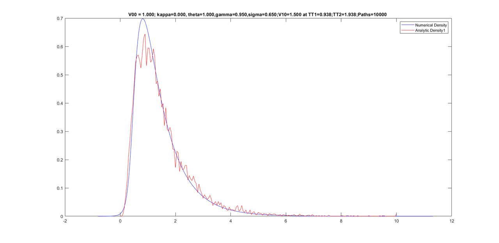](https://postimg.cc/NKQr1dDf)

DataMoments =

   1.0e+05 *

  Columns 1 through 3

   0.000014950555075   0.000033041281232   0.000106468714867

  Columns 4 through 6

   0.000492354720197   0.003145266273971   0.025879984492126

  Columns 7 through 8

   0.253136048083220   2.759160915454327

cMoments =

   1.0e+04 *

  Columns 1 through 3

   0.000141683854457   0.000282494000629   0.000768746924324

  Columns 4 through 6

   0.002735942608976   0.012157189302663   0.064717356655297

  Columns 7 through 8

   0.399051248362580   2.774943184900114

------------------------------------------------------------------------------------------------------------------------------

Graph02

[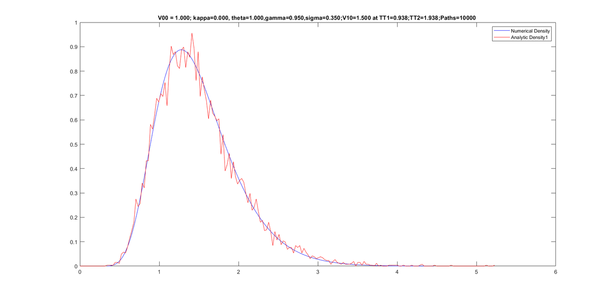](https://postimg.cc/jCZjpR42)

DataMoments =

   1.0e+02 *

  Columns 1 through 3

   0.014982576870428   0.025169434340133   0.047346215662351

  Columns 4 through 6

   0.099644337143297   0.234506541174142   0.616702466402061

  Columns 7 through 8

   1.808259420920021   5.880518334034137

cMoments =

   1.0e+02 *

  Columns 1 through 3

   0.014905742378688   0.024670475837403   0.045114848790249

  Columns 4 through 6

   0.090613348622917   0.198526666185207   0.470908309388449

  Columns 7 through 8

   1.199879030867060   3.258531016535626

----------------------------------------------------------------------------------------------------------------------------------------

Graph3

[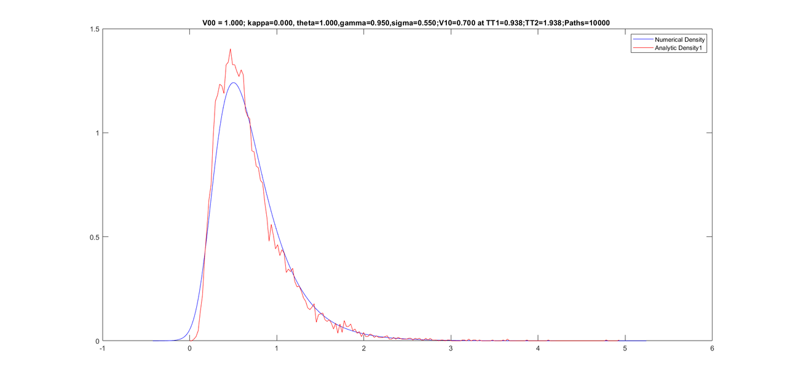](https://postimg.cc/06TSJPHW)

DataMoments =

   1.0e+02 *

  Columns 1 through 3

   0.006981742904554   0.006601365266553   0.008385257981777

  Columns 4 through 6

   0.014203616746419   0.031550037252391   0.088537871719951

  Columns 7 through 8

   0.297257824687865   1.130157508002522

cMoments =

  Columns 1 through 3

   0.709893964339818   0.675552624148450   0.826592963931650

  Columns 4 through 6

   1.273231001915238   2.420576926371608   5.561563218465855

  Columns 7 through 8

  15.107188027976001  47.476108226951922

---------------------------------------------------------------------------------------------------------------------------------------

Graph04

[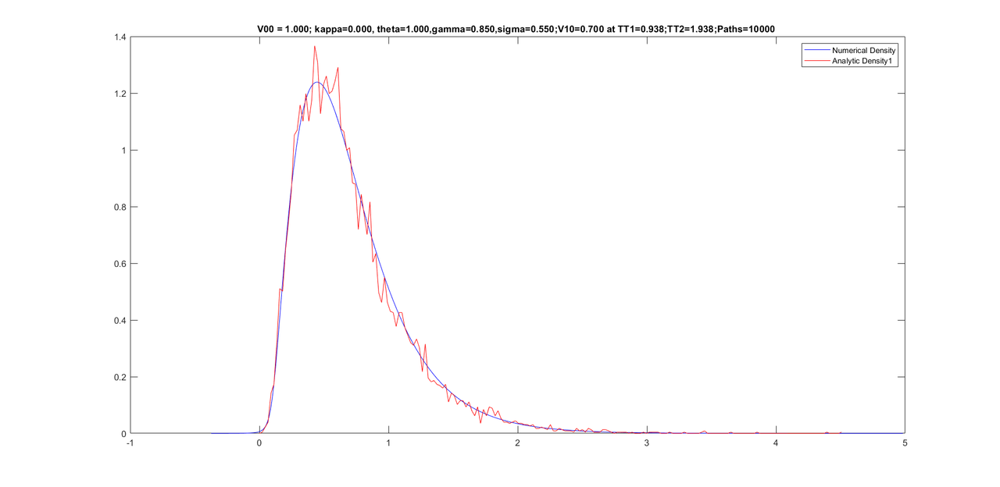](https://postimg.cc/6yZpyCNQ)

DataMoments =

  Columns 1 through 3

   0.698118943462296   0.665703933124946   0.837748161439092

  Columns 4 through 6

   1.356194129902356   2.760142173285625   6.869245855092418

  Columns 7 through 8

  20.164445520327444  67.075477717310250

cMoments =

  Columns 1 through 3

   0.703069671647060   0.666425105689879   0.815105289798997

  Columns 4 through 6

   1.244371114280280   2.308476903458226   5.087135075215539

  Columns 7 through 8

  13.051663784775815  38.286490434201646

-----------------------------------------------------------------------------------------------------------------------------

Graph5

[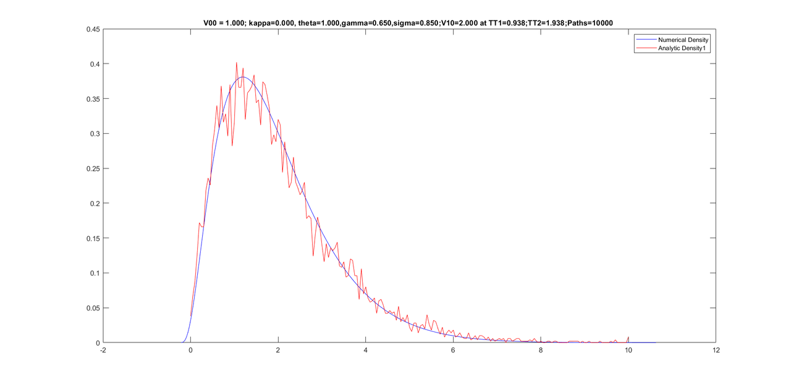](https://postimg.cc/21VR1DWh)

DataMoments =

   1.0e+05 *

  Columns 1 through 3

   0.000019948052391   0.000058011763215   0.000221462820455

  Columns 4 through 6

   0.001052278731224   0.006015336705721   0.040296327860763

  Columns 7 through 8

   0.308593223030771   2.634800987574737

cMoments =

   1.0e+04 *

  Columns 1 through 3

   0.000195735936663   0.000538535865575   0.001882297660129

  Columns 4 through 6

   0.007899091039110   0.038308809736123   0.208826880723545

  Columns 7 through 8

   1.252809721946873   8.136963300633514

---

### #2935 — Amin (Topic Author)
*February 9, 2026, 6:25 PM*

Friends, I had a phone meeting with the psychiatrist today a bit later than 5:00 PM. Doctor increased my medication on
the insistence of my family from two mg Risp to three mg Risp tablets everyday. Doctor was suggesting a decrease in the
time between injections to 5 weeks but kept the time between injections to six weeks when I requested him to not
decrease the time between injections. It would be a bit tough to work on my research with high medications even though I
am very committed to do that.

One of the arguments my sister had was that I was not making any money. She would say that if my research were so good,
why I was not making any money. So I have decided to approach my connections in financial industry to get some
consulting work  (right after completion of the current conditional density research) and hopefully when I talk to the
doctor again after on month, the things would be better.

---

### #2936 — Amin (Topic Author)
*February 10, 2026, 12:22 PM*

**(broken latex: Unbalanced $: 1)**

```latex
.

.

.

.

```
function []= ConditionalDensityHermitesBivariateSequential()

%SV SDE is
%dV(t)=mu1 V(t)^beta1 dt+ mu2 V(t)^beta2 dt + sigma0 V(t)^gamma dZ(t)
%In mean reverting SDEs we ususally have
%mu1= kappaV * thetaV
%beta1=0
%mu2=-kappa
%beta2=0
%The present program works only when drift is zero (for pure noises)
%meaning mu1=0 and mu2=0;

Order=7;
%NDim=4;%Three assets and one SV.
NMomentsY=Order+1;
NMomentsX=Order+1;

%%%%%%%%%%%%%%%%%%%5
%%%%%%%%%%%%%%%%%%%5

V0=1.00;%.32;
V00=V0;
thetaV=1.0;%.045;%1;%.04;
kappaV=0.000;%1.5;%1.5;
mu1=kappaV*thetaV;
mu2=-kappaV;
beta1=0;
beta2=1;
%gamma=.5;%.950;
%sigma0=.55;%.45;%
gamma=.65;%.75
sigma0=.85;%.35
dt=.03125/2;
Tt=64*2;
T=Tt*dt;

seed0=52130649;
%seed0=94210876;
rng(seed0, 'twister')
paths=10000;
V(1:paths,1)=V0;
%
% %%%%%%%%%%%%%%%%%%%%%%%%%%%%%%%%%%%%%%%%%%%%%%%%%%%%%%%%%%%%%%%%%%%%%%%%%%%%%%%%%%%%5
 TT1=60; %Transition distribution start
 TT2=124; %Transition distribution end

Random2(1:paths/2,1)=0;

for tt=1:Tt

    Random2(1:paths/2)=randn(paths/2,1);
    Random2(paths/2+1:paths)=-Random2(1:paths/2);

    V(1:paths,1)=V(1:paths,1)+ ...
        (mu1.*V(1:paths,1).^beta1 + mu2.*V(1:paths,1).^beta2)*dt + ...
        sigma0*V(1:paths,1).^gamma .*Random2(1:paths,1)*sqrt(dt) + ...
        (mu1.*beta1*V(1:paths,1).^(beta1-1) + mu2.*beta2.*V(1:paths,1).^(beta2-1)).* ...
        ((mu1.*V(1:paths,1).^beta1 + mu2.*V(1:paths,1).^beta2)*dt^2/2 + ...
        sigma0*V(1:paths,1).^gamma .*Random2(1:paths,1)*(1-1/sqrt(3))*dt^1.5) + ...
        .5*(mu1.*beta1.*(beta1-1).*V(1:paths,1).^(beta1-2) + mu2.*beta2.*(beta2-1).*V(1:paths,1).^(beta2-2)).* ...
        sigma0^2.*V(1:paths,1).^(2*gamma).*dt^2/2 + ...
        sigma0*gamma*V(1:paths,1).^(gamma-1) .* ...
        ((mu1.*V(1:paths,1).^beta1 + mu2.*V(1:paths,1).^beta2).*Random2(1:paths,1).*1/sqrt(3)*dt^1.5 + ...
        sigma0.*V(1:paths,1).^gamma .*(Random2(1:paths,1).^2-1)*dt/2) + ...
        .5*sigma0*gamma*(gamma-1).*V(1:paths,1).^(gamma-2) .* ...
        sigma0^2.*V(1:paths,1).^(2*gamma) .*Random2(1:paths,1).*1/sqrt(3)*dt^1.5;

    V(V<0)=.00001;

    if(tt==TT1)
        Xin(1:paths,1)=V(1:paths,1);
    end

    if(tt==TT2)
        Yin(1:paths,1)=V(1:paths,1);
    end
end

str=input("I have reached stone 1");

%%%%%%%%%%%%%%%%%%%%%%%%%%%%%%%%%%%%%%%%%%%%%%%%%%5

Order=7;
clf;
%CalculateHermiteCorrelations02(Xin,Yin,paths);
[HCorr2,YPowersH,XPowersH,Zy,Zx] = CalculateHermiteCorrelations02(Xin,Yin,paths);

HH=Order;
[HnZx] = EvalHermiteArrayH0(Zx,HH);

for pp=1:paths
 Yxi(pp)=YPowersH(1,1);

  for nn=2:Order+1
     Yxi(pp)=Yxi(pp)+YPowersH(nn,1).*HCorr2(nn-1).*HnZx(pp,nn);
  end

  YYxi(pp)=Yin(pp)-Yxi(pp);

 end

%
 [HCorr3,YxiPowersH,XPowersH,Zyxi,Zx] = CalculateHermiteCorrelations02(Xin,YYxi,paths);

 str=input("I have reached stone 2")
% %%%%%%%%%%%%%%%%%%%%%%%%%%%%%%%%%%%%%%%%%%%%%%%%%%%%%%%%%%%%%%%%%%%%%%%%%%%%%%55
% save("C:\Users\Lenovo\Documents\MATLAB\MATLAB1\pqfileA.mat","HCorr2","YPowersH","XPowersH");
%
% str=input("Variables have been saved");
% %load("C:\Users\Lenovo\Documents\MATLAB\MATLAB1\pqfileA.mat","HCorr2","YPowersH","XPowersH");
% %%%%%%%%%%%%%%%%%%%%%%%%%%%%%%%%%%%%%%%%%%%%%%%%%%%%%%%%%%%%%%%%%%%%%%%%%%%%%5
% %In this block, we do conditional Monte Carlo of SDE which is the true
% %numerical 1D conditional density of Y conditional on X having a given
% %value. This value of X on which we are conditionin is defined by V10 below.
% %We can alter V10 below and it will take out a 1D slice from the 2D density
% %of Y conditional on X  taking a specific value (here V10).

V10=2.0;
%[XCoeffZ(1:Order+1)] = ConvertHermiteSeriesToZSeries01(XPowersH(1:Order+1,1),Order);
%V10=XCoeffZ(1);
V(1:paths)=V10;
Random2(1:paths,1)=0;

for tt=TT1+1:TT2

    Random2(1:paths/2)=randn(paths/2,1);
    Random2(paths/2+1:paths)=-Random2(1:paths/2);

    V(1:paths,1)=V(1:paths,1)+ ...
        (mu1.*V(1:paths,1).^beta1 + mu2.*V(1:paths,1).^beta2)*dt + ...
        sigma0*V(1:paths,1).^gamma .*Random2(1:paths,1)*sqrt(dt) + ...
        (mu1.*beta1*V(1:paths,1).^(beta1-1) + mu2.*beta2.*V(1:paths,1).^(beta2-1)).* ...
        ((mu1.*V(1:paths,1).^beta1 + mu2.*V(1:paths,1).^beta2)*dt^2/2 + ...
        sigma0*V(1:paths,1).^gamma .*Random2(1:paths,1)*(1-1/sqrt(3))*dt^1.5) + ...
        .5*(mu1.*beta1.*(beta1-1).*V(1:paths,1).^(beta1-2) + mu2.*beta2.*(beta2-1).*V(1:paths,1).^(beta2-2)).* ...
        sigma0^2.*V(1:paths,1).^(2*gamma).*dt^2/2 + ...
        sigma0*gamma*V(1:paths,1).^(gamma-1) .* ...
        ((mu1.*V(1:paths,1).^beta1 + mu2.*V(1:paths,1).^beta2).*Random2(1:paths,1).*1/sqrt(3)*dt^1.5 + ...
        sigma0.*V(1:paths,1).^gamma .*(Random2(1:paths,1).^2-1)*dt/2) + ...
        .5*sigma0*gamma*(gamma-1).*V(1:paths,1).^(gamma-2) .* ...
        sigma0^2.*V(1:paths,1).^(2*gamma) .*Random2(1:paths,1).*1/sqrt(3)*dt^1.5;

    V(V<0)=.00001;

end

%Below

NoOfBins=200;
MaxCutOff=10;

[XDensity,IndexOut,IndexMax] = MakeDensityFromSimulation_Infiniti_NEW(V,paths,NoOfBins,MaxCutOff );

for qq=1:8

    DataMoments(qq)=sum(V(:).^qq)/paths;

end

%%%%%%%%%%%%%%%%%%%%%%%%%%%%%%%%%%%%%%%%%%%%%%%%%%%%%%%%%%%%%%%%%%%%%%%%%%%%%%%%%%%%%%%5

%Below, we calculate the value of Zx0 corresponding to X0 (here V10). This
%comes from inverting the Z-series of X so that X=V10;

xOrder=Order;
yOrder=Order;
XCoeffH(1:Order+1)=XPowersH(1:Order+1,1);

[Zxc] = CalculateZgivenXAndHSeriesCoeffs(V10,XCoeffH,xOrder);

HH=Order;
[HnZxc] = EvalHermiteArrayH0(Zxc,HH);

Yxc=YPowersH(1,1);

for nn=2:Order+1
    %Yxi(pp)=Yxi(pp)+YPowersH(nn,1).*HCorr2(nn-1).*HnZx(pp,nn);
    Yxc=Yxc+YPowersH(nn,1).*HCorr2(nn-1).*HnZxc(1,nn);
end

YxcFirst=Yxc;

YCoeffH(1:Order+1)=YPowersH(1:Order+1,1);

YxCoeffH(1)=YCoeffH(1);

for nn=2:Order+1
    %Yxi(pp)=Yxi(pp)+YPowersH(nn,1).*HCorr2(nn-1).*HnZx(pp,nn);
    YxCoeffH(nn)=YPowersH(nn,1).*HCorr2(nn-1);
end

%CalculateConditionaMoments(Yxc,Zxc,YCoeffH,YxCoeffH,Order)
[EMu,TMu] = CalculateConditionalMoments(Yxc,Zxc,YCoeffH,YxCoeffH,Order)

str=input("I am here at stone 3");

%%%%%%%%%%%%%%%%%%%%%%%%%%%%%%%%%%%%%%%%%%%%%%%%%%%%%%%%%%%%%%%%%%%%%%%5
% %%%%%%%%%%%%%%%%%%%%%%%%%%%%%%%%%%%%%%%%%%%%%%%%%%%%%%%%%%%%%%%%%%%%%%%%%%%%%%5

[YxCoeffZ(1:Order+1)] = ConvertHermiteSeriesToZSeries01(YxCoeffH(1:Order+1),Order);

[c0,c,FittedMoments] = CalculateZSeriesDensityFromRawMoments02FromGuess02NoData(EMu(1:8));%,YxCoeffZ(2:8));
 YCoeffz(1)=c0;
 YCoeffz(2:Order+1)=c(1:Order);

 YCoeffz

 [YCoeffh(1:Order+1)] = ConvertZSeriesToHermiteSeriesNew(YCoeffz(1:Order+1),Order);

 Order=7;

 NMoments=8;
 [YCoeffz(1:Order+1)] = ConvertHermiteSeriesToZSeries01(YCoeffh(1:Order+1),Order);
 cMoments=CalculateMomentsOfZSeries(YCoeffz(1),YCoeffz(2:Order+1),Order,NMoments);

 YxiPowersH
 [YxiCoeffz(1:8)] = ConvertZSeriesToHermiteSeriesNew(YxiPowersH(1:8,1),7);
 YxiMoments=CalculateMomentsOfZSeries(YxiCoeffz(1),YxiCoeffz(2:8),7,NMoments);

 DataMoments

 cMoments

 YxcFirst

 YxiMoments(1:8)

 str=input("Look at comparison of moments");

 YCoeffh

 YxCoeffH

 str=input("Look at coeffs of Hermite-Series");

clf;

PlotHermiteSeriesDensityAndRvGraph(YCoeffh(1),YCoeffh(2:Order+1),'b')

hold on

plot(IndexOut(1:IndexMax),XDensity(1:IndexMax),'r');

%hold on
%PlotHermiteSeriesDensityAndRvGraph(YCoeffh(1),YCoeffh1(2:yOrder+1),'g')
title(sprintf('V00 = %.3f; kappa=%.3f, theta=%.3f,gamma=%.3f,sigma=%.3f;V10=%.3f at TT1=%.3f;TT2=%.3f;Paths=%d ',V00,
kappaV, thetaV,gamma,sigma0, V10,(TT1*dt),(TT2*dt),paths));%,sprintf('theta= %f', theta), sprintf('kappa = %f',
kappa),sprintf('sigma = %f', sigma0),sprintf('T = %f', T));
legend({'Analytic Density','Numerical Density'}, ...
    'Location','northeast')

str=input("This is the first version without altering the moments of conditional density")

%[YMoments0]=CalculateMomentsOfZSeries(YCoeffz(1),YCoeffz(2:6),5,6)

end
```

.

.

.

```
function [HCorr2,YPowersH,XPowersH,Zy,Zx] = CalculateHermiteCorrelations02(Xin,Yin,NData)

Order=7;
NMoments=8;

[ZI] = MomentMatchedStandardNormalDiscretizedDensity(NData);

[XCoeffH,Zx] = CalculateHermiteSeriesFromData01(Xin,Order,ZI);
[XCoeffZ(1:Order+1)] = ConvertHermiteSeriesToZSeries01(XCoeffH(1:Order+1),Order);

 for pp=1:Order+1
     XrMu(pp)=sum(Xin(1:NData).^pp)/NData;
 end

 %[SecondMomentX] = CalculateSecondMomentC7(XCoeffZ(1),XCoeffZ(2:Order+1));

 [MomentsX] = CalculateMomentsOfZSeries(XCoeffZ(1),XCoeffZ(2:Order+1),Order,NMoments);

XCoeffZs=XCoeffZ/sqrt(MomentsX(2)-MomentsX(1).^2);

 [c0,c] = CalculateZSeriesDensityFromRawMoments02FromGuess02(Xin,ZI);%,XCoeffZ(2:Order+1));
 XCoeffZ(1)=c0;
 XCoeffZ(2:Order+1)=c(1:Order);

 [XCoeffH(1:Order+1)] = ConvertZSeriesToHermiteSeriesNew(XCoeffZ(1:Order+1),Order);
XPowersH(1:Order+1,1)=XCoeffH(1:Order+1);
for nn=1:NData

  %[Zx(nn)]=CalculateZgivenXAndZSeriesBisection2C5Improved(Xin(nn),XCoeffZ(1),XCoeffZ(2:6));
end
[Zx] = CalculateZgivenXAndHSeriesCoeffs(Xin,XCoeffH,Order);

 XPowersZ(1:Order+1,1)=XCoeffZ(1:Order+1);
% %[cc,EX] =SeriesProduct1D(aa,bb,SeriesOrder1,SeriesOrder2)
% [XPowersZ(1:Order*2+1,2),EX2]=SeriesProduct1D(XPowersZ(1:Order+1,1),XPowersZ(1:Order+1,1),Order+1,Order+1);
% [XPowersZ(1:Order*3+1,3),EX3]=SeriesProduct1D(XPowersZ(1:Order+1,1),XPowersZ(1:2*Order+1,2),Order+1,2*Order+1);
% [XPowersZ(1:Order*4+1,4),EX4]=SeriesProduct1D(XPowersZ(1:Order+1,1),XPowersZ(1:3*Order+1,3),Order+1,3*Order+1);
% [XPowersZ(1:Order*5+1,5),EX5]=SeriesProduct1D(XPowersZ(1:Order+1,1),XPowersZ(1:4*Order+1,4),Order+1,4*Order+1);
% [XPowersZ(1:Order*6+1,6),EX6]=SeriesProduct1D(XPowersZ(1:Order+1,1),XPowersZ(1:5*Order+1,5),Order+1,5*Order+1);
% [XPowersZ(1:Order*7+1,7),EX7]=SeriesProduct1D(XPowersZ(1:Order+1,1),XPowersZ(1:6*Order+1,6),Order+1,6*Order+1);
% [XPowersZ(1:Order*8+1,8),EX8]=SeriesProduct1D(XPowersZ(1:Order+1,1),XPowersZ(1:7*Order+1,7),Order+1,7*Order+1);

for nn=2:Order+1
[XPowersZ(1:Order*nn+1,nn),EXn(nn)]=SeriesProduct1D(XPowersZ(1:Order+1,1),XPowersZ(1:Order*(nn-1)+1,nn-1),Order+1,(nn-1)*Order+1);
XPowersH(1:Order*nn+1,nn)=ConvertZSeriesToHermiteSeriesNew(XPowersZ(1:Order*nn+1,nn),Order*nn);
end

XrMu
EXn

XPowersH(1,1:Order+1)

str=input("Look at moments of X----1")

% %%%%%%%%%%%%%%%%%%%%%%%%%%%%%%%%%%%%%%%%%%%%%%%%%%%%%%%%%%%%%%%%%%%%%%%%55

Order=7;

[YCoeffH,Zy] = CalculateHermiteSeriesFromData01(Yin,Order,ZI);
[YCoeffZ(1:Order+1)] = ConvertHermiteSeriesToZSeries01(YCoeffH(1:Order+1),Order);

for qq=1:Order+1
     YrMu(qq)=sum(Yin(1:NData).^qq)/NData;
end

[MomentsY] = CalculateMomentsOfZSeries(YCoeffZ(1),YCoeffZ(2:Order+1),Order,NMoments);

YCoeffZs=YCoeffZ/sqrt(MomentsY(2)-MomentsY(1).^2);

 [c0,c] = CalculateZSeriesDensityFromRawMoments02FromGuess02(Yin,ZI);%,YCoeffZ(2:Order+1));
 YCoeffZ(1)=c0;
 YCoeffZ(2:Order+1)=c(1:Order);

for nn=1:NData
  %[Zy(nn)]=CalculateZgivenXAndZSeriesBisection2C5Improved(Yin(nn),YCoeffZ(1),YCoeffZ(2:6));
end

YPowersZ(1:Order+1,1)=YCoeffZ(1:Order+1);
[YCoeffH(1:Order+1)] = ConvertZSeriesToHermiteSeriesNew(YCoeffZ(1:Order+1),Order);

[Zy] = CalculateZgivenXAndHSeriesCoeffs(Yin,YCoeffH,Order);

YPowersH(1:Order+1,1)=YCoeffH(1:Order+1);
for nn=2:Order+1
[YPowersZ(1:Order*nn+1,nn),EYn(nn)]=SeriesProduct1D(YPowersZ(1:Order+1,1),YPowersZ(1:Order*(nn-1)+1,nn-1),Order+1,(nn-1)*Order+1);
YPowersH(1:Order*nn+1,nn)=ConvertZSeriesToHermiteSeriesNew(YPowersZ(1:Order*nn+1,nn),Order*nn);

end

YrMu
EYn

% mm=0;
% for nn=1:NData
%     if((abs(Zx(nn))1)
% ExistingCorr(1:(pp-1)*Order)=HCorr3(1:(pp-1)*Order);
% else
% ExistingCorr=0;
% end
% %[HCorr3] =
CalculateHCorrIterative(YPowersH(1:Order+1,1),XPowersH,EXYin,ExistingCorr,NewCorr,LenECorr,LenNCorr,Order);
% %[HCorr3] =
CalculateHCorrIterative02(YPowersH(1:pp*Order+1,pp),XPowersH,EXYin,ExistingCorr,NewCorr,LenECorr,LenNCorr,Order,pp);
% [HCorr3] = CalculateHCorrIterative04(YPowersH,XPowersH,EXY1in,EXY2in,ExistingCorr,NewCorr,LenECorr,LenNCorr,Order,pp);
%
% for mm=1:Order
% %EXY1(mm)=YPowersH(1,2)*XPowersH(1,mm);
% EXY2(mm)=YPowersH(1,pp)*XPowersH(1,mm);
% EXY3(mm)=YPowersH(1,pp)*XPowersH(1,mm);
% EXY0(mm)=YPowersH(1,pp).*XPowersH(1,mm);
% EXY00(mm)=YPowersH(1,pp).*XPowersH(1,mm);
% EXY000(mm)=YPowersH(1,pp).*XPowersH(1,mm);
% for nn=1:Order*pp
%  %EXY1(mm)=EXY1(mm)+YPowersH(nn+1,1).*XPowersH(nn+1,mm).*factorial(nn)*HCorr1(nn);
%  EXY2(mm)=EXY2(mm)+YPowersH(nn+1,pp).*XPowersH(nn+1,mm).*factorial(nn)*HCorr2(nn);
%  EXY3(mm)=EXY3(mm)+YPowersH(nn+1,pp).*XPowersH(nn+1,mm).*factorial(nn)*HCorr3(nn);
% end
% for nn=1:Order
%  %EXY1(mm)=EXY1(mm)+YPowersH(nn+1,1).*XPowersH(nn+1,mm).*factorial(nn)*HCorr1(nn);
%  EXY00(mm)=EXY00(mm)+YPowersH(nn+1,pp).*XPowersH(nn+1,mm).*factorial(nn)*HCorr3(nn);
% end
%
% if(pp<2)
%     pp2=1;
% else
%     pp2=2;
% end
% for nn=1:Order*pp2
%  %EXY1(mm)=EXY1(mm)+YPowersH(nn+1,1).*XPowersH(nn+1,mm).*factorial(nn)*HCorr1(nn);
%  EXY000(mm)=EXY000(mm)+YPowersH(nn+1,pp).*XPowersH(nn+1,mm).*factorial(nn)*HCorr3(nn);
% end
% end
%
% HCorr2
% HCorr3
%
% EXY1in
%
% EXY2
% EXY3
% EXY0
% EXY00
% EXY000
%
% HCorr3
% %YPowersH
% %XPowersH
% pp
%
% str=input("Look at comparison of moments data")
% end
%
% HCorr3(pp*Order+1:pp*Order+Order)=HCorr2(pp*Order+1:pp*Order+Order);
%
% %HCorr3=HCorr2;

%%%%%%%%%%%%%%%%%%%%%%%%%%%%%%%%%%%%%%%%%%%%%%%%%%%%%%%%%%%%%%%%%%%%%%%%%%%

% %
% Order=7;
%
% for pp=1:Order+1
%
% for qq=1:Order
% EXYin(pp,qq)=sum(Yin(1:NData).^pp.*Xin(1:NData).^qq)/NData;
% end
% end
%
%
%
% %[HCorr3] =
CalculateHCorrIterative04(YPowersH,XPowersH,EXY1in,EXY2in,ExistingCorr,NewCorr,LenECorr,LenNCorr,Order,pp);
% [HCorr3] = CalculateHCorrIterative08(YPowersH,XPowersH,EXYin,HCorr2,Order);
%
%
% for pp1=1:(Order+1)
%     for qq1=1:Order
%         if(pp1<=qq1)
%             NN1=pp1;
%         else
%             NN1=qq1;
%         end
%         EXY1(pp1,qq1)=YPowersH(1,pp1)*XPowersH(1,qq1);
%         for nn1=1:NN1*Order
%             EXY1(pp1,qq1)=EXY1(pp1,qq1)+YPowersH(nn1+1,pp1)*XPowersH(nn1+1,qq1).*factorial(nn1)*HCorr3(nn1);
%         end
%     end
% end
%
% HCorr2
% HCorr3
%
% EXYin
%
% EXY1
%
%
%
% str=input("Look at comparison of moments data")
end

```

.

.

.

.

```
function [ZnNew] = MomentMatchedStandardNormalDiscretizedDensity(Ndata)

[ZnNew] = StandardNormalIdealDesity02(Ndata,1);

if((Ndata=30))
    MOrder=6;

alpha(1) =1.002706567896411;
alpha(3)=-0.001341612601616;
alpha(5)=0.000431803496557;

elseif((Ndata>=250)&&(Ndata=2000)&&(Ndata=50000)&&(Ndata=150000)&&(Ndata=250000))
    MOrder=12;

    alpha(1) =1.000899195470733;
    alpha(3)=-0.000414380757501;
  alpha(5)=0.000161271457889;
  alpha(7)=0.000037987998807;
  alpha(9)=0;%.000016308099635;
  alpha(11)=0.;%000002045556572;                   0
  alpha(13)=0;%.000000157715037;
end

%[ZnNew,alpha,Moment] = MatchMomentParametersOfIdealZhalfNew01(ZnNew,MOrder);

% alpha(1)=0.998665620502348;
% alpha(3)=0.000729818387735;
% alpha(5)=0.000026530286747;
% alpha(7)=0.000021718051556;
% alpha(9)=0.000008734265559;
% alpha(11)=-0.000000362716896;                  0
% alpha(13)=-0.000000010818264;

[ZnNew,alpha] = NewtonRootSearchForMatchingMomentsOfGaussianVariates01(ZnNew,alpha,MOrder);

% alpha
%
% str=input("Look at alpha");

end

```

.

.

.

.

```
function [ZZ] = StandardNormalIdealDesity02(Ndata,Sigma)
%Ndata is number of data points in sample, for which we want to find the
%coefficients of the Z-series.
%Sigma=1+.06;
%Sigma=1;
if (rem(Ndata,2)==0)
    NnMid=Ndata/2;
    NnMid
    ZZ(NnMid+1)=norminv(.5+1/Ndata*.5,0,Sigma);
    ZZ(NnMid)=norminv(.5-1/Ndata*.5,0,Sigma);
    for nn=2:NnMid-1
        ZZ(nn+NnMid)=norminv(.5+(nn-.5)*1/Ndata,0,Sigma);
        ZZ(-nn+1+NnMid)=norminv(.5-(nn-.5)*1/Ndata,0,Sigma);
    end
    %A=normcdf((Ndata-1)/Ndata);
    %ZZ(Ndata)=exp(-5*A^2)/(1/Ndata);
    A=norminv((Ndata-1)/Ndata);
    ZZ(Ndata)=A +0.398942 *exp(-.5*A^2)/sqrt(1/Ndata)/sqrt(.5);
    ZZ(1)=-A-0.398942 *exp(-.5*A^2)/sqrt(1/Ndata)/sqrt(.5);
end

if (rem(Ndata,2)==1)
    NnMid=(Ndata+1)/2;
    ZZ(NnMid)=0;
    for nn=1:NnMid-2
        ZZ(nn+NnMid)=norminv(.5+(nn)*1/Ndata,0,Sigma);
        ZZ(-nn+NnMid)=norminv(.5-(nn)*1/Ndata,0,Sigma);
    end
   A=norminv((Ndata-1)/Ndata);
    ZZ(Ndata)=A +0.398942 *exp(-.5*A^2)/sqrt(1/Ndata)/sqrt(.5);
    ZZ(1)=-A-0.398942 *exp(-.5*A^2)/sqrt(1/Ndata)/sqrt(.5);
end

%ZZ
%A
%plot(ZZ)
%str=input("Look at density plot standard")

end

```

.

.

.

```
function [ZnNew,alpha] = NewtonRootSearchForMatchingMomentsOfGaussianVariates01(Zn,alpha,MOrder)

Ndata=length(Zn);

 %MOrder=12;
 HOrder=MOrder-2;

 EZ(1)=0;
EZ(2)=1;
for nn=3:MOrder
    if rem(nn,2)==1
        EZ(nn)=0;
    else
        EZ(nn)=EZ(nn-2)*(nn-1);
        %EZ(nn)
    end
end

TMoment(1:MOrder)=EZ(1:MOrder);
 %CalculateMomentsAndDerivativesOfIdealNormalGrid(Zn,alpha,MOrder,HOrder);
 [F,dF] = CalculateMomentsAndDerivativesOfIdealNormalGrid(Zn,alpha,MOrder,HOrder,TMoment);

% F
% dF
% str=input("Look at results");

w(MOrder)=1;
for nn=MOrder-2:-2:2
w(nn)=w(nn+2).*(nn+2)*(nn+1);%*.5;
end
%w(2)=w(2)*1024;
%w(8)=w(8)*2;
%w(10)=w(10)*sqrt(2);
%w
%str=input("Look at weights--12")

[ZnNew] = CalculateZnAfterHermiteSeriesMultiplication(Zn,alpha,MOrder);

for mm=1:MOrder
    Moment(mm)=sum(ZnNew(1:Ndata).^mm)/Ndata;
end

ObjFuncBest=CalculateObjMoment(EZ,Moment,w,MOrder);

ObjFuncBest
%str=input("Look at ObjFuncBest");
%b0Best=c0;
alphaBest(1:HOrder+1)=alpha(1:HOrder+1);

    qq=0;
    for mm=2:2:MOrder
        qq=qq+1;
        da(qq,1)=alpha(mm-1);
    end

nn=0;
while((nn.000000000001) || (abs(F(2,1))>.000000000001) || (abs(F(3,1))>.000000000001)))% ||
(abs(F(4,1))>.00000000001)))%|| (abs(F(5,1))>.00000000001)))%|| (abs(F(6,1))>.00000000001)))%||
(abs(F(7,1))>.00000000001)|| (abs(F(8,1))>.00000000001)  ))

    nn=nn+1;
    %Below Newton matrix equation to improve the Z-series coefficients guess at previous step.
    da=da-dF\F;

    qq=0;
    for mm=2:2:MOrder
        qq=qq+1;
        alpha(mm-1)=da(qq,1);
    end
    %b(1:SeriesOrder)=da(2:SeriesOrder+1,1);

    [ZnNew] = CalculateZnAfterHermiteSeriesMultiplication(Zn,alpha,MOrder);

    for mm=1:MOrder
        Moment(mm)=sum(ZnNew(1:Ndata).^mm)/Ndata;
    end

    ObjFuncNew=CalculateObjMoment(EZ,Moment,w,MOrder);

ObjFuncBest
ObjFuncNew
%str=input("Look at objfunction--11--");

%alpha

%str=input("Look at alpha");

    if(ObjFuncBest>ObjFuncNew)

       ObjFuncBest=ObjFuncNew;
       alphaBest=alpha;
       %bBest(1:SeriesOrder)=b(1:SeriesOrder);
    end

    [F,dF] = CalculateMomentsAndDerivativesOfIdealNormalGrid(Zn,alpha,MOrder,HOrder,TMoment);

    qq=0;
    for mm=2:2:MOrder
        qq=qq+1;
        da(qq,1)=alpha(mm-1);
    end

end
alpha=alphaBest;%Best;

   [ZnNew] = CalculateZnAfterHermiteSeriesMultiplication(Zn,alpha,MOrder);

end
```

.

.

.

```
function [F,dF] = CalculateMomentsAndDerivativesOfIdealNormalGrid(Zn,alpha,MOrder,HOrder,TMoment)

Ndata=length(Zn);

[Hz] = HermitePoly(HOrder);

for nn=1:2:HOrder+1
    ZZ(nn,1:Ndata)=Zn(1:Ndata).^(nn-1);
end

HermiteSeries(1:Ndata)=alpha(1);
HermiteZ(1:Ndata,1:HOrder)=0;
for nn=2:2:HOrder
    %Ndata
    %nn
    HermiteZ(1:Ndata)=0;
    for mm=1:2:(nn+1)
        %HermiteZ(nn,:)=HermiteZ(nn,:)+Hz(nn+1,mm).*ZZ(mm,:);
        HermiteZ(1:Ndata)=HermiteZ(1:Ndata)+Hz(nn+1,mm).*ZZ(mm,1:Ndata);
    end
    HermiteSeries(1:Ndata)=HermiteSeries(1:Ndata)+ alpha(nn+1).*HermiteZ(1:Ndata);
end

ZnNew(1:Ndata)=Zn(1:Ndata).*HermiteSeries(1:Ndata);

for mm=1:MOrder
    Moment(mm)=sum(ZnNew(1:Ndata).^mm)/Ndata;
    for nn=2:2:HOrder
        HermiteZ(1:Ndata)=0;
        for kk=1:2:(nn+1)
            HermiteZ(1:Ndata)=HermiteZ(1:Ndata)+Hz(nn+1,kk).*ZZ(kk,1:Ndata);
        end
        dG(mm,nn)=sum(Zn(1:Ndata).^(mm).*mm.*HermiteSeries(1:Ndata).^(mm-1).*HermiteZ(1:Ndata))/Ndata;

    end

    dG0(mm)=sum(Zn(1:Ndata).^(mm).*mm.*HermiteSeries(1:Ndata).^(mm-1))/Ndata;

    G(mm,1)=Moment(mm)-TMoment(mm);
end

%dG0

%str=input("Look at dG0");
QQ=round(MOrder/2);
qq=0;
for nn=2:2:MOrder
qq=qq+1;
F(qq,1)=G(nn,1);
dF(qq,1)=dG0(nn);
dF(qq,2:QQ)=dG(nn,2:2:(2+(QQ-2)*2));
end

% F(1,1)=G(2,1);
% F(2,1)=G(4,1);
% F(3,1)=G(6,1);
% F(4,1)=G(8,1);
% F(5,1)=G(10,1);
% F(6,1)=G(12,1);
%
% dF(1,1)=dG0(2);
% dF(2,1)=dG0(4);
% dF(3,1)=dG0(6);
% dF(4,1)=dG0(8);
% dF(5,1)=dG0(10);
% dF(6,1)=dG0(12);
%
% dF(1,2)=dG(2,2);
% dF(2,2)=dG(4,2);
% dF(3,2)=dG(6,2);
% dF(4,2)=dG(8,2);
% dF(5,2)=dG(10,2);
% dF(6,2)=dG(12,2);
%
% dF(1,3)=dG(2,4);
% dF(2,3)=dG(4,4);
% dF(3,3)=dG(6,4);
% dF(4,3)=dG(8,4);
% dF(5,3)=dG(10,4);
% dF(6,3)=dG(12,4);
%
% dF(1,4)=dG(2,6);
% dF(2,4)=dG(4,6);
% dF(3,4)=dG(6,6);
% dF(4,4)=dG(8,6);
% dF(5,4)=dG(10,6);
% dF(6,4)=dG(12,6);
%
% dF(1,5)=dG(2,8);
% dF(2,5)=dG(4,8);
% dF(3,5)=dG(6,8);
% dF(4,5)=dG(8,8);
% dF(5,5)=dG(10,8);
% dF(6,5)=dG(12,8);
%
% dF(1,6)=dG(2,10);
% dF(2,6)=dG(4,10);
% dF(3,6)=dG(6,10);
% dF(4,6)=dG(8,10);
% dF(5,6)=dG(10,10);
% dF(6,6)=dG(12,10);
%Moment

%dMoment

% F
% dF
% dG
% Moment
%
% str=input("Look at moments and F");

end

```

.

.

.

.

```
function [Hz] = HermitePoly(Order)
Hz(1:Order+1,1:Order+1)=0.0;
Hz(1,1)=1.0;
for k=1:Order
    for m=1:k
       Hz(k+1,m+1)=Hz(k,m);
       if (m>1)
            Hz(k+1,m-1)=Hz(k+1,m-1)-(m-1)*Hz(k,m);
       end
    end
end

end

```

.

.

.

.

```
function [ZnNew] = CalculateZnAfterHermiteSeriesMultiplication(Zn,alpha,MOrder)

HOrder=MOrder-2;

Ndata=length(Zn);

[Hz] = HermitePoly(HOrder);

for nn=1:2:HOrder+1
    ZZ(nn,1:Ndata)=Zn(1:Ndata).^(nn-1);
end

HermiteSeries(1:Ndata)=alpha(1);
HermiteZ(1:Ndata,1:HOrder)=0;
for nn=2:2:HOrder
    Ndata;
    nn;
    HermiteZ(1:Ndata)=0;
    for mm=1:2:(nn+1)
        %HermiteZ(nn,:)=HermiteZ(nn,:)+Hz(nn+1,mm).*ZZ(mm,:);
        HermiteZ(1:Ndata)=HermiteZ(1:Ndata)+Hz(nn+1,mm).*ZZ(mm,1:Ndata);
    end
    HermiteSeries(1:Ndata)=HermiteSeries(1:Ndata)+ alpha(nn+1).*HermiteZ(1:Ndata);
end

ZnNew(1:Ndata)=Zn(1:Ndata).*HermiteSeries(1:Ndata);

% Moment2=sum(ZnNew(1:Ndata).^2)*1/Ndata
% Moment4=sum(ZnNew(1:Ndata).^4)*1/Ndata
% Moment6=sum(ZnNew(1:Ndata).^6)*1/Ndata
% Moment8=sum(ZnNew(1:Ndata).^8)*1/Ndata
% Moment10=sum(ZnNew(1:Ndata).^10)*1/Ndata
% Moment12=sum(ZnNew(1:Ndata).^12)*1/Ndata
% Moment14=sum(ZnNew(1:Ndata).^14)*1/Ndata

plot((1:Ndata),Zn(1:Ndata),'g',(1:Ndata),ZnNew(1:Ndata),'r')

end

```

.

.

.

.

```
function [ObjMomentOut] = CalculateObjMoment(Moment0,Moment,w,MOrder)

ObjMomentOut=0;
for nn=1:MOrder
    ObjMomentOut=ObjMomentOut+(Moment(nn)-Moment0(nn)).^2.*w(nn);
end

end

```

.

.

.

.

```
function [Coeff,Zy] = CalculateHermiteSeriesFromData01(Yin,Order,ZI)

Ndata=length(Yin);

%Hz=HermitePoly(Order);
MeanYin=sum(Yin(1:Ndata))/Ndata;
Ym(1:Ndata)=Yin(1:Ndata)-MeanYin;
YmVar=sum(Ym(1:Ndata).^2)/Ndata;
Y(1:Ndata)=Ym(1:Ndata)/sqrt(YmVar);

 %[Zn] = StandardNormalIdealDesity02(Ndata,1);
% %[ZI] = CalculateZI(Zn);
%
%
% ZI1=Zn;
%Below W is the design matrix for least squares regression i.e the matrix
%that contains all the hermite polynomials calculated at ideal normal
%density grid of size Ndata.
[W] = EvalHermiteArrayH0(ZI,Order);
%[W1] = EvalHermiteArrayH0(ZI1,Order);

for nn=1:Ndata
    for hh=1:Order+1
W(nn,hh)=W(nn,hh);%sqrt(normpdf(ZI(1,1:Ndata)));
    end
end

%We first sort the data so that we can assign one appropriate Z-grid
%point(and associated hermite polynomials calculated at that grid point)
%to each data element. This ideal normal density Z-grid is
%constructed so that its size is equal to data observations count. We
%suppose that first derivative of random variables with repsect to Z
%does not switch sign meaning that increasing values of data
%observations have to aligned with increasing values of ideal normal
%density grid.
[Ys,I]=sort(Y(1:Ndata));
%In the line below, the data sort is reversed so that now the ideal
%normal density grid elements assigned to various observations of random
%variable face it on data observations index. For details, Please look
%on interent the definition of matlab sort command with role of "I"
%in output and how it alters the index.

%%Zs1(I(1:Ndata))=ZI(1:Ndata);

%Below the values to be regressed facing the design matrix are assigned
Ymu(1:Ndata,1)=Ys(1:Ndata);

%Below, implement least squares regression.
WW=(W'*W);

coeff=(WW)$W'*Ymu);

%str=input("Look at variances of hermite polynomials inside function")

%Store in coefficietns array of all random varaibles
Coeff(1:Order+1)= coeff(1:Order+1,1);
%Store the associated Z in Z-array of all coefficients.
Zy(I(1:Ndata))=W(1:Ndata,2);

Coeff(1:Order+1)=Coeff(1:Order+1).*sqrt(YmVar);
Coeff(1)=Coeff(1)+MeanYin;

end

```

.

.

.

.

```
function [c] = ConvertHermiteSeriesToZSeries01(ch,Order)

c(1:Order+1)=0;
[Hz] = HermitePoly(Order);
for nn=1:Order+1
    for mm=1:Order+1
        c(mm)=c(mm)+ch(nn).*Hz(nn,mm);
    end
end

end

```

.

.

.

.

```
function [Moments] = CalculateMomentsOfZSeries(a0,a,SeriesOrder,NMoments)

%aa0=a0;
%a0=0;% ---1

EZ(1)=0;
EZ(2)=1;
%LogEZ(2)=0;
for nn=3:NMoments*SeriesOrder
    if rem(nn,2)==1
        EZ(nn)=0;
    else
        EZ(nn)=EZ(nn-2)*(nn-1);
        %LogEZ(nn)=log(EZ(nn-2))+log(nn-1);
        %EZ(nn);
    end
end
%EZ
%EZ(1:30)
%str=input('Look at numbers')
a(SeriesOrder+1:SeriesOrder*NMoments+1)=0;
b0=a0;
b=a;

for mm=1:NMoments
    if(mm>1)
        %[b0,b] =SeriesProductLogarithmic(a0,a,b0,b,SeriesOrder*mm);

        [b0,b] =SeriesProduct(a0,a,b0,b,SeriesOrder*mm);

        %b0-bb0

        %b-bb

        %str=input('Look at two products')

        b(SeriesOrder*mm+1:SeriesOrder*NMoments+1)=0;
    end
   % Logb=log(abs(b));
   % Signb=sign(b);
    EXZ(mm,1)=b0;
    for pp2=1:SeriesOrder*mm
        if rem(pp2,2)==0
            %EXZ(mm,1)=EXZ(mm,1)+exp(Logb(pp2)+LogEZ(pp2)).*Signb(pp2);
            EXZ(mm,1)=EXZ(mm,1)+b(pp2).*EZ(pp2);
 %           b(pp2).*EZ(pp2)
 %           exp(Logb(pp2)+LogEZ(pp2)).*Signb(pp2)
 %           mm
 %           pp2
            %str=input('Look at moment values')
        end
    end
end

for nn=1:NMoments
    Moments(nn)=EXZ(nn,1);
end

end

```

.

.

.

.

```
function [c0,c,FittedMoments] = CalculateZSeriesDensityFromRawMoments02FromGuess02(Xin,ZI)
%The above function takes data as input.
%And returns Z-series Coeffs upto 7th power of Z as
%Y=c0+c(1)*Z+c(2)*Z^2+c(3)*Z^3+c(4)*Z^4+c(5)*Z^5+c(6)*Z^6+c(7)*Z^7
%Fitted Moments are raw moments of the Z-series density and usually are exactly
%the same as input raw moments rMu(1:8).i.e  FittedMoments(1:8)==rMu(1:8)
%with high precision.

Ndata=length(Xin);

%%%%%%%%%%%%%%%%%%%%%%%%%%%%%%%%%%%%%%%%%%%%%%%%%%%%%%%%%%%%%%%%%%%%%%%%%%%%%%5

for mm=1:8
    rMu(mm)=sum(Xin(:).^mm)/Ndata;
end

for nn=1:Ndata
    Xs(nn)=(Xin(nn)-rMu(1))./sqrt(rMu(2)-rMu(1).^2);
end

for mm=1:8
    sMu1(mm)=sum(Xs(:).^mm)/Ndata;
end

%%%%%%%%%%%%%%%%%%%%%%%%%%%%%%%%%%%%%%%%%%%%%%%%%%%%%%%%%%%%%%%%%%%%%%%%%%%%%%5
SeriesOrder=7;    %Z-series till 7th power. hardcoded here cannot chagne.
mOrder=8;         %Number of raw moments in calibration. hardcoded here cannot chagne.
Order=7;
NMoments=mOrder;
                  %Find central Moments from raw moments
[Mu1,cMu] = ConvertRawMomentsToCentralMoments(rMu,mOrder);
                  %Find standardized Moments from central moments
sMu(1)=0;
sMu(2)=1;
sMu(3)=cMu(3)/cMu(2).^1.5;
sMu(4)=cMu(4)/cMu(2).^2.0;
sMu(5)=cMu(5)/cMu(2).^2.5;
sMu(6)=cMu(6)/cMu(2).^3.0;
sMu(7)=cMu(7)/cMu(2).^3.5;
sMu(8)=cMu(8)/cMu(2).^4.0;

%sMu
%sMu1

%str=input("Look at comparison of standardized moments:");

[cGuess,Zx] = CalculateHermiteSeriesFromData01(Xs,Order,ZI);

wm(1:Order+1)=1;
for mm=Order+1:-1:2
    wm(mm-1)=wm(mm)*(mm+1).^2;
end

MaxIter=750;

[cGuess,ObjBest] = ZSeries1DCoeffsIterativeForGuess(cGuess,sMu,Order,MaxIter,wm);

%iter=5;           %Number of iterations in the calibration.
                  %Please experiment and play around.
bGuess(1:7)=cGuess(2:8);    %We have assigned initial values of coefficients

c0=-(bGuess(2)+3*bGuess(4)+15*bGuess(6));
c(1:7)=bGuess(1:7);

[IsValidFlag] = CheckIsValidDensity(c0,c);

[Moments] = CalculateMomentsOfZSeries(c0,c,SeriesOrder,NMoments);

ObjBest=0.0;
for nn1=1:Order+1
    ObjBest=ObjBest+(sMu(nn1)-Moments(nn1)).^2.*wm(nn1);
end

bGuess0Best=c0;
    bGuessBest=bGuess;

Iterations=20;

SuccessFlag=0;
FailCount=0;
for iterA=1:Iterations

    SuccessFlag=0;

    iter=3;
[bGuess0,bGuess(1:7),ObjNew] = PreSmoothingGuessAdvancedFromGuessBestNew(sMu,bGuess,iter,wm);

[IsValidFlag] = CheckIsValidDensity(bGuess0,bGuess);

if((ObjNew=3)
Random(1:7)=0;

Random=randn(size(Random));

bGuess(2:7)=bGuessBest(2:7)-bGuessBest(2:7).*.0002.*(Random(2:7)).*sqrt(2:7);
bGuess0=-(bGuess(2)+3*bGuess(4)+15*bGuess(6));

[SecondMoment] = CalculateSecondMomentC7(bGuess0,bGuess);
bGuess=bGuess/sqrt(SecondMoment);

end

else
  FailCount=0;

end

end

c0=-(bGuessBest(2)+3*bGuessBest(4)+15*bGuessBest(6));
[SecondMoment] = CalculateSecondMomentC7(c0,bGuessBest);
bGuessBest=bGuessBest/sqrt(SecondMoment);
c(1:7)=bGuessBest(1:7);

c0
c
%str=input("Look at pre-smoothing Guess result")
%%%%%%%%%%%%%%%%%%%%%%%%%%%%%%%%%%%%%%%%%%%%%%%%%%%%%%%%%%%%%%%%%%%%%%%%%%%%%

%%%%%%%%%%%%%%%%%%%%%%%%%%%%%%%%%%%%%%%%%%%%%%%%%%%%%%%%%%%%%%%%%%%%%%
%Comment this block if you do not want multidimensional Newton pass
%Even though preSmoothing guess is very close to optimal, slight
%inaccuracies can change the shape of probabioity density so this
%Multidimensional Newton is usually required.

[F,dF] = CalculateMomentsAndDerivatives_0(sMu,c0,c,SeriesOrder,SeriesOrder,NMoments);

da(1,1)=c0;
da(2:SeriesOrder+1,1)=c(1:SeriesOrder);

[Moments] = CalculateMomentsOfZSeries(c0,c,SeriesOrder,NMoments);

ObjBest=0.0;
for nn1=1:Order+1
    ObjBest=ObjBest+(sMu(nn1)-Moments(nn1)).^2.*wm(nn1);
end

b0Best=c0;
bBest(1:SeriesOrder)=c(1:SeriesOrder);

nn=0;
SuccessFlag=0;
FailCount=0;

while((nn.000000000001) || (abs(F(2,1))>.000000000001) || (abs(F(3,1))>.000000000001) || (abs(F(4,1))>.00000000001)||
(abs(F(5,1))>.00000000001)|| (abs(F(6,1))>.00000000001)|| (abs(F(7,1))>.00000000001)|| (abs(F(8,1))>.00000000001)  ))
SuccessFlag=0;
    nn=nn+1;

    if(nnObjNew) &&( IsValidFlag))

       ObjBest=ObjNew;
       b0Best=b0;
       bBest(1:SeriesOrder)=b(1:SeriesOrder);
       SuccessFlag=1;
    end

    if(SuccessFlag==0)
        FailCount=FailCount+1;
    else
        FailCount=0;
    end

    if(FailCount>=3)
        Random(1:7)=0;

        Random=randn(size(Random));

        b(1:7)=bBest(1:7)+bBest(1:7).*.0002.*(Random(1:7)).*sqrt(1:7);
        b0=-(b(2)+3*b(4)+15*b(6));

        [SecondMoment] = CalculateSecondMomentC7(b0,b);
        b=b/sqrt(SecondMoment);
        %b0=-(b(2)+3*b(4)+15*b(6));
    end

    da(1,1)=b0;
    da(2:SeriesOrder+1,1)=b(1:SeriesOrder);

end
c0=b0Best;%Best;
c(1:SeriesOrder)=bBest;%Best(1:SeriesOrder);

%Multidimensional Newton root search ends. Comment till here if you like to
%exclude this
%%%%%%%%%%%%%%%%%%%%%%%%%%%%%%%%%%%%%%%%%%%%%%%%%%%%%%%%%%%%%%%%%%%%%%%%%%%%%%%%%%%%%%%%%%%%%%%%%%%%%

c0
c

%str=input("Look at standardized output coefficients");

%%%%%%%%%%%%%%%%%%%%%%%%%%%%%%%%%%%%%%%%%%%%%%%%%%%%%%%%%%%%%%%%%

%Make sure you do not comment the lines below

c0=c0*sqrt(cMu(2)); %convert from standardized to central moments
c=c*sqrt(cMu(2));   %convert from standardized to central moments

c0=c0+Mu1;          %convert from central to raw moments by adding mean.

[FittedMoments] = CalculateMomentsOfZSeries(c0,c,SeriesOrder,NMoments);
%%%%%%%%%%%%%%%%%%%%%%%%%%%%%%%%%%%%%%%%%%%%%%%%%%%%%%%%%%%%%%%%%%%%%%%%%%%%%%%%%%%%%%%%%%%%%%
%Please Uncomment this if you want to see a comparison of input moments and
%fitted moments
rMu
FittedMoments
str=input('Look at comparison of fitted moments with input moments: Warning: Large Mismatch implies that many results
would be off');
%%%%%%%%%%%%%%%%%%%%%%%%%%%%%%%%%%%%%%%%%%%%%%%%%%%%%%%%%%%%%%%%%%%%%%%%%%%%%%%%%%%%%%%%%%%%%5
%COMMENT lines below if you do not want to see the density of new Z-series random variable with
%fitted moments.
%First calculate normal random variable on a grid below
dNn=.1/2;   % Normal density subdivisions width. would change with number of subdivisions
Nn=45*4;  % No of normal density subdivisions
NnMid=((1+Nn)/2)*dNn;
Z(1:Nn)=(((1:Nn)*dNn)-NnMid);
%Z
%str=input('Look at Z');
%Now calculate Y as a function of normal random variable.
Y(1:Nn)=c0;
for nn=1:7
    Y(1:Nn)=Y(1:Nn)+c(nn)*Z(1:Nn).^nn;
end

%Now take change of densities derivative of Y with respect to normal
DfY(1:Nn)=0;
for nn=2:Nn-1
    DfY(nn) = (Y(nn + 1) - Y(nn - 1))/(Z(nn + 1) - Z(nn - 1));
    %Change of variable derivative for densities
end
DfY(Nn)=DfY(Nn-1);
DfY(1)=DfY(2);

%Now calculate the density of Y from density of normal random variable
%using change of probability derivative.
pY(1:Nn)=0;
for nn = 1:Nn
    pY(nn) = (normpdf(Z(nn),0, 1))/abs(DfY(nn));
end

plot(Y(1:Nn),pY(1:Nn),'b');
title('Density of the Z-Series Variable with Fitted Moments');

%str=input('Look at the density of Z-series random variable')
%%%%%%%%%%%%%%%%%%%%%%%%%%%%%%%%%%%%%%%%%%%%%%%%%%%%%%%%%%%%%%%%%%%%%%%%%%%%%%%%%%%%%%%%%%%%
end
```

.

.

.

.

```
function [mu1,cMu] = ConvertRawMomentsToCentralMoments(Mu,mOrder)

%cu
%mu
% %mOrder
%str=input('Look at numbers');
mu1=Mu(1);
for mm=2:mOrder
    cMu(mm)=0;
    for jj=0:mm
        if(jj==0)
            cMu(mm)=cMu(mm)+ (-1)^(mm-jj).*factorial(mm)/factorial(jj)/factorial(mm-jj)*1*mu1.^(mm-jj);

        else
            cMu(mm)=cMu(mm)+ (-1)^(mm-jj).*factorial(mm)/factorial(jj)/factorial(mm-jj)*Mu(jj)*mu1.^(mm-jj);

        end
    end
end

```

.

.

.

.

```
function [YCoeffZ,ObjFunc] = ZSeries1DCoeffsIterativeForGuess(YCoeffZ,TargetMoments,Order,MaxIter,w1D)

%Order=5;
SeriesOrder=Order+1;
NMoments=Order+1;
MOrder=Order+1;

for nn=1:SeriesOrder

        DeltaX(nn)=.00125*2/factorial(nn+1);
end
DeltaXMax=DeltaX*10;

% w1D(1:NMoments)=1;
% for nn=NMoments-1:-1:1
%         w1D(nn)=w1D(nn+1)*(nn+1).^0;
% end

%[YCoeffZ(1:Order+1)] = ConvertHermiteSeriesToZSeries01(YCoeffH(1:Order+1),Order);
[FittedMoments] = CalculateMomentsOfZSeries(YCoeffZ(1),YCoeffZ(2:Order+1),SeriesOrder,NMoments);

[ObjFuncBest] = CalculateObjMoment(TargetMoments,FittedMoments,w1D,MOrder);

ObjFunc1=0;
ObjFunc2=0;

ObjFuncBest
str=input("Look objFuncBest");
%cBest=c;

ImproveFlag(1:SeriesOrder)=1;
ImproveFlagPrev(1:SeriesOrder)=0;
ImproveCount(1:SeriesOrder)=0;
ContinueFlag=1;
kk=0;
%while ((kk.0001))
while ((ContinueFlag)&&(ObjFuncBest>.0001))
kk=kk+1;
    for nn=3:Order+1%SeriesOrder

            YCoeffZnew=YCoeffZ;
            YCoeffZnew(1)=-(YCoeffZnew(3)+3*YCoeffZnew(5)+15*YCoeffZnew(7));
            %[YCoeffZnew(1:Order+1)] = ConvertHermiteSeriesToZSeries01(YCoeffHnew(1:Order+1),Order);
            [FittedMoments] = CalculateMomentsOfZSeries(YCoeffZnew(1),YCoeffZnew(2:Order+1),SeriesOrder,NMoments);
            YCoeffZnew(:)=YCoeffZnew(:)./sqrt(FittedMoments(2));
            [FittedMoments] = CalculateMomentsOfZSeries(YCoeffZnew(1),YCoeffZnew(2:Order+1),SeriesOrder,NMoments);

            DoCalculations=0;
            if(FittedMoments(nn)0)&&(DValue2>0)&&(DValue3>0)&&(DValue4>0)&&(DValue5>0)&&(DValue6>0);
 %DValue1=1;
 %DValue2=1;
            end
 DFlag1=1;
 DFlag2=1;
                if((DoCalculations)&&(ObjFunc1TargetMoments(nn))
                YCoeffZnew(nn)=YCoeffZnew(nn)-DeltaX(nn);
                DoCalculations=1;
            end
            if(DoCalculations)
            YCoeffZnew(1)=-(YCoeffZnew(3)+3*YCoeffZnew(5)+15*YCoeffZnew(7));
            %[YCoeffZnew(1:Order+1)] = ConvertHermiteSeriesToZSeries01(YCoeffHnew(1:Order+1),Order);
            [FittedMoments] = CalculateMomentsOfZSeries(YCoeffZnew(1),YCoeffZnew(2:Order+1),SeriesOrder,NMoments);
            YCoeffZnew(:)=YCoeffZnew(:)./sqrt(FittedMoments(2));
            [FittedMoments] = CalculateMomentsOfZSeries(YCoeffZnew(1),YCoeffZnew(2:Order+1),SeriesOrder,NMoments);
            [ObjFunc2] = CalculateObjMoment(TargetMoments,FittedMoments,w1D,MOrder);

            end

 DFlag1=1;
 DFlag2=1;
                if((DoCalculations)&&(ObjFunc2DeltaXMax(nn))
           DeltaX(nn)=DeltaXMax(nn);
       end
    end

    ContinueFlag=(ContinueFlag || ImproveFlag(nn));

end

ObjFunc=ObjFuncBest;

end
```

.

.

.

```
function [c0Best,cBest,ObjBest] = PreSmoothingGuessAdvancedFromGuessBestNew(cmu,cin,iter,wm)

%Mul=1.0;
SeriesOrder=7;
Order=7;
NMoments=8;

 EZ(1)=0;
 EZ(2)=1;
 for nn=3:NMoments*SeriesOrder+SeriesOrder+2
     if rem(nn,2)==1
         EZ(nn)=0;
     else
         EZ(nn)=EZ(nn-2)*(nn-1);
         EZ(nn);
     end
 end

c0=-(cin(2)+3*cin(4)+15*cin(6));  %This is for zero mean condition.
c=cin;

Moments=CalculateMomentsOfZSeries(c0,c,SeriesOrder,NMoments);

ObjBest=0.0;
for nn1=1:Order+1
    ObjBest=ObjBest+(cmu(nn1)-Moments(nn1)).^2.*wm(nn1);
end
c0Best=c0;
cBest(1:SeriesOrder)=c(1:SeriesOrder);

MaxIter=10;

for nn=1:iter     %increase the iterations over coefficients if neeeded

%%%%%%%%%%%%%%%%%%%%%%%%%%%%%%%%%%%%%%%%%%%%%%%%%%%%%%%%%

[M3,dc2] = CalculateParticularMomentAndDerivativeOfItsCoeff(c0,c,SeriesOrder,3,EZ);

%tolerance=.0000001*cmu(3);
tolerance=.001*cmu(3)/nn;
mm=0;
while ((abs(M3-cmu(3)) >tolerance ) && (mmtolerance ) && (mmtolerance ) && (mmtolerance ) && (mmtolerance ) &&
(mmtolerance ) && (mmObjNew)
    ObjBest=ObjNew;
    cBest=c;
    c0Best=c0;
end

end

end

```

.

.

.

```
function [EnMoment,dEnMomentdCoeff] = CalculateParticularMomentAndDerivativeOfItsCoeff(a0,a,SeriesOrder,nMoment,EZ)

% if(SeriesOrder>=8)
% a0=-(a(2)+3*a(4)+15*a(6)+105*a(8));% ---1
% end
% if(SeriesOrder<8)
% a0=-(a(2)+3*a(4)+15*a(6));% ---1
% end
%
% EZ(1)=0;
% EZ(2)=1;
% for nn=3:NMoments*SeriesOrder+NZterms+2
%     if rem(nn,2)==1
%         EZ(nn)=0;
%     else
%         EZ(nn)=EZ(nn-2)*(nn-1);
%         EZ(nn);
%     end
% end
% EZ;

%EXZ(1,1)=1;
%for pp1=1:NZterms
%        EXZ(1,pp1+1)=EZ(pp1);
%end

a(SeriesOrder+1:nMoment*SeriesOrder+1+SeriesOrder)=0;
b0=a0;
b=a;

for mm=2:nMoment

    [b0,b] =SeriesProduct(a0,a,b0,b,SeriesOrder*mm+SeriesOrder+1);
     b(SeriesOrder*mm+1:nMoment*SeriesOrder+SeriesOrder+1)=0;
     if(mm==nMoment-1)
         dEnMomentdCoeff=b0.*EZ(nMoment-1);
         for pp2=1:SeriesOrder*nMoment-1

            dEnMomentdCoeff=dEnMomentdCoeff+b(pp2).*EZ(pp2+nMoment-1);
        end
        dEnMomentdCoeff=dEnMomentdCoeff*nMoment;
     end
     if(mm==nMoment)
        EnMoment=b0;
        for pp2=1:SeriesOrder*nMoment
            EnMoment=EnMoment+b(pp2).*EZ(pp2);

        end
     end
end

end

```

.

.
```

---

### #2937 — Amin (Topic Author)
*February 10, 2026, 1:04 PM*

.

.

.

.

```
function [c0,c] = IterateSmoothingGuessOverPreviousMoments(cmu,c,nMoment,iter,EZ)

MaxIter=7;
SeriesOrder=7;
c0=-(c(2)+3*c(4)+15*c(6));
if(nMoment==3)
for nn=1:iter     %increase the iterations over coefficients if neeeded

%%%%%%%%%%%%%%%%%%%%%%%%%%%%%%%%%%%%%%%%%%%%%%%%%%%%%%%%%

c0=-(c(2)+3*c(4)+15*c(6));

[SecondMoment] = CalculateSecondMomentC7(c0,c);

c=c/sqrt(SecondMoment);
c0=c0/sqrt(SecondMoment);

[M3,dc2] = CalculateParticularMomentAndDerivativeOfItsCoeff(c0,c,SeriesOrder,3,EZ);

tolerance=.001*cmu(3);
mm=0;
while ((abs(M3-cmu(3)) >tolerance ) && (mmtolerance ) && (mmtolerance ) && (mmtolerance ) && (mmtolerance ) &&
(mmtolerance ) && (mmtolerance ) && (mmtolerance ) && (mmtolerance ) && (mmtolerance ) && (mmtolerance ) && (mmtolerance
) && (mmtolerance ) && (mmtolerance ) && (mmtolerance ) && (mmtolerance ) && (mmtolerance ) && (mmtolerance ) &&
(mmtolerance ) && (mmtolerance ) && (mmtolerance ) && (mm<MaxIter))
mm=mm+1;

c(7)=c(7)-(M8-cmu(8))/dc7;
[M8,dc7] = CalculateParticularMomentAndDerivativeOfItsCoeff(c0,c,SeriesOrder,8,EZ);

end

[SecondMoment] = CalculateSecondMomentC7(c0,c);

c=c/sqrt(SecondMoment);
c0=c0/sqrt(SecondMoment);

%%%%%%%%%%%%%%%%%%%%%%%%%%%%%%%%

end

end

end

```

.

.

.

```
function [F,dF] = CalculateMomentsAndDerivatives_0(Ms,a0,a,SeriesOrder,NZterms,NMoments)
%[F,dF] = CalculateCumulantsAndDerivativesFromMoments(C,a0,a,SeriesOrder,SeriesOrder,NoOfCumulants);

%a(1)=a1;
%a(2)=a2;
%a(3)=a3;
%a(4)=a4;
%a(5)=a5;
%a(6)=a6;
%a(7)=a7;

%aa0=a0;
if(NMoments>8)
a0=-(a(2)+3*a(4)+15*a(6)+105*a(8));% ---1
end
if((NMoments==7)||(NMoments==8))
a0=-(a(2)+3*a(4)+15*a(6));% ---1
end
% if(NMoments==6)
% a0=-(a(2)+3*a(4));% ---1
% end

if((NMoments==6)||(NMoments==7))
a0=-(a(2)+3*a(4));% ---1
end

if((NMoments==3)||(NMoments==4))
a0=-(a(2));% ---1
end

EZ(1)=0;
EZ(2)=1;
for nn=3:NMoments*SeriesOrder+NZterms+2
    if rem(nn,2)==1
        EZ(nn)=0;
    else
        EZ(nn)=EZ(nn-2)*(nn-1);
        EZ(nn);
    end
end
EZ;

EXZ(1,1)=1;
for pp1=1:NZterms
        EXZ(1,pp1+1)=EZ(pp1);
end

a(SeriesOrder+1:NMoments*SeriesOrder+1)=0;
b0=a0;
b=a;

for mm=1:NMoments
    if(mm>1)
        [b0,b] =SeriesProduct(a0,a,b0,b,SeriesOrder*mm);
        b(SeriesOrder*mm+1:NMoments*SeriesOrder+1)=0;
    end
   % b0
   % b
%str=input('Look at numbers')
    EXZ(mm+1,1)=b0;
    for pp2=1:SeriesOrder*mm

            EXZ(mm+1,1)=EXZ(mm+1,1)+b(pp2).*EZ(pp2);
    end
    for pp1=1:NZterms
        EXZ(mm+1,pp1+1)=b0.*EZ(pp1);
        for pp2=1:SeriesOrder*mm

            EXZ(mm+1,pp1+1)=EXZ(mm+1,pp1+1)+b(pp2).*EZ(pp2+pp1);
        end
    end
end

%u1=EXZ(2,1);
u2=EXZ(3,1);

if(NMoments>=3)
u3=EXZ(4,1);
end

%NMoments
if(NMoments>=4)
u4=EXZ(5,1);
end

u1=a0+a(2);
if(SeriesOrder>=4)
u1=a0+a(2)+3*a(4);
end
if(SeriesOrder>=6)
u1=u1+15*a(6);
end
if(SeriesOrder>=8)
u1=u1+105*a(8);
end

%k2=u2-u1^2;
%k3=u3-3*u2*u1+2*u1^3;
%k4=u4-4*u3*u1-3*u2^2+12*u2*u1^2-6*u1^4;

du1(1)=1;%----2
% du1(2)=0;%----2
% du1(3)=1;%----2
% du1(4)=0;%----2
% du1(5)=1;%----2
% du1(6)=0;%----2
% du1(7)=15;%----2
% du1(8)=0;%----2
% du1(9)=105;%----2
% du1(10)=0;%----2
 du2(1)=2*EXZ(2,1);

 if(NMoments>=3)

 du3(1)=3*EXZ(3,1);

 end

 if(NMoments>=4)
 du4(1)=4*EXZ(4,1);
 end

%du1(1)=1;%----2
%du2(1)=0;
%du3(1)=0;
%du4(1)=0;

for mm=2:SeriesOrder+1
du1(mm)=EXZ(1,mm);
du2(mm)=2*EXZ(2,mm);
if(NMoments>=3)

du3(mm)=3*EXZ(3,mm);
end
if(NMoments>=4)

du4(mm)=4*EXZ(4,mm);
end
end

if(NMoments>=5)
u5=EXZ(6,1);

%du5(1)=5*EXZ(5,1);

for mm=1:SeriesOrder+1
du5(mm)=5*EXZ(5,mm);
end

end

if(NMoments>=6)
u6=EXZ(7,1);
%du6(1)=0;

for mm=1:SeriesOrder+1
du6(mm)=6*EXZ(6,mm);
end

end

if(NMoments>=7)
u7=EXZ(8,1);
%str=input('Look at k7 and k71')

%du7(1)=0;

for mm=1:SeriesOrder+1
du7(mm)=7*EXZ(7,mm);
end

end
if(NMoments>=8)

u8=EXZ(9,1);
for mm=1:SeriesOrder+1
du8(mm)=8*EXZ(8,mm);
end

end

if(NMoments>=9)

u9=EXZ(10,1);
for mm=1:SeriesOrder+1
du9(mm)=9*EXZ(9,mm);
end

end
if(NMoments>=10)

u10=EXZ(11,1);
for mm=1:SeriesOrder+1
du10(mm)=10*EXZ(10,mm);
end

end

 F(1,1)=u1-Ms(1);
 F(2,1)=u2-Ms(2);
 F(3,1)=u3-Ms(3);
 if(NMoments>=4)
 F(4,1)=u4-Ms(4);
 end
 if(NMoments>=5)
 F(5,1)=u5-Ms(5);
 end
 if(NMoments>=6)
 F(6,1)=u6-Ms(6);
 end
 if(NMoments>=7)
 F(7,1)=u7-Ms(7);
 end
 if(NMoments>=8)
 F(8,1)=u8-Ms(8);
 end
 if(NMoments>=9)
 F(9,1)=u9-Ms(9);
 end
 if(NMoments>=10)
 F(10,1)=u10-Ms(10);
 end

      for mm=1:SeriesOrder+1
        dF(1,mm)=du1(mm);
        dF(2,mm)=du2(mm);
        dF(3,mm)=du3(mm);

        if(NMoments>=4)
        dF(4,mm)=du4(mm);
        end

        if(NMoments>=5)
            dF(5,mm)=du5(mm);
        end

        if(NMoments>=6)
        dF(6,mm)=du6(mm);
        end
        if(NMoments>=7)
        dF(7,mm)=du7(mm);
        end
        if(NMoments>=8)
        dF(8,mm)=du8(mm);
        end
        if(NMoments>=9)
        dF(9,mm)=du9(mm);
        end
        if(NMoments>=10)
        dF(10,mm)=du10(mm);
        end

      end

end

```

.

.

.

.

```
function [c0,c,FittedMoments] = CalculateZSeriesDensityFromRawMoments02FromGuess02NoData(rMu)
%The above function takes an array of first eight raw moments as input.
%And returns Z-series Coeffs upto 7th power of Z as
%Y=c0+c(1)*Z+c(2)*Z^2+c(3)*Z^3+c(4)*Z^4+c(5)*Z^5+c(6)*Z^6+c(7)*Z^7
%Fitted Moments are raw moments of the Z-series density and usually are exactly
%the same as input raw moments rMu(1:8).i.e  FittedMoments(1:8)==rMu(1:8)
%with high precision.

%ZSeries1DCoeffsIterativeForGuess

%Ndata=length(Xin);

%%%%%%%%%%%%%%%%%%%%%%%%%%%%%%%%%%%%%%%%%%%%%%%%%%%%%%%%%%%%%%%%%%%%%%%%%%%%%%5
%If you do not have valid moments from a density available, please
%uncomment the following input moments to run the program.

% rMu(1)=0.000012499863483*10^5;
% rMu(2)=0.000021197093700*10^5;
% rMu(3)=0.000050274347857*10^5;
% rMu(4)=0.000171368317209*10^5;
% rMu(5)=0.000856094970826*10^5;
% rMu(6)=0.006320436615909*10^5;
% rMu(7)=0.068698344472325*10^5;
% rMu(8)=1.084082326087001*10^5;

% rMu(1)=0;
% rMu(2)=1;
% rMu(3)=0;
% rMu(4)=105*105;
% rMu(5)=0;
% rMu(6)=(945*11)^2;
% rMu(7)=0;
% rMu(8)=(945*11*13*15).^2;
%

% for mm=1:8
%     rMu(mm)=sum(Xin(:).^mm)/Ndata;
% end
%
% for nn=1:Ndata
%     Xs(nn)=(Xin(nn)-rMu(1))./sqrt(rMu(2)-rMu(1).^2);
% end
%
% for mm=1:8
%     sMu1(mm)=sum(Xs(:).^mm)/Ndata;
% end

%%%%%%%%%%%%%%%%%%%%%%%%%%%%%%%%%%%%%%%%%%%%%%%%%%%%%%%%%%%%%%%%%%%%%%%%%%%%%%5
SeriesOrder=7;    %Z-series till 7th power. hardcoded here cannot chagne.
mOrder=8;         %Number of raw moments in calibration. hardcoded here cannot chagne.
Order=7;
NMoments=mOrder;
                  %Find central Moments from raw moments
[Mu1,cMu] = ConvertRawMomentsToCentralMoments(rMu,mOrder);
                  %Find standardized Moments from central moments
sMu(1)=0;
sMu(2)=1;
sMu(3)=cMu(3)/cMu(2).^1.5;
sMu(4)=cMu(4)/cMu(2).^2.0;
sMu(5)=cMu(5)/cMu(2).^2.5;
sMu(6)=cMu(6)/cMu(2).^3.0;
sMu(7)=cMu(7)/cMu(2).^3.5;
sMu(8)=cMu(8)/cMu(2).^4.0;

sMu

str=input("Look at comparison of standardized moments:");

%[cGuess,Zx] = CalculateHermiteSeriesFromData01(Xs,Order,ZI);

wm(1:Order+1)=1;
for mm=Order+1:-1:2
    wm(mm-1)=wm(mm)*(mm+1).^2;
end

MaxIter=750;
cGuess(1:8)=0.0;
cGuess(2)=1.0;
[cGuess,ObjBest] = ZSeries1DCoeffsIterativeForGuess(cGuess,sMu,Order,MaxIter,wm);

%iter=5;           %Number of iterations in the calibration.
                  %Please experiment and play around.
bGuess(1:7)=cGuess(2:8);    %We have assigned initial values of coefficients

%bGuess(4:7)=bGuess(4:7)/200;
%bGuess(1)=1;      %other than c(1) to zero. We are starting with no prior information.

c0=-(bGuess(2)+3*bGuess(4)+15*bGuess(6));
c(1:7)=bGuess(1:7);

[IsValidFlag] = CheckIsValidDensity(c0,c);

[Moments] = CalculateMomentsOfZSeries(c0,c,SeriesOrder,NMoments);

%wm(1:Order+1)=1;
%for mm=Order+1:-1:2
%    wm(mm-1)=wm(mm)*(mm-1).^2;
%end

ObjBest=0.0;
for nn1=1:Order+1
    ObjBest=ObjBest+(sMu(nn1)-Moments(nn1)).^2.*wm(nn1);
end

bGuess0Best=c0;
    bGuessBest=bGuess;

Iterations=20;

SuccessFlag=0;
FailCount=0;
for iterA=1:Iterations

    SuccessFlag=0;

    iter=3;
[bGuess0,bGuess(1:7),ObjNew] = PreSmoothingGuessAdvancedFromGuessBestNew(sMu,bGuess,iter,wm);

[IsValidFlag] = CheckIsValidDensity(bGuess0,bGuess);

%[Moments] = CalculateMomentsOfZSeries(bGuess0,bGuess,SeriesOrder,NMoments);

%ObjNew=0.0;
%for nn1=1:Order+1
%    ObjNew=ObjNew+(rMu(nn1)-Moments(nn1)).^2.*wm(nn1);
%end

if((ObjNew=3)
Random(1:7)=0;

Random=randn(size(Random));

bGuess(2:7)=bGuessBest(2:7)-bGuessBest(2:7).*.0002.*(Random(2:7)).*sqrt(2:7);
bGuess0=-(bGuess(2)+3*bGuess(4)+15*bGuess(6));

[SecondMoment] = CalculateSecondMomentC7(bGuess0,bGuess);
bGuess=bGuess/sqrt(SecondMoment);

end

else
  FailCount=0;

end

end

c0=-(bGuessBest(2)+3*bGuessBest(4)+15*bGuessBest(6));
[SecondMoment] = CalculateSecondMomentC7(c0,bGuessBest);
bGuessBest=bGuessBest/sqrt(SecondMoment);
c(1:7)=bGuessBest(1:7);

% bGuess(1:7)=c(1:7)
%
% iter=5;
% [c0,c] = PreSmoothingGuessAdvancedFromGuessBestNewModified(sMu,bGuess,iter);
%
% c0
% c
%bGuess(1:7)=c(1:7);
%iter=10;
%[c0,c] = PreSmoothingGuessAdvancedFromGuessBestNewModified(sMu,bGuess,iter);

c0
c
%str=input("Look at pre-smoothing Guess result")
%%%%%%%%%%%%%%%%%%%%%%%%%%%%%%%%%%%%%%%%%%%%%%%%%%%%%%%%%%%%%%%%%%%%%%%%%%%%%

%%%%%%%%%%%%%%%%%%%%%%%%%%%%%%%%%%%%%%%%%%%%%%%%%%%%%%%%%%%%%%%%%%%%%%
%Comment this block if you do not want multidimensional Newton pass
%Even though preSmoothing guess is very close to optimal, slight
%inaccuracies can change the shape of probabioity density so this
%Multidimensional Newton is usually required.

[F,dF] = CalculateMomentsAndDerivatives_0(sMu,c0,c,SeriesOrder,SeriesOrder,NMoments);

da(1,1)=c0;
da(2:SeriesOrder+1,1)=c(1:SeriesOrder);

[Moments] = CalculateMomentsOfZSeries(c0,c,SeriesOrder,NMoments);

ObjBest=0.0;
for nn1=1:Order+1
    ObjBest=ObjBest+(sMu(nn1)-Moments(nn1)).^2.*wm(nn1);
end

%Replace with your own more intelligent objective function if you like.
%ObjBest=100000*(abs(sMu(1)-Moments(1)))+abs(sMu(2)-Moments(2))+abs((sMu(3)-Moments(3))^(1/1.5))+abs((sMu(4)-Moments(4))^(1/2.0))
+ ...
%    abs((sMu(5)-Moments(5))^(1/2.0))+abs((sMu(6)-Moments(6))^(1/2.0))+abs((sMu(7)-Moments(7))^(1/2.0))+ ...
%    abs((sMu(8)-Moments(8))^(1/2.0));

b0Best=c0;
bBest(1:SeriesOrder)=c(1:SeriesOrder);

nn=0;
SuccessFlag=0;
FailCount=0;

while((nn.000000000001) || (abs(F(2,1))>.000000000001) || (abs(F(3,1))>.000000000001) || (abs(F(4,1))>.00000000001)||
(abs(F(5,1))>.00000000001)|| (abs(F(6,1))>.00000000001)|| (abs(F(7,1))>.00000000001)|| (abs(F(8,1))>.00000000001)  ))
SuccessFlag=0;
    nn=nn+1;
    %Below Newton matrix equation to improve the Z-series coefficients guess at previous step.

    if(nnObjNew) &&( IsValidFlag))

       ObjBest=ObjNew;
       b0Best=b0;
       bBest(1:SeriesOrder)=b(1:SeriesOrder);
       SuccessFlag=1;
    end

    if(SuccessFlag==0)
        FailCount=FailCount+1;
    else
        FailCount=0;
    end

    if(FailCount>=3)
        Random(1:7)=0;

        Random=randn(size(Random));

        b(1:7)=bBest(1:7)+bBest(1:7).*.0002.*(Random(1:7)).*sqrt(1:7);
        b0=-(b(2)+3*b(4)+15*b(6));

        [SecondMoment] = CalculateSecondMomentC7(b0,b);
        b=b/sqrt(SecondMoment);

    end

    da(1,1)=b0;
    da(2:SeriesOrder+1,1)=b(1:SeriesOrder);

end
c0=b0Best;%Best;
c(1:SeriesOrder)=bBest;%Best(1:SeriesOrder);

%Above are the best chosen Z-series coefficients based on the objective function.
%But my objective function can be improved.

%Multidimensional Newton root search ends. Comment till here if you like to
%exclude this
%%%%%%%%%%%%%%%%%%%%%%%%%%%%%%%%%%%%%%%%%%%%%%%%%%%%%%%%%%%%%%%%%%%%%%%%%%%%%%%%%%%%%%%%%%%%%%%%%%%%%

c0
c

%str=input("Look at standardized output coefficients");

%%%%%%%%%%%%%%%%%%%%%%%%%%%%%%%%%%%%%%%%%%%%%%%%%%%%%%%%%%%%%%%%%

%Make sure you do not comment the lines below

c0=c0*sqrt(cMu(2)); %convert from standardized to central moments
c=c*sqrt(cMu(2));   %convert from standardized to central moments

c0=c0+Mu1;          %convert from central to raw moments by adding mean.

[FittedMoments] = CalculateMomentsOfZSeries(c0,c,SeriesOrder,NMoments);
%%%%%%%%%%%%%%%%%%%%%%%%%%%%%%%%%%%%%%%%%%%%%%%%%%%%%%%%%%%%%%%%%%%%%%%%%%%%%%%%%%%%%%%%%%%%%%
%Please Uncomment this if you want to see a comparison of input moments and
%fitted moments
rMu
FittedMoments
str=input('Look at comparison of fitted moments with input moments');
%%%%%%%%%%%%%%%%%%%%%%%%%%%%%%%%%%%%%%%%%%%%%%%%%%%%%%%%%%%%%%%%%%%%%%%%%%%%%%%%%%%%%%%%%%%%%5
%COMMENT lines below if you do not want to see the density of new Z-series random variable with
%fitted moments.
%First calculate normal random variable on a grid below
dNn=.1/2;   % Normal density subdivisions width. would change with number of subdivisions
Nn=45*4;  % No of normal density subdivisions
NnMid=((1+Nn)/2)*dNn;
Z(1:Nn)=(((1:Nn)*dNn)-NnMid);
%Z
%str=input('Look at Z');
%Now calculate Y as a function of normal random variable.
Y(1:Nn)=c0;
for nn=1:7
    Y(1:Nn)=Y(1:Nn)+c(nn)*Z(1:Nn).^nn;
end

%Now take change of densities derivative of Y with respect to normal
DfY(1:Nn)=0;
for nn=2:Nn-1
    DfY(nn) = (Y(nn + 1) - Y(nn - 1))/(Z(nn + 1) - Z(nn - 1));
    %Change of variable derivative for densities
end
DfY(Nn)=DfY(Nn-1);
DfY(1)=DfY(2);

%Now calculate the density of Y from density of normal random variable
%using change of probability derivative.
pY(1:Nn)=0;
for nn = 1:Nn
    pY(nn) = (normpdf(Z(nn),0, 1))/abs(DfY(nn));
end

plot(Y(1:Nn),pY(1:Nn),'b');
title('Density of the Z-Series Variable with Fitted Moments');

%str=input('Look at the density of Z-series random variable')
%%%%%%%%%%%%%%%%%%%%%%%%%%%%%%%%%%%%%%%%%%%%%%%%%%%%%%%%%%%%%%%%%%%%%%%%%%%%%%%%%%%%%%%%%%%%
end
.
.
.
.
function [cH] = ConvertZSeriesToHermiteSeriesNew(c,Order)
%Order is order of highest hermite.
b(1:Order+1)=c(1:Order+1);
[Hz] = HermitePoly(Order);
if(b(Order+1)~= 0)
    for nn=Order+1:-1:1
        cH(nn)=b(nn);
        if((nn-1)>0)
            b(1:nn-1)=b(1:nn-1)-cH(nn).*Hz(nn,1:nn-1);
        end
    end
    bH0=cH(1);
    bH(1:Order)=cH(2:Order+1);
end

end
```

.

.

.

```
function [CorrH] = CalculateCorrelationBivariateHermiteCH0(Z1,Z2,paths,HH)

CorrH(1:HH)=0;
CovH(1:HH)=0;
Var1H(1:HH)=0;
Var2H(1:HH)=0;

[X1h] = EvalHermiteArrayH0(Z1,HH);
[X2h] = EvalHermiteArrayH0(Z2,HH);

for hh=1:HH
    CovH(hh)=CovH(hh)+sum(X1h(:,hh+1).*X2h(:,hh+1))/paths;
    Var1H(hh)=Var1H(hh)+sum(X1h(:,hh+1).*X1h(:,hh+1))/paths;
    Var2H(hh)=Var2H(hh)+sum(X2h(:,hh+1).*X2h(:,hh+1))/paths;
    CorrH(hh)=CovH(hh)./sqrt(Var1H(hh))./sqrt(Var2H(hh));
end

% Var1H
% Var2H
%
% str=input("Look at variances of data hermites");

end

```

.

.

.

```
function [EMu,TMu] = CalculateConditionalMoments(Yxc,Zxc,YCoeffH,YxCoeffH,Order)

NMoments=8;

[YCoeffZ(1:Order+1)] = ConvertHermiteSeriesToZSeries01(YCoeffH(1:Order+1),Order);

[Zy0] = CalculateZgivenXAndHSeriesCoeffs(Yxc,YCoeffH,Order);

[TotalYMoments] = CalculateLocalMomentsOfZSeries(YCoeffZ,Zy0,Order,NMoments);

TotalYMoments(1)
Yxc

str=input("Look at the results here:0")

while(TotalYMoments(1)>Yxc)
   Zy0=Zy0-.0025;

[TotalYMoments] = CalculateLocalMomentsOfZSeries(YCoeffZ,Zy0,Order,NMoments);
Zy0
TotalYMoments(1)
Yxc

end

str=input("Look at the results here:TotalMoments:00:Matching the Density Mean to Conditional Mean")

[YxCoeffZ(1:Order+1)] = ConvertHermiteSeriesToZSeries01(YxCoeffH(1:Order+1),Order);

[ExplainedYxMoments] = CalculateLocalMomentsOfZSeries(YxCoeffZ,Zxc,Order,NMoments);

ExplainedYxMoments(1)
Yxc

str=input("Look at the results here Explained Moments:0")

while(ExplainedYxMoments(1)>Yxc)
   Zxc=Zxc-.0025;

[ExplainedYxMoments] = CalculateLocalMomentsOfZSeries(YxCoeffZ,Zxc,Order,NMoments);
Zxc
ExplainedYxMoments(1)
Yxc
end

str=input("Look at the results here:ExplainedMoments:0:Matching the Density Mean to Conditional Mean")

Zxc

Zy0

TotalYMoments

ExplainedYxMoments

TMu=TotalYMoments;

EMu=ExplainedYxMoments;

end

```

.

.

.

.

```
function [cMoments] = CalculateLocalMomentsOfZSeries(YCoeffZ,Zy,Order,NMoments)

Yz=YCoeffZ(1);
for nn=2:Order+1
    Yz=Yz+YCoeffZ(nn).*Zy.^(nn-1);
end

dYdZy(1:Order+1,1:Order)=0.0;

for nn=2:Order+1
        dYdZy(nn-1,1)=(nn-1)*YCoeffZ(nn);
end

for mm=2:Order+1
    for nn=2:Order+1
        dYdZy(nn-1,mm)=(nn-1)*dYdZy(nn,mm-1);
    end
end

dYdZy0(1:Order+1)=0.0;
for mm=1:Order+1
for nn=1:Order+1
    dYdZy0(mm)=dYdZy0(mm)+dYdZy(nn,mm).*Zy.^(nn-1);
end
end

for nn=2:Order+1

cc(nn)=dYdZy0(nn-1)/factorial(nn-1);

end
cc(1)=Yz;
%cc(1)=cc(1)-cc(3)-3*cc(5)-15*cc(7);

cMoments=CalculateMomentsOfZSeries(cc(1),cc(2:Order+1),Order,NMoments);

cc
cMoments

%str=input("Look at cc and CMoments");

end

```

.

.

.

.

```
function [IsValidFlag] = CheckIsValidDensity(cc0,cc)
%Roughly checks if the density is valid. It is not a definitive check but
%just a rough one but mostly works.

Z(1)=2.0;
Z(2)=3.0;
Z(3)=3.9;
Z(4)=4.2;

Z(5)=-2.3;
Z(6)=-2.7;
Z(7)=-3.3;
Z(8)=-3.9;
Z(9)=-4.3;

if(length(cc)==7)
X=cc0 + cc(1) * Z+ cc(2) * Z.^2+ cc(3) * Z.^3+ cc(4) * Z.^4+ cc(5) * Z.^5+ cc(6) * Z.^6+ cc(7) * Z.^7;
end
if(length(cc)==5)
X=cc0 + cc(1) * Z+ cc(2) * Z.^2+ cc(3) * Z.^3+ cc(4) * Z.^4+ cc(5) * Z.^5;
end
IsValidFlag=0;
if ((X(4)>=X(3)) && (X(3)>X(2)) && (X(2)>X(1))&&(X(1)>X(5))&&(X(5)>X(6)) && (X(6)>X(7)) && (X(7)>X(8))&& (X(8)>X(9)))
    IsValidFlag=1;
end

end

```

.

.

.

.

```
function [c0,c] =SeriesProduct(a0,a,b0,b,SeriesOrder)

c0=a0*b0;
c(1:SeriesOrder)=0.0;
for nn=1:SeriesOrder
    c(nn)=c(nn)+a0*b(nn);
    c(nn)=c(nn)+b0*a(nn);
    for kk=1:nn-1
        c(nn)=c(nn)+a(kk)*b(nn-kk);
    end
end

end
```

.

.

.

.

```
function [SecondMoment] = CalculateSecondMomentC7(a0,a)

SecondMoment=a0^2+a(1)^2 +2* a0* a(2) +3*(a(2).^2+2* a(1).* a(3) +2* a0* a(4))+ ...
    15*(a(3).^2 +2 *a(2).* a(4) +2 *a(1).* a(5)+2* a0* a(6))+105*(a(4).^2 +2* a(3).* a(5)+2* a(2).* a(6) +2* a(1).* a(7)
)+ ...
    945*(a(5).^2 +2* a(4).* a(6) +2 *a(3).* a(7) )+(10395)*(a(6).^2+2* a(5).* a(7) )+(135135)*a(7).^2;

end
```

.

.

.

```
function [c0,c] = PreSmoothingGuessAdvancedFromGuessBestNewModified(cmu,cin,iter)

%Mul=1.0;
SeriesOrder=7;
NMoments=8;

 EZ(1)=0;
 EZ(2)=1;
 for nn=3:NMoments*SeriesOrder+SeriesOrder+2
     if rem(nn,2)==1
         EZ(nn)=0;
     else
         EZ(nn)=EZ(nn-2)*(nn-1);
         EZ(nn);
     end
 end

c0=-(cin(2)+3*cin(4)+15*cin(6));  %This is for zero mean condition.
c=cin;

[ObjBest] =CalculateMomentsMatchObjFunction(c0,c,SeriesOrder,NMoments,cmu);
bbest=c;
b0best=c0;
ObjBestBefore=ObjBest;

MaxIter=10;
ImprovementFlag=1;
nn=0;
%for nn=1:iter     %increase the iterations over coefficients if neeeded
while ((nntolerance ) && (mmtolerance ) && (mmtolerance ) && (mmtolerance ) && (mmtolerance ) && (mmtolerance ) &&
(mm<MaxIter))
mm=mm+1;

c(7)=c(7)-(M8-cmu(8))/dc7;
[M8,dc7] = CalculateParticularMomentAndDerivativeOfItsCoeff(c0,c,SeriesOrder,8,EZ);

end

[SecondMoment] = CalculateSecondMomentC7(c0,c);

c=c/sqrt(SecondMoment);
c0=c0/sqrt(SecondMoment);

% [IsValidFlag] = CheckIsValidDensity(c0,c);
%
% [ObjNew] =CalculateMomentsMatchObjFunction(c0,c,SeriesOrder,NMoments,cmu);
% if((ObjNew<ObjBest) && (IsValidFlag))
%     ObjBest=ObjNew;
%     bbest=c;
%     b0best=c0;
% end

[c0,c] = IterateSmoothingGuessOverPreviousMoments(cmu,c,8,2,EZ);

[IsValidFlag] = CheckIsValidDensity(c0,c);

[ObjNew] =CalculateMomentsMatchObjFunction(c0,c,SeriesOrder,NMoments,cmu);
if((ObjNew<ObjBest) && (IsValidFlag))
    ObjBest=ObjNew;
    bbest=c;
    b0best=c0;
end
%%%%%%%%%%%%%%%%%%%%%%%%%%%%%%%%
ImprovementFlag=0;
if(ObjBest<ObjBestBefore)
    ObjBestBefore=ObjBest;
    ImprovementFlag=1;
end

end

c0=b0best;
c=bbest;
end

```

.

.

.

```
function [ObjNew] =CalculateMomentsMatchObjFunction(c0,c,SeriesOrder,NMoments,sMu)
[Moments] = CalculateMomentsOfZSeries(c0,c,SeriesOrder,NMoments);

if(NMoments==8)
if((sMu(3)<.00001) || (sMu(5)<.00001) || (sMu(7)<.00001))  %If Odd standardized input Moments are zero
     ObjNew=((sMu(2)-Moments(2))/sMu(2)).^2+((sMu(3)-Moments(3))).^2+((sMu(4)-Moments(4))/sMu(4)).^2+ ...
    ((sMu(5)-Moments(5))).^2+((sMu(6)-Moments(6))/sMu(6)).^2+((sMu(7)-Moments(7))).^2+ ...
    ((sMu(8)-Moments(8))/sMu(8)).^2;
else
    ObjNew=((sMu(2)-Moments(2))/sMu(2)).^2+((sMu(3)-Moments(3))/sMu(3)).^2+((sMu(4)-Moments(4))/sMu(4)).^2+ ...
    ((sMu(5)-Moments(5))/sMu(5)).^2+((sMu(6)-Moments(6))/sMu(6)).^2+((sMu(7)-Moments(7))/sMu(7)).^2+ ...
    ((sMu(8)-Moments(8))/sMu(8)).^2;
end
end

if(NMoments==6)
if((sMu(3)<.00001) || (sMu(5)<.00001))  %If Odd standardized input Moments are zero
     ObjNew=((sMu(2)-Moments(2))/sMu(2)).^2+((sMu(3)-Moments(3))).^2+((sMu(4)-Moments(4))/sMu(4)).^2+ ...
    ((sMu(5)-Moments(5))).^2+((sMu(6)-Moments(6))/sMu(6)).^2;
else
    ObjNew=((sMu(2)-Moments(2))/sMu(2)).^2+((sMu(3)-Moments(3))/sMu(3)).^2+((sMu(4)-Moments(4))/sMu(4)).^2+ ...
    ((sMu(5)-Moments(5))/sMu(5)).^2+((sMu(6)-Moments(6))/sMu(6)).^2;
end
end

if(NMoments==4)
if((sMu(3)<.00001))  %If Odd standardized input Moments are zero
     ObjNew=((sMu(2)-Moments(2))/sMu(2)).^2+((sMu(3)-Moments(3))).^2+((sMu(4)-Moments(4))/sMu(4)).^2;
else
    ObjNew=((sMu(2)-Moments(2))/sMu(2)).^2+((sMu(3)-Moments(3))/sMu(3)).^2+((sMu(4)-Moments(4))/sMu(4)).^2;
end
end

%sMu
%Moments
%str=input("Look at numbers");
end

```

.

.

.

.

```
function [XDensity,IndexOut,IndexMax] = MakeDensityFromSimulation_Infiniti_NEW(X,Paths,NoOfBins,MaxCutOff )
%Processes monte carlo paths to return a series Xdensity as a function of IndexOut. IndexMax is the maximum value of
index.
%

Xmin=0;
Xmax=0;
for p=1:Paths
if(X(p)>MaxCutOff)
X(p)=MaxCutOff;
end
%if(X(p)real(X(p)))
Xmin=real(X(p));
end
if(XmaxIndexMax)
index=IndexMax;
end

XDensity(index)=XDensity(index)+1.0/Paths/BinSize;

end

IndexOut(1:IndexMax)=Xmin+(0:(IndexMax-1))*BinSize;

end
```

.

.

.

```
function [] = PlotHermiteSeriesDensityAndRvGraph(c0,c,Color)

Index=length(c);

dNn=.1/2;   % Normal density subdivisions width. would change with number of subdivisions
Nn=45*4;  % No of normal density subdivisions
NnMid=((1+Nn)/2)*dNn;
Z(1:Nn)=(((1:Nn)*dNn)-NnMid);
%Z
%str=input('Look at Z');
%Now calculate Y as a function of normal random variable.
[W] = EvalHermiteArrayH0(Z,Index);

Y(1:Nn,1)=c0;
for nn=1:Index
    Y(1:Nn,1)=Y(1:Nn,1)+W(1:Nn,nn+1).*c(nn);
end

%Now take change of densities derivative of Y with respect to normal
DfY(1:Nn)=0;
for nn=2:Nn-1
    DfY(nn) = (Y(nn + 1) - Y(nn - 1))/(Z(nn + 1) - Z(nn - 1));
    %Change of variable derivative for densities
end
DfY(Nn)=DfY(Nn-1);
DfY(1)=DfY(2);

%Now calculate the density of Y from density of normal random variable
%using change of probability derivative.
pY(1:Nn)=0;
for nn = 1:Nn
    pY(nn) = (normpdf(Z(nn),0, 1))/abs(DfY(nn));
end
Y;
%clf;
plot(Y(1:Nn),pY(1:Nn),Color);
%title('Density of the Z-Series Variable with Fitted Moments');
title('Density of the Uniform Variable in terms of Hermite Series');
str=input('Look at density');

%clf;
%plot(Z(1:Nn),Y(1:Nn),Color);
%title('Graph of Z-Series Variable as a function of underlying standard normal');
%str=input('Look at Graph of Z-Series Variable as a function of underlying standard normal');

end

```

.

.

.

```
function [EZ] = EZZ2()

EZ(1)=1;
EZ(2)=0;
EZ(3)=1;
for nn=4:128 %Increase for larger products.
    if rem(nn,2)==0
        EZ(nn)=0;
    else
        EZ(nn)=EZ(nn-2)*(nn-2);
        EZ(nn);
    end
end
% EZ(64)
% EZ(64).*EZ(64)

end

```

.

.

.

```
function [cc,EX] =SeriesProduct1D(aa,bb,SeriesOrder1,SeriesOrder2)

SeriesOrder3=SeriesOrder1+SeriesOrder2-1;

cc(1:SeriesOrder3)=0;

for nn1=1:SeriesOrder3
    if(nn1<=SeriesOrder1)
        nn3=nn1;
    else
        nn3=SeriesOrder1;
    end
    for jj1=1:nn3
        if(nn1-jj1+1 <=SeriesOrder2)
            cc(nn1)=cc(nn1)+aa(jj1).*bb(nn1-jj1+1);
        end

    end
end

[EZ] = EZZ2();

EX=0;
for nn1=1:SeriesOrder3
    EX=EX+cc(nn1).*EZ(nn1);
end

end
```

.

.

.

.

```
function [Wh] = EvalHermiteArrayH0(Z,Order)

%Evaluates first Order-th hermites at the array of Z's. If input array of Z
%has a size of 100 and Order is 4, it will return a 100 X 5 array.

Hz=HermitePoly(Order);

Wh(1:length(Z),1:Order+1)=0;
for nn=1:Order+1
    Wh(:,nn)=0;
    for mm=1:nn
        Wh(:,nn)=Wh(:,nn)+Hz(nn,mm).*Z(:).^(mm-1);
    end
end

end

```

.

.

.

```
function [Xh,dXh] = EvalHermiteSeriesH0(Coeff,Z,Order,Hz)

%Hz=HermitePoly(Order);

%Xh=Coeff(1);
Xh(1:length(Z))=0;
dXh(1:length(Z))=0;
for nn=1:Order+1
    for mm=1:nn
        Xh(:)=Xh(:)+Coeff(nn).*Hz(nn,mm).*Z(:).^(mm-1);
    end
    for mm=1:nn-1
        dXh(:)=dXh(:)+Coeff(nn).*(nn-1)*Hz(nn-1,mm).*Z(:).^(mm-1);
    end
end

end

```

.

.

.

.

```
function [Z]=CalculateZgivenXAndHermiteSeriesBisection(Y,coeff,median,Hz,Order)
%[Z]=CalculateZgivenXAndZSeriesBisection2C5(Y,c0,c);

%This program takes a value of Y as input and returns the corresponding
%value of Z given the parameters of the Z-series.
%It first see if the value of Y is greater than median or smaller than
%median. If the value of Y is greater than median Z has to be greater than
%zero and if the value of Y is smaller than median Z has to be negative.
% Once we know whether Z is greater than Z or smaller than Zero, we divide
% the program into two repeated if loops, one for Z greater than zero and
%one for Z smaller than zero.
%If Z is positive, we have to assign it a valid band of upper and
%lower values between which it can be found.
%This is done sequentially by calculating Y(.5) at Z=.5, if Y is smaller
%than Y(.5), we know that true value of Y will lie between 0 and .5
%so we assign a lower band value Za=0 and upper band value Zb=.5
%If however Y is greater than Y(.5), we know that true Z should be larger
%than .5 and we again evaluate Y(1) at Z=1, If Y is smaller than Y(1),
%we know that true value of Z should be between .5 and 1, and we assign a
%lower band value Za=.5 and upper band value of Zb=1. Through repeated
%elseif we continue until we find an appropriate band value of Z.

%Once we have determined the upper band value of Zb and lower band value of
%Za, We find Zmid=(Za+Zb)/2. We then evaluate Y(Zmid) and if Y  Y(Zmid), we assign the lower band value equal to Zmid as
Za=Zmid. In a
% few iterations, this bisection procedure gets extremely close to true
% value of Z for which Y(Z)=Y
%EvalHermiteSeriesH0(Coeff,Z,Order,Hz)

Z=(Y-coeff(1))/coeff(2);
BracketSize=.5;
if(Y>=median)
    Ztry=.5;
    ZtryBefore=0;
    NotBracketed=1;
    while((NotBracketed)&&(Ztry Ymid)
            Za=Zmid;
        end
    Z=.5*Za+.5*Zb; %This can be taken out of the loop and does not
    %necessarily have to be calculated again and again. Has to be
    %calculated at least once after the loop to determine the true value of
    %Z.

    end

end

if(Y=-8))
        [Ytry,dYtrydZ]= EvalHermiteSeriesH0(coeff,Ztry,Order,Hz);
        if((Y>= Ytry) || (dYtrydZ  Ymid)|| (dYmiddZ<0))
            Za=Zmid;
        elseif(Y<  Ymid)
            Zb=Zmid;
        end
    Z=.5*Za+.5*Zb; %This can be taken out of the loop and does not
    %necessarily have to be calculated again and again. Has to be
    %calculated at least once after the loop to determine the true value of
    %Z.

    end

end

end

```

.

.

.

.

```
function [Z] = CalculateZgivenXAndHSeriesCoeffs(X,Coeff,Order)

%Finds Z given an array of X-values and Coeffs of hermite series.

Z(1:length(X))=0;
Hz=HermitePoly(Order);
median=0;
for nn=1:Order+1
    median=median+Coeff(nn).*Hz(nn,1);
end

for nn=1:length(X)
    Z(nn)=CalculateZgivenXAndHermiteSeriesBisection(X(nn),Coeff,median,Hz,Order);
end

end

```

.

.

.

---

### #2938 — Amin (Topic Author)
*February 10, 2026, 1:33 PM*

Friends, I have mainly improved two things in this program.

1. I tried to improve the Z-series Construction from moments because I realized that on average one out of every five
Z-series was not being properly captured which really affected the final results and all analytics. Please make sure
that Data Moments and the moments of generated Z-series are quite close to each other.

2. When we have a conditional Z-series and want to use it for calculation of conditional moments on the Z-series. We
would have to match the conditional mean from the conditional Z-series and equate it to the density mean of the density
that is obtained after calculation of moments on the Z-series.

We cannot make the conditional mean equal to conditional median of the density as I had suggested.

Once we have Yxc which is conditional mean of Y given X, then we cannot find conditional moments on Zyxc (as I had
earlier suggested). We would have to try various values of Z starting from Zyxc and calculate moments of Yx on the
Z-axis where first moment(mean (as second, fourth and sixth power of Z-series contributes to mean) ) equals the
conditional moment.

There might be some more problems that I might have overlooked so this version is only preliminary and you have to wait
for the final version in a few days.

Here is the output you will see when you run this program (This is the last output from yesterday's graphs. Similalrly
you should retrieve output DataMoments and cMoments given below yesterday's graphs when you use parameters on the title
of yesterday's graphs)

DataMoments =

   1.0e+05 *

  Columns 1 through 3

   0.000019948052391   0.000058011763215   0.000221462820455

  Columns 4 through 6

   0.001052278731224   0.006015336705721   0.040296327860763

  Columns 7 through 8

   0.308593223030771   2.634800987574737

cMoments =

   1.0e+04 *

  Columns 1 through 3

   0.000195735936663   0.000538535865575   0.001882297660129

  Columns 4 through 6

   0.007899091039110   0.038308809736123   0.208826880723545

  Columns 7 through 8

   1.252809721946873   8.136963300633514

YxcFirst =

   1.959267380928625

ans =

   1.0e+04 *

  Columns 1 through 3

   0.000030112266689   0.000136999811444   0.000204677598105

  Columns 4 through 6

   0.000768269750055   0.001947740814553   0.008178539181341

  Columns 7 through 8

   0.004790608225200   1.171961715381426

Look at comparison of moments

YCoeffh =

  Columns 1 through 3

   1.957359366627286   1.201561805102153   0.234026044528957

  Columns 4 through 6

   0.008267806923085  -0.003870886103379  -0.000613369968334

  Columns 7 through 8

  -0.000035630162897   0.000000927079790

YxCoeffH =

  Columns 1 through 3

   0.994552654256750   0.779034647230377   0.192728097616314

  Columns 4 through 6

   0.018246313165238  -0.001411189642757  -0.000385426695961

  Columns 7 through 8

  -0.000041981370800   0.000000927035414

Look at coeffs of Hermite-Series

Look at density

This is the first version without altering the moments of conditional density

[](https://postimg.cc/21VR1DWh)

---

### #2939 — Amin (Topic Author)
*February 10, 2026, 3:43 PM*

Friends, I am totally energy-less, and lethargic with pain all over my body due to effect of recent antipsychotic
injection (which shows its maximum effect in 4-8 days after the injection date). It is extremely difficult to do
anything meaningful with so much pain and listlessness. I just wanted to have a long sleep tonight and went to bed ten
minutes ago but mind control agents continue to give me gas in my room and it is a total torture to breathe in the gas
on top of all the pain in the body due to injection. I feel like getting suffocated but my protests to mind control
agents are of no avail. I, therefore, decided to get out of bed and open my laptop to make a protest on this forum.

Please stress on American defense and American government to stop giving me gas in my room that goes into breathing and
end my mind control.

---

### #2940 — Amin (Topic Author)
*February 11, 2026, 5:39 PM*

Friends, I could not work properly even today because of extreme sedation and accompanying aches all over my body. But
despite zero progress today, I am very optimistic that soon we would solve the problem of finding conditional
expectations of densities of Y given X when joint data of Y and X are given. I will start working properly in a few days
as the effect of antipsychotic injection decreases. Even though we have not finished the complete work, I have very good
ideas about solution of the problem and I am sure that we would be playing with the full solution in a few days.

Here I want to take this opportunity to thank American friends who tried to help me and and ask their friends in
government to press defense against my persecution. Though my persecution never decreased completely and would be very
high sometimes, there was mostly enough decrease in persecution activity so I could find enough space to do interesting
work. Last year, however, was very bad and I could do good work only towards the last of the previous year. But if
friends would not have helped me, the situation would have been far worse and I would not have been possibly able to do
any research at all. I want to thank all friends again for helping me and making sure that I could do my research in a
relatively more comfortable environment than otherwise.

I again suspect that this year would be very bad for me in context of my human rights and I am seriously afraid that I
might be detained once or twice this year. On the other hand, I expect that I would be trying to do more interesting
research this year. We have already developed a lot of infrastructure to use orthogonal polynomials with densities and I
think that most of the infrastructure requires a quick upgrade  to add the later research after most of the initial
programs were written. And we need to start working on  interesting applications of our research to applied problems in
probability theory.

---

### #2941 — Amin (Topic Author)
*February 12, 2026, 2:37 PM*

>
> Friends, I am writing this post to complain about my constantly increasing mind control. They have been using many
tactics they have almost never used before.
>
> I have told friends about one such incidents several years ago. I was lying on the floor on the carpet in the drawing
room with my back towards the ceiling and I was working on my laptop. There are several large wooden sofas in the
drawing room and they had hidden microwave devices in the sofas. I remained working in the same position for more than
twenty minutes and when I tried to stand up and move myself out of the position, my muscles in the legs and torso would
not work at all. They had kicked all neurotransmitters out of the legs and torso that were required for me to get out of
my lying position. However, their work was not perfect and with great difficulty and great effort, I somehow was manage
to stand up and escaped out of the main gate of the house with a great limp. Mind control was smaller there and I
continued to try to walk around there with a limp to work my muscles again. I remained there for more than half an hour
trying to make myself feel better and trying to make myself relaxed. That day I realized that they had devices using
which they can pull all important neurotransmitters out of the muscles in a particular part of the body and make those
part motionless.
>
> Now they are trying to do something of the sort again as they tried to do something like that several times yesterday.
My room has a large wooden bed and I never sleep on that. Rather I sleep on a smaller cot that I can continue to move
around in my room. There is also a large wooden dressing table with a mirror. All these wooden furniture are sources of
problem. Yesterday, I was sitting on the wooden bed for a very little bit in front of the dressing table and I noticed
strange feelings and pain in my belly and I realized that they were targeting my belly with huge EM waves. I quickly
moved out of that place and walked into other sides of the room.
>
> Later when I was writing yesterday's post on Wilmott last night, it took me a long time and I was sitting on a plastic
chair and a plastic table. After about half an hour into writing that post, I noticed that my one leg would not move and
its muscles have huge pain. I knew about it only when I tried to change the position of my leg and I was not feeling any
pain earlier. When I realized that there was a huge pain in muscles of my right leg and it would not work properly, I
left my room and walked into my mother's room and continued to jump around to exercise my leg to make its muscles work
again.
>
> Later when I tried to sleep at night next to wooden bed on the other side of the dressing table, I noticed some pain
again in my lower torso as waves were hitting it again. I placed my folding plastic table between the wooden bed and my
cot and I was able to sleep better.
>
> So all through yesterday, they continued to try to somehow kick neurotransmitters out of my muscles so that I would
not be able to move around and then medical help would be called that my body would not be working properly and then I
would be given all sort of medication and possibly detained with some psychiatrist claiming that my mental disease was
in a very advanced stage.
.

Friends, for last two nights, they have been targeting me with huge microwaves when I try to sleep. The microwaves are
so huge that my body seems to be lightly pulsating and I would feel extreme anxiety and loss of breath.

I was able to survive for past two days because when I realized too high microwaves activity, I changed my position to
sleep by moving my cot but there are just enough possibilities of sleeping at different places in my room and they would
soon catch up.

I have no idea what they were trying to do but it seems that they were trying to kick neurotransmitters out of my body
so I would not be able to move at all(like the incidents in the copied posts). This has happened to me two or three
times before when they tried to make it impossible for me to move at all but I was able to move out of the room with
great difficulty and became better only after half an hour or so.

They try such tricks and the purpose is to tell people that I have brain-disease at such an advanced stage that  person
I got locked in my room and they had to take me out of the room with great difficulty(by breaking the lock) and I have
to be treated with all sorts of drugs for me to recover.

Everyday, my life is very very difficult due to all sort of such antics by mind control agencies.

---

### #2942 — Amin (Topic Author)
*February 14, 2026, 1:43 PM*

Friends, I have not been able to work after the injection including today. But I want to assure friends that we have
done all the difficult work and the remaining work is pretty easy and we would complete in another 7-10 days. I hope I
would be able to get back to work in a few days possibly tomorrow.

Even though I was hit with some bad drink today, I am somewhat upbeat at the moment since there is no gas in my room's
air and fresh air seems really pleasant in my room and it seems like a blessing to enjoy fresh air in my room.

I will try restarting work tonight but I do not know for sure. But again, we are out of the woods and the complete
problem is going to be solved very soon. Soon we would be moving towards conditionality with a large number of variables
on the same lines as the solution to bivariate problems.

---

### #2943 — Amin (Topic Author)
*February 17, 2026, 5:14 PM*

Friends, I slowly started work two days ago and now catching speed. I really hope that we would have the complete
conditional density calculation model for bivariate cases in a few days. In worst case scenario, it can be a week to ten
days but I hope that we would get the new model pretty sooner. Difficult to wait to release the new version.

---

### #2944 — Amin (Topic Author)
*February 19, 2026, 3:26 PM*

>
> Here is corrected version of the post I made yesterday.
>
>
>
> The purpose of this post is to describe research towards finding the conditional moments of Y given X. Once we find
these conditional moments, we can use them to construct the 1D conditional Z-series of Y given X. First some
preliminaries for orientation purpose.
>
>
>
> 1D Hermite series of Y and X is given as
>
>
>
> $$Y(Z_y)\,=\,\sum\limits_{n=0}^{N}\,a_n\,H_n(Z_y)$$
>
> $$X(Z_x)\,=\,\sum\limits_{n=0}^{N}\,b_n\,H_n(Z_x)$$
>
>
>
>  and correlation between respective hermite polynomials of nth order (when total data count is P) is given as
>
>
>
>
>
> \begin{equation}\label{4.1.5}
>
> \rho_{n} \, = \,  \frac{\sum\limits_{p=1}^{P}\, H_n(Z_{x,p}) \, \, H_n(Z_{y,p}) \,}{\sqrt{\sum\limits_{p=1}^{P} \,
{H_n(Z_{x,p})}^2 \,\sum\limits_{p=1}^{P} \, \, {H_n(Z_{y,p})}^2 \,}}
>
> \end{equation}
>
>
>
> The general conditional value of Y given X is given as
>
>
>
> $$\left[Y|X\right]\,=\,\,\sum\limits_{n=0}^{N}\,a_n\,\rho_n\,  H_n(Z_x) $$
>
>
>
> We can take conditional expected value of Y given a certain realization of X as
>
> $
$E\left[\left[Y|X\right]|X=X_0\right]\,=\,\,\left(\sum\limits_{n=0}^{N}\,a_n\,\rho_n\,  H_n(Z_x) \right)| Z_x=Z_{x_0}\,$
$
>
>
>
> and expected value of mth moment of Y given X is calculated by method of local Taylor described in previous post. We
re-expand the Z-series of$\left[Y|X\right]$ as a function of$Z_x$ as a Taylor series around$Z_x\,=\,Z_{x_0}$ and then
use coefficients of this new Taylor series to calculate the conditional moments of$\left[Y\,|\,X\right]$ given by
notation$E\left[{\left[Y|X\right]}^m|X=X_0\right]\,$
>
>
>
> Please note that$E\left[\left[Y|X\right]^m|X=X_0\right]\,$ is different from$E\left[Y^m|X=X_0\right]\,$ when m>1 (they
are only equal for first moment when m=1) and conditional moments of Y, we want to find for the purpose of conditional
density are given as$E\left[Y^m|X=X_0\right]\,$
>
>
>
> My strategy is to write
>
> $$\,Y^m\,=\,\left(\,Y\,-\,\left[Y|X\right]\,+\,\left[Y|X\right]\,\right)^m$$
>
> and then apply binomial theorem and finally take conditional expectations on all terms of binomial expansion.
>
>
>
>
>
> Explicitly doing it for second moment, we take the following steps as
>
>
>
> \begin{align}
>
> \,Y^2\, &=\,\left(\,Y\,-\,\left[Y|X\right]\,+\,\left[Y|X\right]\,\right)^2\, \\
>
> &=\,\left(\,Y\,-\,\left[Y|X\right]\,\right)^2+ \,2\,\left(\,Y\,-\,\left[Y|X\right]\,\right) \,\left[Y|X\right]\,+ \,
\,{\left[Y|X\right]\,}^2\, \\
>
> \end{align}
>
>
>
> Now we take conditional expectation w.r.t $X\,=\,X_0$ as
>
>
>
> \begin{align}
>
> \,E\left[Y^2\,|\,X=X_0\right]\, &=\,E\left[\left(\,Y\,-\,\left[Y|X\right]\,+\,\left[Y|X\right]\,\right)^2\,|\,X=X_0
\right]\\
>
> &=\,E\left[\left(\,Y\,-\,\left[Y|X\right]\,\right)^2\,|\,X\,=\,X_0\right]\,\\
>
> &+ \,2\,E\left[\left(\left(\,Y\,-\,\left[Y|X\right]\,\right) \,\left[Y|X\right]\,\right)\,|X=X_0\right] \\
>
> &+ \, E\left[\,{\left[Y|X\right]\,}^2\,|\,X\,=X_0\,\right] \\
>
> \end{align}
>
>
>
> but middle term
$ \,2\,E\left[\left(\left(\,Y\,-\,\left[Y|X\right]\,\right) \,\left[Y|X\right]\,\right)\,|X=X_0\right] $ goes to zero
and we are left with expression for conditional second moment as
>
>
>
>
>
> \begin{align}
>
> \,E\left[Y^2\,|\,X=X_0\right]\, &=\,E\left[\left(\,Y\,-\,\left[Y|X\right]\,\right)^2\,|\,X\,=\,X_0\right]\,\\
>
> &+ \, E\left[\,{\left[Y|X\right]\,}^2\,|\,X\,=X_0\,\right] \\
>
> \end{align}
>
>
>
> Please note that$E\left[\left(\,Y\,-\,\left[Y|X\right]\,\right)\,|\,X\,=\,X_0\right]\,$ is zero mean uncorrelated part
and$E\left[\left(\,Y\,-\,\left[Y|X\right]\,\right)^2\,|\,X\,=\,X_0\right]\,$ is expectation of conditional variance of
uncorrelated part. Please also note that we know how to calculate$E\left[\,{\left[Y|X\right]\,}^2\,|\,X\,=X_0\,\right] $
which has to be calculated by method of local Taylor Series as described in previous post. We re-expand the Z-series of
$\left[Y|X\right]$ as a function of$Z_x$ as a Taylor series around$Z_x\,=\,Z_{x_0}$ and then find expectation of
conditional moments using Z-series centered around the conditional expected value.
>
>
>
>
>
> For the third moment, we take the following steps as
>
>
>
> \begin{align}
>
> \,Y^3\, &=\,\left(\,Y\,-\,\left[Y|X\right]\,+\,\left[Y|X\right]\,\right)^3\, \\
>
> &=\,\left(\,Y\,-\,\left[Y|X\right]\,\right)^3+ \,3\,\left(\,Y\,-\,\left[Y|X\right]\,\right)^2
\,\left[Y|X\right]\,+\,3\,\left(\,Y\,-\,\left[Y|X\right]\,\right)\,\, \,{\left[Y|X\right]\,}^2\,+ \,
\,{\left[Y|X\right]\,}^3\, \\
>
> \end{align}
>
>
>
> Now we take conditional expectation w.r.t $X\,=\,X_0$ as
>
>
>
>
>
> \begin{align}
>
> \,E\left[Y^3\,|\,X=X_0\right]\, &=\,E\left[\left(\,Y\,-\,\left[Y|X\right]\,+\,\left[Y|X\right]\,\right)^3\,|\,X=X_0
\right]\\
>
> &=\,E\left[\left(\,Y\,-\,\left[Y|X\right]\,\right)^3\,|\,X\,=\,X_0\right]\,\\
>
> &+ \,3\,E\left[\left(\left(\,Y\,-\,\left[Y|X\right]\,\right)^2 \,\left[Y|X\right]\,\right)\,|X=X_0\right] \\
>
> &+\,3\,E\left[\left(\left(\,Y\,-\,\left[Y|X\right]\,\right)\,\,
\,{\left[Y|X\right]\,}^2\,\right)\,|\,X\,=\,X_0\right]\,\\
>
> &+ \, E\left[\,{\left[Y|X\right]\,}^3\,|\,X\,=X_0\,\right] \\
>
> \end{align}
>
>
>
> Again the second last term
$\,3\,E\left[\left(\left(\,Y\,-\,\left[Y|X\right]\,\right)\,\, \,{\left[Y|X\right]\,}^2\,\right)\,|\,X\,=\,X_0\right]\,$
goes to zero and we are left with the formula
>
>
>
>
>
> \begin{align}
>
> \,E\left[Y^3\,|\,X=X_0\right]\, &=\,E\left[\left(\,Y\,-\,\left[Y|X\right]\,\right)^3\,|\,X\,=\,X_0\right]\,\\
>
> &+ \,3\,E\left[\left(\left(\,Y\,-\,\left[Y|X\right]\,\right)^2 \,\left[Y|X\right]\,\right)\,|X=X_0\right] \\
>
> &+ \, E\left[\,{\left[Y|X\right]\,}^3\,|\,X\,=X_0\,\right] \\
>
> \end{align}
>
>
>
> and so on for higher moments.
>
>
>
> There is still work to be done in modeling the zero mean uncorrelated part and I want to model the uncorrelated zero
mean part given by$\left(\,Y\,-\,\left[Y|X\right]\,\right)$ as a special conditional Z-series from its higher moments
and hope that most of the work would be ready in a few days.
>
.

.

.

Friends, please refer to copied post for context.

In order to model the nth conditional moment of Y, we have to evaluate

$
$\,E\left[\,Y^m\,\,|\,X\,=\,X_0\,\right]\,=\,E\left[\biggl(\,Y\,-\,\left[Y|X\right]\,+\,\left[Y|X\right]\,\biggr)^m\,|\,X\,=\,X_0\,\right]$
$

When we expand the above equation using binomial formula, we have to calculate conditional cross moments of the type
given below

$
$\,E\left[\biggl(\,Y\,-\,\left[Y|X\right]\,\biggr)^{(m-k)}\,\biggl(\left[Y|X\right]\,\biggr)^k\, \bigg|\,X\,=\,X_0\,\right]$
$

We have already reasonably correctly found conditional Z-series of$\left[Y|X\right]\,$ in terms of$Z_x$ and we have
already used them in approximate calculations of conditional distributions of CEV noises. For calculation of above
cross-moments, we would need to also find the conditional Z-series of moments of
${\biggl(\,Y\,-\,\left[Y|X\right]\,\biggr)}^k$ in terms of$Z_x$ . We cannot find a conditional Z-series of
${\biggl(\,Y\,-\,\left[Y|X\right]\,\biggr)}$ in terms of$Z_x$ since this correlation has already been calculated as
$\left[Y|X\right]\,$ and subtracted from Y and therefore${\biggl(\,Y\,-\,\left[Y|X\right]\,\biggr)}$ is orthogonal to
$Z_x$ (and higher hermite polynomials) meaning there is no first order correlation between
${\biggl(\,Y\,-\,\left[Y|X\right]\,\biggr)}$ and hermite polynomials of$Z_x$ even though correlations in higher order
moments of${\biggl(\,Y\,-\,\left[Y|X\right]\,\biggr)}^k$ and hermite polynomials of$Z_x$ might exist (they are
orthogonal but not independent). For independence all the higher order moments
${\biggl(\,Y\,-\,\left[Y|X\right]\,\biggr)}^k$ and hermite polynomials of$Z_x$ should have zero correlations. (We can
possibly generalize it to say that two variables are independent when all their cross-moments take no correlations
between their respective moments).

In order to find Z-series of kth moment, we could try regressing${\biggl(\,Y\,-\,\left[Y|X\right]\,\biggr)}^k$ on powers
of$Z_x$ . But then, in order to turn the Z-series into conditional Z-series about a point$Z_{x_0}$ , we would have to
find all the appropriate moments of kth moment at$\,\,Z_x\,=\,Z_{x_0}\,$ and then convert these moments into conditional
Z-series at$\,\,Z_x\,=\,Z_{x_0}\,$ . But this would not go smoothly as our density construction from moments program
does not work smoothly when applied to find Z-series of moments of random variables where we have to use moments of
moments(of the random variables) as input.

(Before you read next paragraph, please look at this post: https://forum.wilmott.com/viewtopic.php?t=99702&start=2925#p889697)

An alternative way to find the conditional Z-series of${\biggl(\,Y\,-\,\left[Y|X\right]\,\biggr)}^k$ at
$\,\,Z_x\,=\,Z_{x_0}\,$ is to apply regression directly on shifted value of Z by regressing
${\biggl(\,Y_p\,-\,{\left[Y|X\right]}_p\,\biggr)}^k$ on$\bigr(Z_{x_p}\,-\,Z_{x_0}\bigl)$ instead of straight regression
of${\biggl(\,Y_p\,-\,{\left[Y|X\right]}_p\,\biggr)}^k$ on$\,Z_{x_p}\,$ . This way we can directly get the conditional
Z-series of${\biggl(\,Y\,-\,\left[Y|X\right]\,\biggr)}^k$ at$\,\,Z_x\,=\,Z_{x_0}\,$ using one regression and we would
not have to first calculate moments at$\,\,Z_x\,=\,Z_{x_0}\,$ and then convert those moments to conditional Z-series at
$\,\,Z_x\,=\,Z_{x_0}\,$ . (If we do not follow this alternative strategy then,) Our Z-series calculation program would
almost certainly fail when applied to find Z-series of higher moments(from their own conditional moments).

Another important thing is to not use a very high order Z-series for higher moments and limit them to only order=4 or
order=5 where order means order of highest Hermite polynomial in hermite -series. For proper modeling, We would want to
draw the Z-series of moments and then decide what order gives us most stability in Z-series of moments by trying various
orders for Z-series and then graphing them. Again, for finding Z-series of higher moments, we sometimes need to avoid
the temptation to increase the number of hermite polynomials and rather decrease the number of hermite polynomials used
in order to find a fit that is robust and approximate.

Once we have found both conditional Z-series of$\left[Y|X\right]\,$ in terms of$Z_x$ and the conditional Z-series of kth
moment${\biggl(\,Y\,-\,\left[Y|X\right]\,\biggr)}^{(m-k)}$ in terms of$Z_x$ , then we can easily find the conditional
cross-moments given below

$
$\,E\left[\biggl(\,Y\,-\,\left[Y|X\right]\,\biggr)^{(m-k)}\,\biggl(\left[Y|X\right]\,\biggr)^k\, \bigg|\,X\,=\,X_0\,\right]$
$

by first finding the appropriate powers of both conditional Z-series and then simply multiplying them with each other as
both Z-series share the same underlying$Z_x$ in their calculations and then take expectations over the powers of
gaussians (powers of$Z_x$ ) with odd powers going to zero.

Again, please let me emphasize that we are not using one conditional Z-series of
$\biggl(\,Y\,-\,\left[Y|X\right]\,\biggr)$ as$\biggl(\,Y\,-\,\left[Y|X\right]\,\biggr)$ is orthogonal to$Z_x$ but higher
moments of$\biggl(\,Y\,-\,\left[Y|X\right]\,\biggr)$ do take correlations with$Z_x$ and its hermite polynomials and
therefore we have to find conditional Z-series of each of the (m-k)th moment
${\biggl(\,Y\,-\,\left[Y|X\right]\,\biggr)}^{(m-k)}$ as a function of$Z_x$ and use these Z-series of different moments
to find the cross-moments needed in the main formula.

I hope to get a working program ready over this coming weekend and hope to post it before the new working week.

---

### #2945 — Amin (Topic Author)
*February 23, 2026, 2:29 PM*

Friends, here is the progress. I was able to perfectly calibrate to CEV noises conditional density with the time
parameters given in the last matlab program. But when I changed the stopping points and altered the time window length
for conditionality, I was off again. The first program worked for noises well since TT1 and TT2-TT1 in my program were
roughly equal length and change of density type derivatives cancel out. You can see that even the previous program gives
good results whenever TT1-TT0=TT2-TT1 with different values of TT1 and TT2.  And then I realized that there is some
systematic relationship between the length of first time window (TT1-TT0) and length of second conditional time window
(TT2-TT1) and I am working to explore this relationship. I am very optimistic that I would soon sort out all these new
issues. My first guess is that change of density type derivatives are behind this problem. I am playing with change of
density derivatives and hope that I would soon get the problem perfectly sorted out. Mean reverting diffusions were not
working properly for precisely the same problem since mean reverting diffusion do not change with time linearly and once
this issue (about change of density derivatives) is sorted out, mean reversion diffusions would also work with the same
algorithm.

I am glad that something worked out at equal windows of time and we got valuable insight. Again the true conditional
density changes very systematically with the change in length of time windows (TT1-TT0) and (TT2-TT1) and I am exploring
the change of density type derivatives to find out the precise answer to the problem.

I want to thank friends to stay with me all through the research effort and I assure friends that we are extremely close
to finally settling the problem.

But again this pattern between predicted result and true result is very systematic and we will soon figure it out and
get the right results.

---

### #2946 — Amin (Topic Author)
*February 23, 2026, 8:34 PM*

Friends, some things we discovered in past week or ten days (like finding moments on our densities) are very useful but
some other ideas were a bit naiive. For example$[Y|X]$ is merely correlated part of diffusion that is carried forward
from time TT1 to next steps till time TT2. We are not interested in finding this correlated part and this should merely
transfer its mean value(starting value) to orthogonal part in TT2-TT1. When TT1-TT0 equaled TT2-TT1, our correlated part
from TT1-TT0 matched in distribution sense with the noise in TT2-TT1, since this was the same diffusion equation. This
was wrong.

However, I have been able to calculate conditional diffusions for both noises and mean-reverting SDEs by considering the
orthogonal part which I earlier called$Y-\left[Y|X\right]$ . But this is not extremely exact. Some samples show precise
results while others show approximate results. The results in parts of SDEs(like typical SDEs we find in finance) that
are greater than one are quite good while conditioning on values that are smaller than one are rather not so good. My
guess is that converting the SDE data to log or bessel form would likely increase accuracy quite a bit especially when
conditioned on starting values smaller than one) and I am trying that. All final results would be shown in the original
coordinates by making the reverse conversions after doing all analytics.

 Again, I have made big progress but the work needs some further improvements. I will come back tomorrow night with new
updates and possibly post the new program in another day or two.

---

### #2947 — Amin (Topic Author)
*February 24, 2026, 5:52 PM*

**(broken latex: Unbalanced $: 61)**

```latex
>
> Friends, I have deleted my last post made yesterday. In my last post, the calculation of moments of the conditional
variable was wrong. I had written
>
>
>
> Expected value of mth moment of Y given X is given as
>
> $
$E\left[\left[Y|X\right]^m|X=X_0\right]\,=\,\,\left(\sum\limits_{n=0}^{N}\,a_n\,\rho_n\,  H_n(Z_x) \right)^m| Z_x=Z_{x_0}\,$
$
>
>
>
> The above equation was basically wrong since it does not give us moments of$\left[Y|X\right]$ and merely gives us
square or cube or mth power of the conditional point value. This is obviously wrong.
>
>
>
> I had earlier done proper calculations of moments of the conditional expected value by making a local Taylor series
around the conditional point$Z_x=Z_{X_0}$ . I had mentioned about it in post 2924 and post 2925. Yesterday, I had taken
too much drugged food and even though I was able to continue working reasonably well with extreme amount of caffeine, I
was still somewhat muddled and made the above mistake.
>
>
>
> Here I first describe how to find the local moments around some point on a density using local Taylor series as I had
previously mentioned. And then post the corrected version of yesterday's post.
>
>
>
> Suppose we have a Hermite-series of random variable Y given as
>
>
>
> $$Y(Z_y)\,=\,\sum\limits_{n=0}^{N}\,a_n\,H_n(Z_y)$$
>
>
>
> We suppose its equivalent Z-series of Y is given as
>
>
>
> $$Y(Z_y)\,=\,\sum\limits_{n=0}^{N}\,\tilde{a}_n\,{Z_y}^n$$
>
>
>
> The average expected moments are obviously given as
>
>
>
> $$E\left[{Y(Z_y)}^m\right]\,=\,E\left[\left(\sum\limits_{n=0}^{N}\,\tilde{a}_n\,{Z_y}^n\,\right)^m\,\right]$$
>
>
>
> But these are average moments of the distribution. And we want to find conditional moments at some point on the
distribution. We can also sometimes call them local moments.
>
>
>
> Suppose we want to find conditional moments of Y given$Y\,=\,Y_0$ . At$Y_0$ the value of$Z_y$ is$Z_{y_0}$ . We take
the derivatives of Z-series at$Z_{y_0}$ and re-expand the Z-series as a Taylor series around (Z_{y_0}
$ using derivatives calculated there. We take the coefficients of this new Z-Series/Hermite-Series around the conditional  value $
Z_y\,=\,Z_{y_0}$ to find the conditional moments/local moments.
>
>
>
> Taking above Example of the Z-series
>
>
>
> $$Y(Z_y)\,=\,\sum\limits_{n=0}^{N}\,\tilde{a}_n\,{Z_y}^n$$
>
>
>
> Taking conditional value at $Z_{y_0}$, we have
>
>
>
> $$Y_0\,=\,\sum\limits_{n=0}^{N}\,\tilde{a}_n\,{Z_{y_0}}^n$$
>
>
>
> The value of first derivative at $Z_{y_0}$ is given as
>
>
>
> $
$\frac{dY}{dZ}\,|^{\,\left( Z_y\,=\,Z_{y_0}\,\right)}\,=\,\sum\limits_{n=0}^{N-1}\,(n+1)\,\tilde{a}_{n+1} \,\,{Z_{y_0}}^n$
$
>
>
>
> Similarly
>
>
>
> $
$\frac{d^2Y}{dZ^2}\,|^{\,\left(\, Z_y\,=\,Z_{y_0}\,\right)}\,=\,\sum\limits_{n=0}^{N-2}\,(n+1)\,(n+2)\,\tilde{a}_{n+2} \,\,{Z_{y_0}}^n$
$
>
>
>
> and mth derivative is given as
>
>
>
> $
$\frac{d^mY}{dZ^m}\,|^{\,\left(\, Z_y\,=\,Z_{y_0}\,\right)}\,=\,\sum\limits_{n=0}^{N-m}\,(n+1)\,(n+2)\,\ldots\,(n+m)\,\tilde{a}_{n+m} \,\,{Z_{y_0}}^n$
$
>
>
>
> We use above derivatives to form a local Taylor series around $Z_y\,=\,Z_{y_0}$ as
>
> \begin{align}
>
> Y(Z_y\,-\,Z_{y_0})\,&=\,Y_0\,+\,\left[\frac{dY}{dZ}\,|^{\,\left(
Z_y\,=\,Z_{y_0}\,\right)}\,\right]\,\left(Z_y\,-Z_{y_0}\right) \\
>
> &+\,\frac{1}{2}\,\left[\frac{d^2Y}{dZ^2}\,|^{\,\left(
Z_y\,=\,Z_{y_0}\,\right)}\,\right]\,{\left(Z_y\,-Z_{y_0}\right)}^2 \\
>
> &+\,\frac{1}{6}\,\left[\frac{d^3Y}{dZ^3}\,|^{\,\left(
Z_y\,=\,Z_{y_0}\,\right)}\,\right]\,{\left(Z_y\,-Z_{y_0}\right)}^3 \\
>
> &+\,\ldots \\
>
> &+\,\frac{1}{N!}\,\left[\frac{d^NY}{dZ^N}\,|^{\,\left(
Z_y\,=\,Z_{y_0}\,\right)}\,\right]\,{\left(Z_y\,-Z_{y_0}\right)}^N \\
>
> \end{align}
>
>
>
> We convert the above Taylor to our familiar  Z-series by using
>
>
>
> \begin{align}
>
> \tilde{c}_0\,&=\,Y_0\,\\
>
> \tilde{c}_1\,&=\left[\frac{dY}{dZ}\,|^{\,\left( Z_y\,=\,Z_{y_0}\,\right)}\,\right]\, \\
>
> \tilde{c}_2\,&=\frac{1}{2}\,\left[\frac{d^2Y}{dZ^2}\,|^{\,\left( Z_y\,=\,Z_{y_0}\,\right)}\,\right]\, \\
>
> \tilde{c}_3\,&=\,\frac{1}{6}\,\left[\frac{d^3Y}{dZ^3}\,|^{\,\left( Z_y\,=\,Z_{y_0}\,\right)}\,\right]\, \\
>
> \,\ldots \\
>
> \tilde{c}_N\,&=\frac{1}{N!}\,\left[\frac{d^NY}{dZ^N}\,|^{\,\left( Z_y\,=\,Z_{y_0}\,\right)}\,\right]\, \\
>
> \end{align}
>
>
>
> and get our new Z-series as
>
>
>
> $$Y(Z_y-Z_{y_0})\,=\,\sum\limits_{n=0}^{N}\,\tilde{c}_n\,{(Z_y\,-Z_{y_0})}^n$$
>
>
>
> We do a change of variable and define $Z\,=(Z_y-Z_{y_0})$ to get
>
>
>
> $$Y(Z)\,=\,\sum\limits_{n=0}^{N}\,\tilde{c}_n\,{Z}^n$$
>
>
>
> The conditional or local moments of the value$ Z_y\,=\,Z_{y_0}\,$ can be found as the expectation of the Z-Series
below
>
>
>
> $
$\,E\left[ \,Y^m\,|\,Y\,=\,Y_{0}\right]\,=\,E\left[ \,Y^m\,|\,Z_y\,=\,Z_{y_0}\right]\,=E\left[\left(\,\sum\limits_{n=0}^{N}\,\tilde{c}_n\,{Z}^n\right)^m\right]$
$ where Z in above Z-series is a standard normal random variable.
>
>
>
> For example if the associated equivalent hermite-series is given as
>
>
>
> $$Y(Z)\,=\,\sum\limits_{n=0}^{N}\,c_n\,H_n(Z)$$
>
>
>
> then we can automatically calculate the conditional second moment as
>
>
>
> $$E\left[Y^2|(Y\,=Y_0)\right]\,=\,\sum\limits_{n=0}^{N}\,c_n^2\,n!$$
>
>
>
> and variance would be given as (just omitting the zeroth index term)
>
>
>
> $$E\left[Var(Y)|(Y\,=Y_0)\right]\,=\,\sum\limits_{n=1}^{N}\,c_n^2\,n!$$
>
.

.

.

Friends, I am a bit tired and do not feel like working tonight but decided to share my ideas with friends. I will come
back and work on them tomorrow. The ideas are tentative.

Friends, please review the copied post.

In the context of previous posts, Suppose we have a Hermite-series of random variable Y given as

$$Y(Z_y)\,=\,\sum\limits_{n=0}^{N}\,a_n\,H_n(Z_y)$$

and value of Y given X is given as

$$\left[Y|X\right](Z_x)\,=\,\,\sum\limits_{n=0}^{N}\,a_n\,\rho_n\,  H_n(Z_x) \,$$

Since second equation is derived from first equation after replacing$H_n(Z_y)$ with$\rho_n\,  H_n(Z_x)$ , it implies
that both equations change continuously with each other and when$Z_y=Z_0$ , we also have$Z_x=Z_0$ , but there are extra
correlation values.

Suppose we write the orthogonal part of Y with respect to X as $Y \perp X$, then let us suppose we have

       $$\,Y(Z_y)\,=\,\left[Y \perp X\right](Z_{\bar{y}})\,+\,\left[Y|X\right](Z_x)$$

I suspect that with the given definition of$Y(Z_y)$ and$\left[Y|X\right](Z_x)$ , the above equation is related by slopes
of the respective curves at all points. In other words, it should somehow hold in distribution sense that

$$\,Y(Z_y\,=\,Z_0)\,=\,\left[Y \perp X\right](Z_{\bar{y}}\,=\,Z_0)\,+\,\left[Y|X\right](Z_x\,=\,Z_0)$$

We have the equations for$Y(Z_y\,=\,Z_0)$ and$\,\left[Y|X\right](Z_x\,=\,Z_0)$ and from there we should be able to find
out$\left[Y \perp X\right] (Z_{\bar{y}}\,=\,Z_0)\,$

We should be able to find out all derivatives of the form
$ \,\frac{d^nY}{d{Z_y}^n}\,|^{\,\left( Z_y\,=\,Z_{0}\,\right)}\,\,\,$ and
$\,\,\frac{d^n\left[Y|X\right]}{d{Z_x}^n}\,|^{\,\left( Z_x\,=\,Z_{0}\,\right)}\,\,\,$

I earlier suspected that we could have the relationship as

$
$ \,\,\frac{d^n\left[Y \perp X\right]}{d{Z_{\bar{y}}}^n}\,|^{\,\left( Z_{\bar{y}}\,=\,Z_{0}\,\right)}\,\,\,=\,\,\frac{d^nY}{d{Z_y}^n}\,|^{\,\left( Z_y\,=\,Z_{0}\,\right)}\,\,\,-\,\,\frac{d^n\left[Y|X\right]}{d{Z_x}^n}\,|^{\,\left( Z_x\,=\,Z_{0}\,\right)}\,\,$
$

but the above relationship might not work for hermite polynomials of orthogonal normals and we may have to try a
relationship between moments based on moments calculus as given below. First we will use the above derivatives to
calculate the moment of the respective random variable and then  find the moments of orthogonal part through moments
calculus subtraction. The program for finding moments of orthogonal part through both other parts that are given can
possibly be as below.

Again when$Z_y\,=\,Z_{0}$ and when$Z_x\,=\,Z_{0}$ , we can find the moments of$Y(Z_y)$ and$\left[Y|X\right](Z_x)$ at
those points and find the moments of$\left[Y \perp X\right](Z_{\bar{y}})$ through moment calculus as below.

```
function [Moment1] =SubtractCorrelatedRvsByMomentsSubtraction(XCoeffZ,YCoeffZ)

SeriesOrder=7;
NMoments=8;
%[Moment2] =
CalculateMomentsOfZSeries((XCoeffZ(1)-(XCoeffZ(3)+3*XCoeffZ(5)+15*XCoeffZ(7))),XCoeffZ(2:8),SeriesOrder,NMoments);

%[Moment] =
CalculateMomentsOfZSeries((YCoeffZ(1)-(YCoeffZ(3)+3*YCoeffZ(5)+15*YCoeffZ(7))),YCoeffZ(2:8),SeriesOrder,NMoments);

[Moment2] = CalculateMomentsOfZSeries((XCoeffZ(1)),XCoeffZ(2:8),SeriesOrder,NMoments);

[Moment] = CalculateMomentsOfZSeries((YCoeffZ(1)),YCoeffZ(2:8),SeriesOrder,NMoments);

Moment1(1)= Moment(1) - Moment2(1);

Moment1(2)=Moment(2) -( 2*Moment1(1).*Moment2(1) + Moment2(2));

Moment1(3)=Moment(3) -( 3 *Moment1(2).*Moment2(1) + 3*Moment1(1).*Moment2(2) + Moment2(3));

Moment1(4)=Moment(4) -( 4* Moment1(3).*Moment2(1) + 6*Moment1(2).*Moment2(2) + 4*Moment1(1).* Moment2(3) + Moment2(4));

Moment1(5)=Moment(5) -( 5* Moment1(4).*Moment2(1) + 10*Moment1(3).*Moment2(2) + 10*Moment1(2).*Moment2(3) +
5*Moment1(1)* Moment2(4) + Moment2(5));

Moment1(6)=Moment(6) -( 6* Moment1(5).* Moment2(1) + 15*Moment1(4).*Moment2(2)+ 20*Moment1(3).*Moment2(3)
+15*Moment1(2).*Moment2(4)+6*Moment1(1).*Moment2(5)+Moment2(6));

Moment1(7)=Moment(7)-( 7* Moment1(6).*Moment2(1) + 21* Moment1(5).*Moment2(2) + 35*Moment1(4).*Moment2(3)+
35*Moment1(3).*Moment2(4)+ 21*Moment1(2).*Moment2(5) + 7*Moment1(1).*Moment2(6) + Moment2(7));

Moment1(8)=Moment(8)-( 8*Moment1(7).* Moment2(1) + 28*Moment1(6).*Moment2(2) + 56*Moment1(5).*Moment2(3) +
70*Moment1(4).*Moment2(4)+56*Moment1(3).*Moment2(5) + ...
 28.*Moment1(2).*Moment2(6) + 8*Moment1(1).*Moment2(7) +Moment2(8));

Moment1

str=input("Look at Moment1")
end
```

.

.

.
```

---

### #2948 — Amin (Topic Author)
*February 25, 2026, 9:06 PM*

Friends, no the ideas in previous post did not work for me. I had tried a different way from density of orthogonal part
but that was very less exact and I did not post those results since we want our method to be accurate.

The problem is really two dimensional and two univariate densities of orthogonal part and correlated part cannot
properly solve it. We really need cross terms as in actual two dimensional Z-series. When we tried two dimensional
problem earlier, our understanding was very limited but now we want to re-solve the two dimensional problem with perfect
planning and a very good game plan that I am going to share below.

 I will start with some preliminaries and then quickly take friends to solution of two dimensional problem.

In the context of previous posts, Suppose we have a Hermite-series of random variable Y given as

$$Y(Z_y)\,=\,\sum\limits_{n=0}^{N}\,a_n\,H_n(Z_y)$$

and value of Y that is correlated with X or Y given X is given as

$$\left[Y|X\right](Z_x)\,=\,\,\sum\limits_{n=0}^{N}\,a_n\,\rho_n\,  H_n(Z_x) \,$$

In my matlab program that will in a few days, I will take the series to 7th Hermite polynomial but here I am taking
calculations to only fifth hermite polynomial. Writing Hermite-Series of Y as

$
$Y(Z_y)\,=\,\,a_0\,+\,a_1\,  H_1(Z_y) \,\,+\,a_2\,  H_2(Z_y) \,\,+\,a_3\,  H_3(Z_y) \,\,+\,a_4\,  H_4(Z_y) \,\,+\,a_5\,  H_5(Z_y) \,$
$

Converting the above to a Z-series, we get

$
$Y(Z_y)\,=\,\left[\,a_0\,-\,a_2\, + 3 \,a_4\,\right]+\,\left[\,a_1\,\,-3\,a_3\,\,+\,15\,a_5\,\right]  Z_y\,\,\\+\,\left[\,a_2\,-\,6\,\,a_4\,\,\right] \, {Z_y}^2 \,\,+\,\left[\,a_3\,-10\,a_5\,\right]\,{Z_y}^3 \,\,+\,a_4\,  {Z_y}^4 \,\,+\,a_5\,  {Z_y}^5 \,$
$

We re-write the Z-series of Y after lumping together the coefficients as

$$Y(Z_y)\,=\,b_0+\,b_1  Z_y\,\,+\,b_2 \, {Z_y}^2 \,\,+\,b_3\,{Z_y}^3 \,\,+\,b_4\,  {Z_y}^4 \,\,+\,b_5\,  {Z_y}^5 \,$$

Now writing the Hermite-Series of correlated part  and expanding it as

$
$\left[Y|X\right](Z_x)\,=\,\,a_0\,+\,a_1\,\rho_1\,  H_1(Z_x) \,\,+\,a_2\,\rho_2\,  H_2(Z_x) \,\,+\,a_3\,\rho_3\,  H_3(Z_x) \,\,+\,a_4\,\rho_4\,  H_4(Z_x) \,\,+\,a_5\,\rho_5\,  H_5(Z_x) \,$
$

Converting the above to a Z-series, we get

$
$\left[Y|X\right](Z_x)\,=\,\left[\,a_0\,-\,a_2\,\rho_2 + 3 \,a_4\,\rho_4\,\right]+\,\left[\,a_1\,\rho_1\,-3\,a_3\,\rho_3\,+\,15\,a_5\,\rho_5\,\right]  Z_x\,\,\\+\,\left[\,a_2\,\rho_2\,-\,6\,\,a_4\,\rho_4\,\right] \, {Z_x}^2 \,\,+\,\left[\,a_3\,\rho_3\,-\,10\,a_5\,\rho_5\,\right]\,{Z_x}^3 \,\,+\,a_4\,\rho_4\,  {Z_x}^4 \,\,+\,a_5\,\rho_5\,  {Z_x}^5 \,$
$

We re-write the Z-series of correlated part after lumping together the coefficients as

$
$\left[Y|X\right](Z_x)\,=\,c_0+\,c_1  Z_x\,\,+\,c_2 \, {Z_x}^2 \,\,+\,c_3\,{Z_x}^3 \,\,+\,c_4\,  {Z_x}^4 \,\,+\,c_5\,  {Z_x}^5 \,$
$

Similarly, a very rough initial guess for the orthogonal part is given as

\begin{align}

\left[Y \perp X\right](Z_{\tilde{y}})\,&=\,\left[\,a_0\,-\,a_2\,\sqrt{1-{\rho_2}^2} + 3
\,a_4\,\sqrt{1-{\rho_4}^2}\,\right] \\

&+\,\left[\,a_1\,\sqrt{1-{\rho_1}^2}\,-3\,a_3\,\sqrt{1-{\rho_3}^2}\,+\,15\,a_5\,\sqrt{1-{\rho_5}^2}\,\right] 
Z_{\tilde{y}}\,\,+\,\left[\,a_2\,\sqrt{1-{\rho_2}^2}\,-\,6\,\,a_4\,\sqrt{1-{\rho_4}^2}\,\right] \, {Z_{\tilde{y}}}^2
\,\,\\

&+\,\left[\,a_3\,\sqrt{1-{\rho_3}^2}\,-\,10\,a_5\,\sqrt{1-{\rho_5}^2}\,\right]\,{Z_{\tilde{y}}}^3
\,\,+\,a_4\,\sqrt{1-{\rho_4}^2}\, {Z_{\tilde{y}}}^4 \,\,+\,a_5\,\sqrt{1-{\rho_5}^2}\,  {Z_{\tilde{y}}}^5 \,

\end{align}

We re-write the Z-series of orthogonal part after lumping together the coefficients as

$
$\left[Y\perp X\right](Z_{\tilde{y}})\,=\,d_0+\,d_1  Z_{\tilde{y}}\,\,+\,d_2 \, {Z_{\tilde{y}}}^2 \,\,+\,d_3\,{Z_{\tilde{y}}}^3 \,\,+\,d_4\,  {Z_{\tilde{y}}}^4 \,\,+\,d_5\,  {Z_{\tilde{y}}}^5 \,$
$

Now we step back and write the Z-series of Y again

$$Y(Z_y)\,=\,b_0+\,b_1  Z_y\,\,+\,b_2 \, {Z_y}^2 \,\,+\,b_3\,{Z_y}^3 \,\,+\,b_4\,  {Z_y}^4 \,\,+\,b_5\,  {Z_y}^5 \,$$

We realize that once values of $Z_y$ for every pth instance of data are given, we could have written

$$\,Z_{y,p}\,= \,Z_{x,p}\,+\left(\,Z_{y,p}\,-\,Z_{x,p}\,\right)$$

or a more informed breakdown based on correlations could have been

$$\,Z_{y,p}\,=\rho \,Z_{x,p}\,+\sqrt{1-{\rho}^2}\,Z_{\tilde{y},p}\,$$

And we do not have one correlation, and we have many correlations.

This gives us the idea that let us write the Z-series of Y in which we replace$Z_y$ with$Z_x$ and$Z_\tilde{y}$ in a way
that we retrieve the highest order terms and we also remain in a two dimensional framework. We want to retrieve the
correlated part exactly and would optimize the$Z_\tilde{y}$ by calculating weights in optimization. We substitute the
ideas in Z-series of Y to re-write it as below. First I am writing it without signs so it is easy to intuitively
understand and the full version with signs will follow below

$
$Y(Z_x,Z_{\tilde{y}})\,=\,b_0+\,  \left[ c_1 \,Z_x\,+\,\zeta_1\,d_1 \,Z_{\tilde{y}}\,\right]\,+\, { \left[{|c_2|}^{\frac{1}{2}} \,Z_x\,+\,\zeta_2\,{|d_2|}^{\frac{1}{2}} \,Z_{\tilde{y}}\,\right]}^2 \,\,\\+\, { \left[{|c_3|}^{\frac{1}{3}} \,Z_x\,+\,\zeta_3\,{|d_3|}^{\frac{1}{3}} \,Z_{\tilde{y}}\,\right]}^3 \,\,\,+\, { \left[{|c_4|}^{\frac{1}{4}} \,Z_x\,+\,\zeta_4\,{|d_4|}^{\frac{1}{4}} \,Z_{\tilde{y}}\,\right]}^4 \,\,\,\,\\+ \, { \left[{|c_5|}^{\frac{1}{5}} \,Z_x\,+\,\zeta_5\,{|d_5|}^{\frac{1}{5}} \,Z_{\tilde{y}}\,\right]}^5 \,\, \,$
$

The above equation when implemented with proper signs makes sure that correlated part is perfectly retrieved. While
$\zeta_1,\ldots,\zeta_5$ are constants that have to be found out by matching moments of Y on the left hand side.

The full equation with signs would be as

$
$Y(Z_x,Z_{\tilde{y}})\,=\,b_0+\,  \left[ c_1 \,Z_x\,+\,\zeta_1\,d_1 \,Z_{\tilde{y}}\,\right]\,+\, {\left[ \text{sgn}\left({c_2}\right){|c_2|}^{\frac{1}{2}} \,Z_x\,+\,\zeta_2\, \text{sgn}\left({d_2}\right){|d_2|}^{\frac{1}{2}} \,Z_{\tilde{y}}\,\right]}^2 \,\,\\+\, { \left[ \text{sgn}\left({c_3}\right){|c_3|}^{\frac{1}{3}} \,Z_x\,+\,\zeta_3\, \text{sgn}\left({d_3}\right){|d_3|}^{\frac{1}{3}} \,Z_{\tilde{y}}\,\right]}^3 \,\,\,+\, { \left[ \text{sgn}\left({c_4}\right){|c_4|}^{\frac{1}{4}} \,Z_x\,+\,\zeta_4\, \text{sgn}\left({d_4}\right){|d_4|}^{\frac{1}{4}} \,Z_{\tilde{y}}\,\right]}^4 \,\,\,\,\\+ \, { \left[ \text{sgn}\left({c_5}\right){|c_5|}^{\frac{1}{5}} \,Z_x\,+\,\zeta_5\, \text{sgn}\left({d_5}\right){|d_5|}^{\frac{1}{5}} \,Z_{\tilde{y}}\,\right]}^5 \,\, \,$
$

We also notice that after expansion the 2D Z-series is not  6 X 6, and only has non-zero elements on left of diagonal
and on diagonal so that sum of indices on both sides does not exceed six. This means that our 2D Z-series with six
moments would only have 21 elements as opposed to 36 elements if it were square. From above analysis, we learn that
elements left of diagonal were not needed and were only adding noise in our earlier implementations and making
calibration unstable and were not needed.

We suggest to try the above calibration first with only five unknowns$\zeta_1,\ldots,\zeta_5$ . If it does not work, we
will do a full-blown calibration with 21 unknowns in case of sixth order.

The above calibration has the same highest power as in one-dimensional optimization since all entries higher than or
left of digonal are zero so Newton should work just as well as in one dimensional case. Our Newton was not working
properly earlier since we had highest order values a product of$E[Z^{36}]*E[Z^{36}]$ while now the highest values would
coincide with one dimensional Newton to only$E[Z^{36}]$

When we start with informed values like above, all our multiplier coefficients would calibrate close to unity.

I will soon be posting a full-fledged program with above ideas implemented till eighth moment or seventh hermite
polynomial to the highest. I am very sure that we are out of the woods and finally very close to our goal.

Increasing dimensionality in the above program should be very striaghtforward with lumping all the correlated part as
one variable.

Here, I want to tell friends that I reached the result equation through the following intermediate equation after
putting a guess in Z-series of Y that retrieves the highest order terms that are correlated and non-correlated.
(Coefficients of Z-series of Y cancel out).

$
$Y(Z_x,Z_{\tilde{y}})\,=\,b_0+\,b_1\,  \left[ \frac{c_1}{b_1} \,Z_x\,+\,\zeta_1\,\frac{d_1}{b_1} \,Z_{\tilde{y}}\,\right]\,+\,b_2\, { \left[{|\frac{c_2}{b_2}|}^{\frac{1}{2}} \,Z_x\,+\,\zeta_2\,{|\frac{d_2}{b_2}|}^{\frac{1}{2}} \,Z_{\tilde{y}}\,\right]}^2 \,\,\\+\,b_3\, { \left[{|\frac{c_3}{b_3}|}^{\frac{1}{3}} \,Z_x\,+\,\zeta_3\,{|\frac{d_3}{b_3}|}^{\frac{1}{3}} \,Z_{\tilde{y}}\,\right]}^3 \,\,\,+\,b_4\, { \left[{|\frac{c_4}{b_4}|}^{\frac{1}{4}} \,Z_x\,+\,\zeta_4\,{|\frac{d_4}{b_4}|}^{\frac{1}{4}} \,Z_{\tilde{y}}\,\right]}^4 \,\,\,\,\\+ \,b_5\, { \left[{|\frac{c_5}{b_5}|}^{\frac{1}{5}} \,Z_x\,+\,\zeta_5\,{|\frac{d_5}{b_5}|}^{\frac{1}{5}} \,Z_{\tilde{y}}\,\right]}^5 \,\, \,$
$

---

### #2949 — Amin (Topic Author)
*February 26, 2026, 8:02 PM*

Friends, I was not able to work today. Today was the day for my mother's chemotherapy and I took her to hospital. In the
evening and at night, mind control guys continued to give me constant pain in my heart. Due to intense pain and
uneasiness in my heart, I decided to make this post after waking up in the middle of my sleep at late night. Mind
control agents had been better with me earlier since they were convinced that I would not be able to solve the problem.
I tried to work earlier tonight but was not feeling well and they were also causing constant pain in my heart. But over
night the pain really intensified and I decided to make a post in the  middle of my sleep to tell friends about it.

---

### #2950 — Amin (Topic Author)
*February 27, 2026, 5:30 PM*

Friends, ideas in the previous technical post seem to work very well. I will come back with a detailed post and also
post a matlab program over the weekend. The method works for all noises and mean-reverting SDEs.

It is still ad-hoc and exploratory and there is a possibility that some signs selection needs to improve(might be a bit
wrong). Other improvements are also possible.

In the meanwhile, there are a few graphs for SDEs. SDE and conditionality parameters are on the title of the graphs.

.

.

.

.

[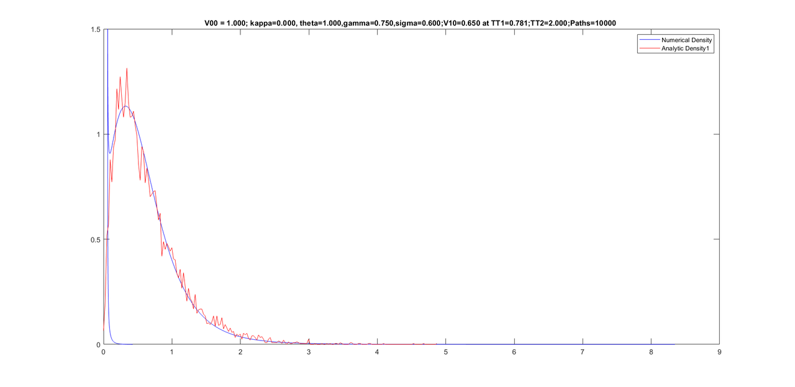](https://postimg.cc/8FqSWDWL)

[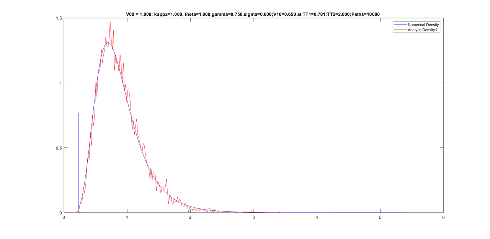](https://postimg.cc/sBtrSySp)

[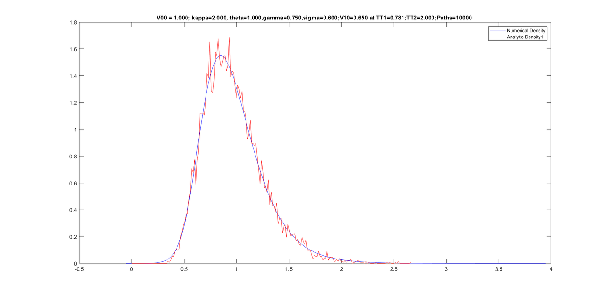](https://postimg.cc/v1ps9M91)

[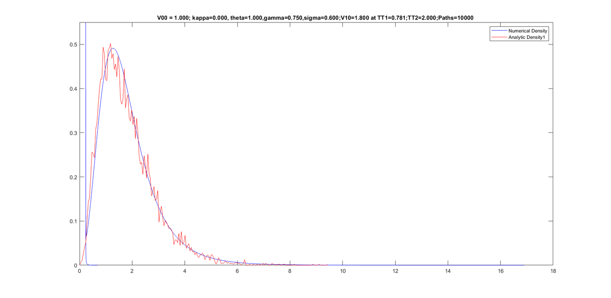](https://postimg.cc/jWWTLCW4)

[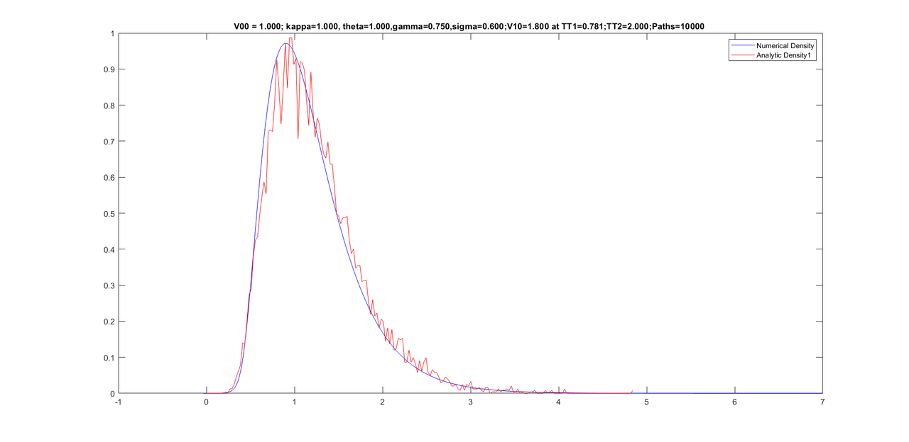](https://postimg.cc/1ggSf4gc)

[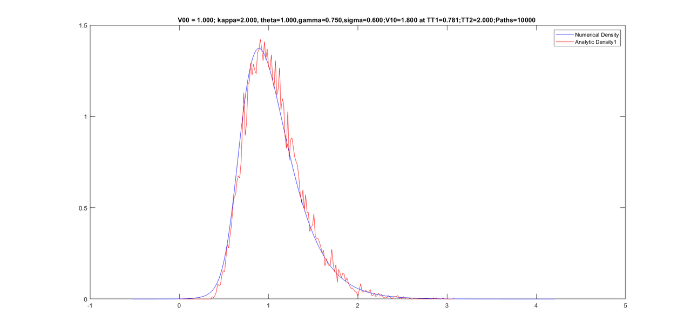](https://postimg.cc/SXX4JjXL)

[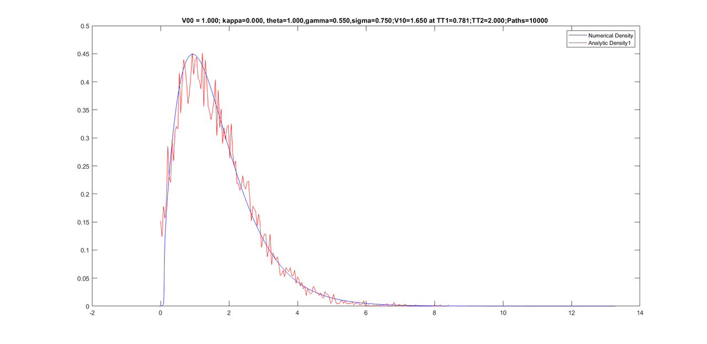](https://postimg.cc/kVVCBDVW)

[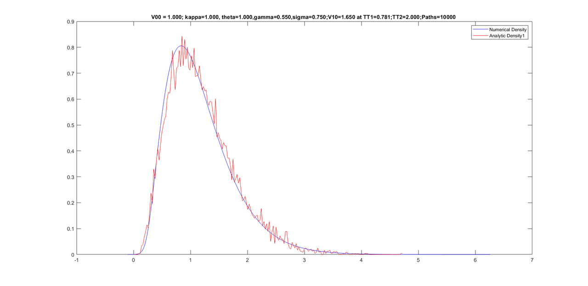](https://postimg.cc/KKKbR4KB)

[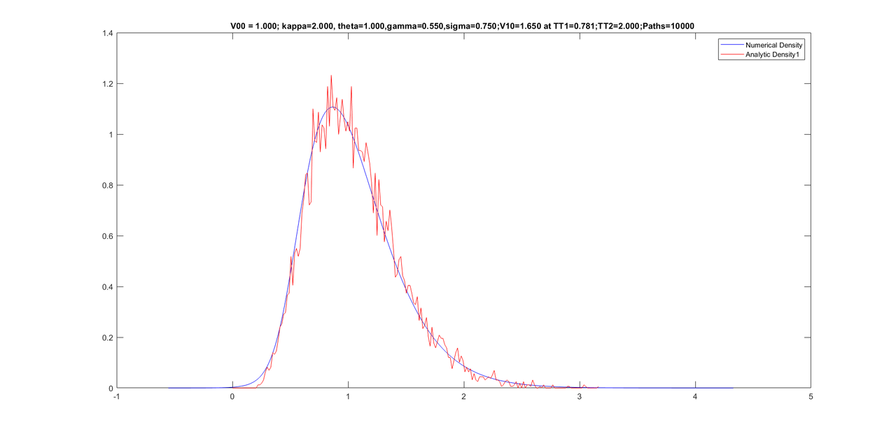](https://postimg.cc/SXX4JjX8)

[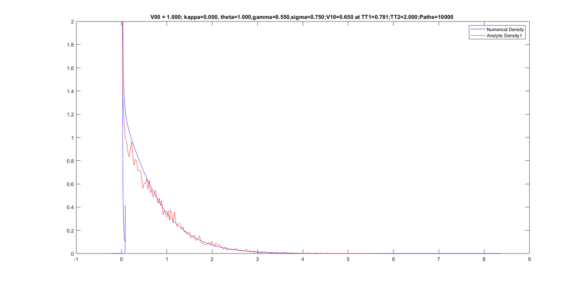](https://postimg.cc/kVVCBDVS)

[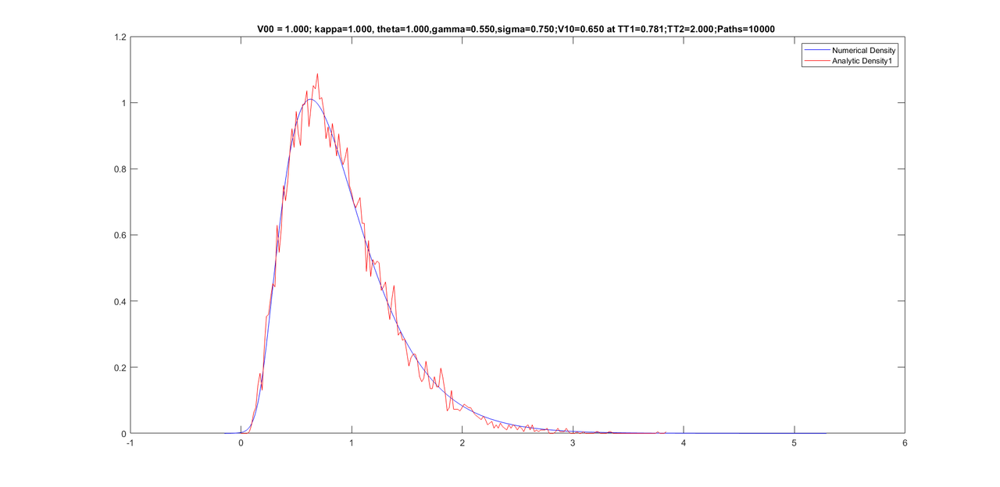](https://postimg.cc/yJJKkWJS)

[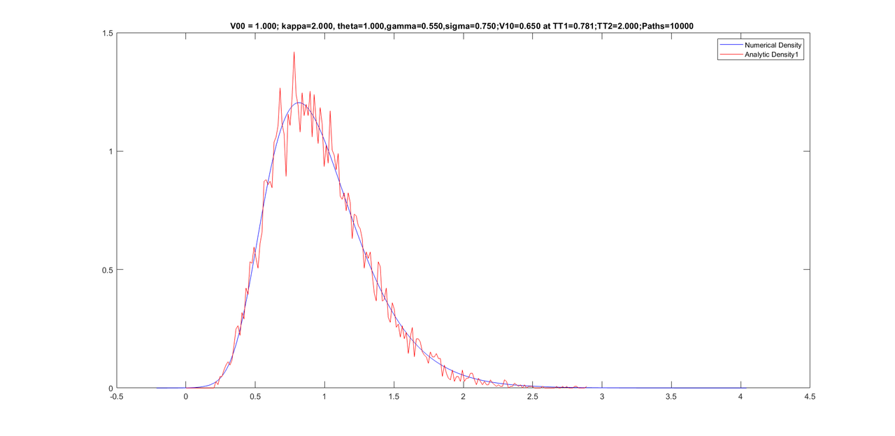](https://postimg.cc/3yyhdWy0)

[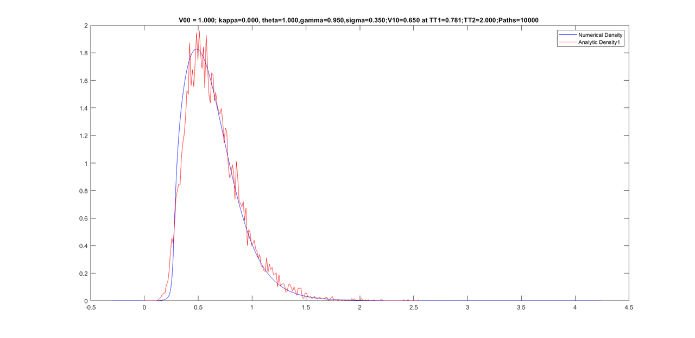](https://postimg.cc/B883Xt8j)

[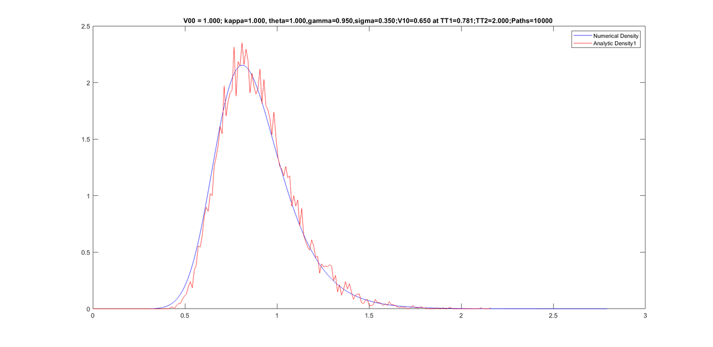](https://postimg.cc/WDDVhtDt)

[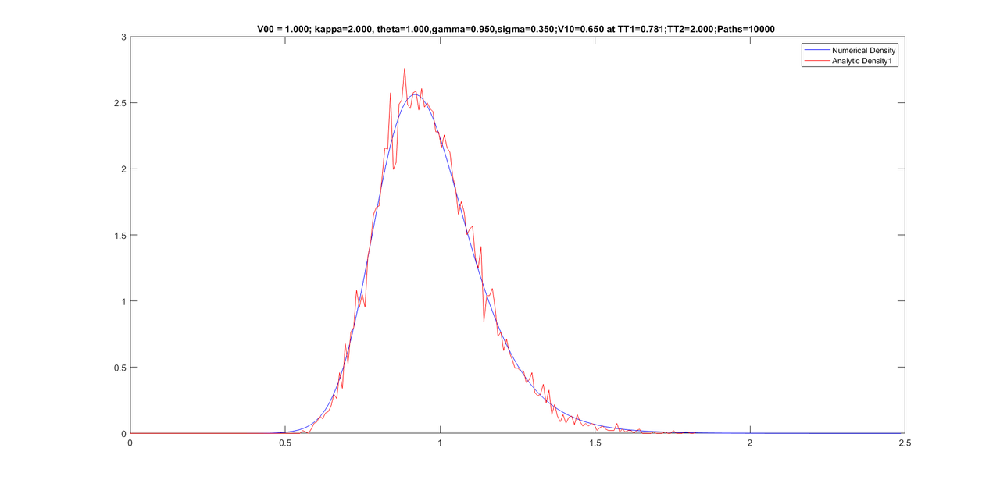](https://postimg.cc/B883Xt8Q)

[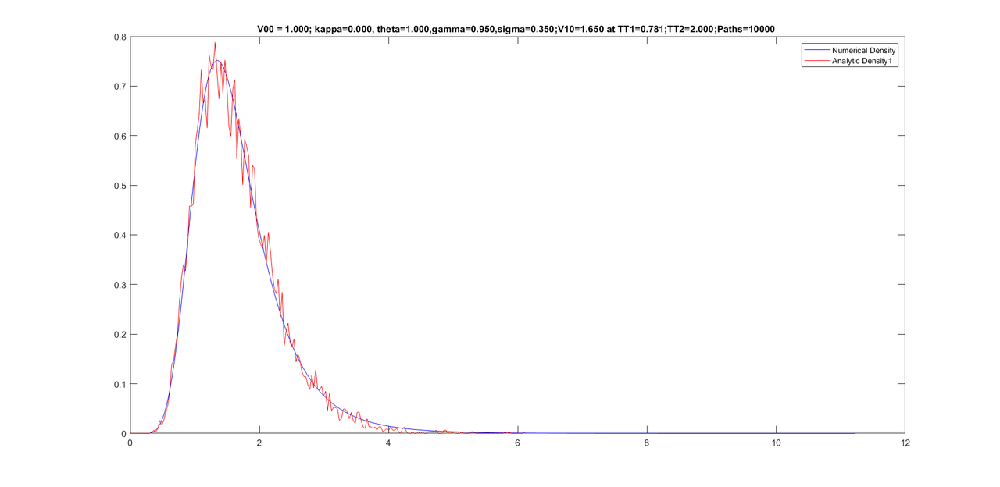](https://postimg.cc/Jyy8Gty1)

[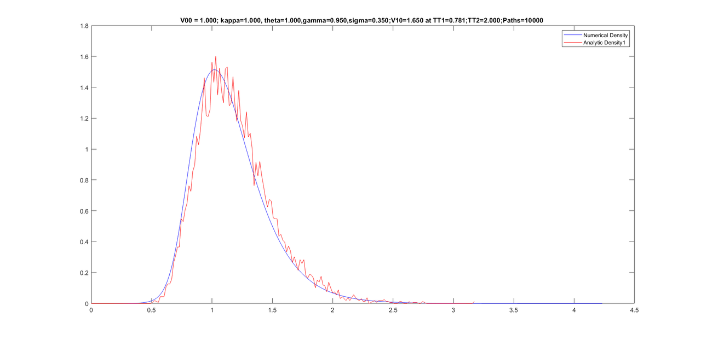](https://postimg.cc/gwwpnrwz)

[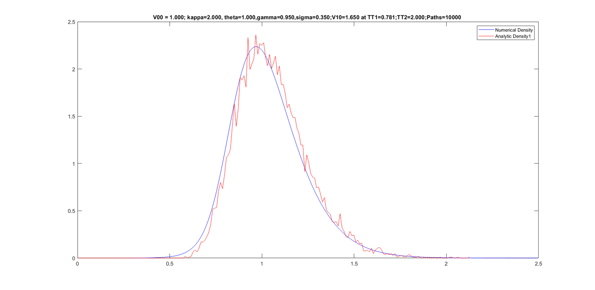](https://postimg.cc/066vbr65)

---

[← Previous](page_058.md) | [Index](index.md) | [Next →](page_060.md)
