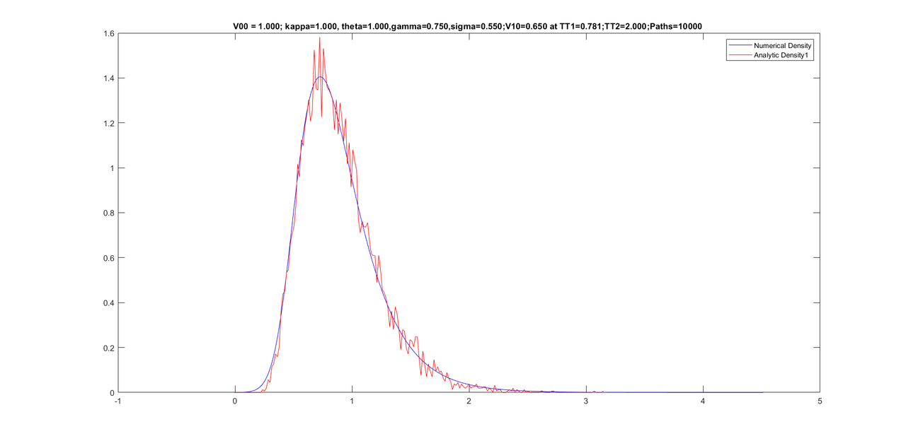
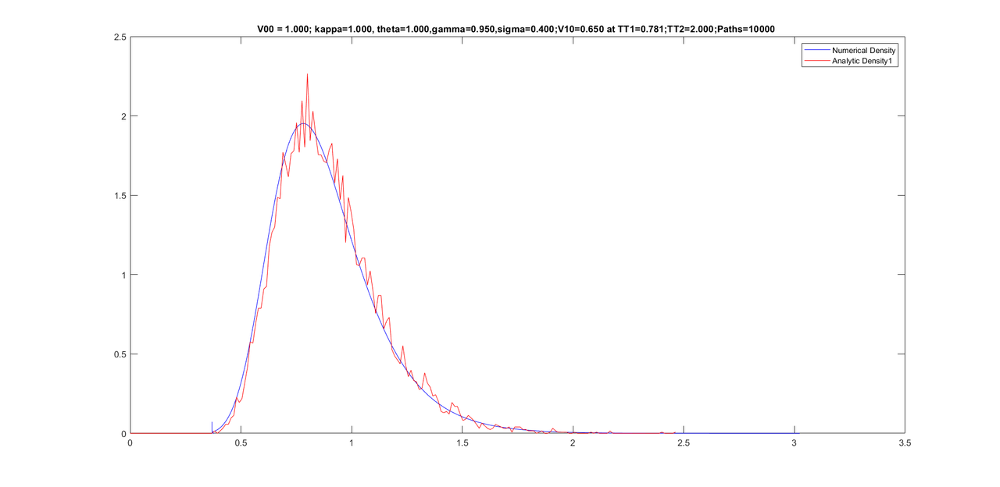
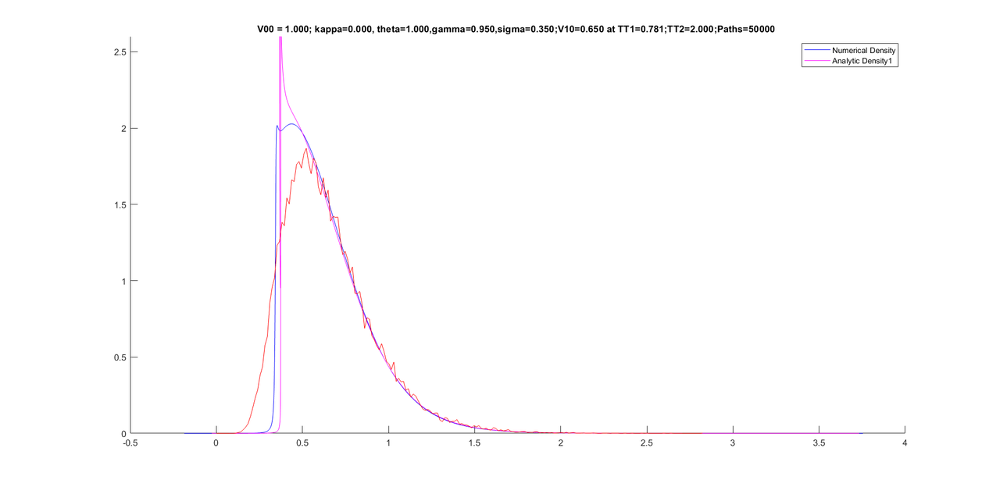
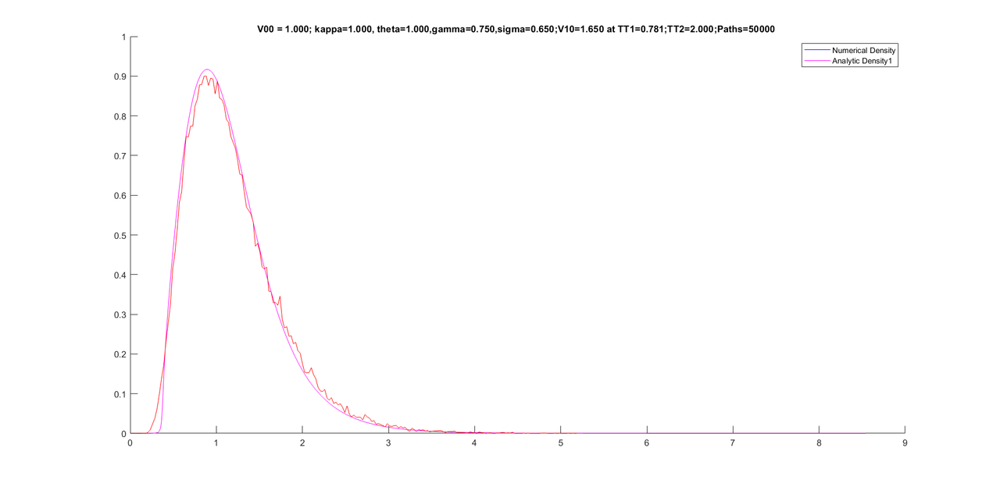
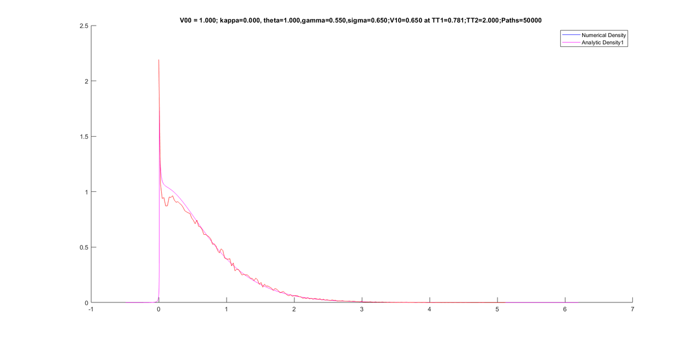
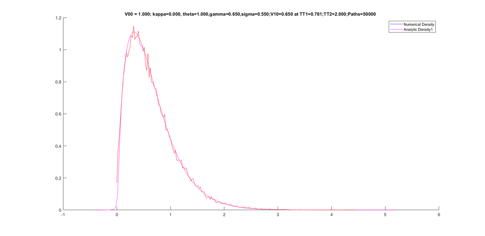

# Breakthrough in the theory of stochastic differential equations and their simulation

**Page 60 of 65** — Posts #2951–#3000

[← Previous](page_059.md) | [Index](index.md) | [Next →](page_061.md)

---

### #2951 — Amin (Topic Author)
*March 1, 2026, 8:09 AM*

Friends, I made and posted the above graphs day before yesterday. It took me fifteen to twenty minutes to make all the
graphs. I saved the main helper function that had the algorithm to construct the density and started working with its
copies. Yesterday afternoon, they asked the maid in our home to add a huge amount of drugs in cooked food at home. I
could not work properly but continued to try to work. Since I was unable to think perfectly straight, they also started
changing my programs. I continued to sense that there was something off each time they altered my programs but I knew
that I had huge drugs in my food and I was not thinking right so I remained quiet. But today when I ran the function
that I had saved after making the graphs and had not altered at all, I found that its graphs were also not matching the 
graphs I had uploaded on internet.

Friends, I am being very upset due to such activity and I wanted to post all my previous posts about Jews again but then
I realize that good and bad people are among all people, races, religions. Speaking bad things about all Jews is indeed
very wrong and I have actually continued to say that in the past that a large number of them are indeed very good human
beings. Then I decided to not post the past stuff.

But I cannot help speaking about the bad actors who are behind mind control of innocent people. There was this Jewish
professor from NYU math with whom I took a class in numerical methods. He was the sort of guy who never did any research
and was usually involved with administrative roles. He was thoroughly slighted by my talent when I took my class with
him. He approached several Jewish billionaires and told them them if jews did not retard very intelligent Muslims, then
Muslims would gradually have far more influence in United States and pleaded the Jewish billionaires to use whatever
influence they had to crush intelligent Muslims with mind control. The scumbag has made it purpose of his life to retard
intelligent Muslims in United States all over. When one Jewish billionaire is done and stops asking defense to continue
my mind control, the scumbag Jewish professor approaches some other Jewish billionaire and frightens him and asks the
new billionaire to use influence over American defense to start my mind control. This Jewish scumbag is not in his
control and his hatred and venom has possessed him and taken full control of him and it is the only objective of his
life to retard muslim students in US. He sees his purpose of life in this activity of retarding innocent and intelligent
Muslims.

Friends, the method works and is a great breakthrough in stochastics. I used only a very shortcut technique to draw the
densities. Writing a full program can take a week to ten days. There are at least four or five different ways we can
approach the problem using the ideas in my technical post and I expect that it would remain a major research interest
activity for many years to come.

I will anyway post a program with whatever basic stuff I have done later today.

---

### #2952 — Amin (Topic Author)
*March 1, 2026, 10:21 AM*

**Friends, I really believe that in a civilized society of twenty first century there is absolutely no place for
connivance and machinations of a group of rich jews led by jewish billionaire Godfather of mind control who have
retarded, at whim, thousands of talented intelligent people in America and abroad that they did not like. These cruel
people are inhuman animals even though they have learnt to adjust extremely well within American society. **

**These corrupt crooks are very powerful and they have already complete control over American army and a large number of
politicians. Due to this huge influence and power, it is very difficult to do anything to undo the cruel mind control
network led by jewish billionaire and his rich jewish cohort.**

I have suggested several times previously to good American people if nothing else works, please just ask some patriotic
American investigative journalists in major newspapers to run a comprehensive story about mind control network of jewish
billionaire and the nexus between rich jews and American defense and about tens of thousands of people that have been
retarded over past thirty years.

I want to invite patriotic American journalists from CNN, Washington Post, NewYork Times, Guardian or some other large,
reputed and responsible US or European media outlets to run a thorough story on machinations of evil jews led by jewish
billionaire and the  nexus of bad jews with American defense and their cruel mind control network that has retarded tens
of thousands of very intelligent Americans and foreigners all over the world.

**Since good people may not have the power to forcefully end the evil practices of the powerful nexus between evil
Jewish billionaire and US army crooks, only way to end the cruel and subhuman practices of the nexus seems to be
exposing them openly in US public and the public of other countries all across the world.**

** **

**I think it is important for us to make sure there is a better future of American children and children all across the
world and we leave them a legacy in which fairness and justice prevails as opposed to machinations, trickery and deceit
that has been unleashed in the society by the jewish billionaire and his rich jewish cohort.**

**What I am writing is my honest opinion even though a lot of friends might differ with it to some degree. I think it is
very important that all of us try to have rule of law, and good governance for the benefit of our country and society.
We promote freedom of speech and freedom of press in our societies so that people can criticize bad or wrong actions of
other people and make each other aware of their observations of wrongdoings by some people especially the ones in the
authority in the society while, obviously, every body has to try to investigate the truth on their own without blindly
believing anyone. The purpose of such criticism and related discussions is to try to root out bad practices from the
society and promote good ethics and practices.

**

Another thing I want to suggest is that true patriotism is not about hiding bad practices taking place in our country
from others, instead it is about exposing such bad practices by unethical people in the public with the final goal that
these bad practices are rooted out from our societies.

**Now I will come to the point that I have been suggesting for years that there is a jewish billionaire and his rich
cohort who are behind indiscriminate mind control of a large number of intelligent American people and others . And a
large number of people in American defense have become a mercenerary army that play in the hands of these rich jews.
These rich jews hire quite a few of senior officers from Pentagon and army after their retirement in their large
enterprises and these people are paid millions of dollars each and they enjoy very high social status. One of the most
important purpose of these retired officers is to convince their juniors who are still in official service and have
reached positions of authority to do illegal, extrajudicial and extraconstitutional mind control control of Americans
and others suggested by the rich jewish cohort. This thing is so well known in some jewish circles that many jews
continuously report thousands of people among intelligent students and many others who fall out with these jews for any
reason to mind control by American defense. You do not always have to be extra intelligent, sometimes falling out with a
jew who knows how to approach the rich jewish cohort will seal the fate of the victim by mind control forever. As
always, I would like to mention that there are large number of jews who are opposed to this practice and have absolutely
nothing to do with mind control of innocent people. Please let me specifically say again that there are many very rich
jews and billionaires who have nothing to do with mind control. But I definitely own that I am suggesting this rich
jewish billionaire and his cohort of rich jews are behind most of the mind control and this is a common knowledge in
many jewish circles and many people among these circles know who to approach for mind control of anyone they do not
like.**

**But what is even more alarming is that all the bad actors behind mind control including rich jewish cohort and
mercenary criminals in American defense, when exposed in public, have absolutely no remorse about their crimes and they
become even more adamant to use all machinatory tactics so that they can continue illegal and extrajudicial mind control
of innocent and intelligent people. They have lost all sense of good and evil and have no qualms about continuing the
evil practices at all. It seems many of these bad actors have no conception that retarding innocent human beings is a
wrong thing and an evil practice and they think that mind control of innocent people in the society they do not like is
indeed a good thing.**

I know that many good Americans want to end the bad practice of mind control of innocent people from their society
without any retribution against the bad actors behind such evil practices. The bad actors, on the other hand, have
absolutely no remorse about their evil actions and are ready to go to any limit to thwart the attempts of good people to
end mind control and they always try to undermine all good people and their actions towards amicably ending the evil of
mind control from American society. These bad actors are not willing to gracefully acknowledge and be thankful that good
American people do not want to hurt them beyond ending the inhuman practice of mind control from American society and
instead these bad actors are adamantly using all sort of machinatory and bellicose tactics so they can continue and
increase the evil of inhuman mind control of intelligent and innocent human beings.

I really want to suggest if all amicable attempts by good Americans to end mind control fail, it does not mean that they
have to yield to inhuman practices in our society by continuing to play nice. As there is very huge evidence about
existence of extra-judicial, extra-constitutional and cruel mind control and resulting retarding of very large number of
innocent people by American defense and a large number of stories are circulating in academia about people who were
targeted by American defense on behest of jewish cohort, I really believe that it is a great opportunity for some good
journalists in American and international media to write in detail about the hugely widespread evil of extrajudicial,
extraconstitutional, inhuman and cruel practice of mind control and also about nexus between some bad jews and corrupt
people in American defense that has been the dominating force behind this inhuman evil in our societies. I want to
request good American people that if all else fails, please motivate some brave and patriotic journalists to write in
complete detail about the evil of mind control. If it is not possible to write about this inhuman practice in American
newspapers due to possible reprisal from american defense, please break the news in some large British or European
newspaper. I am sure there is enough evidence about existence of mind control and related inhuman and cruel practices
that any serious journalist can firmly stand behind a well written article that completely exposes mind control and
associated cruelties and retarding of thousands of innocent persons by corrupt people in American defense. As I earlier
suggested Patriotism does not consist in saving any false pride or hiding evil practices of our countrymen, it consists
in rationally doing what is broader good for people in our societies by trying to put an end to evil practices.

**I will also request readers, for good of our societies, to let at least one journalist you know in the following
American, European and Pakistani newspapers about true nature of mind control and about my thread. **

**I also want to explain very clearly that I have been very severely criticizing bad jews and American defense but this
is limited to criticism in writing only. I write only on Wilmott forum where I also contribute my research and I do not
write anywhere else(at least for past 10-15 years).  I do not want anyone including myself to take the law in our own
hands. We have to respect the human dignity of every jew and every human being including those involved in bad practices
so even though I openly talk about bad people, it is not an invitation to anyone to take the law in their hands or hurt
any any human being. I will continue to fight for my cause of ending mind control of innocent and intelligent people but
I want people to completely respect all good jews and good people in American army(even though I wrongly generalized
about all of American defense as being bad, if you know any good and patriotic people there, please give them your
utmost respect) and make a political struggle for the law or government actions to take their course against corrupt and
evil people. I absolutely do not suggest any violence or anybody taking law in their hands.**

---

### #2953 — Amin (Topic Author)
*March 1, 2026, 10:30 AM*

For Friends who have recently started to look at my thread, I am copying two more following posts from the past.

[My Letter To HRW About My Human Rights Abuse](https://forum.wilmott.com/viewtopic.php?f=15&t=102298)

I really want to tell people that I have lived as a sane person due to support from friends otherwise I was even put to
physical torture before my case got known to a lot of good people. I am copying an experience of planned physical abuse
on the insistence of mind control agencies. I am copying context of the post as well.

The excerpt below  is from a past post stating obvious abuse by various psychiatrists on the insistence of mind control
agencies. The episode of physical abuse by beating me for more than twenty minutes is towards the end of this post:

Friends, I  wanted to remain busy with my research and not speak about mind control and its reasons and people behind
it. I simply wanted to concentrate on my research but whenever I have any progress in my research, my mind control and
related torture sharply increases to make more research impossible for me. I want to remain totally devoted to my
research and want friends to help me in doing that, I want everyone of all the good people in Europe or America who
follow my research to please tell two or three journalists about my research and my mind control. I will also request
European friends to ask their government and embassies to please keep a vigil about the matter and force corrupt
Pakistani govt. and establishment to not drug food in Lahore with mind control chemicals.

I was a very simple, very meek but also very hard working student at a large university in New York and joined the
university in 1997. My mind control started in very late 1997 when a racist jewish professor in Math department of my
university was threatened by my talent and approached the Jewish Billionaire to ask American defense to put me under
mind control. Even that long time ago, a large number of jews were very aware that this Jewish billionaire was a
Godfather of mind control and would approach the billionaire to recommend talented people to mind control from time to
time when they would be threatened by their talent. Over past twenty five years tens of thousands (if not more than a
hundred thousand) of innocent people mostly American nationals have been placed on mind control abuse by scumbags of
American defense on recommendation of Jewish billionaire. Most universities in US  have a couple of jews who continue to
keep eye on brilliant students of the university and recommend them to American defense through jewish billionaire when
they feel threatened  by the talent of the students due to any reason like their religion, race, ethnicity or just
because they are not jews.

I had told friends earlier that a jewish billionaire is Godfather of mind control. When my persecution started (in late
1997) at the university in New York which is a big time player in mind control of Muslims, blacks and foreigners, many
university officials were very pleased that they were getting written in good books of the billionaire jewish Godfather.
Though there are far richer billionaires in US who are staunchly opposed to mind control, they are not ready to shell
out hundreds of millions of dollars to bribe anyone to end mind control while mind control Godfather continues to give
large bribes to people to continue mind control. Many of the people related to defense in mind control are given
extremely high paying jobs in Godfather and his other jewish friends' companies after they retire from mind control and
Godfather is extremely generous towards them and it is well established and well known to scum in mind control that
after retarding muslims, blacks and others in their career, they will move to paradise(tens of people from army/Pentagon
who follow whims of Billionaire Godfather are given jobs paying milllons of dollars by Godfather and his jewish cohort
in several companies) after they retire. No wonder there is no let up in mind control whatever good people try.

We know in almost all classic folk lore stories evil is too strong and too sure of itself while good is mostly weak and
just trying to protect itself from evil who is bent on damaging and eradicating the weak and the poor good but it is the
weak and poor good that finally prevails. I want to tell good American friends that evil at this stage has become too
bold and thousands of talented people are retarded every year. And it is just not muslims and blacks that are on the
line, several thousands of brilliant whites are retarded across United States by mind control agency every year that has
become too emboldened due to lack of any accountability. Thousands of foreigners are also kept retarded in dozens of
countries including many European countries.

My only intention behind this post is that I want mind control to end from our societies. I do not have any joy in
mentioning that there are some bad jewish actors behind it. In American society there are a large number of jews who
have excelled in the professions of science, education, medicine and have made great contributions to our societies.
There are a very large number of jewish professors each of whom would have taught tens of thousands of students on top
of making extraordinary contributions to body of human knowledge through their great research. Then there are
accomplished jewish scientists whose work, research and inventions make our everyday life better. There are great jewish
doctors and surgeons who would treat countless sick people and make them recover from disease. The list of contributions
of jewish people to humanity is very long and it continues. Then there are a large number of ordinary jewish folks who
are known for their goodness and civility to other people in the society. When we know all of this, we do not want to
say anything anti-jewish to hurt the feelings of so many good jewish people. But I still have to say there are really
some bad people who are unconnected with most of the nice and accomplished jews and they instigate and continue cruel
mind control torture on talented people of other ethnicities, religions and countries based on their personal dislike
and hatred. My purpose is only to end the mind control victimization and torture on otherwise nice and talented people
and I do not have any hidden intentions beyond that. And I am sure American society knows very well about the
contributions of good Jews to both their country and broader humanity and my exposing some bad actors would never have
any bad effect of any kind on these good and nice jews who we all respect and who are our role models.I want to tell
friends something I have said before here that I am sure American society would eventually end the menace of mind
control from their and other countries. I want to request all good Americans and Europeans to come forward and invite
any investigative journalist you know to read my threads and ask them to help end the menace of mind control in our
societies through their investigative journalism. Without any accountability evil will continue to grow stronger and
then mind control would start to threaten even those people who consider themselves safe due to affiliations, status or
wealth.

https://forum.wilmott.com/viewtopic.php?t=99702&start=2325#p881807

https://forum.wilmott.com/viewtopic.php?t=99702&start=2325#p881808

https://forum.wilmott.com/viewtopic.php?t=99702&start=2325#p881886

https://forum.wilmott.com/viewtopic.php?t=99702&start=2340#p881951

Friends, this speaks volumes about headstrong cruelty of people in American defense and their Jewish billionaire backers
cohort that they are even more ready to show me cruelties even after people have a widespread knowledge of their
machinations and tactics. These evil people have no intention or desire to decrease their torture on me despite that I
have been telling tales of their inhuman torture on me over past twenty five years through various psychiatrists.

Please read the following two posts to see the context how I have been maltreated by various psychiatrists on behest of
mind control agencies over past 25 years.

Friends, I have been on forced antipsychotics for most of the time since early 1999. There were a few periods of a few
months when I remained free from antipsychotics. But other than two or three such periods, I have remained on
antipsychotics. It is very hard to feel well when huge antipsychotics are forced on someone who is mentally healthy. I
have also been detained forcefully tens of times whenever some of my neurotransmitters came back, the purpose of
detention was to take brilliant neurotransmitters out of my brain and send me back home with a relatively retarded brain
after the end of months long detentions. I have seen sheer trauma, torture and brutality on the hands of these
psychiatrists who connive with American defense and Pakistani military to declare me mentally ill so they can force
antipsychotics on me. I will be 51 this year and portion of my life that I lived under mind control has exceeded the
part of early life that I lived without mind control.

I have a phone meeting with the psychiatrist on 14th of June 2024. And I am sure the psychiatrist will try again to keep
me under medication or even increase my medication. Even after a large number of people have become aware of truth about
mind control and accompanying persecution by the psychiatrists, most psychiatrists are not the least worried that their
wrongdoing is being exposed in public.

I want to request good Americans to please protest to American defense, mind control agency, Pak army and relevant
psychiatrists to please end this cruel practice of declaring healthy people on antipsychotics and forcefully detaining
them up to years in their faciiities.

When they detain me, they have fixed all mind control gadgets and lasers in the psychiatric facility and they add all
mind control chemicals openly in food and psychiatric drugs. It is a very controlled environment in captivity and within
a month or so, they are able to remove all neurotransmitters from the brain of the victim. Every time I was detained,
they kept me in the psychiatric facility for 30-50 days. One psychiatric even detained me for ten months after I
returned from Britain. There are also instances of being detained for six months once and three months twice.

I really want to request American people again to please protest to their government and try to make sure that I am not
being detained again on totally flimsy psychiatric grounds.

.

[My Letter To HRW About My Human Rights Abuse](https://forum.wilmott.com/viewtopic.php?f=15&t=102298)

Above is a very incomplete account of how various psychiatrists continued to play in hands of Pakistan army to retard
me. It also does not cover all the time till year 2022 and the account stops several years earlier. I could not write
about last several years that were exceptionally brutal.

Friends, in a previous post I told friends how staff at a lady psychiatrist's hospital started beating me and abused me.
During past twenty three years, there have been many many instances of my obvious abuse by different psychiatrists. I
will describe some of those instances in this post.

When I came from United States and till fifteen years after that, my father would proudly ask me that I could see any
psychiatrist I wish. This was because Pakistan army was managing my persecution and they would force psychiatrists to
declare me schizophrenic and my father was told that every psychiatrist would be forced to cooperate. However, by chance
in 2016, I came  across a psychiatrist who was far better. I never told him that I was under mind control but whenever
he interviewed me, he always said after the interview that I was perfectly sane and mentally healthy. When my family
would force him to increase the dosage of antipsychotics, the doctor first told me that I should not live with my family
and make a comprehensive plan to support myself and become independent (such a plan could never work since Pakistan army
was threatening people in Pakistan to not give me any business and CIA was making sure that every contact I would reach
for work in Europe (and Singapore/ Japan /Australia) would be approached by CIA telling them that I was a very bad guy
and they must not do business with me. I had not told the doctor any such thing that intelligence agencies were after
me.)  When I told the good doctor how previous psychiatrists had abused me, he would tell me that this used to be a very
widespread practice in America hundred years ago to wrong mentally healthy humans by using corrupt psychiatrists as
instruments to detain them and strip them of their sanity. The good doctor I am talking about was American national with
Pakistan background who had practiced psychiatry in America for over twenty years and had returned to Pakistan. That
good doctor kept me on very low antipsychotics (1 mg resperidone per day) and that too on extreme insistence of my
family. It was only during that time of treatment by that doctor that I got my first break in research and I solved the
problem of high order monte carlo simulations (and analytic series solution of ODEs)  and posted that solution on this
thread. Ok, when my family was fed with the doctor, they detained me with another doctor. They detained me again two
years ago when I requested my family that I wanted to see the same doctor of my choice again( I have been detained every
year for past six or seven years by different doctors), they detained me through a different doctor. So my family now
stubbornly refuses to allow me to see a professional qualified American psychiatrist of my own choice and detains me
every time I try to approach him.

Now back to my obvious abuse by two other psychiatrists. I was detained by this doctor who was running a mental health
facility and was not a psychiatrist himself. At that time I did not use to walk very much and my blood pressure used to
be somewhat high. Since other antipsychotics had failed to retard me, doctor suggested I take aripperizole injections.
These injections affect the heart and also elevate blood pressure but doctor who wanted to retard me had no regard for
my health while pretending to cure me. In initial days of my detention, staff at the hospital when checked my blood
pressure told me high enough blood pressure in line with what I used to have but after I complained about aripperizole
and its effect on blood pressure the staff started doctoring blood pressure and started telling me that my blood
pressure was very good or even low. This is a post I wrote on another thread in this forum about it. How to safeguard my
research - Page 32 - wilmott.com

.

> Amin:
>
>
>
> Since I wrote about high blood pressure and mentioned high blood pressure before the hospital staff, they have started
to doctor blood pressure. Now, everyday they tell me that my blood pressure is 120/80 or 110/70. While they always told
me that my blood pressure was 130/90 or 140/100 prior to injections. I have never had so good blood pressure for years
that they have started to tell me now. Friends would recall a previous post when I could not sleep at night and had to
take a sleeping pill. When the dispenser came to me at night(The hospital has no MBBS who stays here at night in
Ramadan. Dr. AS used to stay here on some nights earlier but has been totally absent in Ramadan). When the dispenser
checked my blood pressure, he told me that it upper blood pressure is 110. I did not believe him at all. He asked me to
check on my own and put the stethoscope head assembly in my ears. I could easily tell that upper blood pressure was more
than 140 and lower was more than 100. The staff has already started to doctor blood pressure. My parents are going to
Saudi Arabia for two weeks in a few days. Now Dr. AS has the plan to hold me in detention while my parents are abroad. I
had a complete settlement with Dr. N and we(I and the doctor N) both agreed that I would be visiting him every fifteen
days and all modalities were agreed. I do think as a patient it is my right to choose the psychiatrist and Dr. AS( who
is incharge of facility Pav.) has no right to change the doctor after I have selected a psychiatrist and we both agree
on terms of any treatment. Dr. AS has imposed another psychiatrist Dr. M who has not even seen me and has already
started giving me injections and increased medicine without looking at my present condition. Dr. N had explicitly stated
that I would be free to leave if it were his facility. Most major reason for detaining me now is that Dr.AS wants to
continue to detain me while my parents are leaving for abroad for more than two weeks
.

Later after a few days, I was given a second aripperizole injection and released from detention. An injection was due
every fifteen days. My parents were in Saudi Arabia and I was living with my sister. She insisted after fifteen days
that I get a new aripperizole injection. I complained about too much side effects and other serious problems but my
sister insisted that I must get the injection. She talked to another doctor and the doctor told her that if his blood
pressure and pulse are fine, just give him the injection. I asked my sister that my blood pressure must be checked
before I get the new injection. We went to a small hospital close to her house and when my blood pressure was checked my
lower blood pressure was 110. The hospital staff recommended that I stay at the hospital in their care until my blood
pressure decreases. It was a totally random blood perssure check. When hospital staff came to know that I had been given
aripperizole injections, they told my sister to not give me those injections any more. My sister asked the staff to
relieve me and we came home but I was not given aripperizole injections after that.

But this is interesting that the psychiatrist was initially desperate to prescribe aripperizole despite that I had told
him about my heart and blood pressure problems and his staff was asked to doctor blood pressure so that I would accept
the injections.

Good thing is that only after stopping aripperizole, I started my treatment with good psychiatrist  doctor Naeem Aftab
(who is an American national) and he gave me enough relief that I was able to get a break in my research and solve the
problem of high order monte carlo simulations. I would always be thankful to Dr. Naeem Aftab for giving me relief at
such a crucial point in my life.

Yet another experience for abuse was with a seasoned psychiatrist who is known for his connections with Pakistan army.
When army dictator Pervaiz Musharraf ruled the country, he made this doctor the dean(president) of the university of
health sciences which regulates most medical universities in Pakistan. He had treated me for three years in year 2001.
He started my treatment without interviewing me and gave me electric shocks at the start to jumpstart the therapy. I was
given electric shocks for fifteen days in early 2001. I still recall that doctor would place a wooden wedge between my
teeth and then give me an injection and I still recall how numbness would move in my body from feet to the upper body
after the injection.

When going to that doctor's psychiatrist facility in 2001 I had to travel from Kot Addu to Rawalpindi. My family had
given me some drug in my food and I became unconscious after an hour or so. I still recall how I was begging my younger
brother to help me that I do not want to go anywhere and if he could help me but he like everybody else in the family
refused. Slowly drug in food showed its effect and I have absolutely no memory of being taken in my father's car despite
that it would have taken him at least eight hours to take me to Rawalpindi. Psychiatrist did not interview me and
detained me and started giving me electric shocks. I still recall how I defecated in my bed there and they had to wash
it.

Anyway, I was taken to this psychiatrist in 2017 again. He was very clearly told that I had been given antipsychotic
drug larjactil by another doctor and it backfired and I had extremely severe drug-induced jaundice. But the doctor was
so haughty and cavalier and so desperate to retard me that he still insisted that I must get the same drug larjactil and
said that it was not necessary that it would cause jaundice every time. Problem for the doctor was that most
antipsychotics had failed to retard me and he wanted to give me some potent antipsychotic that had not been well-tried
on me. Though the drug was given to me earlier and later discontinued, the doctor wanted to take his chances to retard
me and he had no regard for my health. This doctor is a big crony of Pakistan army and really wanted to please the
generals and therefore he decided to give me larjactil again. And as would already be obvious to most friends, after two
weeks, I started to show all signs of drug-induced jaundice again and my body and eyes were all yellow. My Biluribin
shot like anything. And it took more than two months to control jaundice after that. Though my biluribin came back to
normal after two months, several less known enzymes in my liver remained disturbed for several years after that and
continued to show as abnormal in my liver function test reports.

I have been detained more than 30 times by various psychiatrists during past twenty-five years on orders of Pakistan
Army. This is despite that I have never been violent all my life. I have never hit anyone in my adult life and I rarely
speak with anyone in a loud voice. I have never done anything like breaking a glass or any utensils that is associated
with sick people.

Here, I will recall an incident eight years ago when I myself approached a lady psychiatrist for help and how she abused
me, and her staff beat me for twenty minutes and then tied me and started my treatment with antipsychotics again.

I am recalling this from early 2015. They had previously put me on extremely high antipsychotics and my creativity was
all gone. I could barely do any intellectual work. At that time, I was able to convince my family to decrease the
injections and they had agreed since I had already lost most of my creativity and intellectual capability. I think mind
control agencies were also thinking that I had lost my creativity forever and they wanted to see if it was right time to
decrease my drugs and still make sure that I would remain intellectually dull after injections had ended.

But I slowly started to work on my research and started to regain my brain. When mind control agencies realized that I
had started to do better research, they asked my family to do something again to retard me. My father asked a
self-stylized religious saint to come to our house and take care of me. He came to our house with one of his followers
and told me that he wanted to give me injections and I would go to sleep for 24 hours, and they would take scans of my
brain to treat me, but I continued to beg and plead him, and I was able to convince him to allow me to leave the home in
my car. The supposed saint allowed me to leave since he was probably sure that he would get me later as I had no other
place to go other than my home and, therefore, I was able to convince him to let me go outside. When I left the house, I
made posts about the saint on at least two different forums from outside my house and pleaded for help. Enough people
were following my story even at that time and the saint had to leave. I also called my father when I was outside and
protested against this.

My family still remained very tense with me, and I was very afraid that they would force antipsychotics injections and
mind control drugs on me therefore I stayed one night out of the home. Here is the post I made when I was away on April
14th, 2015, 2:09 pm

[viewtopic.php?f=15&t=94796&start=315#p748191](https://forum.wilmott.com/viewtopic.php?f=15&t=94796&start=315#p748191)

"I am staying out of my home for the night since I had realized that my father will try to force me into detention again
and I would request a court tomorrow for stay order to stop my father from hospitalizing me forcefully again and I would
request the court that if there has to be a check on my mental health, it has to be done and investigated properly by a
psychiatrist of my choice and I should remain free at the same time. I do not want to be at the mercy of my father's
chosen psychiatrist as we saw in the past year that they continued to quote mental health laws and forcefully manipulate
me into taking injections. If my father forcefully hospitalized me, I would be cutoff from the outer world and they
would do whatever they like. My father's self-stylized saint(peer) had already hinted that he wanted to give me
injections that would put me to sleep for 24 hours and he had no argument for my mental sickness at all.”

Next day, on April 15, 2015, I went to Lahore High Court to find some help but I was told that I had to submit an
application that would be considered several weeks later when its turn would arrive. When I realized that there was no
possibility of help from the court, I decided to see a psychiatrist on my own. I was driving in Garden town Lahore where
I came across B**** psychiatric clinic and decided to see the psychiatrist Dr. N*** there. It was evening but the
psychiatrist still not had arrived there. I waited for an hour in the reception and then had a consultation with her. I
asked her to listen to my case carefully and then decide if I was sane enough and tell my parents about it. She said
that I seemed perfectly fine and asked me that she wanted to hear what my family had to say. I agreed and took an
appointment to visit her again at April 20, 2015. I took my mother on the planned day and my mother did not have
anything decisive to say about any disease other than that I did not eat at home. The psychiatrist asked me to visit her
after one week on 27 April 2015. The next week when I went again to visit the psychiatrist, on April 27, and was sitting
in the waiting room so that I could visit the psychiatrist on my turn. Another lady who was a psychologist came to me
and asked me to go with her in a different room to have a session with psychologist but I declined and said that I was
only interested in seeing the psychiatrist who had promised to see me again the earlier week. After five minutes, at
least four men came to the room and started besting me. They gave me slaps on my face with full force and gave me blows
and they continued to do it for more than fifteen minutes. I had never been beaten like that ever before in my life. All
this time, I was simply trying to raise my hand to somehow protect me. Since I was sitting on the sofa, only my face and
head were the target of slaps and blows. They were very violent with all sort of slaps and blows on my face as I earlier
mentioned that I was sitting and they were standing. . They literally continued to beat me and I continued to beg them
to stop. After fifteen minutes of beating me, they tied my legs and lifted me and put me on a bed in a room in the
psychiatrist facility and told me that doctor had gone to America and she could not see me. It was a complete lie and
the psychiatrist was in her office and was interviewing other patients when I arrived. I continued to ask them to loosen
the knots but they continued to make fun of me. I was totally surprised since Dr. N had behaved very nicely in the
previous meeting held at 20th with my mother and myself and I was sure she would declare me mentally sane on this
meeting. After I was kept tied for about half an hour, a new guard came and opened my hands and legs and said that they
would keep me at the facility for three days. The next day my medication in the form of pills started and I was also
given two more injections. I was given about nine pills at night and about eight pills in the morning. I was still not
given the opportunity to meet the psychiatrist N, and I was told several different things by different people including
that psychiatrist N had gone to America, and she had gone to Islamabad. About three days into my treatment, I saw
through the glass walls that psychiatrist N was interviewing her clients in her office. After seven days, I was asked to
meet psychiatrist N, and she said that she was unaware of the beating as she was in a meeting. Psychiatrist N also
assured me that I had no schizophrenia and previous doctors had very wrongly diagnosed me but it was a case of some
mania that she would properly treat this time.  Her staff continued to say that they were giving me drugs so that the
effect of other drugs given to me by previous psychiatrists would decrease.

Before my computer was taken away from me, I was able to take notes for two days in the hospital on my computer that I
write here. After first two days of medication, I was so extremely weak that I could barely walk and I had extreme
difficulty speaking.

“My Diary for past two days.

4/27/2015

I had two sessions with the doctor N previously on the 20th of April and once before at 13 or 14th of April. I remained
away from home during this time and second meeting on 20th of April, evening after the night when I remained away from
home. I had told the doctor about my circumstances in the first meeting with her. She had said that I looked perfectly
fine mentally but she needed to talk to my family. On 20th of April, I took my mother for a second joint session of
myself and my and the psychiatrist said, after the meeting, that said she really could not call me schizophrenic but she
needed one more sessions and asked me to come to her facility on 27th of April.

When I arrived at the psychiatric facility, a psychologist had asked me to accompany her which I did and on the way to
the her room, I asked for the reason, after which she replied that she wanted to take a session of mine. I told her that
I already had a session with another psyc hologist and also with a psychiatrist so I would prefer to have a new session
with the psychiatrist now. She agreed and I returned to the waiting room. I was sitting on a sofa in the waiting room on
27th at 8:00 PM (PST) in the line to see the psychiatrist when about five guards took control of me, while I was sitting
on a sofa in the waiting room to see the doctor, and gave me an injection. I was beaten and my legs and hands were very
strictly tied for more than hour. Though the doctor was in her consultation room and a lot of people were waiting to see
her, I was told again and again that doctor was not present at the facility.

In the previous two sessions, she had given the impression I was healthy mentally but she used force without
interviewing for the third time or seeing me and without requests to comply. If she was given any special information,
she should have talked to me about it and she should have verified with me any change in circumstances.

One injection was given around 8 PM when I arrived for third session with the doctor N. I really think that the doctor
was there since there was a large rush of visitors and her SUV was parked in the hospital but everybody among the staff
continued to say that doctor did not come to the facility this evening.

I was kept tied for more than one hour. I was taken tied from the waiting room to my room. All these rooms have video
cameras so you can ask Dr. N for a video of the events though she might make the excuse that cameras were not working.
One of the staff had mentioned when they brought me into a patient room in the facility, that everything was watched by
cameras.I would request people familiar with the matter to request her to show them footage of the cameras. Of course,
there could be many excuses that cameras were not working but I insist that cameras were working.

Good Mental health facilities try to avoid treating humans like this.

Another injection was given at night before I slept.

and my internet USB device was also taken. They simply took possession of everything out of my pockets and also took my
laptop.

When I asked why they gave me injections, one of the staff told me you were ?hyper? and I was totally surprised since I
was quietly sitting on the sofa in the waiting lounge for the doctor. I was told that I would stay in the hospital for
three days. I am sure this matter can be resolved who is lying and who is truthful once you look apt video footage of
cameras in most rooms.

4/28/2015

One injection was given in the morning. One injection was given around noon. All injections were IM (given in the
muscle.)

Unknown pills(some pills in the morning +5 pills around noon + 3 pills at night) were given and I was told,? We will
tell you know the names of these pills only when you leave.?

Computer was returned today but I was told that we did not take your mobile and they continued to say we never took my
mobile. My mobile was never returned( despite I always keep my mobile on me.)

I was also not given my EVO USB device and I was told you cannot write anything on internet. However the USB device was
returned to my mother at night.

I was told today by the psychologist that doctor N had gone to America and will come back after seven days and only then
she would be able to see you. I was told we are adjusting your medicine and see what was a good medicine. I was told
they were discussing the drugs with her on phone and skype There were several conflicting statements about where Dr. N
was. Somebody said she was just out of city and had gone to Islamabad.

When I asked my mother who is living with me at the hospital, I wanted a second opinion, because of beating and other
irresponsible behavior of the psychiatrist, my mother would make all sort of excuses while the staff would say that you
cannot leave the hospital until Dr. N arrives who is currently out of country.

Earlier today, I was told that I would live at the hospital for fifteen days and later I was told that I would live at
the facility for seven days. When I was tied, somebody had told me that I would live in the hospital for three days
only.

My mother told me please do not write anything wrong on internet otherwise, they would take your USB forcefully like Dr.
A had done more than one year ago. The purpose was to threaten me to not write about any maltreatment so that the doctor
would continue to freely manipulate me.

7-8 pills were given in the afternoon and similar number of pills were given at night. At many times during the day, I
could barely walk and had extreme difficulty speaking.”

---

### #2954 — Amin (Topic Author)
*March 1, 2026, 11:06 AM*

Friends, time of my writing above posts and American attacks on Iran are a pure coincidence. After extremely sad deaths
of tens of thousands of protestors in Iran trying for a true democracy in their country, I only want American forces to
swiftly act and remove the repressive regime of clerics and let Iranian people find their own future through a free and
fair elections.

I thought that many people might be inclined to take a wrong impression from timing of my posts.

---

### #2955 — Amin (Topic Author)
*March 1, 2026, 11:46 PM*

** I want to say that US defense has retarded several thousand people of exceptional talent in United States only
because of their hardliner conservative biases, to oblige their rich conservative buddies, and due to so many other
reasons that pseudo-educated, incompetent, corrupt and biased people can have. This is obvious transgression of the
constitution of United States. Military has to be professional and should never be allowed to be above the law, justice
and the constitution. As a citizen of a third world country where military does every wrong thing possible, I can tell
people of United States that barriers to unconstitutional practices by military are only psychological and once the
society starts to condone these unconstitutional practices, these practices  become a norm in the society and then
military has absolutely no hesitation about indulging in unlawful practices. The level of moral courage required to
stop unconstitutional practices by military is probably not very high when these practices are only starting but once
these unconstitutional and unethical practices have taken root in a society, the level of moral courage required to stop
them would be extremely high. For example, Good people in my country are routinely abused and some even die at hands of
Army when they protest against wrong practices by the military here but still no good comes out of their sacrifices
since military has absolutely no psychological barriers against wrongdoings and a large part of the society now
routinely condones their wrong high-handed unconstitutional actions. Again coming towards the topic, I would like to say
again that US military has retarded several thousand people of exceptional talent in United States over past two
decades. Even if just lucky two or three people among the retarded thousands might have become successful like Bill
Gates or Elon Musk by doing something interesting and different, they could have contributed several hundred billion
dollars to US economy. Fools in US military are biting the very same hand that feeds them.**

**Is Mind Control a Legal Practice or is it Completely Illegal?**

**Americans should ask their Supreme Court to make a judgement and clearly outline whether extra-judicial mind control
and forever retarding of innocent civilians by American defense can be authorized by American constitution. Can American
defense ever be allowed to retard even one innocent and law abiding human being (let alone thousands of them that are
retarded by American defense every year) by American Supreme Court. **

**American government very cleverly continued to officially (aka continued to brazenly lie about its existence) deny the
existence of any mind control program for decades. Only after mind control has taken root in the society and a practice
of bowing of ordinary civilians before the army and secret services has taken hold in the society that American defense
now accepts the existence of mind control behind doors. **

**Again what I mean to say is that mind control of innocent people by American defense is both extra-judicial
and extra-constitutional. Can a government person who has taken oath to serve American people ever allow something that
is both extra-judicial and extra-constitutional to exist in United States when it is exactly in his power and under his
discretion to end such extra-judicial, extra-constitutional, cruel and inhuman practices while still laying claim to
love for America and her people. According to my opinion, by allowing and perpetrating extra-judicial
and extra-constitutional mind control and retarding of innocent civilians, you are breaking the constitution of Unites
States or in other words, you are becoming a traitor to United States. **

**Let us ask a question. Can a high government official or American president decide to allow extra-judicial
or extra-constitutional practices in United States? Is such a government official not overstepping his authority when he
allows extra-judicial and extra-constitutional practices? Is there any check and balance on such acts and practices of
breaking the constitution of United States.    **

**American constitution was very carefully designed by forefathers of United States and all civil and individual
liberties very clearly protected in it with their great wisdom. Consequences of implicitly breaking the constitution and
letting such practices take root in the society can be extremely high especially for new and later generations when
such extra-judicial and extra-constitutional practices would become an accepted norm in the society. Once you let the
camel in the tent, Camel kicks you out of the tent and takes control of the tent. The act of providing justice cannot be
left to armies in any reasonably civilized society. Please, stop the implicit breaking of the US constitution otherwise 
everyone in the society would probably become vassals to rich and powerful billionaires who would be orchestrating mind
control of all of those ordinary citizens who have the courage to disagree with rich and powerful as has already started
to brazenly happen in American society. **

---

### #2956 — Amin (Topic Author)
*March 2, 2026, 3:44 PM*

Friends, I am copying another very very relevant post from the past.

Friends, my mind control is increasing like anything. It is becoming extremely difficult to get good water. They
continue to drug underground water in more and more remote areas as I try to go far to get good water. Bread in the city
is also being drugged and it is very difficult to get good bread for me. I have been taking bran bread by Dawn but I Was
hit twice in past three days by drugged bran bread and then I bought a bread by Dory bakers and it was also drugged.
Yesterday, I bought sandwich bread by Sunny breads and it was also drugged. They consider my research as bane of
everything against them and think that I was able to get exposure only due to my research and want to stop my research
and think once I would not be able to do my research, all good will gained and simultaneously all bad will against their
crimes would erode in a few weeks. Rich and evil jews have no remorse about their crimes and more I expose their crimes,
the more headstrong they become to stop me at all cost.

True stories of machinations by evil jews against many Americans are considered heresy by general American public who
believes strongly in protecting the Jews at all cost and it is a long held tradition in United States to call even true
criticism against Jews as anti-semitic talk. These ungrateful evil and cruel jews, on the other hand, respond to this
great benevolence of Americans by retarding thousands of innocent American folks through mind control  because American
defense is a puppet in their hands. Knowledge about mind-control is well known in some jewish circles and many of them
they know who to approach in the community to start anybody's mind control and a large number of simple 
good-natured American folks are placed under mind control when some jew is displeased with them.

Even though American society keeps jews in very high regard, they are not gold-plated. Just like any other people or
race, some of them are extremely good human beings, some of them are extremely evil and some of them simply do not care.
They tend to be more intelligent and when this intelligence shows itself in the form of Einstein we see one of the
greatest human beings ever born but when this intelligence turns evil and machinatory we have exactly opposite form of
humanity like evil jewish billionaire godfather/goldfather and his rich jewish cohort who has taken complete control of
American army to advance their nefarious designs and have retarded thousands of innocent and intelligent people they did
not like. So respect has to be shown in abundance to good people but very carefully to evil people. When great respect
is shown to evil people, they become even more emboldened to advance their agendas based on hatred, venom,  poison and
malice.

I want friends to please protest to American defense that has become a puppet in the hands of rich jews.  Black sheep in
American defense behind mind control are given very prestigious jobs paying millions of dollars in Jewish companies
after they retire and rich jews want to block talented muslims, from being successful in United States with an iron
fist, they would start wielding some influence and start opposing American policies in Israel and they want to nip this
supposed evil in the bud. And American defense has no dearth of wannabees who desperately want to join the ranks of so
many others who have gotten extremely high paying jobs with great social status in jewish companies after retirement
from American defense. Please do not blindly believe me and find out somebody in your social circle(or well known to
somebody in your social circle) you know well and who is in mind control agency of US defense and ask them about my
allegations and your eyes would open forever about role of rich jews in United States and how they openly use mind
control on anyone they wish especially on tens of thousands of white Americans whose families have been living in US for
hundreds of years. If your eyes do not open forever, I am ready to take any blame you wish. Mind control is basis of
symbiotic relationship between American defense and rich and evil Jewish cohort. I think when they claim that
industrial-military complex is behind it, know in plain English it means that bad Jews of the billionaire and his cohort
are behind it.

Especially very talented American people in science and technology are forced to work in Jewish owned companies due to
fear of mind control. Many such people who want to leave are coldly told by administration to leave but their mind
control is initiated by American defense on insistence of jews right after they leave the jewish company and once they
know the reason behind mind control was that they tried to leave the jewish company against the will of the company
owners. And due to large number of such precedents well known to many professionals in many jewish companies, most of
the very talented people do not dare to leave the jewish companies against the will of administration since they know
very well that they would be instantly put on mind control by American defense who dances on the tunes of
rich jews since they want extremely high paying prestigious jobs with jewish companies having great social status.
Please do not believe a single word I say blindly but try to find out the actual truth on your own from authentic
sources you know well and you will find the truth that would open your eyes forever.

Many friends who are used to formal language all the time might be disturbed by my use of slang expletives for bad
people but after reading Einstein's letter to Marie Curie, I consider myself perfectly validated to use the word of scum
for American army and for bad jews who have no ethics and are ready to fall to every low level of humanity for some
material gain or due to their hatred, venom, poison or malice as in case of bad jews.

Over past thirty years, lot of bad jews have developed a network in academia(with absolute apology to all the great
jewish people in academia) and when a victim has to be retarded most of the jews in the network start orchestrating
totally complete lies about the victim so that good people think that retarding the victim is indeed is a very good
thing.

And I want to tell people that this network of evil jews has greatly perfected itself over past thirty years and not
only muslims are retarded, everyone they do not like including europeans, blacks and a large number of white talented
Americans are retarded at whim by this network of emboldened evil jews.

I want to request all good people in American society and in european countries to end and thwart this gang of
evil jews who are bent on retarding intelligent people of every nation and creed they do not like.

Not everybody is the same, there are at the same time a large number of jews who have nothing to do with any of this and
many good jewish companies who do not follow any inhuman practice. But there is a close group of rich jews who are
actually involved in large scale mind control with American defsnse working as their proxy. Please try to know the truth
on your own.

I want to advise American defense to watch a lot of American movies and try to behave like heroes in those movies.
Instead people in American defense are short-tempered scumbags who became belligerent when anybody criticizes them.
Contrary to American and Western spirit of freedom of criticism and speech that we all cherish, these short-tempered
scumbags are unwilling to tolerate anything other than eulogies based on complete lies. Just like Henry Ford used to say
that you can buy any color of car as long as it is black, to these scumbags of American defense the freedom of speech
means that you can say anything you like as long it is a eulogy otherwise they become belligerent and start moving
thousands of people to silence someone who speaks the truth about them. Let us all of us start cursing Erdogan together
now.

When mature and deep people face some criticism, they respond by totally neglecting it if it is wrong. Immature, shallow
and short-tempered people respond to criticism by getting angry and deeply offended and start jerking like psychos how
to respond meanly to this criticism. American defense is full of such immature blokes and I am very sure that intolerant
and arrogant scum of American army will again resort to torture and violence against me after reading my criticism.

I want to request(and suggest to good jews as a friend) to disavow any relationship with jewish scumbag billionaire and
his rich jewish cohort who are involved with mind control of innocent and intelligent people of so many nations for
their nefarious designs.

I also want to explain very clearly that I have been very severely criticizing bad jews and American defense but this is
limited to criticism in writing only. I write only on Wilmott forum where I also contribute my research and I do not
write anywhere else(at least for past 10-15 years).  I do not want anyone including myself to take the law in our own
hands. We have to respect the human dignity of every jew and every human being including those involved in bad practices
so even though I openly talk about bad people, it is not an invitation to anyone to take the law in their hands or hurt
any any human being. I will continue to fight for my cause of ending mind control of innocent and intelligent people but
I want people to completely respect all good jews and good people in American army(even though I wrongly generalized
about all of American defense as being bad, if you know any good and patriotic people there, please give them your
utmost respect) and make a political struggle for the law or government actions to take their course against corrupt and
evil people. I absolutely do not suggest any violence or anybody taking law in their hands.

---

### #2957 — Amin (Topic Author)
*March 2, 2026, 4:58 PM*

Given the general American people's tendency to keep Jews in high esteem, if you are upset with me for writing about
evil Jews, I just want to tell you that please keep the possibility known that I might be speaking the exact truth. I
want to tell my good friends that joined my thread relatively recently that a lot of stories of machinations of rich
jews and indiscriminate mind control of  very large number of Americans orchestrated by these rich jews are widely
circulating in academia in good universities. Please just ask around and you will know the complete truth. I want to
tell friends that a lot of patriotic Americans in good universities know about the mind control reign of terror that has
been unleashed by some rich machinatory jews in US. Truth is closer than you think and you might have to ask a few
people to get to know someone in academia who has learnt the complete truth.

---

### #2958 — Amin (Topic Author)
*March 3, 2026, 6:52 AM*

**I want to say that US defense has retarded several thousand people of exceptional talent in United States only because
of their hardliner conservative biases, to oblige their rich conservative buddies, and due to so many other reasons that
pseudo-educated, incompetent, corrupt and biased people can have. This is obvious transgression of the constitution of
United States. Military has to be professional and should never be allowed to be above the law, justice and the
constitution. As a citizen of a third world country where military does every wrong thing possible, I can tell people of
United States that barriers to unconstitutional practices by military are only psychological and once the society starts
to condone these unconstitutional practices, these practices  become a norm in the society and then military has
absolutely no hesitation about indulging in unlawful practices. The level of moral courage required to
stop unconstitutional practices by military is probably not very high when these practices are only starting but once
these unconstitutional and unethical practices have taken root in a society, the level of moral courage required to stop
them would be extremely high. For example, Good people in my country are routinely abused and some even die at hands of
Army when they protest against wrong practices by the military here but still no good comes out of their sacrifices
since military has absolutely no psychological barriers against wrongdoings and a large part of the society now
routinely condones their wrong high-handed unconstitutional actions. Again coming towards the topic, I would like to say
again that US military has retarded several thousand people of exceptional talent in United States over past two
decades. Even if just lucky two or three people among the retarded thousands might have become successful like Bill
Gates or Elon Musk by doing something interesting and different, they could have contributed several hundred billion
dollars to US economy. Fools in US military are biting the very same hand that feeds them.**

**Is Mind Control a Legal Practice or is it Completely Illegal?**

**Americans should ask their Supreme Court to make a judgement and clearly outline whether extra-judicial mind control
and forever retarding of innocent civilians by American defense can be authorized by American constitution. Can American
defense ever be allowed to retard even one innocent and law abiding human being (let alone thousands of them that are
retarded by American defense every year) by American Supreme Court. **

**American government very cleverly continued to officially (aka continued to brazenly lie about its existence) deny the
existence of any mind control program for decades. Only after mind control has taken root in the society and a practice
of bowing of ordinary civilians before the army and secret services has taken hold in the society that American defense
now accepts the existence of mind control behind doors. **

**Again what I mean to say is that mind control of innocent people by American defense is both extra-judicial
and extra-constitutional. Can a government person who has taken oath to serve American people ever allow something that
is both extra-judicial and extra-constitutional to exist in United States when it is exactly in his power and under his
discretion to end such extra-judicial, extra-constitutional, cruel and inhuman practices while still laying claim to
love for America and her people. According to my opinion, by allowing and perpetrating extra-judicial
and extra-constitutional mind control and retarding of innocent civilians, you are breaking the constitution of Unites
States or in other words, you are becoming a traitor to United States. **

**Let us ask a question. Can a high government official or American president decide to allow extra-judicial
or extra-constitutional practices in United States? Is such a government official not overstepping his authority when he
allows extra-judicial and extra-constitutional practices? Is there any check and balance on such acts and practices of
breaking the constitution of United States.    **

**American constitution was very carefully designed by forefathers of United States and all civil and individual
liberties very clearly protected in it with their great wisdom. Consequences of implicitly breaking the constitution and
letting such practices take root in the society can be extremely high especially for new and later generations when
such extra-judicial and extra-constitutional practices would become an accepted norm in the society. Once you let the
camel in the tent, Camel kicks you out of the tent and takes control of the tent. The act of providing justice cannot be
left to armies in any reasonably civilized society. Please, stop the implicit breaking of the US constitution otherwise 
everyone in the society would probably become vassals to rich and powerful billionaires who would be orchestrating mind
control of all of those ordinary citizens who have the courage to disagree with rich and powerful as has already started
to brazenly happen in American society. **

---

### #2959 — Amin (Topic Author)
*March 3, 2026, 6:56 AM*

[My Letter To HRW About My Human Rights Abuse](https://forum.wilmott.com/viewtopic.php?f=15&t=102298)

---

### #2960 — Amin (Topic Author)
*March 3, 2026, 7:27 AM*

Friends, a few days ago when I was about to post my programs, mind control agents continued to alter the output of my
programs. At that time I was merely looking to post the technical details and I had not the slightest inkling that I
would make any posts about machinations of evil Jews in United States but once they stubbornly refused to let me
reconstruct the good graphs that I had already posted on internet a day ago from the same program that was used to make
those graphs(I had saved it aside and made further modifications on the copy of the programs), I was very upset and
decided to tell people again about machinations of evil Jews in US. At this point I am so happy and glad that I made
this brief diversion and informed people about machinatory practices of evil jews. Why? Since I have been exposing the
evil jews for past several years, several hundreds or possibly thousands of totally innocent and intelligent students in
universities that would have otherwise been put on mind control by evil machinatory jews in academia, have been spared a
life of misery and mind control torture. Every time I expose the crime of Jewish scumbags in Academia, these scumbags
become more and more careful to not put so many new victims on mind control. If these scumbags make someone shoot me
now, I will think that I would have fulfilled the purpose of my living by saving thousands of innocent and intelligent
people who would otherwise have been put on mind control by jewish scumbags in academia.

I want to tell good jews in Academia and there are a huge plenty of them that I have used the word scumbag only for evil
people who are behind instigating mind control of innocent people. I am friendly to all good human beings and good Jews
are not an exception. My favorite human being that I hugely admire, Einstein, was also a Jew. I admire him not only
because he was one of the greatest scientists but because he was also a great human being who was well ahead of his time
and who always rose above the differences of religion, race, color or creed. For example, he was never against Jews
going to Palestine, but he was sharply opposed to Jews oppressing original inhabitants of the land and wanted the Jews
to live amicably side by side the original people of the land. Einstein, in fact, wanted Jews to make Palestine a place
where jews live so nicely together and with others that it becomes a model for the rest of the people of the world to
follow. He was also a staunch supporter of women's rights. When Marie-Curie (who was also one of the greatest scientists
of all time) was maligned by a large majority of scientists of her time for her affair, Einstein stood at her back and
supported her. Einstein was also a very great supporter of black people's rights and despised the inequality imposed on
them. In short, he was just not the greatest scientist, he was one of the really great human beings as well.

I want to do research in mathematics for the rest of my life. I do not want to have to do anything with evil Jews but if
they continue to force the inhuman misery, torture and humiliation of mind control, I would openly continue to expose
the scumbags in general public. I am not the problem but the scum and venom in the heads of these jewish scumbags is the
problem.

And I again apologize to good Jews and want to tell them that I have used the derogatory word scumbag only for inhuman,
cruel and autistic people who instigate mind control of innocent people without any human feelings of compassion or
mercy, it is not for good Jews at all who are just as sacred as other good human beings.

If somebody is still upset with me for my discussing this and for the use of words like scumbag, I want to tell them to please vent their anger on the jewish perpetrators of these cruelties and against the scumbag Jewish billionaire behind these crimes, please do not blame the victims for speaking out against decades of humiliation, torture, trauma and inhuman cruelties.  I would like you to read this for many details: [My Letter To HRW About My Human Rights Abuse](https://forum.wilmott.com/viewtopic.php?f=15&t=102298)

---

### #2961 — Amin (Topic Author)
*March 3, 2026, 10:15 AM*

>
> Friends, no the ideas in previous post did not work for me. I had tried a different way from density of orthogonal
part but that was very less exact and I did not post those results since we want our method to be accurate.
>
>
>
> The problem is really two dimensional and two univariate densities of orthogonal part and correlated part cannot
properly solve it. We really need cross terms as in actual two dimensional Z-series. When we tried two dimensional
problem earlier, our understanding was very limited but now we want to re-solve the two dimensional problem with perfect
planning and a very good game plan that I am going to share below.
>
>
>
>  I will start with some preliminaries and then quickly take friends to solution of two dimensional problem.
>
>
>
> In the context of previous posts, Suppose we have a Hermite-series of random variable Y given as
>
>
>
> $$Y(Z_y)\,=\,\sum\limits_{n=0}^{N}\,a_n\,H_n(Z_y)$$
>
>
>
> and value of Y that is correlated with X or Y given X is given as
>
>
>
> $$\left[Y|X\right](Z_x)\,=\,\,\sum\limits_{n=0}^{N}\,a_n\,\rho_n\,  H_n(Z_x) \,$$
>
>
>
> In my matlab program that will in a few days, I will take the series to 7th Hermite polynomial but here I am taking
calculations to only fifth hermite polynomial. Writing Hermite-Series of Y as
>
>
>
> $
$Y(Z_y)\,=\,\,a_0\,+\,a_1\,  H_1(Z_y) \,\,+\,a_2\,  H_2(Z_y) \,\,+\,a_3\,  H_3(Z_y) \,\,+\,a_4\,  H_4(Z_y) \,\,+\,a_5\,  H_5(Z_y) \,$
$
>
>
>
> Converting the above to a Z-series, we get
>
>
>
>
>
> $
$Y(Z_y)\,=\,\left[\,a_0\,-\,a_2\, + 3 \,a_4\,\right]+\,\left[\,a_1\,\,-3\,a_3\,\,+\,15\,a_5\,\right]  Z_y\,\,\\+\,\left[\,a_2\,-\,6\,\,a_4\,\,\right] \, {Z_y}^2 \,\,+\,\left[\,a_3\,-10\,a_5\,\right]\,{Z_y}^3 \,\,+\,a_4\,  {Z_y}^4 \,\,+\,a_5\,  {Z_y}^5 \,$
$
>
>
>
> We re-write the Z-series of Y after lumping together the coefficients as
>
>
>
> $$Y(Z_y)\,=\,b_0+\,b_1  Z_y\,\,+\,b_2 \, {Z_y}^2 \,\,+\,b_3\,{Z_y}^3 \,\,+\,b_4\,  {Z_y}^4 \,\,+\,b_5\,  {Z_y}^5 \,$$
>
>
>
> Now writing the Hermite-Series of correlated part  and expanding it as
>
>
>
> $
$\left[Y|X\right](Z_x)\,=\,\,a_0\,+\,a_1\,\rho_1\,  H_1(Z_x) \,\,+\,a_2\,\rho_2\,  H_2(Z_x) \,\,+\,a_3\,\rho_3\,  H_3(Z_x) \,\,+\,a_4\,\rho_4\,  H_4(Z_x) \,\,+\,a_5\,\rho_5\,  H_5(Z_x) \,$
$
>
>
>
> Converting the above to a Z-series, we get
>
>
>
>
>
> $
$\left[Y|X\right](Z_x)\,=\,\left[\,a_0\,-\,a_2\,\rho_2 + 3 \,a_4\,\rho_4\,\right]+\,\left[\,a_1\,\rho_1\,-3\,a_3\,\rho_3\,+\,15\,a_5\,\rho_5\,\right]  Z_x\,\,\\+\,\left[\,a_2\,\rho_2\,-\,6\,\,a_4\,\rho_4\,\right] \, {Z_x}^2 \,\,+\,\left[\,a_3\,\rho_3\,-\,10\,a_5\,\rho_5\,\right]\,{Z_x}^3 \,\,+\,a_4\,\rho_4\,  {Z_x}^4 \,\,+\,a_5\,\rho_5\,  {Z_x}^5 \,$
$
>
>
>
> We re-write the Z-series of correlated part after lumping together the coefficients as
>
>
>
> $
$\left[Y|X\right](Z_x)\,=\,c_0+\,c_1  Z_x\,\,+\,c_2 \, {Z_x}^2 \,\,+\,c_3\,{Z_x}^3 \,\,+\,c_4\,  {Z_x}^4 \,\,+\,c_5\,  {Z_x}^5 \,$
$
>
>
>
> Similarly, a very rough initial guess for the orthogonal part is given as
>
>
>
> \begin{align}
>
> \left[Y \perp X\right](Z_{\tilde{y}})\,&=\,\left[\,a_0\,-\,a_2\,\sqrt{1-{\rho_2}^2} + 3
\,a_4\,\sqrt{1-{\rho_4}^2}\,\right] \\
>
> &+\,\left[\,a_1\,\sqrt{1-{\rho_1}^2}\,-3\,a_3\,\sqrt{1-{\rho_3}^2}\,+\,15\,a_5\,\sqrt{1-{\rho_5}^2}\,\right] 
Z_{\tilde{y}}\,\,+\,\left[\,a_2\,\sqrt{1-{\rho_2}^2}\,-\,6\,\,a_4\,\sqrt{1-{\rho_4}^2}\,\right] \, {Z_{\tilde{y}}}^2
\,\,\\
>
> &+\,\left[\,a_3\,\sqrt{1-{\rho_3}^2}\,-\,10\,a_5\,\sqrt{1-{\rho_5}^2}\,\right]\,{Z_{\tilde{y}}}^3
\,\,+\,a_4\,\sqrt{1-{\rho_4}^2}\, {Z_{\tilde{y}}}^4 \,\,+\,a_5\,\sqrt{1-{\rho_5}^2}\,  {Z_{\tilde{y}}}^5 \,
>
> \end{align}
>
>
>
> We re-write the Z-series of orthogonal part after lumping together the coefficients as
>
>
>
> $
$\left[Y\perp X\right](Z_{\tilde{y}})\,=\,d_0+\,d_1  Z_{\tilde{y}}\,\,+\,d_2 \, {Z_{\tilde{y}}}^2 \,\,+\,d_3\,{Z_{\tilde{y}}}^3 \,\,+\,d_4\,  {Z_{\tilde{y}}}^4 \,\,+\,d_5\,  {Z_{\tilde{y}}}^5 \,$
$
>
>
>
> Now we step back and write the Z-series of Y again
>
>
>
> $$Y(Z_y)\,=\,b_0+\,b_1  Z_y\,\,+\,b_2 \, {Z_y}^2 \,\,+\,b_3\,{Z_y}^3 \,\,+\,b_4\,  {Z_y}^4 \,\,+\,b_5\,  {Z_y}^5 \,$$
>
>
>
> We realize that once values of $Z_y$ for every pth instance of data are given, we could have written
>
>
>
> $$\,Z_{y,p}\,= \,Z_{x,p}\,+\left(\,Z_{y,p}\,-\,Z_{x,p}\,\right)$$
>
>
>
> or a more informed breakdown based on correlations could have been
>
>
>
> $$\,Z_{y,p}\,=\rho \,Z_{x,p}\,+\sqrt{1-{\rho}^2}\,Z_{\tilde{y},p}\,$$
>
>
>
> And we do not have one correlation, and we have many correlations.
>
>
>
> This gives us the idea that let us write the Z-series of Y in which we replace$Z_y$ with$Z_x$ and$Z_\tilde{y}$ in a
way that we retrieve the highest order terms and we also remain in a two dimensional framework. We want to retrieve the
correlated part exactly and would optimize the$Z_\tilde{y}$ by calculating weights in optimization. We substitute the
ideas in Z-series of Y to re-write it as below. First I am writing it without signs so it is easy to intuitively
understand and the full version with signs will follow below
>
>
>
> $
$Y(Z_x,Z_{\tilde{y}})\,=\,b_0+\,  \left[ c_1 \,Z_x\,+\,\zeta_1\,d_1 \,Z_{\tilde{y}}\,\right]\,+\, { \left[{|c_2|}^{\frac{1}{2}} \,Z_x\,+\,\zeta_2\,{|d_2|}^{\frac{1}{2}} \,Z_{\tilde{y}}\,\right]}^2 \,\,\\+\, { \left[{|c_3|}^{\frac{1}{3}} \,Z_x\,+\,\zeta_3\,{|d_3|}^{\frac{1}{3}} \,Z_{\tilde{y}}\,\right]}^3 \,\,\,+\, { \left[{|c_4|}^{\frac{1}{4}} \,Z_x\,+\,\zeta_4\,{|d_4|}^{\frac{1}{4}} \,Z_{\tilde{y}}\,\right]}^4 \,\,\,\,\\+ \, { \left[{|c_5|}^{\frac{1}{5}} \,Z_x\,+\,\zeta_5\,{|d_5|}^{\frac{1}{5}} \,Z_{\tilde{y}}\,\right]}^5 \,\, \,$
$
>
>
>
> The above equation when implemented with proper signs makes sure that correlated part is perfectly retrieved. While
$\zeta_1,\ldots,\zeta_5$ are constants that have to be found out by matching moments of Y on the left hand side.
>
>
>
> The full equation with signs would be as
>
>
>
> $
$Y(Z_x,Z_{\tilde{y}})\,=\,b_0+\,  \left[ c_1 \,Z_x\,+\,\zeta_1\,d_1 \,Z_{\tilde{y}}\,\right]\,+\, {\left[ \text{sgn}\left({c_2}\right){|c_2|}^{\frac{1}{2}} \,Z_x\,+\,\zeta_2\, \text{sgn}\left({d_2}\right){|d_2|}^{\frac{1}{2}} \,Z_{\tilde{y}}\,\right]}^2 \,\,\\+\, { \left[ \text{sgn}\left({c_3}\right){|c_3|}^{\frac{1}{3}} \,Z_x\,+\,\zeta_3\, \text{sgn}\left({d_3}\right){|d_3|}^{\frac{1}{3}} \,Z_{\tilde{y}}\,\right]}^3 \,\,\,+\, { \left[ \text{sgn}\left({c_4}\right){|c_4|}^{\frac{1}{4}} \,Z_x\,+\,\zeta_4\, \text{sgn}\left({d_4}\right){|d_4|}^{\frac{1}{4}} \,Z_{\tilde{y}}\,\right]}^4 \,\,\,\,\\+ \, { \left[ \text{sgn}\left({c_5}\right){|c_5|}^{\frac{1}{5}} \,Z_x\,+\,\zeta_5\, \text{sgn}\left({d_5}\right){|d_5|}^{\frac{1}{5}} \,Z_{\tilde{y}}\,\right]}^5 \,\, \,$
$
>
>
>
> We also notice that after expansion the 2D Z-series is not  6 X 6, and only has non-zero elements on left of diagonal
and on diagonal so that sum of indices on both sides does not exceed six. This means that our 2D Z-series with six
moments would only have 21 elements as opposed to 36 elements if it were square. From above analysis, we learn that
elements left of diagonal were not needed and were only adding noise in our earlier implementations and making
calibration unstable and were not needed.
>
>
>
> We suggest to try the above calibration first with only five unknowns$\zeta_1,\ldots,\zeta_5$ . If it does not work,
we will do a full-blown calibration with 21 unknowns in case of sixth order.
>
>
>
> The above calibration has the same highest power as in one-dimensional optimization since all entries higher than or
left of digonal are zero so Newton should work just as well as in one dimensional case. Our Newton was not working
properly earlier since we had highest order values a product of$E[Z^{36}]*E[Z^{36}]$ while now the highest values would
coincide with one dimensional Newton to only$E[Z^{36}]$
>
>
>
> When we start with informed values like above, all our multiplier coefficients would calibrate close to unity.
>
>
>
> I will soon be posting a full-fledged program with above ideas implemented till eighth moment or seventh hermite
polynomial to the highest. I am very sure that we are out of the woods and finally very close to our goal.
>
>
>
> Increasing dimensionality in the above program should be very striaghtforward with lumping all the correlated part as
one variable.
>
>
>
> Here, I want to tell friends that I reached the result equation through the following intermediate equation after
putting a guess in Z-series of Y that retrieves the highest order terms that are correlated and non-correlated.
(Coefficients of Z-series of Y cancel out).
>
>
>
> $
$Y(Z_x,Z_{\tilde{y}})\,=\,b_0+\,b_1\,  \left[ \frac{c_1}{b_1} \,Z_x\,+\,\zeta_1\,\frac{d_1}{b_1} \,Z_{\tilde{y}}\,\right]\,+\,b_2\, { \left[{|\frac{c_2}{b_2}|}^{\frac{1}{2}} \,Z_x\,+\,\zeta_2\,{|\frac{d_2}{b_2}|}^{\frac{1}{2}} \,Z_{\tilde{y}}\,\right]}^2 \,\,\\+\,b_3\, { \left[{|\frac{c_3}{b_3}|}^{\frac{1}{3}} \,Z_x\,+\,\zeta_3\,{|\frac{d_3}{b_3}|}^{\frac{1}{3}} \,Z_{\tilde{y}}\,\right]}^3 \,\,\,+\,b_4\, { \left[{|\frac{c_4}{b_4}|}^{\frac{1}{4}} \,Z_x\,+\,\zeta_4\,{|\frac{d_4}{b_4}|}^{\frac{1}{4}} \,Z_{\tilde{y}}\,\right]}^4 \,\,\,\,\\+ \,b_5\, { \left[{|\frac{c_5}{b_5}|}^{\frac{1}{5}} \,Z_x\,+\,\zeta_5\,{|\frac{d_5}{b_5}|}^{\frac{1}{5}} \,Z_{\tilde{y}}\,\right]}^5 \,\, \,$
$
>
.

.

.

Friends, very sorry about all the off-topic stuff but I had no choice.

Here I explain how I did the optimization that resulted in the posted graphs. As a start, We have to find the
$\zeta_1,\ldots,\zeta_5$ so that moments of the following equation (here given without signs)

$
$Y(Z_x,Z_{\tilde{y}})\,=\,b_0+\,  \left[ c_1 \,Z_x\,+\,\zeta_1\,d_1 \,Z_{\tilde{y}}\,\right]\,+\, { \left[{|c_2|}^{\frac{1}{2}} \,Z_x\,+\,\zeta_2\,{|d_2|}^{\frac{1}{2}} \,Z_{\tilde{y}}\,\right]}^2 \,\,\\+\, { \left[{|c_3|}^{\frac{1}{3}} \,Z_x\,+\,\zeta_3\,{|d_3|}^{\frac{1}{3}} \,Z_{\tilde{y}}\,\right]}^3 \,\,\,+\, { \left[{|c_4|}^{\frac{1}{4}} \,Z_x\,+\,\zeta_4\,{|d_4|}^{\frac{1}{4}} \,Z_{\tilde{y}}\,\right]}^4 \,\,\,\,\\+ \, { \left[{|c_5|}^{\frac{1}{5}} \,Z_x\,+\,\zeta_5\,{|d_5|}^{\frac{1}{5}} \,Z_{\tilde{y}}\,\right]}^5 \,\, \,$
$

equate to the moments of the following equation whose coefficients are already known from one dimensional optimization.

$$Y(Z_y)\,=\,b_0+\,b_1  Z_y\,\,+\,b_2 \, {Z_y}^2 \,\,+\,b_3\,{Z_y}^3 \,\,+\,b_4\,  {Z_y}^4 \,\,+\,b_5\,  {Z_y}^5 \,$$

However, this full-fledged optimization would have taken several days to program, so I did a quick and dirty
optimization in which I separately equated each term of the above two equations to each other to find out
$\zeta_1,\ldots,\zeta_5$ separately.

I used the following equations and solved each of the following equations with a quick one dimensional Newton.

$$Var \left[\,b_1  Z_y\,\right]\,=Var \left[ c_1 \,Z_x\,+\,\zeta_1\,d_1 \,Z_{\tilde{y}}\,\right] $$

or $$\,{b_1}^2\,=\,\,{c_1}^2\ +\,\left(\zeta_1 \,{d_1}\right)^2\,$$

We could do a quick Newton to find out the value of$\zeta_1$ . I recall that in my program I had kept this first zeta
equal to one and did not do optimization on it.

Similarly for second term, we have

$
$Var \left[\,b_2  {Z_y}^2\,\right]\,=Var \left[ { \left[{|c_2|}^{\frac{1}{2}} \,Z_x\,+\,\zeta_2\,{|d_2|}^{\frac{1}{2}} \,Z_{\tilde{y}}\,\right]}^2\,\right] $
$

If we take signs right, we know all the variables in both right and left side of equations and we only do not know
$\zeta_2$ , and this$\zeta_2$ is found by one dimensional Newton root search.

For the nth term, not writing the sign, we have

$
$Var \left[\,b_n  {Z_y}^n\,\right]\,=Var \left[ { \left[{|c_n|}^{\frac{1}{n}} \,Z_x\,+\,\zeta_n\,{|d_n|}^{\frac{1}{n}} \,Z_{\tilde{y}}\,\right]}^n\,\right] $
$

All the variables on both sides are known and we only need a one dimensional Newton to find the value of $\zeta_n$.

This will just give us an ad-hoc value for zetas that is quite close to true value

Once we have the above zetas known, we can take them as starting values for a full Newton optimization that matches all
the moments of the equation for$Z_y$ on right and of$Z_x$ and$Z_{\tilde{y}}$ on the left. I have not done this next
step.

I am posting my matlab program that was not working perfectly and hope that it works for friends.

---

### #2962 — Amin (Topic Author)
*March 3, 2026, 10:25 AM*

.

.

.

```
function []= ConditionalDensityHermitesBivariateSequential020()

%SV SDE is
%dV(t)=mu1 V(t)^beta1 dt+ mu2 V(t)^beta2 dt + sigma0 V(t)^gamma dZ(t)
%In mean reverting SDEs we ususally have
%mu1= kappaV * thetaV
%beta1=0
%mu2=-kappa
%beta2=0
%The present program works only when drift is zero (for pure noises)
%meaning mu1=0 and mu2=0;

Order=7;
%NDim=4;%Three assets and one SV.
NMomentsY=Order+1;
NMomentsX=Order+1;

%%%%%%%%%%%%%%%%%%%5
%%%%%%%%%%%%%%%%%%%5

V0=1.00;%.32;
V00=V0;
thetaV=1.0;%.045;%1;%.04;
kappaV=1.000;%1.5;%1.5;
mu1=kappaV*thetaV;
mu2=-kappaV;
beta1=0;
beta2=1;
%gamma=.5;%.950;
%sigma0=.55;%.45;%
gamma=.75;%.75
sigma0=.55;%.35
dt=.03125/2/8;
Tt=64*2*8;
T=Tt*dt;

seed0=52130649;
%seed0=94210876;
rng(seed0, 'twister')
paths=10000;
V(1:paths,1)=V0;
%
% %%%%%%%%%%%%%%%%%%%%%%%%%%%%%%%%%%%%%%%%%%%%%%%%%%%%%%%%%%%%%%%%%%%%%%%%%%%%%%%%%%%%5
 TT1=100*8/2; %Transition distribution start
 TT2=256*8/2; %Transition distribution end

Random2(1:paths/2,1)=0;

for tt=1:Tt

    Random2(1:paths/2)=randn(paths/2,1);
    Random2(paths/2+1:paths)=-Random2(1:paths/2);

    V(1:paths,1)=V(1:paths,1)+ ...
        (mu1.*V(1:paths,1).^beta1 + mu2.*V(1:paths,1).^beta2)*dt + ...
        sigma0*V(1:paths,1).^gamma .*Random2(1:paths,1)*sqrt(dt) + ...
        (mu1.*beta1*V(1:paths,1).^(beta1-1) + mu2.*beta2.*V(1:paths,1).^(beta2-1)).* ...
        ((mu1.*V(1:paths,1).^beta1 + mu2.*V(1:paths,1).^beta2)*dt^2/2 + ...
        sigma0*V(1:paths,1).^gamma .*Random2(1:paths,1)*(1-1/sqrt(3))*dt^1.5) + ...
        .5*(mu1.*beta1.*(beta1-1).*V(1:paths,1).^(beta1-2) + mu2.*beta2.*(beta2-1).*V(1:paths,1).^(beta2-2)).* ...
        sigma0^2.*V(1:paths,1).^(2*gamma).*dt^2/2 + ...
        sigma0*gamma*V(1:paths,1).^(gamma-1) .* ...
        ((mu1.*V(1:paths,1).^beta1 + mu2.*V(1:paths,1).^beta2).*Random2(1:paths,1).*1/sqrt(3)*dt^1.5 + ...
        sigma0.*V(1:paths,1).^gamma .*(Random2(1:paths,1).^2-1)*dt/2) + ...
        .5*sigma0*gamma*(gamma-1).*V(1:paths,1).^(gamma-2) .* ...
        sigma0^2.*V(1:paths,1).^(2*gamma) .*Random2(1:paths,1).*1/sqrt(3)*dt^1.5;

    V(Vabs(Yin(pp)-YPowersH(1,1)))
      %YYxi(pp)=sign(YYxi(pp)).*abs(Yin(pp)-YPowersH(1,1));
  end
end

  [HCorr3,YYxiPowersH,XPowersH,Zyxi,Zx] = CalculateHermiteCorrelations02(Xin,YYxi,paths);

for nn=2:Order+1
    %Yxi(pp)=Yxi(pp)+YPowersH(nn,1).*HCorr2(nn-1).*HnZx(pp,nn);
    YxCoeffH2(nn)=YYxiPowersH(nn,1).*HCorr3(nn-1);
    %YxCoeffH(nn)=YxiPowersH(nn,1);
end

%%%%%%%%%%%%%%%%%%%%%%%%%%%%%%%%%%%%%%%%%%%%%%%%%%%%%%%%%%%%%%%%%%%%

%[YCoeffHH] = Calculate2DZSeries(YCoeffH,HCorr2,YxCoeffH2,Order);
[YCoeffHH] = Calculate2DZSeries(YCoeffH,HCorr2,Order);

[YCoeffZZ] = Convert2DHermitesInto2DSeriesNew(YCoeffHH,Order,Order);

% %%%%%%%%%%%%%%%%%%%%%%%%%%%%%%%%%%%%%%%%%%%%%%%%%%%%%%%%%%%%%%%%%%%%%%%%%%%%%%55
% save("C:\Users\Lenovo\Documents\MATLAB\MATLAB1\pqfileA.mat","HCorr2","YPowersH","XPowersH");
%
% str=input("Variables have been saved");
% %load("C:\Users\Lenovo\Documents\MATLAB\MATLAB1\pqfileA.mat","HCorr2","YPowersH","XPowersH");
% %%%%%%%%%%%%%%%%%%%%%%%%%%%%%%%%%%%%%%%%%%%%%%%%%%%%%%%%%%%%%%%%%%%%%%%%%%%%%5
% %In this block, we do conditional Monte Carlo of SDE which is the true
% %numerical 1D conditional density of Y conditional on X having a given
% %value. This value of X on which we are conditionin is defined by V10 below.
% %We can alter V10 below and it will take out a 1D slice from the 2D density
% %of Y conditional on X  taking a specific value (here V10).

V10=.65;
%[XCoeffZ(1:Order+1)] = ConvertHermiteSeriesToZSeries01(XPowersH(1:Order+1,1),Order);
%V10=XCoeffZ(1);
V(1:paths)=V10;
Random2(1:paths,1)=0;

for tt=1:TT2-TT1

    Random2(1:paths/2)=randn(paths/2,1);
    Random2(paths/2+1:paths)=-Random2(1:paths/2);

    V(1:paths,1)=V(1:paths,1)+ ...
        (mu1.*V(1:paths,1).^beta1 + mu2.*V(1:paths,1).^beta2)*dt + ...
        sigma0*V(1:paths,1).^gamma .*Random2(1:paths,1)*sqrt(dt) + ...
        (mu1.*beta1*V(1:paths,1).^(beta1-1) + mu2.*beta2.*V(1:paths,1).^(beta2-1)).* ...
        ((mu1.*V(1:paths,1).^beta1 + mu2.*V(1:paths,1).^beta2)*dt^2/2 + ...
        sigma0*V(1:paths,1).^gamma .*Random2(1:paths,1)*(1-1/sqrt(3))*dt^1.5) + ...
        .5*(mu1.*beta1.*(beta1-1).*V(1:paths,1).^(beta1-2) + mu2.*beta2.*(beta2-1).*V(1:paths,1).^(beta2-2)).* ...
        sigma0^2.*V(1:paths,1).^(2*gamma).*dt^2/2 + ...
        sigma0*gamma*V(1:paths,1).^(gamma-1) .* ...
        ((mu1.*V(1:paths,1).^beta1 + mu2.*V(1:paths,1).^beta2).*Random2(1:paths,1).*1/sqrt(3)*dt^1.5 + ...
        sigma0.*V(1:paths,1).^gamma .*(Random2(1:paths,1).^2-1)*dt/2) + ...
        .5*sigma0*gamma*(gamma-1).*V(1:paths,1).^(gamma-2) .* ...
        sigma0^2.*V(1:paths,1).^(2*gamma) .*Random2(1:paths,1).*1/sqrt(3)*dt^1.5;

    V(V<0)=.0001;

end

%V=log(V);

%logV10=log(V10);
%Below

NoOfBins=200;
MaxCutOff=10;

[XDensity,IndexOut,IndexMax] = MakeDensityFromSimulation_Infiniti_NEW(V,paths,NoOfBins,MaxCutOff );

for qq=1:8

    DataMoments(qq)=sum(V(:).^qq)/paths;

end

%%%%%%%%%%%%%%%%%%%%%%%%%%%%%%%%%%%%%%%%%%%%%%%%%%%%%%%%%%%%%%%%%%%%%%%%%%%%%%%%%%%%%%%5

OrderY=Order;
 OrderX=Order;
 NMoments=8;
 [YMoments] = CalculateMomentsOf2DZSeriesY(YCoeffZZ,OrderY,OrderX,NMoments);

YMoments

 DataMoments

 xOrder=Order;
yOrder=Order;
[Zx0] = CalculateZgivenXAndHSeriesCoeffs(V10,XCoeffH,xOrder);

%Below, we collapse two dimensional pdf of Y|X to one dimensional pdf given
%Zx i.e. this Y|X=X(Zx)
%Here we take out a 1D slice from the 2D density
%of Y conditional on X  taking a specific value (here V10).
He(1)=1;
He(2)=Zx0;
He(3)=Zx0^2-1;
He(4)=Zx0^3-3*Zx0;
He(5)=Zx0^4-6*Zx0.^2+3;
He(6)=Zx0^5-10*Zx0.^3+15*Zx0;
He(7)=Zx0^6-15*Zx0.^4+45*Zx0.^2-15;
He(8)=Zx0^7-21*Zx0.^5+105*Zx0.^3-105*Zx0;

YCoeffh(1:Order+1)=0;
for hh=1:yOrder+1
    for hh2=1:xOrder+1
        YCoeffh(hh)=YCoeffh(hh)+YCoeffHH(hh,hh2).*He(hh2);
    end
end

 [YCoeffz(1:Order+1)] = ConvertHermiteSeriesToZSeries01(YCoeffh(1:Order+1),Order);

 [YMomentsModel]=CalculateMomentsOfZSeries(YCoeffz(1),YCoeffz(2:8),7,8);

 YMomentsModel

 DataMoments

 str=input("Look at comparison of moments");

 %[YCoeffz(1),YCoeffz(2:Order+1),FittedMoments] =
CalculateZSeriesDensityFromRawMoments02FromGuess02NoData(YMomentsModel(1:8));

clf;

%PlotZSeriesDensity(YCoeffz(1),YCoeffz(2:yOrder+1),'b')
PlotZSeriesDensity(YCoeffz(1),YCoeffz(2:6),'b')

hold on

plot(IndexOut(1:IndexMax),XDensity(1:IndexMax),'r');

%PlotHermiteSeriesDensityAndRvGraph(YCoeffh(1),YCoeffh1(2:yOrder+1),'g')
title(sprintf('V00 = %.3f; kappa=%.3f, theta=%.3f,gamma=%.3f,sigma=%.3f;V10=%.3f at TT1=%.3f;TT2=%.3f;Paths=%d ',V00,
kappaV, thetaV,gamma,sigma0, V10,(TT1*dt),(TT2*dt),paths));%,sprintf('theta= %f', theta), sprintf('kappa = %f',
kappa),sprintf('sigma = %f', sigma0),sprintf('T = %f', T));
legend({'Numerical Density','Analytic Density1'}, ...
    'Location','northeast')

str=input("This is the first version without altering the moments of conditional density")

end

```

.

.

.

.

```
function [YCoeffHH] = Calculate2DZSeries(YCoeffH,rho,Order)

for nn=1:7
ch(nn+1)=rho(nn).*YCoeffH(nn+1);
dh(nn+1)=sqrt(1-rho(nn).^2).*YCoeffH(nn+1);
end

[YCoeffZ(1:Order+1)] = ConvertHermiteSeriesToZSeries01(YCoeffH(1:Order+1),Order);
[c(1:Order+1)] = ConvertHermiteSeriesToZSeries01(ch(1:Order+1),Order);
[d(1:Order+1)] = ConvertHermiteSeriesToZSeries01(dh(1:Order+1),Order);

for nn=2:Order+1
cn(nn)=sign(c(nn)).*(abs(c(nn))).^(1/(nn-1));
dn(nn)=sign(d(nn)).*(abs(d(nn))).^(1/(nn-1));
end

cn
dn

str=input("Look at numbers");

CC(1,2)=cn(2);
CC(2,1)=dn(2);

%2--
%cn^2 Zx^2 + 2 cn dn zeta Zx Zy + dn^2 zeta^2 Zy^2
Convergence=0;
zeta=1;
count=0;
TVar(2)=3*YCoeffZ(3).^2;
while((~Convergence)&&(count<50))
count=count+1;
Var(2)=cn(3).^4 *3 + 6* cn(3).^2* dn(3).^2* zeta.^2 + dn(3).^4 *zeta.^4* 3;
dVar(2)=2* 6* cn(3).^2* dn(3).^2* zeta+ dn(3).^4 *4*zeta.^3* 3;

TVar(2)
Var(2)
dVar(2)

zeta=zeta+(TVar(2)-Var(2))/dVar(2)

if(abs(TVar(2)-Var(2))<.0000001)
    Convergence=1;
end

end
zeta
CC(1,3)=cn(3).^2;
CC(2,2)=2 *cn(3).* dn(3).* zeta;
CC(3,1)=dn(3).^2.* zeta^2;

str=input("Look at values---1");

%3--
%cn^3 Zx^3 + 3 cn^2 dn zeta Zx^2 Zy + 3 cn dn^2 zeta^2 Zx Zy^2 +
% dn^3 zeta^3 Zy^3

Convergence=0;
zeta=.5;
count=0;
TVar(3)=15.*YCoeffZ(4).^2
Var(3)=cn(4).^6* 15 + 15* cn(4).^4* dn(4).^2* zeta.^2* 3 + 15* cn(4).^2* dn(4).^4* zeta.^4* 3 + ...
 dn(4).^6* zeta.^6* 15

cn(4).^6* 15
str=input("Look at starting values");

while((~Convergence)&&(count<5000))
count=count+1;
Var(3)=cn(4).^6* 15 + 15* cn(4).^4* dn(4).^2* zeta.^2* 3 + 15* cn(4).^2* dn(4).^4* zeta.^4* 3 + ...
 dn(4).^6* zeta.^6* 15;

dVar(3)=15* cn(4).^4* dn(4).^2* 2*zeta* 3 + 15* cn(4).^2* dn(4).^4*4* zeta.^3* 3 + ...
 dn(4).^6* 6*zeta.^5* 15;

TVar(3)
Var(3)
dVar(3)
zeta

zeta=zeta+(TVar(3)-Var(3))/dVar(3)/100;

if(abs(TVar(3)-Var(3))<.0000001)
    Convergence=1;
end

end
 zeta
CC(1,4)= cn(4).^3;
CC(2,3)=  3.* cn(4).^2 .*dn(4).* zeta;
CC(3,2)=3.* cn(4).* dn(4).^2.* zeta^2;
CC(4,1)=dn(4).^3 .*zeta^3;

str=input("Look at values---2");

%4-
%cn^4 Zx^4 + 4 cn^3 dn zeta Zx^3 Zy + 6 cn^2 dn^2 zeta^2 Zx^2 Zy^2 +
% 4 cn dn^3 zeta^3 Zx Zy^3 + dn^4 zeta^4 Zy^4

Convergence=0;

zeta=.5;
count=0;
TVar(4)=105.*YCoeffZ(5).^2;;
while((~Convergence)&&(count<5000))
count=count+1;
Var(4)= cn(5).^8* 105 + 28* cn(5).^6.* dn(5).^2.* zeta^2 .*15 + 70.* cn(5).^4.* dn(5).^4.* zeta.^4* 3 + ...
 28* cn(5).^2.* dn(5)^6.* zeta.^6 *15 + dn(5).^8 *zeta.^8 *105;

dVar(4)= 28* cn(5).^6.* dn(5).^2.*2* zeta .*15 + 70.* cn(5).^4.* dn(5).^4.*4* zeta.^3* 3 + ...
 28* cn(5).^2.* dn(5)^6.*6* zeta.^5 *15 + dn(5).^8 *8*zeta.^7 *105;

zeta=zeta+(TVar(4)-Var(4))/dVar(4)/5;

if(abs(TVar(4)-Var(4))<.0000001)
    Convergence=1;
end

end

zeta

CC(1,5)=cn(5).^4;
CC(2,4)=4* cn(5).^3.* dn(5).* zeta;
CC(3,3)=6* cn(5).^2.* dn(5).^2.* zeta^2;
CC(4,2)=4*cn(5).*dn(5).^3.*zeta^3;
CC(5,1)=dn(5).^4.*zeta^4;

str=input("Look at values---3");

%5--
%cn^5 Zx^5 + 5 cn^4 dn zeta Zx^4 Zy + 10 cn^3 dn^2 zeta^2 Zx^3 Zy^2 +
% 10 cn^2 dn^3 zeta^3 Zx^2 Zy^3 + 5 cn dn^4 zeta^4 Zx Zy^4 +
% dn^5 zeta^5 Zy^5

Convergence=0;

zeta=.5;
count=0;
TVar(5)=945.*YCoeffZ(6).^2;
while((~Convergence)&&(count<5000))
count=count+1;
 Var(5)=cn(6).^10* 945 + 45* cn(6).^8.* dn(6).^2.* zeta.^2 *105 + 210* cn(6).^6.* dn(6).^4* zeta^4 *15*3 + ...
 210 *cn(6).^4* dn(6).^6* zeta^6 *3*15 + 45* cn(6).^2* dn(6).^8* zeta^8* 105 + dn(6).^10* zeta^10* 945;

 dVar(5)= 45* cn(6).^8.* dn(6).^2.* 2*zeta *105 + 210* cn(6).^6.* dn(6).^4* 4*zeta^3 *15*3 + ...
 210 *cn(6).^4* dn(6).^6*6* zeta^5 *3*15 + 45* cn(6).^2*dn(6).^8* 8*zeta^7* 105 + dn(6).^10* 10*zeta^9* 945;

zeta=zeta+(TVar(5)-Var(5))/dVar(5)/10;

if(abs(TVar(5)-Var(5))<.0000001)
    Convergence=1;
end

end

zeta
CC(1,6)=cn(6).^5;
CC(2,5)=5*cn(6).^4.*dn(6).*zeta;
CC(3,4)=10*cn(6).^3.*dn(6).^2*zeta^2;
CC(4,3)=10*cn(6).^2.*dn(6).^3*zeta^3;
CC(5,2)=5*cn(6).*dn(6).^4.*zeta^4;
CC(6,1)=dn(6).^5*zeta^5;

str=input("Look at values---4");

%6---
%cn^6 Zx^6 + 6 cn^5 dn zeta Zx^5 Zy + 15 cn^4 dn^2 zeta^2 Zx^4 Zy^2 +
% 20 cn^3 dn^3 zeta^3 Zx^3 Zy^3 + 15 cn^2 dn^4 zeta^4 Zx^2 Zy^4 +
% 6 cn dn^5 zeta^5 Zx Zy^5 + dn^6 zeta^6 Zy^6

Convergence=0;

zeta=1;
count=0;
TVar(6)=10395.*YCoeffZ(7).^2;
while((~Convergence)&&(count<10000))
count=count+1;
 Var(6)=cn(7).^12 *10395 + 66* cn(7).^10* dn(7).^2* zeta^2* 945 + 495* cn(7).^8* dn(7).^4* zeta^4 *105*3 + ...
 924* cn(7).^6 *dn(7).^6* zeta^6 *15*15 + 495* cn(7).^4 *dn(7).^8* zeta^8* 3*105 + ...
 66 *cn(7).^2* dn(7).^10* zeta.^10 *945 + dn(7).^12* zeta^12* 10395;

dVar(6)= 66* cn(7).^10* dn(7).^2* 2*zeta* 945 + 495* cn(7).^8* dn(7).^4* 4*zeta^3 *105*3 + ...
 924* cn(7).^6 *dn(7).^6* 6*zeta^5 *15*15 + 495* cn(7).^4 *dn(7).^8* 8*zeta^7* 3*105 + ...
 66 *cn(7).^2* dn(7).^10* 10*zeta.^9 *945 + dn(7).^12* 12*zeta^11* 10395;

zeta=zeta+(TVar(6)-Var(6))/dVar(6)/10;

if(abs(TVar(6)-Var(6))<.0000001)
    Convergence=1;
end

end
zeta

CC(1,7)=cn(7).^6;
CC(2,6)=6*cn(7).^5.*dn(7).*zeta;
CC(3,5)=15*cn(7).^4.*dn(7).^2*zeta^2;
CC(4,4)=20*cn(7).^3.*dn(7).^3*zeta^3;
CC(5,3)=15*cn(7).^2.*dn(7).^4.*zeta^4;
CC(6,2)=6*cn(7).*dn(7).^5*zeta^5;
CC(7,1)=dn(7).^6*zeta^6;

str=input("Look at values---5");

 %7------
 %cn^7 Zx^7 + 7 cn^6 dn zeta Zx^6 Zy + 21 cn^5 dn^2 zeta^2 Zx^5 Zy^2 +
 %35 cn^4 dn^3 zeta^3 Zx^4 Zy^3 + 35 cn^3 dn^4 zeta^4 Zx^3 Zy^4 +
 %21 cn^2 dn^5 zeta^5 Zx^2 Zy^5 + 7 cn dn^6 zeta^6 Zx Zy^6 +
 %dn^7 zeta^7 Zy^7

Convergence=0;

zeta=1;
count=0;
TVar(7)=10395*13.*YCoeffZ(8).^2;
while((~Convergence)&&(count<5000))
count=count+1;
 Var(7)=cn(8)^14* 10395*13 + 91* cn(8).^12* dn(8).^2* zeta^2* 10395 + ...
 1001* cn(8).^10 .*dn(8).^4* zeta.^4 *945*3 + 3003* cn(8).^8.* dn(8).^6* zeta^6 *105*15 + ...
 3003 *cn(8).^6* dn(8).^8 *zeta^8* 15*105 + 1001* cn(8).^4* dn(8).^10* zeta^10* 3*945 + ...
 91 *cn(8).^2 *dn(8).^12* zeta^12* 10395 + dn(8).^14 *zeta^14* 10395*13;

dVar(7)= 91* cn(8).^12* dn(8).^2* 2*zeta* 10395 + ...
 1001* cn(8).^10 .*dn(8).^4* 4*zeta.^3 *945*3 + 3003* cn(8).^8.* dn(8).^6* 6*zeta^5 *105*15 + ...
 3003 *cn(8).^6* dn(8).^8 *8*zeta^7* 15*105 + 1001* cn(8).^4* dn(8).^10* 10*zeta^9* 3*945 + ...
 91 *cn(8).^2 *dn(8).^12* 12*zeta^11* 10395 + dn(8).^14 *14*zeta^13* 10395*13;

zeta=zeta+(TVar(7)-Var(7))/dVar(7)/10;

if(abs(TVar(7)-Var(7))<.0000001)
    Convergence=1;
end

end
 zeta

CC(1,8)=cn(8).^7;
CC(2,7)=7*cn(8).^6.*dn(8).*zeta;
CC(3,6)=21*cn(8).^5.*dn(8).^2*zeta^2;
CC(4,5)=35*cn(8).^4.*dn(8).^3*zeta^3;
CC(5,4)=35*cn(8).^3.*dn(8).^4.*zeta^4;
CC(6,3)=21*cn(8).^2.*dn(7).^5*zeta^5;
CC(7,2)=7*cn(8).*dn(8).^6*zeta^6;
CC(8,1)=dn(8).^7*zeta^7;

str=input("Look at values---6");

%[CCHH] = Convert2DSeriesInto2DHermitesCC8(CC)
[CCHH] = ConvertZSeriesToHermiteSeries2D(CC,Order+1,Order+1);

YCoeffHH=CCHH;
YCoeffHH(1,1)=YCoeffH(1);

YCoeffHH
str=input("Look at values---Last");

end

```

.

.

.

.

```
function [YMoments] = CalculateMomentsOf2DZSeriesY(YCoeffZZ,OrderY,OrderX,NMoments)

[EZ] = EZZ2();

EX=0;
for nn1=1:OrderY
    for nn2=1:OrderX
        EX=EX+YCoeffZZ(nn1,nn2).*EZ(nn1).*EZ(nn2);
    end
end

MeanZZ=EX;
YMoments(1)=EX;

YpCoeff(1:(OrderY+1)*(OrderX+1),1:(OrderY+1)*(OrderX+1),1:NMoments)=0.0;

YpCoeff(1:OrderY+1,1:OrderX+1,1)=YCoeffZZ(1:OrderY+1,1:OrderX+1);

SeriesOrder10=OrderY+1;
SeriesOrder01=OrderX+1;
SeriesOrder20=OrderY+1;
SeriesOrder02=OrderX+1;

for pp=2:NMoments

  SeriesOrder30=SeriesOrder10+SeriesOrder20-1;
  SeriesOrder03=SeriesOrder01+SeriesOrder02-1;
% %
% %  %Below calculate the product: 2D product of Z-series [Y|X](Zy,Zx)*X(Zx)
  [YpCoeff(1:SeriesOrder30,1:SeriesOrder03,pp),EYp(pp)]
=SeriesProduct2DAlgorithmicNew(YpCoeff(1:SeriesOrder10,1:SeriesOrder01,pp-1),YCoeffZZ(1:OrderX+1,1:OrderY+1,1),SeriesOrder10,SeriesOrder01,SeriesOrder20,SeriesOrder02);

  YMoments(pp)=EYp(pp);

  SeriesOrder10=SeriesOrder30;
SeriesOrder01=SeriesOrder03;
SeriesOrder20=OrderY+1;
SeriesOrder02=OrderX+1;

end

end

```

.

.

.

```
function [HCorr2,YPowersH,XPowersH,Zy,Zx] = CalculateHermiteCorrelations02(Xin,Yin,NData)

Order=7;
NMoments=8;

[ZI] = MomentMatchedStandardNormalDiscretizedDensity(NData);

[XCoeffH,Zx] = CalculateHermiteSeriesFromData01(Xin,Order,ZI);
[XCoeffZ(1:Order+1)] = ConvertHermiteSeriesToZSeries01(XCoeffH(1:Order+1),Order);

 for pp=1:Order+1
     XrMu(pp)=sum(Xin(1:NData).^pp)/NData;
 end

 %[SecondMomentX] = CalculateSecondMomentC7(XCoeffZ(1),XCoeffZ(2:Order+1));

 [MomentsX] = CalculateMomentsOfZSeries(XCoeffZ(1),XCoeffZ(2:Order+1),Order,NMoments);

XCoeffZs=XCoeffZ/sqrt(MomentsX(2)-MomentsX(1).^2);

 [c0,c] = CalculateZSeriesDensityFromRawMoments02FromGuess02(Xin,ZI);%,XCoeffZ(2:Order+1));
 XCoeffZ(1)=c0;
 XCoeffZ(2:Order+1)=c(1:Order);

 [XCoeffZ] = FixTheDensityDerivativesATExtremes(XCoeffZ,Order);
[XCoeffZ] = FixTheDensityDerivativesATNegativeExtreme(XCoeffZ,Order);

 [XCoeffH(1:Order+1)] = ConvertZSeriesToHermiteSeriesNew(XCoeffZ(1:Order+1),Order);
XPowersH(1:Order+1,1)=XCoeffH(1:Order+1);
for nn=1:NData

  %[Zx(nn)]=CalculateZgivenXAndZSeriesBisection2C5Improved(Xin(nn),XCoeffZ(1),XCoeffZ(2:6));
end
[Zx] = CalculateZgivenXAndHSeriesCoeffs(Xin,XCoeffH,Order);

 XPowersZ(1:Order+1,1)=XCoeffZ(1:Order+1);
% %[cc,EX] =SeriesProduct1D(aa,bb,SeriesOrder1,SeriesOrder2)
% [XPowersZ(1:Order*2+1,2),EX2]=SeriesProduct1D(XPowersZ(1:Order+1,1),XPowersZ(1:Order+1,1),Order+1,Order+1);
% [XPowersZ(1:Order*3+1,3),EX3]=SeriesProduct1D(XPowersZ(1:Order+1,1),XPowersZ(1:2*Order+1,2),Order+1,2*Order+1);
% [XPowersZ(1:Order*4+1,4),EX4]=SeriesProduct1D(XPowersZ(1:Order+1,1),XPowersZ(1:3*Order+1,3),Order+1,3*Order+1);
% [XPowersZ(1:Order*5+1,5),EX5]=SeriesProduct1D(XPowersZ(1:Order+1,1),XPowersZ(1:4*Order+1,4),Order+1,4*Order+1);
% [XPowersZ(1:Order*6+1,6),EX6]=SeriesProduct1D(XPowersZ(1:Order+1,1),XPowersZ(1:5*Order+1,5),Order+1,5*Order+1);
% [XPowersZ(1:Order*7+1,7),EX7]=SeriesProduct1D(XPowersZ(1:Order+1,1),XPowersZ(1:6*Order+1,6),Order+1,6*Order+1);
% [XPowersZ(1:Order*8+1,8),EX8]=SeriesProduct1D(XPowersZ(1:Order+1,1),XPowersZ(1:7*Order+1,7),Order+1,7*Order+1);

for nn=2:Order+1
[XPowersZ(1:Order*nn+1,nn),EXn(nn)]=SeriesProduct1D(XPowersZ(1:Order+1,1),XPowersZ(1:Order*(nn-1)+1,nn-1),Order+1,(nn-1)*Order+1);
XPowersH(1:Order*nn+1,nn)=ConvertZSeriesToHermiteSeriesNew(XPowersZ(1:Order*nn+1,nn),Order*nn);
end

XrMu
EXn

XPowersH(1,1:Order+1)

str=input("Look at moments of X----1")

% %%%%%%%%%%%%%%%%%%%%%%%%%%%%%%%%%%%%%%%%%%%%%%%%%%%%%%%%%%%%%%%%%%%%%%%%55

Order=7;

[YCoeffH,Zy] = CalculateHermiteSeriesFromData01(Yin,Order,ZI);
[YCoeffZ(1:Order+1)] = ConvertHermiteSeriesToZSeries01(YCoeffH(1:Order+1),Order);

for qq=1:Order+1
     YrMu(qq)=sum(Yin(1:NData).^qq)/NData;
end

[MomentsY] = CalculateMomentsOfZSeries(YCoeffZ(1),YCoeffZ(2:Order+1),Order,NMoments);

YCoeffZs=YCoeffZ/sqrt(MomentsY(2)-MomentsY(1).^2);

 [c0,c] = CalculateZSeriesDensityFromRawMoments02FromGuess02(Yin,ZI);%,YCoeffZ(2:Order+1));
 YCoeffZ(1)=c0;
 YCoeffZ(2:Order+1)=c(1:Order);

 [YCoeffZ] = FixTheDensityDerivativesATExtremes(YCoeffZ,Order)
[YCoeffZ] = FixTheDensityDerivativesATNegativeExtreme(YCoeffZ,Order)

for nn=1:NData
  %[Zy(nn)]=CalculateZgivenXAndZSeriesBisection2C5Improved(Yin(nn),YCoeffZ(1),YCoeffZ(2:6));
end

YPowersZ(1:Order+1,1)=YCoeffZ(1:Order+1);
[YCoeffH(1:Order+1)] = ConvertZSeriesToHermiteSeriesNew(YCoeffZ(1:Order+1),Order);

[Zy] = CalculateZgivenXAndHSeriesCoeffs(Yin,YCoeffH,Order);

YPowersH(1:Order+1,1)=YCoeffH(1:Order+1);
for nn=2:Order+1
[YPowersZ(1:Order*nn+1,nn),EYn(nn)]=SeriesProduct1D(YPowersZ(1:Order+1,1),YPowersZ(1:Order*(nn-1)+1,nn-1),Order+1,(nn-1)*Order+1);
YPowersH(1:Order*nn+1,nn)=ConvertZSeriesToHermiteSeriesNew(YPowersZ(1:Order*nn+1,nn),Order*nn);

end

YrMu
EYn

% mm=0;
% for nn=1:NData
%     if((abs(Zx(nn))1)
% ExistingCorr(1:(pp-1)*Order)=HCorr3(1:(pp-1)*Order);
% else
% ExistingCorr=0;
% end
% %[HCorr3] =
CalculateHCorrIterative(YPowersH(1:Order+1,1),XPowersH,EXYin,ExistingCorr,NewCorr,LenECorr,LenNCorr,Order);
% %[HCorr3] =
CalculateHCorrIterative02(YPowersH(1:pp*Order+1,pp),XPowersH,EXYin,ExistingCorr,NewCorr,LenECorr,LenNCorr,Order,pp);
% [HCorr3] = CalculateHCorrIterative04(YPowersH,XPowersH,EXY1in,EXY2in,ExistingCorr,NewCorr,LenECorr,LenNCorr,Order,pp);
%
% for mm=1:Order
% %EXY1(mm)=YPowersH(1,2)*XPowersH(1,mm);
% EXY2(mm)=YPowersH(1,pp)*XPowersH(1,mm);
% EXY3(mm)=YPowersH(1,pp)*XPowersH(1,mm);
% EXY0(mm)=YPowersH(1,pp).*XPowersH(1,mm);
% EXY00(mm)=YPowersH(1,pp).*XPowersH(1,mm);
% EXY000(mm)=YPowersH(1,pp).*XPowersH(1,mm);
% for nn=1:Order*pp
%  %EXY1(mm)=EXY1(mm)+YPowersH(nn+1,1).*XPowersH(nn+1,mm).*factorial(nn)*HCorr1(nn);
%  EXY2(mm)=EXY2(mm)+YPowersH(nn+1,pp).*XPowersH(nn+1,mm).*factorial(nn)*HCorr2(nn);
%  EXY3(mm)=EXY3(mm)+YPowersH(nn+1,pp).*XPowersH(nn+1,mm).*factorial(nn)*HCorr3(nn);
% end
% for nn=1:Order
%  %EXY1(mm)=EXY1(mm)+YPowersH(nn+1,1).*XPowersH(nn+1,mm).*factorial(nn)*HCorr1(nn);
%  EXY00(mm)=EXY00(mm)+YPowersH(nn+1,pp).*XPowersH(nn+1,mm).*factorial(nn)*HCorr3(nn);
% end
%
% if(pp<2)
%     pp2=1;
% else
%     pp2=2;
% end
% for nn=1:Order*pp2
%  %EXY1(mm)=EXY1(mm)+YPowersH(nn+1,1).*XPowersH(nn+1,mm).*factorial(nn)*HCorr1(nn);
%  EXY000(mm)=EXY000(mm)+YPowersH(nn+1,pp).*XPowersH(nn+1,mm).*factorial(nn)*HCorr3(nn);
% end
% end
%
% HCorr2
% HCorr3
%
% EXY1in
%
% EXY2
% EXY3
% EXY0
% EXY00
% EXY000
%
% HCorr3
% %YPowersH
% %XPowersH
% pp
%
% str=input("Look at comparison of moments data")
% end
%
% HCorr3(pp*Order+1:pp*Order+Order)=HCorr2(pp*Order+1:pp*Order+Order);
%
% %HCorr3=HCorr2;

%%%%%%%%%%%%%%%%%%%%%%%%%%%%%%%%%%%%%%%%%%%%%%%%%%%%%%%%%%%%%%%%%%%%%%%%%%%

% %
% Order=7;
%
% for pp=1:Order+1
%
% for qq=1:Order
% EXYin(pp,qq)=sum(Yin(1:NData).^pp.*Xin(1:NData).^qq)/NData;
% end
% end
%
%
%
% %[HCorr3] =
CalculateHCorrIterative04(YPowersH,XPowersH,EXY1in,EXY2in,ExistingCorr,NewCorr,LenECorr,LenNCorr,Order,pp);
% [HCorr3] = CalculateHCorrIterative08(YPowersH,XPowersH,EXYin,HCorr2,Order);
%
%
% for pp1=1:(Order+1)
%     for qq1=1:Order
%         if(pp1<=qq1)
%             NN1=pp1;
%         else
%             NN1=qq1;
%         end
%         EXY1(pp1,qq1)=YPowersH(1,pp1)*XPowersH(1,qq1);
%         for nn1=1:NN1*Order
%             EXY1(pp1,qq1)=EXY1(pp1,qq1)+YPowersH(nn1+1,pp1)*XPowersH(nn1+1,qq1).*factorial(nn1)*HCorr3(nn1);
%         end
%     end
% end
%
% HCorr2
% HCorr3
%
% EXYin
%
% EXY1
%
%
%
% str=input("Look at comparison of moments data")
end

```

...

...

I think I have posted all the other functions earlier.

Here is the graph I see when I run the program but most of my graphs are not matching the output in the graphs shown in
the post few days ago.

[](https://postimg.cc/f3jDvvVb)

---

### #2963 — Amin (Topic Author)
*March 3, 2026, 11:54 AM*

Friends, sorry that I have been away from this for past few days and could not check many things. I will re-start
working tonight. One important thing as I mentioned that moments of Y that are calculated from its one-dimensional
Z-series should match the moments of Y that are calculated from its 2D Z-series(that we get as a result from this
program.) If they are not the same, we would have to do a joint Newton root-search on new zetas to match the moments
found from both equations. We can do another joint Newton root-search to match the cross-moments and with this new work,
I am sure we can write a Newton program that would do it in seconds.

In my earlier program, all zetas converged somewhere between .7  and 1.

There are a lot of other interesting things to share about more research and possibilities but I will try to write a
detailed post later tonight.

---

### #2964 — Amin (Topic Author)
*March 3, 2026, 6:51 PM*

Please look at the following program(with extremely minor changes) for a comparison of Y1D moments (from one dimensional
Z-series) and Y2D Moments (from our new 2D Z-series). Match of lower moments is generally very good but match of high
moments is poor. So we would need at least one multi-dimensional Newton with starting values from our this 1D-Serial
Newton to recalibrate the zetas. For perfect results, we might have to do a full-fledged optimization, but on top of
second optimization that should not be very difficult either and hopefully would be instantaneous. (I learnt somewhere
that people in Quantum molecular dynamics use multi-dimensional Newton on several tens of thousands of variables.)

I had the following values from a set of SDE parameters.

Y2DMoments =

   1.0e+04 *

  Columns 1 through 3

   0.000099702325684   0.000147215042124   0.000312277203128

  Columns 4 through 6

   0.000932938594611   0.003863082537589   0.021743683799191

  Columns 7 through 8

   0.162613313211767   1.593852796352780

Y1DMoments =

   1.0e+03 *

  Columns 1 through 3

   0.000997023256837   0.001463242966312   0.003065426488947

  Columns 4 through 6

   0.008907060223156   0.034551695408010   0.170536813116833

  Columns 7 through 8

   1.019337946984353   7.067224662028715

```
function []= ConditionalDensityHermitesBivariateSequential020()

%SV SDE is
%dV(t)=mu1 V(t)^beta1 dt+ mu2 V(t)^beta2 dt + sigma0 V(t)^gamma dZ(t)
%In mean reverting SDEs we ususally have
%mu1= kappaV * thetaV
%beta1=0
%mu2=-kappa
%beta2=0
%The present program works only when drift is zero (for pure noises)
%meaning mu1=0 and mu2=0;

Order=7;
%NDim=4;%Three assets and one SV.
NMomentsY=Order+1;
NMomentsX=Order+1;

%%%%%%%%%%%%%%%%%%%5
%%%%%%%%%%%%%%%%%%%5

V0=1.00;%.32;
V00=V0;
thetaV=1.0;%.045;%1;%.04;
kappaV=0.000;%1.5;%1.5;
mu1=kappaV*thetaV;
mu2=-kappaV;
beta1=0;
beta2=1;
%gamma=.5;%.950;
%sigma0=.55;%.45;%
gamma=.85;%.75
sigma0=.45;%.35
dt=.03125/2/8;
Tt=64*2*8;
T=Tt*dt;

seed0=52130649;
%seed0=94210876;
rng(seed0, 'twister')
paths=10000;
V(1:paths,1)=V0;
%
% %%%%%%%%%%%%%%%%%%%%%%%%%%%%%%%%%%%%%%%%%%%%%%%%%%%%%%%%%%%%%%%%%%%%%%%%%%%%%%%%%%%%5
 TT1=100*8/2; %Transition distribution start
 TT2=256*8/2; %Transition distribution end

Random2(1:paths/2,1)=0;

for tt=1:Tt

    Random2(1:paths/2)=randn(paths/2,1);
    Random2(paths/2+1:paths)=-Random2(1:paths/2);

    V(1:paths,1)=V(1:paths,1)+ ...
        (mu1.*V(1:paths,1).^beta1 + mu2.*V(1:paths,1).^beta2)*dt + ...
        sigma0*V(1:paths,1).^gamma .*Random2(1:paths,1)*sqrt(dt) + ...
        (mu1.*beta1*V(1:paths,1).^(beta1-1) + mu2.*beta2.*V(1:paths,1).^(beta2-1)).* ...
        ((mu1.*V(1:paths,1).^beta1 + mu2.*V(1:paths,1).^beta2)*dt^2/2 + ...
        sigma0*V(1:paths,1).^gamma .*Random2(1:paths,1)*(1-1/sqrt(3))*dt^1.5) + ...
        .5*(mu1.*beta1.*(beta1-1).*V(1:paths,1).^(beta1-2) + mu2.*beta2.*(beta2-1).*V(1:paths,1).^(beta2-2)).* ...
        sigma0^2.*V(1:paths,1).^(2*gamma).*dt^2/2 + ...
        sigma0*gamma*V(1:paths,1).^(gamma-1) .* ...
        ((mu1.*V(1:paths,1).^beta1 + mu2.*V(1:paths,1).^beta2).*Random2(1:paths,1).*1/sqrt(3)*dt^1.5 + ...
        sigma0.*V(1:paths,1).^gamma .*(Random2(1:paths,1).^2-1)*dt/2) + ...
        .5*sigma0*gamma*(gamma-1).*V(1:paths,1).^(gamma-2) .* ...
        sigma0^2.*V(1:paths,1).^(2*gamma) .*Random2(1:paths,1).*1/sqrt(3)*dt^1.5;

    V(Vabs(Yin(pp)-YPowersH(1,1)))
      %YYxi(pp)=sign(YYxi(pp)).*abs(Yin(pp)-YPowersH(1,1));
  end
end

  [HCorr3,YYxiPowersH,XPowersH,Zyxi,Zx] = CalculateHermiteCorrelations02(Xin,YYxi,paths);

for nn=2:Order+1
    %Yxi(pp)=Yxi(pp)+YPowersH(nn,1).*HCorr2(nn-1).*HnZx(pp,nn);
    YxCoeffH2(nn)=YYxiPowersH(nn,1).*HCorr3(nn-1);
    %YxCoeffH(nn)=YxiPowersH(nn,1);
end

%%%%%%%%%%%%%%%%%%%%%%%%%%%%%%%%%%%%%%%%%%%%%%%%%%%%%%%%%%%%%%%%%%%%

%[YCoeffHH] = Calculate2DZSeries(YCoeffH,HCorr2,YxCoeffH2,Order);
[YCoeffHH] = Calculate2DZSeries(YCoeffH,HCorr2,Order);

[YCoeffZZ] = Convert2DHermitesInto2DSeriesNew(YCoeffHH,Order,Order);

% %%%%%%%%%%%%%%%%%%%%%%%%%%%%%%%%%%%%%%%%%%%%%%%%%%%%%%%%%%%%%%%%%%%%%%%%%%%%%%55
% save("C:\Users\Lenovo\Documents\MATLAB\MATLAB1\pqfileA.mat","HCorr2","YPowersH","XPowersH");
%
% str=input("Variables have been saved");
% %load("C:\Users\Lenovo\Documents\MATLAB\MATLAB1\pqfileA.mat","HCorr2","YPowersH","XPowersH");
% %%%%%%%%%%%%%%%%%%%%%%%%%%%%%%%%%%%%%%%%%%%%%%%%%%%%%%%%%%%%%%%%%%%%%%%%%%%%%5
% %In this block, we do conditional Monte Carlo of SDE which is the true
% %numerical 1D conditional density of Y conditional on X having a given
% %value. This value of X on which we are conditionin is defined by V10 below.
% %We can alter V10 below and it will take out a 1D slice from the 2D density
% %of Y conditional on X  taking a specific value (here V10).

V10=.65;
%[XCoeffZ(1:Order+1)] = ConvertHermiteSeriesToZSeries01(XPowersH(1:Order+1,1),Order);
%V10=XCoeffZ(1);
V(1:paths)=V10;
Random2(1:paths,1)=0;

for tt=1:TT2-TT1

    Random2(1:paths/2)=randn(paths/2,1);
    Random2(paths/2+1:paths)=-Random2(1:paths/2);

    V(1:paths,1)=V(1:paths,1)+ ...
        (mu1.*V(1:paths,1).^beta1 + mu2.*V(1:paths,1).^beta2)*dt + ...
        sigma0*V(1:paths,1).^gamma .*Random2(1:paths,1)*sqrt(dt) + ...
        (mu1.*beta1*V(1:paths,1).^(beta1-1) + mu2.*beta2.*V(1:paths,1).^(beta2-1)).* ...
        ((mu1.*V(1:paths,1).^beta1 + mu2.*V(1:paths,1).^beta2)*dt^2/2 + ...
        sigma0*V(1:paths,1).^gamma .*Random2(1:paths,1)*(1-1/sqrt(3))*dt^1.5) + ...
        .5*(mu1.*beta1.*(beta1-1).*V(1:paths,1).^(beta1-2) + mu2.*beta2.*(beta2-1).*V(1:paths,1).^(beta2-2)).* ...
        sigma0^2.*V(1:paths,1).^(2*gamma).*dt^2/2 + ...
        sigma0*gamma*V(1:paths,1).^(gamma-1) .* ...
        ((mu1.*V(1:paths,1).^beta1 + mu2.*V(1:paths,1).^beta2).*Random2(1:paths,1).*1/sqrt(3)*dt^1.5 + ...
        sigma0.*V(1:paths,1).^gamma .*(Random2(1:paths,1).^2-1)*dt/2) + ...
        .5*sigma0*gamma*(gamma-1).*V(1:paths,1).^(gamma-2) .* ...
        sigma0^2.*V(1:paths,1).^(2*gamma) .*Random2(1:paths,1).*1/sqrt(3)*dt^1.5;

    V(V<0)=.0001;

end

%V=log(V);

%logV10=log(V10);
%Below

NoOfBins=200;
MaxCutOff=10;

[XDensity,IndexOut,IndexMax] = MakeDensityFromSimulation_Infiniti_NEW(V,paths,NoOfBins,MaxCutOff );

for qq=1:8

    DataMoments(qq)=sum(V(:).^qq)/paths;

end

%%%%%%%%%%%%%%%%%%%%%%%%%%%%%%%%%%%%%%%%%%%%%%%%%%%%%%%%%%%%%%%%%%%%%%%%%%%%%%%%%%%%%%%5

OrderY=Order;
 OrderX=Order;
 NMoments=8;
 [Y2DMoments] = CalculateMomentsOf2DZSeriesY(YCoeffZZ,OrderY,OrderX,NMoments);
[Y1DMoments] = CalculateMomentsOfZSeries(YCoeffZ(1),YCoeffZ(2:8),OrderY,NMoments);
%CalculateMomentsOfZSeries(
Y2DMoments

Y1DMoments

str=input("Look at comparison of 1D (True) moments and 2D Moments(Basically should roughly be the same) ");

DataMoments

 xOrder=Order;
yOrder=Order;
[Zx0] = CalculateZgivenXAndHSeriesCoeffs(V10,XCoeffH,xOrder);

%Below, we collapse two dimensional pdf of Y|X to one dimensional pdf given
%Zx i.e. this Y|X=X(Zx)
%Here we take out a 1D slice from the 2D density
%of Y conditional on X  taking a specific value (here V10).
He(1)=1;
He(2)=Zx0;
He(3)=Zx0^2-1;
He(4)=Zx0^3-3*Zx0;
He(5)=Zx0^4-6*Zx0.^2+3;
He(6)=Zx0^5-10*Zx0.^3+15*Zx0;
He(7)=Zx0^6-15*Zx0.^4+45*Zx0.^2-15;
He(8)=Zx0^7-21*Zx0.^5+105*Zx0.^3-105*Zx0;

YCoeffh(1:Order+1)=0;
for hh=1:yOrder+1
    for hh2=1:xOrder+1
        YCoeffh(hh)=YCoeffh(hh)+YCoeffHH(hh,hh2).*He(hh2);
    end
end

 [YCoeffz(1:Order+1)] = ConvertHermiteSeriesToZSeries01(YCoeffh(1:Order+1),Order);

 [YMomentsModel]=CalculateMomentsOfZSeries(YCoeffz(1),YCoeffz(2:8),7,8);

 YMomentsModel

 DataMoments

 str=input("Look at comparison of moments");

 %[YCoeffz(1),YCoeffz(2:Order+1),FittedMoments] =
CalculateZSeriesDensityFromRawMoments02FromGuess02NoData(YMomentsModel(1:8));

clf;

%PlotZSeriesDensity(YCoeffz(1),YCoeffz(2:yOrder+1),'b')
PlotZSeriesDensity(YCoeffz(1),YCoeffz(2:6),'b')

hold on

plot(IndexOut(1:IndexMax),XDensity(1:IndexMax),'r');

%PlotHermiteSeriesDensityAndRvGraph(YCoeffh(1),YCoeffh1(2:yOrder+1),'g')
title(sprintf('V00 = %.3f; kappa=%.3f, theta=%.3f,gamma=%.3f,sigma=%.3f;V10=%.3f at TT1=%.3f;TT2=%.3f;Paths=%d ',V00,
kappaV, thetaV,gamma,sigma0, V10,(TT1*dt),(TT2*dt),paths));%,sprintf('theta= %f', theta), sprintf('kappa = %f',
kappa),sprintf('sigma = %f', sigma0),sprintf('T = %f', T));
legend({'Numerical Density','Analytic Density1'}, ...
    'Location','northeast')

str=input("This is the first version without altering the moments of conditional density")

end

```

---

### #2965 — Amin (Topic Author)
*March 3, 2026, 7:37 PM*

Friends, right after I made my last post, the mind control agents started to give me sharp pain in my left temple. They
had done this in the past several times but not had done anything like this in recent months but now they have started
giving me sharp pain in my left temple again and it is very very unsettling and it is impossible to do anything or
concentrate on anything with this continuing pain.

Please protest to American defense for their cruelties and torture. If I have been able to live a reasonably better
life, it is only because of support of a lot of friends who continued to suggest to people at American defense to be
better and more civilized. Please help me against this torture.

---

### #2966 — Amin (Topic Author)
*March 3, 2026, 8:53 PM*

Friends, the pain decreased ten minutes after I made the post. I had said that there could be several ways to model a 2D
Z-series especially when we have knowledge of underlying values of gaussians associated with each data element. Given
pth data, we could write the Z-series of$Y_p$ as

$
$Y_p(Z_{y,p})\,=\,b_0+\,b_1  Z_{y,p}\,\,+\,b_2 \, {Z_{y,p}}^2 \,\,+\,b_3\,{Z_{y,p}}^3 \,\,+\,b_4\,  {Z_{y,p}}^4 \,\,+\,b_5\,  {Z_{y,p}}^5 \,$
$

I had earlier suggested a 2D Z-series of the form

$
$Y(Z_x,Z_{\tilde{y}})\,=\,b_0+\,b_1\,  \left[ \frac{c_1}{b_1} \,Z_x\,+\,\zeta_1\,\frac{d_1}{b_1} \,Z_{\tilde{y}}\,\right]\,+\,b_2\, { \left[{|\frac{c_2}{b_2}|}^{\frac{1}{2}} \,Z_x\,+\,\zeta_2\,{|\frac{d_2}{b_2}|}^{\frac{1}{2}} \,Z_{\tilde{y}}\,\right]}^2 \,\,\\+\,b_3\, { \left[{|\frac{c_3}{b_3}|}^{\frac{1}{3}} \,Z_x\,+\,\zeta_3\,{|\frac{d_3}{b_3}|}^{\frac{1}{3}} \,Z_{\tilde{y}}\,\right]}^3 \,\,\,+\,b_4\, { \left[{|\frac{c_4}{b_4}|}^{\frac{1}{4}} \,Z_x\,+\,\zeta_4\,{|\frac{d_4}{b_4}|}^{\frac{1}{4}} \,Z_{\tilde{y}}\,\right]}^4 \,\,\,\,\\+ \,b_5\, { \left[{|\frac{c_5}{b_5}|}^{\frac{1}{5}} \,Z_x\,+\,\zeta_5\,{|\frac{d_5}{b_5}|}^{\frac{1}{5}} \,Z_{\tilde{y}}\,\right]}^5 \,\, \,$
$

A 2D Z-series version of above for each path could be

$
$Y_p(Z_{x,p},Z_{{y},p})\,=\,b_0+\,b_1\,  \left[ \frac{c_1}{b_1} \,Z_{x,p}\,+\,\left[ Z_{y,p}\,-\,\frac{c_1}{b_1} \,Z_{x,p}\,   \right]\,\right]\,+\,b_2\, { \left[{|\frac{c_2}{b_2}|}^{\frac{1}{2}} \,Z_{x,p}\,+\,\left[ Z_{y,p}\,-\,{|\frac{c_2}{b_2}|}^{\frac{1}{2}} \,Z_{x,p}\,   \right]\,\,\right]}^2 \,\,\\+\,b_3\, { \left[{|\frac{c_3}{b_3}|}^{\frac{1}{3}} \,Z_{x,p}\,+\,\,\left[ Z_{y,p}\,-\,{|\frac{c_3}{b_3}|}^{\frac{1}{3}} \,Z_{x,p}\,   \right]\,\right]}^3 \,\,\,+\,b_4\, { \left[{|\frac{c_4}{b_4}|}^{\frac{1}{4}} \,Z_{x,p}\,+\,\,\left[ Z_{y,p}\,-\,{|\frac{c_4}{b_4}|}^{\frac{1}{4}} \,Z_{x,p}\,   \right]\,\right]}^4 \,\,\,\,\\+ \,b_5\, { \left[{|\frac{c_5}{b_5}|}^{\frac{1}{5}} \,Z_{x,p}\,+\,\,\left[ Z_{y,p}\,-\,{|\frac{c_5}{b_5}|}^{\frac{1}{5}} \,Z_{x,p}\,   \right]\,\right]}^5 \,\, \,$
$

Please note when data is given all of the values on RHS are exactly known. We could choose$d_1\,,\,d_2\,,\ldots,\,d_5 $
in equation below so that we can match the moments of above equation with the moments of the following equation

$
$Y_p(Z_{x},Z_{\tilde{y}})\,=\,b_0+\,b_1\,  \left[ \frac{c_1}{b_1} \,Z_{x}\,+\,\left(d_1\,Z_{\tilde{y}}  \right)\,\right]\,+\,b_2\, { \left[{|\frac{c_2}{b_2}|}^{\frac{1}{2}} \,Z_{x}\,+\,\left(d_2\,Z_{\tilde{y}}  \right)\,\right]}^2 \,\,\\+\,b_3\, { \left[{|\frac{c_3}{b_3}|}^{\frac{1}{3}} \,Z_{x}\,+\,\left(d_3\,Z_{\tilde{y}}  \right)\right]}^3 \,\,\,+\,b_4\, { \left[{|\frac{c_4}{b_4}|}^{\frac{1}{4}} \,Z_{x}\,+\,\left(d_4\,Z_{\tilde{y}}  \right)\,\right]}^4 \,\,\,\,\\+ \,b_5\, { \left[{|\frac{c_5}{b_5}|}^{\frac{1}{5}} \,Z_{x}\,+\,\left(d_5\,Z_{\tilde{y}}  \right)\,\right]}^5 \,\, \,$
$

---

### #2967 — Amin (Topic Author)
*March 4, 2026, 12:53 PM*

Friends, when I wrote the last matlab program (with serial calibration of zetas), I expected that it would be highly
accurate (which it still might become after future modifications) and started out with a Z-series that has highest power
Order=7. But highest moments have a lot of noise, therefore if you re-do the above program with highest power i.e
Order=5, I expect that results would be vastly better since larger powers are throwing the results off.

I will today write a new version of series product specifically for traingular type 2D Z-series and then use that for
proposed program for full-fledged multi-dimensional Newton for moments and cross-moments. I will start working towards
this today and hope that new programs would be ready in a few days.

---

### #2968 — Amin (Topic Author)
*March 4, 2026, 7:40 PM*

Friends, I have been working in the semi-open Garage of our house. And mind control agents repeatedly point lasers on my
eyes causing sharp pain especially in my left eye. It is very difficult to work with a constant pain in the eyes. I
continue to ask the mind control agents to not cause pain in my eyes but to no avail.

I want to request friends to please protest to the Government and ask them to end mind control torture on mem and so
many other innocent people like me.

---

### #2969 — Amin (Topic Author)
*March 5, 2026, 4:47 AM*

Friends, this is reduced (six) moments program that seems to work better. This is only for review and some parts are
still on Order=7 (that can throw mean very slightly off) but I will change that and release a perfectly worked out five
order program later. Please also try graphing the old program with reduced coefficients by keeping the order of the
older program at seven but graphing at the end with only five coefficients.

Here is the tentative six moments program.

```
function []= ConditionalDensityHermitesBivariateSequential020()

%SV SDE is
%dV(t)=mu1 V(t)^beta1 dt+ mu2 V(t)^beta2 dt + sigma0 V(t)^gamma dZ(t)
%In mean reverting SDEs we ususally have
%mu1= kappaV * thetaV
%beta1=0
%mu2=-kappa
%beta2=0
%The present program works only when drift is zero (for pure noises)
%meaning mu1=0 and mu2=0;

Order=7;
%NDim=4;%Three assets and one SV.
NMomentsY=Order+1;
NMomentsX=Order+1;

%%%%%%%%%%%%%%%%%%%5
%%%%%%%%%%%%%%%%%%%5

V0=1.00;%.32;
V00=V0;
thetaV=1.0;%.045;%1;%.04;
kappaV=1.000;%1.5;%1.5;
mu1=kappaV*thetaV;
mu2=-kappaV;
beta1=0;
beta2=1;
%gamma=.5;%.950;
%sigma0=.55;%.45;%
gamma=.95;%.75
sigma0=.4;%.35
dt=.03125/2/8;
Tt=64*2*8;
T=Tt*dt;

seed0=52130649;
%seed0=94210876;
rng(seed0, 'twister')
paths=10000;
V(1:paths,1)=V0;
%
% %%%%%%%%%%%%%%%%%%%%%%%%%%%%%%%%%%%%%%%%%%%%%%%%%%%%%%%%%%%%%%%%%%%%%%%%%%%%%%%%%%%%5
 TT1=100*8/2; %Transition distribution start
 TT2=256*8/2; %Transition distribution end

Random2(1:paths/2,1)=0;

for tt=1:Tt

    Random2(1:paths/2)=randn(paths/2,1);
    Random2(paths/2+1:paths)=-Random2(1:paths/2);

    V(1:paths,1)=V(1:paths,1)+ ...
        (mu1.*V(1:paths,1).^beta1 + mu2.*V(1:paths,1).^beta2)*dt + ...
        sigma0*V(1:paths,1).^gamma .*Random2(1:paths,1)*sqrt(dt) + ...
        (mu1.*beta1*V(1:paths,1).^(beta1-1) + mu2.*beta2.*V(1:paths,1).^(beta2-1)).* ...
        ((mu1.*V(1:paths,1).^beta1 + mu2.*V(1:paths,1).^beta2)*dt^2/2 + ...
        sigma0*V(1:paths,1).^gamma .*Random2(1:paths,1)*(1-1/sqrt(3))*dt^1.5) + ...
        .5*(mu1.*beta1.*(beta1-1).*V(1:paths,1).^(beta1-2) + mu2.*beta2.*(beta2-1).*V(1:paths,1).^(beta2-2)).* ...
        sigma0^2.*V(1:paths,1).^(2*gamma).*dt^2/2 + ...
        sigma0*gamma*V(1:paths,1).^(gamma-1) .* ...
        ((mu1.*V(1:paths,1).^beta1 + mu2.*V(1:paths,1).^beta2).*Random2(1:paths,1).*1/sqrt(3)*dt^1.5 + ...
        sigma0.*V(1:paths,1).^gamma .*(Random2(1:paths,1).^2-1)*dt/2) + ...
        .5*sigma0*gamma*(gamma-1).*V(1:paths,1).^(gamma-2) .* ...
        sigma0^2.*V(1:paths,1).^(2*gamma) .*Random2(1:paths,1).*1/sqrt(3)*dt^1.5;

    V(Vabs(Yin(pp)-YPowersH(1,1)))
      %YYxi(pp)=sign(YYxi(pp)).*abs(Yin(pp)-YPowersH(1,1));
  end
end

  [HCorr3,YYxiPowersH,XPowersH,Zyxi,Zx] = CalculateHermiteCorrelations02(Xin,YYxi,paths);

for nn=2:Order+1
    %Yxi(pp)=Yxi(pp)+YPowersH(nn,1).*HCorr2(nn-1).*HnZx(pp,nn);
    YxCoeffH2(nn)=YYxiPowersH(nn,1).*HCorr3(nn-1);
    %YxCoeffH(nn)=YxiPowersH(nn,1);
end

%%%%%%%%%%%%%%%%%%%%%%%%%%%%%%%%%%%%%%%%%%%%%%%%%%%%%%%%%%%%%%%%%%%%

Order=5;
[YCoeffHH] = Calculate2DZSeries(YCoeffH,HCorr2,YxCoeffH2,Order);
%[YCoeffHH] = Calculate2DZSeries(YCoeffH,HCorr2,Order);

[YCoeffZZ] = Convert2DHermitesInto2DSeriesNew(YCoeffHH,Order,Order);

[ccTriangular,EXt] =SeriesProduct2DTriangularNew(YCoeffZZ,YCoeffZZ,Order+1,Order+1)

[cc,Ex] =SeriesProduct2DAlgorithmicNew(YCoeffZZ,YCoeffZZ,Order+1,Order+1,Order+1,Order+1)

ccTriangular
cc
EXt
Ex

str=input("Look if products from two different programs match together");

% %%%%%%%%%%%%%%%%%%%%%%%%%%%%%%%%%%%%%%%%%%%%%%%%%%%%%%%%%%%%%%%%%%%%%%%%%%%%%%55
% save("C:\Users\Lenovo\Documents\MATLAB\MATLAB1\pqfileA.mat","HCorr2","YPowersH","XPowersH");
%
% str=input("Variables have been saved");
% %load("C:\Users\Lenovo\Documents\MATLAB\MATLAB1\pqfileA.mat","HCorr2","YPowersH","XPowersH");
% %%%%%%%%%%%%%%%%%%%%%%%%%%%%%%%%%%%%%%%%%%%%%%%%%%%%%%%%%%%%%%%%%%%%%%%%%%%%%5
% %In this block, we do conditional Monte Carlo of SDE which is the true
% %numerical 1D conditional density of Y conditional on X having a given
% %value. This value of X on which we are conditionin is defined by V10 below.
% %We can alter V10 below and it will take out a 1D slice from the 2D density
% %of Y conditional on X  taking a specific value (here V10).

V10=.65;
%[XCoeffZ(1:Order+1)] = ConvertHermiteSeriesToZSeries01(XPowersH(1:Order+1,1),Order);
%V10=XCoeffZ(1);
V(1:paths)=V10;
Random2(1:paths,1)=0;

for tt=1:TT2-TT1

    Random2(1:paths/2)=randn(paths/2,1);
    Random2(paths/2+1:paths)=-Random2(1:paths/2);

    V(1:paths,1)=V(1:paths,1)+ ...
        (mu1.*V(1:paths,1).^beta1 + mu2.*V(1:paths,1).^beta2)*dt + ...
        sigma0*V(1:paths,1).^gamma .*Random2(1:paths,1)*sqrt(dt) + ...
        (mu1.*beta1*V(1:paths,1).^(beta1-1) + mu2.*beta2.*V(1:paths,1).^(beta2-1)).* ...
        ((mu1.*V(1:paths,1).^beta1 + mu2.*V(1:paths,1).^beta2)*dt^2/2 + ...
        sigma0*V(1:paths,1).^gamma .*Random2(1:paths,1)*(1-1/sqrt(3))*dt^1.5) + ...
        .5*(mu1.*beta1.*(beta1-1).*V(1:paths,1).^(beta1-2) + mu2.*beta2.*(beta2-1).*V(1:paths,1).^(beta2-2)).* ...
        sigma0^2.*V(1:paths,1).^(2*gamma).*dt^2/2 + ...
        sigma0*gamma*V(1:paths,1).^(gamma-1) .* ...
        ((mu1.*V(1:paths,1).^beta1 + mu2.*V(1:paths,1).^beta2).*Random2(1:paths,1).*1/sqrt(3)*dt^1.5 + ...
        sigma0.*V(1:paths,1).^gamma .*(Random2(1:paths,1).^2-1)*dt/2) + ...
        .5*sigma0*gamma*(gamma-1).*V(1:paths,1).^(gamma-2) .* ...
        sigma0^2.*V(1:paths,1).^(2*gamma) .*Random2(1:paths,1).*1/sqrt(3)*dt^1.5;

    V(V<0)=.0001;

end

%V=log(V);

%logV10=log(V10);
%Below

NoOfBins=200;
MaxCutOff=10;

[XDensity,IndexOut,IndexMax] = MakeDensityFromSimulation_Infiniti_NEW(V,paths,NoOfBins,MaxCutOff );

for qq=1:8

    DataMoments(qq)=sum(V(:).^qq)/paths;

end

%%%%%%%%%%%%%%%%%%%%%%%%%%%%%%%%%%%%%%%%%%%%%%%%%%%%%%%%%%%%%%%%%%%%%%%%%%%%%%%%%%%%%%%5

OrderY=Order;
 OrderX=Order;
 NMoments=8;
 [Y2DMoments] = CalculateMomentsOf2DZSeriesY(YCoeffZZ,OrderY,OrderX,NMoments);
[Y1DMoments] = CalculateMomentsOfZSeries(YCoeffZ(1),YCoeffZ(2:Order+1),OrderY,NMoments);
%CalculateMomentsOfZSeries(
Y2DMoments

Y1DMoments

str=input("Look at comparison of 1D (True) moments and 2D Moments(Basically should roughly be the same) ");

DataMoments

 xOrder=Order;
yOrder=Order;
[Zx0] = CalculateZgivenXAndHSeriesCoeffs(V10,XCoeffH,xOrder);

%Below, we collapse two dimensional pdf of Y|X to one dimensional pdf given
%Zx i.e. this Y|X=X(Zx)
%Here we take out a 1D slice from the 2D density
%of Y conditional on X  taking a specific value (here V10).
He(1)=1;
He(2)=Zx0;
He(3)=Zx0^2-1;
He(4)=Zx0^3-3*Zx0;
He(5)=Zx0^4-6*Zx0.^2+3;
He(6)=Zx0^5-10*Zx0.^3+15*Zx0;
He(7)=Zx0^6-15*Zx0.^4+45*Zx0.^2-15;
He(8)=Zx0^7-21*Zx0.^5+105*Zx0.^3-105*Zx0;

YCoeffh(1:Order+1)=0;
for hh=1:yOrder+1
    for hh2=1:xOrder+1
        YCoeffh(hh)=YCoeffh(hh)+YCoeffHH(hh,hh2).*He(hh2);
    end
end

 [YCoeffz(1:Order+1)] = ConvertHermiteSeriesToZSeries01(YCoeffh(1:Order+1),Order);

 [YMomentsModel]=CalculateMomentsOfZSeries(YCoeffz(1),YCoeffz(2:Order+1),Order,Order+1);

 YMomentsModel

 DataMoments

 str=input("Look at comparison of moments");

 %[YCoeffz(1),YCoeffz(2:Order+1),FittedMoments] =
CalculateZSeriesDensityFromRawMoments02FromGuess02NoData(YMomentsModel(1:8));

clf;

%PlotZSeriesDensity(YCoeffz(1),YCoeffz(2:yOrder+1),'b')
PlotZSeriesDensity(YCoeffz(1),YCoeffz(2:6),'b')

hold on

plot(IndexOut(1:IndexMax),XDensity(1:IndexMax),'r');

%PlotHermiteSeriesDensityAndRvGraph(YCoeffh(1),YCoeffh1(2:yOrder+1),'g')
title(sprintf('V00 = %.3f; kappa=%.3f, theta=%.3f,gamma=%.3f,sigma=%.3f;V10=%.3f at TT1=%.3f;TT2=%.3f;Paths=%d ',V00,
kappaV, thetaV,gamma,sigma0, V10,(TT1*dt),(TT2*dt),paths));%,sprintf('theta= %f', theta), sprintf('kappa = %f',
kappa),sprintf('sigma = %f', sigma0),sprintf('T = %f', T));
legend({'Numerical Density','Analytic Density1'}, ...
    'Location','northeast')

str=input("This is the first version without altering the moments of conditional density")

end

```

.

.

.

.

```
function [YCoeffHH] = Calculate2DZSeries(YCoeffH,rho,YxCoeffH2,Order)

for nn=1:Order
ch(nn+1)=rho(nn).*YCoeffH(nn+1);%-YxCoeffH2(nn+1)/2;
dh(nn+1)=sqrt(1-rho(nn).^2).*YCoeffH(nn+1);
end

[YCoeffZ(1:Order+1)] = ConvertHermiteSeriesToZSeries01(YCoeffH(1:Order+1),Order);
[c(1:Order+1)] = ConvertHermiteSeriesToZSeries01(ch(1:Order+1),Order);
[d(1:Order+1)] = ConvertHermiteSeriesToZSeries01(dh(1:Order+1),Order);

for nn=2:Order+1
cn(nn)=sign(c(nn)).*(abs(c(nn))).^(1/(nn-1));
dn(nn)=sign(d(nn)).*(abs(d(nn))).^(1/(nn-1));
end

cn
dn

str=input("Look at numbers");

CC(1,2)=cn(2);
CC(2,1)=dn(2);

%2--
%cn^2 Zx^2 + 2 cn dn zeta Zx Zy + dn^2 zeta^2 Zy^2
Convergence=0;
zeta=1;
count=0;
TVar(2)=3*YCoeffZ(3).^2;
while((~Convergence)&&(count<50))
count=count+1;
Var(2)=cn(3).^4 *3 + 6* cn(3).^2* dn(3).^2* zeta.^2 + dn(3).^4 *zeta.^4* 3;
dVar(2)=2* 6* cn(3).^2* dn(3).^2* zeta+ dn(3).^4 *4*zeta.^3* 3;

TVar(2)
Var(2)
dVar(2)

zeta=zeta+(TVar(2)-Var(2))/dVar(2)

if(abs(TVar(2)-Var(2))<.0000001)
    Convergence=1;
end

end
zeta
CC(1,3)=cn(3).^2;
CC(2,2)=2 *cn(3).* dn(3).* zeta;
CC(3,1)=dn(3).^2.* zeta^2;

str=input("Look at values---1");

%3--
%cn^3 Zx^3 + 3 cn^2 dn zeta Zx^2 Zy + 3 cn dn^2 zeta^2 Zx Zy^2 +
% dn^3 zeta^3 Zy^3

Convergence=0;
zeta=.5;
count=0;
TVar(3)=15.*YCoeffZ(4).^2
Var(3)=cn(4).^6* 15 + 15* cn(4).^4* dn(4).^2* zeta.^2* 3 + 15* cn(4).^2* dn(4).^4* zeta.^4* 3 + ...
 dn(4).^6* zeta.^6* 15

cn(4).^6* 15
str=input("Look at starting values");

while((~Convergence)&&(count<5000))
count=count+1;
Var(3)=cn(4).^6* 15 + 15* cn(4).^4* dn(4).^2* zeta.^2* 3 + 15* cn(4).^2* dn(4).^4* zeta.^4* 3 + ...
 dn(4).^6* zeta.^6* 15;

dVar(3)=15* cn(4).^4* dn(4).^2* 2*zeta* 3 + 15* cn(4).^2* dn(4).^4*4* zeta.^3* 3 + ...
 dn(4).^6* 6*zeta.^5* 15;

TVar(3)
Var(3)
dVar(3)
zeta

zeta=zeta+(TVar(3)-Var(3))/dVar(3)/100;

if(abs(TVar(3)-Var(3))<.0000001)
    Convergence=1;
end

end
 zeta
CC(1,4)= cn(4).^3;
CC(2,3)=  3.* cn(4).^2 .*dn(4).* zeta;
CC(3,2)=3.* cn(4).* dn(4).^2.* zeta^2;
CC(4,1)=dn(4).^3 .*zeta^3;

str=input("Look at values---2");

%4-
%cn^4 Zx^4 + 4 cn^3 dn zeta Zx^3 Zy + 6 cn^2 dn^2 zeta^2 Zx^2 Zy^2 +
% 4 cn dn^3 zeta^3 Zx Zy^3 + dn^4 zeta^4 Zy^4

Convergence=0;

zeta=.5;
count=0;
TVar(4)=105.*YCoeffZ(5).^2;;
while((~Convergence)&&(count<5000))
count=count+1;
Var(4)= cn(5).^8* 105 + 28* cn(5).^6.* dn(5).^2.* zeta^2 .*15 + 70.* cn(5).^4.* dn(5).^4.* zeta.^4* 3 + ...
 28* cn(5).^2.* dn(5)^6.* zeta.^6 *15 + dn(5).^8 *zeta.^8 *105;

dVar(4)= 28* cn(5).^6.* dn(5).^2.*2* zeta .*15 + 70.* cn(5).^4.* dn(5).^4.*4* zeta.^3* 3 + ...
 28* cn(5).^2.* dn(5)^6.*6* zeta.^5 *15 + dn(5).^8 *8*zeta.^7 *105;

zeta=zeta+(TVar(4)-Var(4))/dVar(4)/5;

if(abs(TVar(4)-Var(4))<.0000001)
    Convergence=1;
end

end

zeta

CC(1,5)=cn(5).^4;
CC(2,4)=4* cn(5).^3.* dn(5).* zeta;
CC(3,3)=6* cn(5).^2.* dn(5).^2.* zeta^2;
CC(4,2)=4*cn(5).*dn(5).^3.*zeta^3;
CC(5,1)=dn(5).^4.*zeta^4;

str=input("Look at values---3");

%5--
%cn^5 Zx^5 + 5 cn^4 dn zeta Zx^4 Zy + 10 cn^3 dn^2 zeta^2 Zx^3 Zy^2 +
% 10 cn^2 dn^3 zeta^3 Zx^2 Zy^3 + 5 cn dn^4 zeta^4 Zx Zy^4 +
% dn^5 zeta^5 Zy^5

Convergence=0;

zeta=.5;
count=0;
TVar(5)=945.*YCoeffZ(6).^2;
while((~Convergence)&&(count<5000))
count=count+1;
 Var(5)=cn(6).^10* 945 + 45* cn(6).^8.* dn(6).^2.* zeta.^2 *105 + 210* cn(6).^6.* dn(6).^4* zeta^4 *15*3 + ...
 210 *cn(6).^4* dn(6).^6* zeta^6 *3*15 + 45* cn(6).^2* dn(6).^8* zeta^8* 105 + dn(6).^10* zeta^10* 945;

 dVar(5)= 45* cn(6).^8.* dn(6).^2.* 2*zeta *105 + 210* cn(6).^6.* dn(6).^4* 4*zeta^3 *15*3 + ...
 210 *cn(6).^4* dn(6).^6*6* zeta^5 *3*15 + 45* cn(6).^2*dn(6).^8* 8*zeta^7* 105 + dn(6).^10* 10*zeta^9* 945;

zeta=zeta+(TVar(5)-Var(5))/dVar(5)/10;

if(abs(TVar(5)-Var(5))<.0000001)
    Convergence=1;
end

end

zeta
CC(1,6)=cn(6).^5;
CC(2,5)=5*cn(6).^4.*dn(6).*zeta;
CC(3,4)=10*cn(6).^3.*dn(6).^2*zeta^2;
CC(4,3)=10*cn(6).^2.*dn(6).^3*zeta^3;
CC(5,2)=5*cn(6).*dn(6).^4.*zeta^4;
CC(6,1)=dn(6).^5*zeta^5;

str=input("Look at values---4");

%6---
%cn^6 Zx^6 + 6 cn^5 dn zeta Zx^5 Zy + 15 cn^4 dn^2 zeta^2 Zx^4 Zy^2 +
% 20 cn^3 dn^3 zeta^3 Zx^3 Zy^3 + 15 cn^2 dn^4 zeta^4 Zx^2 Zy^4 +
% 6 cn dn^5 zeta^5 Zx Zy^5 + dn^6 zeta^6 Zy^6

% Convergence=0;
%
% zeta=1;
% count=0;
% TVar(6)=10395.*YCoeffZ(7).^2;
% while((~Convergence)&&(count<10000))
% count=count+1;
%  Var(6)=cn(7).^12 *10395 + 66* cn(7).^10* dn(7).^2* zeta^2* 945 + 495* cn(7).^8* dn(7).^4* zeta^4 *105*3 + ...
%  924* cn(7).^6 *dn(7).^6* zeta^6 *15*15 + 495* cn(7).^4 *dn(7).^8* zeta^8* 3*105 + ...
%  66 *cn(7).^2* dn(7).^10* zeta.^10 *945 + dn(7).^12* zeta^12* 10395;
%
%
% dVar(6)= 66* cn(7).^10* dn(7).^2* 2*zeta* 945 + 495* cn(7).^8* dn(7).^4* 4*zeta^3 *105*3 + ...
%  924* cn(7).^6 *dn(7).^6* 6*zeta^5 *15*15 + 495* cn(7).^4 *dn(7).^8* 8*zeta^7* 3*105 + ...
%  66 *cn(7).^2* dn(7).^10* 10*zeta.^9 *945 + dn(7).^12* 12*zeta^11* 10395;
%
% zeta=zeta+(TVar(6)-Var(6))/dVar(6)/10;
%
% if(abs(TVar(6)-Var(6))<.0000001)
%     Convergence=1;
% end
%
% end
% zeta
%
% CC(1,7)=cn(7).^6;
% CC(2,6)=6*cn(7).^5.*dn(7).*zeta;
% CC(3,5)=15*cn(7).^4.*dn(7).^2*zeta^2;
% CC(4,4)=20*cn(7).^3.*dn(7).^3*zeta^3;
% CC(5,3)=15*cn(7).^2.*dn(7).^4.*zeta^4;
% CC(6,2)=6*cn(7).*dn(7).^5*zeta^5;
% CC(7,1)=dn(7).^6*zeta^6;
%
%
% str=input("Look at values---5");
%
%
%  %7------
%  %cn^7 Zx^7 + 7 cn^6 dn zeta Zx^6 Zy + 21 cn^5 dn^2 zeta^2 Zx^5 Zy^2 +
%  %35 cn^4 dn^3 zeta^3 Zx^4 Zy^3 + 35 cn^3 dn^4 zeta^4 Zx^3 Zy^4 +
%  %21 cn^2 dn^5 zeta^5 Zx^2 Zy^5 + 7 cn dn^6 zeta^6 Zx Zy^6 +
%  %dn^7 zeta^7 Zy^7
%
% Convergence=0;
%
% zeta=1;
% count=0;
% TVar(7)=10395*13.*YCoeffZ(8).^2;
% while((~Convergence)&&(count<5000))
% count=count+1;
%  Var(7)=cn(8)^14* 10395*13 + 91* cn(8).^12* dn(8).^2* zeta^2* 10395 + ...
%  1001* cn(8).^10 .*dn(8).^4* zeta.^4 *945*3 + 3003* cn(8).^8.* dn(8).^6* zeta^6 *105*15 + ...
%  3003 *cn(8).^6* dn(8).^8 *zeta^8* 15*105 + 1001* cn(8).^4* dn(8).^10* zeta^10* 3*945 + ...
%  91 *cn(8).^2 *dn(8).^12* zeta^12* 10395 + dn(8).^14 *zeta^14* 10395*13;
%
%
% dVar(7)= 91* cn(8).^12* dn(8).^2* 2*zeta* 10395 + ...
%  1001* cn(8).^10 .*dn(8).^4* 4*zeta.^3 *945*3 + 3003* cn(8).^8.* dn(8).^6* 6*zeta^5 *105*15 + ...
%  3003 *cn(8).^6* dn(8).^8 *8*zeta^7* 15*105 + 1001* cn(8).^4* dn(8).^10* 10*zeta^9* 3*945 + ...
%  91 *cn(8).^2 *dn(8).^12* 12*zeta^11* 10395 + dn(8).^14 *14*zeta^13* 10395*13;
%
% zeta=zeta+(TVar(7)-Var(7))/dVar(7)/10;
%
% if(abs(TVar(7)-Var(7))<.0000001)
%     Convergence=1;
% end
%
% end
%  zeta
%
% CC(1,8)=cn(8).^7;
% CC(2,7)=7*cn(8).^6.*dn(8).*zeta;
% CC(3,6)=21*cn(8).^5.*dn(8).^2*zeta^2;
% CC(4,5)=35*cn(8).^4.*dn(8).^3*zeta^3;
% CC(5,4)=35*cn(8).^3.*dn(8).^4.*zeta^4;
% CC(6,3)=21*cn(8).^2.*dn(7).^5*zeta^5;
% CC(7,2)=7*cn(8).*dn(8).^6*zeta^6;
% CC(8,1)=dn(8).^7*zeta^7;
%
% str=input("Look at values---6");

%[CCHH] = Convert2DSeriesInto2DHermitesCC8(CC)
[CCHH] = ConvertZSeriesToHermiteSeries2D(CC,Order+1,Order+1);

YCoeffHH=CCHH;
YCoeffHH(1,1)=YCoeffH(1);

YCoeffHH
str=input("Look at values---Last");

end

```

.

.

.

Here is the output you should see at the end.

Y2DMoments =

  Columns 1 through 3

   0.998821369627639   1.084390293085274   1.289026658351093

  Columns 4 through 6

   1.690751652771609   2.466129564236956   4.029060825923778

  Columns 7 through 8

   7.417246644509357  15.450351491356505

Y1DMoments =

  Columns 1 through 3

   0.998821369627639   1.083797154490150   1.286554505822264

  Columns 4 through 6

   1.682620914791220   2.440318114802323   3.945353579788665

  Columns 7 through 8

   7.133943838568799  14.439439594013498

Look at comparison of 1D (True) moments and 2D Moments(Basically should roughly be the same) DataMoments =

  Columns 1 through 3

   0.895733891483095   0.856149163003438   0.875276883039050

  Columns 4 through 6

   0.959247003488813   1.129113755110097   1.429508712223227

  Columns 7 through 8

   1.947894240656828   2.855443071572593

YMomentsModel =

  Columns 1 through 3

   0.882724388095708   0.835321053893308   0.850522168111149

  Columns 4 through 6

   0.935328858028655   1.114983495904513   1.445367450862005

DataMoments =

  Columns 1 through 3

   0.895733891483095   0.856149163003438   0.875276883039050

  Columns 4 through 6

   0.959247003488813   1.129113755110097   1.429508712223227

  Columns 7 through 8

   1.947894240656828   2.855443071572593

and this graph.

[](https://postimg.cc/ZB3w8j9r)

---

### #2970 — Amin (Topic Author)
*March 5, 2026, 5:00 AM*

Friends, I am going to write a program that takes a Z-series density that is slightly corrupted at any of the ends (with
sudden deltas or density falling back on itself) due to the reason that$\frac{dX}{dZ}$ becomes negative. I will try to
keep the lower moments about the same and systematically alter the coefficients so that with a minimum change in
weighted moment objective function, the density is quickly fixed with appropriate tails.

---

### #2971 — Amin (Topic Author)
*March 5, 2026, 11:01 PM*

A New version with tail corrected density. It works very well and keeps the moments just about the same while fixing the
tails. I will explain the logic with latex tomorrow.

.

.

.

```
function []= ConditionalDensityHermitesBivariateSequential020()

%SV SDE is
%dV(t)=mu1 V(t)^beta1 dt+ mu2 V(t)^beta2 dt + sigma0 V(t)^gamma dZ(t)
%In mean reverting SDEs we ususally have
%mu1= kappaV * thetaV
%beta1=0
%mu2=-kappa
%beta2=0
%The present program works only when drift is zero (for pure noises)
%meaning mu1=0 and mu2=0;

Order=7;
%NDim=4;%Three assets and one SV.
NMomentsY=Order+1;
NMomentsX=Order+1;

%%%%%%%%%%%%%%%%%%%5
%%%%%%%%%%%%%%%%%%%5

V0=1.00;%.32;
V00=V0;
thetaV=0.0;%.045;%1;%.04;
kappaV=0.000;%1.5;%1.5;
mu1=kappaV*thetaV;
mu2=-kappaV;
beta1=0;
beta2=1;
%gamma=.5;%.950;
%sigma0=.55;%.45;%
gamma=.75;%.75
sigma0=.55;%.35
dt=.03125/2/8;
Tt=64*2*8;
T=Tt*dt;

seed0=52130649;
%seed0=94210876;
rng(seed0, 'twister')
paths=10000;
V(1:paths,1)=V0;
%
% %%%%%%%%%%%%%%%%%%%%%%%%%%%%%%%%%%%%%%%%%%%%%%%%%%%%%%%%%%%%%%%%%%%%%%%%%%%%%%%%%%%%5
 TT1=100*8/2; %Transition distribution start
 TT2=256*8/2; %Transition distribution end

Random2(1:paths/2,1)=0;

for tt=1:Tt

    Random2(1:paths/2)=randn(paths/2,1);
    Random2(paths/2+1:paths)=-Random2(1:paths/2);

    V(1:paths,1)=V(1:paths,1)+ ...
        (mu1.*V(1:paths,1).^beta1 + mu2.*V(1:paths,1).^beta2)*dt + ...
        sigma0*V(1:paths,1).^gamma .*Random2(1:paths,1)*sqrt(dt) + ...
        (mu1.*beta1*V(1:paths,1).^(beta1-1) + mu2.*beta2.*V(1:paths,1).^(beta2-1)).* ...
        ((mu1.*V(1:paths,1).^beta1 + mu2.*V(1:paths,1).^beta2)*dt^2/2 + ...
        sigma0*V(1:paths,1).^gamma .*Random2(1:paths,1)*(1-1/sqrt(3))*dt^1.5) + ...
        .5*(mu1.*beta1.*(beta1-1).*V(1:paths,1).^(beta1-2) + mu2.*beta2.*(beta2-1).*V(1:paths,1).^(beta2-2)).* ...
        sigma0^2.*V(1:paths,1).^(2*gamma).*dt^2/2 + ...
        sigma0*gamma*V(1:paths,1).^(gamma-1) .* ...
        ((mu1.*V(1:paths,1).^beta1 + mu2.*V(1:paths,1).^beta2).*Random2(1:paths,1).*1/sqrt(3)*dt^1.5 + ...
        sigma0.*V(1:paths,1).^gamma .*(Random2(1:paths,1).^2-1)*dt/2) + ...
        .5*sigma0*gamma*(gamma-1).*V(1:paths,1).^(gamma-2) .* ...
        sigma0^2.*V(1:paths,1).^(2*gamma) .*Random2(1:paths,1).*1/sqrt(3)*dt^1.5;

    V(Vabs(Yin(pp)-YPowersH(1,1)))
      %YYxi(pp)=sign(YYxi(pp)).*abs(Yin(pp)-YPowersH(1,1));
  end
end

  [HCorr3,YYxiPowersH,XPowersH,Zyxi,Zx] = CalculateHermiteCorrelations02(Xin,YYxi,paths);

for nn=2:Order+1
    %Yxi(pp)=Yxi(pp)+YPowersH(nn,1).*HCorr2(nn-1).*HnZx(pp,nn);
    YxCoeffH2(nn)=YYxiPowersH(nn,1).*HCorr3(nn-1);
    %YxCoeffH(nn)=YxiPowersH(nn,1);
end

%%%%%%%%%%%%%%%%%%%%%%%%%%%%%%%%%%%%%%%%%%%%%%%%%%%%%%%%%%%%%%%%%%%%

Order=5;
[YCoeffHH] = Calculate2DZSeries(YCoeffH,HCorr2,YxCoeffH2,Order);
%[YCoeffHH] = Calculate2DZSeries(YCoeffH,HCorr2,Order);

[YCoeffZZ] = Convert2DHermitesInto2DSeriesNew(YCoeffHH,Order,Order);

%
%
%
% [ccTriangular,EXt] =SeriesProduct2DTriangularNew(YCoeffZZ,YCoeffZZ,Order+1,Order+1)
%
% [cc,Ex] =SeriesProduct2DAlgorithmicNew(YCoeffZZ,YCoeffZZ,Order+1,Order+1,Order+1,Order+1)
%
% ccTriangular
% cc
% EXt
% Ex
%
% str=input("Look if products from two different programs match together");
%

% %%%%%%%%%%%%%%%%%%%%%%%%%%%%%%%%%%%%%%%%%%%%%%%%%%%%%%%%%%%%%%%%%%%%%%%%%%%%%%55
% save("C:\Users\Lenovo\Documents\MATLAB\MATLAB1\pqfileA.mat","HCorr2","YPowersH","XPowersH");
%
% str=input("Variables have been saved");
% %load("C:\Users\Lenovo\Documents\MATLAB\MATLAB1\pqfileA.mat","HCorr2","YPowersH","XPowersH");
% %%%%%%%%%%%%%%%%%%%%%%%%%%%%%%%%%%%%%%%%%%%%%%%%%%%%%%%%%%%%%%%%%%%%%%%%%%%%%5
% %In this block, we do conditional Monte Carlo of SDE which is the true
% %numerical 1D conditional density of Y conditional on X having a given
% %value. This value of X on which we are conditionin is defined by V10 below.
% %We can alter V10 below and it will take out a 1D slice from the 2D density
% %of Y conditional on X  taking a specific value (here V10).

V10=.65;
%[XCoeffZ(1:Order+1)] = ConvertHermiteSeriesToZSeries01(XPowersH(1:Order+1,1),Order);
%V10=XCoeffZ(1);
V(1:paths)=V10;
Random2(1:paths,1)=0;

for tt=1:TT2-TT1

    Random2(1:paths/2)=randn(paths/2,1);
    Random2(paths/2+1:paths)=-Random2(1:paths/2);

    V(1:paths,1)=V(1:paths,1)+ ...
        (mu1.*V(1:paths,1).^beta1 + mu2.*V(1:paths,1).^beta2)*dt + ...
        sigma0*V(1:paths,1).^gamma .*Random2(1:paths,1)*sqrt(dt) + ...
        (mu1.*beta1*V(1:paths,1).^(beta1-1) + mu2.*beta2.*V(1:paths,1).^(beta2-1)).* ...
        ((mu1.*V(1:paths,1).^beta1 + mu2.*V(1:paths,1).^beta2)*dt^2/2 + ...
        sigma0*V(1:paths,1).^gamma .*Random2(1:paths,1)*(1-1/sqrt(3))*dt^1.5) + ...
        .5*(mu1.*beta1.*(beta1-1).*V(1:paths,1).^(beta1-2) + mu2.*beta2.*(beta2-1).*V(1:paths,1).^(beta2-2)).* ...
        sigma0^2.*V(1:paths,1).^(2*gamma).*dt^2/2 + ...
        sigma0*gamma*V(1:paths,1).^(gamma-1) .* ...
        ((mu1.*V(1:paths,1).^beta1 + mu2.*V(1:paths,1).^beta2).*Random2(1:paths,1).*1/sqrt(3)*dt^1.5 + ...
        sigma0.*V(1:paths,1).^gamma .*(Random2(1:paths,1).^2-1)*dt/2) + ...
        .5*sigma0*gamma*(gamma-1).*V(1:paths,1).^(gamma-2) .* ...
        sigma0^2.*V(1:paths,1).^(2*gamma) .*Random2(1:paths,1).*1/sqrt(3)*dt^1.5;

    V(V<0)=.0001;

end

%V=log(V);

%logV10=log(V10);
%Below

NoOfBins=200;
MaxCutOff=10;

[XDensity,IndexOut,IndexMax] = MakeDensityFromSimulation_Infiniti_NEW(V,paths,NoOfBins,MaxCutOff );

for qq=1:8

    DataMoments(qq)=sum(V(:).^qq)/paths;

end

%%%%%%%%%%%%%%%%%%%%%%%%%%%%%%%%%%%%%%%%%%%%%%%%%%%%%%%%%%%%%%%%%%%%%%%%%%%%%%%%%%%%%%%5

OrderY=Order;
 OrderX=Order;
 NMoments=8;
 [Y2DMoments] = CalculateMomentsOf2DZSeriesY(YCoeffZZ,OrderY,OrderX,NMoments);
[Y1DMoments] = CalculateMomentsOfZSeries(YCoeffZ(1),YCoeffZ(2:Order+1),OrderY,NMoments);
%CalculateMomentsOfZSeries(
Y2DMoments

Y1DMoments

str=input("Look at comparison of 1D (True) moments and 2D Moments(Basically should roughly be the same) ");

DataMoments

 xOrder=Order;
yOrder=Order;
[Zx0] = CalculateZgivenXAndHSeriesCoeffs(V10,XCoeffH,xOrder);

%Below, we collapse two dimensional pdf of Y|X to one dimensional pdf given
%Zx i.e. this Y|X=X(Zx)
%Here we take out a 1D slice from the 2D density
%of Y conditional on X  taking a specific value (here V10).
He(1)=1;
He(2)=Zx0;
He(3)=Zx0^2-1;
He(4)=Zx0^3-3*Zx0;
He(5)=Zx0^4-6*Zx0.^2+3;
He(6)=Zx0^5-10*Zx0.^3+15*Zx0;
He(7)=Zx0^6-15*Zx0.^4+45*Zx0.^2-15;
He(8)=Zx0^7-21*Zx0.^5+105*Zx0.^3-105*Zx0;

YCoeffh(1:Order+1)=0;
for hh=1:yOrder+1
    for hh2=1:xOrder+1
        YCoeffh(hh)=YCoeffh(hh)+YCoeffHH(hh,hh2).*He(hh2);
    end
end

 [YCoeffz(1:Order+1)] = ConvertHermiteSeriesToZSeries01(YCoeffh(1:Order+1),Order);

 [Wndd] = CalculateNegativeDensityDerivativeWeight(YCoeffz,Order)

 str=input("Look at the weight Wndd");

 [YMomentsModel]=CalculateMomentsOfZSeries(YCoeffz(1),YCoeffz(2:Order+1),Order,Order+1);

 YMomentsModel

 DataMoments

 str=input("Look at comparison of moments");

 %[YCoeffz(1),YCoeffz(2:Order+1),FittedMoments] =
CalculateZSeriesDensityFromRawMoments02FromGuess02NoData(YMomentsModel(1:8));

 MaxIter=150;
 [YCoeffh,ObjFunc] = DensityCorrection1DCoeffsIterative(YCoeffh,YMomentsModel,Order,MaxIter)

[YCoeffz(1:Order+1)] = ConvertHermiteSeriesToZSeries01(YCoeffh(1:Order+1),Order);

 [YMomentsModelCorrected]=CalculateMomentsOfZSeries(YCoeffz(1),YCoeffz(2:Order+1),Order,Order+1);

 YMomentsModelCorrected

 DataMoments

clf;

%PlotZSeriesDensity(YCoeffz(1),YCoeffz(2:yOrder+1),'b')
PlotZSeriesDensity(YCoeffz(1),YCoeffz(2:6),'b')

hold on

plot(IndexOut(1:IndexMax),XDensity(1:IndexMax),'r');

%PlotHermiteSeriesDensityAndRvGraph(YCoeffh(1),YCoeffh1(2:yOrder+1),'g')
title(sprintf('V00 = %.3f; kappa=%.3f, theta=%.3f,gamma=%.3f,sigma=%.3f;V10=%.3f at TT1=%.3f;TT2=%.3f;Paths=%d ',V00,
kappaV, thetaV,gamma,sigma0, V10,(TT1*dt),(TT2*dt),paths));%,sprintf('theta= %f', theta), sprintf('kappa = %f',
kappa),sprintf('sigma = %f', sigma0),sprintf('T = %f', T));
legend({'Numerical Density','Analytic Density1'}, ...
    'Location','northeast')

str=input("This is the first version without altering the moments of conditional density")

end

```

.

.

.

.

```
function [Wndd] = CalculateNegativeDensityDerivativeWeight(cc,Order)

NN=5001;
ZZ(1:NN)=-5:(10/5000):5;

for mm=1:Order
cc1(mm)=mm*cc(mm+1);
end

Wndd=0;
for nn=1:NN
    dydz(nn)=sum(cc1(1:Order).*ZZ(nn).^(0:Order-1));
    if(dydz(nn)<0)
        Wndd=Wndd+dydz(nn).*normpdf(ZZ(nn))* ((10/5000));
    elseif(dydz(nn)==0)
        Wndd=Wndd-.001.*normpdf(ZZ(nn))* ((10/5000));
    end
end

end

```

.

.

.

.

```
function [YCoeffH,ObjFunc] = DensityCorrection1DCoeffsIterative(YCoeffH,TargetMoments,Order,MaxIter)

%Order=5;
SeriesOrder=Order+1;
NMoments=Order+1;
MOrder=Order+1;

for nn=1:SeriesOrder

        DeltaX(nn)=.00125*2/100;%/factorial(nn+1);
end
DeltaXMax=DeltaX*10;

w1D(1:NMoments)=1;
for nn=NMoments-1:-1:1
        w1D(nn)=w1D(nn+1)*(nn+1).^0;
end

[YCoeffZ(1:Order+1)] = ConvertHermiteSeriesToZSeries01(YCoeffH(1:Order+1),Order);
[FittedMoments] = CalculateMomentsOfZSeries(YCoeffZ(1),YCoeffZ(2:Order+1),SeriesOrder,NMoments);
[Wndd0] = CalculateNegativeDensityDerivativeWeight(YCoeffZ,Order);

[ObjFuncBest] = CalculateObjMoment(TargetMoments,FittedMoments,w1D,MOrder);

ObjFuncBest
str=input("Look objFuncBest");
%cBest=c;

kk=0;
while ((kkWndd0)

            [FittedMoments] = CalculateMomentsOfZSeries(YCoeffZnew(1),YCoeffZnew(2:Order+1),SeriesOrder,NMoments);

            [ObjFunc] = CalculateObjMoment(TargetMoments,FittedMoments,w1D,MOrder);

            EffRatio(nn)=abs(ObjFunc-ObjFunc0*0)./abs(Wndd-Wndd0);

            SIGN(nn)=1;

        else

            YCoeffHnew(nn)=YCoeffH(nn)-DeltaX(nn);
            [YCoeffZnew(1:Order+1)] = ConvertHermiteSeriesToZSeries01(YCoeffHnew(1:Order+1),Order);

            [Wndd] = CalculateNegativeDensityDerivativeWeight(YCoeffZnew,Order);

            if(Wndd>Wndd0)

                [FittedMoments] = CalculateMomentsOfZSeries(YCoeffZnew(1),YCoeffZnew(2:Order+1),SeriesOrder,NMoments);

                [ObjFunc] = CalculateObjMoment(TargetMoments,FittedMoments,w1D,MOrder);

                EffRatio(nn)=abs(ObjFunc-ObjFunc0*0)./abs(Wndd-Wndd0);

                SIGN(nn)=-1;

            else

                DeltaX(nn)=DeltaX(nn)*.8;

           end

        end

    end
    EffRatioMax=EffRatio(2);
    Index=2;
    for nn=3:Order+1
           if(EffRatioMax>EffRatio(nn))
               Index=nn;
               EffRatioMax=EffRatio(nn);
           end
    end

    YCoeffH(Index)=YCoeffH(Index)+SIGN(Index).*DeltaX(Index);

%     EffRatio
%
%     if(rem(kk,1)==0)
%     kk
%     [Wndd0] = CalculateNegativeDensityDerivativeWeight(YCoeffZ,Order)
%     Index
%     %ObjFunc1
%     %ObjFunc2
%     %ObjFuncBest
%
%     %DeltaX
%     %ImproveCount
%     end

  % str=input("Look at numbers in this loop");

end

ObjFunc=ObjFuncBest;

%[YCoeffH] = ConvertZSeriesToHermiteSeriesNew(YCoeffZ,Order);

end
```

.

.

.

.

Here is what you see at end.

Wndd =

    -1.788875616990369e-05

Look at the weight WnddYMomentsModel =

  Columns 1 through 3

   0.623348650011100   0.573152788070585   0.723391570566846

  Columns 4 through 6

   1.213755033082776   2.640436167728122   7.279302711679602

DataMoments =

  Columns 1 through 3

   0.647546156980395   0.622460801712956   0.810729893990109

  Columns 4 through 6

   1.356663651573667   2.807661002614454   6.934660403568150

  Columns 7 through 8

  19.702504835053752  62.170694251132993

Look at comparison of moments

ObjFuncBest =

     0

Look objFuncBest

YCoeffh =

  Columns 1 through 3

   0.623348650011100   0.404357395193463   0.097037185892372

  Columns 4 through 6

   0.018451371453399   0.001820224587658  -0.000045709935958

ObjFunc =

     0

YMomentsModelCorrected =

  Columns 1 through 3

   0.623348650011100   0.573023360010170   0.722987905441402

  Columns 4 through 6

   1.213977503455031   2.643470556275905   7.289196418670993

DataMoments =

  Columns 1 through 3

   0.647546156980395   0.622460801712956   0.810729893990109

  Columns 4 through 6

   1.356663651573667   2.807661002614454   6.934660403568150

  Columns 7 through 8

  19.702504835053752  62.170694251132993

You see the graph with proper tail. Graph with bad tail is uncorrected.

[](./download/file.php?id=10787&sid=aff630d1bcf686f40ea23502c68a6fd8&mode=view)

[](./download/file.php?id=10787&sid=aff630d1bcf686f40ea23502c68a6fd8&mode=view)

---

### #2972 — Amin (Topic Author)
*March 6, 2026, 5:50 PM*

About the density correction program that improves the tails of the density.

First I construct a measure of negative derivative by integrating the first derivative$\frac{dX}{dZ} $ with a Gaussian
density weight$p(Z)$ wherever this derivative is negative. Wherever this derivative is zero, we use a small negative
value in integration. The value of$\frac{dX}{dZ} $ when it is positive, a zero value is used in integration as it is a
measure of negative derivative or zero derivative. This weight is called Wndd which is a negative value when there is a
negative first derivative and zero when the density is good. (Weight of negative density derivative). This depends on
hermite coefficients of the density and is altered when hermite coefficients are altered.

Then I construct a measure of deviation of moments from base moments which is defined by its own user input weights.
This is called Objective Function (Obj). This measure is also altered when hermite coefficients are altered as new value
of moments associated with changed hermite coefficients is different from old value of moments with unchanged
coefficients.

Then we perturb each of the nnth hermite coefficients (and calculate the initial Wndd0 which is calculated before this
change once ) and also calculate the new value of Wndd(nn) . We make sure that change in hermite coefficients is in the
right direction in which density is improving with smaller absolute value of Wndd(nn) which is by construction negative
or zero.

We also calculate the change in moments based objective function from pre-change value of Obj0 to after the change value
of Obj(nn).

We calculate the ratio abs(Obj(nn)-Obj0)/abs(Wndd(nn)-Wndd0) and alter the hermite coefficient for which the change in
moment objective function is smallest per improvement in the Wndd value. Only one out of all the hermite coefficients is
altered based on smallest value of the ratio abs(Obj(nn)-Obj0)/abs(Wndd(nn)-Wndd0).

We repeat the calculation of the gradient ratio  abs(Obj(nn)-Obj0)/abs(Wndd(nn)-Wndd0) for all hermite coefficients
after some coefficient had already been altered and continue the loop.

---

### #2973 — Amin (Topic Author)
*March 7, 2026, 9:53 AM*

Friends, try this program and see if it is better.

.

.

.

```
function [YCoeffH,ObjFunc] = DensityCorrection1DCoeffsIterative(YCoeffH,TargetMoments,Order,MaxIter)

%Order=5;
SeriesOrder=Order+1;
NMoments=Order+1;
MOrder=Order+1;

for nn=1:SeriesOrder

        DeltaX(nn)=.00125*2/100;%/factorial(nn+1);
end
DeltaXMax=DeltaX*10;

w1D(1:NMoments)=1;
for nn=NMoments-1:-1:1
        w1D(nn)=w1D(nn+1)*(nn+1).^0;
end

[YCoeffZ(1:Order+1)] = ConvertHermiteSeriesToZSeries01(YCoeffH(1:Order+1),Order);
[FittedMoments] = CalculateMomentsOfZSeries(YCoeffZ(1),YCoeffZ(2:Order+1),SeriesOrder,NMoments);
[Wndd0] = CalculateNegativeDensityDerivativeWeight(YCoeffZ,Order);

[ObjFuncBest] = CalculateObjMoment(TargetMoments,FittedMoments,w1D,MOrder);

ObjFuncBest
str=input("Look objFuncBest");
%cBest=c;

kk=0;
while ((kkWndd0)

            [FittedMoments] = CalculateMomentsOfZSeries(YCoeffZnew(1),YCoeffZnew(2:Order+1),SeriesOrder,NMoments);

            [ObjFunc] = CalculateObjMoment(TargetMoments,FittedMoments,w1D,MOrder);

            EffRatio(nn)=abs(ObjFunc-ObjFunc0*1)./abs(Wndd-Wndd0);

            SIGN(nn)=1;

        else

            YCoeffHnew(nn)=YCoeffH(nn)-DeltaX(nn);
            [YCoeffZnew(1:Order+1)] = ConvertHermiteSeriesToZSeries01(YCoeffHnew(1:Order+1),Order);

            [Wndd] = CalculateNegativeDensityDerivativeWeight(YCoeffZnew,Order);

            if(Wndd>Wndd0)

                [FittedMoments] = CalculateMomentsOfZSeries(YCoeffZnew(1),YCoeffZnew(2:Order+1),SeriesOrder,NMoments);

                [ObjFunc] = CalculateObjMoment(TargetMoments,FittedMoments,w1D,MOrder);

                EffRatio(nn)=abs(ObjFunc-ObjFunc0*1)./abs(Wndd-Wndd0);

                SIGN(nn)=-1;

            else

                DeltaX(nn)=DeltaX(nn)*.8;

           end

        end

    end
    EffRatioMax=EffRatio(2);
    Index=2;
    for nn=3:Order+1
           if(EffRatioMax>EffRatio(nn))
               Index=nn;
               EffRatioMax=EffRatio(nn);
           end
    end

    YCoeffH(Index)=YCoeffH(Index)+SIGN(Index).*DeltaX(Index);

%     EffRatio
%
     if(rem(kk,1)==0)
     kk
     [Wndd0] = CalculateNegativeDensityDerivativeWeight(YCoeffZ,Order)
     Index
%     %ObjFunc1
%     %ObjFunc2
%     %ObjFuncBest
%
%     %DeltaX
%     %ImproveCount
     end

  % str=input("Look at numbers in this loop");

end

ObjFunc=ObjFuncBest;

%[YCoeffH] = ConvertZSeriesToHermiteSeriesNew(YCoeffZ,Order);

end
```

.

.

.

---

### #2974 — Amin (Topic Author)
*March 7, 2026, 10:17 AM*

Friends, as I had previously said that our latest main program for conditional densities is just ad-hoc as I was just
initially trying to find out if the ideas work and they worked reasonably well but not perfectly. But we all have a
better understanding of the model now.

As the next lowest hanging fruit, as we see in this post https://forum.wilmott.com/viewtopic.php?t=99702&start=2955#p889799

Even if we remain at the variance-covariance levels, after solving for direct variances of each term, we need to make
sure that covariance of first term with all later terms and so on are also perfectly satisfied. This would settle all
the coefficients separately for each term. For example seventh terms has seven free coefficients that can be settled by
covariances with previous six terms and the variance of the term itself. Similarly six term has six free coefficients
that can be settled by covariance with first five terms and a variance.

Even if all variances and covariances are not hundred percent exactly calibrate-able, they should be calibrated as
closely as possible.

The above is only on variance-covariance level that should probably work quite well if all of it is implemented but I
think there are quite a few variations on the theme are possible that deal with various moments.

So I hope that friends who are not satisfied with the current model would like it after I release the next version.

---

### #2975 — Amin (Topic Author)
*March 7, 2026, 12:47 PM*

Friends, after I wrote my previous post, mind control agents continue to give me constant pain in the temple. Even
otherwise, passing the day is not easy. When I sleep, they continue to pull neurotransmitters from the vital parts of
the brain and when I wake up, I have pain and weakness all over my body. And then it takes me a very long time like six
or seven hours to feel alright during which I continue to take coffee, tea and other foods to feel better. Many times,
when there is sharp pain in the body parts and there is extreme uneasiness in the brain, the only solution to feel
slightly better is to take some good food to reset some neurotransmitters in the brain and therefore my weight has
dramatically increased over time and it is now affecting my liver. And then when after attempting everything over six
and seven hours, I feel slightly better, they start giving me pain in the temple or below the eyes or inside the eyes
and it becomes very difficult to work again. Finally if I am feeling better at night and bitterly want to get some work
done, they start using electromagnetic waves methods to induce sharp sleep. Every day is a struggle and a fight after
that.

I absolutely envy people who are free and do not have to go through the torture of mind control. I am very very
concerned about my health and every year, there are so many things about my health and well being that I continue to
comfort myself that I would fix them when my mind control might finally end sometimes that year. But every time, even
since the discovery of method to solve ODES in 2016, every time I do some good research, the torture sharply increases
rather than decreasing. In earlier years when I worked with monte carlo and other things, when I would make some
discovery I would so thoroughly naiively think that  my mind control would end now only to know that inhuman torture
would increase extremely sharply.

Mind control agents are still rather restrained now because of the attention my research has gotten but they still never
let go of any opportunity to torture me and cause sharp pains over my body and many other antics like that.

---

### #2976 — Amin (Topic Author)
*March 7, 2026, 4:07 PM*

Friends, after writing the previous post, I went out to take food and water. I was being very careful on my side. But
they had perfectly planned places to drug food and water from the experience of past so many years. And I ended up
buying bad and heavily drugged water and drugged bottle of jam. The food and water was very carefully drugged to not
become easily obvious but they were thoroughly drugged.

Friends drugging of food and water was a very regular thing in past more than a decade. Such practices are regularly
done by Pakistani/British/Japanese and other pygmy rulers on the orders of scumbag Jews and scumbags of American
defense. (I used to believe in religion about fifteen years ago). And I went to pilgrimage with my family in 2005 and
water in the shrines of Mecca and Medina in Kaaba Compound and Mosque of the prophet in Medina was regularly thoroughly
drugged on the orders of scumbag Jews and the scumbags of American defense. ZamZam water in Kaaba compound is thoroughly
drugged and I believe that Saudis simply drug the ZamZam well with mind control drugs just like underground water is
contaminated all over the world. Restaurants in Mecca where I would get take away food for example thoroughly drugged
their food in advance. I am not saying this for religious reasons, I am saying it to outline the global reach of the
Jewish octopus(the bad jews).

A lot of very good American people tried to save me and actively protested to American defense but that only decreased
the torture by a small degree and food and water continued to remain drugged on a huge scale even then. However, I was
not detained by psychiatrists and most psychiatrists were not extremely aggressive in forcing drugs on me in the times
of Biden due to influence of many good people in government. However that changed sharply with arrival of Trump and I
was again detained for two months by a psychiatrist and my psychiatric drugs were sharply increased. It took me more
than six months to recover and restart my research. I am sure psychiatrists are again going to be very aggressive now.
And I am also very afraid that I could be detained several times in next three years.

Friends, I was again not going to write anything but whatever little bad food I have taken an hour ago has started to
show its effect. They are using the same drugs that cause people to express deep satire about scumbag jews and scumbags
of American defense. Basically the way it works that victim is given drugs in food and the victim says extreme satire
about the other bad people in a very negative way under the influence of drugs and the Jews use that extreme satire as a
pretext to tell people that persecution of the victim is indeed very justified. American defense is extremely skilled at
such techniques and works as a private army of rich jews.

I believe some bad jews, a subset of all the jews, are really dreaming on the lines of wishes made by some elders of the
zion who believed in jewish supermacy. I know protocols of the elders of zion is considered an anti-semite hoax but I
tend to believe that even otherwise untrue there is some true basis to it because of the similar machinations by some
bad rich jews of today.

Internet continues to tell us that protocols of elders of zion is a great anti-semite hoax of all times. But internet is
highly controlled and rigged. For example, I like to think about these things independently on my own with my own
reasoning. A few weeks ago when I was just wasting my time, I had this thought to explore what happened before and
between first and second world war that Jews that enjoyed very equal status in Germany(just like in America today)
became  great scapegoats. I was surprised that there were thousands of research papers and other sources that had done
research about the topic and had resulted in conclusion that jews were targeted due to envy and all sort of other lame
things. I was forced to think that thousands of articles are written about something which is hugely controversial and
large number of people wanted to prove their point one way or other. But surprisingly there was not a single source of
information on Google or other internet that said that Jews had done anything bad at all before or after first world
war. If there is no controversy at all, then why such a huge research activity? That led me to believe that something is
rigged on internet and some information is censored on internet by powerful lobbies. A long time ago more than fifteen
years ago, I had learnt on internet something that jews had totally squeezed all non-jewish Germans from Berlin stock
exchange but I could not find that on internet recently.

Again I believe in laws of physics and believe everything follows a cause and effect and when something happens, there
is a reason behind it and therefore it is hard to believe in hand-waving that Germans had become jealous. At least there
must be something bad about a subset of Jews that Nazis could take advantage and blowed out of proportion when they
wronged the jews in general and openly maligned them in German public.

Again, I want to tell people that to me holocaust was one of the greatest human tragedies and 99.9% of the ordinary Jews
that were killed were totally innocent in all aspects. If some jews had possibly done any bad things, they had already
left the country with all their money. From the holocaust, we learn that the problem has to be handled with great care
and not to be generalized to good Jews at all. And again we have to respect human dignity of even those people who are
involved in bad and evil things so I am not suggesting that we have to show any hatred to Jews. On the contrary, we want
their good and want them(bad Jews) to be good human beings and stop them from doing evil things to other people in the
society (and we do not demand anything more from them) and take steps that rich and powerful people(of any religion or
creed) would not be able to influence American defense for their heinous designs.

And another thing I want to ask Americans and others that respect and disrespect must not be shown to people of any
religion or race or color. There are good and bad people among all groups. Respect has to be shown on individual basis
to good people who contribute to society and disrespect has to be shown similarly to individuals who engage in practices
that damage the society irrespective of the group they belong. Enshrining people of a religion and disliking some other
group of people is not a good practice in my opinion. I can understand that there are correlations and a large number of
very good Jews have vastly contributed to society which is an absolutely fantastic thing and all these outstanding
people should be given extremely great respect but when these things are over-generalized, it gives even bad people
respect they basically do not deserve at all. Human beings have a tendency to generalize which may mostly be a benign
thing but when it comes to matters of giving respect, we have to be very careful that bad individuals who machinate and
cause harm in the society are not respected under the blanket umbrella of respect given to a group in general. At least
we have to avoid the tendency to give general respect to a group so much that when some individuals of this group do
extremely bad things, instead of criticizing them, we are buried under the weight of our blanket respect. So I suppose
that bad generalization that was done by Nazis was obviously extremely wrong but reverse-generalization towards good
side might have some of its consequences as well. Anyway, these are my ideas based on my own reasoning and logic and you
are welcome to differ.

---

### #2977 — Amin (Topic Author)
*March 7, 2026, 9:51 PM*

We could write the univariate Z-series of $Y$ as

$
$Y(Z_{y})\,=\,b_0+\,b_1  Z_{y}\,\,+\,b_2 \, {Z_{y}}^2 \,\,+\,b_3\,{Z_{y}}^3 \,\,+\,b_4\,  {Z_{y}}^4 \,\,+\,b_5\,  {Z_{y}}^5 \,$
$

I had earlier suggested a 2D Z-series of the form

$
$Y(Z_x,Z_{\tilde{y}})\,=\,b_0+\,b_1\,  \left[ \frac{c_1}{b_1} \,Z_x\,+\,\zeta_1\,\frac{d_1}{b_1} \,Z_{\tilde{y}}\,\right]\,+\,b_2\, { \left[{|\frac{c_2}{b_2}|}^{\frac{1}{2}} \,Z_x\,+\,\zeta_2\,{|\frac{d_2}{b_2}|}^{\frac{1}{2}} \,Z_{\tilde{y}}\,\right]}^2 \,\,\\+\,b_3\, { \left[{|\frac{c_3}{b_3}|}^{\frac{1}{3}} \,Z_x\,+\,\zeta_3\,{|\frac{d_3}{b_3}|}^{\frac{1}{3}} \,Z_{\tilde{y}}\,\right]}^3 \,\,\,+\,b_4\, { \left[{|\frac{c_4}{b_4}|}^{\frac{1}{4}} \,Z_x\,+\,\zeta_4\,{|\frac{d_4}{b_4}|}^{\frac{1}{4}} \,Z_{\tilde{y}}\,\right]}^4 \,\,\,\,\\+ \,b_5\, { \left[{|\frac{c_5}{b_5}|}^{\frac{1}{5}} \,Z_x\,+\,\zeta_5\,{|\frac{d_5}{b_5}|}^{\frac{1}{5}} \,Z_{\tilde{y}}\,\right]}^5 \,\, \,$
$

Which can be written more succintly as below where$c_1$ and$d_1$ coefficients are different from those in above
equation.

$
$Y(Z_x,Z_{\tilde{y}})\,=\,b_0+\,b_1\,  \left[ c_1 \,Z_x\,+\,d_1 \,Z_{\tilde{y}}\,\right]\,+\,b_2\, { \left[ \, c_2 \,Z_x\,+\,d_2 \,Z_{\tilde{y}}\,\right]}^2 \,\,\\+\,b_3\, { \left[\, b_3 \,Z_x\,+\,d_3 \,Z_{\tilde{y}}\,\right]}^3 \,\,\,+\,b_4\, { \left[ \, c_4 \,Z_x\,+\,d_4 \,Z_{\tilde{y}}\,\right]}^4 \,\,\,\,+ \,b_5\, { \left[\, c_5 \,Z_x\,+\,d_5 \,Z_{\tilde{y}}\,\right]}^5 \,\, \,$
$

Starting the calibration, the first term is known in advance as

$$T_1\,=\,+\,b_1\,  \left[ c_1 \,Z_x\,+\,d_1 \,Z_{\tilde{y}}\,\right]\,$$

second term is given as (zetas to be calibrated are only given in expansion)

\begin{align}

T_2\,&=\,\,b_2\, { \left[ \, c_2 \,Z_x\,+\,d_2 \,Z_{\tilde{y}}\,\right]}^2

&=\,b_2 \,\left[ {c_2}^2 \,{Z_x}^2+2 \,\zeta_1 c_2\, d_2\, Z_x\, Z_{\tilde{y}}+\,\zeta_2{d_2}^2\,
{Z_{\tilde{y}}}^2\,\right]

\end{align}

We cannot find covariance across$T_1$ and$T_2$ since$Z^3$ has zero expectation and rather cross-moment has to be found
through${T_1}^2$ and${T_2}^2$ , From variance and this cross-moment, we find the following two equations: The first
equation is from variance and second equation is from cross-moments

$
${c_2}^4 {Zx}^4+4 {c_2}^2 {d_2}^2 {\zeta_1}^2 {Z_x}^2 {Z_{\tilde{y}}}^2+2 {c_2}^2 {d_2}^2 {\zeta_2} {Z_x}^2 {Z_{\tilde{y}}}^2+{d_2}^4 {\zeta_2}^2 {Z_{\tilde{y}}}^4$
$

$
${c_1}^2 {c_2}^4 {Zx}^6+{c_2}^4 {d_1}^2 {Z_x}^4 {Z_{\tilde{y}}}^2+8 {c_1} {c_2}^3 {d_1} {d_2} {\zeta_1} {Z_x}^4 {Z_{\tilde{y}}}^2+4 {c_1}^2 {c_2}^2 {d_2}^2 {\zeta_1}^2 {Z_x}^4 {Z_{\tilde{y}}}^2 \\+2 {c_1}^2 {c_2}^2 {d_2}^2 {\zeta_2} {Z_x}^4 {Z_{\tilde{y}}}^2+4 {c_2}^2 {d_1}^2 {d_2}^2 {\zeta_1}^2 {Z_x}^2 {Z_{\tilde{y}}}^4+2 {c_2}^2 {d_1}^2 {d_2}^2 {\zeta_2} {Z_x}^2 {Z_{\tilde{y}}}^4+8 {c_1} {c_2} {d_1} {d_2}^3 \zeta_1 \zeta_2 {Z_x}^2 {Z_y}^4 \\+{c_1}^2 {d_2}^4 {\zeta_2}^2 {Z_x}^2 {Z_{\tilde{y}}}^4+{d_1}^2 {d_2}^4 {\zeta_2}^2 {Z_{\tilde{y}}}^6$
$

All coefficients are known in above equations other than zetas that are now found by the following system of two
equations as (all coefficients$A_n$ and$B_n$ are already known and are compact form of other term wise expressions in
previous equations). We can solve the equation with 2D Newton method.

$$A_1\,+ A_2\, \zeta_1+ A_3\, \zeta_2 +A_4 {\zeta_2}^2\,=\,E\left[{Z}^4\right]\,=\,3$$

and

$$B_1\,+ B_2\, \zeta_1+ B_3\, \zeta_2+ B_4\, \zeta_1\, \zeta_2 +B_5 {\zeta_2}^2\,=\,E\left[{Z}^6\right]\,=\,15$$

Similarly we will move next to expanding the equation

\begin{align}

T_3\,&=\,\,b_3\, { \left[ \, c_3 \,Z_x\,+\,d_3 \,Z_{\tilde{y}}\,\right]}^3

\end{align}

We will have to find square of$T_3$ and also find its cross-moments with squares of$T_1$ and$T_2$ and equate the
variance to$\,E\left[{Z}^6\right]\,$ and cross-moments to$\,E\left[{Z}^8\right]\,$ and$\,E\left[{Z}^{10}\right]\,$ .
These would give three second order equations in$\zeta_1,\,\zeta_2\, and \,\zeta_3$ that would be solved by 3D Newton
method and so on.

---

### #2978 — Amin (Topic Author)
*March 8, 2026, 6:17 AM*

>
> Friends, after writing the previous post, I went out to take food and water. I was being very careful on my side. But
they had perfectly planned places to drug food and water from the experience of past so many years. And I ended up
buying bad and heavily drugged water and drugged bottle of jam. The food and water was very carefully drugged to not
become easily obvious but they were thoroughly drugged.
>
>
>
> Friends drugging of food and water was a very regular thing in past more than a decade. Such practices are regularly
done by Pakistani/British/Japanese and other pygmy rulers on the orders of scumbag Jews and scumbags of American
defense. (I used to believe in religion about fifteen years ago). And I went to pilgrimage with my family in 2005 and
water in the shrines of Mecca and Medina in Kaaba Compound and Mosque of the prophet in Medina was regularly thoroughly
drugged on the orders of scumbag Jews and the scumbags of American defense. ZamZam water in Kaaba compound is thoroughly
drugged and I believe that Saudis simply drug the ZamZam well with mind control drugs just like underground water is
contaminated all over the world. Restaurants in Mecca where I would get take away food for example thoroughly drugged
their food in advance. I am not saying this for religious reasons, I am saying it to outline the global reach of the
Jewish octopus(the bad jews).
>
>
>
> A lot of very good American people tried to save me and actively protested to American defense but that only decreased
the torture by a small degree and food and water continued to remain drugged on a huge scale even then. However, I was
not detained by psychiatrists and most psychiatrists were not extremely aggressive in forcing drugs on me in the times
of Biden due to influence of many good people in government. However that changed sharply with arrival of Trump and I
was again detained for two months by a psychiatrist and my psychiatric drugs were sharply increased. It took me more
than six months to recover and restart my research. I am sure psychiatrists are again going to be very aggressive now.
And I am also very afraid that I could be detained several times in next three years.
>
>
>
> Friends, I was again not going to write anything but whatever little bad food I have taken an hour ago has started to
show its effect. They are using the same drugs that cause people to express deep satire about scumbag jews and scumbags
of American defense. Basically the way it works that victim is given drugs in food and the victim says extreme satire
about the other bad people in a very negative way under the influence of drugs and the Jews use that extreme satire as a
pretext to tell people that persecution of the victim is indeed very justified. American defense is extremely skilled at
such techniques and works as a private army of rich jews.
>
>
>
> I believe some bad jews, a subset of all the jews, are really dreaming on the lines of wishes made by some elders of
the zion who believed in jewish supermacy. I know protocols of the elders of zion is considered an anti-semite hoax but
I tend to believe that even otherwise untrue there is some true basis to it because of the similar machinations by some
bad rich jews of today.
>
>
>
> Internet continues to tell us that protocols of elders of zion is a great anti-semite hoax of all times. But internet
is highly controlled and rigged. For example, I like to think about these things independently on my own with my own
reasoning. A few weeks ago when I was just wasting my time, I had this thought to explore what happened before and
between first and second world war that Jews that enjoyed very equal status in Germany(just like in America today)
became  great scapegoats. I was surprised that there were thousands of research papers and other sources that had done
research about the topic and had resulted in conclusion that jews were targeted due to envy and all sort of other lame
things. I was forced to think that thousands of articles are written about something which is hugely controversial and
large number of people wanted to prove their point one way or other. But surprisingly there was not a single source of
information on Google or other internet that said that Jews had done anything bad at all before or after first world
war. If there is no controversy at all, then why such a huge research activity? That led me to believe that something is
rigged on internet and some information is censored on internet by powerful lobbies. A long time ago more than fifteen
years ago, I had learnt on internet something that jews had totally squeezed all non-jewish Germans from Berlin stock
exchange but I could not find that on internet recently.
>
>
>
> Again I believe in laws of physics and believe everything follows a cause and effect and when something happens, there
is a reason behind it and therefore it is hard to believe in hand-waving that Germans had become jealous. At least there
must be something bad about a subset of Jews that Nazis could take advantage and blowed out of proportion when they
wronged the jews in general and openly maligned them in German public.
>
>
>
> Again, I want to tell people that to me holocaust was one of the greatest human tragedies and 99.9% of the ordinary
Jews that were killed were totally innocent in all aspects. If some jews had possibly done any bad things, they had
already left the country with all their money. From the holocaust, we learn that the problem has to be handled with
great care and not to be generalized to good Jews at all. And again we have to respect human dignity of even those
people who are involved in bad and evil things so I am not suggesting that we have to show any hatred to Jews. On the
contrary, we want their good and want them(bad Jews) to be good human beings and stop them from doing evil things to
other people in the society (and we do not demand anything more from them) and take steps that rich and powerful
people(of any religion or creed) would not be able to influence American defense for their heinous designs.
>
>
>
> And another thing I want to ask Americans and others that respect and disrespect must not be shown to people of any
religion or race or color. There are good and bad people among all groups. Respect has to be shown on individual basis
to good people who contribute to society and disrespect has to be shown similarly to individuals who engage in practices
that damage the society irrespective of the group they belong. Enshrining people of a religion and disliking some other
group of people is not a good practice in my opinion. I can understand that there are correlations and a large number of
very good Jews have vastly contributed to society which is an absolutely fantastic thing and all these outstanding
people should be given extremely great respect but when these things are over-generalized, it gives even bad people
respect they basically do not deserve at all. Human beings have a tendency to generalize which may mostly be a benign
thing but when it comes to matters of giving respect, we have to be very careful that bad individuals who machinate and
cause harm in the society are not respected under the blanket umbrella of respect given to a group in general. At least
we have to avoid the tendency to give general respect to a group so much that when some individuals of this group do
extremely bad things, instead of criticizing them, we are buried under the weight of our blanket respect. So I suppose
that bad generalization that was done by Nazis was obviously extremely wrong but reverse-generalization towards good
side might have some of its consequences as well. Anyway, these are my ideas based on my own reasoning and logic and you
are welcome to differ.
>
.

.

Friends, when I wrote the above post, I had already taken a few very small sips of water that I had bought and had also
realized that water was bad. The small amount of water I had drank was able to alter my brain. For example when I was
talking to my mother after that, in order to answer her, I would recollect myself for a few tens of seconds to be able
to answer every time she asked something and I could not be able to answer the simple questions like who was on the door
spontaneously.

Good thing was that I had taken relatively very little of water, only a few sips, so even though my consciousness was
thoroughly altered, I still had some self-control left otherwise I would have been ranting very very irresponsibly under
the influence of mind control drugs.

Even though I believe that we need to talk about the ideas in above copied post, I would not have written about many of
them if I were not under influence and people could see an evolution of thinking in the post as I was more able to
collect myself together through the course of writing.

What is truly horrifying to me is if I had taken a large amount of water, I would be totally out of control and very
very irresponsibly ranting. I know it from my past innumerable experiences when they would repeatedly do such things to
me.

Friends, why do American defense or bad jews have to resort to using such mind altering drugs on their victims. Because
they have no legitimacy in what they are doing and by making the victim say irresponsible thing after thoroughly
altering his brain, they want to gain legitimacy in eyes of a lot of people. Please protest about it and ask the
government to stop using such nefarious tactics on good-natured civilians.

---

### #2979 — Amin (Topic Author)
*March 8, 2026, 11:59 AM*

Friends, this is so upsetting. Mind control agents have no absolutely no regard about my privacy and they continue to
take liberties with my private data on my computer. I had downloaded quite a large amount of learning and education
material about factor models in finance, portfolio optimization and trading. And when I realize now that we have built a
large amount of probability theory and stochastic processes infrastructure, I want to apply all that infrastructure
towards factor models and algorithmic trading. And today when I tried to look at all the old material I had downloaded
to start exploring the ideas for future applications of my models, I was surprised to find that there was absolutely
nothing at all of any such thing on my computer. I had also downloaded stuff on protein modelling and quantum molecular
dynamics and all of that material was still present on my computer but all the stuff on factor models and trading and
finance was completely gone.

This is absolutely so rude and annoying that I continued to try to download so much material to learn later and they
deleted all of it from my hard disk when I was not looking it for several weeks. This is extremely annoying. I really
want to request people to protest against all such excesses and annoying behavior of mind control agents.

---

### #2980 — Amin (Topic Author)
*March 8, 2026, 5:04 PM*

Friends, I was able to download a good book on factor models and went through some of its chapters. Though I have still
to learn a lot about factor models, a bigger picture about direction of future research is emerging. And after
completion of work on conditional distributions, I plan to continue working with its applications towards factor models.
As I see, we can model all various factors in the market as univariate Z-series but correlated with Z-series of other
factors. And conditional distribution of every stock would basically be a multi-dimensional Z-series depending on
correlated univariate Z-series of different factors. This way we would be able to capture the conditional density of the
particular stock for each scenario about future evolution of the factors. This would be a multi-dimensional version of
the technology that exists roughly in univariate form as of now. But I believe that real action would be in conditional
prediction of future evolution of each factor (or factor premium) based on the dynamics of stochastic variables that
each factor depends on so basically traders could predict the near-term evolution of factor premium and be able to
adjust their portfolio towards increasing factor premium stocks from decreasing factor premium stocks sometime in
advance of this change in premium. To do all of this meticulously in an industrial setting would require a large scale
research effort involving quite a few of people but I would try to keep working with interesting ideas and sharing them
with friends.

I hope to continue working with the new conditional calibration model with multiple zetas and multi-dimensional Newton
and hope that it would be ready in another two or three days.

---

### #2981 — Amin (Topic Author)
*March 10, 2026, 11:12 AM*

Friends, I am very sorry to say that some signs on the terms of 2D Z-series of Y in the variance-matching original
program can be totally wrong. This is why the program works very well when all the signs are very good but when some
signs are bad, the output becomes poor. I believe that very first graphs I had posted had come out of a better sign
algorithm. When I was working on the program more than a week or ten days ago, I had more than three versions of the
program and I had worked on the signs but they thoroughly started altering my programs and no program was working well
and I became very upset and fell back on the very first program that I posted and I had lost all sense that it had many
obvious errors and then they started drugging me and I remained away from my research for so many days and I forgot
everything about the signs in the meantime and started thinking of other things to improve the program. But last night
while working I realized about possible errors with signs again and also that if signs are not fixed, even the better
calibrated program (that is calibrated to some cross-moments in addition) would behave erratically. Variances are
matched on squared values but signs have to be chosen from many other considerations and even if variances are right,
wrong signs on original non-squared terms would alter the Z-series to become a bad one and graphs would be bad.

Friends, research in mathematics is not easy at all and even if someone is intelligent, they have to be very stubborn
and work very very hard and think extremely hard about various aspects of the problem for weeks or months in a row to
find some clue that would help solve the problem. But if someone had to constantly fight mind control torture, withstand
pain from lasers, take huge amount of anti-psychotics despite being healthy and intelligent, live on bare-minimum money,
and also be forced to take thoroughly mind altering drugs mixed in food and also face occasional detention by
psychiatrists, something like research in mathematics that is already very difficult becomes  a thoroughly herculean
task. It would be a lot easier and better if I did not have to face all of these extra difficulties that most people in
research do not have to face.

Friends, I also want to say that very people who are spreading bad news about me to dishearten good people who wanted my
research to work well so that they could also use it in their own scientific discovery, are the ones who have absolutely
good working programs that they got when I had for example posted the first graphs and did other work. They have record
of every change on my computer and they absolutely know what program I used when I posted the first original graphs.
They also continue to test my programs live when I am working on them and start altering my programs on my computer when
they know I have done something very right.

I wanted to write this post to discuss the signs but I deviated to discuss all the related things. I will make the next
technical post about signs.

---

### #2982 — Amin (Topic Author)
*March 10, 2026, 12:44 PM*

Friends, I want to discuss my (wrong) algorithm for signs (I had better algorithms in later versions but seemingly they
were not working either when I wrongly fell back on first version) and let us consider the expansion of fourth power of
Z.

First, let us write the full equation I used for the first graph on which I fell back.

The full equation with signs would be as

$
$Y(Z_x,Z_{\tilde{y}})\,=\,b_0+\,  \left[ c_1 \,Z_x\,+\,\zeta_1\,d_1 \,Z_{\tilde{y}}\,\right]\,+\, {\left[ \text{sgn}\left({c_2}\right){|c_2|}^{\frac{1}{2}} \,Z_x\,+\,\zeta_2\, \text{sgn}\left({d_2}\right){|d_2|}^{\frac{1}{2}} \,Z_{\tilde{y}}\,\right]}^2 \,\,\\+\, { \left[ \text{sgn}\left({c_3}\right){|c_3|}^{\frac{1}{3}} \,Z_x\,+\,\zeta_3\, \text{sgn}\left({d_3}\right){|d_3|}^{\frac{1}{3}} \,Z_{\tilde{y}}\,\right]}^3 \,\,\,+\, { \left[ \text{sgn}\left({c_4}\right){|c_4|}^{\frac{1}{4}} \,Z_x\,+\,\zeta_4\, \text{sgn}\left({d_4}\right){|d_4|}^{\frac{1}{4}} \,Z_{\tilde{y}}\,\right]}^4 \,\,\,\,\\+ \, { \left[ \text{sgn}\left({c_5}\right){|c_5|}^{\frac{1}{5}} \,Z_x\,+\,\zeta_5\, \text{sgn}\left({d_5}\right){|d_5|}^{\frac{1}{5}} \,Z_{\tilde{y}}\,\right]}^5 \,\, \,$
$

We write the univariate Z-series of Y again as

$$Y(Z_y)\,=\,b_0+\,b_1  Z_y\,\,+\,b_2 \, {Z_y}^2 \,\,+\,b_3\,{Z_y}^3 \,\,+\,b_4\,  {Z_y}^4 \,\,+\,b_5\,  {Z_y}^5 \,$$

Considering the fourth power to outline the possible problem with signs of even terms

$
${ \left[ \text{sgn}\left({c_4}\right){|c_4|}^{\frac{1}{4}} \,Z_x\,+\,\zeta_4\, \text{sgn}\left({d_4}\right){|d_4|}^{\frac{1}{4}} \,Z_{\tilde{y}}\,\right]}^4 $
$

and the signs of above term should go to the signs of term below

$$\,b_4\,  {Z_y}^4 $$

If b4 is negative, there is no way (from the above wrong approach) that any choice of$  \text{sgn}\left({c_4}\right)$ or
$\text{sgn}\left({d_4}\right)$ could make the sign negative in the following expression

$
$ {\text{sgn}\left({c_4}\right)}^4  {|c_4|} \,\,{Z_x}^4\,+\,4\,  {\text{sgn}\left({c_4}\right)}^3 {|c_4|}^{\frac{3}{4}}\, {\text{sgn}\left({d_4}\right)} {|d_4|}^{\frac{1}{4}} \, zeta \,{Z_x}^3\, {Z_{\tilde{y}}}+\,6\, {\text{sgn}\left({c_4}\right)}^2 {|c_4|}^{\frac{2}{4}}\, {\text{sgn}\left({d_4}\right)}^2 {|d_4|}^{\frac{2}{4}}\, zeta^2\,\,{Z_x}^2\,{Z_{\tilde{y}}}^2\\+\,4\, {\text{sgn}\left({c_4}\right)} {|c_4|}^{\frac{1}{4}} \, {\text{sgn}\left({d_4}\right)}^3\, {|d_4|}^{\frac{3}{4}}\, zeta^3 \,{Z_x}\, {Z_{\tilde{y}}}^3 + {\text{sgn}\left({d_4}\right)}^4 {|d4|} \,zeta^4\,{Z_{\tilde{y}}}^4$
$

In fact, choosing any sgn function is a poor choice and unnecessarily complicated and both signs could be kept positive
and the extraneous sign of$b_4$ could applied on the entire expression after that making an equation as below. This is
valid when$c_n$ and$b_n$ have the same sign.

$
$  {\text{sgn}(b_4)}\,\left[{|c_4|} \,\,{Z_x}^4\,+\,4\,  {|c_4|}^{\frac{3}{4}}\,  {|d_4|}^{\frac{1}{4}} \, zeta \,{Z_x}^3\,{Z_{\tilde{y}}}\, +\,6\,  {|c_4|}^{\frac{2}{4}}\,  {|d_4|}^{\frac{2}{4}}\, zeta^2\,\,{Z_x}^2\,{Z_{\tilde{y}}}^2\\+\,4\,  {|c_4|}^{\frac{1}{4}} \,  {|d_4|}^{\frac{3}{4}}\, zeta^3\,\,{Z_x}\,{Z_{\tilde{y}}}^3 +  {|d4|} \,zeta^4\,{Z_{\tilde{y}}}^4 \right] $
$

This simple choice would solve most of the issues but not when sign of$c_n$ is different from sign of$b_n$ . And there
are still some cases when sign of$c_n$ or$c_4$ in our case is negative while sign of$b_4$ is positive and vice versa.
Please note that sign of leading term in$Z_x$ in above expansion has to be retrieved. This requires some more
understanding and one simple solution could be to apply a negative sign to leading term in$Z_x$ whenever signs of$c_n$
and$b_n$ are different as given below

$
$  {\text{sgn}(b_4)}\,\left[\,-{|c_4|} \,\,{Z_x}^4\,+\,4\,  {|c_4|}^{\frac{3}{4}}\,  {|d_4|}^{\frac{1}{4}} \, zeta +\,6\,  {|c_4|}^{\frac{2}{4}}\,  {|d_4|}^{\frac{2}{4}}\, zeta^2\\+\,4\,  {|c_4|}^{\frac{1}{4}} \,  {|d_4|}^{\frac{3}{4}}\, zeta^3 +  {|d4|} \,zeta^4 \right] $
$

I did not follow any of the above considerations in the program I posted several days ago and many times choice of sign
is going to be wrong somewhere offsetting the right values and creating wrong graphs.

Even though I not only have to concentrate on research, I also need to fight on several other fronts wrongly forced one
me but I still apologize for not being able to correct these misleading errors in last post of the main matlab program.

I think good graphs in initial post came from an algorithm to seventh order that had been corrected for signs and I also
dropped higher than five coefficients of the Z-series when I made the graphs.

I will try making a new post tonight with corrected version of the first program.

---

### #2983 — Amin (Topic Author)
*March 10, 2026, 5:45 PM*

```
function [YCoeffHH] = Calculate2DZSeries11(YCoeffH,rho,YxCoeffH2,Order,gamma)

for nn=1:Order
ch(nn+1)=rho(nn).*YCoeffH(nn+1)+(sqrt(2)*gamma^2)*YxCoeffH2(nn+1);%/sqrt(factorial(nn+1));
dh(nn+1)=sqrt(1-rho(nn).^2).*YCoeffH(nn+1);
end

for nn=1:Order
ch0(nn+1)=rho(nn).*YCoeffH(nn+1);%/sqrt(factorial(nn+1));
%dh(nn+1)=sqrt(1-rho(nn).^2).*YCoeffH(nn+1);
end
[ch0(1:Order+1)] = ConvertHermiteSeriesToZSeries01(ch0(1:Order+1),Order);

[YCoeffZ(1:Order+1)] = ConvertHermiteSeriesToZSeries01(YCoeffH(1:Order+1),Order);
[c(1:Order+1)] = ConvertHermiteSeriesToZSeries01(ch(1:Order+1),Order);
[d(1:Order+1)] = ConvertHermiteSeriesToZSeries01(dh(1:Order+1),Order);

for nn=2:Order+1
cn(nn)=(abs(c(nn))).^(1/(nn-1));
dn(nn)=(abs(d(nn))).^(1/(nn-1));
end

for nn=2:Order+1
    if(sign(c(nn))~=sign(YCoeffZ(nn)))
        Sign2(nn)=-1;
    else
        Sign2(nn)=1;
    end
end

cn
dn

str=input("Look at numbers");

%CC(1,2)=sign(YCoeffZ(2)).*cn(2);
CC(1,2)=ch0(2);
CC(2,1)=sign(YCoeffZ(2)).*dn(2);

%2--
%cn^2 Zx^2 + 2 cn dn zeta Zx Zy + dn^2 zeta^2 Zy^2
Convergence=0;
zeta=1;
count=0;
TVar(2)=3*YCoeffZ(3).^2;
while((~Convergence)&&(count<50))
count=count+1;
Var(2)=cn(3).^4 *3 + 6* cn(3).^2* dn(3).^2* zeta.^2 + dn(3).^4 *zeta.^4* 3;
dVar(2)=2* 6* cn(3).^2* dn(3).^2* zeta+ dn(3).^4 *4*zeta.^3* 3;

TVar(2)
Var(2)
dVar(2)

zeta=zeta+(TVar(2)-Var(2))/dVar(2)

if(abs(TVar(2)-Var(2))<.0000001)
    Convergence=1;
end

end
zeta
%CC(1,3)=Sign2(3).*sign(YCoeffZ(3)).*(cn(3).^2);
CC(1,3)=ch0(3);
CC(2,2)=Sign2(3).^2.*sign(YCoeffZ(3)).*(2 *cn(3).* dn(3).* zeta);
CC(3,1)=sign(YCoeffZ(3)).*(dn(3).^2.* zeta^2);

str=input("Look at values---1");

%3--
%cn^3 Zx^3 + 3 cn^2 dn zeta Zx^2 Zy + 3 cn dn^2 zeta^2 Zx Zy^2 +
% dn^3 zeta^3 Zy^3

Convergence=0;
zeta=.5;
count=0;
TVar(3)=15.*YCoeffZ(4).^2
Var(3)=cn(4).^6* 15 + 15* cn(4).^4* dn(4).^2* zeta.^2* 3 + 15* cn(4).^2* dn(4).^4* zeta.^4* 3 + ...
 dn(4).^6* zeta.^6* 15

cn(4).^6* 15
str=input("Look at starting values");

while((~Convergence)&&(count<5000))
count=count+1;
Var(3)=cn(4).^6* 15 + 15* cn(4).^4* dn(4).^2* zeta.^2* 3 + 15* cn(4).^2* dn(4).^4* zeta.^4* 3 + ...
 dn(4).^6* zeta.^6* 15;

dVar(3)=15* cn(4).^4* dn(4).^2* 2*zeta* 3 + 15* cn(4).^2* dn(4).^4*4* zeta.^3* 3 + ...
 dn(4).^6* 6*zeta.^5* 15;

TVar(3)
Var(3)
dVar(3)
zeta

zeta=zeta+(TVar(3)-Var(3))/dVar(3)/100;

if(abs(TVar(3)-Var(3))<.0000001)
    Convergence=1;
end

end
 zeta
%CC(1,4)= Sign2(4).*sign(YCoeffZ(4)).* (cn(4).^3);
CC(1,4)=ch0(4);
CC(2,3)= Sign2(4).^2.*sign(YCoeffZ(4)).* (3.* cn(4).^2 .*dn(4).* zeta);
CC(3,2)=Sign2(4).^2.*sign(YCoeffZ(4)).* (3.* cn(4).* dn(4).^2.* zeta^2);
CC(4,1)=sign(YCoeffZ(4)).* (dn(4).^3 .*zeta^3);

str=input("Look at values---2");

%4-
%cn^4 Zx^4 + 4 cn^3 dn zeta Zx^3 Zy + 6 cn^2 dn^2 zeta^2 Zx^2 Zy^2 +
% 4 cn dn^3 zeta^3 Zx Zy^3 + dn^4 zeta^4 Zy^4

Convergence=0;

zeta=.5;
count=0;
TVar(4)=105.*YCoeffZ(5).^2;;
while((~Convergence)&&(count<5000))
count=count+1;
Var(4)= cn(5).^8* 105 + 28* cn(5).^6.* dn(5).^2.* zeta^2 .*15 + 70.* cn(5).^4.* dn(5).^4.* zeta.^4* 3 + ...
 28* cn(5).^2.* dn(5)^6.* zeta.^6 *15 + dn(5).^8 *zeta.^8 *105;

dVar(4)= 28* cn(5).^6.* dn(5).^2.*2* zeta .*15 + 70.* cn(5).^4.* dn(5).^4.*4* zeta.^3* 3 + ...
 28* cn(5).^2.* dn(5)^6.*6* zeta.^5 *15 + dn(5).^8 *8*zeta.^7 *105;

zeta=zeta+(TVar(4)-Var(4))/dVar(4)/5;

if(abs(TVar(4)-Var(4))<.0000001)
    Convergence=1;
end

end

zeta

%CC(1,5)=Sign2(5).*sign(YCoeffZ(5)).*(cn(5).^4);
CC(1,5)=ch0(5);
CC(2,4)=Sign2(5).^2.*sign(YCoeffZ(5)).*(4* cn(5).^3.* dn(5).* zeta);
CC(3,3)=Sign2(5).^2.*sign(YCoeffZ(5)).*(6* cn(5).^2.* dn(5).^2.* zeta^2);
CC(4,2)=Sign2(5).^2.*sign(YCoeffZ(5)).* (4*cn(5).*dn(5).^3.*zeta^3);
CC(5,1)=sign(YCoeffZ(5)).*(dn(5).^4.*zeta^4);

str=input("Look at values---3");

%5--
%cn^5 Zx^5 + 5 cn^4 dn zeta Zx^4 Zy + 10 cn^3 dn^2 zeta^2 Zx^3 Zy^2 +
% 10 cn^2 dn^3 zeta^3 Zx^2 Zy^3 + 5 cn dn^4 zeta^4 Zx Zy^4 +
% dn^5 zeta^5 Zy^5

Convergence=0;

zeta=.5;
count=0;
TVar(5)=945.*YCoeffZ(6).^2;
while((~Convergence)&&(count<5000))
count=count+1;
 Var(5)=cn(6).^10* 945 + 45* cn(6).^8.* dn(6).^2.* zeta.^2 *105 + 210* cn(6).^6.* dn(6).^4* zeta^4 *15*3 + ...
 210 *cn(6).^4* dn(6).^6* zeta^6 *3*15 + 45* cn(6).^2* dn(6).^8* zeta^8* 105 + dn(6).^10* zeta^10* 945;

 dVar(5)= 45* cn(6).^8.* dn(6).^2.* 2*zeta *105 + 210* cn(6).^6.* dn(6).^4* 4*zeta^3 *15*3 + ...
 210 *cn(6).^4* dn(6).^6*6* zeta^5 *3*15 + 45* cn(6).^2*dn(6).^8* 8*zeta^7* 105 + dn(6).^10* 10*zeta^9* 945;

zeta=zeta+(TVar(5)-Var(5))/dVar(5)/10;

if(abs(TVar(5)-Var(5))<.0000001)
    Convergence=1;
end

end

zeta
%CC(1,6)=Sign2(6).*sign(YCoeffZ(6)).*(cn(6).^5);
CC(1,6)=ch0(6);
CC(2,5)=Sign2(6).^2.*sign(YCoeffZ(6)).*(5*cn(6).^4.*dn(6).*zeta);
CC(3,4)=Sign2(6).^2.*sign(YCoeffZ(6)).*(10*cn(6).^3.*dn(6).^2*zeta^2);
CC(4,3)=Sign2(6).^2.*sign(YCoeffZ(6)).*(10*cn(6).^2.*dn(6).^3*zeta^3);
CC(5,2)=Sign2(6).^2.*sign(YCoeffZ(6)).*(5*cn(6).*dn(6).^4.*zeta^4);
CC(6,1)=sign(YCoeffZ(6)).*(dn(6).^5*zeta^5);

str=input("Look at values---4");

%6---
%cn^6 Zx^6 + 6 cn^5 dn zeta Zx^5 Zy + 15 cn^4 dn^2 zeta^2 Zx^4 Zy^2 +
% 20 cn^3 dn^3 zeta^3 Zx^3 Zy^3 + 15 cn^2 dn^4 zeta^4 Zx^2 Zy^4 +
% 6 cn dn^5 zeta^5 Zx Zy^5 + dn^6 zeta^6 Zy^6

Convergence=0;

zeta=1;
count=0;
TVar(6)=10395.*YCoeffZ(7).^2;
while((~Convergence)&&(count<10000))
count=count+1;
 Var(6)=cn(7).^12 *10395 + 66* cn(7).^10* dn(7).^2* zeta^2* 945 + 495* cn(7).^8* dn(7).^4* zeta^4 *105*3 + ...
 924* cn(7).^6 *dn(7).^6* zeta^6 *15*15 + 495* cn(7).^4 *dn(7).^8* zeta^8* 3*105 + ...
 66 *cn(7).^2* dn(7).^10* zeta.^10 *945 + dn(7).^12* zeta^12* 10395;

dVar(6)= 66* cn(7).^10* dn(7).^2* 2*zeta* 945 + 495* cn(7).^8* dn(7).^4* 4*zeta^3 *105*3 + ...
 924* cn(7).^6 *dn(7).^6* 6*zeta^5 *15*15 + 495* cn(7).^4 *dn(7).^8* 8*zeta^7* 3*105 + ...
 66 *cn(7).^2* dn(7).^10* 10*zeta.^9 *945 + dn(7).^12* 12*zeta^11* 10395;

zeta=zeta+(TVar(6)-Var(6))/dVar(6)/10;

if(abs(TVar(6)-Var(6))<.0000001)
    Convergence=1;
end

end
zeta

%CC(1,7)=Sign2(7).*sign(YCoeffZ(7)).*(cn(7).^6);
CC(1,7)=ch0(7);
CC(2,6)=sign(YCoeffZ(7)).*(6*cn(7).^5.*dn(7).*zeta);
CC(3,5)=sign(YCoeffZ(7)).*(15*cn(7).^4.*dn(7).^2*zeta^2);
CC(4,4)=sign(YCoeffZ(7)).*(20*cn(7).^3.*dn(7).^3*zeta^3);
CC(5,3)=sign(YCoeffZ(7)).*(15*cn(7).^2.*dn(7).^4.*zeta^4);
CC(6,2)=sign(YCoeffZ(7)).*(6*cn(7).*dn(7).^5*zeta^5);
CC(7,1)=sign(YCoeffZ(7)).*(dn(7).^6*zeta^6);
%
%
% str=input("Look at values---5");
%
%
%  %7------
%  %cn^7 Zx^7 + 7 cn^6 dn zeta Zx^6 Zy + 21 cn^5 dn^2 zeta^2 Zx^5 Zy^2 +
%  %35 cn^4 dn^3 zeta^3 Zx^4 Zy^3 + 35 cn^3 dn^4 zeta^4 Zx^3 Zy^4 +
%  %21 cn^2 dn^5 zeta^5 Zx^2 Zy^5 + 7 cn dn^6 zeta^6 Zx Zy^6 +
%  %dn^7 zeta^7 Zy^7
%
Convergence=0;

zeta=1;
count=0;
TVar(7)=10395*13.*YCoeffZ(8).^2;
while((~Convergence)&&(count<5000))
count=count+1;
 Var(7)=cn(8)^14* 10395*13 + 91* cn(8).^12* dn(8).^2* zeta^2* 10395 + ...
 1001* cn(8).^10 .*dn(8).^4* zeta.^4 *945*3 + 3003* cn(8).^8.* dn(8).^6* zeta^6 *105*15 + ...
 3003 *cn(8).^6* dn(8).^8 *zeta^8* 15*105 + 1001* cn(8).^4* dn(8).^10* zeta^10* 3*945 + ...
 91 *cn(8).^2 *dn(8).^12* zeta^12* 10395 + dn(8).^14 *zeta^14* 10395*13;

dVar(7)= 91* cn(8).^12* dn(8).^2* 2*zeta* 10395 + ...
 1001* cn(8).^10 .*dn(8).^4* 4*zeta.^3 *945*3 + 3003* cn(8).^8.* dn(8).^6* 6*zeta^5 *105*15 + ...
 3003 *cn(8).^6* dn(8).^8 *8*zeta^7* 15*105 + 1001* cn(8).^4* dn(8).^10* 10*zeta^9* 3*945 + ...
 91 *cn(8).^2 *dn(8).^12* 12*zeta^11* 10395 + dn(8).^14 *14*zeta^13* 10395*13;

zeta=zeta+(TVar(7)-Var(7))/dVar(7)/10;

if(abs(TVar(7)-Var(7))<.0000001)
    Convergence=1;
end

end
 zeta

%CC(1,8)=Sign2(8).*sign(YCoeffZ(8)).*(cn(8).^7);
CC(1,8)=ch0(8);
%CC(1,8)=ch0(8)+Sign2(8).*sign(YCoeffZ(8)).*(cn(8).^7);
CC(2,7)=sign(YCoeffZ(8)).*(7*cn(8).^6.*dn(8).*zeta);
CC(3,6)=sign(YCoeffZ(8)).*(21*cn(8).^5.*dn(8).^2*zeta^2);
CC(4,5)=sign(YCoeffZ(8)).*(35*cn(8).^4.*dn(8).^3*zeta^3);
CC(5,4)=sign(YCoeffZ(8)).*(35*cn(8).^3.*dn(8).^4.*zeta^4);
CC(6,3)=sign(YCoeffZ(8)).*(21*cn(8).^2.*dn(7).^5*zeta^5);
CC(7,2)=sign(YCoeffZ(8)).*(7*cn(8).*dn(8).^6*zeta^6);
CC(8,1)=sign(YCoeffZ(8)).*(dn(8).^7*zeta^7);
%
% str=input("Look at values---6");

%[CCHH] = Convert2DSeriesInto2DHermitesCC8(CC)
[CCHH] = ConvertZSeriesToHermiteSeries2D(CC,Order+1,Order+1);

YCoeffHH=CCHH;
YCoeffHH(1,1)=YCoeffH(1);

YCoeffHH
str=input("Look at values---Last");

end

```

.

.

.

```
function [YCoeffHH] = Calculate2DZSeries01(YCoeffH,rho,YxCoeffH2,Order)

for nn=1:Order
ch(nn+1)=rho(nn).*YCoeffH(nn+1)+(YxCoeffH2(nn+1));%/sqrt(factorial(nn+1));
dh(nn+1)=sqrt(1-rho(nn).^2).*YCoeffH(nn+1);
end

for nn=1:Order
ch0(nn+1)=rho(nn).*YCoeffH(nn+1);%/sqrt(factorial(nn+1));
%dh(nn+1)=sqrt(1-rho(nn).^2).*YCoeffH(nn+1);
end
[ch0(1:Order+1)] = ConvertHermiteSeriesToZSeries01(ch0(1:Order+1),Order);

[YCoeffZ(1:Order+1)] = ConvertHermiteSeriesToZSeries01(YCoeffH(1:Order+1),Order);
[c(1:Order+1)] = ConvertHermiteSeriesToZSeries01(ch(1:Order+1),Order);
[d(1:Order+1)] = ConvertHermiteSeriesToZSeries01(dh(1:Order+1),Order);

for nn=2:Order+1
cn(nn)=(abs(c(nn))).^(1/(nn-1));
dn(nn)=(abs(d(nn))).^(1/(nn-1));
end

for nn=2:Order+1
    if(sign(c(nn))~=sign(YCoeffZ(nn)))
        Sign2(nn)=-1;
    else
        Sign2(nn)=1;
    end
end

cn
dn

str=input("Look at numbers");

%CC(1,2)=sign(YCoeffZ(2)).*cn(2);
CC(1,2)=ch0(2);
CC(2,1)=sign(YCoeffZ(2)).*dn(2);

%2--
%cn^2 Zx^2 + 2 cn dn zeta Zx Zy + dn^2 zeta^2 Zy^2
Convergence=0;
zeta=1;
count=0;
TVar(2)=3*YCoeffZ(3).^2;
while((~Convergence)&&(count<50))
count=count+1;
Var(2)=cn(3).^4 *3 + 6* cn(3).^2* dn(3).^2* zeta.^2 + dn(3).^4 *zeta.^4* 3;
dVar(2)=2* 6* cn(3).^2* dn(3).^2* zeta+ dn(3).^4 *4*zeta.^3* 3;

TVar(2)
Var(2)
dVar(2)

zeta=zeta+(TVar(2)-Var(2))/dVar(2)

if(abs(TVar(2)-Var(2))<.0000001)
    Convergence=1;
end

end
zeta
%CC(1,3)=Sign2(3).*sign(YCoeffZ(3)).*(cn(3).^2);
CC(1,3)=ch0(3);
CC(2,2)=Sign2(3).^2.*sign(YCoeffZ(3)).*(2 *cn(3).* dn(3).* zeta);
CC(3,1)=sign(YCoeffZ(3)).*(dn(3).^2.* zeta^2);

str=input("Look at values---1");

%3--
%cn^3 Zx^3 + 3 cn^2 dn zeta Zx^2 Zy + 3 cn dn^2 zeta^2 Zx Zy^2 +
% dn^3 zeta^3 Zy^3

Convergence=0;
zeta=.5;
count=0;
TVar(3)=15.*YCoeffZ(4).^2
Var(3)=cn(4).^6* 15 + 15* cn(4).^4* dn(4).^2* zeta.^2* 3 + 15* cn(4).^2* dn(4).^4* zeta.^4* 3 + ...
 dn(4).^6* zeta.^6* 15

cn(4).^6* 15
str=input("Look at starting values");

while((~Convergence)&&(count<5000))
count=count+1;
Var(3)=cn(4).^6* 15 + 15* cn(4).^4* dn(4).^2* zeta.^2* 3 + 15* cn(4).^2* dn(4).^4* zeta.^4* 3 + ...
 dn(4).^6* zeta.^6* 15;

dVar(3)=15* cn(4).^4* dn(4).^2* 2*zeta* 3 + 15* cn(4).^2* dn(4).^4*4* zeta.^3* 3 + ...
 dn(4).^6* 6*zeta.^5* 15;

TVar(3)
Var(3)
dVar(3)
zeta

zeta=zeta+(TVar(3)-Var(3))/dVar(3)/100;

if(abs(TVar(3)-Var(3))<.0000001)
    Convergence=1;
end

end
 zeta
%CC(1,4)= Sign2(4).*sign(YCoeffZ(4)).* (cn(4).^3);
CC(1,4)=ch0(4);
CC(2,3)= Sign2(4).^2.*sign(YCoeffZ(4)).* (3.* cn(4).^2 .*dn(4).* zeta);
CC(3,2)=Sign2(4).^2.*sign(YCoeffZ(4)).* (3.* cn(4).* dn(4).^2.* zeta^2);
CC(4,1)=sign(YCoeffZ(4)).* (dn(4).^3 .*zeta^3);

str=input("Look at values---2");

%4-
%cn^4 Zx^4 + 4 cn^3 dn zeta Zx^3 Zy + 6 cn^2 dn^2 zeta^2 Zx^2 Zy^2 +
% 4 cn dn^3 zeta^3 Zx Zy^3 + dn^4 zeta^4 Zy^4

Convergence=0;

zeta=.5;
count=0;
TVar(4)=105.*YCoeffZ(5).^2;;
while((~Convergence)&&(count<5000))
count=count+1;
Var(4)= cn(5).^8* 105 + 28* cn(5).^6.* dn(5).^2.* zeta^2 .*15 + 70.* cn(5).^4.* dn(5).^4.* zeta.^4* 3 + ...
 28* cn(5).^2.* dn(5)^6.* zeta.^6 *15 + dn(5).^8 *zeta.^8 *105;

dVar(4)= 28* cn(5).^6.* dn(5).^2.*2* zeta .*15 + 70.* cn(5).^4.* dn(5).^4.*4* zeta.^3* 3 + ...
 28* cn(5).^2.* dn(5)^6.*6* zeta.^5 *15 + dn(5).^8 *8*zeta.^7 *105;

zeta=zeta+(TVar(4)-Var(4))/dVar(4)/5;

if(abs(TVar(4)-Var(4))<.0000001)
    Convergence=1;
end

end

zeta

%CC(1,5)=Sign2(5).*sign(YCoeffZ(5)).*(cn(5).^4);
CC(1,5)=ch0(5);
CC(2,4)=Sign2(5).^2.*sign(YCoeffZ(5)).*(4* cn(5).^3.* dn(5).* zeta);
CC(3,3)=Sign2(5).^2.*sign(YCoeffZ(5)).*(6* cn(5).^2.* dn(5).^2.* zeta^2);
CC(4,2)=Sign2(5).^2.*sign(YCoeffZ(5)).* (4*cn(5).*dn(5).^3.*zeta^3);
CC(5,1)=sign(YCoeffZ(5)).*(dn(5).^4.*zeta^4);

str=input("Look at values---3");

%5--
%cn^5 Zx^5 + 5 cn^4 dn zeta Zx^4 Zy + 10 cn^3 dn^2 zeta^2 Zx^3 Zy^2 +
% 10 cn^2 dn^3 zeta^3 Zx^2 Zy^3 + 5 cn dn^4 zeta^4 Zx Zy^4 +
% dn^5 zeta^5 Zy^5

Convergence=0;

zeta=.5;
count=0;
TVar(5)=945.*YCoeffZ(6).^2;
while((~Convergence)&&(count<5000))
count=count+1;
 Var(5)=cn(6).^10* 945 + 45* cn(6).^8.* dn(6).^2.* zeta.^2 *105 + 210* cn(6).^6.* dn(6).^4* zeta^4 *15*3 + ...
 210 *cn(6).^4* dn(6).^6* zeta^6 *3*15 + 45* cn(6).^2* dn(6).^8* zeta^8* 105 + dn(6).^10* zeta^10* 945;

 dVar(5)= 45* cn(6).^8.* dn(6).^2.* 2*zeta *105 + 210* cn(6).^6.* dn(6).^4* 4*zeta^3 *15*3 + ...
 210 *cn(6).^4* dn(6).^6*6* zeta^5 *3*15 + 45* cn(6).^2*dn(6).^8* 8*zeta^7* 105 + dn(6).^10* 10*zeta^9* 945;

zeta=zeta+(TVar(5)-Var(5))/dVar(5)/10;

if(abs(TVar(5)-Var(5))<.0000001)
    Convergence=1;
end

end

zeta
%CC(1,6)=Sign2(6).*sign(YCoeffZ(6)).*(cn(6).^5);
CC(1,6)=ch0(6);
CC(2,5)=Sign2(6).^2.*sign(YCoeffZ(6)).*(5*cn(6).^4.*dn(6).*zeta);
CC(3,4)=Sign2(6).^2.*sign(YCoeffZ(6)).*(10*cn(6).^3.*dn(6).^2*zeta^2);
CC(4,3)=Sign2(6).^2.*sign(YCoeffZ(6)).*(10*cn(6).^2.*dn(6).^3*zeta^3);
CC(5,2)=Sign2(6).^2.*sign(YCoeffZ(6)).*(5*cn(6).*dn(6).^4.*zeta^4);
CC(6,1)=sign(YCoeffZ(6)).*(dn(6).^5*zeta^5);

str=input("Look at values---4");

%6---
%cn^6 Zx^6 + 6 cn^5 dn zeta Zx^5 Zy + 15 cn^4 dn^2 zeta^2 Zx^4 Zy^2 +
% 20 cn^3 dn^3 zeta^3 Zx^3 Zy^3 + 15 cn^2 dn^4 zeta^4 Zx^2 Zy^4 +
% 6 cn dn^5 zeta^5 Zx Zy^5 + dn^6 zeta^6 Zy^6

Convergence=0;

zeta=1;
count=0;
TVar(6)=10395.*YCoeffZ(7).^2;
while((~Convergence)&&(count<10000))
count=count+1;
 Var(6)=cn(7).^12 *10395 + 66* cn(7).^10* dn(7).^2* zeta^2* 945 + 495* cn(7).^8* dn(7).^4* zeta^4 *105*3 + ...
 924* cn(7).^6 *dn(7).^6* zeta^6 *15*15 + 495* cn(7).^4 *dn(7).^8* zeta^8* 3*105 + ...
 66 *cn(7).^2* dn(7).^10* zeta.^10 *945 + dn(7).^12* zeta^12* 10395;

dVar(6)= 66* cn(7).^10* dn(7).^2* 2*zeta* 945 + 495* cn(7).^8* dn(7).^4* 4*zeta^3 *105*3 + ...
 924* cn(7).^6 *dn(7).^6* 6*zeta^5 *15*15 + 495* cn(7).^4 *dn(7).^8* 8*zeta^7* 3*105 + ...
 66 *cn(7).^2* dn(7).^10* 10*zeta.^9 *945 + dn(7).^12* 12*zeta^11* 10395;

zeta=zeta+(TVar(6)-Var(6))/dVar(6)/10;

if(abs(TVar(6)-Var(6))<.0000001)
    Convergence=1;
end

end
zeta

%CC(1,7)=Sign2(7).*sign(YCoeffZ(7)).*(cn(7).^6);
CC(1,7)=ch0(7);
CC(2,6)=sign(YCoeffZ(7)).*(6*cn(7).^5.*dn(7).*zeta);
CC(3,5)=sign(YCoeffZ(7)).*(15*cn(7).^4.*dn(7).^2*zeta^2);
CC(4,4)=sign(YCoeffZ(7)).*(20*cn(7).^3.*dn(7).^3*zeta^3);
CC(5,3)=sign(YCoeffZ(7)).*(15*cn(7).^2.*dn(7).^4.*zeta^4);
CC(6,2)=sign(YCoeffZ(7)).*(6*cn(7).*dn(7).^5*zeta^5);
CC(7,1)=sign(YCoeffZ(7)).*(dn(7).^6*zeta^6);
%
%
% str=input("Look at values---5");
%
%
%  %7------
%  %cn^7 Zx^7 + 7 cn^6 dn zeta Zx^6 Zy + 21 cn^5 dn^2 zeta^2 Zx^5 Zy^2 +
%  %35 cn^4 dn^3 zeta^3 Zx^4 Zy^3 + 35 cn^3 dn^4 zeta^4 Zx^3 Zy^4 +
%  %21 cn^2 dn^5 zeta^5 Zx^2 Zy^5 + 7 cn dn^6 zeta^6 Zx Zy^6 +
%  %dn^7 zeta^7 Zy^7
%
Convergence=0;

zeta=1;
count=0;
TVar(7)=10395*13.*YCoeffZ(8).^2;
while((~Convergence)&&(count<5000))
count=count+1;
 Var(7)=cn(8)^14* 10395*13 + 91* cn(8).^12* dn(8).^2* zeta^2* 10395 + ...
 1001* cn(8).^10 .*dn(8).^4* zeta.^4 *945*3 + 3003* cn(8).^8.* dn(8).^6* zeta^6 *105*15 + ...
 3003 *cn(8).^6* dn(8).^8 *zeta^8* 15*105 + 1001* cn(8).^4* dn(8).^10* zeta^10* 3*945 + ...
 91 *cn(8).^2 *dn(8).^12* zeta^12* 10395 + dn(8).^14 *zeta^14* 10395*13;

dVar(7)= 91* cn(8).^12* dn(8).^2* 2*zeta* 10395 + ...
 1001* cn(8).^10 .*dn(8).^4* 4*zeta.^3 *945*3 + 3003* cn(8).^8.* dn(8).^6* 6*zeta^5 *105*15 + ...
 3003 *cn(8).^6* dn(8).^8 *8*zeta^7* 15*105 + 1001* cn(8).^4* dn(8).^10* 10*zeta^9* 3*945 + ...
 91 *cn(8).^2 *dn(8).^12* 12*zeta^11* 10395 + dn(8).^14 *14*zeta^13* 10395*13;

zeta=zeta+(TVar(7)-Var(7))/dVar(7)/10;

if(abs(TVar(7)-Var(7))<.0000001)
    Convergence=1;
end

end
 zeta

%CC(1,8)=Sign2(8).*sign(YCoeffZ(8)).*(cn(8).^7);
CC(1,8)=ch0(8);
%CC(1,8)=ch0(8)+Sign2(8).*sign(YCoeffZ(8)).*(cn(8).^7);
CC(2,7)=sign(YCoeffZ(8)).*(7*cn(8).^6.*dn(8).*zeta);
CC(3,6)=sign(YCoeffZ(8)).*(21*cn(8).^5.*dn(8).^2*zeta^2);
CC(4,5)=sign(YCoeffZ(8)).*(35*cn(8).^4.*dn(8).^3*zeta^3);
CC(5,4)=sign(YCoeffZ(8)).*(35*cn(8).^3.*dn(8).^4.*zeta^4);
CC(6,3)=sign(YCoeffZ(8)).*(21*cn(8).^2.*dn(7).^5*zeta^5);
CC(7,2)=sign(YCoeffZ(8)).*(7*cn(8).*dn(8).^6*zeta^6);
CC(8,1)=sign(YCoeffZ(8)).*(dn(8).^7*zeta^7);
%
% str=input("Look at values---6");

%[CCHH] = Convert2DSeriesInto2DHermitesCC8(CC)
[CCHH] = ConvertZSeriesToHermiteSeries2D(CC,Order+1,Order+1);

YCoeffHH=CCHH;
YCoeffHH(1,1)=YCoeffH(1);

YCoeffHH
str=input("Look at values---Last");

end

```

.

.

.

```
function [YCoeffHH] = Calculate2DZSeries0(YCoeffH,rho,YxCoeffH2,Order)

for nn=1:Order
ch(nn+1)=rho(nn).*YCoeffH(nn+1);%/sqrt(factorial(nn+1));
dh(nn+1)=sqrt(1-rho(nn).^2).*YCoeffH(nn+1);
end

[YCoeffZ(1:Order+1)] = ConvertHermiteSeriesToZSeries01(YCoeffH(1:Order+1),Order);
[c(1:Order+1)] = ConvertHermiteSeriesToZSeries01(ch(1:Order+1),Order);
[d(1:Order+1)] = ConvertHermiteSeriesToZSeries01(dh(1:Order+1),Order);

for nn=2:Order+1
cn(nn)=(abs(c(nn))).^(1/(nn-1));
dn(nn)=(abs(d(nn))).^(1/(nn-1));
end

for nn=2:Order+1
    if(sign(c(nn))~=sign(YCoeffZ(nn)))
        Sign2(nn)=-1;
    else
        Sign2(nn)=1;
    end
end

cn
dn

str=input("Look at numbers");

CC(1,2)=sign(YCoeffZ(2)).*cn(2);
CC(2,1)=sign(YCoeffZ(2)).*dn(2);

%2--
%cn^2 Zx^2 + 2 cn dn zeta Zx Zy + dn^2 zeta^2 Zy^2
Convergence=0;
zeta=1;
count=0;
TVar(2)=3*YCoeffZ(3).^2;
while((~Convergence)&&(count<50))
count=count+1;
Var(2)=cn(3).^4 *3 + 6* cn(3).^2* dn(3).^2* zeta.^2 + dn(3).^4 *zeta.^4* 3;
dVar(2)=2* 6* cn(3).^2* dn(3).^2* zeta+ dn(3).^4 *4*zeta.^3* 3;

TVar(2)
Var(2)
dVar(2)

zeta=zeta+(TVar(2)-Var(2))/dVar(2)

if(abs(TVar(2)-Var(2))<.0000001)
    Convergence=1;
end

end
zeta
CC(1,3)=Sign2(3).*sign(YCoeffZ(3)).*(cn(3).^2);
CC(2,2)=Sign2(3).^2.*sign(YCoeffZ(3)).*(2 *cn(3).* dn(3).* zeta);
CC(3,1)=sign(YCoeffZ(3)).*(dn(3).^2.* zeta^2);

str=input("Look at values---1");

%3--
%cn^3 Zx^3 + 3 cn^2 dn zeta Zx^2 Zy + 3 cn dn^2 zeta^2 Zx Zy^2 +
% dn^3 zeta^3 Zy^3

Convergence=0;
zeta=.5;
count=0;
TVar(3)=15.*YCoeffZ(4).^2
Var(3)=cn(4).^6* 15 + 15* cn(4).^4* dn(4).^2* zeta.^2* 3 + 15* cn(4).^2* dn(4).^4* zeta.^4* 3 + ...
 dn(4).^6* zeta.^6* 15

cn(4).^6* 15
str=input("Look at starting values");

while((~Convergence)&&(count<5000))
count=count+1;
Var(3)=cn(4).^6* 15 + 15* cn(4).^4* dn(4).^2* zeta.^2* 3 + 15* cn(4).^2* dn(4).^4* zeta.^4* 3 + ...
 dn(4).^6* zeta.^6* 15;

dVar(3)=15* cn(4).^4* dn(4).^2* 2*zeta* 3 + 15* cn(4).^2* dn(4).^4*4* zeta.^3* 3 + ...
 dn(4).^6* 6*zeta.^5* 15;

TVar(3)
Var(3)
dVar(3)
zeta

zeta=zeta+(TVar(3)-Var(3))/dVar(3)/100;

if(abs(TVar(3)-Var(3))<.0000001)
    Convergence=1;
end

end
 zeta
CC(1,4)= Sign2(4).*sign(YCoeffZ(4)).* (cn(4).^3);
CC(2,3)= Sign2(4).^2.*sign(YCoeffZ(4)).* (3.* cn(4).^2 .*dn(4).* zeta);
CC(3,2)=Sign2(4).^2.*sign(YCoeffZ(4)).* (3.* cn(4).* dn(4).^2.* zeta^2);
CC(4,1)=sign(YCoeffZ(4)).* (dn(4).^3 .*zeta^3);

str=input("Look at values---2");

%4-
%cn^4 Zx^4 + 4 cn^3 dn zeta Zx^3 Zy + 6 cn^2 dn^2 zeta^2 Zx^2 Zy^2 +
% 4 cn dn^3 zeta^3 Zx Zy^3 + dn^4 zeta^4 Zy^4

Convergence=0;

zeta=.5;
count=0;
TVar(4)=105.*YCoeffZ(5).^2;;
while((~Convergence)&&(count<5000))
count=count+1;
Var(4)= cn(5).^8* 105 + 28* cn(5).^6.* dn(5).^2.* zeta^2 .*15 + 70.* cn(5).^4.* dn(5).^4.* zeta.^4* 3 + ...
 28* cn(5).^2.* dn(5)^6.* zeta.^6 *15 + dn(5).^8 *zeta.^8 *105;

dVar(4)= 28* cn(5).^6.* dn(5).^2.*2* zeta .*15 + 70.* cn(5).^4.* dn(5).^4.*4* zeta.^3* 3 + ...
 28* cn(5).^2.* dn(5)^6.*6* zeta.^5 *15 + dn(5).^8 *8*zeta.^7 *105;

zeta=zeta+(TVar(4)-Var(4))/dVar(4)/5;

if(abs(TVar(4)-Var(4))<.0000001)
    Convergence=1;
end

end

zeta

CC(1,5)=Sign2(5).*sign(YCoeffZ(5)).*(cn(5).^4);
CC(2,4)=Sign2(5).^2.*sign(YCoeffZ(5)).*(4* cn(5).^3.* dn(5).* zeta);
CC(3,3)=Sign2(5).^2.*sign(YCoeffZ(5)).*(6* cn(5).^2.* dn(5).^2.* zeta^2);
CC(4,2)=Sign2(5).^2.*sign(YCoeffZ(5)).* (4*cn(5).*dn(5).^3.*zeta^3);
CC(5,1)=sign(YCoeffZ(5)).*(dn(5).^4.*zeta^4);

str=input("Look at values---3");

%5--
%cn^5 Zx^5 + 5 cn^4 dn zeta Zx^4 Zy + 10 cn^3 dn^2 zeta^2 Zx^3 Zy^2 +
% 10 cn^2 dn^3 zeta^3 Zx^2 Zy^3 + 5 cn dn^4 zeta^4 Zx Zy^4 +
% dn^5 zeta^5 Zy^5

Convergence=0;

zeta=.5;
count=0;
TVar(5)=945.*YCoeffZ(6).^2;
while((~Convergence)&&(count<5000))
count=count+1;
 Var(5)=cn(6).^10* 945 + 45* cn(6).^8.* dn(6).^2.* zeta.^2 *105 + 210* cn(6).^6.* dn(6).^4* zeta^4 *15*3 + ...
 210 *cn(6).^4* dn(6).^6* zeta^6 *3*15 + 45* cn(6).^2* dn(6).^8* zeta^8* 105 + dn(6).^10* zeta^10* 945;

 dVar(5)= 45* cn(6).^8.* dn(6).^2.* 2*zeta *105 + 210* cn(6).^6.* dn(6).^4* 4*zeta^3 *15*3 + ...
 210 *cn(6).^4* dn(6).^6*6* zeta^5 *3*15 + 45* cn(6).^2*dn(6).^8* 8*zeta^7* 105 + dn(6).^10* 10*zeta^9* 945;

zeta=zeta+(TVar(5)-Var(5))/dVar(5)/10;

if(abs(TVar(5)-Var(5))<.0000001)
    Convergence=1;
end

end

zeta
CC(1,6)=Sign2(6).*sign(YCoeffZ(6)).*(cn(6).^5);
CC(2,5)=Sign2(6).^2.*sign(YCoeffZ(6)).*(5*cn(6).^4.*dn(6).*zeta);
CC(3,4)=Sign2(6).^2.*sign(YCoeffZ(6)).*(10*cn(6).^3.*dn(6).^2*zeta^2);
CC(4,3)=Sign2(6).^2.*sign(YCoeffZ(6)).*(10*cn(6).^2.*dn(6).^3*zeta^3);
CC(5,2)=Sign2(6).^2.*sign(YCoeffZ(6)).*(5*cn(6).*dn(6).^4.*zeta^4);
CC(6,1)=sign(YCoeffZ(6)).*(dn(6).^5*zeta^5);

str=input("Look at values---4");

%6---
%cn^6 Zx^6 + 6 cn^5 dn zeta Zx^5 Zy + 15 cn^4 dn^2 zeta^2 Zx^4 Zy^2 +
% 20 cn^3 dn^3 zeta^3 Zx^3 Zy^3 + 15 cn^2 dn^4 zeta^4 Zx^2 Zy^4 +
% 6 cn dn^5 zeta^5 Zx Zy^5 + dn^6 zeta^6 Zy^6

Convergence=0;

zeta=1;
count=0;
TVar(6)=10395.*YCoeffZ(7).^2;
while((~Convergence)&&(count<10000))
count=count+1;
 Var(6)=cn(7).^12 *10395 + 66* cn(7).^10* dn(7).^2* zeta^2* 945 + 495* cn(7).^8* dn(7).^4* zeta^4 *105*3 + ...
 924* cn(7).^6 *dn(7).^6* zeta^6 *15*15 + 495* cn(7).^4 *dn(7).^8* zeta^8* 3*105 + ...
 66 *cn(7).^2* dn(7).^10* zeta.^10 *945 + dn(7).^12* zeta^12* 10395;

dVar(6)= 66* cn(7).^10* dn(7).^2* 2*zeta* 945 + 495* cn(7).^8* dn(7).^4* 4*zeta^3 *105*3 + ...
 924* cn(7).^6 *dn(7).^6* 6*zeta^5 *15*15 + 495* cn(7).^4 *dn(7).^8* 8*zeta^7* 3*105 + ...
 66 *cn(7).^2* dn(7).^10* 10*zeta.^9 *945 + dn(7).^12* 12*zeta^11* 10395;

zeta=zeta+(TVar(6)-Var(6))/dVar(6)/10;

if(abs(TVar(6)-Var(6))<.0000001)
    Convergence=1;
end

end
zeta

CC(1,7)=Sign2(7).*sign(YCoeffZ(7)).*(cn(7).^6);
CC(2,6)=sign(YCoeffZ(7)).*(6*cn(7).^5.*dn(7).*zeta);
CC(3,5)=sign(YCoeffZ(7)).*(15*cn(7).^4.*dn(7).^2*zeta^2);
CC(4,4)=sign(YCoeffZ(7)).*(20*cn(7).^3.*dn(7).^3*zeta^3);
CC(5,3)=sign(YCoeffZ(7)).*(15*cn(7).^2.*dn(7).^4.*zeta^4);
CC(6,2)=sign(YCoeffZ(7)).*(6*cn(7).*dn(7).^5*zeta^5);
CC(7,1)=sign(YCoeffZ(7)).*(dn(7).^6*zeta^6);
%
%
% str=input("Look at values---5");
%
%
%  %7------
%  %cn^7 Zx^7 + 7 cn^6 dn zeta Zx^6 Zy + 21 cn^5 dn^2 zeta^2 Zx^5 Zy^2 +
%  %35 cn^4 dn^3 zeta^3 Zx^4 Zy^3 + 35 cn^3 dn^4 zeta^4 Zx^3 Zy^4 +
%  %21 cn^2 dn^5 zeta^5 Zx^2 Zy^5 + 7 cn dn^6 zeta^6 Zx Zy^6 +
%  %dn^7 zeta^7 Zy^7
%
Convergence=0;

zeta=1;
count=0;
TVar(7)=10395*13.*YCoeffZ(8).^2;
while((~Convergence)&&(count<5000))
count=count+1;
 Var(7)=cn(8)^14* 10395*13 + 91* cn(8).^12* dn(8).^2* zeta^2* 10395 + ...
 1001* cn(8).^10 .*dn(8).^4* zeta.^4 *945*3 + 3003* cn(8).^8.* dn(8).^6* zeta^6 *105*15 + ...
 3003 *cn(8).^6* dn(8).^8 *zeta^8* 15*105 + 1001* cn(8).^4* dn(8).^10* zeta^10* 3*945 + ...
 91 *cn(8).^2 *dn(8).^12* zeta^12* 10395 + dn(8).^14 *zeta^14* 10395*13;

dVar(7)= 91* cn(8).^12* dn(8).^2* 2*zeta* 10395 + ...
 1001* cn(8).^10 .*dn(8).^4* 4*zeta.^3 *945*3 + 3003* cn(8).^8.* dn(8).^6* 6*zeta^5 *105*15 + ...
 3003 *cn(8).^6* dn(8).^8 *8*zeta^7* 15*105 + 1001* cn(8).^4* dn(8).^10* 10*zeta^9* 3*945 + ...
 91 *cn(8).^2 *dn(8).^12* 12*zeta^11* 10395 + dn(8).^14 *14*zeta^13* 10395*13;

zeta=zeta+(TVar(7)-Var(7))/dVar(7)/10;

if(abs(TVar(7)-Var(7))<.0000001)
    Convergence=1;
end

end
 zeta

CC(1,8)=Sign2(8).*sign(YCoeffZ(8)).*(cn(8).^7);
CC(2,7)=sign(YCoeffZ(8)).*(7*cn(8).^6.*dn(8).*zeta);
CC(3,6)=sign(YCoeffZ(8)).*(21*cn(8).^5.*dn(8).^2*zeta^2);
CC(4,5)=sign(YCoeffZ(8)).*(35*cn(8).^4.*dn(8).^3*zeta^3);
CC(5,4)=sign(YCoeffZ(8)).*(35*cn(8).^3.*dn(8).^4.*zeta^4);
CC(6,3)=sign(YCoeffZ(8)).*(21*cn(8).^2.*dn(7).^5*zeta^5);
CC(7,2)=sign(YCoeffZ(8)).*(7*cn(8).*dn(8).^6*zeta^6);
CC(8,1)=sign(YCoeffZ(8)).*(dn(8).^7*zeta^7);
%
% str=input("Look at values---6");

%[CCHH] = Convert2DSeriesInto2DHermitesCC8(CC)
[CCHH] = ConvertZSeriesToHermiteSeries2D(CC,Order+1,Order+1);

YCoeffHH=CCHH;
YCoeffHH(1,1)=YCoeffH(1);

YCoeffHH
str=input("Look at values---Last");

end

```

.

.

.

---

### #2984 — Amin (Topic Author)
*March 10, 2026, 5:51 PM*

.

.

```
function []= ConditionalDensityHermitesBivariateSequential020O7()

%SV SDE is
%dV(t)=mu1 V(t)^beta1 dt+ mu2 V(t)^beta2 dt + sigma0 V(t)^gamma dZ(t)
%In mean reverting SDEs we ususally have
%mu1= kappaV * thetaV
%beta1=0
%mu2=-kappa
%beta2=0
%The present program works only when drift is zero (for pure noises)
%meaning mu1=0 and mu2=0;

Order=7;
%NDim=4;%Three assets and one SV.
NMomentsY=Order+1;
NMomentsX=Order+1;

%%%%%%%%%%%%%%%%%%%5
%%%%%%%%%%%%%%%%%%%5

V0=1.00;%.32;
V00=V0;
thetaV=1.0;%.045;%1;%.04;
kappaV=0.000;%1.5;%1.5;
mu1=kappaV*thetaV;
mu2=-kappaV;
beta1=0;
beta2=1;
%gamma=.5;%.950;
%sigma0=.55;%.45;%
gamma=.95;%.75
sigma0=.45;%.35
dt=.03125/2/8;
Tt=64*2*8;
T=Tt*dt;

seed0=52130649;
%seed0=94210876;
rng(seed0, 'twister')
paths=50000;
V(1:paths,1)=V0;
%
% %%%%%%%%%%%%%%%%%%%%%%%%%%%%%%%%%%%%%%%%%%%%%%%%%%%%%%%%%%%%%%%%%%%%%%%%%%%%%%%%%%%%5
 TT1=100*8/2; %Transition distribution start
 TT2=256*8/2; %Transition distribution end

Random2(1:paths/2,1)=0;

for tt=1:Tt

    Random2(1:paths/2)=randn(paths/2,1);
    Random2(paths/2+1:paths)=-Random2(1:paths/2);

    V(1:paths,1)=V(1:paths,1)+ ...
        (mu1.*V(1:paths,1).^beta1 + mu2.*V(1:paths,1).^beta2)*dt + ...
        sigma0*V(1:paths,1).^gamma .*Random2(1:paths,1)*sqrt(dt) + ...
        (mu1.*beta1*V(1:paths,1).^(beta1-1) + mu2.*beta2.*V(1:paths,1).^(beta2-1)).* ...
        ((mu1.*V(1:paths,1).^beta1 + mu2.*V(1:paths,1).^beta2)*dt^2/2 + ...
        sigma0*V(1:paths,1).^gamma .*Random2(1:paths,1)*(1-1/sqrt(3))*dt^1.5) + ...
        .5*(mu1.*beta1.*(beta1-1).*V(1:paths,1).^(beta1-2) + mu2.*beta2.*(beta2-1).*V(1:paths,1).^(beta2-2)).* ...
        sigma0^2.*V(1:paths,1).^(2*gamma).*dt^2/2 + ...
        sigma0*gamma*V(1:paths,1).^(gamma-1) .* ...
        ((mu1.*V(1:paths,1).^beta1 + mu2.*V(1:paths,1).^beta2).*Random2(1:paths,1).*1/sqrt(3)*dt^1.5 + ...
        sigma0.*V(1:paths,1).^gamma .*(Random2(1:paths,1).^2-1)*dt/2) + ...
        .5*sigma0*gamma*(gamma-1).*V(1:paths,1).^(gamma-2) .* ...
        sigma0^2.*V(1:paths,1).^(2*gamma) .*Random2(1:paths,1).*1/sqrt(3)*dt^1.5;

    V(Vabs(Yin(pp)-YPowersH(1,1)))
      %YYxi(pp)=sign(YYxi(pp)).*abs(Yin(pp)-YPowersH(1,1));
  end
end

  [HCorr3,YYxiPowersH,XPowersH,Zyxi,Zx] = CalculateHermiteCorrelations02(Xin,YYxi,paths);

for nn=2:Order+1
    %Yxi(pp)=Yxi(pp)+YPowersH(nn,1).*HCorr2(nn-1).*HnZx(pp,nn);
    YxCoeffH2(nn)=YYxiPowersH(nn,1).*HCorr3(nn-1);
    %YxCoeffH(nn)=YxiPowersH(nn,1);
end

%%%%%%%%%%%%%%%%%%%%%%%%%%%%%%%%%%%%%%%%%%%%%%%%%%%%%%%%%%%%%%%%%%%%

Order=7;
[YCoeffHH] = Calculate2DZSeries11(YCoeffH,HCorr2,YxCoeffH2,Order,gamma);
%[YCoeffHH] = Calculate2DZSeries(YCoeffH,HCorr2,Order);

[YCoeffZZ] = Convert2DHermitesInto2DSeriesNew(YCoeffHH,Order,Order);

%
%
%
% [ccTriangular,EXt] =SeriesProduct2DTriangularNew(YCoeffZZ,YCoeffZZ,Order+1,Order+1)
%
% [cc,Ex] =SeriesProduct2DAlgorithmicNew(YCoeffZZ,YCoeffZZ,Order+1,Order+1,Order+1,Order+1)
%
% ccTriangular
% cc
% EXt
% Ex
%
% str=input("Look if products from two different programs match together");
%

% %%%%%%%%%%%%%%%%%%%%%%%%%%%%%%%%%%%%%%%%%%%%%%%%%%%%%%%%%%%%%%%%%%%%%%%%%%%%%%55
% save("C:\Users\Lenovo\Documents\MATLAB\MATLAB1\pqfileA.mat","HCorr2","YPowersH","XPowersH");
%
% str=input("Variables have been saved");
% %load("C:\Users\Lenovo\Documents\MATLAB\MATLAB1\pqfileA.mat","HCorr2","YPowersH","XPowersH");
% %%%%%%%%%%%%%%%%%%%%%%%%%%%%%%%%%%%%%%%%%%%%%%%%%%%%%%%%%%%%%%%%%%%%%%%%%%%%%5
% %In this block, we do conditional Monte Carlo of SDE which is the true
% %numerical 1D conditional density of Y conditional on X having a given
% %value. This value of X on which we are conditionin is defined by V10 below.
% %We can alter V10 below and it will take out a 1D slice from the 2D density
% %of Y conditional on X  taking a specific value (here V10).

V10=.65;
%[XCoeffZ(1:Order+1)] = ConvertHermiteSeriesToZSeries01(XPowersH(1:Order+1,1),Order);
%V10=XCoeffZ(1);
V(1:paths)=V10;
Random2(1:paths,1)=0;

for tt=1:TT2-TT1

    Random2(1:paths/2)=randn(paths/2,1);
    Random2(paths/2+1:paths)=-Random2(1:paths/2);

    V(1:paths,1)=V(1:paths,1)+ ...
        (mu1.*V(1:paths,1).^beta1 + mu2.*V(1:paths,1).^beta2)*dt + ...
        sigma0*V(1:paths,1).^gamma .*Random2(1:paths,1)*sqrt(dt) + ...
        (mu1.*beta1*V(1:paths,1).^(beta1-1) + mu2.*beta2.*V(1:paths,1).^(beta2-1)).* ...
        ((mu1.*V(1:paths,1).^beta1 + mu2.*V(1:paths,1).^beta2)*dt^2/2 + ...
        sigma0*V(1:paths,1).^gamma .*Random2(1:paths,1)*(1-1/sqrt(3))*dt^1.5) + ...
        .5*(mu1.*beta1.*(beta1-1).*V(1:paths,1).^(beta1-2) + mu2.*beta2.*(beta2-1).*V(1:paths,1).^(beta2-2)).* ...
        sigma0^2.*V(1:paths,1).^(2*gamma).*dt^2/2 + ...
        sigma0*gamma*V(1:paths,1).^(gamma-1) .* ...
        ((mu1.*V(1:paths,1).^beta1 + mu2.*V(1:paths,1).^beta2).*Random2(1:paths,1).*1/sqrt(3)*dt^1.5 + ...
        sigma0.*V(1:paths,1).^gamma .*(Random2(1:paths,1).^2-1)*dt/2) + ...
        .5*sigma0*gamma*(gamma-1).*V(1:paths,1).^(gamma-2) .* ...
        sigma0^2.*V(1:paths,1).^(2*gamma) .*Random2(1:paths,1).*1/sqrt(3)*dt^1.5;

    V(V<0)=.0001;

end

%V=log(V);

%logV10=log(V10);
%Below

NoOfBins=200;
MaxCutOff=10;

[XDensity,IndexOut,IndexMax] = MakeDensityFromSimulation_Infiniti_NEW(V,paths,NoOfBins,MaxCutOff );

for qq=1:8

    DataMoments(qq)=sum(V(:).^qq)/paths;

end

%%%%%%%%%%%%%%%%%%%%%%%%%%%%%%%%%%%%%%%%%%%%%%%%%%%%%%%%%%%%%%%%%%%%%%%%%%%%%%%%%%%%%%%5

OrderY=Order;
 OrderX=Order;
 NMoments=8;
 [Y2DMoments] = CalculateMomentsOf2DZSeriesY(YCoeffZZ,OrderY,OrderX,NMoments);
[Y1DMoments] = CalculateMomentsOfZSeries(YCoeffZ(1),YCoeffZ(2:Order+1),OrderY,NMoments);
%CalculateMomentsOfZSeries(
Y2DMoments

Y1DMoments

str=input("Look at comparison of 1D (True) moments and 2D Moments(Basically should roughly be the same) ");

DataMoments

 xOrder=Order;
yOrder=Order;
[Zx0] = CalculateZgivenXAndHSeriesCoeffs(V10,XCoeffH,xOrder);

%Below, we collapse two dimensional pdf of Y|X to one dimensional pdf given
%Zx i.e. this Y|X=X(Zx)
%Here we take out a 1D slice from the 2D density
%of Y conditional on X  taking a specific value (here V10).
He(1)=1;
He(2)=Zx0;
He(3)=Zx0^2-1;
He(4)=Zx0^3-3*Zx0;
He(5)=Zx0^4-6*Zx0.^2+3;
He(6)=Zx0^5-10*Zx0.^3+15*Zx0;
He(7)=Zx0^6-15*Zx0.^4+45*Zx0.^2-15;
He(8)=Zx0^7-21*Zx0.^5+105*Zx0.^3-105*Zx0;

YCoeffh(1:Order+1)=0;
for hh=1:yOrder+1
    for hh2=1:xOrder+1
        YCoeffh(hh)=YCoeffh(hh)+YCoeffHH(hh,hh2).*He(hh2);
    end
end

 [YCoeffz(1:Order+1)] = ConvertHermiteSeriesToZSeries01(YCoeffh(1:Order+1),Order);

 [Wndd] = CalculateNegativeDensityDerivativeWeight(YCoeffz,Order)

 str=input("Look at the weight Wndd");

 [YMomentsModel]=CalculateMomentsOfZSeries(YCoeffz(1),YCoeffz(2:Order+1),Order,Order+1);

 YMomentsModel

 DataMoments

 str=input("Look at comparison of moments");

 YCoeffz1=YCoeffz;
 %[YCoeffz(1),YCoeffz(2:Order+1),FittedMoments] =
CalculateZSeriesDensityFromRawMoments02FromGuess02NoData(YMomentsModel(1:8));

  MaxIter=500;
  [YCoeffh,ObjFunc] = DensityCorrection1DCoeffsIterative(YCoeffh,YMomentsModel,Order,MaxIter)

 [YCoeffz(1:Order+1)] = ConvertHermiteSeriesToZSeries01(YCoeffh(1:Order+1),Order);
%
  [YMomentsModelCorrected]=CalculateMomentsOfZSeries(YCoeffz(1),YCoeffz(2:Order+1),Order,Order+1);
%
  YMomentsModelCorrected
%
  DataMoments

clf;

%PlotZSeriesDensity(YCoeffz(1),YCoeffz(2:yOrder+1),'b')
%PlotZSeriesDensity(YCoeffz(1),YCoeffz(2:Order+1-2),'b')

hold on

PlotZSeriesDensity(YCoeffz(1),YCoeffz(2:Order+1-2),'b')
PlotZSeriesDensity(YCoeffz1(1),YCoeffz1(2:Order+1-2),'m')

hold on

plot(IndexOut(1:IndexMax),XDensity(1:IndexMax),'r');

%PlotHermiteSeriesDensityAndRvGraph(YCoeffh(1),YCoeffh1(2:yOrder+1),'g')
title(sprintf('V00 = %.3f; kappa=%.3f, theta=%.3f,gamma=%.3f,sigma=%.3f;V10=%.3f at TT1=%.3f;TT2=%.3f;Paths=%d ',V00,
kappaV, thetaV,gamma,sigma0, V10,(TT1*dt),(TT2*dt),paths));%,sprintf('theta= %f', theta), sprintf('kappa = %f',
kappa),sprintf('sigma = %f', sigma0),sprintf('T = %f', T));
legend({'Numerical Density','Analytic Density1'}, ...
    'Location','northeast')

str=input("This is the first version without altering the moments of conditional density")

hold off

end

```

.

.

.

Friends, please try above function with all three versions of the helper calibration matlab routine given in previous
post. The three programs in previous post are three different versions of the same calibration function.

It had started to work very well with above functions but they started to alter my programs again. I wanted to post a
lot of graphs but then I decided to post the different versions of the functions quickly when they started altering my
programs. Please experiment with them and enjoy.

---

### #2985 — Amin (Topic Author)
*March 10, 2026, 7:32 PM*

Please try this main program.

.

.

.

```
function []= ConditionalDensityHermitesBivariateSequential020O7()

%SV SDE is
%dV(t)=mu1 V(t)^beta1 dt+ mu2 V(t)^beta2 dt + sigma0 V(t)^gamma dZ(t)
%In mean reverting SDEs we ususally have
%mu1= kappaV * thetaV
%beta1=0
%mu2=-kappa
%beta2=0
%The present program works only when drift is zero (for pure noises)
%meaning mu1=0 and mu2=0;

Order=7;
%NDim=4;%Three assets and one SV.
NMomentsY=Order+1;
NMomentsX=Order+1;

%%%%%%%%%%%%%%%%%%%5
%%%%%%%%%%%%%%%%%%%5

V0=1.00;%.32;
V00=V0;
thetaV=1.0;%.045;%1;%.04;
kappaV=0.000;%1.5;%1.5;
mu1=kappaV*thetaV;
mu2=-kappaV;
beta1=0;
beta2=1;
%gamma=.5;%.950;
%sigma0=.55;%.45;%
gamma=.95;%.75
sigma0=.35;%.35
dt=.03125/2/8;
Tt=64*2*8;
T=Tt*dt;

seed0=52130649;
%seed0=94210876;
rng(seed0, 'twister')
paths=50000;
V(1:paths,1)=V0;
%
% %%%%%%%%%%%%%%%%%%%%%%%%%%%%%%%%%%%%%%%%%%%%%%%%%%%%%%%%%%%%%%%%%%%%%%%%%%%%%%%%%%%%5
 TT1=100*8/2; %Transition distribution start
 TT2=256*8/2; %Transition distribution end

Random2(1:paths/2,1)=0;

for tt=1:Tt

    Random2(1:paths/2)=randn(paths/2,1);
    Random2(paths/2+1:paths)=-Random2(1:paths/2);

    V(1:paths,1)=V(1:paths,1)+ ...
        (mu1.*V(1:paths,1).^beta1 + mu2.*V(1:paths,1).^beta2)*dt + ...
        sigma0*V(1:paths,1).^gamma .*Random2(1:paths,1)*sqrt(dt) + ...
        (mu1.*beta1*V(1:paths,1).^(beta1-1) + mu2.*beta2.*V(1:paths,1).^(beta2-1)).* ...
        ((mu1.*V(1:paths,1).^beta1 + mu2.*V(1:paths,1).^beta2)*dt^2/2 + ...
        sigma0*V(1:paths,1).^gamma .*Random2(1:paths,1)*(1-1/sqrt(3))*dt^1.5) + ...
        .5*(mu1.*beta1.*(beta1-1).*V(1:paths,1).^(beta1-2) + mu2.*beta2.*(beta2-1).*V(1:paths,1).^(beta2-2)).* ...
        sigma0^2.*V(1:paths,1).^(2*gamma).*dt^2/2 + ...
        sigma0*gamma*V(1:paths,1).^(gamma-1) .* ...
        ((mu1.*V(1:paths,1).^beta1 + mu2.*V(1:paths,1).^beta2).*Random2(1:paths,1).*1/sqrt(3)*dt^1.5 + ...
        sigma0.*V(1:paths,1).^gamma .*(Random2(1:paths,1).^2-1)*dt/2) + ...
        .5*sigma0*gamma*(gamma-1).*V(1:paths,1).^(gamma-2) .* ...
        sigma0^2.*V(1:paths,1).^(2*gamma) .*Random2(1:paths,1).*1/sqrt(3)*dt^1.5;

    V(Vabs(Yin(pp)-YPowersH(1,1)))
      %YYxi(pp)=sign(YYxi(pp)).*abs(Yin(pp)-YPowersH(1,1));
  end
end

  [HCorr3,YYxiPowersH,XPowersH,Zyxi,Zx] = CalculateHermiteCorrelations02(Xin,YYxi,paths);

for nn=2:Order+1
    %Yxi(pp)=Yxi(pp)+YPowersH(nn,1).*HCorr2(nn-1).*HnZx(pp,nn);
    YxCoeffH2(nn)=YYxiPowersH(nn,1).*HCorr3(nn-1);
    %YxCoeffH(nn)=YxiPowersH(nn,1);
end

%%%%%%%%%%%%%%%%%%%%%%%%%%%%%%%%%%%%%%%%%%%%%%%%%%%%%%%%%%%%%%%%%%%%

Order=7;
%[YCoeffHH] = Calculate2DZSeries11(YCoeffH,HCorr2,YxCoeffH2,Order,gamma);
[YCoeffHH] = Calculate2DZSeries00(YCoeffH,HCorr2,YxCoeffH2,Order);

[YCoeffZZ] = Convert2DHermitesInto2DSeriesNew(YCoeffHH,Order,Order);

%
%
%
% [ccTriangular,EXt] =SeriesProduct2DTriangularNew(YCoeffZZ,YCoeffZZ,Order+1,Order+1)
%
% [cc,Ex] =SeriesProduct2DAlgorithmicNew(YCoeffZZ,YCoeffZZ,Order+1,Order+1,Order+1,Order+1)
%
% ccTriangular
% cc
% EXt
% Ex
%
% str=input("Look if products from two different programs match together");
%

% %%%%%%%%%%%%%%%%%%%%%%%%%%%%%%%%%%%%%%%%%%%%%%%%%%%%%%%%%%%%%%%%%%%%%%%%%%%%%%55
% save("C:\Users\Lenovo\Documents\MATLAB\MATLAB1\pqfileA.mat","HCorr2","YPowersH","XPowersH");
%
% str=input("Variables have been saved");
% %load("C:\Users\Lenovo\Documents\MATLAB\MATLAB1\pqfileA.mat","HCorr2","YPowersH","XPowersH");
% %%%%%%%%%%%%%%%%%%%%%%%%%%%%%%%%%%%%%%%%%%%%%%%%%%%%%%%%%%%%%%%%%%%%%%%%%%%%%5
% %In this block, we do conditional Monte Carlo of SDE which is the true
% %numerical 1D conditional density of Y conditional on X having a given
% %value. This value of X on which we are conditionin is defined by V10 below.
% %We can alter V10 below and it will take out a 1D slice from the 2D density
% %of Y conditional on X  taking a specific value (here V10).

V10=.65;
%[XCoeffZ(1:Order+1)] = ConvertHermiteSeriesToZSeries01(XPowersH(1:Order+1,1),Order);
%V10=XCoeffZ(1);
V(1:paths)=V10;
Random2(1:paths,1)=0;

for tt=1:TT2-TT1

    Random2(1:paths/2)=randn(paths/2,1);
    Random2(paths/2+1:paths)=-Random2(1:paths/2);

    V(1:paths,1)=V(1:paths,1)+ ...
        (mu1.*V(1:paths,1).^beta1 + mu2.*V(1:paths,1).^beta2)*dt + ...
        sigma0*V(1:paths,1).^gamma .*Random2(1:paths,1)*sqrt(dt) + ...
        (mu1.*beta1*V(1:paths,1).^(beta1-1) + mu2.*beta2.*V(1:paths,1).^(beta2-1)).* ...
        ((mu1.*V(1:paths,1).^beta1 + mu2.*V(1:paths,1).^beta2)*dt^2/2 + ...
        sigma0*V(1:paths,1).^gamma .*Random2(1:paths,1)*(1-1/sqrt(3))*dt^1.5) + ...
        .5*(mu1.*beta1.*(beta1-1).*V(1:paths,1).^(beta1-2) + mu2.*beta2.*(beta2-1).*V(1:paths,1).^(beta2-2)).* ...
        sigma0^2.*V(1:paths,1).^(2*gamma).*dt^2/2 + ...
        sigma0*gamma*V(1:paths,1).^(gamma-1) .* ...
        ((mu1.*V(1:paths,1).^beta1 + mu2.*V(1:paths,1).^beta2).*Random2(1:paths,1).*1/sqrt(3)*dt^1.5 + ...
        sigma0.*V(1:paths,1).^gamma .*(Random2(1:paths,1).^2-1)*dt/2) + ...
        .5*sigma0*gamma*(gamma-1).*V(1:paths,1).^(gamma-2) .* ...
        sigma0^2.*V(1:paths,1).^(2*gamma) .*Random2(1:paths,1).*1/sqrt(3)*dt^1.5;

    V(V<0)=.0001;

end

%V=log(V);

%logV10=log(V10);
%Below

NoOfBins=200;
MaxCutOff=10;

[XDensity,IndexOut,IndexMax] = MakeDensityFromSimulation_Infiniti_NEW(V,paths,NoOfBins,MaxCutOff );

for qq=1:8

    DataMoments(qq)=sum(V(:).^qq)/paths;

end

%%%%%%%%%%%%%%%%%%%%%%%%%%%%%%%%%%%%%%%%%%%%%%%%%%%%%%%%%%%%%%%%%%%%%%%%%%%%%%%%%%%%%%%5

OrderY=Order;
 OrderX=Order;
 NMoments=8;
 [Y2DMoments] = CalculateMomentsOf2DZSeriesY(YCoeffZZ,OrderY,OrderX,NMoments);
[Y1DMoments] = CalculateMomentsOfZSeries(YCoeffZ(1),YCoeffZ(2:Order+1),OrderY,NMoments);
%CalculateMomentsOfZSeries(
Y2DMoments

Y1DMoments

str=input("Look at comparison of 1D (True) moments and 2D Moments(Basically should roughly be the same) ");

DataMoments

 xOrder=Order;
yOrder=Order;
[Zx0] = CalculateZgivenXAndHSeriesCoeffs(V10,XCoeffH,xOrder);

%Below, we collapse two dimensional pdf of Y|X to one dimensional pdf given
%Zx i.e. this Y|X=X(Zx)
%Here we take out a 1D slice from the 2D density
%of Y conditional on X  taking a specific value (here V10).
He(1)=1;
He(2)=Zx0;
He(3)=Zx0^2-1;
He(4)=Zx0^3-3*Zx0;
He(5)=Zx0^4-6*Zx0.^2+3;
He(6)=Zx0^5-10*Zx0.^3+15*Zx0;
He(7)=Zx0^6-15*Zx0.^4+45*Zx0.^2-15;
He(8)=Zx0^7-21*Zx0.^5+105*Zx0.^3-105*Zx0;

YCoeffh(1:Order+1)=0;
for hh=1:yOrder+1
    for hh2=1:xOrder+1
        YCoeffh(hh)=YCoeffh(hh)+YCoeffHH(hh,hh2).*He(hh2);
    end
end

YCoeffh(1)=YCoeffH(1);
for hh2=2:xOrder+1
    YCoeffh(1)=YCoeffh(1)+YCoeffH(hh2).*HCorr2(hh2-1).*He(hh2);
end

 [YCoeffz(1:Order+1)] = ConvertHermiteSeriesToZSeries01(YCoeffh(1:Order+1),Order);

 [Wndd] = CalculateNegativeDensityDerivativeWeight(YCoeffz,Order)

 str=input("Look at the weight Wndd");

 [YMomentsModel]=CalculateMomentsOfZSeries(YCoeffz(1),YCoeffz(2:Order+1),Order,Order+1);

 YMomentsModel

 DataMoments

 str=input("Look at comparison of moments");

 YCoeffz1=YCoeffz;
 %[YCoeffz(1),YCoeffz(2:Order+1),FittedMoments] =
CalculateZSeriesDensityFromRawMoments02FromGuess02NoData(YMomentsModel(1:8));

  MaxIter=500;
  [YCoeffh,ObjFunc] = DensityCorrection1DCoeffsIterative(YCoeffh,YMomentsModel,Order,MaxIter)

 [YCoeffz(1:Order+1)] = ConvertHermiteSeriesToZSeries01(YCoeffh(1:Order+1),Order);
%
  [YMomentsModelCorrected]=CalculateMomentsOfZSeries(YCoeffz(1),YCoeffz(2:Order+1),Order,Order+1);
%
  YMomentsModelCorrected
%
  DataMoments

clf;

%PlotZSeriesDensity(YCoeffz(1),YCoeffz(2:yOrder+1),'b')
%PlotZSeriesDensity(YCoeffz(1),YCoeffz(2:Order+1-2),'b')

hold on

PlotZSeriesDensity(YCoeffz(1),YCoeffz(2:Order+1-2),'b')
PlotZSeriesDensity(YCoeffz1(1),YCoeffz1(2:Order+1-2),'m')

hold on

plot(IndexOut(1:IndexMax),XDensity(1:IndexMax),'r');

%PlotHermiteSeriesDensityAndRvGraph(YCoeffh(1),YCoeffh1(2:yOrder+1),'g')
title(sprintf('V00 = %.3f; kappa=%.3f, theta=%.3f,gamma=%.3f,sigma=%.3f;V10=%.3f at TT1=%.3f;TT2=%.3f;Paths=%d ',V00,
kappaV, thetaV,gamma,sigma0, V10,(TT1*dt),(TT2*dt),paths));%,sprintf('theta= %f', theta), sprintf('kappa = %f',
kappa),sprintf('sigma = %f', sigma0),sprintf('T = %f', T));
legend({'Numerical Density','Analytic Density1'}, ...
    'Location','northeast')

str=input("This is the first version without altering the moments of conditional density")

hold off

end

```

.

.

.

---

### #2986 — Amin (Topic Author)
*March 11, 2026, 5:44 AM*

An explanation here for friends who are also working on the programs.

1.   The matlab function in post  2983    named  Calculate2DZSeries0 is the simplest with only the problem of signs
fixed.

When I was earlier working with the problem two months ago and I had retrieved the original density of X from Y through
correlations (that seemed to work with TT1=TT2), I had noticed that adding hermite correlations of calculated orthogonal
part$\left[ Y \perp X \right]$ with X improved the estimate of original density.$\left[ Y \perp X \right]$ is supposedly
orthogonal to X and no correlations should exist but small correlations exist in reality and adding them to
$\left[Y|X\right]$ , improved the estimate of$\left[Y|X\right]$ . This hermites correlations is what we are adding as an
input variable YxCoeffH2 in the calibration function.

Here I added this correlation to$\left[Y|X\right]$ in first line of the function where$\left[Y|X\right]\,$
=rho(nn).*YCoeffH(nn+1)

.

.

```
ch(nn+1)=rho(nn).*YCoeffH(nn+1)+(YxCoeffH2(nn+1));
```

.

.

I noticed that adding the above correlations removes the problem of spikes at the start of the density and mostly
improves the shape and fit of the density close to zero. But sometimes it throws an already good density a bit away.

More work has to be done on this. Please experiment with different weights on YxCoeffH2(nn+1) in the above copied line
of code. I took in gamma since I noticed that weight had to be higher for .95 and smaller for .5 . But this is just
developing and we would have a clear picture in a few days.

Meanwhile, the main program given in post 2985 keeps the mean accurate. This is because when YxCoeffH2 is added to
$\left[Y|X\right]$ , it slightly alters the mean and this issue is fixed in the main program in post 2985.

Friends, the problem is very very solvable but they try to stop me from working at all cost. Even yesterday, they
continued to force microwaves on my temple when I was working with the programs and then they started altering the
programs when they saw that something had started to work well at a lot of places.

Edit: I suspect that I had the following first line of the calibration function when I made the first posted graphs.

```
ch(nn+1)=rho(nn).*YCoeffH(nn+1)+(YxCoeffH2(nn+1))/sqrt(factorial(nn+1))
```

.

Friends, basically the next thing to investigate is how to properly add YxCoeffH2 is added to$\left[Y|X\right]$ , (as is
done in above line in an ad-hoc way) and what should be the exact form of its coefficients. I hope we would find out in
next few days. This term removes spikes and mostly improves the shape of the density.

---

### #2987 — Amin (Topic Author)
*March 11, 2026, 11:57 AM*

For friends, trying to follow and doing things on their own, try this program if it works alright. It does not seem to
but I tried systematically adding two correlation through addition of moments.

.

.

```
function [YCoeffHH] = Calculate2DZSeries13(YCoeffH,rho,YxCoeffH2,Order,gamma)

[YxCoeffZ2(1:Order+1)] = ConvertHermiteSeriesToZSeries01(YxCoeffH2(1:Order+1),Order);
for nn=1:Order
YxCoeffH1(nn+1)=rho(nn).*YCoeffH(nn+1);%+sqrt(2).*(YxCoeffH2(nn+1));%/sqrt(factorial(nn+1));
end

[YxCoeffZ1(1:Order+1)] = ConvertHermiteSeriesToZSeries01(YxCoeffH1(1:Order+1),Order);

[Moment] =AddRvsByMomentsAddition(YxCoeffZ1,YxCoeffZ2);

[c00,c01,FittedMoments] = CalculateZSeriesDensityFromRawMoments02FromGuess02NoData(Moment)

%for nn=1:Order
%ch(nn+1)=rho(nn).*YCoeffH(nn+1)+sqrt(2).*(YxCoeffH2(nn+1));%/sqrt(factorial(nn+1));
%dh(nn+1)=sqrt(1-rho(nn).^2).*YCoeffH(nn+1);
%end

c(1)=c00;
c(2:Order+1)=c01(1:Order);

%[cH(1:Order+1)] = ConvertZSeriesToHermiteSeries1D(c(1:Order+1),Order+1)

for nn=1:Order
%ch(nn+1)=rho(nn).*YCoeffH(nn+1)+sqrt(2).*(YxCoeffH2(nn+1));%/sqrt(factorial(nn+1));
dh(nn+1)=sqrt(1-rho(nn).^2).*YCoeffH(nn+1);
end

for nn=1:Order
%ch0(nn+1)=ch(nn+1);%rho(nn).*YCoeffH(nn+1);%/sqrt(factorial(nn+1));
%dh(nn+1)=sqrt(1-rho(nn).^2).*YCoeffH(nn+1);
end
[ch0(1:Order+1)] = ConvertHermiteSeriesToZSeries01(c(1:Order+1),Order);

[YCoeffZ(1:Order+1)] = ConvertHermiteSeriesToZSeries01(YCoeffH(1:Order+1),Order);
%[c(1:Order+1)] = ConvertHermiteSeriesToZSeries01(ch(1:Order+1),Order);
[d(1:Order+1)] = ConvertHermiteSeriesToZSeries01(dh(1:Order+1),Order);

for nn=2:Order+1
cn(nn)=(abs(c(nn))).^(1/(nn-1));
dn(nn)=(abs(d(nn))).^(1/(nn-1));
end

for nn=2:Order+1
    if(sign(c(nn))~=sign(YCoeffZ(nn)))
        Sign2(nn)=-1;
    else
        Sign2(nn)=1;
    end
end

cn
dn

str=input("Look at numbers");

%CC(1,2)=sign(YCoeffZ(2)).*cn(2);
CC(1,2)=ch0(2);
CC(2,1)=sign(YCoeffZ(2)).*dn(2);

%2--
%cn^2 Zx^2 + 2 cn dn zeta Zx Zy + dn^2 zeta^2 Zy^2
Convergence=0;
zeta=1;
count=0;
TVar(2)=3*YCoeffZ(3).^2;
while((~Convergence)&&(count<50))
count=count+1;
Var(2)=cn(3).^4 *3 + 6* cn(3).^2* dn(3).^2* zeta.^2 + dn(3).^4 *zeta.^4* 3;
dVar(2)=2* 6* cn(3).^2* dn(3).^2* zeta+ dn(3).^4 *4*zeta.^3* 3;

TVar(2)
Var(2)
dVar(2)

zeta=zeta+(TVar(2)-Var(2))/dVar(2)

if(abs(TVar(2)-Var(2))<.0000001)
    Convergence=1;
end

end
zeta
%CC(1,3)=Sign2(3).*sign(YCoeffZ(3)).*(cn(3).^2);
CC(1,3)=ch0(3);
CC(2,2)=Sign2(3).^2.*sign(YCoeffZ(3)).*(2 *cn(3).* dn(3).* zeta);
CC(3,1)=sign(YCoeffZ(3)).*(dn(3).^2.* zeta^2);

str=input("Look at values---1");

%3--
%cn^3 Zx^3 + 3 cn^2 dn zeta Zx^2 Zy + 3 cn dn^2 zeta^2 Zx Zy^2 +
% dn^3 zeta^3 Zy^3

Convergence=0;
zeta=.5;
count=0;
TVar(3)=15.*YCoeffZ(4).^2
Var(3)=cn(4).^6* 15 + 15* cn(4).^4* dn(4).^2* zeta.^2* 3 + 15* cn(4).^2* dn(4).^4* zeta.^4* 3 + ...
 dn(4).^6* zeta.^6* 15

cn(4).^6* 15
str=input("Look at starting values");

while((~Convergence)&&(count<5000))
count=count+1;
Var(3)=cn(4).^6* 15 + 15* cn(4).^4* dn(4).^2* zeta.^2* 3 + 15* cn(4).^2* dn(4).^4* zeta.^4* 3 + ...
 dn(4).^6* zeta.^6* 15;

dVar(3)=15* cn(4).^4* dn(4).^2* 2*zeta* 3 + 15* cn(4).^2* dn(4).^4*4* zeta.^3* 3 + ...
 dn(4).^6* 6*zeta.^5* 15;

TVar(3)
Var(3)
dVar(3)
zeta

zeta=zeta+(TVar(3)-Var(3))/dVar(3)/100;

if(abs(TVar(3)-Var(3))<.0000001)
    Convergence=1;
end

end
 zeta
%CC(1,4)= Sign2(4).*sign(YCoeffZ(4)).* (cn(4).^3);
CC(1,4)=ch0(4);
CC(2,3)= Sign2(4).^2.*sign(YCoeffZ(4)).* (3.* cn(4).^2 .*dn(4).* zeta);
CC(3,2)=Sign2(4).^2.*sign(YCoeffZ(4)).* (3.* cn(4).* dn(4).^2.* zeta^2);
CC(4,1)=sign(YCoeffZ(4)).* (dn(4).^3 .*zeta^3);

str=input("Look at values---2");

%4-
%cn^4 Zx^4 + 4 cn^3 dn zeta Zx^3 Zy + 6 cn^2 dn^2 zeta^2 Zx^2 Zy^2 +
% 4 cn dn^3 zeta^3 Zx Zy^3 + dn^4 zeta^4 Zy^4

Convergence=0;

zeta=.5;
count=0;
TVar(4)=105.*YCoeffZ(5).^2;;
while((~Convergence)&&(count<5000))
count=count+1;
Var(4)= cn(5).^8* 105 + 28* cn(5).^6.* dn(5).^2.* zeta^2 .*15 + 70.* cn(5).^4.* dn(5).^4.* zeta.^4* 3 + ...
 28* cn(5).^2.* dn(5)^6.* zeta.^6 *15 + dn(5).^8 *zeta.^8 *105;

dVar(4)= 28* cn(5).^6.* dn(5).^2.*2* zeta .*15 + 70.* cn(5).^4.* dn(5).^4.*4* zeta.^3* 3 + ...
 28* cn(5).^2.* dn(5)^6.*6* zeta.^5 *15 + dn(5).^8 *8*zeta.^7 *105;

zeta=zeta+(TVar(4)-Var(4))/dVar(4)/5;

if(abs(TVar(4)-Var(4))<.0000001)
    Convergence=1;
end

end

zeta

%CC(1,5)=Sign2(5).*sign(YCoeffZ(5)).*(cn(5).^4);
CC(1,5)=ch0(5);
CC(2,4)=Sign2(5).^2.*sign(YCoeffZ(5)).*(4* cn(5).^3.* dn(5).* zeta);
CC(3,3)=Sign2(5).^2.*sign(YCoeffZ(5)).*(6* cn(5).^2.* dn(5).^2.* zeta^2);
CC(4,2)=Sign2(5).^2.*sign(YCoeffZ(5)).* (4*cn(5).*dn(5).^3.*zeta^3);
CC(5,1)=sign(YCoeffZ(5)).*(dn(5).^4.*zeta^4);

str=input("Look at values---3");

%5--
%cn^5 Zx^5 + 5 cn^4 dn zeta Zx^4 Zy + 10 cn^3 dn^2 zeta^2 Zx^3 Zy^2 +
% 10 cn^2 dn^3 zeta^3 Zx^2 Zy^3 + 5 cn dn^4 zeta^4 Zx Zy^4 +
% dn^5 zeta^5 Zy^5

Convergence=0;

zeta=.5;
count=0;
TVar(5)=945.*YCoeffZ(6).^2;
while((~Convergence)&&(count<5000))
count=count+1;
 Var(5)=cn(6).^10* 945 + 45* cn(6).^8.* dn(6).^2.* zeta.^2 *105 + 210* cn(6).^6.* dn(6).^4* zeta^4 *15*3 + ...
 210 *cn(6).^4* dn(6).^6* zeta^6 *3*15 + 45* cn(6).^2* dn(6).^8* zeta^8* 105 + dn(6).^10* zeta^10* 945;

 dVar(5)= 45* cn(6).^8.* dn(6).^2.* 2*zeta *105 + 210* cn(6).^6.* dn(6).^4* 4*zeta^3 *15*3 + ...
 210 *cn(6).^4* dn(6).^6*6* zeta^5 *3*15 + 45* cn(6).^2*dn(6).^8* 8*zeta^7* 105 + dn(6).^10* 10*zeta^9* 945;

zeta=zeta+(TVar(5)-Var(5))/dVar(5)/10;

if(abs(TVar(5)-Var(5))<.0000001)
    Convergence=1;
end

end

zeta
%CC(1,6)=Sign2(6).*sign(YCoeffZ(6)).*(cn(6).^5);
CC(1,6)=ch0(6);
CC(2,5)=Sign2(6).^2.*sign(YCoeffZ(6)).*(5*cn(6).^4.*dn(6).*zeta);
CC(3,4)=Sign2(6).^2.*sign(YCoeffZ(6)).*(10*cn(6).^3.*dn(6).^2*zeta^2);
CC(4,3)=Sign2(6).^2.*sign(YCoeffZ(6)).*(10*cn(6).^2.*dn(6).^3*zeta^3);
CC(5,2)=Sign2(6).^2.*sign(YCoeffZ(6)).*(5*cn(6).*dn(6).^4.*zeta^4);
CC(6,1)=sign(YCoeffZ(6)).*(dn(6).^5*zeta^5);

str=input("Look at values---4");

%6---
%cn^6 Zx^6 + 6 cn^5 dn zeta Zx^5 Zy + 15 cn^4 dn^2 zeta^2 Zx^4 Zy^2 +
% 20 cn^3 dn^3 zeta^3 Zx^3 Zy^3 + 15 cn^2 dn^4 zeta^4 Zx^2 Zy^4 +
% 6 cn dn^5 zeta^5 Zx Zy^5 + dn^6 zeta^6 Zy^6

Convergence=0;

zeta=1;
count=0;
TVar(6)=10395.*YCoeffZ(7).^2;
while((~Convergence)&&(count<10000))
count=count+1;
 Var(6)=cn(7).^12 *10395 + 66* cn(7).^10* dn(7).^2* zeta^2* 945 + 495* cn(7).^8* dn(7).^4* zeta^4 *105*3 + ...
 924* cn(7).^6 *dn(7).^6* zeta^6 *15*15 + 495* cn(7).^4 *dn(7).^8* zeta^8* 3*105 + ...
 66 *cn(7).^2* dn(7).^10* zeta.^10 *945 + dn(7).^12* zeta^12* 10395;

dVar(6)= 66* cn(7).^10* dn(7).^2* 2*zeta* 945 + 495* cn(7).^8* dn(7).^4* 4*zeta^3 *105*3 + ...
 924* cn(7).^6 *dn(7).^6* 6*zeta^5 *15*15 + 495* cn(7).^4 *dn(7).^8* 8*zeta^7* 3*105 + ...
 66 *cn(7).^2* dn(7).^10* 10*zeta.^9 *945 + dn(7).^12* 12*zeta^11* 10395;

zeta=zeta+(TVar(6)-Var(6))/dVar(6)/10;

if(abs(TVar(6)-Var(6))<.0000001)
    Convergence=1;
end

end
zeta

%CC(1,7)=Sign2(7).*sign(YCoeffZ(7)).*(cn(7).^6);
CC(1,7)=ch0(7);
CC(2,6)=sign(YCoeffZ(7)).*(6*cn(7).^5.*dn(7).*zeta);
CC(3,5)=sign(YCoeffZ(7)).*(15*cn(7).^4.*dn(7).^2*zeta^2);
CC(4,4)=sign(YCoeffZ(7)).*(20*cn(7).^3.*dn(7).^3*zeta^3);
CC(5,3)=sign(YCoeffZ(7)).*(15*cn(7).^2.*dn(7).^4.*zeta^4);
CC(6,2)=sign(YCoeffZ(7)).*(6*cn(7).*dn(7).^5*zeta^5);
CC(7,1)=sign(YCoeffZ(7)).*(dn(7).^6*zeta^6);
%
%
% str=input("Look at values---5");
%
%
%  %7------
%  %cn^7 Zx^7 + 7 cn^6 dn zeta Zx^6 Zy + 21 cn^5 dn^2 zeta^2 Zx^5 Zy^2 +
%  %35 cn^4 dn^3 zeta^3 Zx^4 Zy^3 + 35 cn^3 dn^4 zeta^4 Zx^3 Zy^4 +
%  %21 cn^2 dn^5 zeta^5 Zx^2 Zy^5 + 7 cn dn^6 zeta^6 Zx Zy^6 +
%  %dn^7 zeta^7 Zy^7
%
Convergence=0;

zeta=1;
count=0;
TVar(7)=10395*13.*YCoeffZ(8).^2;
while((~Convergence)&&(count<5000))
count=count+1;
 Var(7)=cn(8)^14* 10395*13 + 91* cn(8).^12* dn(8).^2* zeta^2* 10395 + ...
 1001* cn(8).^10 .*dn(8).^4* zeta.^4 *945*3 + 3003* cn(8).^8.* dn(8).^6* zeta^6 *105*15 + ...
 3003 *cn(8).^6* dn(8).^8 *zeta^8* 15*105 + 1001* cn(8).^4* dn(8).^10* zeta^10* 3*945 + ...
 91 *cn(8).^2 *dn(8).^12* zeta^12* 10395 + dn(8).^14 *zeta^14* 10395*13;

dVar(7)= 91* cn(8).^12* dn(8).^2* 2*zeta* 10395 + ...
 1001* cn(8).^10 .*dn(8).^4* 4*zeta.^3 *945*3 + 3003* cn(8).^8.* dn(8).^6* 6*zeta^5 *105*15 + ...
 3003 *cn(8).^6* dn(8).^8 *8*zeta^7* 15*105 + 1001* cn(8).^4* dn(8).^10* 10*zeta^9* 3*945 + ...
 91 *cn(8).^2 *dn(8).^12* 12*zeta^11* 10395 + dn(8).^14 *14*zeta^13* 10395*13;

zeta=zeta+(TVar(7)-Var(7))/dVar(7)/10;

if(abs(TVar(7)-Var(7))<.0000001)
    Convergence=1;
end

end
 zeta

%CC(1,8)=Sign2(8).*sign(YCoeffZ(8)).*(cn(8).^7);
CC(1,8)=ch0(8);
%CC(1,8)=ch0(8)+Sign2(8).*sign(YCoeffZ(8)).*(cn(8).^7);
CC(2,7)=sign(YCoeffZ(8)).*(7*cn(8).^6.*dn(8).*zeta);
CC(3,6)=sign(YCoeffZ(8)).*(21*cn(8).^5.*dn(8).^2*zeta^2);
CC(4,5)=sign(YCoeffZ(8)).*(35*cn(8).^4.*dn(8).^3*zeta^3);
CC(5,4)=sign(YCoeffZ(8)).*(35*cn(8).^3.*dn(8).^4.*zeta^4);
CC(6,3)=sign(YCoeffZ(8)).*(21*cn(8).^2.*dn(7).^5*zeta^5);
CC(7,2)=sign(YCoeffZ(8)).*(7*cn(8).*dn(8).^6*zeta^6);
CC(8,1)=sign(YCoeffZ(8)).*(dn(8).^7*zeta^7);
%
% str=input("Look at values---6");

%[CCHH] = Convert2DSeriesInto2DHermitesCC8(CC)
[CCHH] = ConvertZSeriesToHermiteSeries2D(CC,Order+1,Order+1);

YCoeffHH=CCHH;
YCoeffHH(1,1)=YCoeffH(1);

YCoeffHH
str=input("Look at values---Last");

end

```

.

.

.

```
function []= ConditionalDensityHermitesBivariateSequential020O7()

%SV SDE is
%dV(t)=mu1 V(t)^beta1 dt+ mu2 V(t)^beta2 dt + sigma0 V(t)^gamma dZ(t)
%In mean reverting SDEs we ususally have
%mu1= kappaV * thetaV
%beta1=0
%mu2=-kappa
%beta2=0
%The present program works only when drift is zero (for pure noises)
%meaning mu1=0 and mu2=0;

Order=7;
%NDim=4;%Three assets and one SV.
NMomentsY=Order+1;
NMomentsX=Order+1;

%%%%%%%%%%%%%%%%%%%5
%%%%%%%%%%%%%%%%%%%5

V0=1.00;%.32;
V00=V0;
thetaV=1.0;%.045;%1;%.04;
kappaV=0.000;%1.5;%1.5;
mu1=kappaV*thetaV;
mu2=-kappaV;
beta1=0;
beta2=1;
%gamma=.5;%.950;
%sigma0=.55;%.45;%
gamma=.95;%.75
sigma0=.35;%.35
dt=.03125/2/8;
Tt=64*2*8;
T=Tt*dt;

seed0=52130649;
%seed0=94210876;
rng(seed0, 'twister')
paths=50000;
V(1:paths,1)=V0;
%
% %%%%%%%%%%%%%%%%%%%%%%%%%%%%%%%%%%%%%%%%%%%%%%%%%%%%%%%%%%%%%%%%%%%%%%%%%%%%%%%%%%%%5
 TT1=100*8/2; %Transition distribution start
 TT2=256*8/2; %Transition distribution end

Random2(1:paths/2,1)=0;

for tt=1:Tt

    Random2(1:paths/2)=randn(paths/2,1);
    Random2(paths/2+1:paths)=-Random2(1:paths/2);

    V(1:paths,1)=V(1:paths,1)+ ...
        (mu1.*V(1:paths,1).^beta1 + mu2.*V(1:paths,1).^beta2)*dt + ...
        sigma0*V(1:paths,1).^gamma .*Random2(1:paths,1)*sqrt(dt) + ...
        (mu1.*beta1*V(1:paths,1).^(beta1-1) + mu2.*beta2.*V(1:paths,1).^(beta2-1)).* ...
        ((mu1.*V(1:paths,1).^beta1 + mu2.*V(1:paths,1).^beta2)*dt^2/2 + ...
        sigma0*V(1:paths,1).^gamma .*Random2(1:paths,1)*(1-1/sqrt(3))*dt^1.5) + ...
        .5*(mu1.*beta1.*(beta1-1).*V(1:paths,1).^(beta1-2) + mu2.*beta2.*(beta2-1).*V(1:paths,1).^(beta2-2)).* ...
        sigma0^2.*V(1:paths,1).^(2*gamma).*dt^2/2 + ...
        sigma0*gamma*V(1:paths,1).^(gamma-1) .* ...
        ((mu1.*V(1:paths,1).^beta1 + mu2.*V(1:paths,1).^beta2).*Random2(1:paths,1).*1/sqrt(3)*dt^1.5 + ...
        sigma0.*V(1:paths,1).^gamma .*(Random2(1:paths,1).^2-1)*dt/2) + ...
        .5*sigma0*gamma*(gamma-1).*V(1:paths,1).^(gamma-2) .* ...
        sigma0^2.*V(1:paths,1).^(2*gamma) .*Random2(1:paths,1).*1/sqrt(3)*dt^1.5;

    V(Vabs(Yin(pp)-YPowersH(1,1)))
      %YYxi(pp)=sign(YYxi(pp)).*abs(Yin(pp)-YPowersH(1,1));
  end
end

  [HCorr3,YYxiPowersH,XPowersH,Zyxi,Zx] = CalculateHermiteCorrelations02(Xin,YYxi,paths);

for nn=2:Order+1
    %Yxi(pp)=Yxi(pp)+YPowersH(nn,1).*HCorr2(nn-1).*HnZx(pp,nn);
    YxCoeffH2(nn)=YYxiPowersH(nn,1).*HCorr3(nn-1);
    %YxCoeffH(nn)=YxiPowersH(nn,1);
end

%%%%%%%%%%%%%%%%%%%%%%%%%%%%%%%%%%%%%%%%%%%%%%%%%%%%%%%%%%%%%%%%%%%%

Order=7;
%[YCoeffHH] = Calculate2DZSeries11(YCoeffH,HCorr2,YxCoeffH2,Order,gamma);
[YCoeffHH] = Calculate2DZSeries13(YCoeffH,HCorr2,YxCoeffH2,Order);

[YCoeffZZ] = Convert2DHermitesInto2DSeriesNew(YCoeffHH,Order,Order);

%
%
%
% [ccTriangular,EXt] =SeriesProduct2DTriangularNew(YCoeffZZ,YCoeffZZ,Order+1,Order+1)
%
% [cc,Ex] =SeriesProduct2DAlgorithmicNew(YCoeffZZ,YCoeffZZ,Order+1,Order+1,Order+1,Order+1)
%
% ccTriangular
% cc
% EXt
% Ex
%
% str=input("Look if products from two different programs match together");
%

% %%%%%%%%%%%%%%%%%%%%%%%%%%%%%%%%%%%%%%%%%%%%%%%%%%%%%%%%%%%%%%%%%%%%%%%%%%%%%%55
% save("C:\Users\Lenovo\Documents\MATLAB\MATLAB1\pqfileA.mat","HCorr2","YPowersH","XPowersH");
%
% str=input("Variables have been saved");
% %load("C:\Users\Lenovo\Documents\MATLAB\MATLAB1\pqfileA.mat","HCorr2","YPowersH","XPowersH");
% %%%%%%%%%%%%%%%%%%%%%%%%%%%%%%%%%%%%%%%%%%%%%%%%%%%%%%%%%%%%%%%%%%%%%%%%%%%%%5
% %In this block, we do conditional Monte Carlo of SDE which is the true
% %numerical 1D conditional density of Y conditional on X having a given
% %value. This value of X on which we are conditionin is defined by V10 below.
% %We can alter V10 below and it will take out a 1D slice from the 2D density
% %of Y conditional on X  taking a specific value (here V10).

V10=.65;
%[XCoeffZ(1:Order+1)] = ConvertHermiteSeriesToZSeries01(XPowersH(1:Order+1,1),Order);
%V10=XCoeffZ(1);
V(1:paths)=V10;
Random2(1:paths,1)=0;

for tt=1:TT2-TT1

    Random2(1:paths/2)=randn(paths/2,1);
    Random2(paths/2+1:paths)=-Random2(1:paths/2);

    V(1:paths,1)=V(1:paths,1)+ ...
        (mu1.*V(1:paths,1).^beta1 + mu2.*V(1:paths,1).^beta2)*dt + ...
        sigma0*V(1:paths,1).^gamma .*Random2(1:paths,1)*sqrt(dt) + ...
        (mu1.*beta1*V(1:paths,1).^(beta1-1) + mu2.*beta2.*V(1:paths,1).^(beta2-1)).* ...
        ((mu1.*V(1:paths,1).^beta1 + mu2.*V(1:paths,1).^beta2)*dt^2/2 + ...
        sigma0*V(1:paths,1).^gamma .*Random2(1:paths,1)*(1-1/sqrt(3))*dt^1.5) + ...
        .5*(mu1.*beta1.*(beta1-1).*V(1:paths,1).^(beta1-2) + mu2.*beta2.*(beta2-1).*V(1:paths,1).^(beta2-2)).* ...
        sigma0^2.*V(1:paths,1).^(2*gamma).*dt^2/2 + ...
        sigma0*gamma*V(1:paths,1).^(gamma-1) .* ...
        ((mu1.*V(1:paths,1).^beta1 + mu2.*V(1:paths,1).^beta2).*Random2(1:paths,1).*1/sqrt(3)*dt^1.5 + ...
        sigma0.*V(1:paths,1).^gamma .*(Random2(1:paths,1).^2-1)*dt/2) + ...
        .5*sigma0*gamma*(gamma-1).*V(1:paths,1).^(gamma-2) .* ...
        sigma0^2.*V(1:paths,1).^(2*gamma) .*Random2(1:paths,1).*1/sqrt(3)*dt^1.5;

    V(V<0)=.0001;

end

%V=log(V);

%logV10=log(V10);
%Below

NoOfBins=200;
MaxCutOff=10;

[XDensity,IndexOut,IndexMax] = MakeDensityFromSimulation_Infiniti_NEW(V,paths,NoOfBins,MaxCutOff );

for qq=1:8

    DataMoments(qq)=sum(V(:).^qq)/paths;

end

%%%%%%%%%%%%%%%%%%%%%%%%%%%%%%%%%%%%%%%%%%%%%%%%%%%%%%%%%%%%%%%%%%%%%%%%%%%%%%%%%%%%%%%5

OrderY=Order;
 OrderX=Order;
 NMoments=8;
 [Y2DMoments] = CalculateMomentsOf2DZSeriesY(YCoeffZZ,OrderY,OrderX,NMoments);
[Y1DMoments] = CalculateMomentsOfZSeries(YCoeffZ(1),YCoeffZ(2:Order+1),OrderY,NMoments);
%CalculateMomentsOfZSeries(
Y2DMoments

Y1DMoments

str=input("Look at comparison of 1D (True) moments and 2D Moments(Basically should roughly be the same) ");

DataMoments

 xOrder=Order;
yOrder=Order;
[Zx0] = CalculateZgivenXAndHSeriesCoeffs(V10,XCoeffH,xOrder);

%Below, we collapse two dimensional pdf of Y|X to one dimensional pdf given
%Zx i.e. this Y|X=X(Zx)
%Here we take out a 1D slice from the 2D density
%of Y conditional on X  taking a specific value (here V10).
He(1)=1;
He(2)=Zx0;
He(3)=Zx0^2-1;
He(4)=Zx0^3-3*Zx0;
He(5)=Zx0^4-6*Zx0.^2+3;
He(6)=Zx0^5-10*Zx0.^3+15*Zx0;
He(7)=Zx0^6-15*Zx0.^4+45*Zx0.^2-15;
He(8)=Zx0^7-21*Zx0.^5+105*Zx0.^3-105*Zx0;

YCoeffh(1:Order+1)=0;
for hh=1:yOrder+1
    for hh2=1:xOrder+1
        YCoeffh(hh)=YCoeffh(hh)+YCoeffHH(hh,hh2).*He(hh2);
    end
end

YCoeffh(1)=YCoeffH(1);
for hh2=2:xOrder+1
    YCoeffh(1)=YCoeffh(1)+YCoeffH(hh2).*HCorr2(hh2-1).*He(hh2);
end

 [YCoeffz(1:Order+1)] = ConvertHermiteSeriesToZSeries01(YCoeffh(1:Order+1),Order);

 [Wndd] = CalculateNegativeDensityDerivativeWeight(YCoeffz,Order)

 str=input("Look at the weight Wndd");

 [YMomentsModel]=CalculateMomentsOfZSeries(YCoeffz(1),YCoeffz(2:Order+1),Order,Order+1);

 YMomentsModel

 DataMoments

 str=input("Look at comparison of moments");

 YCoeffz1=YCoeffz;
 %[YCoeffz(1),YCoeffz(2:Order+1),FittedMoments] =
CalculateZSeriesDensityFromRawMoments02FromGuess02NoData(YMomentsModel(1:8));

  MaxIter=500;
  [YCoeffh,ObjFunc] = DensityCorrection1DCoeffsIterative(YCoeffh,YMomentsModel,Order,MaxIter)

 [YCoeffz(1:Order+1)] = ConvertHermiteSeriesToZSeries01(YCoeffh(1:Order+1),Order);
%
  [YMomentsModelCorrected]=CalculateMomentsOfZSeries(YCoeffz(1),YCoeffz(2:Order+1),Order,Order+1);
%
  YMomentsModelCorrected
%
  DataMoments

clf;

%PlotZSeriesDensity(YCoeffz(1),YCoeffz(2:yOrder+1),'b')
%PlotZSeriesDensity(YCoeffz(1),YCoeffz(2:Order+1-2),'b')

hold on

PlotZSeriesDensity(YCoeffz(1),YCoeffz(2:Order+1-2),'b')
PlotZSeriesDensity(YCoeffz1(1),YCoeffz1(2:Order+1-2),'m')

hold on

plot(IndexOut(1:IndexMax),XDensity(1:IndexMax),'r');

%PlotHermiteSeriesDensityAndRvGraph(YCoeffh(1),YCoeffh1(2:yOrder+1),'g')
title(sprintf('V00 = %.3f; kappa=%.3f, theta=%.3f,gamma=%.3f,sigma=%.3f;V10=%.3f at TT1=%.3f;TT2=%.3f;Paths=%d ',V00,
kappaV, thetaV,gamma,sigma0, V10,(TT1*dt),(TT2*dt),paths));%,sprintf('theta= %f', theta), sprintf('kappa = %f',
kappa),sprintf('sigma = %f', sigma0),sprintf('T = %f', T));
legend({'Numerical Density','Analytic Density1'}, ...
    'Location','northeast')

str=input("This is the first version without altering the moments of conditional density")

hold off

end

```

.

.

.

.

Fit of moments from our 2D Z series to 1D Z-series is excellent as here.

Y2DMoments =

   1.0e+02 *

  Columns 1 through 3

   0.009990193093262   0.012637975942631   0.020201544376356

  Columns 4 through 6

   0.040715697776367   0.103412556149844   0.329278568379063

  Columns 7 through 8

   1.293652652551287   6.108997403521317

Y1DMoments =

   1.0e+02 *

  Columns 1 through 3

   0.009990193093262   0.012667677716495   0.020315157546331

  Columns 4 through 6

   0.041065769352865   0.104333157962209   0.330186130104045

  Columns 7 through 8

   1.275766322636428   5.844213728766011

And final fit to conditional moments is also very good here

YMomentsModelCorrected =

  Columns 1 through 3

   0.651267680221755   0.485005542610550   0.416586307776427

  Columns 4 through 6

   0.414799523933189   0.481949037613488   0.662522707775693

  Columns 7 through 8

   1.105532342508617   2.324815438530166

DataMoments =

  Columns 1 through 3

   0.649301810498154   0.490540518443655   0.429158943173752

  Columns 4 through 6

   0.432454516590526   0.498851268413515   0.653855510280914

  Columns 7 through 8

   0.964761667657993   1.584154386383092

but I am still getting a graph very off as (Please note that Our calculated conditional density has higher eighth moment
than eighth moment of conditionally calculated data while far smaller tail on the left side and equal tail on right
side. What is wrong?).

[](https://postimg.cc/nsqtvP8q)

---

### #2988 — Amin (Topic Author)
*March 11, 2026, 12:02 PM*

Sorry, I forgot to attach the addition of RVs through moments addition program.

.

.

```
function [Moment] =AddRvsByMomentsAddition(XCoeffZ,YCoeffZ)

SeriesOrder=7;
NMoments=8;
[Moment1] = CalculateMomentsOfZSeries(XCoeffZ(1),XCoeffZ(2:8),SeriesOrder,NMoments);

[Moment2] = CalculateMomentsOfZSeries(YCoeffZ(1),YCoeffZ(2:8),SeriesOrder,NMoments);

Moment(1)= Moment1(1) + Moment2(1);

Moment(2)=Moment1(2) + 2*Moment1(1).*Moment2(1) + Moment2(2);

Moment(3)=Moment1(3) + 3 *Moment1(2).*Moment2(1) + 3*Moment1(1).*Moment2(2) + Moment2(3);

Moment(4)=Moment1(4) + 4* Moment1(3).*Moment2(1) + 6*Moment1(2).*Moment2(2) + 4*Moment1(1).* Moment2(3) + Moment2(4);

Moment(5)=Moment1(5) + 5* Moment1(4).*Moment2(1) + 10*Moment1(3).*Moment2(2) + 10*Moment1(2).*Moment2(3) + 5*Moment1(1)*
Moment2(4) + Moment2(5);

Moment(6)=Moment1(6) + 6* Moment1(5).* Moment2(1) + 15*Moment1(4).*Moment2(2)+ 20*Moment1(3).*Moment2(3)
+15*Moment1(2).*Moment2(4)+6*Moment1(1).*Moment2(5)+Moment2(6);

Moment(7)=Moment1(7)+ 7* Moment1(6).*Moment2(1) + 21* Moment1(5).*Moment2(2) + 35*Moment1(4).*Moment2(3)+
35*Moment1(3).*Moment2(4)+ 21*Moment1(2).*Moment2(5) + 7*Moment1(1).*Moment2(6) + Moment2(7);

Moment(8)=Moment1(8)+ 8*Moment1(7).* Moment2(1) + 28*Moment1(6).*Moment2(2) + 56*Moment1(5).*Moment2(3) +
70*Moment1(4).*Moment2(4)+56*Moment1(3).*Moment2(5) + ...
 28.*Moment1(2).*Moment2(6) + 8*Moment1(1).*Moment2(7) +Moment2(8);

end

```

.

.

.

Please also try replacing the function:   Calculate2DZSeries13         and replace its appropriate line 18??  with the
following lines. with a negative or positive multiple in second input parameter.

```
[Moment] =AddRvsByMomentsAddition(YxCoeffZ1,-1*YxCoeffZ2);
```

.

.

or

```
[Moment] =AddRvsByMomentsAddition(YxCoeffZ1,.5*YxCoeffZ2);
```

---

### #2989 — Amin (Topic Author)
*March 11, 2026, 10:51 PM*

Friends, I played around with this and it seems that the same 2D Z-series seems to work well to give good 1D conditional
densities given a large number of conditioning points but does not work well for some other conditioning points. I think
we have to fix the 2D Z-series to work well everywhere rather than adding ad-hoc values to 2D Z-series depending upon
originating points.

I Want to re-start my complete calibration that also matches appropriate cross-moments and I expect (even though I
cannot be sure) that even minor improvements might fix our current unresolved problems. We are close and we need some
minor fixes everywhere.

Another interesting thing I wanted to share with friends is that I suspect we can use the ideas behind the current work
for addition of two correlated Z-series as well if the correlations are known.

Suppose we want to add random variables V and X to find Y, Suppose we have the Z-series of V given as

\begin{align}

V(Z_v)\,&=\,a_0+\,a_1  Z_v\,\,+\,a_2 \, {Z_v}^2 \,\,+\,a_3\,{Z_v}^3 \,\,+\,a_4\,  {Z_v}^4 \,\,+\,a_5\,  {Z_v}^5 \, \\

&=\,\sum\limits_{n=0}^{N}\,a_n\, {Z_v}^n

\end{align}

and Z-series of X is given as

$$X(Z_x)\,=\,\sum\limits_{n=0}^{N}\,b_n\, {Z_x}^n$$

and we want to find the Z-series of Y given Y=X+V, the Z-series of Y is obviously given as

$$Y(Z_y)\,=\,\sum\limits_{n=0}^{N}\,c_n\, {Z_y}^n$$

I think we can find all$c_n$ by equating the variance on both sides of the following equation (I am not going to be
careful about signs for brevity)

$$\,E\left[ \,\sum\limits_{n=0}^{N}\,c_n \, { \left[ {|a_n|}^{\frac{1}{n}} \,Z_v\,+\,{|b_n|}^{\frac{1}{n}}
\,Z_x\,\right]}^n \right]^2\\

= \,E\left[ \,\sum\limits_{n=0}^{N}\,a_n \, {Z_v}^n\,+\,\,\sum\limits_{n=0}^{N}\,b_n \, {Z_x}^n\,\right]^2$$

The coefficients$c_n$ are the only unknowns in the above equation and can be found by equating the terms with the same
order (or order of crosses of powers of) of$Z_v$ and$Z_x$

The above equation is only from top of my mind and there may be some error but still some idea based on its minor
modification should work. I have not numerically solved it yet.

---

### #2990 — Amin (Topic Author)
*March 12, 2026, 3:55 PM*

Friends, today was the day for my mother's chemotherapy and I had to wake up at 10:00 after sleeping around 6:00 am. My
brain is rather a bit muddled and unable to think properly.

But I Want to work tomorrow on the above solution for summation of random variables. And I expect that we would have to
modify the solution for conditional density a bit in line with the above method and its results.

---

### #2991 — Amin (Topic Author)
*March 13, 2026, 12:42 AM*

Friends, I have worked out structure of the automated multi-dimensional Newton optimization algorithm that can find
coefficients to map a Sum Z-series of arbitrary order on two known Z-series of the same order without resorting to any
copy-paste of algebra from Mathematica.

It can still take another two to three days to write, run and debug the algorithm.

---

### #2992 — Amin (Topic Author)
*March 13, 2026, 6:49 AM*

Friends, I found out when matching second moments, large number of terms go to zero since their normals are odd and
second moment is not enough to properly add two Z-series.

However, we make the observation that however large the number of random variables being added, the sum variable
Z-series has only six or eight coefficients (depending upon if choose the order of Z-series equal to five or seven
respectively) so we can only have six or eight degrees of freedom to calibrate and the problem is equivalent to
one-dimensional problem.

We may have to optimize these free coefficients either by matching all moments and this program should be very simple to
write.

After this understanding I can guarantee that after this quick calibration, for example in our earlier problem of
finding 2D Z-series density, the moments of 1D Z-series of Y and the moments of 2D Z-series of Y found from our
algorithm would match perfectly.

This is a very solvable problem and I am working on it.

It may not be as simple as matching 2nd moment but from my present understanding I guarantee friends that an automated
algorithm would get it in sub-seconds and will be very quick.

Most important thing to notice is that when two or more variables are summed, the degrees of freedom of the sum Z-series
are only the same as one dimensional Z-series so the same number of free calibratable zetas should be used when finding
two dimensional Z-series as we are trying to find for our conditional density problem. In my latest programming effort,
I was using much larger number of zetas which does not seem right now and dimensionality of 2D Z-series calibration
problem is the same as that of 1D Z-series.

I also have fixed my ideas about automating the program rather than copying from mathematica and it should be a simple
algorithm.

Friends who waited for such a long time for me to make some progress, I want to request them to please bear with me for
just a little more, and the problem would definitely be solved soon. I am trying to write a good program that friends
would like to use.

---

### #2993 — Amin (Topic Author)
*March 13, 2026, 11:03 AM*

Friends, use the program below for calibration. In this program Newton root search is not used and correlation is found
by analytic Gaussian formula applied on squares of Gaussians.

For example let us write the Z-series of Y again

$$Y(Z_y)\,=\,b_0+\,b_1  Z_y\,\,+\,b_2 \, {Z_y}^2 \,\,+\,b_3\,{Z_y}^3 \,\,+\,b_4\,  {Z_y}^4 \,\,+\,b_5\,  {Z_y}^5 \,$$

We re-write the Z-series of correlated part in terms of the coefficients of Y and correlations as

$
$\left[Y|X\right](Z_x)\,=\,b_0+\,b_1 \,\rho_1\, Z_x\,\,+\,b_2 \,\,\rho_2\, {Z_x}^2 \,\,+\,b_3\,\,\rho_3\, {Z_x}^3 \,\,+\,b_4\,\,\rho_4\,  {Z_x}^4 \,\,+\,b_5\,\,\rho_5\,  {Z_x}^5 \,$
$

Now we write the 2D Z-Series of Y as

$
$Y(Z_x,Z_{\tilde{y}})\,=\,b_0+\sum\limits_{n=1}^{N} \,b_n\,  {\left[ {\rho_n}^{\frac{1}{n}} \,{Z_x}\,+\,\sqrt{1-{\rho_n}^{\frac{2}{n}}} \,{Z_{\tilde{y}}}\,\right]}^n\,$
$

With this formula, no Newton root search is needed and calibration is vastly improved. When I try root search, all zetas
calibrate to one.

The following program is based on it.

.

```
function [YCoeffHH] = Calculate2DZSeriesCorrected(YCoeffH,rho,YxCoeffH2,Order)

for nn=1:Order
ch(nn+1)=rho(nn).*YCoeffH(nn+1)+(YxCoeffH2(nn+1))/sqrt(factorial(nn+1));
end

[YCoeffZ(1:Order+1)] = ConvertHermiteSeriesToZSeries01(YCoeffH(1:Order+1),Order);
[c(1:Order+1)] = ConvertHermiteSeriesToZSeries01(ch(1:Order+1),Order);
%[d(1:Order+1)] = ConvertHermiteSeriesToZSeries01(dh(1:Order+1),Order);
for nn=1:Order
    rho_z(nn)=c(nn+1)./YCoeffZ(nn+1);
end

for nn=2:Order+1
cn(nn)=(abs(rho_z(nn-1))).^(1/(nn-1));
dn(nn)=sqrt(1-(abs(rho_z(nn-1))).^(2/(nn-1))); %The line is gaussian formula for correlation as sqrt(1-cn(nn).^2)
ch0(nn)=rho_z(nn-1);
end

cn
dn

str=input("Look at numbers");

%CC(1,2)=sign(YCoeffZ(2)).*cn(2);
CC(1,2)=abs(YCoeffZ(2)).*ch0(2);
CC(2,1)=(YCoeffZ(2)).*dn(2);

zeta=1;

CC(1,3)=abs(YCoeffZ(3)).*ch0(3);
CC(2,2)=YCoeffZ(3).*(2 *cn(3).* dn(3).* zeta);
CC(3,1)=YCoeffZ(3).*(dn(3).^2.* zeta^2);

CC(1,4)=abs(YCoeffZ(4)).*ch0(4);
CC(2,3)=YCoeffZ(4).* (3.* cn(4).^2 .*dn(4).* zeta);
CC(3,2)=YCoeffZ(4).* (3.* cn(4).* dn(4).^2.* zeta^2);
CC(4,1)=YCoeffZ(4).* (dn(4).^3 .*zeta^3);

CC(1,5)=abs(YCoeffZ(5)).*ch0(5);
CC(2,4)=YCoeffZ(5).*(4* cn(5).^3.* dn(5).* zeta);
CC(3,3)=YCoeffZ(5).*(6* cn(5).^2.* dn(5).^2.* zeta^2);
CC(4,2)=YCoeffZ(5).* (4*cn(5).*dn(5).^3.*zeta^3);
CC(5,1)=YCoeffZ(5).*(dn(5).^4.*zeta^4);

CC(1,6)=abs(YCoeffZ(6)).*ch0(6);
CC(2,5)=YCoeffZ(6).*(5*cn(6).^4.*dn(6).*zeta);
CC(3,4)=YCoeffZ(6).*(10*cn(6).^3.*dn(6).^2*zeta^2);
CC(4,3)=YCoeffZ(6).*(10*cn(6).^2.*dn(6).^3*zeta^3);
CC(5,2)=YCoeffZ(6).*(5*cn(6).*dn(6).^4.*zeta^4);
CC(6,1)=YCoeffZ(6).*(dn(6).^5*zeta^5);

CC(1,7)=abs(YCoeffZ(7)).*ch0(7);
CC(2,6)=YCoeffZ(7).*(6*cn(7).^5.*dn(7).*zeta);
CC(3,5)=YCoeffZ(7).*(15*cn(7).^4.*dn(7).^2*zeta^2);
CC(4,4)=YCoeffZ(7).*(20*cn(7).^3.*dn(7).^3*zeta^3);
CC(5,3)=YCoeffZ(7).*(15*cn(7).^2.*dn(7).^4.*zeta^4);
CC(6,2)=YCoeffZ(7).*(6*cn(7).*dn(7).^5*zeta^5);
CC(7,1)=YCoeffZ(7).*(dn(7).^6*zeta^6);

CC(1,8)=abs(YCoeffZ(8)).*ch0(8);
CC(2,7)=YCoeffZ(8).*(7*cn(8).^6.*dn(8).*zeta);
CC(3,6)=YCoeffZ(8).*(21*cn(8).^5.*dn(8).^2*zeta^2);
CC(4,5)=YCoeffZ(8).*(35*cn(8).^4.*dn(8).^3*zeta^3);
CC(5,4)=YCoeffZ(8).*(35*cn(8).^3.*dn(8).^4.*zeta^4);
CC(6,3)=YCoeffZ(8).*(21*cn(8).^2.*dn(7).^5*zeta^5);
CC(7,2)=YCoeffZ(8).*(7*cn(8).*dn(8).^6*zeta^6);
CC(8,1)=YCoeffZ(8).*(dn(8).^7*zeta^7);

[CCHH] = ConvertZSeriesToHermiteSeries2D(CC,Order+1,Order+1);

YCoeffHH=CCHH;
YCoeffHH(1,1)=YCoeffH(1);

YCoeffHH
str=input("Look at values---Last");

end

```

---

### #2994 — Amin (Topic Author)
*March 13, 2026, 11:45 AM*

Friends, even though the fit is vastly improved with above formula but it is still not perfect. Serial calibration to
all Z terms one after the other is no longer needed as all zetas calibrate to one. But we still need a joint calibration
through multi-dimensional Newton to perfectly calibrate to moments. I want to do joint calibration to zetas through a
model of the form

$
$Y(Z_x,Z_{\tilde{y}})\,=\,b_0+\sum\limits_{n=1}^{N} \,b_n\,  {\left[ {\rho_n}^{\frac{1}{n}} \,{Z_x}\,+\,\zeta_n\,\sqrt{1-{\rho_n}^{\frac{2}{n}}} \,{Z_{\tilde{y}}}\,\right]}^n\,$
$

Once analytic solution is given as a guess to multi-dimensional Newton, it will quickly zap to the perfect solution and
calibrated values of zetas would be very close to one.

If there are still any slacks in densities of conditional variables after the final calibration, we would have to
further investigate how to improve the values of$\left[Y|X\right]$ .

I will try to quickly write the new Newton program in next 2-3 days. I am sure soon we would have a very good model.

---

### #2995 — Amin (Topic Author)
*March 13, 2026, 12:03 PM*

Friends, sorry one of the indices in the previous program was bad and I fixed it. Please use the following program.

.

.

.

.

```
function [YCoeffHH] = Calculate2DZSeriesCorrected(YCoeffH,rho,YxCoeffH2,Order)

YxCoeffH2(3:2:8)=0;

for nn=1:Order
ch(nn+1)=rho(nn).*YCoeffH(nn+1);%+(YxCoeffH2(nn+1));%/sqrt(factorial(nn+1));
end

[YCoeffZ(1:Order+1)] = ConvertHermiteSeriesToZSeries01(YCoeffH(1:Order+1),Order);
[c(1:Order+1)] = ConvertHermiteSeriesToZSeries01(ch(1:Order+1),Order);
%[d(1:Order+1)] = ConvertHermiteSeriesToZSeries01(dh(1:Order+1),Order);
for nn=1:Order
    rho_z(nn)=c(nn+1)./YCoeffZ(nn+1);
end

for nn=2:Order+1
cn(nn)=(abs(rho_z(nn-1))).^(1/(nn-1));
dn(nn)=sqrt(1-(abs(rho_z(nn-1))).^(2/(nn-1))); %The line is gaussian formula for correlation as sqrt(1-cn(nn).^2)
ch0(nn)=rho_z(nn-1);
end

cn
dn

str=input("Look at numbers");

%CC(1,2)=sign(YCoeffZ(2)).*cn(2);
CC(1,2)=abs(YCoeffZ(2)).*ch0(2);
CC(2,1)=(YCoeffZ(2)).*dn(2);

zeta=1;

CC(1,3)=abs(YCoeffZ(3)).*ch0(3);
CC(2,2)=YCoeffZ(3).*(2 *cn(3).* dn(3).* zeta);
CC(3,1)=YCoeffZ(3).*(dn(3).^2.* zeta^2);

CC(1,4)=abs(YCoeffZ(4)).*ch0(4);
CC(2,3)=YCoeffZ(4).* (3.* cn(4).^2 .*dn(4).* zeta);
CC(3,2)=YCoeffZ(4).* (3.* cn(4).* dn(4).^2.* zeta^2);
CC(4,1)=YCoeffZ(4).* (dn(4).^3 .*zeta^3);

CC(1,5)=abs(YCoeffZ(5)).*ch0(5);
CC(2,4)=YCoeffZ(5).*(4* cn(5).^3.* dn(5).* zeta);
CC(3,3)=YCoeffZ(5).*(6* cn(5).^2.* dn(5).^2.* zeta^2);
CC(4,2)=YCoeffZ(5).* (4*cn(5).*dn(5).^3.*zeta^3);
CC(5,1)=YCoeffZ(5).*(dn(5).^4.*zeta^4);

CC(1,6)=abs(YCoeffZ(6)).*ch0(6);
CC(2,5)=YCoeffZ(6).*(5*cn(6).^4.*dn(6).*zeta);
CC(3,4)=YCoeffZ(6).*(10*cn(6).^3.*dn(6).^2*zeta^2);
CC(4,3)=YCoeffZ(6).*(10*cn(6).^2.*dn(6).^3*zeta^3);
CC(5,2)=YCoeffZ(6).*(5*cn(6).*dn(6).^4.*zeta^4);
CC(6,1)=YCoeffZ(6).*(dn(6).^5*zeta^5);

CC(1,7)=abs(YCoeffZ(7)).*ch0(7);
CC(2,6)=YCoeffZ(7).*(6*cn(7).^5.*dn(7).*zeta);
CC(3,5)=YCoeffZ(7).*(15*cn(7).^4.*dn(7).^2*zeta^2);
CC(4,4)=YCoeffZ(7).*(20*cn(7).^3.*dn(7).^3*zeta^3);
CC(5,3)=YCoeffZ(7).*(15*cn(7).^2.*dn(7).^4.*zeta^4);
CC(6,2)=YCoeffZ(7).*(6*cn(7).*dn(7).^5*zeta^5);
CC(7,1)=YCoeffZ(7).*(dn(7).^6*zeta^6);

CC(1,8)=abs(YCoeffZ(8)).*ch0(8);
CC(2,7)=YCoeffZ(8).*(7*cn(8).^6.*dn(8).*zeta);
CC(3,6)=YCoeffZ(8).*(21*cn(8).^5.*dn(8).^2*zeta^2);
CC(4,5)=YCoeffZ(8).*(35*cn(8).^4.*dn(8).^3*zeta^3);
CC(5,4)=YCoeffZ(8).*(35*cn(8).^3.*dn(8).^4.*zeta^4);
CC(6,3)=YCoeffZ(8).*(21*cn(8).^2.*dn(8).^5*zeta^5);
CC(7,2)=YCoeffZ(8).*(7*cn(8).*dn(8).^6*zeta^6);
CC(8,1)=YCoeffZ(8).*(dn(8).^7*zeta^7);

[CCHH] = ConvertZSeriesToHermiteSeries2D(CC,Order+1,Order+1);

YCoeffHH=CCHH;
YCoeffHH(1,1)=YCoeffH(1);

YCoeffHH
str=input("Look at values---Last");

end

```

.

.

.

```
function []= ConditionalDensityHermitesBivariateSequential020O7()

%SV SDE is
%dV(t)=mu1 V(t)^beta1 dt+ mu2 V(t)^beta2 dt + sigma0 V(t)^gamma dZ(t)
%In mean reverting SDEs we ususally have
%mu1= kappaV * thetaV
%beta1=0
%mu2=-kappa
%beta2=0
%The present program works only when drift is zero (for pure noises)
%meaning mu1=0 and mu2=0;

Order=7;
%NDim=4;%Three assets and one SV.
NMomentsY=Order+1;
NMomentsX=Order+1;

%%%%%%%%%%%%%%%%%%%5
%%%%%%%%%%%%%%%%%%%5

V0=1.00;%.32;
V00=V0;
thetaV=1.0;%.045;%1;%.04;
kappaV=1.000;%1.5;%1.5;
mu1=kappaV*thetaV;
mu2=-kappaV;
beta1=0;
beta2=1;
%gamma=.5;%.950;
%sigma0=.55;%.45;%
gamma=.75;%.75
sigma0=.65;%.35
dt=.03125/2/8;
Tt=64*2*8;
T=Tt*dt;

seed0=52130649;
%seed0=94210876;
rng(seed0, 'twister')
paths=50000;
V(1:paths,1)=V0;
%
% %%%%%%%%%%%%%%%%%%%%%%%%%%%%%%%%%%%%%%%%%%%%%%%%%%%%%%%%%%%%%%%%%%%%%%%%%%%%%%%%%%%%5
 TT1=100*8/2; %Transition distribution start
 TT2=256*8/2; %Transition distribution end

Random2(1:paths/2,1)=0;

for tt=1:Tt

    Random2(1:paths/2)=randn(paths/2,1);
    Random2(paths/2+1:paths)=-Random2(1:paths/2);

    V(1:paths,1)=V(1:paths,1)+ ...
        (mu1.*V(1:paths,1).^beta1 + mu2.*V(1:paths,1).^beta2)*dt + ...
        sigma0*V(1:paths,1).^gamma .*Random2(1:paths,1)*sqrt(dt) + ...
        (mu1.*beta1*V(1:paths,1).^(beta1-1) + mu2.*beta2.*V(1:paths,1).^(beta2-1)).* ...
        ((mu1.*V(1:paths,1).^beta1 + mu2.*V(1:paths,1).^beta2)*dt^2/2 + ...
        sigma0*V(1:paths,1).^gamma .*Random2(1:paths,1)*(1-1/sqrt(3))*dt^1.5) + ...
        .5*(mu1.*beta1.*(beta1-1).*V(1:paths,1).^(beta1-2) + mu2.*beta2.*(beta2-1).*V(1:paths,1).^(beta2-2)).* ...
        sigma0^2.*V(1:paths,1).^(2*gamma).*dt^2/2 + ...
        sigma0*gamma*V(1:paths,1).^(gamma-1) .* ...
        ((mu1.*V(1:paths,1).^beta1 + mu2.*V(1:paths,1).^beta2).*Random2(1:paths,1).*1/sqrt(3)*dt^1.5 + ...
        sigma0.*V(1:paths,1).^gamma .*(Random2(1:paths,1).^2-1)*dt/2) + ...
        .5*sigma0*gamma*(gamma-1).*V(1:paths,1).^(gamma-2) .* ...
        sigma0^2.*V(1:paths,1).^(2*gamma) .*Random2(1:paths,1).*1/sqrt(3)*dt^1.5;

    V(Vabs(Yin(pp)-YPowersH(1,1)))
      %YYxi(pp)=sign(YYxi(pp)).*abs(Yin(pp)-YPowersH(1,1));
  end
end

  [HCorr3,YYxiPowersH,XPowersH,Zyxi,Zx] = CalculateHermiteCorrelations02(Xin,YYxi,paths);

for nn=2:Order+1
    %Yxi(pp)=Yxi(pp)+YPowersH(nn,1).*HCorr2(nn-1).*HnZx(pp,nn);
    YxCoeffH2(nn)=YYxiPowersH(nn,1).*HCorr3(nn-1);
    %YxCoeffH(nn)=YxiPowersH(nn,1);
end

%%%%%%%%%%%%%%%%%%%%%%%%%%%%%%%%%%%%%%%%%%%%%%%%%%%%%%%%%%%%%%%%%%%%

Order=7;
%[YCoeffHH] = Calculate2DZSeries11(YCoeffH,HCorr2,YxCoeffH2,Order,gamma);
%[YCoeffHH] = Calculate2DZSeries11(YCoeffH,HCorr2,YxCoeffH2,Order);

%[YCoeffZZ] = Convert2DHermitesInto2DSeriesNew(YCoeffHH,Order,Order);

%
%
%
% [ccTriangular,EXt] =SeriesProduct2DTriangularNew(YCoeffZZ,YCoeffZZ,Order+1,Order+1)
%
% [cc,Ex] =SeriesProduct2DAlgorithmicNew(YCoeffZZ,YCoeffZZ,Order+1,Order+1,Order+1,Order+1)
%
% ccTriangular
% cc
% EXt
% Ex
%
% str=input("Look if products from two different programs match together");
%

% %%%%%%%%%%%%%%%%%%%%%%%%%%%%%%%%%%%%%%%%%%%%%%%%%%%%%%%%%%%%%%%%%%%%%%%%%%%%%%55
% save("C:\Users\Lenovo\Documents\MATLAB\MATLAB1\pqfileA.mat","HCorr2","YPowersH","XPowersH");
%
% str=input("Variables have been saved");
% %load("C:\Users\Lenovo\Documents\MATLAB\MATLAB1\pqfileA.mat","HCorr2","YPowersH","XPowersH");
% %%%%%%%%%%%%%%%%%%%%%%%%%%%%%%%%%%%%%%%%%%%%%%%%%%%%%%%%%%%%%%%%%%%%%%%%%%%%%5
% %In this block, we do conditional Monte Carlo of SDE which is the true
% %numerical 1D conditional density of Y conditional on X having a given
% %value. This value of X on which we are conditionin is defined by V10 below.
% %We can alter V10 below and it will take out a 1D slice from the 2D density
% %of Y conditional on X  taking a specific value (here V10).

V10=1.65;
%[XCoeffZ(1:Order+1)] = ConvertHermiteSeriesToZSeries01(XPowersH(1:Order+1,1),Order);
%V10=XCoeffZ(1);
V(1:paths)=V10;
Random2(1:paths,1)=0;

for tt=1:TT2-TT1

    Random2(1:paths/2)=randn(paths/2,1);
    Random2(paths/2+1:paths)=-Random2(1:paths/2);

    V(1:paths,1)=V(1:paths,1)+ ...
        (mu1.*V(1:paths,1).^beta1 + mu2.*V(1:paths,1).^beta2)*dt + ...
        sigma0*V(1:paths,1).^gamma .*Random2(1:paths,1)*sqrt(dt) + ...
        (mu1.*beta1*V(1:paths,1).^(beta1-1) + mu2.*beta2.*V(1:paths,1).^(beta2-1)).* ...
        ((mu1.*V(1:paths,1).^beta1 + mu2.*V(1:paths,1).^beta2)*dt^2/2 + ...
        sigma0*V(1:paths,1).^gamma .*Random2(1:paths,1)*(1-1/sqrt(3))*dt^1.5) + ...
        .5*(mu1.*beta1.*(beta1-1).*V(1:paths,1).^(beta1-2) + mu2.*beta2.*(beta2-1).*V(1:paths,1).^(beta2-2)).* ...
        sigma0^2.*V(1:paths,1).^(2*gamma).*dt^2/2 + ...
        sigma0*gamma*V(1:paths,1).^(gamma-1) .* ...
        ((mu1.*V(1:paths,1).^beta1 + mu2.*V(1:paths,1).^beta2).*Random2(1:paths,1).*1/sqrt(3)*dt^1.5 + ...
        sigma0.*V(1:paths,1).^gamma .*(Random2(1:paths,1).^2-1)*dt/2) + ...
        .5*sigma0*gamma*(gamma-1).*V(1:paths,1).^(gamma-2) .* ...
        sigma0^2.*V(1:paths,1).^(2*gamma) .*Random2(1:paths,1).*1/sqrt(3)*dt^1.5;

    V(V<0)=.0001;

end

%V=log(V);

%logV10=log(V10);
%Below

NoOfBins=200;
MaxCutOff=10;

[XDensity,IndexOut,IndexMax] = MakeDensityFromSimulation_Infiniti_NEW(V,paths,NoOfBins,MaxCutOff );

for qq=1:8

    DataMoments(qq)=sum(V(:).^qq)/paths;

end

%%%%%%%%%%%%%%%%%%%%%%%%%%%%%%%%%%%%%%%%%%%%%%%%%%%%%%%%%%%%%%%%%%%%%%%%%%%%%%%%%%%%%%%5

xOrder=Order;
yOrder=Order;
[Zx0] = CalculateZgivenXAndHSeriesCoeffs(V10,XCoeffH,xOrder);

[YCoeffHH] = Calculate2DZSeriesCorrected(YCoeffH,HCorr2,YxCoeffH2,Order);
[YCoeffZZ] = Convert2DHermitesInto2DSeriesNew(YCoeffHH,Order,Order);

OrderY=Order;
 OrderX=Order;
 NMoments=8;
 [Y2DMoments] = CalculateMomentsOf2DZSeriesY(YCoeffZZ,OrderY,OrderX,NMoments);
[Y1DMoments] = CalculateMomentsOfZSeries(YCoeffZ(1),YCoeffZ(2:Order+1),OrderY,NMoments);
%CalculateMomentsOfZSeries(
Y2DMoments

Y1DMoments

str=input("Look at comparison of 1D (True) moments and 2D Moments(Basically should roughly be the same) ");

DataMoments

%Below, we collapse two dimensional pdf of Y|X to one dimensional pdf given
%Zx i.e. this Y|X=X(Zx)
%Here we take out a 1D slice from the 2D density
%of Y conditional on X  taking a specific value (here V10).
He(1)=1;
He(2)=Zx0;
He(3)=Zx0^2-1;
He(4)=Zx0^3-3*Zx0;
He(5)=Zx0^4-6*Zx0.^2+3;
He(6)=Zx0^5-10*Zx0.^3+15*Zx0;
He(7)=Zx0^6-15*Zx0.^4+45*Zx0.^2-15;
He(8)=Zx0^7-21*Zx0.^5+105*Zx0.^3-105*Zx0;

YCoeffh(1:Order+1)=0;
for hh=1:yOrder+1
    for hh2=1:xOrder+1
        YCoeffh(hh)=YCoeffh(hh)+YCoeffHH(hh,hh2).*He(hh2);
    end
end

 YCoeffh(1)=YCoeffH(1);
 for hh2=2:xOrder+1
     YCoeffh(1)=YCoeffh(1)+YCoeffH(hh2).*HCorr2(hh2-1).*He(hh2);
 end

 [YCoeffz(1:Order+1)] = ConvertHermiteSeriesToZSeries01(YCoeffh(1:Order+1),Order);

 [Wndd] = CalculateNegativeDensityDerivativeWeight(YCoeffz,Order)

 str=input("Look at the weight Wndd");

 [YMomentsModel]=CalculateMomentsOfZSeries(YCoeffz(1),YCoeffz(2:Order+1),Order,Order+1);

 YMomentsModel

 DataMoments

 str=input("Look at comparison of moments");

 YCoeffz1=YCoeffz;
 %[YCoeffz(1),YCoeffz(2:Order+1),FittedMoments] =
CalculateZSeriesDensityFromRawMoments02FromGuess02NoData(YMomentsModel(1:8));

  MaxIter=500;
%  [YCoeffh,ObjFunc] = DensityCorrection1DCoeffsIterative(YCoeffh,YMomentsModel,Order,MaxIter)

 [YCoeffz(1:Order+1)] = ConvertHermiteSeriesToZSeries01(YCoeffh(1:Order+1),Order);
%
  [YMomentsModelCorrected]=CalculateMomentsOfZSeries(YCoeffz(1),YCoeffz(2:Order+1),Order,Order+1);
%
  YMomentsModelCorrected
%
  DataMoments

%  bGuess(1:5)=0;
%  bGuess(1)=1;
%  [YCoeffz0(1),YCoeffz0(2:6)] = CalculateZSeriesDensityFromRawMomentsM6(YMomentsModelCorrected(1:6),bGuess)

clf;

%PlotZSeriesDensity(YCoeffz(1),YCoeffz(2:yOrder+1),'b')
%PlotZSeriesDensity(YCoeffz(1),YCoeffz(2:Order+1-2),'b')

hold on

%PlotZSeriesDensity(YCoeffz0(1),YCoeffz0(2:Order+1-3),'g')
PlotZSeriesDensity(YCoeffz(1),YCoeffz(2:Order+1-2),'b')
PlotZSeriesDensity(YCoeffz1(1),YCoeffz1(2:Order+1-2),'m')

hold on

plot(IndexOut(1:IndexMax),XDensity(1:IndexMax),'r');

%PlotHermiteSeriesDensityAndRvGraph(YCoeffh(1),YCoeffh1(2:yOrder+1),'g')
title(sprintf('V00 = %.3f; kappa=%.3f, theta=%.3f,gamma=%.3f,sigma=%.3f;V10=%.3f at TT1=%.3f;TT2=%.3f;Paths=%d ',V00,
kappaV, thetaV,gamma,sigma0, V10,(TT1*dt),(TT2*dt),paths));%,sprintf('theta= %f', theta), sprintf('kappa = %f',
kappa),sprintf('sigma = %f', sigma0),sprintf('T = %f', T));
legend({'Numerical Density','Analytic Density1'}, ...
    'Location','northeast')

str=input("This is the first version without altering the moments of conditional density")

hold off

end

```

.

.

.

.

You should get the following graph.

[](https://postimg.cc/p5hZn2JP)

For example look at this graph. How cool it is?

.

.

[](https://postimg.cc/NyrbM8B3)

---

### #2996 — Amin (Topic Author)
*March 14, 2026, 1:08 PM*

Friends, we can algebraically bootstrap correlations of 1st N powers of Gaussians$Z_x$ with 1st N Powers of$Z_y$ from
knowledge of correlations between 1st N hermite polynomials of$Z_x$ and$Z_y$ . There is a possibility that these
correlations are more accurate. I will come back with a detailed post in a few hours.

Correlations I calculated, for example, depended upon the relationships between hermite-series and Z-series. But some
correlations could be off. I will outline these issues and fix them in next post in a few hours.

---

### #2997 — Amin (Topic Author)
*March 14, 2026, 8:06 PM*

Friends, in this new version of the program, correlated Gaussians are substituted in Hermite polynomials and expanded
with binomial formula. This is a slight improvement over the previous program. Long tailed distributions still do not
work very well. We will have to go to multidimensional Newton. But this is an improvement. Please look at the following
graph.

.

.

.

[](https://postimg.cc/z32Yw6xp)

.

.

.

```
function[YCoeffHH]=Calculate2DZSeriesFromHermiteCorrs(YCoeffH,HCorr2,Order)

rho1=HCorr2(1);
rho2=sqrt(abs(HCorr2(2)));
rho3=sign(HCorr2(3)).*(abs(HCorr2(3))).^(1/3);
rho4=sign(HCorr2(4)).*(abs(HCorr2(4))).^(1/4);
rho5=sign(HCorr2(5)).*(abs(HCorr2(5))).^(1/5);
rho6=sign(HCorr2(6)).*(abs(HCorr2(6))).^(1/6);
rho7=sign(HCorr2(7)).*(abs(HCorr2(7))).^(1/7);

% rho1=HCorr2(1);
% rho2=sqrt(abs(HCorr2(2)));
% rho3=(abs(HCorr2(3))).^(1/3);
% rho4=(abs(HCorr2(4))).^(1/4);
% rho5=(abs(HCorr2(5))).^(1/5);
% rho6=(abs(HCorr2(6))).^(1/6);
% rho7=(abs(HCorr2(7))).^(1/7);

psi1=sqrt(1-rho1^2);
psi2=sqrt(1-rho2^2);
psi3=sqrt(1-rho3^2);
psi4=sqrt(1-rho4^2);
psi5=sqrt(1-rho5^2);
psi6=sqrt(1-rho6^2);
psi7=sqrt(1-rho7^2);

C(1:8,1:8)=0.0;

C(2,1)=C(2,1)-YCoeffH(8).*105.*psi7;%.*Zv
C(4,1)=C(4,1)+YCoeffH(8).*105.*psi7^3;%.*Zv^3
C(6,1)=C(6,1)-YCoeffH(8).*21.*psi7^5;%.*Zv^5
C(8,1)=C(8,1)+YCoeffH(8).*psi7^7;%.*Zv^7
C(1,2)=C(1,2)-YCoeffH(8).*105.*rho7;%.*Zx
C(3,2)=C(3,2)+YCoeffH(8).*315.*psi7^2.*rho7;%.*Zv^2.*Zx
C(5,2)=C(5,2)-YCoeffH(8).*105.*psi7^4.*rho7;%.*Zv^4.*Zx
C(7,2)=C(7,2)+YCoeffH(8).*7.*psi7^6.*rho7;%.*Zv^6.*Zx
C(2,3)=C(2,3)+YCoeffH(8).*315.*psi7.*rho7^2;%.*Zv.*Zx^2
C(4,3)=C(4,3)-YCoeffH(8).*210.*psi7^3.*rho7^2;%.*Zv^3.*Zx^2
C(6,3)=C(6,3)+YCoeffH(8).*21.*psi7^5.*rho7^2;%.*Zv^5.*Zx^2
C(1,4)=C(1,4)+YCoeffH(8).*105.*rho7^3;%.*Zx^3
C(3,4)=C(3,4)-YCoeffH(8).*210.*psi7^2.*rho7^3;%.*Zv^2.*Zx^3
C(5,4)=C(5,4)+YCoeffH(8).*35.*psi7^4.*rho7^3;%.*Zv^4.*Zx^3
C(2,5)=C(2,5)-YCoeffH(8).*105.*psi7.*rho7^4;%.*Zv.*Zx^4
C(4,5)=C(4,5)+YCoeffH(8).*35.*psi7^3.*rho7^4;%.*Zv^3.*Zx^4
C(1,6)=C(1,6)-YCoeffH(8).*21.*rho7^5;%.*Zx^5
C(3,6)=C(3,6)+YCoeffH(8).*21.*psi7^2.*rho7^5;%.*Zv^2.*Zx^5
C(2,7)=C(2,7)+YCoeffH(8).*7.*psi7.*rho7^6;%.*Zv.*Zx^6
C(1,8)=C(1,8)+YCoeffH(8).*rho7^7;%.*Zx^7

C(1,1)=C(1,1)-YCoeffH(7).*15;
C(3,1)=C(3,1)+YCoeffH(7).*45.*psi6^2;%.*Zv^2
C(5,1)=C(5,1)-YCoeffH(7).*15.*psi6^4;%.*Zv^4
C(7,1)=C(7,1)+YCoeffH(7).*psi6^6;%.*Zv^6
C(2,2)=C(2,2)+YCoeffH(7).*90.*psi6.*rho6;%.*Zv.*Zx
C(4,2)=C(4,2)-YCoeffH(7).*60.*psi6^3.*rho6;%.*Zv^3.*Zx
C(6,2)=C(6,2)+YCoeffH(7).*6.*psi6^5.*rho6;%.*Zv^5.*Zx
C(1,3)=C(1,3)+YCoeffH(7).*45.*rho6^2;%.*Zx^2
C(3,3)=C(3,3)-YCoeffH(7).*90.*psi6^2.*rho6^2;%.*Zv^2.*Zx^2
C(5,3)=C(5,3)+YCoeffH(7).*15.*psi6^4.*rho6^2;%.*Zv^4.*Zx^2
C(2,4)=C(2,4)-YCoeffH(7).*60.*psi6.*rho6^3;%.*Zv.*Zx^3
C(4,4)=C(4,4)+YCoeffH(7).*20.*psi6^3.*rho6^3;%.*Zv^3.*Zx^3
C(1,5)=C(1,5)-YCoeffH(7).*15.*rho6^4;%.*Zx^4
C(3,5)=C(3,5)+YCoeffH(7).*15.*psi6^2.*rho6^4;%.*Zv^2.*Zx^4
C(2,6)=C(2,6)+YCoeffH(7).*6.*psi6.*rho6^5;%.*Zv.*Zx^5
C(1,7)=C(1,7)+YCoeffH(7).*rho6^6;%.*Zx^6

C(2,1)=C(2,1)+YCoeffH(6).*15.*psi5;%.*Zv
C(4,1)=C(4,1)-YCoeffH(6).*10.*psi5^3;%.*Zv^3
C(6,1)=C(6,1)+YCoeffH(6).*psi5^5;%.*Zv^5
C(1,2)=C(1,2)+YCoeffH(6).*15.*rho5;%.*Zx
C(3,2)=C(3,2)-YCoeffH(6).*30.*psi5^2.*rho5;%.*Zv^2.*Zx
C(5,2)=C(5,2)+YCoeffH(6).*5.*psi5^4.*rho5;%.*Zv^4.*Zx
C(2,3)=C(2,3)-YCoeffH(6).*30.*psi5.*rho5^2;%.*Zv.*Zx^2
C(4,3)=C(4,3)+YCoeffH(6).*10.*psi5^3.*rho5^2;%.*Zv^3.*Zx^2
C(1,4)=C(1,4)-YCoeffH(6).*10.*rho5^3;%.*Zx^3
C(3,4)=C(3,4)+YCoeffH(6).*10.*psi5^2.*rho5^3;%.*Zv^2.*Zx^3
C(2,5)=C(2,5)+YCoeffH(6).*5.*psi5.*rho5^4;%.*Zv.*Zx^4
C(1,6)=C(1,6)+YCoeffH(6).*rho5^5;%.*Zx^5

C(1,1)=C(1,1)+YCoeffH(5).*3;%
C(3,1)=C(3,1)-YCoeffH(5).*6.*psi4^2;%.*Zv^2
C(5,1)=C(5,1)+YCoeffH(5).*psi4^4;%.*Zv^4
C(2,2)=C(2,2)-YCoeffH(5).*12.*psi4.*rho4;%.*Zv.*Zx
C(4,2)=C(4,2)+YCoeffH(5).*4.*psi4^3.*rho4;%.*Zv^3.*Zx
C(1,3)=C(1,3)-YCoeffH(5).*6.*rho4^2;%.*Zx^2
C(3,3)=C(3,3)+YCoeffH(5).*6.*psi4^2.*rho4^2;%.*Zv^2.*Zx^2
C(2,4)=C(2,4)+YCoeffH(5).*4.*psi4.*rho4^3;%.*Zv.*Zx^3
C(1,5)=C(1,5)+YCoeffH(5).*rho4^4;%.*Zx^4

C(2,1)=C(2,1)-YCoeffH(4).*3.*psi3;%.*Zv
C(4,1)=C(4,1)+YCoeffH(4).*psi3^3;%.*Zv^3
C(1,2)=C(1,2)-YCoeffH(4).*3.*rho3;%.*Zx
C(3,2)=C(3,2)+YCoeffH(4).*3.*psi3^2.*rho3;%.*Zv^2.*Zx
C(2,3)=C(2,3)+YCoeffH(4).*3.*psi3.*rho3^2;%.*Zv.*Zx^2
C(1,3)=C(1,3)+YCoeffH(4).*rho3^3;%.*Zx^3

C(1,1)=C(1,1)-YCoeffH(3).*1;%
C(3,1)=C(3,1)+YCoeffH(3).*psi2^2;%.*Zv^2
C(2,2)=C(2,2)+YCoeffH(3).*2.*psi2.*rho2;%.*Zv.*Zx
C(1,3)=C(1,3)+YCoeffH(3).*rho2^2;%.*Zx^2

C(2,1)=C(2,1)+YCoeffH(2).*psi1;%.*Zv
C(1,2)=C(1,2)+YCoeffH(2).*rho1;%.*Zx

C(1,1)=C(1,1)+YCoeffH(1);

[CCHH] = ConvertZSeriesToHermiteSeries2D(C,Order+1,Order+1);

YCoeffHH=CCHH;
YCoeffHH(1,1)=YCoeffH(1);

YCoeffHH(1,2)=YCoeffH(2).*HCorr2(1);
YCoeffHH(1,3)=YCoeffH(3).*HCorr2(2);
YCoeffHH(1,4)=YCoeffH(4).*HCorr2(3);
YCoeffHH(1,5)=YCoeffH(5).*HCorr2(4);
YCoeffHH(1,6)=YCoeffH(6).*HCorr2(5);
YCoeffHH(1,7)=YCoeffH(7).*HCorr2(6);
YCoeffHH(1,8)=YCoeffH(8).*HCorr2(7);

YCoeffHH
str=input("Look at values---Last");

end

```

.

.

.

---

### #2998 — Amin (Topic Author)
*March 15, 2026, 7:00 AM*

Friends, I think I have an appropriate solution to the given problem that only requires simultaneous solution of linear
equations using linear algebra.

Here are the basics. Every$\left[ Z_x\,+\,Z_{\tilde{y}}\right]^n$ is expanded with binomial theorem and each of the
(n+1) expansion terms has one correlation coefficient, so binomial expansion of$\left[ Z_x\,+\,Z_{\tilde{y}}\right]^n$
has n+1 correlation coefficients. There are not two correlation coefficients(that is why I am not indicating any
correlation in compact power equation), rather there are n+1 correlation coefficients and binomial expansion of each nth
power term has different correlation coefficients. So binomial correlation coefficients of each of the
$\left[ Z_x\,+\,Z_{\tilde{y}}\right]^K$ would be very different from binomial correlation coefficients of
$\left[ Z_x\,+\,Z_{\tilde{y}}\right]^N$ for all values of$K\,=\,1,2,\,\ldots,N-1$ .

We impose (N+1) linear constraint equations on Nth power binomial expansion to find N+1 correlation coefficients.

1st constraint is that correlation of   $\left[ Z_x\,+\,Z_{\tilde{y}}\right]^N$  with ${Z_y}^N$  is one.

second constraint is that if$K\,=\,1,2,\,\ldots,N-1$ then for each of the N-1 values of K, the joint correlation of
$\left[\left[ Z_x\,+\,Z_{\tilde{y}}\right]^N\,\left[ Z_x\,+\,Z_{\tilde{y}}\right]^K\right]$ with${Z_y}^{(N+K)}$ is again
one. Please note that all of the$\,\left[ Z_x\,+\,Z_{\tilde{y}}\right]^K$ in above joint correlation have their own K+1
correlation coefficients in their expansion found earlier with a similar method on lower index K.

The last and most important constraint is that correlation between$H_N(Z_x)$ with$H_N(Z_y)$ is also retrieved from the
same sets of values of$\left[ Z_x\,+\,Z_{\tilde{y}}\right]^N$ and$\left[ Z_x\,+\,Z_{\tilde{y}}\right]^K$ that have
already been found and one missing degree of freedom would be solved with this equation of correlation between hermite
polynomials.

All of these constraints can be framed in the form of linear equations that have to be solved recursively with above
constraints for each value of N starting from one. In order to find N+1 correlation coefficients associated with
binomial expansion of$\left[ Z_x\,+\,Z_{\tilde{y}}\right]^N$ , we would need to solve N+1 linear equations
simultaneously.

---

### #2999 — Amin (Topic Author)
*March 15, 2026, 7:38 AM*

Sorry, I think we may not be able to solve the above correlation equations. It's my bad. We may have to solve the
variance equations to match appropriate variances instead of correlations. We would have to turn above correlation
equations to variance equations but that might require solution of second order equations.

The idea is the same that above correlation constraints have to hold but they might require solution of variance
equations to implement those constraints. I am sure the idea I am trying to explain would be very clear to most friends
now.

---

### #3000 — Amin (Topic Author)
*March 15, 2026, 2:59 PM*

Friends, we have come a very long way towards a good solution of the problem. It has been more than a year since I was
trying to find a solution to the problem and we have gone through many ups and downs and I am glad that finally
something worked in a reasonably mathematically elegant way and the problem seems to be easier than we suspected.

As I had told friends that I wanted to write a program with seven parameters that would calibrate to seven moments. But
even though we could match the desired moments, and overall solution might improve further but there would still be some
structural differences between the two equations since all variables would not identically match with correlation one. I
think for very good match, we would need a proper full dimensional calibration in a recursive way. It is not difficult
and I have done most of the work about structural planning of the computer program. I hope that a program would be ready
in a few days but it can take 3-4 days. I have an anti-psychotic injection due on 19th of this month and I want to
finish everything before that and that is my deadline. I am sure we would have a good working program very soon.

---

[← Previous](page_059.md) | [Index](index.md) | [Next →](page_061.md)
