# Breakthrough in the theory of stochastic differential equations and their simulation

**Page 61 of 65** — Posts #3001–#3050

[← Previous](page_060.md) | [Index](index.md) | [Next →](page_062.md)

---

### #3001 — Amin (Topic Author)
*March 16, 2026, 3:26 PM*

Friends, I have totally transformed the program again and it is working extremely well at high volatilities even for
lognormal SDEs. My first graphs are lognormal SDEs with .6 volatility while our earlier algorithm failed at .35
volatility.

1. I have changed density construction to regression based algorithm from previous moments based algorithm and it vastly
improves the performance of the conditional density construction and also increases the speed of the algorithm. It is
totally based on analytics now and if you remove all peripheral things, conditional density algorithm would be
instantaneous.

2. I have also fixed further small errors in calculation of correlations and conversion from 1D density to 2D density is
based on better analytics. It is as good as it can get with analytics and is further improvement on previous program
posted two days ago.

I am going to post the matlab programs in next post right now but here are graphs with SDEs at quite high volatilities.
I have specifically chosen SDEs that have much higher volatilities in following graphs than we had been dealing before.

.

.

.

.

.

.

 [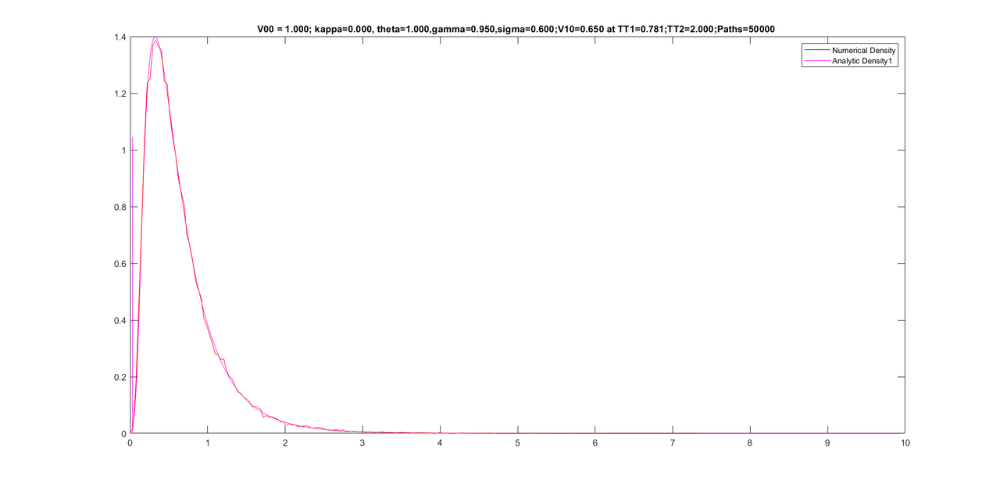](https://postimg.cc/kVSZfcvG)

[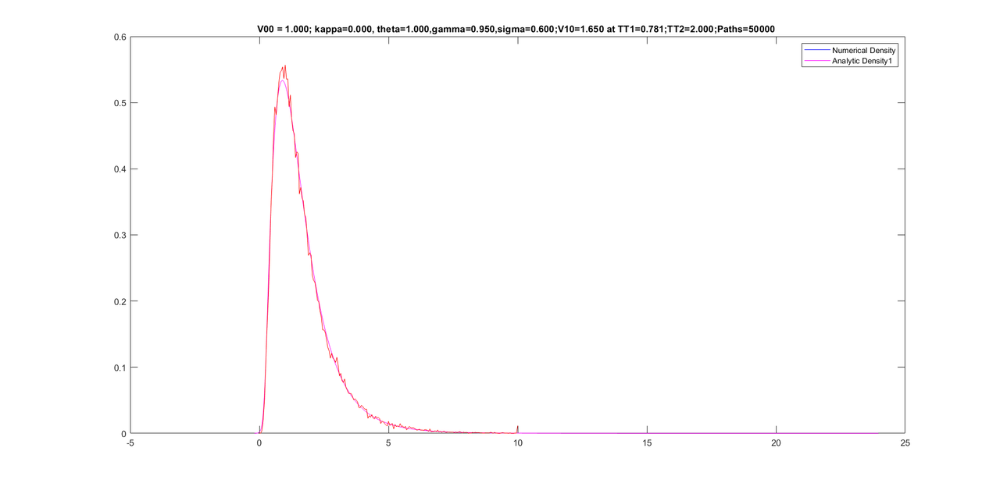](https://postimg.cc/FfSqDZVR)

[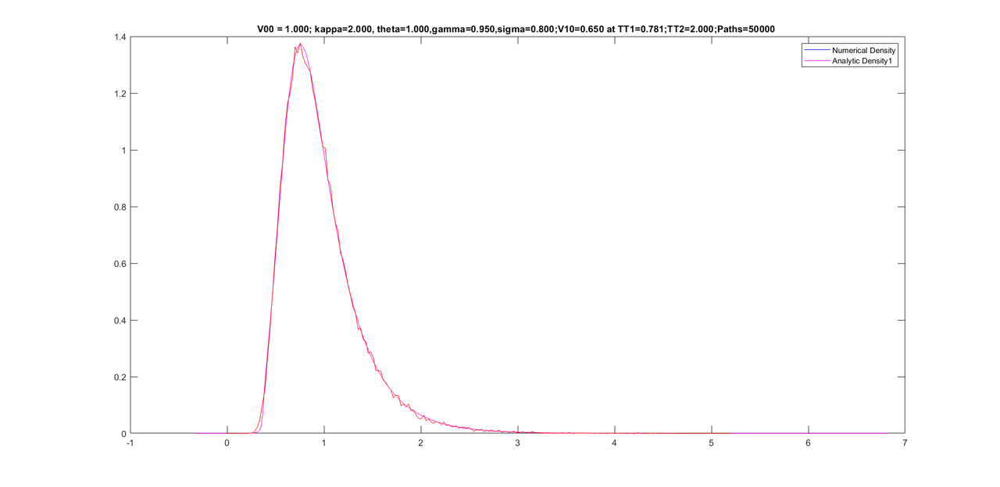](https://postimg.cc/Z9NgVcx0)

[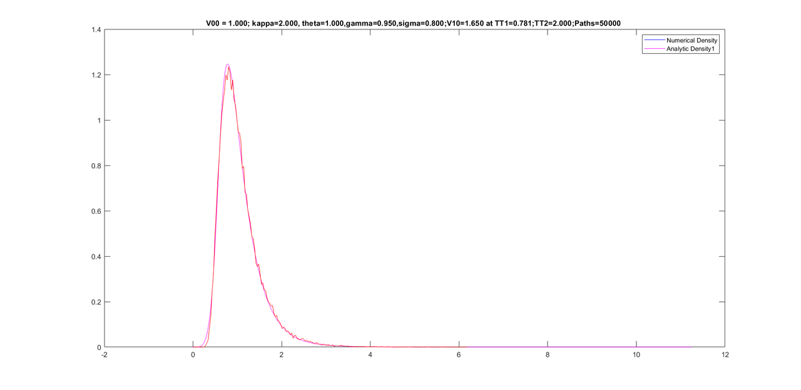](https://postimg.cc/gwh5NDH0)

[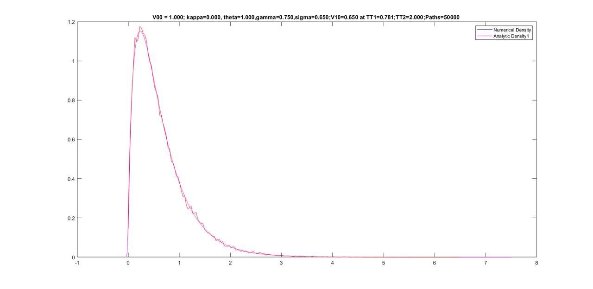](https://postimg.cc/nXgg45BM)

[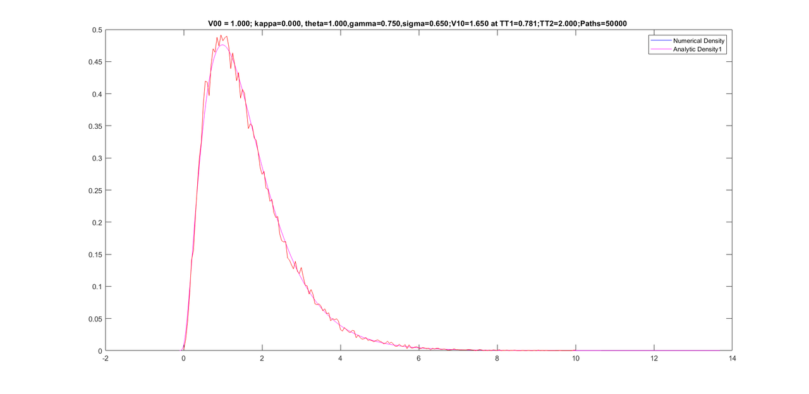](https://postimg.cc/DWGDBgPn)

[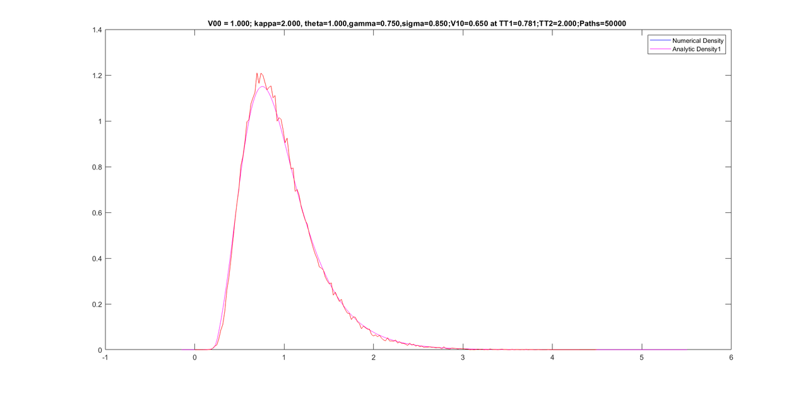](https://postimg.cc/p9j7qZJv)

[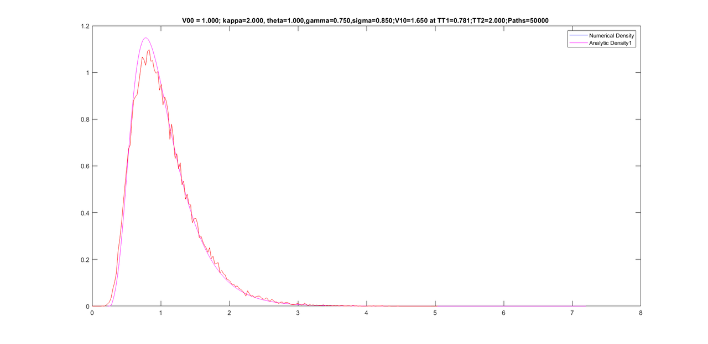](https://postimg.cc/VStTDRW8)

---

### #3002 — Amin (Topic Author)
*March 16, 2026, 3:29 PM*

Graphs in previous post are directly constructed from the following matlab program. When you run the following program
with parameters on the title of graphs, you should be able to make identical graphs as I have not changed anything in
the following program after making above graphs.

.

.

```
function []= ConditionalDensityHermitesBivariate0A()

%SV SDE is
%dV(t)=mu1 V(t)^beta1 dt+ mu2 V(t)^beta2 dt + sigma0 V(t)^gamma dZ(t)
%In mean reverting SDEs we ususally have
%mu1= kappaV * thetaV
%beta1=0
%mu2=-kappa
%beta2=0
%The present program works only when drift is zero (for pure noises)
%meaning mu1=0 and mu2=0;

Order=7;
%NDim=4;%Three assets and one SV.
NMomentsY=Order+1;
NMomentsX=Order+1;

%%%%%%%%%%%%%%%%%%%5
%%%%%%%%%%%%%%%%%%%5

V0=1.000;%.32;
V00=V0;
thetaV=1.0;%.045;%1;%.04;
kappaV=2.000;%1.5;%1.5;
mu1=kappaV*thetaV;
mu2=-kappaV;
beta1=0;
beta2=1;
%gamma=.5;%.950;
%sigma0=.55;%.45;%
gamma=.75;%.75
sigma0=.85;%.35
dt=.03125/2/8;
Tt=64*2*8;
T=Tt*dt;

seed0=52130649;
%seed0=94210876;
rng(seed0, 'twister')
paths=50000;
V(1:paths,1)=V0;
%
% %%%%%%%%%%%%%%%%%%%%%%%%%%%%%%%%%%%%%%%%%%%%%%%%%%%%%%%%%%%%%%%%%%%%%%%%%%%%%%%%%%%%5
 TT1=100*8/2; %Transition distribution start
 TT2=256*8/2; %Transition distribution end

Random2(1:paths/2,1)=0;

for tt=1:Tt

    Random2(1:paths/2)=randn(paths/2,1);
    Random2(paths/2+1:paths)=-Random2(1:paths/2);

    V(1:paths,1)=V(1:paths,1)+ ...
        (mu1.*V(1:paths,1).^beta1 + mu2.*V(1:paths,1).^beta2)*dt + ...
        sigma0*V(1:paths,1).^gamma .*Random2(1:paths,1)*sqrt(dt) + ...
        (mu1.*beta1*V(1:paths,1).^(beta1-1) + mu2.*beta2.*V(1:paths,1).^(beta2-1)).* ...
        ((mu1.*V(1:paths,1).^beta1 + mu2.*V(1:paths,1).^beta2)*dt^2/2 + ...
        sigma0*V(1:paths,1).^gamma .*Random2(1:paths,1)*(1-1/sqrt(3))*dt^1.5) + ...
        .5*(mu1.*beta1.*(beta1-1).*V(1:paths,1).^(beta1-2) + mu2.*beta2.*(beta2-1).*V(1:paths,1).^(beta2-2)).* ...
        sigma0^2.*V(1:paths,1).^(2*gamma).*dt^2/2 + ...
        sigma0*gamma*V(1:paths,1).^(gamma-1) .* ...
        ((mu1.*V(1:paths,1).^beta1 + mu2.*V(1:paths,1).^beta2).*Random2(1:paths,1).*1/sqrt(3)*dt^1.5 + ...
        sigma0.*V(1:paths,1).^gamma .*(Random2(1:paths,1).^2-1)*dt/2) + ...
        .5*sigma0*gamma*(gamma-1).*V(1:paths,1).^(gamma-2) .* ...
        sigma0^2.*V(1:paths,1).^(2*gamma) .*Random2(1:paths,1).*1/sqrt(3)*dt^1.5;

    V(Vabs(Yin(pp)-YPowersH(1,1)))
      %YYxi(pp)=sign(YYxi(pp)).*abs(Yin(pp)-YPowersH(1,1));
  end
end

  [HCorr3,YYxiPowersH,XPowersH,Zyxi,Zx] = CalculateHermiteCorrelations02A(Xin,YYxi,paths);

for nn=2:Order+1
    %Yxi(pp)=Yxi(pp)+YPowersH(nn,1).*HCorr2(nn-1).*HnZx(pp,nn);
    YxCoeffH2(nn)=YYxiPowersH(nn,1).*HCorr3(nn-1);
    %YxCoeffH(nn)=YxiPowersH(nn,1);
end

%%%%%%%%%%%%%%%%%%%%%%%%%%%%%%%%%%%%%%%%%%%%%%%%%%%%%%%%%%%%%%%%%%%%

Order=7;
%[YCoeffHH] = Calculate2DZSeries11(YCoeffH,HCorr2,YxCoeffH2,Order,gamma);
%[YCoeffHH] = Calculate2DZSeries11(YCoeffH,HCorr2,YxCoeffH2,Order);

%[YCoeffZZ] = Convert2DHermitesInto2DSeriesNew(YCoeffHH,Order,Order);

%
%
%
% [ccTriangular,EXt] =SeriesProduct2DTriangularNew(YCoeffZZ,YCoeffZZ,Order+1,Order+1)
%
% [cc,Ex] =SeriesProduct2DAlgorithmicNew(YCoeffZZ,YCoeffZZ,Order+1,Order+1,Order+1,Order+1)
%
% ccTriangular
% cc
% EXt
% Ex
%
% str=input("Look if products from two different programs match together");
%

% %%%%%%%%%%%%%%%%%%%%%%%%%%%%%%%%%%%%%%%%%%%%%%%%%%%%%%%%%%%%%%%%%%%%%%%%%%%%%%55
% save("C:\Users\Lenovo\Documents\MATLAB\MATLAB1\pqfileA.mat","HCorr2","YPowersH","XPowersH");
%
% str=input("Variables have been saved");
% %load("C:\Users\Lenovo\Documents\MATLAB\MATLAB1\pqfileA.mat","HCorr2","YPowersH","XPowersH");
% %%%%%%%%%%%%%%%%%%%%%%%%%%%%%%%%%%%%%%%%%%%%%%%%%%%%%%%%%%%%%%%%%%%%%%%%%%%%%5
% %In this block, we do conditional Monte Carlo of SDE which is the true
% %numerical 1D conditional density of Y conditional on X having a given
% %value. This value of X on which we are conditionin is defined by V10 below.
% %We can alter V10 below and it will take out a 1D slice from the 2D density
% %of Y conditional on X  taking a specific value (here V10).

V10=1.65;
%[XCoeffZ(1:Order+1)] = ConvertHermiteSeriesToZSeries01(XPowersH(1:Order+1,1),Order);
%V10=XCoeffZ(1);
V(1:paths)=V10;
Random2(1:paths,1)=0;

for tt=1:TT2-TT1

    Random2(1:paths/2)=randn(paths/2,1);
    Random2(paths/2+1:paths)=-Random2(1:paths/2);

    V(1:paths,1)=V(1:paths,1)+ ...
        (mu1.*V(1:paths,1).^beta1 + mu2.*V(1:paths,1).^beta2)*dt + ...
        sigma0*V(1:paths,1).^gamma .*Random2(1:paths,1)*sqrt(dt) + ...
        (mu1.*beta1*V(1:paths,1).^(beta1-1) + mu2.*beta2.*V(1:paths,1).^(beta2-1)).* ...
        ((mu1.*V(1:paths,1).^beta1 + mu2.*V(1:paths,1).^beta2)*dt^2/2 + ...
        sigma0*V(1:paths,1).^gamma .*Random2(1:paths,1)*(1-1/sqrt(3))*dt^1.5) + ...
        .5*(mu1.*beta1.*(beta1-1).*V(1:paths,1).^(beta1-2) + mu2.*beta2.*(beta2-1).*V(1:paths,1).^(beta2-2)).* ...
        sigma0^2.*V(1:paths,1).^(2*gamma).*dt^2/2 + ...
        sigma0*gamma*V(1:paths,1).^(gamma-1) .* ...
        ((mu1.*V(1:paths,1).^beta1 + mu2.*V(1:paths,1).^beta2).*Random2(1:paths,1).*1/sqrt(3)*dt^1.5 + ...
        sigma0.*V(1:paths,1).^gamma .*(Random2(1:paths,1).^2-1)*dt/2) + ...
        .5*sigma0*gamma*(gamma-1).*V(1:paths,1).^(gamma-2) .* ...
        sigma0^2.*V(1:paths,1).^(2*gamma) .*Random2(1:paths,1).*1/sqrt(3)*dt^1.5;

    V(V<0)=.0001;

end

%V=log(V);

%logV10=log(V10);
%Below

NoOfBins=200;
MaxCutOff=10;

[XDensity,IndexOut,IndexMax] = MakeDensityFromSimulation_Infiniti_NEW(V,paths,NoOfBins,MaxCutOff );

for qq=1:8

    DataMoments(qq)=sum(V(:).^qq)/paths;

end

%%%%%%%%%%%%%%%%%%%%%%%%%%%%%%%%%%%%%%%%%%%%%%%%%%%%%%%%%%%%%%%%%%%%%%%%%%%%%%%%%%%%%%%5

xOrder=Order;
yOrder=Order;
[Zx0] = CalculateZgivenXAndHSeriesCoeffs(V10,XCoeffH,xOrder);

[YCoeffHH] = Calculate2DZSeriesCorrectedBest(YCoeffH,HCorr2,YxCoeffH2,Order);
%[YCoeffHH]=Calculate2DZSeriesFromHermiteCorrs(YCoeffH,HCorr2,Order);
%[YCoeffHH] = Calculate2DZSeriesCorrectedBest(YCoeffH,rho,YxCoeffH2,Order)
[YCoeffZZ] = Convert2DHermitesInto2DSeriesNew(YCoeffHH,Order,Order);

OrderY=Order;
 OrderX=Order;
 NMoments=8;
 [Y2DMoments] = CalculateMomentsOf2DZSeriesY(YCoeffZZ,OrderY,OrderX,NMoments);
[Y1DMoments] = CalculateMomentsOfZSeries(YCoeffZ(1),YCoeffZ(2:Order+1),OrderY,NMoments);
%CalculateMomentsOfZSeries(
Y2DMoments

Y1DMoments

str=input("Look at comparison of 1D (True) moments and 2D Moments(Basically should roughly be the same) ");

DataMoments

%Below, we collapse two dimensional pdf of Y|X to one dimensional pdf given
%Zx i.e. this Y|X=X(Zx)
%Here we take out a 1D slice from the 2D density
%of Y conditional on X  taking a specific value (here V10).
He(1)=1;
He(2)=Zx0;
He(3)=Zx0^2-1;
He(4)=Zx0^3-3*Zx0;
He(5)=Zx0^4-6*Zx0.^2+3;
He(6)=Zx0^5-10*Zx0.^3+15*Zx0;
He(7)=Zx0^6-15*Zx0.^4+45*Zx0.^2-15;
He(8)=Zx0^7-21*Zx0.^5+105*Zx0.^3-105*Zx0;

YCoeffh(1:Order+1)=0;
for hh=1:yOrder+1
    for hh2=1:xOrder+1
        YCoeffh(hh)=YCoeffh(hh)+YCoeffHH(hh,hh2).*He(hh2);
    end
end

 YCoeffh(1)=YCoeffH(1);
 for hh2=2:xOrder+1
     YCoeffh(1)=YCoeffh(1)+YCoeffH(hh2).*HCorr2(hh2-1).*He(hh2);
 end

 [YCoeffz(1:Order+1)] = ConvertHermiteSeriesToZSeries01(YCoeffh(1:Order+1),Order);

 [Wndd] = CalculateNegativeDensityDerivativeWeight(YCoeffz,Order)

 str=input("Look at the weight Wndd");

 [YMomentsModel]=CalculateMomentsOfZSeries(YCoeffz(1),YCoeffz(2:Order+1),Order,Order+1);

 YMomentsModel

 DataMoments

 str=input("Look at comparison of moments");

 YCoeffz1=YCoeffz;
 %[YCoeffz(1),YCoeffz(2:Order+1),FittedMoments] =
CalculateZSeriesDensityFromRawMoments02FromGuess02NoData(YMomentsModel(1:8));

  MaxIter=500;
%  [YCoeffh,ObjFunc] = DensityCorrection1DCoeffsIterative(YCoeffh,YMomentsModel,Order,MaxIter)

 [YCoeffz(1:Order+1)] = ConvertHermiteSeriesToZSeries01(YCoeffh(1:Order+1),Order);
%
  [YMomentsModelCorrected]=CalculateMomentsOfZSeries(YCoeffz(1),YCoeffz(2:Order+1),Order,Order+1);
%
  YMomentsModelCorrected
%
  DataMoments

%  bGuess(1:5)=0;
%  bGuess(1)=1;
%  [YCoeffz0(1),YCoeffz0(2:6)] = CalculateZSeriesDensityFromRawMomentsM6(YMomentsModelCorrected(1:6),bGuess)

clf;

%PlotZSeriesDensity(YCoeffz(1),YCoeffz(2:yOrder+1),'b')
%PlotZSeriesDensity(YCoeffz(1),YCoeffz(2:Order+1-2),'b')

%hold on

%PlotZSeriesDensity(YCoeffz0(1),YCoeffz0(2:Order+1-3),'g')
PlotZSeriesDensity(YCoeffz(1),YCoeffz(2:Order+1),'b')

hold on
PlotZSeriesDensity(YCoeffz1(1),YCoeffz1(2:Order+1),'m')

hold on

plot(IndexOut(1:IndexMax),XDensity(1:IndexMax),'r');

%PlotHermiteSeriesDensityAndRvGraph(YCoeffh(1),YCoeffh1(2:yOrder+1),'g')
title(sprintf('V00 = %.3f; kappa=%.3f, theta=%.3f,gamma=%.3f,sigma=%.3f;V10=%.3f at TT1=%.3f;TT2=%.3f;Paths=%d ',V00,
kappaV, thetaV,gamma,sigma0, V10,(TT1*dt),(TT2*dt),paths));%,sprintf('theta= %f', theta), sprintf('kappa = %f',
kappa),sprintf('sigma = %f', sigma0),sprintf('T = %f', T));
legend({'Numerical Density','Analytic Density1'}, ...
    'Location','northeast')

str=input("This is the first version without altering the moments of conditional density")

hold off

end

```

.

.

.

.

```
function [HCorr2,YPowersH,XPowersH,Zy,Zx] = CalculateHermiteCorrelations02A(Xin,Yin,NData)

Order=7;
NMoments=8;

[ZI] = MomentMatchedStandardNormalDiscretizedDensity(NData);

[XCoeffH,Zx] = CalculateHermiteSeriesFromData01(Xin,Order,ZI);
% [XCoeffZ(1:Order+1)] = ConvertHermiteSeriesToZSeries01(XCoeffH(1:Order+1),Order);
%
%  for pp=1:Order+1
%      XrMu(pp)=sum(Xin(1:NData).^pp)/NData;
%  end
%
%
%  %[SecondMomentX] = CalculateSecondMomentC7(XCoeffZ(1),XCoeffZ(2:Order+1));
%
%  [MomentsX] = CalculateMomentsOfZSeries(XCoeffZ(1),XCoeffZ(2:Order+1),Order,NMoments);
%
% XCoeffZs=XCoeffZ/sqrt(MomentsX(2)-MomentsX(1).^2);
%
%  [c0,c] = CalculateZSeriesDensityFromRawMoments02FromGuess02(Xin,ZI);%,XCoeffZ(2:Order+1));
%  XCoeffZ(1)=c0;
%  XCoeffZ(2:Order+1)=c(1:Order);
%
%  [XCoeffZ] = FixTheDensityDerivativesATExtremes(XCoeffZ,Order);
% [XCoeffZ] = FixTheDensityDerivativesATNegativeExtreme(XCoeffZ,Order);
%
%
%
%
%  [XCoeffH(1:Order+1)] = ConvertZSeriesToHermiteSeriesNew(XCoeffZ(1:Order+1),Order);
XPowersH(1:Order+1,1)=XCoeffH(1:Order+1);
for nn=1:NData

  %[Zx(nn)]=CalculateZgivenXAndZSeriesBisection2C5Improved(Xin(nn),XCoeffZ(1),XCoeffZ(2:6));
end
[Zx] = CalculateZgivenXAndHSeriesCoeffs(Xin,XCoeffH,Order);

% XPowersZ(1:Order+1,1)=XCoeffZ(1:Order+1);

 % %[cc,EX] =SeriesProduct1D(aa,bb,SeriesOrder1,SeriesOrder2)
% [XPowersZ(1:Order*2+1,2),EX2]=SeriesProduct1D(XPowersZ(1:Order+1,1),XPowersZ(1:Order+1,1),Order+1,Order+1);
% [XPowersZ(1:Order*3+1,3),EX3]=SeriesProduct1D(XPowersZ(1:Order+1,1),XPowersZ(1:2*Order+1,2),Order+1,2*Order+1);
% [XPowersZ(1:Order*4+1,4),EX4]=SeriesProduct1D(XPowersZ(1:Order+1,1),XPowersZ(1:3*Order+1,3),Order+1,3*Order+1);
% [XPowersZ(1:Order*5+1,5),EX5]=SeriesProduct1D(XPowersZ(1:Order+1,1),XPowersZ(1:4*Order+1,4),Order+1,4*Order+1);
% [XPowersZ(1:Order*6+1,6),EX6]=SeriesProduct1D(XPowersZ(1:Order+1,1),XPowersZ(1:5*Order+1,5),Order+1,5*Order+1);
% [XPowersZ(1:Order*7+1,7),EX7]=SeriesProduct1D(XPowersZ(1:Order+1,1),XPowersZ(1:6*Order+1,6),Order+1,6*Order+1);
% [XPowersZ(1:Order*8+1,8),EX8]=SeriesProduct1D(XPowersZ(1:Order+1,1),XPowersZ(1:7*Order+1,7),Order+1,7*Order+1);

%for nn=2:Order+1
%[XPowersZ(1:Order*nn+1,nn),EXn(nn)]=SeriesProduct1D(XPowersZ(1:Order+1,1),XPowersZ(1:Order*(nn-1)+1,nn-1),Order+1,(nn-1)*Order+1);
%XPowersH(1:Order*nn+1,nn)=ConvertZSeriesToHermiteSeriesNew(XPowersZ(1:Order*nn+1,nn),Order*nn);
%end

%XrMu
%EXn

%XPowersH(1,1:Order+1)

%str=input("Look at moments of X----1")

% %%%%%%%%%%%%%%%%%%%%%%%%%%%%%%%%%%%%%%%%%%%%%%%%%%%%%%%%%%%%%%%%%%%%%%%%55

Order=7;

[YCoeffH,Zy] = CalculateHermiteSeriesFromData01(Yin,Order,ZI);
[YCoeffZ(1:Order+1)] = ConvertHermiteSeriesToZSeries01(YCoeffH(1:Order+1),Order);

% for qq=1:Order+1
%      YrMu(qq)=sum(Yin(1:NData).^qq)/NData;
% end
%
% [MomentsY] = CalculateMomentsOfZSeries(YCoeffZ(1),YCoeffZ(2:Order+1),Order,NMoments);
%
% YCoeffZs=YCoeffZ/sqrt(MomentsY(2)-MomentsY(1).^2);
%
%  [c0,c] = CalculateZSeriesDensityFromRawMoments02FromGuess02(Yin,ZI);%,YCoeffZ(2:Order+1));
%  YCoeffZ(1)=c0;
%  YCoeffZ(2:Order+1)=c(1:Order);
%
%
%  [YCoeffZ] = FixTheDensityDerivativesATExtremes(YCoeffZ,Order)
% [YCoeffZ] = FixTheDensityDerivativesATNegativeExtreme(YCoeffZ,Order)
%
%
%
% for nn=1:NData
%   %[Zy(nn)]=CalculateZgivenXAndZSeriesBisection2C5Improved(Yin(nn),YCoeffZ(1),YCoeffZ(2:6));
% end
%
%
% YPowersZ(1:Order+1,1)=YCoeffZ(1:Order+1);
% [YCoeffH(1:Order+1)] = ConvertZSeriesToHermiteSeriesNew(YCoeffZ(1:Order+1),Order);
%
[Zy] = CalculateZgivenXAndHSeriesCoeffs(Yin,YCoeffH,Order);

YPowersH(1:Order+1,1)=YCoeffH(1:Order+1);
%for nn=2:Order+1
%[YPowersZ(1:Order*nn+1,nn),EYn(nn)]=SeriesProduct1D(YPowersZ(1:Order+1,1),YPowersZ(1:Order*(nn-1)+1,nn-1),Order+1,(nn-1)*Order+1);
%YPowersH(1:Order*nn+1,nn)=ConvertZSeriesToHermiteSeriesNew(YPowersZ(1:Order*nn+1,nn),Order*nn);

%end

%YrMu
%EYn

% mm=0;
% for nn=1:NData
%     if((abs(Zx(nn))1)
% ExistingCorr(1:(pp-1)*Order)=HCorr3(1:(pp-1)*Order);
% else
% ExistingCorr=0;
% end
% %[HCorr3] =
CalculateHCorrIterative(YPowersH(1:Order+1,1),XPowersH,EXYin,ExistingCorr,NewCorr,LenECorr,LenNCorr,Order);
% %[HCorr3] =
CalculateHCorrIterative02(YPowersH(1:pp*Order+1,pp),XPowersH,EXYin,ExistingCorr,NewCorr,LenECorr,LenNCorr,Order,pp);
% [HCorr3] = CalculateHCorrIterative04(YPowersH,XPowersH,EXY1in,EXY2in,ExistingCorr,NewCorr,LenECorr,LenNCorr,Order,pp);
%
% for mm=1:Order
% %EXY1(mm)=YPowersH(1,2)*XPowersH(1,mm);
% EXY2(mm)=YPowersH(1,pp)*XPowersH(1,mm);
% EXY3(mm)=YPowersH(1,pp)*XPowersH(1,mm);
% EXY0(mm)=YPowersH(1,pp).*XPowersH(1,mm);
% EXY00(mm)=YPowersH(1,pp).*XPowersH(1,mm);
% EXY000(mm)=YPowersH(1,pp).*XPowersH(1,mm);
% for nn=1:Order*pp
%  %EXY1(mm)=EXY1(mm)+YPowersH(nn+1,1).*XPowersH(nn+1,mm).*factorial(nn)*HCorr1(nn);
%  EXY2(mm)=EXY2(mm)+YPowersH(nn+1,pp).*XPowersH(nn+1,mm).*factorial(nn)*HCorr2(nn);
%  EXY3(mm)=EXY3(mm)+YPowersH(nn+1,pp).*XPowersH(nn+1,mm).*factorial(nn)*HCorr3(nn);
% end
% for nn=1:Order
%  %EXY1(mm)=EXY1(mm)+YPowersH(nn+1,1).*XPowersH(nn+1,mm).*factorial(nn)*HCorr1(nn);
%  EXY00(mm)=EXY00(mm)+YPowersH(nn+1,pp).*XPowersH(nn+1,mm).*factorial(nn)*HCorr3(nn);
% end
%
% if(pp<2)
%     pp2=1;
% else
%     pp2=2;
% end
% for nn=1:Order*pp2
%  %EXY1(mm)=EXY1(mm)+YPowersH(nn+1,1).*XPowersH(nn+1,mm).*factorial(nn)*HCorr1(nn);
%  EXY000(mm)=EXY000(mm)+YPowersH(nn+1,pp).*XPowersH(nn+1,mm).*factorial(nn)*HCorr3(nn);
% end
% end
%
% HCorr2
% HCorr3
%
% EXY1in
%
% EXY2
% EXY3
% EXY0
% EXY00
% EXY000
%
% HCorr3
% %YPowersH
% %XPowersH
% pp
%
% str=input("Look at comparison of moments data")
% end
%
% HCorr3(pp*Order+1:pp*Order+Order)=HCorr2(pp*Order+1:pp*Order+Order);
%
% %HCorr3=HCorr2;

%%%%%%%%%%%%%%%%%%%%%%%%%%%%%%%%%%%%%%%%%%%%%%%%%%%%%%%%%%%%%%%%%%%%%%%%%%%

% %
% Order=7;
%
% for pp=1:Order+1
%
% for qq=1:Order
% EXYin(pp,qq)=sum(Yin(1:NData).^pp.*Xin(1:NData).^qq)/NData;
% end
% end
%
%
%
% %[HCorr3] =
CalculateHCorrIterative04(YPowersH,XPowersH,EXY1in,EXY2in,ExistingCorr,NewCorr,LenECorr,LenNCorr,Order,pp);
% [HCorr3] = CalculateHCorrIterative08(YPowersH,XPowersH,EXYin,HCorr2,Order);
%
%
% for pp1=1:(Order+1)
%     for qq1=1:Order
%         if(pp1<=qq1)
%             NN1=pp1;
%         else
%             NN1=qq1;
%         end
%         EXY1(pp1,qq1)=YPowersH(1,pp1)*XPowersH(1,qq1);
%         for nn1=1:NN1*Order
%             EXY1(pp1,qq1)=EXY1(pp1,qq1)+YPowersH(nn1+1,pp1)*XPowersH(nn1+1,qq1).*factorial(nn1)*HCorr3(nn1);
%         end
%     end
% end
%
% HCorr2
% HCorr3
%
% EXYin
%
% EXY1
%
%
%
% str=input("Look at comparison of moments data")
end

```

.

.

.

```
function [YCoeffHH] = Calculate2DZSeriesCorrectedBest(YCoeffH,rho,YxCoeffH2,Order)

%YxCoeffH2(3:2:8)=0;

for nn=1:Order
ch(nn+1)=rho(nn).*YCoeffH(nn+1);%-(YxCoeffH2(nn+1));%/sqrt(factorial(nn+1));
end

[YCoeffZ(1:Order+1)] = ConvertHermiteSeriesToZSeries01(YCoeffH(1:Order+1),Order);
[c(1:Order+1)] = ConvertHermiteSeriesToZSeries01(ch(1:Order+1),Order);

rho_z(7)=c(8)./YCoeffZ(8);
cn(8)=(abs(rho_z(7))).^(1/7);
dn(8)=sqrt(1-(abs(rho_z(7))).^(2/7)); %The line is gaussian formula for correlation as sqrt(1-cn(nn).^2)
%ch0(nn)=(rho_z(nn-1));
if(rho_z(7)<0)
 %   cn(8)=-cn(8);
end

zeta=1;
%CC(1,8)=(YCoeffZ(8)).*ch0(8);
CC(1,8)=c(8);
CC(2,7)=YCoeffZ(8).*(7*cn(8).^6.*dn(8).*zeta);
CC(3,6)=YCoeffZ(8).*(21*cn(8).^5.*dn(8).^2*zeta^2);
CC(4,5)=YCoeffZ(8).*(35*cn(8).^4.*dn(8).^3*zeta^3);
CC(5,4)=YCoeffZ(8).*(35*cn(8).^3.*dn(8).^4.*zeta^4);
CC(6,3)=YCoeffZ(8).*(21*cn(8).^2.*dn(8).^5*zeta^5);
CC(7,2)=YCoeffZ(8).*(7*cn(8).*dn(8).^6*zeta^6);
CC(8,1)=YCoeffZ(8).*(dn(8).^7*zeta^7);

rho_z(6)=c(7)./YCoeffZ(7);
cn(7)=(abs(rho_z(6))).^(1/6);
dn(7)=sqrt(1-(abs(rho_z(6))).^(2/6)); %The line is gaussian formula for correlation as sqrt(1-cn(nn).^2)

if(rho_z(6)<0)
 %   cn(7)=-cn(7);
end

CC(1,7)=c(7);
CC(2,6)=YCoeffZ(7).*(6*cn(7).^5.*dn(7).*zeta);
CC(3,5)=YCoeffZ(7).*(15*cn(7).^4.*dn(7).^2*zeta^2);
CC(4,4)=YCoeffZ(7).*(20*cn(7).^3.*dn(7).^3*zeta^3);
CC(5,3)=YCoeffZ(7).*(15*cn(7).^2.*dn(7).^4.*zeta^4);
CC(6,2)=YCoeffZ(7).*(6*cn(7).*dn(7).^5*zeta^5);
CC(7,1)=YCoeffZ(7).*(dn(7).^6*zeta^6);

rho_z(5)=(c(6)-CC(3,6))./YCoeffZ(6);
cn(6)=(abs(rho_z(5))).^(1/5);
dn(6)=sqrt(1-(abs(rho_z(5))).^(2/5)); %The line is gaussian formula for correlation as sqrt(1-cn(nn).^2)
if(rho_z(5)<0)
  %  cn(6)=-cn(6);
end

CC(1,6)=(c(6)-CC(3,6));
CC(2,5)=YCoeffZ(6).*(5*cn(6).^4.*dn(6).*zeta);
CC(3,4)=YCoeffZ(6).*(10*cn(6).^3.*dn(6).^2*zeta^2);
CC(4,3)=YCoeffZ(6).*(10*cn(6).^2.*dn(6).^3*zeta^3);
CC(5,2)=YCoeffZ(6).*(5*cn(6).*dn(6).^4.*zeta^4);
CC(6,1)=YCoeffZ(6).*(dn(6).^5*zeta^5);

rho_z(4)=(c(5)-CC(3,5))./YCoeffZ(5);
cn(5)=(abs(rho_z(4))).^(1/4);
dn(5)=sqrt(1-(abs(rho_z(4))).^(2/4)); %The line is gaussian formula for correlation as sqrt(1-cn(nn).^2)
if(rho_z(4)<0)
   % cn(5)=-cn(5);
end

CC(1,5)=(c(5)-CC(3,5));
CC(2,4)=YCoeffZ(5).*(4* cn(5).^3.* dn(5).* zeta);
CC(3,3)=YCoeffZ(5).*(6* cn(5).^2.* dn(5).^2.* zeta^2);
CC(4,2)=YCoeffZ(5).* (4*cn(5).*dn(5).^3.*zeta^3);
CC(5,1)=YCoeffZ(5).*(dn(5).^4.*zeta^4);

rho_z(3)=(c(4)-CC(3,4)-3*CC(5,4))./YCoeffZ(4);
cn(4)=(abs(rho_z(3))).^(1/3);
dn(4)=sqrt(1-(abs(rho_z(3))).^(2/3)); %The line is gaussian formula for correlation as sqrt(1-cn(nn).^2)
if(rho_z(3)<0)
  %  cn(4)=-cn(4);
end

CC(1,4)=(c(4)-CC(3,4)-3*CC(5,4));
CC(2,3)=YCoeffZ(4).* (3.* cn(4).^2 .*dn(4).* zeta);
CC(3,2)=YCoeffZ(4).* (3.* cn(4).* dn(4).^2.* zeta^2);
CC(4,1)=YCoeffZ(4).* (dn(4).^3 .*zeta^3);

rho_z(2)=(c(3)-CC(3,3)-3*CC(5,3))./YCoeffZ(3);
cn(3)=(abs(rho_z(2))).^(1/2);
dn(3)=sqrt(1-(abs(rho_z(2))).^(2/2)); %The line is gaussian formula for correlation as sqrt(1-cn(nn).^2)
if(rho_z(2)<0)
   % cn(3)=-cn(3);
end

CC(1,3)=(c(3)-CC(3,3)-3*CC(5,3));
CC(2,2)=YCoeffZ(3).*(2 *cn(3).* dn(3).* zeta);
CC(3,1)=YCoeffZ(3).*(dn(3).^2.* zeta^2);

rho_z(1)=(c(2)-CC(3,2)-3*CC(5,2)-15*CC(7,2))./YCoeffZ(2);
cn(2)=(abs(rho_z(1)));
dn(2)=sqrt(1-(abs(rho_z(1))).^(2/1));

CC(1,2)=(c(2)-CC(3,2)-3*CC(5,2)-15*CC(7,2));
CC(2,1)=(YCoeffZ(2)).*dn(2);

CC(1,1)=c(1)-CC(3,1)-3*CC(5,1)-15*CC(7,1);

[CCHH] = ConvertZSeriesToHermiteSeries2D(CC,Order+1,Order+1);

YCoeffHH=CCHH;
YCoeffHH(1,1)=YCoeffH(1);

YCoeffHH

YCoeffHH(1,1:Order+1)
ch
str=input("Look at values---Last");

end

```

.

.

.

---

### #3003 — Amin (Topic Author)
*March 16, 2026, 4:15 PM*

Friends, I have removed some un-necessary calculations from the program. Please note that monte carlo simulation data is
also produced live in the program and total run time includes this data generation time. Conditional density generation
algorithm is almost instantaneous.

Even though I shown graphs with 50000 SDE data, the graphs with 10000 data elements are also very very good.

Here are the new slightly altered files.

.

.

.

```
function []= ConditionalDensityHermitesBivariate0A()

%SV SDE is
%dV(t)=mu1 V(t)^beta1 dt+ mu2 V(t)^beta2 dt + sigma0 V(t)^gamma dZ(t)
%In mean reverting SDEs we ususally have
%mu1= kappaV * thetaV
%beta1=0
%mu2=-kappa
%beta2=0
%The present program works only when drift is zero (for pure noises)
%meaning mu1=0 and mu2=0;

Order=7;
%NDim=4;%Three assets and one SV.
NMomentsY=Order+1;
NMomentsX=Order+1;

%%%%%%%%%%%%%%%%%%%5
%%%%%%%%%%%%%%%%%%%5

V0=1.000;%.32;
V00=V0;
thetaV=1.0;%.045;%1;%.04;
kappaV=0.000;%1.5;%1.5;
mu1=kappaV*thetaV;
mu2=-kappaV;
beta1=0;
beta2=1;
%gamma=.5;%.950;
%sigma0=.55;%.45;%
gamma=.55;%.75
sigma0=.65;%.35
dt=.03125/2/8;
Tt=64*2*8;
T=Tt*dt;

seed0=52130649;
%seed0=94210876;
rng(seed0, 'twister')
paths=50000;
V(1:paths,1)=V0;
%
% %%%%%%%%%%%%%%%%%%%%%%%%%%%%%%%%%%%%%%%%%%%%%%%%%%%%%%%%%%%%%%%%%%%%%%%%%%%%%%%%%%%%5
 TT1=100*8/2; %Transition distribution start
 TT2=256*8/2; %Transition distribution end

Random2(1:paths/2,1)=0;

for tt=1:Tt

    Random2(1:paths/2)=randn(paths/2,1);
    Random2(paths/2+1:paths)=-Random2(1:paths/2);

    V(1:paths,1)=V(1:paths,1)+ ...
        (mu1.*V(1:paths,1).^beta1 + mu2.*V(1:paths,1).^beta2)*dt + ...
        sigma0*V(1:paths,1).^gamma .*Random2(1:paths,1)*sqrt(dt) + ...
        (mu1.*beta1*V(1:paths,1).^(beta1-1) + mu2.*beta2.*V(1:paths,1).^(beta2-1)).* ...
        ((mu1.*V(1:paths,1).^beta1 + mu2.*V(1:paths,1).^beta2)*dt^2/2 + ...
        sigma0*V(1:paths,1).^gamma .*Random2(1:paths,1)*(1-1/sqrt(3))*dt^1.5) + ...
        .5*(mu1.*beta1.*(beta1-1).*V(1:paths,1).^(beta1-2) + mu2.*beta2.*(beta2-1).*V(1:paths,1).^(beta2-2)).* ...
        sigma0^2.*V(1:paths,1).^(2*gamma).*dt^2/2 + ...
        sigma0*gamma*V(1:paths,1).^(gamma-1) .* ...
        ((mu1.*V(1:paths,1).^beta1 + mu2.*V(1:paths,1).^beta2).*Random2(1:paths,1).*1/sqrt(3)*dt^1.5 + ...
        sigma0.*V(1:paths,1).^gamma .*(Random2(1:paths,1).^2-1)*dt/2) + ...
        .5*sigma0*gamma*(gamma-1).*V(1:paths,1).^(gamma-2) .* ...
        sigma0^2.*V(1:paths,1).^(2*gamma) .*Random2(1:paths,1).*1/sqrt(3)*dt^1.5;

    V(V<0)=.0001;

    if(tt==TT1)
        Xin(1:paths,1)=V(1:paths,1);
    end

    if(tt==TT2)
        Yin(1:paths,1)=V(1:paths,1);
    end
end

str=input("I have reached stone 1");

%%%%%%%%%%%%%%%%%%%%%%%%%%%%%%%%%%%%%%%%%%%%%%%%%%5

%Xin=log(Xin);
%Yin=log(Yin);

Order=7;
clf;
%CalculateHermiteCorrelations02(Xin,Yin,paths);
[HCorr2,YPowersH,XPowersH,Zy,Zx] = CalculateHermiteCorrelations02A(Xin,Yin,paths);

XCoeffH(1:Order+1)=XPowersH(1:Order+1,1);
YCoeffH(1:Order+1)=YPowersH(1:Order+1,1);
XCoeffZ(1:Order+1)= ConvertHermiteSeriesToZSeries01(XPowersH(1:Order+1,1),Order);
YCoeffZ(1:Order+1)= ConvertHermiteSeriesToZSeries01(YPowersH(1:Order+1,1),Order);

YPowersH(1,1)
XPowersH(1,1)

HCorr2

str=input("Look at the means");

YxCoeffH(1)=YPowersH(1,1);

for nn=2:Order+1
    %Yxi(pp)=Yxi(pp)+YPowersH(nn,1).*HCorr2(nn-1).*HnZx(pp,nn);
    YxCoeffH(nn)=YPowersH(nn,1).*HCorr2(nn-1);
    %YxCoeffH(nn)=YxiPowersH(nn,1);
end

%%%%%%%%%%%%%%%%%%%%%%%%%%%%%%%%%%%%%%%%%%%%%%%%%%%%%%%%%%%%%%%%%%5
% %%%%%%%%%%%%%%%%%%%%%%%%%%%%%%%%%%%%%%%%%%%%%%%%%%%%%%%%%%%%%%%%%%%%%%%%%%%%%5
% %In this block, we do conditional Monte Carlo of SDE which is the true
% %numerical 1D conditional density of Y conditional on X having a given
% %value. This value of X on which we are conditionin is defined by V10 below.
% %We can alter V10 below and it will take out a 1D slice from the 2D density
% %of Y conditional on X  taking a specific value (here V10).

V10=1.65;
%[XCoeffZ(1:Order+1)] = ConvertHermiteSeriesToZSeries01(XPowersH(1:Order+1,1),Order);
%V10=XCoeffZ(1);
V(1:paths)=V10;
Random2(1:paths,1)=0;

for tt=1:TT2-TT1

    Random2(1:paths/2)=randn(paths/2,1);
    Random2(paths/2+1:paths)=-Random2(1:paths/2);

    V(1:paths,1)=V(1:paths,1)+ ...
        (mu1.*V(1:paths,1).^beta1 + mu2.*V(1:paths,1).^beta2)*dt + ...
        sigma0*V(1:paths,1).^gamma .*Random2(1:paths,1)*sqrt(dt) + ...
        (mu1.*beta1*V(1:paths,1).^(beta1-1) + mu2.*beta2.*V(1:paths,1).^(beta2-1)).* ...
        ((mu1.*V(1:paths,1).^beta1 + mu2.*V(1:paths,1).^beta2)*dt^2/2 + ...
        sigma0*V(1:paths,1).^gamma .*Random2(1:paths,1)*(1-1/sqrt(3))*dt^1.5) + ...
        .5*(mu1.*beta1.*(beta1-1).*V(1:paths,1).^(beta1-2) + mu2.*beta2.*(beta2-1).*V(1:paths,1).^(beta2-2)).* ...
        sigma0^2.*V(1:paths,1).^(2*gamma).*dt^2/2 + ...
        sigma0*gamma*V(1:paths,1).^(gamma-1) .* ...
        ((mu1.*V(1:paths,1).^beta1 + mu2.*V(1:paths,1).^beta2).*Random2(1:paths,1).*1/sqrt(3)*dt^1.5 + ...
        sigma0.*V(1:paths,1).^gamma .*(Random2(1:paths,1).^2-1)*dt/2) + ...
        .5*sigma0*gamma*(gamma-1).*V(1:paths,1).^(gamma-2) .* ...
        sigma0^2.*V(1:paths,1).^(2*gamma) .*Random2(1:paths,1).*1/sqrt(3)*dt^1.5;

    V(V<0)=.0001;

end

%V=log(V);

%logV10=log(V10);
%Below

NoOfBins=200;
MaxCutOff=10;

[XDensity,IndexOut,IndexMax] = MakeDensityFromSimulation_Infiniti_NEW(V,paths,NoOfBins,MaxCutOff );

for qq=1:8

    DataMoments(qq)=sum(V(:).^qq)/paths;

end

%%%%%%%%%%%%%%%%%%%%%%%%%%%%%%%%%%%%%%%%%%%%%%%%%%%%%%%%%%%%%%%%%%%%%%%%%%%%%%%%%%%%%%%5

xOrder=Order;
yOrder=Order;
[Zx0] = CalculateZgivenXAndHSeriesCoeffs(V10,XCoeffH,xOrder);

[YCoeffHH] = Calculate2DZSeriesCorrectedBest(YCoeffH,HCorr2,Order);
%[YCoeffHH]=Calculate2DZSeriesFromHermiteCorrs(YCoeffH,HCorr2,Order);
%[YCoeffHH] = Calculate2DZSeriesCorrectedBest(YCoeffH,rho,YxCoeffH2,Order)
[YCoeffZZ] = Convert2DHermitesInto2DSeriesNew(YCoeffHH,Order,Order);

OrderY=Order;
 OrderX=Order;
 NMoments=8;
 [Y2DMoments] = CalculateMomentsOf2DZSeriesY(YCoeffZZ,OrderY,OrderX,NMoments);
[Y1DMoments] = CalculateMomentsOfZSeries(YCoeffZ(1),YCoeffZ(2:Order+1),OrderY,NMoments);
%CalculateMomentsOfZSeries(
Y2DMoments

Y1DMoments

str=input("Look at comparison of 1D (True) moments and 2D Moments(Basically should roughly be the same) ");

DataMoments

%Below, we collapse two dimensional pdf of Y|X to one dimensional pdf given
%Zx i.e. this Y|X=X(Zx)
%Here we take out a 1D slice from the 2D density
%of Y conditional on X  taking a specific value (here V10).
He(1)=1;
He(2)=Zx0;
He(3)=Zx0^2-1;
He(4)=Zx0^3-3*Zx0;
He(5)=Zx0^4-6*Zx0.^2+3;
He(6)=Zx0^5-10*Zx0.^3+15*Zx0;
He(7)=Zx0^6-15*Zx0.^4+45*Zx0.^2-15;
He(8)=Zx0^7-21*Zx0.^5+105*Zx0.^3-105*Zx0;

YCoeffh(1:Order+1)=0;
for hh=1:yOrder+1
    for hh2=1:xOrder+1
        YCoeffh(hh)=YCoeffh(hh)+YCoeffHH(hh,hh2).*He(hh2);
    end
end

 YCoeffh(1)=YCoeffH(1);
 for hh2=2:xOrder+1
     YCoeffh(1)=YCoeffh(1)+YCoeffH(hh2).*HCorr2(hh2-1).*He(hh2);
 end

 [YCoeffz(1:Order+1)] = ConvertHermiteSeriesToZSeries01(YCoeffh(1:Order+1),Order);

 [Wndd] = CalculateNegativeDensityDerivativeWeight(YCoeffz,Order)

 str=input("Look at the weight Wndd");

 [YMomentsModel]=CalculateMomentsOfZSeries(YCoeffz(1),YCoeffz(2:Order+1),Order,Order+1);

 YMomentsModel

 DataMoments

 str=input("Look at comparison of moments");

 YCoeffz1=YCoeffz;
 %[YCoeffz(1),YCoeffz(2:Order+1),FittedMoments] =
CalculateZSeriesDensityFromRawMoments02FromGuess02NoData(YMomentsModel(1:8));

  MaxIter=500;
%  [YCoeffh,ObjFunc] = DensityCorrection1DCoeffsIterative(YCoeffh,YMomentsModel,Order,MaxIter)

 [YCoeffz(1:Order+1)] = ConvertHermiteSeriesToZSeries01(YCoeffh(1:Order+1),Order);
%
  [YMomentsModelCorrected]=CalculateMomentsOfZSeries(YCoeffz(1),YCoeffz(2:Order+1),Order,Order+1);
%
  YMomentsModelCorrected
%
  DataMoments

%  bGuess(1:5)=0;
%  bGuess(1)=1;
%  [YCoeffz0(1),YCoeffz0(2:6)] = CalculateZSeriesDensityFromRawMomentsM6(YMomentsModelCorrected(1:6),bGuess)

clf;

%PlotZSeriesDensity(YCoeffz(1),YCoeffz(2:yOrder+1),'b')
%PlotZSeriesDensity(YCoeffz(1),YCoeffz(2:Order+1-2),'b')

%hold on

%PlotZSeriesDensity(YCoeffz0(1),YCoeffz0(2:Order+1-3),'g')
PlotZSeriesDensity(YCoeffz(1),YCoeffz(2:Order+1),'b')

hold on
PlotZSeriesDensity(YCoeffz1(1),YCoeffz1(2:Order+1),'m')

hold on

plot(IndexOut(1:IndexMax),XDensity(1:IndexMax),'r');

%PlotHermiteSeriesDensityAndRvGraph(YCoeffh(1),YCoeffh1(2:yOrder+1),'g')
title(sprintf('V00 = %.3f; kappa=%.3f, theta=%.3f,gamma=%.3f,sigma=%.3f;V10=%.3f at TT1=%.3f;TT2=%.3f;Paths=%d ',V00,
kappaV, thetaV,gamma,sigma0, V10,(TT1*dt),(TT2*dt),paths));%,sprintf('theta= %f', theta), sprintf('kappa = %f',
kappa),sprintf('sigma = %f', sigma0),sprintf('T = %f', T));
legend({'Numerical Density','Analytic Density1'}, ...
    'Location','northeast')

str=input("This is the first version without altering the moments of conditional density")

hold off

end

```

.

.

.

```
function [YCoeffHH] = Calculate2DZSeriesCorrectedBest(YCoeffH,rho,Order)

%YxCoeffH2(3:2:8)=0;

for nn=1:Order
ch(nn+1)=rho(nn).*YCoeffH(nn+1);%-(YxCoeffH2(nn+1));%/sqrt(factorial(nn+1));
end

[YCoeffZ(1:Order+1)] = ConvertHermiteSeriesToZSeries01(YCoeffH(1:Order+1),Order);
[c(1:Order+1)] = ConvertHermiteSeriesToZSeries01(ch(1:Order+1),Order);

rho_z(7)=c(8)./YCoeffZ(8);
cn(8)=(abs(rho_z(7))).^(1/7);
dn(8)=sqrt(1-(abs(rho_z(7))).^(2/7)); %The line is gaussian formula for correlation as sqrt(1-cn(nn).^2)
%ch0(nn)=(rho_z(nn-1));
if(rho_z(7)<0)
 %   cn(8)=-cn(8);
end

zeta=1;
%CC(1,8)=(YCoeffZ(8)).*ch0(8);
CC(1,8)=c(8);
CC(2,7)=YCoeffZ(8).*(7*cn(8).^6.*dn(8).*zeta);
CC(3,6)=YCoeffZ(8).*(21*cn(8).^5.*dn(8).^2*zeta^2);
CC(4,5)=YCoeffZ(8).*(35*cn(8).^4.*dn(8).^3*zeta^3);
CC(5,4)=YCoeffZ(8).*(35*cn(8).^3.*dn(8).^4.*zeta^4);
CC(6,3)=YCoeffZ(8).*(21*cn(8).^2.*dn(8).^5*zeta^5);
CC(7,2)=YCoeffZ(8).*(7*cn(8).*dn(8).^6*zeta^6);
CC(8,1)=YCoeffZ(8).*(dn(8).^7*zeta^7);

rho_z(6)=c(7)./YCoeffZ(7);
cn(7)=(abs(rho_z(6))).^(1/6);
dn(7)=sqrt(1-(abs(rho_z(6))).^(2/6)); %The line is gaussian formula for correlation as sqrt(1-cn(nn).^2)

if(rho_z(6)<0)
 %   cn(7)=-cn(7);
end

CC(1,7)=c(7);
CC(2,6)=YCoeffZ(7).*(6*cn(7).^5.*dn(7).*zeta);
CC(3,5)=YCoeffZ(7).*(15*cn(7).^4.*dn(7).^2*zeta^2);
CC(4,4)=YCoeffZ(7).*(20*cn(7).^3.*dn(7).^3*zeta^3);
CC(5,3)=YCoeffZ(7).*(15*cn(7).^2.*dn(7).^4.*zeta^4);
CC(6,2)=YCoeffZ(7).*(6*cn(7).*dn(7).^5*zeta^5);
CC(7,1)=YCoeffZ(7).*(dn(7).^6*zeta^6);

rho_z(5)=(c(6)-CC(3,6))./YCoeffZ(6);
cn(6)=(abs(rho_z(5))).^(1/5);
dn(6)=sqrt(1-(abs(rho_z(5))).^(2/5)); %The line is gaussian formula for correlation as sqrt(1-cn(nn).^2)
if(rho_z(5)<0)
  %  cn(6)=-cn(6);
end

CC(1,6)=(c(6)-CC(3,6));
CC(2,5)=YCoeffZ(6).*(5*cn(6).^4.*dn(6).*zeta);
CC(3,4)=YCoeffZ(6).*(10*cn(6).^3.*dn(6).^2*zeta^2);
CC(4,3)=YCoeffZ(6).*(10*cn(6).^2.*dn(6).^3*zeta^3);
CC(5,2)=YCoeffZ(6).*(5*cn(6).*dn(6).^4.*zeta^4);
CC(6,1)=YCoeffZ(6).*(dn(6).^5*zeta^5);

rho_z(4)=(c(5)-CC(3,5))./YCoeffZ(5);
cn(5)=(abs(rho_z(4))).^(1/4);
dn(5)=sqrt(1-(abs(rho_z(4))).^(2/4)); %The line is gaussian formula for correlation as sqrt(1-cn(nn).^2)
if(rho_z(4)<0)
   % cn(5)=-cn(5);
end

CC(1,5)=(c(5)-CC(3,5));
CC(2,4)=YCoeffZ(5).*(4* cn(5).^3.* dn(5).* zeta);
CC(3,3)=YCoeffZ(5).*(6* cn(5).^2.* dn(5).^2.* zeta^2);
CC(4,2)=YCoeffZ(5).* (4*cn(5).*dn(5).^3.*zeta^3);
CC(5,1)=YCoeffZ(5).*(dn(5).^4.*zeta^4);

rho_z(3)=(c(4)-CC(3,4)-3*CC(5,4))./YCoeffZ(4);
cn(4)=(abs(rho_z(3))).^(1/3);
dn(4)=sqrt(1-(abs(rho_z(3))).^(2/3)); %The line is gaussian formula for correlation as sqrt(1-cn(nn).^2)
if(rho_z(3)<0)
  %  cn(4)=-cn(4);
end

CC(1,4)=(c(4)-CC(3,4)-3*CC(5,4));
CC(2,3)=YCoeffZ(4).* (3.* cn(4).^2 .*dn(4).* zeta);
CC(3,2)=YCoeffZ(4).* (3.* cn(4).* dn(4).^2.* zeta^2);
CC(4,1)=YCoeffZ(4).* (dn(4).^3 .*zeta^3);

rho_z(2)=(c(3)-CC(3,3)-3*CC(5,3))./YCoeffZ(3);
cn(3)=(abs(rho_z(2))).^(1/2);
dn(3)=sqrt(1-(abs(rho_z(2))).^(2/2)); %The line is gaussian formula for correlation as sqrt(1-cn(nn).^2)
if(rho_z(2)<0)
   % cn(3)=-cn(3);
end

CC(1,3)=(c(3)-CC(3,3)-3*CC(5,3));
CC(2,2)=YCoeffZ(3).*(2 *cn(3).* dn(3).* zeta);
CC(3,1)=YCoeffZ(3).*(dn(3).^2.* zeta^2);

rho_z(1)=(c(2)-CC(3,2)-3*CC(5,2)-15*CC(7,2))./YCoeffZ(2);
cn(2)=(abs(rho_z(1)));
dn(2)=sqrt(1-(abs(rho_z(1))).^(2/1));

CC(1,2)=(c(2)-CC(3,2)-3*CC(5,2)-15*CC(7,2));
CC(2,1)=(YCoeffZ(2)).*dn(2);

CC(1,1)=c(1)-CC(3,1)-3*CC(5,1)-15*CC(7,1);

[CCHH] = ConvertZSeriesToHermiteSeries2D(CC,Order+1,Order+1);

YCoeffHH=CCHH;
YCoeffHH(1,1)=YCoeffH(1);

YCoeffHH

YCoeffHH(1,1:Order+1)
ch
str=input("Look at values---Last");

end

```

.

.

.

Here is the graph output when you run the program.

.

.

.

[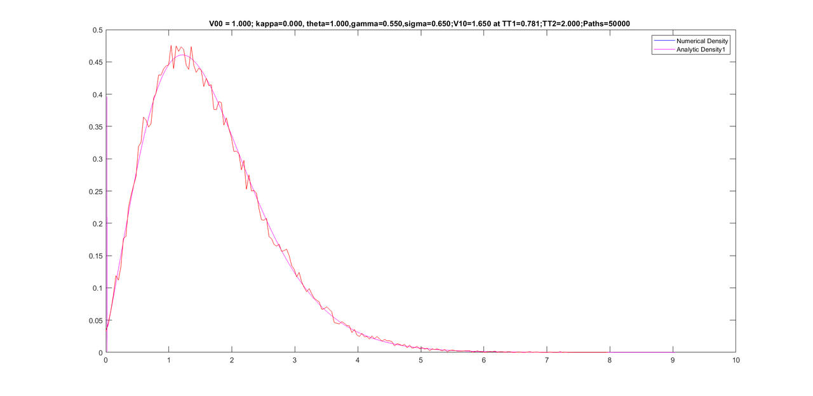](https://postimg.cc/ZCsjyMy9)

---

### #3004 — Amin (Topic Author)
*March 16, 2026, 5:42 PM*

Friends, in order to show the performance of algorithm with 10,000 paths, I went ahead and made a few graphs.

.

.

.

[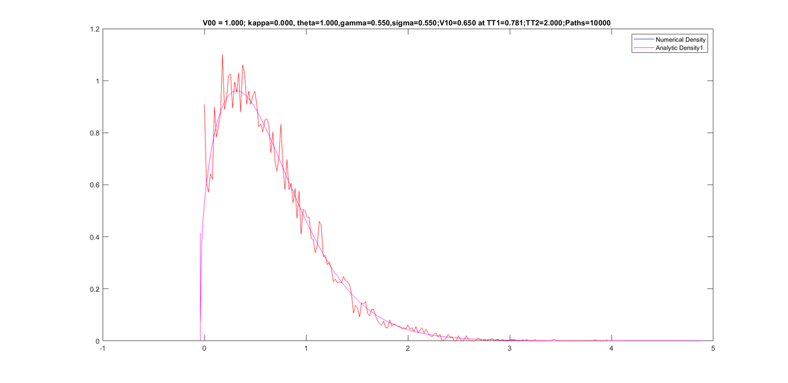](https://postimg.cc/4HNjb2bY)

[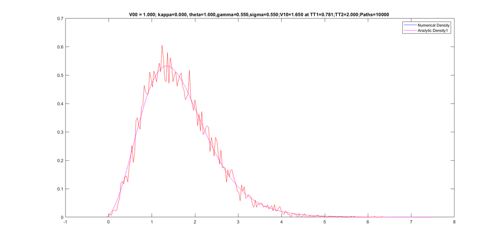](https://postimg.cc/XB7tc1cJ)

[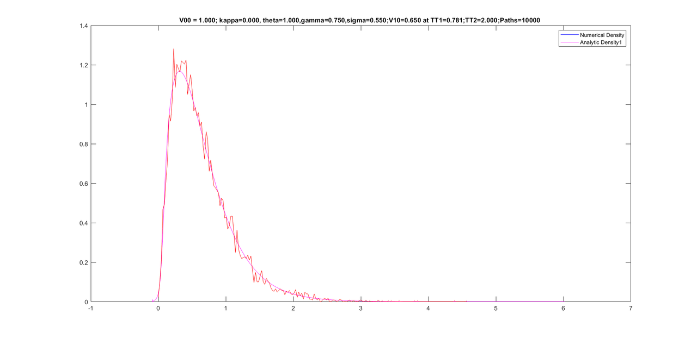](https://postimg.cc/PpMBDnZD)

[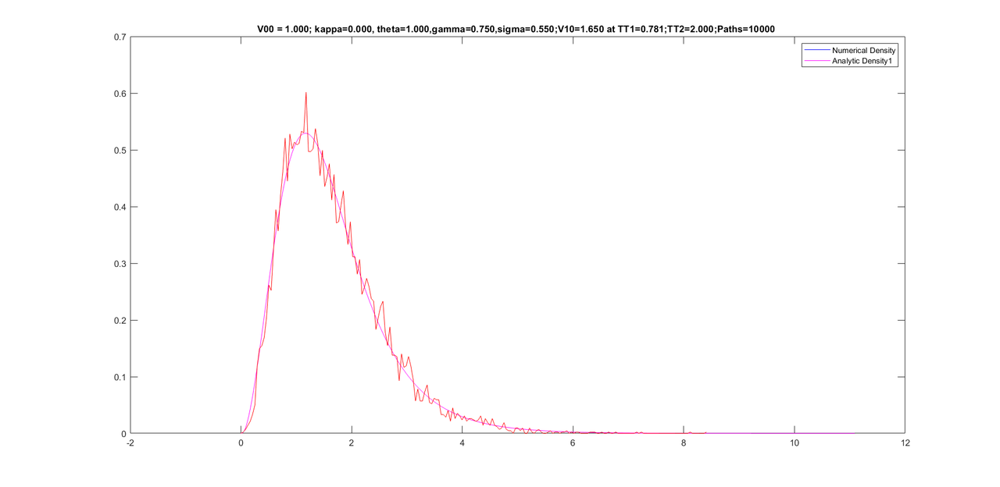](https://postimg.cc/hz0HmRxd)

[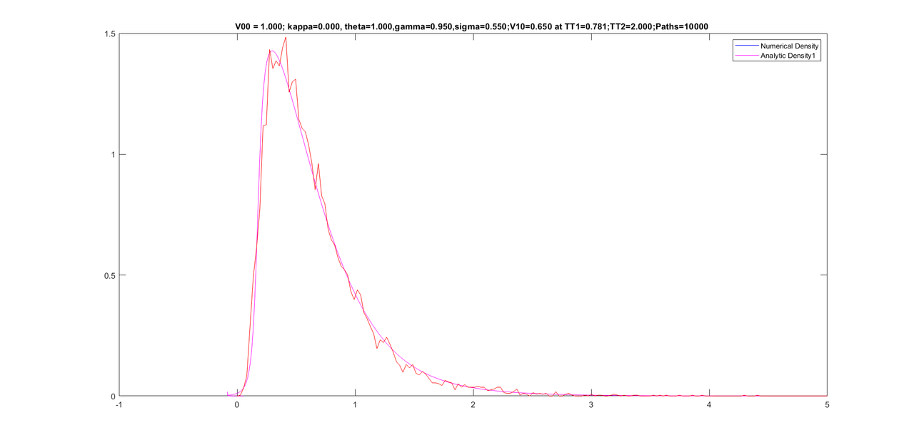](https://postimg.cc/BLCdFfD1)

[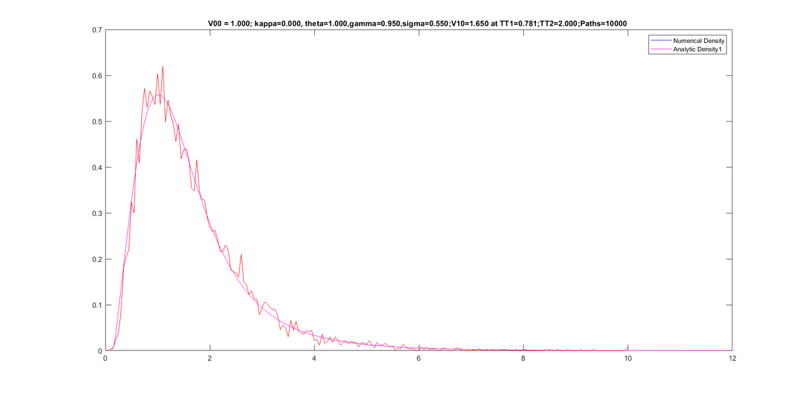](https://postimg.cc/G8jZDnYT)

---

### #3005 — Amin (Topic Author)
*March 17, 2026, 11:06 AM*

Friends, I am so happy that my algorithm for conditional density calculation finally worked well. It had been a
roller-coaster ride all along and many times when I thought I had pinned it, I only found out that there was little
progress. I am convinced that research in mathematics is not for the faint of heart.

In my last program for finding conditional density, I have used correlations consistently so that every nth power of the
binomial expansion$\left[\rho_n \,Z_x\,+\,\sqrt{1-{\rho_n}^2}\,Z_{\tilde{y}}\right]^n$ uses the same correlation across
all different orders of hermite polynomials and this is done in a way that hermite polynomial correlations are retrieved
when we convert 2D Z-series to 2D hermite-series, then the first row in 2D Hermite-series has perfectly appropriate
conditional expectations found from hermite correlations. I will try to write a technical post in a day. I believe this
is the best we can do with one set of correlations for each power of
$\left[\rho_n \,Z_x\,+\,\sqrt{1-{\rho_n}^2}\,Z_{\tilde{y}}\right]^n$ . The only possible solution that could be better
would require numerical methods to choose different correlations coefficients for each term in binomial expansions like
above. But I believe that we have done reasonably well with analytics without use of any elaborate numerical method for
choosing correlations.

I have a lot to say to friends to support me so that my mind control ends and I could start a better life again. My
biggest concern is my health. I can easily tackle both my health and doing good research but it is not possible to live
a healthy life when I am under duress of mind control and all my decision making is altered when my biggest concern is
to survive under mind control. And my decisions are not motivated towards leading a healthy life but are determined by
what consequences mind control would have for me and both are mostly in conflict. I would be 53 this year and my mind
control started in 1997 when I was 24. Ah! what a life time of punishment for being an ambitious student. If I cannot
start living healthy now, in a few years, it might be too late. So I hope that friends would try to help me.

I would write a more detailed post about it. At this point in my life, I just want my freedom from mind control.

---

### #3006 — Amin (Topic Author)
*March 19, 2026, 5:02 AM*

Friends, some ideas for future research where doors have been opened by our recent work.

We have solved the problem of finding conditional density of a variable Y given the realized value of X which is another
correlated variable. The simplest way to condition on a large number of variables would be to lump them all together and
find their joint correlation with Y and then do analytics to find conditional density given the joint realized value of
the lumped variables.

We could also do detailed analytics for finding conditional density given some joint realization of a large number of
variables using hermite correlations. It would all be in line with recent two-dimensional work. We would have to do
analytics with hermite correlations and find out values of correlation controlling for the effect of various variables
as in least squares. In formulas with multiple variables(more than one conditioning variable), it would be difficult to
use raw hermite correlations and rather their controlled effect versions would have to be used. We would also like to
use hermite regression in many advanced ways to find conditional mean and this hermite-series from regressions would
define the leading terms(and associated correlations) in the expansion of powers of$Z_y$ . Also in some difficult
problems, we might have to use terms of the from$Z_{yx}$ in addition to terms like$Z_y$ and$Z_x$ where$Z_{yx}$
defines/underlies the hermite series of product variable$YX$ and so in order to solve more advanced problems, we would
have to use variables like$Z_{yx}$ from product terms of various orders in the expansions of powers of sums.

We can do summation of two random variables and summation of multiple numbers of variables when all N(N+1)/2
correlations are given by carefully using these correlations and expansion formulas of the sum with controlled effect
versions of the hermite correlations.

We can condition Y on X and X on Y with analytic formulas (and find relevant conditional densities) and therefore
different versions of the Bayes formula should analytically hold and could be calculated for any unknowns. This should
be very interesting for friends who work with Bayesian probability and statistics.

There should also be interesting applications of our work in Filtering theory since we know more about conditional
densities, summation of variables and applications of Bayesian formulas.

There can be innumerable applications of our recent research in different fields of physical sciences where external or
innate randomness exists and conditional densities of some random variables have to be found given the realization of
some other random variables. Algorithmic trading can have enormous applications of the research work.

We would be doing a lot of the above stuff with their applications in coming weeks.

---

### #3007 — Amin (Topic Author)
*March 19, 2026, 5:23 AM*

Friends, an antipsychotic injection is due today and I am very afraid that they would add very special and more potent
than ever before drugs in the injection on the pharmacy shelves before I buy it so that they can control me and damage
my brain permanently.

I want to make this request to friends to please force the people of American defense to not add any mind control drugs
to the injection.

---

### #3008 — Amin (Topic Author)
*March 19, 2026, 8:38 AM*

>
> Friends, some ideas for future research where doors have been opened by our recent work.
>
>
>
> We have solved the problem of finding conditional density of a variable Y given the realized value of X which is
another correlated variable. The simplest way to condition on a large number of variables would be to lump them all
together and find their joint correlation with Y and then do analytics to find conditional density given the joint
realized value of the lumped variables.
>
>
>
> We could also do detailed analytics for finding conditional density given some joint realization of a large number of
variables using hermite correlations. It would all be in line with recent two-dimensional work. We would have to do
analytics with hermite correlations and find out values of correlation controlling for the effect of various variables
as in least squares. In formulas with multiple variables(more than one conditioning variable), it would be difficult to
use raw hermite correlations and rather their controlled effect versions would have to be used. We would also like to
use hermite regression in many advanced ways to find conditional mean and this hermite-series from regressions would
define the leading terms(and associated correlations) in the expansion of powers of$Z_y$ . Also in some difficult
problems, we might have to use terms of the from$Z_{yx}$ in addition to terms like$Z_y$ and$Z_x$ where$Z_{yx}$
defines/underlies the hermite series of product variable$YX$ and so in order to solve more advanced problems, we would
have to use variables like$Z_{yx}$ from product terms of various orders in the expansions of powers of sums.
>
>
>
> We can do summation of two random variables and summation of multiple numbers of variables when all N(N+1)/2
correlations are given by carefully using these correlations and expansion formulas of the sum with controlled effect
versions of the hermite correlations.
>
>
>
> We can condition Y on X and X on Y with analytic formulas (and find relevant conditional densities) and therefore
different versions of the Bayes formula should analytically hold and could be calculated for any unknowns. This should
be very interesting for friends who work with Bayesian probability and statistics.
>
>
>
> There should also be interesting applications of our work in Filtering theory since we know more about conditional
densities, summation of variables and applications of Bayesian formulas.
>
>
>
> There can be innumerable applications of our recent research in different fields of physical sciences where external
or innate randomness exists and conditional densities of some random variables have to be found given the realization of
some other random variables. Algorithmic trading can have enormous applications of the research work.
>
>
>
> We would be doing a lot of the above stuff with their applications in coming weeks.
>
.

.

Friends, when there are K conditioning variables K random variables$X_1, X_2, X_3, \ldots \,,X_K$ in the expansion of Y
and we want to find the conditional expectation of Y given all of$X_1, X_2, X_3, \ldots \,,X_K$ . In such a case
effective correlations could be found by standardized regression on correlations.

We define the correlation matrix of nth hermite polynomial of K explaining random variables
$X_1, X_2, X_3, \ldots \,,X_K$ as

$$\textbf{R}_n \,=\,

 \begin{bmatrix}

         \rho_{X_1 X_1,n} & \rho_{X_2 X_1,n} & \cdots & \rho_{X_K X_1,n}\\

         \rho_{X_1 X_2,n} & \rho_{X_2 X_2,n} & \cdots & \rho_{X_K X_2,n}\\

         \vdots & \vdots & \ddots & \vdots\\

         \rho_{X_1 X_K,n} & \rho_{X_2 X_K,n} & \cdots & \rho_{X_K X_K,n}

     \end{bmatrix}

$$

While the vector of correlations of nth hermite polynomial of Y with nth hermite polynomial of each of the K explaining  random variables $X_1, X_2, X_3, \ldots \,,X_K$ is given as

 $$\textbf{r}_{XY,n}\,=\begin{bmatrix}

          \rho_{X_1 Y,n} \\

 \rho_{X_2 Y,n}  \\ \cdots \\ \rho_{X_K Y,n}

     \end{bmatrix}$$

Then vector of effective correlation coefficients $\beta_{n,k}$  associated with kth random variable $X_k$ and nth hermite polynomial that explains the nth hermite polynomial of Y is given as

$$

\begin{bmatrix}

          \beta_{n,1} \\

 \beta_{n,2}  \\ \cdots \\ \beta_{n_K}

     \end{bmatrix}

=

{\begin{bmatrix}

         \rho_{X_1 X_1,n} & \rho_{X_2 X_1,n} & \cdots & \rho_{X_K X_1,n}\\

         \rho_{X_1 X_2,n} & \rho_{X_2 X_2,n} & \cdots & \rho_{X_K X_2,n}\\

         \vdots & \vdots & \ddots & \vdots\\

         \rho_{X_1 X_K,n} & \rho_{X_2 X_K,n} & \cdots & \rho_{X_K X_K,n}

     \end{bmatrix}}^{-1}

\,

\begin{bmatrix}

          \rho_{X_1 Y,n} \\

 \rho_{X_2 Y,n}  \\ \cdots \\ \rho_{X_K Y,n}

     \end{bmatrix}

$$

The above equation is equation of standardized regression that is done on correlations. Inverse of variance-covariance matrix of regressors is replaced by inverse of correlation matrix of regressors ${\textbf{R}_n}^{-1} $. And covariance vector between regressand and regressors is replaced by the respective correlation vector $\textbf{r}_{XY,n}$ making the standardized regression equation as

$$ \boldsymbol{\beta}_n ={\textbf{R}_n}^{-1} \, \textbf{r}_{XY,n}$$

Again $\beta_{n,K}$ is the effective correlation between nth hermite polynomial of Y and nth Hermite polynomial of $X_k$ and this correlation would be used in later analytics instead of the raw hermite correlations.

However, we would still have to convert these effective hermite correlations into consistent correlation used uniquely for each mth power multinomial expansion of ${Z_y}^m$ so that effective hermite correlations would be retrieved between hermite polynomials of Y and each of $X_k$ and in between all hermite polynomials of $X_k$. We have the following expressions

$${Z_y}^m\,=\,\left[\,{\bar{\beta_{m,1}}}^{1/m}\,Z_{k_1}\,+\,{\bar{\beta_{m,2}}}^{1/m}\,Z_{k_2}\,+\,{\bar{\beta_{m,3}}}^{1/m}\,Z_{k_3}\,+\,\ldots\,+\,{\bar{\beta_{m,K}}}^{1/m}\,Z_{K}\,+ \zeta_m \,Z_{\tilde{y}}\right]^m $$

$$\,\zeta_m\,=\,\sqrt{1\,-\,\sum\limits_{k=1}^{K}\,{\bar{\beta_{m,k}}}^{2/m}}$$

Again all of the ${\bar{\beta_{m,k}}}$ (that appear in final multinomial expansion) with a bar over them are found from effective correlations $\beta_{n,k}$ using algebra(I have not given this algebra for multinomial expansions and will try to do it tonight for multinomial expansions and then describe in a new post) so that when mth power above is multinomially expanded inside all of the hermite polynomials of Y, the effective correlations of $\beta_{n,k}$ are effectively retrieved (for each hermite polynomial of nth order of $X_k$ and also on the first rows of multidimensional hermite-series. This can be done with algebra and is a multidimensional extension of what I did for one variable conditioning.

What I want to do next is try to keep the dimensionality to only 2D Z-series in a way that first rows in multidimensional hermite-series are retrieved. For large enough dimensions, we can solve the full problem of finding final correlations while remaining in a 2D Z-series framework.

We can also add product variables $X_kX_l $in above expansion with their respective $Z_{x_{kl}}$ and their effective correlations with nth polynomial of Y given as $\beta_{n,kl}$.

Please recall that we only use first powers of conditioning variables and the combinations of products of first powers of in hermite regressions.

---

### #3009 — Amin (Topic Author)
*March 19, 2026, 10:02 AM*

>
> Friends, an antipsychotic injection is due today and I am very afraid that they would add very special and more potent
than ever before drugs in the injection on the pharmacy shelves before I buy it so that they can control me and damage
my brain permanently.
>
>
>
> I want to make this request to friends to please force the people of American defense to not add any mind control
drugs to the injection.
>
,

Friends, I requested my mother that I would get the injection on Friday and she very reluctantly agreed. I would go out
to buy the injection in an hour or so but want to request friends to please ask American defense to not give me
specially drugged mind control injections. I am very afraid that they have planned to drug injections precisely for me
on a huge scale.

---

### #3010 — Amin (Topic Author)
*March 19, 2026, 8:06 PM*

>
>
> Friends, some ideas for future research where doors have been opened by our recent work.
>
>
>
> We have solved the problem of finding conditional density of a variable Y given the realized value of X which is
another correlated variable. The simplest way to condition on a large number of variables would be to lump them all
together and find their joint correlation with Y and then do analytics to find conditional density given the joint
realized value of the lumped variables.
>
>
>
> We could also do detailed analytics for finding conditional density given some joint realization of a large number of
variables using hermite correlations. It would all be in line with recent two-dimensional work. We would have to do
analytics with hermite correlations and find out values of correlation controlling for the effect of various variables
as in least squares. In formulas with multiple variables(more than one conditioning variable), it would be difficult to
use raw hermite correlations and rather their controlled effect versions would have to be used. We would also like to
use hermite regression in many advanced ways to find conditional mean and this hermite-series from regressions would
define the leading terms(and associated correlations) in the expansion of powers of$Z_y$ . Also in some difficult
problems, we might have to use terms of the from$Z_{yx}$ in addition to terms like$Z_y$ and$Z_x$ where$Z_{yx}$
defines/underlies the hermite series of product variable$YX$ and so in order to solve more advanced problems, we would
have to use variables like$Z_{yx}$ from product terms of various orders in the expansions of powers of sums.
>
>
>
> We can do summation of two random variables and summation of multiple numbers of variables when all N(N+1)/2
correlations are given by carefully using these correlations and expansion formulas of the sum with controlled effect
versions of the hermite correlations.
>
>
>
> We can condition Y on X and X on Y with analytic formulas (and find relevant conditional densities) and therefore
different versions of the Bayes formula should analytically hold and could be calculated for any unknowns. This should
be very interesting for friends who work with Bayesian probability and statistics.
>
>
>
> There should also be interesting applications of our work in Filtering theory since we know more about conditional
densities, summation of variables and applications of Bayesian formulas.
>
>
>
> There can be innumerable applications of our recent research in different fields of physical sciences where external
or innate randomness exists and conditional densities of some random variables have to be found given the realization of
some other random variables. Algorithmic trading can have enormous applications of the research work.
>
>
>
> We would be doing a lot of the above stuff with their applications in coming weeks.
>
.

.

Friends, when there are K conditioning variables K random variables$X_1, X_2, X_3, \ldots \,,X_K$ in the expansion of Y
and we want to find the conditional expectation of Y given all of$X_1, X_2, X_3, \ldots \,,X_K$ . In such a case
effective correlations could be found by standardized regression on correlations.

We define the correlation matrix of nth hermite polynomial of K explaining random variables
$X_1, X_2, X_3, \ldots \,,X_K$ as

$$\textbf{R}_n \,=\,

 \begin{bmatrix}

         \rho_{X_1 X_1,n} & \rho_{X_2 X_1,n} & \cdots & \rho_{X_K X_1,n}\\

         \rho_{X_1 X_2,n} & \rho_{X_2 X_2,n} & \cdots & \rho_{X_K X_2,n}\\

         \vdots & \vdots & \ddots & \vdots\\

         \rho_{X_1 X_K,n} & \rho_{X_2 X_K,n} & \cdots & \rho_{X_K X_K,n}

     \end{bmatrix}

$$

While the vector of correlations of nth hermite polynomial of Y with nth hermite polynomial of each of the K explaining  random variables $X_1, X_2, X_3, \ldots \,,X_K$ is given as

 $$\textbf{r}_{XY,n}\,=\begin{bmatrix}

          \rho_{X_1 Y,n} \\

 \rho_{X_2 Y,n}  \\ \cdots \\ \rho_{X_K Y,n}

     \end{bmatrix}$$

Then vector of effective correlation coefficients $\beta_{n,k}$  associated with kth random variable $X_k$ and nth hermite polynomial that explains the nth hermite polynomial of Y is given as

$$

\begin{bmatrix}

          \beta_{n,1} \\

 \beta_{n,2}  \\ \cdots \\ \beta_{n_K}

     \end{bmatrix}

=

{\begin{bmatrix}

         \rho_{X_1 X_1,n} & \rho_{X_2 X_1,n} & \cdots & \rho_{X_K X_1,n}\\

         \rho_{X_1 X_2,n} & \rho_{X_2 X_2,n} & \cdots & \rho_{X_K X_2,n}\\

         \vdots & \vdots & \ddots & \vdots\\

         \rho_{X_1 X_K,n} & \rho_{X_2 X_K,n} & \cdots & \rho_{X_K X_K,n}

     \end{bmatrix}}^{-1}

\,

\begin{bmatrix}

          \rho_{X_1 Y,n} \\

 \rho_{X_2 Y,n}  \\ \cdots \\ \rho_{X_K Y,n}

     \end{bmatrix}

$$

The above equation is equation of standardized regression that is done on correlations. Inverse of variance-covariance matrix of regressors is replaced by inverse of correlation matrix of regressors ${\textbf{R}_n}^{-1} $. And covariance vector between regressand and regressors is replaced by the respective correlation vector $\textbf{r}_{XY,n}$ making the standardized regression equation as

$$ \boldsymbol{\beta}_n ={\textbf{R}_n}^{-1} \, \textbf{r}_{XY,n}$$

Again $\beta_{n,K}$ is the effective correlation between nth hermite polynomial of Y and nth Hermite polynomial of $X_k$ and this correlation would be used in later analytics instead of the raw hermite correlations.

However, we would still have to convert these effective hermite correlations into consistent correlation used uniquely for each mth power multinomial expansion of ${Z_y}^m$ so that effective hermite correlations would be retrieved between hermite polynomials of Y and each of $X_k$ and in between all hermite polynomials of $X_k$. We have the following expressions

$${Z_y}^m\,=\,\left[\,{\bar{\beta_{m,1}}}^{1/m}\,Z_{k_1}\,+\,{\bar{\beta_{m,2}}}^{1/m}\,Z_{k_2}\,+\,{\bar{\beta_{m,3}}}^{1/m}\,Z_{k_3}\,+\,\ldots\,+\,{\bar{\beta_{m,K}}}^{1/m}\,Z_{K}\,+ \zeta_m \,Z_{\tilde{y}}\right]^m $$

$$\,\zeta_m\,=\,\sqrt{1\,-\,\sum\limits_{k=1}^{K}\,{\bar{\beta_{m,k}}}^{2/m}}$$

Again all of the ${\bar{\beta_{m,k}}}$ (that appear in final multinomial expansion) with a bar over them are found from effective correlations $\beta_{n,k}$ using algebra(I have not given this algebra for multinomial expansions and will try to do it tonight for multinomial expansions and then describe in a new post) so that when mth power above is multinomially expanded inside all of the hermite polynomials of Y, the effective correlations of $\beta_{n,k}$ are effectively retrieved (for each hermite polynomial of nth order of $X_k$ and also on the first rows of multidimensional hermite-series. This can be done with algebra and is a multidimensional extension of what I did for one variable conditioning.

What I want to do next is try to keep the dimensionality to only 2D Z-series in a way that first rows in multidimensional hermite-series are retrieved. For large enough dimensions, we can solve the full problem of finding final correlations while remaining in a 2D Z-series framework.

We can also add product variables $X_kX_l $in above expansion with their respective $Z_{x_{kl}}$ and their effective correlations with nth polynomial of Y given as $\beta_{n,kl}$.

Please recall that we only use first powers of conditioning variables and the combinations of products of first powers of in hermite regressions.

.

.

Friends, I have been able to think of a fast algorithm for conditional density estimation given realized values of a large number (like forty) of correlated random variables as specified by user. I hope that the whole algorithm for conditional density estimation would be able to solve for a typical forty random variables and find this conditional density given the realization of these variables in a few tens of seconds. It can take a few days to complete the program and I hope to complete it over the weekend.

---

### #3011 — Amin (Topic Author)
*March 21, 2026, 2:02 PM*

Friends, I am working on the general multi-dimensional program with arbitrary dimensions. It would be possible to get
all the parameters of the N-dimensional density in a Z-series multinomial form  but for large dimensions, this density
could generally be expanded easily in a bivariate form by lumping all known variables together. However, we would have
already found all the correlation parameters in multinomial expansions in a way that is consistent with (and reproduces)
hermite correlations found from hermite regression. This second condition is also not very difficult and I expect that
multinomial version is an extension of bivariate version of matching the leading parameters of expansions to retrieve
hermite correlations.

I am working on a four dimensional Z-series with a full hermite algorithm and  its reduced bivariate version so I can be
able to make sure that full algorithm and reduced dimension algorithm give precisely the same result as I expect.

For this four dimensional program, I am modelling three different but correlated SDEs and take their values at T1,
X1(T1),X2(T1), X3(T1) as three correlated random variables, and then take the sum 
Y=X1(T2)-X1(T1)+X2(T2)-X2(T1)+X3(T2)-X3(T1) as the fourth variable whose conditional density we want to find. I could
use  Y=X1(T2)+X2(T2)+X3(T2) as the fourth variable whose density has to be found but I suspect if the different SDEs are
far apart on X-axis at time T1, their sum at time T2 would be multi-modal and possibly would be difficult to find with
this nascent version of the conditional density algorithm and an advanced version that works for multi-modal densities
would require more research (or possibly a different choice of underlying polynomials in some cases).

Friends, I want to mention again that mind control agents continue to add chemicals to my food. It was Eid day today and
I had food with the family and it was highly drugged and I started ranting after an hour or two of having food. These
mind control agents are never tired of their machinations. It is very difficult to work while under the influence of
mind control drugs. Please protest to the government to and my active mind control abuse.

---

### #3012 — Amin (Topic Author)
*March 21, 2026, 5:41 PM*

Friends, mind control agents have been adding mind control drugs in my food for a long time now but they had stopped
giving me very significant gases(other than very brief periods of gas). But for past one week, they have been using the
gases very boldly in almost every room of our house. I do not spend a large amount of time in my room but I sleep there
and they release some gas that has a distinct smell that is very unnerving and unsettling. This gas is specially
released in my room when I sleep there at night and I think it also comes out of the ceiling fan in my room. In our
home, there is also a sink in the living room to wash hands and they have placed some device in the water pipe of sink
and it continuously releases some gas and whenever I get within three or four feet of the sink, I can smell the
unnerving gas that also makes my nose ionized as I breathe with a distinct itch(It is not exactly itch but rather a
stinging sensation) type feeling in my nose. All of these gases  started about 5-7 days ago and they had not been using
huge gases earlier for about a month or more.

Even though they do not cause a huge pain as they had been doing earlier, they still cause uneasiness with minor pain by
pointing waves on my temple.

I want to request friends to please stress on American defense to stop using mind control gases that give me a very
sickening feeling when I breathe these gases.

---

### #3013 — Amin (Topic Author)
*March 23, 2026, 6:38 PM*

Friends, after playing with the model for so many days, I have decided to keep most calculations of the multidimensional
model in a two dimensional framework. Even though for N Zx explanatory variables, N correlation weights have to be first
found for each power of Zy (so that on each row of hermite correlations terms is matched if we convert the
multi-dimensional Z-series to Hermite-series). But for all calculations, I am replacing all the appropriate sums of
correlation-weighted Z's at different places with their variance-matched one dimensional correlation weighted Z. After
last two sets of multinomial expansion terms(for sixth and seventh power where leading terms do not require any
correction), we would calculate correlation weight of leading highest power term of each individual Z based on
corrections from one dimensional (variance-matched) lumped term analogous to what I did in bivariate model. Later when
we would have to find one dimensional conditional density, we would replace all the multiple realized Zx values with one
dimensional variance-matched value and expand as in binomial expansion.

I noticed that, with the older program to calculate hermite correlations, sometimes hermite-correlations are over-stated
and squared sum of effective correlations increase one. I think this is because I was using data variance of
hermite-polynomials as opposed to their true variance. I have fixed that in a new program that I am posting now. For
other friends who are working, I am posting the part of program that calculates effective correlations and other
coefficients.

Please use the following code for hermite correlations calculations to avoid squared sum of effective correlations
increasing one and resulting imaginary number correlations with final random variable. Please note that none of the
following is a complete program for multidimensional conditionally found density and these are only sub-routines for
other friends who are trying to work with the method on their own.

.

.

.

```
function [CorrH] = CalculateCorrelationBivariateHermiteCH1(Z1,Z2,paths,HH)

CorrH(1:HH)=0;
CovH(1:HH)=0;
Var1H(1:HH)=0;
Var2H(1:HH)=0;

[X1h] = EvalHermiteArrayH0(Z1,HH);
[X2h] = EvalHermiteArrayH0(Z2,HH);

for hh=1:HH
    CovH(hh)=CovH(hh)+sum(X1h(:,hh+1).*X2h(:,hh+1))/paths;
    %Var1H(hh)=Var1H(hh)+sum(X1h(:,hh+1).*X1h(:,hh+1))/paths;
    %Var2H(hh)=Var2H(hh)+sum(X2h(:,hh+1).*X2h(:,hh+1))/paths;
    CorrH(hh)=CovH(hh)./factorial(hh);%sqrt(Var1H(hh))./sqrt(Var2H(hh));
end

% Var1H
% Var2H
%
% str=input("Look at variances of data hermites");

end

```

 .

.

.

This is another program that I am posting for friends.

.

```
function [BetaCorrH,YCoeffH,XCoeffH,CorrXX1st] = CalculateHermiteCorrelations0NA(Xin,Yin,NData,NDims)

%This program finds required correlations between NDims explanatory
%variables given in Xin that has NDims dimensionality. Yin is variable
%being explained and is one-diemsnional.

Order=7;
NMoments=8;

[ZI] = MomentMatchedStandardNormalDiscretizedDensity(NData);

for nn=1:NDims
[XCoeffH(1:Order+1,nn),Zx(1:NData,nn)] = CalculateHermiteSeriesFromData01(Xin(1:NData,nn),Order,ZI);

[Zx(1:NData,nn)] = CalculateZgivenXAndHSeriesCoeffs(Xin(1:NData,nn),XCoeffH(1:Order+1,nn),Order);

end

[YCoeffH,Zy] = CalculateHermiteSeriesFromData01(Yin,Order,ZI);
[Zy] = CalculateZgivenXAndHSeriesCoeffs(Yin,YCoeffH,Order);

for nn1=1:NDims
    for nn2=1:NDims
        if(nn1==nn2)
            HCorrXX(nn1,nn2,1:Order)=1.0;
        else
            HCorrXX(nn1,nn2,1:Order) =
CalculateCorrelationBivariateHermiteCH1(Zx(1:NData,nn1),Zx(1:NData,nn2),NData,Order);
        end
    end
end

for nn1=1:NDims
    HCorrXY(nn1,1:Order) = CalculateCorrelationBivariateHermiteCH1(Zx(1:NData,nn1),Zy(1:NData),NData,Order);
end

for hh=1:Order
    CorrXX(1:NDims,1:NDims)=HCorrXX(1:NDims,1:NDims,hh);
    CorrXY(1:NDims,1)=HCorrXY(1:NDims,hh);
    BetaCorrH(1:NDims,hh)=CorrXX\CorrXY;
end

CorrXX1st(1:NDims,1:NDims)=HCorrXX(1:NDims,1:NDims,1)

BetaCorrH(:,1)'*CorrXX

CorrXY

HCorrXX

HCorrXY

BetaCorrH

str=input("Look at BetaCorrH");
end

```

---

### #3014 — Amin (Topic Author)
*March 24, 2026, 4:01 PM*

Friends, I tried to work today and was able to do some work but I feel very tired now and would not be able to work late
as is my usual routine. I had an antipsychotic injection on 19th of March and the injection starts to show its effect a
few days after the injection date and I become highly sedated. It may possibly remain bad for a few days but I hope that
I would soon be able to get the work done possibly some time over this weekend.

---

### #3015 — Amin (Topic Author)
*March 27, 2026, 3:37 PM*

Friends, sorry for no post over past two days. But I am very sedated and down and unable to work. I am sleeping 12-14
hours everyday as opposed to 6-8 hours of sleep that I earlier had before the anti-psychotic injection. I am not able to
do any work and have a very little attention span and I get tired of work very quickly within minutes. I hope to get
better within a few days and start working properly again. Like always, I will soon be posting all my new programs on
wilmott(as I have always been doing.)

---

### #3016 — Amin (Topic Author)
*March 28, 2026, 7:29 AM*

Friends, I hope that I would be able to re-start work today or tomorrow. But, in the meantime, I thought I would share
some of my concerns with friends and ask them for help.

Edit: I am still not perfectly in my senses due to mind control and during the writing of this post, I continued to make
stupid spelling mistakes in every third or fourth word followed by a correction. I could not get many of the spellings
right the first time in flow of the writing.

I want to say that I have tried to do good research in mathematics in the past and I want to continue doing that in the
future. Many friends who tried to help me and were able to decrease my mind control truly helped me do better research.
If they had not helped me, I would still probably had been doing research but with a much less success and much more
mind control. I am going to request people to help me again to make things more conducive for better research but I will
continue my research regardless.

My first serious concern is my health. Due to mind control and anti-psychotics, my weight has remarkably increased to
110 kg and it is already affecting my liver very seriously and several important enzymes in my liver are far out of
their normal range for past four/five years. When they take neurotransmitters off the victim's brain and disconnect
connections to some part (something they do in my brain several times everyday), the brain feels extreme anxiety and
eating good food helps in making the brain feel better. This naturally causes a calorie-surplus that continues to
increase my weight. Five years ago, I was still very over-weight but my weight was 100 kg. The right weight for my
height is smaller that 80 kg. If I cannot fix my weight now, I may not be able to live after 10-15 years. Many people
have calculated this and are looking to do whatever it takes to decrease this time even further.

Four/five years ago, I still used to walk about 7-9 kilometers in the morning almost every other day or two and
sometimes on a daily basis. But my mind control continued to increase and it became extremely difficult to get good food
and water in the city.

Even these days, it is possible to get good food in the city easily but water all across the city is highly drugged.
Underground water-reservoirs and public supply water is thoroughly drugged wherever I have tried it. There are a large
number of private and public filtration plants in the city but almost all of the public filtration plants and 80% of
private filtration plants add mind control drugs to their purified water. All the major water brands like Nestle,
Dasani(coca-cola), Aquafina(pepsi) , Sufi, Next (Meezan) and most of the other brands are currently adding mind control
drugs to water. Sometimes I notice that some brand starts supplying good water and I start buying its water and then
only to know within a few days that they start re-supplying water with mind control drugs. Sometimes when I cannot get
good water, I buy some water that I know is least drugged and it continues to help them in mind control and I mostly
drink very less water when I buy drugged water and try to use it with tea and coffee etc. to mitigate its effect. It is
a major exercise for me everyday to try getting good water in the city.

All stimulant drinks which are in my approach and all diet drinks are also drugged continuously. Especially cheap diet
drinks with caffeine are very thoroughly drugged.

It is very very difficult to go out into the city and try to get good water after every few hours so I buy 6-7 1.5
Liters bottles of water once in a day and keep them in my room or car and on my motorcycle when I move around. With all
of the water and some other food to take care of, it is very difficult to go out early in the morning for a walk. I
simply cannot take all the water with me when I go out for a walk and this consideration keeps me grounded every
morning. Only if I could have gone out and buy good water from some shop nearby, I would not have to keep any water on
me and I could easily go out for a morning walk and also be able to do some light exercise in the morning.

It is already summers and when it is very difficult to get good water in summers(as it usually is in all summers), it
becomes very difficult to take care of any other considerations and water becomes the most important priority.

So my first serious request to friends is to ask the American defense to not drug the water at all. And not drug other
food and force any drugs on me through my family or our maid etc.

On the contrary, mind control agents are very anal people (and therefore apple of the eyes of bad people) and they
continue to focus lasers on my knees so I would have pain in my knees and would not be able to walk properly. Many
times, for example, when I go around on the motorcycle, and my knees would be perfectly fine when I ride the bike. But
they keep focusing lases on knees(especially since the position of knees is fixed when I sit on motorcycle) and there
would extreme pain in the knees when I get off the motorcycle and I would barely be able to walk despite that my knees
were perfectly fine when I started the ride. It is not only the knees, they do it to several parts of body. There was a
time about a year ago when they had taken neurotransmitters out of my left arm and I would not be able to lift anything
heavier than 4-5 kg from my arm. There are many other things like this they do and this list continues forever. They
actively try to decrease the duration of my life.

I also have other concerns that I wanted to share with friends but I would say them in a different post.

---

### #3017 — Amin (Topic Author)
*March 28, 2026, 8:43 AM*

Friends, when I was writing the previous post, I had a water bottle lying on one side of my laptop on the table and I
was sitting in the car garage. I had some other water that was also in a bag hanging from my motorcycle. And there was
one bottle that was buried inside some other stuff in a different bag.

When I leave the car garage alone with some water or food here, I fasten the catch/latch from inside so nobody from
outside can enter the house/Garage.

But I think my mother called me from inside and I forgot to put the latch on and somebody now could enter the garage if
they had a key on them. And when I returned in the midst of writing the previous post and took a sip from the water
bottle lying next, I realized that water in the bottle was highly drugged. I also realized that somebody must have
entered the garage from outside so I did not try the bottles that were obviously hanging from the motor-bike and took
the botte that was buried inside the other things in a different bag. It was fortunately good water and I continued to
sip through it while writing the post.

After writing the post, I forgot all about it and went outside for twenty or so minutes. When I came back and tried
other bottles that were hanging from the bike, they were extremely drugged. At this point, I decided to make a different
post to tell people that they drugged my water within a minute by entering the garage from outside  when I left for a
minute to talk to my mother and forgot to put the latch on from inside. This happened precisely when I was making a
request to friends to ask American defense to not drug my water.

---

### #3018 — Amin (Topic Author)
*March 28, 2026, 3:04 PM*

Friends, I went out to get water and food in the evening today. I filled some water from a mosque in OPF
Society(Overseas Pakistani Foundation). The mosque had a large water filter attached to a cooler and when I checked the
water, the water seemed to have no drugs. I filled four 1.5 ilter water bottles and then another guy came to get some
water. After he left, I tried to fill a fifth water bottle but when I tried to check whether water was good, I realized
that water was very bad. Then I noticed that all four water bottles that I had earlier filled had good water but fifth
water bottle had drugged water. I realized that somebody had drugged the water in the meantime when I was filling water.

Even now, a little before the writing of this post, they released some gas with pungent feeling in my room and after I
inhaled the gas through my noise, they started giving me sharp pain in my temple.

Please help me if you can.

---

### #3019 — Amin (Topic Author)
*March 28, 2026, 4:22 PM*

9:16 PM. Friends, I was trying to sleep but they continue to give me sharp pain in my temple. I noticed that first they
ionize the nose with some pungent gas and then sharp pain in the temple naturally follows. It is extremely difficult to
sleep with such a sharp pain.

Friends it seems to me that they want to unnerve me with their torture tactics so that I start writing about bad jews
and their intentions and practices and then all jews would be annoyed and put each other in motion to persecute me.

---

### #3020 — Amin (Topic Author)
*March 29, 2026, 5:01 PM*

Friends, I did some crucial work today and wrote the logic of main (weights on gaussians) calibration part of the
program. If it works well, it will be a very fast program with only second order loops to calculate variances. I hope, I
will get my new program to work by tomorrow or day after tomorrow. But that is conditional on everything in the
algorithm working well which I hope it will.

---

### #3021 — Amin (Topic Author)
*March 29, 2026, 8:37 PM*

Friends, I got up in the middle of night trying to work. And decided to post the new version of calibration function.
This is a part of program and not full program and only for those friends who are working on the ideas themselves. You
cannot run it without other functionality so this is not for everyone.

I am glad that I took a few days away due to injection. The earlier version I had written before had fourth order loops
that were totally unnecessary.

Friends, they are still at the writing of this post causing severe pain in my left upper jaw. They release some highly
ionizing gas in the air and then fire lasers that charges the gas and acts as a conducting medium from devices to my
mouth. And then continue to cause pain in my left temple, or in left eye or left cheek or left part of the upper jaw.
And wherever I move the conducting medium follows me and pain continues. This is very very unsettling and it is
difficult to do anything under constant pain.

.

.

.

.

```
function [cn,ccn] = Calculate2DZSeriesNDim(YCoeffH,BetaCorrH,CorrXX1st,NDims,Order)

%NDims in all of the program would be N-1 as y-tilde would be dealt separately

for hh=1:Order
    for nn=1:NDims
        ch(nn+1,hh+1)=BetaCorrH(nn,hh).*YCoeffH(hh+1);%make sure indices on all hermite-correlations match.check.
        %%%% nn+1 since 1st index would go to y-tilde.
    end
end

ch
YCoeffH

str=input("Look at above---00-1-1-1-1-");

[YCoeffZ(1:Order+1)] = ConvertHermiteSeriesToZSeries01(YCoeffH(1:Order+1),Order);

for nn=1:NDims
[c(nn+1,1:Order+1)] = ConvertHermiteSeriesToZSeries01(ch(nn+1,1:Order+1),Order);
end

cnSqrSum=0;
for nn=1:NDims
    rho_z(nn+1,7)=c(nn+1,8)./YCoeffZ(8);
    cn(nn+1,8)=(abs(rho_z(nn+1,7))).^(1/7);
    ccn(nn+1,8)=sqrt(1-cn(nn+1,8).^2);

end

for nn1=1:NDims
for nn2=1:NDims
if(nn1==nn2)

        cnSqrSum=cnSqrSum+cn(nn1+1,8).*cn(nn2+1,8);

else

        cnSqrSum=cnSqrSum+2*cn(nn1+1,8).*cn(nn2+1,8).*CorrXX1st(nn1,nn2);

end
end
end

cn(1,8)=sqrt(1-cnSqrSum);
ccn(1,8)=sqrt(1-cn(1,8).^2);
Cn(1,8)=cn(1,8).*YCoeffZ(8);

cnSqrSum=0;
for nn=1:NDims
    rho_z(nn+1,6)=c(nn+1,7)./YCoeffZ(7);
    cn(nn+1,7)=(abs(rho_z(nn+1,6))).^(1/6);
    ccn(nn+1,7)=sqrt(1-cn(nn+1,7).^2);
    %cnSqrSum=cnSqrSum+cn(7,nn+1).^2;
end

for nn1=1:NDims
for nn2=1:NDims
    if(nn1==nn2)

        cnSqrSum=cnSqrSum+cn(nn1+1,7).*cn(nn2+1,7);
    else

        cnSqrSum=cnSqrSum+2*cn(nn1+1,7).*cn(nn2+1,7).*CorrXX1st(nn1,nn2);
    end
end
end

cn(1,7)=sqrt(1-cnSqrSum);
ccn(1,7)=sqrt(1-cn(1,7).^2);
Cn(1,7)=cn(1,7).*YCoeffZ(7);

cnSqrSum=0;
for nn=1:NDims
    CC(3,6)=YCoeffZ(8).*(21*cn(nn+1,8).^5.*ccn(nn+1,8).^2);
    rho_z(nn+1,5)=(c(nn+1,6)-CC(3,6))./YCoeffZ(6);
    cn(nn+1,6)=(abs(rho_z(nn+1,5))).^(1/5);
    ccn(nn+1,6)=sqrt(1-cn(nn+1,6).^2);
    %cnSqrSum=cnSqrSum+cn(7,nn+1).^2;
end

for nn1=1:NDims
for nn2=1:NDims
    if(nn1==nn2)

        cnSqrSum=cnSqrSum+cn(nn1+1,6).*cn(nn2+1,6);
    else

        cnSqrSum=cnSqrSum+2*cn(nn1+1,6).*cn(nn2+1,6).*CorrXX1st(nn1,nn2);
    end
end
end

cn(1,6)=sqrt(1-cnSqrSum);
ccn(1,6)=sqrt(1-cn(1,6).^2);
Cn(1,6)=cn(1,6).*YCoeffZ(6);

cnSqrSum=0;
for nn=1:NDims
    CC(3,5)=YCoeffZ(7).*(15*cn(nn+1,7).^4.*ccn(nn+1,7).^2);
    rho_z(nn+1,4)=(c(nn+1,5)-CC(3,5))./YCoeffZ(5);
    cn(nn+1,5)=(abs(rho_z(nn+1,4))).^(1/4);
    ccn(nn+1,5)=sqrt(1-cn(nn+1,5).^2);
    %cnSqrSum=cnSqrSum+cn(7,nn+1).^2;
end

for nn1=1:NDims
for nn2=1:NDims
    if(nn1==nn2)

        cnSqrSum=cnSqrSum+cn(nn1+1,5).*cn(nn2+1,5);
    else

        cnSqrSum=cnSqrSum+2*cn(nn1+1,5).*cn(nn2+1,5).*CorrXX1st(nn1,nn2);
    end
end
end

cn(1,5)=sqrt(1-cnSqrSum);
ccn(1,5)=sqrt(1-cn(1,5).^2);
Cn(1,5)=cn(1,5).*YCoeffZ(5);

%CC(3,4)=YCoeffZ(6).*(10*cn(6).^3.*dn(6).^2*zeta^2);
%CC(5,4)=YCoeffZ(8).*(35*cn(8).^3.*dn(8).^4.*zeta^4);
cnSqrSum=0;
for nn=1:NDims
    CC(5,4)=YCoeffZ(8).*(35*cn(nn+1,8).^3.*ccn(nn+1,8).^4);
    CC(3,4)=YCoeffZ(6).*(10*cn(nn+1,6).^3.*ccn(nn+1,6).^2);
    rho_z(nn+1,3)=(c(nn+1,4)-3*CC(5,4)-CC(3,4))./YCoeffZ(4);
    cn(nn+1,4)=(abs(rho_z(nn+1,3))).^(1/3);
    ccn(nn+1,4)=sqrt(1-cn(nn+1,4).^2);
    %cnSqrSum=cnSqrSum+cn(7,nn+1).^2;
end

for nn1=1:NDims
for nn2=1:NDims
    if(nn1==nn2)

        cnSqrSum=cnSqrSum+cn(nn1+1,4).*cn(nn2+1,4);
    else

        cnSqrSum=cnSqrSum+2*cn(nn1+1,4).*cn(nn2+1,4).*CorrXX1st(nn1,nn2);
    end
end
end

cn(1,4)=sqrt(1-cnSqrSum);
ccn(1,4)=sqrt(1-cn(1,4).^2);
Cn(1,4)=cn(1,4).*YCoeffZ(4);

%CC(3,3)=YCoeffZ(5).*(6* cn(5).^2.* dn(5).^2);
%CC(5,3)=YCoeffZ(7).*(15*cn(7).^2.*dn(7).^4);
cnSqrSum=0;
for nn=1:NDims
    CC(3,3)=YCoeffZ(5).*(6*cn(nn+1,5).^2.*ccn(nn+1,5).^2);
    CC(5,3)=YCoeffZ(7).*(15*cn(nn+1,7).^2.*ccn(nn+1,7).^4);
    rho_z(nn+1,2)=(c(nn+1,3)-3*CC(5,3)-CC(3,3))./YCoeffZ(3);
    cn(nn+1,3)=(abs(rho_z(nn+1,2))).^(1/3);
    ccn(nn+1,3)=sqrt(1-cn(nn+1,3).^2);
    %cnSqrSum=cnSqrSum+cn(7,nn+1).^2;
end

for nn1=1:NDims
for nn2=1:NDims
    if(nn1==nn2)

        cnSqrSum=cnSqrSum+cn(nn1+1,3).*cn(nn2+1,3);
    else

        cnSqrSum=cnSqrSum+2*cn(nn1+1,3).*cn(nn2+1,3).*CorrXX1st(nn1,nn2);
    end
end
end

cn(1,3)=sqrt(1-cnSqrSum);
ccn(1,3)=sqrt(1-cn(1,3).^2);
Cn(1,3)=cn(1,3).*YCoeffZ(3);

%CC(7,2)=YCoeffZ(8).*(7*cn(8).*dn(8).^6*zeta^6);
%CC(5,2)=YCoeffZ(6).*(5*cn(6).*dn(6).^4.*zeta^4);
%CC(3,2)=YCoeffZ(4).* (3.* cn(4).* dn(4).^2.* zeta^2);
cnSqrSum=0;
for nn=1:NDims
    CC(3,2)=YCoeffZ(3).*(3*cn(nn+1,3).*ccn(nn+1,3).^2);
    CC(5,2)=YCoeffZ(5).*(5*cn(nn+1,5).*ccn(nn+1,5).^4);
    CC(7,2)=YCoeffZ(7).*(7*cn(nn+1,7).*ccn(nn+1,7).^6);
    rho_z(nn+1,1)=(c(nn+1,2)-15*CC(7,2)-3*CC(5,2)-CC(3,2))./YCoeffZ(2);
    cn(nn+1,2)=(abs(rho_z(nn+1,1))).^(1/2);
    ccn(nn+1,2)=sqrt(1-cn(nn+1,2).^2);
    %cnSqrSum=cnSqrSum+cn(7,nn+1).^2;
end

for nn1=1:NDims
for nn2=1:NDims
    if(nn1==nn2)

        cnSqrSum=cnSqrSum+cn(nn1+1,2).*cn(nn2+1,2);
    else

        cnSqrSum=cnSqrSum+2*cn(nn1+1,2).*cn(nn2+1,2).*CorrXX1st(nn1,nn2);
    end
end
end

cn(1,2)=sqrt(1-cnSqrSum);
ccn(1,2)=sqrt(1-cn(1,2).^2);
Cn(1,2)=cn(1,2).*YCoeffZ(2);

cn

str=input("Look at coefficients cn");

end

```

.

.

.

.

.

---

### #3022 — Amin (Topic Author)
*March 30, 2026, 7:19 AM*

A Corrected and updated version of file in previous post.

.

.

.

```
function [cn,ccn] = Calculate2DZSeriesNDimCorrected(YCoeffH,BetaCorrH,CorrXX1st,NDims,Order)

%NDims in all of the program would be N-1 as y-tilde would be dealt separately

for hh=1:Order
    for nn=1:NDims
        ch(nn+1,hh+1)=BetaCorrH(nn,hh).*YCoeffH(hh+1);%make sure indices on all hermite-correlations match.check.
        %%%% nn+1 since 1st index would go to y-tilde.
    end
end

ch
YCoeffH

str=input("Look at above---00-1-1-1-1-");

[YCoeffZ(1:Order+1)] = ConvertHermiteSeriesToZSeries01(YCoeffH(1:Order+1),Order);

for nn=1:NDims
[c(nn+1,1:Order+1)] = ConvertHermiteSeriesToZSeries01(ch(nn+1,1:Order+1),Order);
end

for nn=1:NDims
    rho_z(nn+1,7)=c(nn+1,8)./YCoeffZ(8);
    cn(nn+1,8)=(abs(rho_z(nn+1,7))).^(1/7);
end

cnSqrSum=0;
for nn=1:NDims
    ccn0(nn+1,8)=cn(nn+1,8).^2;
    cnSqrSum=cnSqrSum+cn(nn+1,8).*cn(nn+1,8);
    for mm=1:NDims
        if(nn~=mm)
            ccn0(nn+1,8)=ccn0(nn+1,8)+2*cn(nn+1,8).*cn(mm+1,8).*CorrXX1st(nn,mm);
            cnSqrSum=cnSqrSum+2*cn(nn+1,8).*cn(mm+1,8).*CorrXX1st(nn,mm);
        end
    end
    ccn(nn+1,8)=sqrt(1-ccn0(nn+1,8));

end

cn(1,8)=sqrt(1-cnSqrSum);
ccn(1,8)=sqrt(1-cn(1,8).^2);
Cn(1,8)=cn(1,8).*YCoeffZ(8);

cnSqrSum=0;
for nn=1:NDims
    rho_z(nn+1,6)=c(nn+1,7)./YCoeffZ(7);
    cn(nn+1,7)=(abs(rho_z(nn+1,6))).^(1/6);
    %ccn(nn+1,7)=sqrt(1-cn(nn+1,7).^2);
    %cnSqrSum=cnSqrSum+cn(7,nn+1).^2;
end

cnSqrSum=0;
for nn=1:NDims
    ccn0(nn+1,7)=cn(nn+1,7).^2;
    cnSqrSum=cnSqrSum+cn(nn+1,7).*cn(nn+1,7);
    for mm=1:NDims
        if(nn~=mm)
            ccn0(nn+1,7)=ccn0(nn+1,7)+2*cn(nn+1,7).*cn(mm+1,7).*CorrXX1st(nn,mm);
            cnSqrSum=cnSqrSum+2*cn(nn+1,7).*cn(mm+1,7).*CorrXX1st(nn,mm);
        end
    end
    ccn(nn+1,7)=sqrt(1-ccn0(nn+1,7));

end

cn(1,7)=sqrt(1-cnSqrSum);
ccn(1,7)=sqrt(1-cn(1,7).^2);
Cn(1,7)=cn(1,7).*YCoeffZ(7);

cnSqrSum=0;
for nn=1:NDims
    CC(3,6)=YCoeffZ(8).*(21*cn(nn+1,8).^5.*ccn(nn+1,8).^2);
    rho_z(nn+1,5)=(c(nn+1,6)-CC(3,6))./YCoeffZ(6);
    cn(nn+1,6)=(abs(rho_z(nn+1,5))).^(1/5);
%    ccn(nn+1,6)=sqrt(1-cn(nn+1,6).^2);
    %cnSqrSum=cnSqrSum+cn(7,nn+1).^2;
end

cnSqrSum=0;
for nn=1:NDims
    ccn0(nn+1,6)=cn(nn+1,6).^2;
    cnSqrSum=cnSqrSum+cn(nn+1,6).*cn(nn+1,6);
    for mm=1:NDims
        if(nn~=mm)
            ccn0(nn+1,6)=ccn0(nn+1,6)+2*cn(nn+1,6).*cn(mm+1,6).*CorrXX1st(nn,mm);
            cnSqrSum=cnSqrSum+2*cn(nn+1,6).*cn(mm+1,6).*CorrXX1st(nn,mm);
        end
    end
    ccn(nn+1,6)=sqrt(1-ccn0(nn+1,6));

end

cn(1,6)=sqrt(1-cnSqrSum);
ccn(1,6)=sqrt(1-cn(1,6).^2);
Cn(1,6)=cn(1,6).*YCoeffZ(6);

cnSqrSum=0;
for nn=1:NDims
    CC(3,5)=YCoeffZ(7).*(15*cn(nn+1,7).^4.*ccn(nn+1,7).^2);
    rho_z(nn+1,4)=(c(nn+1,5)-CC(3,5))./YCoeffZ(5);
    cn(nn+1,5)=(abs(rho_z(nn+1,4))).^(1/4);
    %ccn(nn+1,5)=sqrt(1-cn(nn+1,5).^2);
    %cnSqrSum=cnSqrSum+cn(7,nn+1).^2;
end

cnSqrSum=0;
for nn=1:NDims
    ccn0(nn+1,5)=cn(nn+1,5).^2;
    cnSqrSum=cnSqrSum+cn(nn+1,5).*cn(nn+1,5);
    for mm=1:NDims
        if(nn~=mm)
            ccn0(nn+1,5)=ccn0(nn+1,5)+2*cn(nn+1,5).*cn(mm+1,5).*CorrXX1st(nn,mm);
            cnSqrSum=cnSqrSum+2*cn(nn+1,5).*cn(mm+1,5).*CorrXX1st(nn,mm);
        end
    end
    ccn(nn+1,5)=sqrt(1-ccn0(nn+1,5));

end

cn(1,5)=sqrt(1-cnSqrSum);
ccn(1,5)=sqrt(1-cn(1,5).^2);
Cn(1,5)=cn(1,5).*YCoeffZ(5);

%CC(3,4)=YCoeffZ(6).*(10*cn(6).^3.*dn(6).^2*zeta^2);
%CC(5,4)=YCoeffZ(8).*(35*cn(8).^3.*dn(8).^4.*zeta^4);
cnSqrSum=0;
for nn=1:NDims
    CC(5,4)=YCoeffZ(8).*(35*cn(nn+1,8).^3.*ccn(nn+1,8).^4);
    CC(3,4)=YCoeffZ(6).*(10*cn(nn+1,6).^3.*ccn(nn+1,6).^2);
    rho_z(nn+1,3)=(c(nn+1,4)-3*CC(5,4)-CC(3,4))./YCoeffZ(4);
    cn(nn+1,4)=(abs(rho_z(nn+1,3))).^(1/3);
    %ccn(nn+1,4)=sqrt(1-cn(nn+1,4).^2);
    %cnSqrSum=cnSqrSum+cn(7,nn+1).^2;
end

cnSqrSum=0;
for nn=1:NDims
    ccn0(nn+1,4)=cn(nn+1,4).^2;
    cnSqrSum=cnSqrSum+cn(nn+1,4).*cn(nn+1,4);
    for mm=1:NDims
        if(nn~=mm)
            ccn0(nn+1,4)=ccn0(nn+1,4)+2*cn(nn+1,4).*cn(mm+1,4).*CorrXX1st(nn,mm);
            cnSqrSum=cnSqrSum+2*cn(nn+1,4).*cn(mm+1,4).*CorrXX1st(nn,mm);
        end
    end
    ccn(nn+1,4)=sqrt(1-ccn0(nn+1,4));

end

cn(1,4)=sqrt(1-cnSqrSum);
ccn(1,4)=sqrt(1-cn(1,4).^2);
Cn(1,4)=cn(1,4).*YCoeffZ(4);

%CC(3,3)=YCoeffZ(5).*(6* cn(5).^2.* dn(5).^2);
%CC(5,3)=YCoeffZ(7).*(15*cn(7).^2.*dn(7).^4);
cnSqrSum=0;
for nn=1:NDims
    CC(3,3)=YCoeffZ(5).*(6*cn(nn+1,5).^2.*ccn(nn+1,5).^2);
    CC(5,3)=YCoeffZ(7).*(15*cn(nn+1,7).^2.*ccn(nn+1,7).^4);
    rho_z(nn+1,2)=(c(nn+1,3)-3*CC(5,3)-CC(3,3))./YCoeffZ(3);
    cn(nn+1,3)=(abs(rho_z(nn+1,2))).^(1/2);
    %ccn(nn+1,3)=sqrt(1-cn(nn+1,3).^2);
    %cnSqrSum=cnSqrSum+cn(7,nn+1).^2;
end

cnSqrSum=0;
for nn=1:NDims
    ccn0(nn+1,3)=cn(nn+1,3).^2;
    cnSqrSum=cnSqrSum+cn(nn+1,3).*cn(nn+1,3);
    for mm=1:NDims
        if(nn~=mm)
            ccn0(nn+1,3)=ccn0(nn+1,3)+2*cn(nn+1,3).*cn(mm+1,3).*CorrXX1st(nn,mm);
            cnSqrSum=cnSqrSum+2*cn(nn+1,3).*cn(mm+1,3).*CorrXX1st(nn,mm);
        end
    end
    ccn(nn+1,3)=sqrt(1-ccn0(nn+1,3));

end

cn(1,3)=sqrt(1-cnSqrSum);
ccn(1,3)=sqrt(1-cn(1,3).^2);
Cn(1,3)=cn(1,3).*YCoeffZ(3);

%CC(7,2)=YCoeffZ(8).*(7*cn(8).*dn(8).^6*zeta^6);
%CC(5,2)=YCoeffZ(6).*(5*cn(6).*dn(6).^4.*zeta^4);
%CC(3,2)=YCoeffZ(4).* (3.* cn(4).* dn(4).^2.* zeta^2);
cnSqrSum=0;
for nn=1:NDims
    CC(3,2)=YCoeffZ(3).*(3*cn(nn+1,3).*ccn(nn+1,3).^2);
    CC(5,2)=YCoeffZ(5).*(5*cn(nn+1,5).*ccn(nn+1,5).^4);
    CC(7,2)=YCoeffZ(7).*(7*cn(nn+1,7).*ccn(nn+1,7).^6);
    rho_z(nn+1,1)=(c(nn+1,2)-15*CC(7,2)-3*CC(5,2)-CC(3,2))./YCoeffZ(2);
    cn(nn+1,2)=(abs(rho_z(nn+1,1)));
    %ccn(nn+1,2)=sqrt(1-cn(nn+1,2).^2);
    %cnSqrSum=cnSqrSum+cn(7,nn+1).^2;
end

cnSqrSum=0;
for nn=1:NDims
    ccn0(nn+1,2)=cn(nn+1,2).^2;
    cnSqrSum=cnSqrSum+cn(nn+1,2).*cn(nn+1,2);
    for mm=1:NDims
        if(nn~=mm)
            ccn0(nn+1,2)=ccn0(nn+1,2)+2*cn(nn+1,2).*cn(mm+1,2).*CorrXX1st(nn,mm);
            cnSqrSum=cnSqrSum+2*cn(nn+1,2).*cn(mm+1,2).*CorrXX1st(nn,mm);
        end
    end
    ccn(nn+1,2)=sqrt(1-ccn0(nn+1,2));

end

cn(1,2)=sqrt(1-cnSqrSum);
ccn(1,2)=sqrt(1-cn(1,2).^2);
Cn(1,2)=cn(1,2).*YCoeffZ(2);

cn

str=input("Look at coefficients cn");

end

```

---

### #3023 — Amin (Topic Author)
*March 30, 2026, 9:17 AM*

Friends, mind control agents are using their lasers on me very boldly. I just came out from outside and laid myself on
the bed in my room. They charged my nose by ionizing the released gas followed by a very strong pain in my temple.

This is very inhuman and barbarian. This happens when advanced technologies are handed to scum. These scumbags of
defense are never tired of speaking about irresponsible behavior of our poor nations but the scum itself are the most
irresponsible animals. My favorite word for scum of American defense is Leprechauns. Indeed short statured with huge
lust for gold. A perfect analogy.

---

### #3024 — Amin (Topic Author)
*March 30, 2026, 3:05 PM*

Friends, mind control agents are in full torture mode. I am doing nothing but only trying to sleep at some good angle in
my room and only trying to minimize the pain in my left temple. There is just huge pain and hard to describe and they
are in full torture mode.

---

### #3025 — Amin (Topic Author)
*March 31, 2026, 5:43 AM*

I was later able to have a good sleep yesterday night after making a lot of changes in my room. But since I woke up,
they are again in full-torture mode and now I have huge pain in my skull accompanied by sheer anxiety in the brain. I am
just trying to pass time in a relatively good manner without feeling too much pain.

There is no way I can work in this condition and have to wait until pain and torture ends.

---

### #3026 — Amin (Topic Author)
*April 1, 2026, 3:17 PM*

Friends, have coded the logic of the multi-dimensional program and I am going to find small errors in the program. I
will have the results by Friday. Even if there are some errors in my logic and the program does not work perfectly, I am
very sure that soon we would get a final  and a perfect program to work for us perfectly in multi-dimensions.

Some things are better and I was able to get good water in 19L Bottles from two different bakeries, Cakes and Bakes and
Gourmet Bakery. This was after a very long time that I was able to get good water easily. Food at home also is a bit
better. But again today morning, they continued to give me pain in my temple and in my teeth from time to time.
Afternoon and evening were a bit better. I hope that things might be better slowly in a few days.

I am going to sleep now but hope that the effect of the antipsychotic injection would decrease sharply in a few days and
I would be able to work at night.

---

### #3027 — Amin (Topic Author)
*April 2, 2026, 6:23 AM*

Friends, everyday is a struggle for me and they continue to torture me unabated. Someday, they start giving me pain in
my temple and some day below the eyes and some other days on the left side of my teeth. It is very very difficult to
pass time with this torture. It is very difficult and a total struggle.

I told friends that water from two different bakeries was good a few days ago. Both 19 L water bottles ended today and I
bought them again from the same shops and water was bad this time again from both shops.

Friends, mind control gents continue to suggest that they would decrease torture on me if I start working for a Jew in
academia. I have a lot of respect for good Jewish professors(who followed the line of Einstein in being good human
beings) but I have just a very small portion of my life left and I do not want to work for anyone. I absolutely want no
more trouble in my life and I also want my research to be open for everyone as it had been since past eight or nine
years. I want to continue posting my research at Wilmott.

Friends, I have zero quality of life with pains all over the time and with antipsychotics, aches in my body and
continuing torture. Every time I do some good research, I have hope that my torture would decrease but high-handed scum
of defense always increases my torture as a rule. I have nothing more to say but it is very very difficult to just pass
time.

---

### #3028 — Amin (Topic Author)
*April 3, 2026, 5:30 PM*

Friends, this is very preliminary and I am sure there are lots of errors and it requires many changes but I am still
posting a very intermediate version of the program for friends who are following the logic of my programs. Again this is
not the final program and will go through many changes. Something worked well on two dimensional conditionality so I
decided to post this temporary program. This program has conditionality based on two random variables. Total No of
Dimensions is three. If you increase NDim (Number of explanatory variables) from present value of two, please alter line
351 of the main program accordingly. This is still preliminary.

Friends, if it does not work, try replacing the small block of code from line 349-352 to following value

for hh=1:Order

Zx(hh+1)=sign(ZxSign(hh+1)).*sqrt(Zx(hh+1)/Vol(hh+1));%./bbnv(1,hh+1).^1;

%Zx(hh+1)=Zx0(1)+Zx0(2);%(ZxSign(hh+1));%./bbnv(1,hh+1);%

end

Also try replacing code block from line 335-352 by following block.

```
ZxSign(1:Order+1)=0;

Vol(1:Order+1)=0.0;
Zx(1:Order+1)=0.0;
for hh=1:Order
for nn=1:NDims
    ZxSign(hh+1) = ZxSign(hh+1) + bnv(nn+1,hh+1).^0 .*Zx0(nn);
    for mm=1:NDims
        Zx(hh+1) = Zx(hh+1) + bnv(nn+1,hh+1).^0.*bnv(mm+1,hh+1).^0 .*Zx0(nn).*Zx0(mm).*CorrXX1st(nn,mm);
        Vol(hh+1)=Vol(hh+1)+bnv(nn+1,hh+1).^0.*bnv(mm+1,hh+1).^0.*CorrXX1st(nn,mm);
    end
end
end

for hh=1:Order
Zx(hh+1)=sign(ZxSign(hh+1)).*sqrt(Zx(hh+1)/Vol(hh+1));%./bbnv(1,hh+1).^1;
%Zx(hh+1)=Zx0(1)+Zx0(2);%(ZxSign(hh+1));%./bbnv(1,hh+1);%
end
```

.

.

.

Here is the main program followed by other matlab files.

.

```
function []= ConditionalDensityHermitesNvariate0A()

%SV SDE is
%dV(t)=mu1 V(t)^beta1 dt+ mu2 V(t)^beta2 dt + sigma0 V(t)^gamma dZ(t)
%In mean reverting SDEs we ususally have
%mu1= kappaV * thetaV
%beta1=0
%mu2=-kappa
%beta2=0
%The present program works only when drift is zero (for pure noises)
%meaning mu1=0 and mu2=0;

Order=7;
%NDim=4;%Three assets and one SV.
%NMomentsY=Order+1;
%NMomentsX=Order+1;

%%%%%%%%%%%%%%%%%%%5
dt=.03125/2/8;
Tt=64*2*8;
T=Tt*dt;
seed0=12130649;
seed0=94210876;
seed0=14210876;
rng(seed0, 'twister')
paths=50000;
TT1=100*8/2; %Transition distribution start
TT2=256*8/2; %Transition distribution end

%%%%%%%%%%%%%%%%%%%5

NDims=2;

V0(1)=1.000;%.32;
V00(1)=V0(1);
thetaV(1)=1.0;%.045;%1;%.04;
kappaV(1)=0.000;%1.5;%1.5;
mu1(1)=kappaV(1)*thetaV(1);
mu2(1)=-kappaV(1);
beta1(1)=0;
beta2(1)=1;
gamma(1)=.95;%.75
sigma0(1)=.55;%.35

V0(2)=1.000;%.32;
V00(2)=V0(2);
thetaV(2)=1.0;%.045;%1;%.04;
kappaV(2)=0.000;%1.5;%1.5;
mu1(2)=kappaV(2)*thetaV(2);
mu2(2)=-kappaV(2);
beta1(2)=0;
beta2(2)=1;
gamma(2)=.75;%.75
sigma0(2)=.55;%.35

V0(3)=1.000;%.33;
V00(3)=V0(3);
thetaV(3)=1.0;%.045;%1;%.04;
kappaV(3)=0.000;%1.5;%1.5;
mu1(3)=kappaV(3)*thetaV(3);
mu2(3)=-kappaV(3);
beta1(3)=0;
beta2(3)=1;
gamma(3)=.95;%.75
sigma0(3)=.55;%.35

% V0(4)=1.000;%.44;
% V00(4)=V0(4);
% thetaV(4)=1.0;%.045;%1;%.04;
% kappaV(4)=0.000;%1.5;%1.5;
% mu1(4)=kappaV(4)*thetaV(4);
% mu2(4)=-kappaV(4);
% beta1(4)=0;
% beta2(4)=1;
% gamma(4)=.95;%.75
% sigma0(4)=.55;%.45

%%%%%%%%%%%%%%%%%%%%%%%%%%%%%%%%%%%%%%%%%%%%%%%%%%%%%%%%%%%%%%%%%%%%%5
for nn=1:NDims
V(1:paths,nn)=V0(nn);
end
%V(1:paths,1:NDims)=V0(1,1:NDims);

Random1(1:paths/2,1:NDims)=0;

for tt=1:Tt

    Random2(1:paths/2,1:NDims)=randn(size(Random1));
    Random2(paths/2+1:paths,1:NDims)=-Random2(1:paths/2,1:NDims);

    for nn=1:NDims

    V(1:paths,nn)=V(1:paths,nn)+ ...
        (mu1(nn).*V(1:paths,nn).^beta1(nn) + mu2(nn).*V(1:paths,nn).^beta2(nn))*dt + ...
        sigma0(nn).*V(1:paths,nn).^gamma(nn) .*Random2(1:paths,nn)*sqrt(dt) + ...
        (mu1(nn).*beta1(nn)*V(1:paths,nn).^(beta1(nn)-1) + mu2(nn).*beta2(nn).*V(1:paths,nn).^(beta2(nn)-1)).* ...
        ((mu1(nn).*V(1:paths,nn).^beta1(nn) + mu2(nn).*V(1:paths,nn).^beta2(nn))*dt^2/2 + ...
        sigma0(nn).*V(1:paths,nn).^gamma(nn) .*Random2(1:paths,nn)*(1-1/sqrt(3))*dt^1.5) + ...
        .5*(mu1(nn).*beta1(nn).*(beta1(nn)-1).*V(1:paths,nn).^(beta1(nn)-2) +
mu2(nn).*beta2(nn).*(beta2(nn)-1).*V(1:paths,nn).^(beta2(nn)-2)).* ...
        sigma0(nn)^2.*V(1:paths,nn).^(2*gamma(nn)).*dt^2/2 + ...
        sigma0(nn).*gamma(nn).*V(1:paths,nn).^(gamma(nn)-1) .* ...
        ((mu1(nn).*V(1:paths,nn).^beta1(nn) + mu2(nn).*V(1:paths,nn).^beta2(nn)).*Random2(1:paths,nn).*1/sqrt(3)*dt^1.5
+ ...
        sigma0(nn).*V(1:paths,nn).^gamma(nn) .*(Random2(1:paths,nn).^2-1)*dt/2) + ...
        .5*sigma0(nn).*gamma(nn).*(gamma(nn)-1).*V(1:paths,nn).^(gamma(nn)-2) .* ...
        sigma0(nn).^2.*V(1:paths,nn).^(2*gamma(nn)) .*Random2(1:paths,nn).*1/sqrt(3)*dt^1.5;

    V(V(:,nn)<0)=.0001;

    if(tt==TT1)
        Xin(1:paths,nn)=V(1:paths,nn);
    end

    if(tt==TT2)

        Xin2(1:paths,nn)=V(1:paths,nn);
    end

    end

end

Yin(1:paths)=0.0;

for pp=1:paths
for mm=1:NDims
    Yin(pp)=Yin(pp)+Xin2(pp,mm);%-Xin(pp,mm);
%-Xin(pp,mm);
end
end

str=input("I have reached stone 1");

%%%%%%%%%%%%%%%%%%%%%%%%%%%%%%%%%%%%%%%%%%%%%%%%%%5

%Xin=log(Xin);
%Yin=log(Yin);

Order=7;
clf;
%CalculateHermiteCorrelations02(Xin,Yin,paths);
%[HCorr2,YPowersH,XPowersH,Zy,Zx] = CalculateHermiteCorrelations0NA(Xin,Yin,paths);
[BetaCorrH,YCoeffH,XCoeffH,CorrXX1st] = CalculateHermiteCorrelations0NA(Xin,Yin,paths,NDims)
 YCoeffZ(1:Order+1)= ConvertHermiteSeriesToZSeries01(YCoeffH(1:Order+1),Order);

BetaCorrH

CorrXX1st
str=input("I have reached Stone2");

%Calculate2DZSeriesNDim(YCoeffH,BetaCorrH,CorrXX1st,NDims,Order);
%[cn,ccn] = Calculate2DZSeriesNDimCorrected(YCoeffH,BetaCorrH,CorrXX1st,NDims,Order);
%[bn,dn,cn,ccn] = Calculate2DZSeriesNDimCorrected(YCoeffH,BetaCorrH,CorrXX1st,NDims,Order)
[cn,dn,bnv,bbnv] = Calculate2DZSeriesNDimCorrected(YCoeffH,BetaCorrH,CorrXX1st,NDims,Order);

% %XCoeffH(1:Order+1)=XPowersH(1:Order+1,1);
% %YCoeffH(1:Order+1)=YPowersH(1:Order+1,1);
% XCoeffZ(1:Order+1)= ConvertHermiteSeriesToZSeries01(XPowersH(1:Order+1,1),Order);
% YCoeffZ(1:Order+1)= ConvertHermiteSeriesToZSeries01(YPowersH(1:Order+1,1),Order);
%
%
% YPowersH(1,1)
% XPowersH(1,1)
%
%
% HCorr2
%
% str=input("Look at the means");
%
%
% YxCoeffH(1)=YPowersH(1,1);
%
% for nn=2:Order+1
%     %Yxi(pp)=Yxi(pp)+YPowersH(nn,1).*HCorr2(nn-1).*HnZx(pp,nn);
%     YxCoeffH(nn)=YPowersH(nn,1).*HCorr2(nn-1);
%     %YxCoeffH(nn)=YxiPowersH(nn,1);
% end

%%%%%%%%%%%%%%%%%%%%%%%%%%%%%%%%%%%%%%%%%%%%%%%%%%%%%%%%%%%%%%%%%%5
% %%%%%%%%%%%%%%%%%%%%%%%%%%%%%%%%%%%%%%%%%%%%%%%%%%%%%%%%%%%%%%%%%%%%%%%%%%%%%5
% %In this block, we do conditional Monte Carlo of SDE which is the true
% %numerical 1D conditional density of Y conditional on X having a given
% %value. This value of X on which we are conditionin is defined by V10 below.
% %We can alter V10 below and it will take out a 1D slice from the 2D density
% %of Y conditional on X  taking a specific value (here V10).

% V10=.65;
% %[XCoeffZ(1:Order+1)] = ConvertHermiteSeriesToZSeries01(XPowersH(1:Order+1,1),Order);
% %V10=XCoeffZ(1);
% V(1:paths)=V10;
% Random2(1:paths,1)=0;
%
% for tt=1:TT2-TT1
%
%     Random2(1:paths/2)=randn(paths/2,1);
%     Random2(paths/2+1:paths)=-Random2(1:paths/2);
%
%
%     V(1:paths,1)=V(1:paths,1)+ ...
%         (mu1.*V(1:paths,1).^beta1 + mu2.*V(1:paths,1).^beta2)*dt + ...
%         sigma0*V(1:paths,1).^gamma .*Random2(1:paths,1)*sqrt(dt) + ...
%         (mu1.*beta1*V(1:paths,1).^(beta1-1) + mu2.*beta2.*V(1:paths,1).^(beta2-1)).* ...
%         ((mu1.*V(1:paths,1).^beta1 + mu2.*V(1:paths,1).^beta2)*dt^2/2 + ...
%         sigma0*V(1:paths,1).^gamma .*Random2(1:paths,1)*(1-1/sqrt(3))*dt^1.5) + ...
%         .5*(mu1.*beta1.*(beta1-1).*V(1:paths,1).^(beta1-2) + mu2.*beta2.*(beta2-1).*V(1:paths,1).^(beta2-2)).* ...
%         sigma0^2.*V(1:paths,1).^(2*gamma).*dt^2/2 + ...
%         sigma0*gamma*V(1:paths,1).^(gamma-1) .* ...
%         ((mu1.*V(1:paths,1).^beta1 + mu2.*V(1:paths,1).^beta2).*Random2(1:paths,1).*1/sqrt(3)*dt^1.5 + ...
%         sigma0.*V(1:paths,1).^gamma .*(Random2(1:paths,1).^2-1)*dt/2) + ...
%         .5*sigma0*gamma*(gamma-1).*V(1:paths,1).^(gamma-2) .* ...
%         sigma0^2.*V(1:paths,1).^(2*gamma) .*Random2(1:paths,1).*1/sqrt(3)*dt^1.5;
%
%     V(V<0)=.0001;
%
% end
%
% %V=log(V);
%
% %logV10=log(V10);
% %Below
%
% NoOfBins=200;
% MaxCutOff=10;
%
% [XDensity,IndexOut,IndexMax] = MakeDensityFromSimulation_Infiniti_NEW(V,paths,NoOfBins,MaxCutOff );
%
% for qq=1:8
%
%     DataMoments(qq)=sum(V(:).^qq)/paths;
%
% end

%%%%%%%%%%%%%%%%%%%%%%%%%%%%%%%%%%%%%%%%%%%%%%%%%%%%%%%%%%%%%%%%%%%%%%%%%%%%%%%%%%%%%%%

V10(1)=.65;
V10(2)=1.2;
V10(3)=1.75;
%V10(4)=1;

for nn=1:NDims
V(1:paths,nn)=V10(nn);
end
%V(1:paths,1:NDims)=V0(1,1:NDims);

Random1(1:paths/2,1:NDims)=0;

for tt=1:TT2-TT1

    Random2(1:paths/2,1:NDims)=randn(size(Random1));
    Random2(paths/2+1:paths,1:NDims)=-Random2(1:paths/2,1:NDims);

    for nn=1:NDims

    V(1:paths,nn)=V(1:paths,nn)+ ...
        (mu1(nn).*V(1:paths,nn).^beta1(nn) + mu2(nn).*V(1:paths,nn).^beta2(nn))*dt + ...
        sigma0(nn).*V(1:paths,nn).^gamma(nn) .*Random2(1:paths,nn)*sqrt(dt) + ...
        (mu1(nn).*beta1(nn)*V(1:paths,nn).^(beta1(nn)-1) + mu2(nn).*beta2(nn).*V(1:paths,nn).^(beta2(nn)-1)).* ...
        ((mu1(nn).*V(1:paths,nn).^beta1(nn) + mu2(nn).*V(1:paths,nn).^beta2(nn))*dt^2/2 + ...
        sigma0(nn).*V(1:paths,nn).^gamma(nn) .*Random2(1:paths,nn)*(1-1/sqrt(3))*dt^1.5) + ...
        .5*(mu1(nn).*beta1(nn).*(beta1(nn)-1).*V(1:paths,nn).^(beta1(nn)-2) +
mu2(nn).*beta2(nn).*(beta2(nn)-1).*V(1:paths,nn).^(beta2(nn)-2)).* ...
        sigma0(nn)^2.*V(1:paths,nn).^(2*gamma(nn)).*dt^2/2 + ...
        sigma0(nn).*gamma(nn).*V(1:paths,nn).^(gamma(nn)-1) .* ...
        ((mu1(nn).*V(1:paths,nn).^beta1(nn) + mu2(nn).*V(1:paths,nn).^beta2(nn)).*Random2(1:paths,nn).*1/sqrt(3)*dt^1.5
+ ...
        sigma0(nn).*V(1:paths,nn).^gamma(nn) .*(Random2(1:paths,nn).^2-1)*dt/2) + ...
        .5*sigma0(nn).*gamma(nn).*(gamma(nn)-1).*V(1:paths,nn).^(gamma(nn)-2) .* ...
        sigma0(nn).^2.*V(1:paths,nn).^(2*gamma(nn)) .*Random2(1:paths,nn).*1/sqrt(3)*dt^1.5;

    V(V(:,nn)<0)=.0001;

    %if(tt==TT1)
    %    XXin(1:paths,nn)=V(1:paths,nn);
    %end

    if(tt==TT2-TT1)

        XXin2(1:paths,nn)=V(1:paths,nn);
    end

    end

end

Yin2(1:paths)=0.0;

for pp=1:paths
for mm=1:NDims
    Yin2(pp)=Yin2(pp)+XXin2(pp,mm);%-V10(mm);
end
end

NoOfBins=200;
MaxCutOff=10;

[XDensity,IndexOut,IndexMax] = MakeDensityFromSimulation_Infiniti_NEW(Yin2,paths,NoOfBins,MaxCutOff );

for qq=1:8

    DataMoments(qq)=sum(Yin2(:).^qq)/paths;

end

%%%%%%%%%%%%%%%%%%%%%%%%%%%%%%%%%%%%%%%%%%%%%%%%%%%%%%%%%%%%%%%%%%%%%%%%%%%%%%%%%%%%%%%5

for nn=1:NDims
    [Zx0(nn)] = CalculateZgivenXAndHSeriesCoeffs(V10(nn),XCoeffH(1:Order+1,nn),Order);
end

%Zx00=0.0;

ZxSign(1:Order+1)=0;

Vol(1:Order+1)=0.0;
Zx(1:Order+1)=0.0;
for hh=1:Order
for nn=1:NDims
    ZxSign(hh+1) = ZxSign(hh+1) + bnv(nn+1,hh+1) .*Zx0(nn);
    for mm=1:NDims
        Zx(hh+1) = Zx(hh+1) + bnv(nn+1,hh+1).*bnv(mm+1,hh+1) .*Zx0(nn).*Zx0(mm).*CorrXX1st(nn,mm);
        Vol(hh+1)=Vol(hh+1)+bnv(nn+1,hh+1).*bnv(mm+1,hh+1).*CorrXX1st(nn,mm);
    end
end
end

for hh=1:Order
%Zx(hh+1)=sign(ZxSign(hh+1)).*sqrt(Zx(hh+1)/Vol(hh+1));%./bbnv(1,hh+1).^1;
Zx(hh+1)=Zx0(1)+Zx0(2);%(ZxSign(hh+1));%./bbnv(1,hh+1);%
end

%%%%%%%%%%%%%%%%%%%%%%%%%%%%%%%%%%%%%%%%%%%%%%%%%%%%%%%%%%%%%%%%%%%%%%%%%%%%%%5

cn
dn

str=input("Look at cn and dn");

CC(1,8)=YCoeffZ(8).*cn(8).^7.*Zx(8).^7;
CC(2,7)=YCoeffZ(8).*(7*cn(8).^6.*dn(8).*Zx(8).^6);
CC(3,6)=YCoeffZ(8).*(21*cn(8).^5.*dn(8).^2.*Zx(8).^5);
CC(4,5)=YCoeffZ(8).*(35*cn(8).^4.*dn(8).^3.*Zx(8).^4);
CC(5,4)=YCoeffZ(8).*(35*cn(8).^3.*dn(8).^4.*Zx(8).^3);
CC(6,3)=YCoeffZ(8).*(21*cn(8).^2.*dn(8).^5.*Zx(8).^2);
CC(7,2)=YCoeffZ(8).*(7*cn(8).*dn(8).^6.*Zx(8).^1);
CC(8,1)=YCoeffZ(8).*(dn(8).^7);

CC(1,7)=YCoeffZ(7).*cn(7).^6.*Zx(7).^6;
CC(2,6)=YCoeffZ(7).*(6*cn(7).^5.*dn(7).*Zx(7).^5);
CC(3,5)=YCoeffZ(7).*(15*cn(7).^4.*dn(7).^2.*Zx(7).^4);
CC(4,4)=YCoeffZ(7).*(20*cn(7).^3.*dn(7).^3.*Zx(7).^3);
CC(5,3)=YCoeffZ(7).*(15*cn(7).^2.*dn(7).^4.*Zx(7).^2);
CC(6,2)=YCoeffZ(7).*(6*cn(7).*dn(7).^5.*Zx(7).^1);
CC(7,1)=YCoeffZ(7).*(dn(7).^6);

ss=0;

CC(1,6)=(YCoeffZ(6).*cn(6).^5.*Zx(6).^5-ss*CC(3,6));
CC(2,5)=YCoeffZ(6).*(5*cn(6).^4.*dn(6).*Zx(6).^4);
CC(3,4)=YCoeffZ(6).*(10*cn(6).^3.*dn(6).^2.*Zx(6).^3);
CC(4,3)=YCoeffZ(6).*(10*cn(6).^2.*dn(6).^3.*Zx(6).^2);
CC(5,2)=YCoeffZ(6).*(5*cn(6).*dn(6).^4..*Zx(6).^1);
CC(6,1)=YCoeffZ(6).*(dn(6).^5);

CC(1,5)=(YCoeffZ(5).*cn(5).^4.*Zx(5).^4-ss*CC(3,5));
CC(2,4)=YCoeffZ(5).*(4* cn(5).^3.* dn(5).*Zx(5).^3);
CC(3,3)=YCoeffZ(5).*(6* cn(5).^2.* dn(5).^2.*Zx(5).^2);
CC(4,2)=YCoeffZ(5).* (4*cn(5).*dn(5).^3.*Zx(5).^1);
CC(5,1)=YCoeffZ(5).*(dn(5).^4);

CC(1,4)=(YCoeffZ(4).*cn(4).^3.*Zx(4).^3-ss*CC(3,4)-ss*3*CC(5,4));
CC(2,3)=YCoeffZ(4).* (3.* cn(4).^2 .*dn(4).*Zx(4).^2);
CC(3,2)=YCoeffZ(4).* (3.* cn(4).* dn(4).^2.*Zx(4).^1);
CC(4,1)=YCoeffZ(4).* (dn(4).^3);

CC(1,3)=(YCoeffZ(3).*cn(3).^2.*Zx(3).^2-ss*CC(3,3)-ss*3*CC(5,3));
CC(2,2)=YCoeffZ(3).*(2 *cn(3).* dn(3).*Zx(3));
CC(3,1)=YCoeffZ(3).*(dn(3).^2);

CC(1,2)=(YCoeffZ(2).*cn(2).^1.*Zx(2).^1-ss*CC(3,2)-ss*3*CC(5,2)-ss*15*CC(7,2));
CC(2,1)=(YCoeffZ(2)).*dn(2);

CC(1,1)=YCoeffZ(1);%-CC(3,1)-3*CC(5,1)-15*CC(7,1);
%CC(1,1)=c(1)-CC(3,1)-3*CC(5,1)-15*CC(7,1);

str=input("Look at last few values")
C(1)=CC(1,1)+CC(1,2)+CC(1,3)+CC(1,4)+CC(1,5)+CC(1,6)+CC(1,7)+CC(1,8);
C(2)=CC(2,1)+CC(2,2)+CC(2,3)+CC(2,4)+CC(2,5)+CC(2,6)+CC(2,7);
C(3)=CC(3,1)+CC(3,2)+CC(3,3)+CC(3,4)+CC(3,5)+CC(3,6);
C(4)=CC(4,1)+CC(4,2)+CC(4,3)+CC(4,4)+CC(4,5);
C(5)=CC(5,1)+CC(5,2)+CC(5,3)+CC(5,4);
C(6)=CC(6,1)+CC(6,2)+CC(6,3);
C(7)=CC(7,1)+CC(7,2);
C(8)=CC(8,1);

%C(1)=0-C(3)-3*C(5)-15*C(7);

YCoeffz=C;

 [YMomentsModel]=CalculateMomentsOfZSeries(YCoeffz(1),YCoeffz(2:Order+1),Order,Order+1);

 YMomentsModel

 DataMoments

 str=input("Look at comparison of moments");

clf;

PlotZSeriesDensity(YCoeffz(1),YCoeffz(2:Order+1),'b')

hold on

plot(IndexOut(1:IndexMax),XDensity(1:IndexMax),'r');

%PlotHermiteSeriesDensityAndRvGraph(YCoeffh(1),YCoeffh1(2:yOrder+1),'g')
title(sprintf('V00 = %.3f; kappa=%.3f, theta=%.3f,gamma=%.3f,sigma=%.3f;V10=%.3f at TT1=%.3f;TT2=%.3f;Paths=%d ',V00,
kappaV, thetaV,gamma,sigma0, V10,(TT1*dt),(TT2*dt),paths));%,sprintf('theta= %f', theta), sprintf('kappa = %f',
kappa),sprintf('sigma = %f', sigma0),sprintf('T = %f', T));
legend({'Numerical Density','Analytic Density1'}, ...
    'Location','northeast')

str=input("This is the first version without altering the moments of conditional density")

hold off

end

```

.

.

.

.

```
function [BetaCorrH,YCoeffH,XCoeffH,CorrXX1st] = CalculateHermiteCorrelations0NA(Xin,Yin,NData,NDims)

%This program finds required correlations between NDims explanatory
%variables given in Xin that has NDims dimensionality. Yin is variable
%being explained and is one-diemsnional.

Order=7;
NMoments=8;

[ZI] = MomentMatchedStandardNormalDiscretizedDensity(NData);

for nn=1:NDims
[XCoeffH(1:Order+1,nn),Zx(1:NData,nn)] = CalculateHermiteSeriesFromData01(Xin(1:NData,nn),Order,ZI);

[Zx(1:NData,nn)] = CalculateZgivenXAndHSeriesCoeffs(Xin(1:NData,nn),XCoeffH(1:Order+1,nn),Order);

end

[YCoeffH,Zy] = CalculateHermiteSeriesFromData01(Yin,Order,ZI);
[Zy] = CalculateZgivenXAndHSeriesCoeffs(Yin,YCoeffH,Order);

for nn1=1:NDims
    for nn2=1:NDims
        if(nn1==nn2)
            HCorrXX(nn1,nn2,1:Order)=1.0;
        else
            HCorrXX(nn1,nn2,1:Order) =
CalculateCorrelationBivariateHermiteCH1(Zx(1:NData,nn1),Zx(1:NData,nn2),NData,Order);
        end
    end
end

for nn1=1:NDims
    HCorrXY(nn1,1:Order) = CalculateCorrelationBivariateHermiteCH1(Zx(1:NData,nn1),Zy(1:NData),NData,Order);
end

for hh=1:Order
    CorrXX(1:NDims,1:NDims)=HCorrXX(1:NDims,1:NDims,hh);
    CorrXY(1:NDims,1)=HCorrXY(1:NDims,hh);
    BetaCorrH(1:NDims,hh)=CorrXX\CorrXY;
end

CorrXX1st(1:NDims,1:NDims)=HCorrXX(1:NDims,1:NDims,1)

BetaCorrH(:,1)'*CorrXX

CorrXY

HCorrXX

HCorrXY

BetaCorrH

str=input("Look at BetaCorrH");
end

```

.

.

.

```
function [bn,dn,cn,ccn] = Calculate2DZSeriesNDimCorrected(YCoeffH,BetaCorrH,CorrXX1st,NDims,Order)

%NDims in all of the program would be N-1 as y-tilde would be dealt separately

% for nn=1:NDims
%     ccn0(nn+1,8)=cn(nn+1).^2;
%     cnSqrSum=cnSqrSum+cn(nn+1,8).*cn(nn+1,8);
%     for mm=1:NDims
%         if(nn~=mm)
%             ccn0(nn+1,8)=ccn0(nn+1,8)+2*cn(nn+1,8).*cn(mm+1,8).*CorrXX1st(nn,mm);
%             cnSqrSum=cnSqrSum+2*cn(nn+1,8).*cn(mm+1,8).*CorrXX1st(nn,mm);
%         end
%     end
%     ccn(nn+1,8)=sqrt(1-ccn0(nn+1,8));
%
% end

for hh=1:Order
    for nn=1:NDims
        ch(nn+1,hh+1)=BetaCorrH(nn,hh).*YCoeffH(hh+1);%make sure indices on all hermite-correlations match.check.
        %%%% nn+1 since 1st index would go to y-tilde.
    end
end

ch
YCoeffH

str=input("Look at above---00-1-1-1-1-");

[YCoeffZ(1:Order+1)] = ConvertHermiteSeriesToZSeries01(YCoeffH(1:Order+1),Order);

for nn=1:NDims
[c(nn+1,1:Order+1)] = ConvertHermiteSeriesToZSeries01(ch(nn+1,1:Order+1),Order);
end

for nn=1:NDims
    rho_z(nn+1,7)=c(nn+1,8)./YCoeffZ(8);
    cn(nn+1,8)=(abs(rho_z(nn+1,7))).^(1/7);
end

cnSqrSum=0;
for nn=1:NDims
    ccn0(nn+1,8)=cn(nn+1,8).^2;
    cnSqrSum=cnSqrSum+cn(nn+1,8).*cn(nn+1,8);
    for mm=1:NDims
        if(nn~=mm)
            ccn0(nn+1,8)=ccn0(nn+1,8)+2*cn(nn+1,8).*cn(mm+1,8).*CorrXX1st(nn,mm);
            cnSqrSum=cnSqrSum+cn(nn+1,8).*cn(mm+1,8).*CorrXX1st(nn,mm);
        end
    end
    ccn(nn+1,8)=sqrt(1-ccn0(nn+1,8));

end

cn(1,8)=sqrt(1-cnSqrSum);
ccn(1,8)=sqrt(1-cn(1,8).^2);
Cn(1,8)=cn(1,8).*YCoeffZ(8);

cn
ccn
str=input("Compare the Eighth Element From NDim---2");

% ccn00(2,8)=cn(2,8).^2+2*cn(2,8).*cn(3,8).*CorrXX1st(1,2)+2*cn(2,8).*cn(4,8).*CorrXX1st(1,3)+ ...
%     cn(3,8).^2+2*cn(3,8).*cn(4,8).*CorrXX1st(2,3)+cn(4,8).^2
%
% ccn00(2,8)=sqrt(1-(cn(2,8).^2+2*cn(2,8).*cn(3,8).*CorrXX1st(1,2)+2*cn(2,8).*cn(4,8).*CorrXX1st(1,3)))
%
% cnSqrSum
%
% ccn0(2,8)
%
% ccn(1,8)
%
% ccn(2,8)
%
% str=input("Look at the variables Inside");
%

cnSqrSum=0;
for nn=1:NDims
    rho_z(nn+1,6)=c(nn+1,7)./YCoeffZ(7);
    cn(nn+1,7)=(abs(rho_z(nn+1,6))).^(1/6);
    %ccn(nn+1,7)=sqrt(1-cn(nn+1,7).^2);
    %cnSqrSum=cnSqrSum+cn(7,nn+1).^2;
end

cnSqrSum=0;
for nn=1:NDims
    ccn0(nn+1,7)=cn(nn+1,7).^2;
    cnSqrSum=cnSqrSum+cn(nn+1,7).*cn(nn+1,7);
    for mm=1:NDims
        if(nn~=mm)
            ccn0(nn+1,7)=ccn0(nn+1,7)+2*cn(nn+1,7).*cn(mm+1,7).*CorrXX1st(nn,mm);
            cnSqrSum=cnSqrSum+cn(nn+1,7).*cn(mm+1,7).*CorrXX1st(nn,mm);
        end
    end
    ccn(nn+1,7)=sqrt(1-ccn0(nn+1,7));

end

cn(1,7)=sqrt(1-cnSqrSum);
ccn(1,7)=sqrt(1-cn(1,7).^2);
Cn(1,7)=cn(1,7).*YCoeffZ(7);

cn
ccn
str=input("Compare the Seventh Element From NDim---2");

cnSqrSum=0;
for nn=1:NDims
    CC(3,6)=YCoeffZ(8).*(21*cn(nn+1,8).^5.*ccn(nn+1,8).^2);
    rho_z(nn+1,5)=(c(nn+1,6)-CC(3,6))./YCoeffZ(6);
    cn(nn+1,6)=(abs(rho_z(nn+1,5))).^(1/5);
%    ccn(nn+1,6)=sqrt(1-cn(nn+1,6).^2);
    %cnSqrSum=cnSqrSum+cn(7,nn+1).^2;
end

cnSqrSum=0;
for nn=1:NDims
    ccn0(nn+1,6)=cn(nn+1,6).^2;
    cnSqrSum=cnSqrSum+cn(nn+1,6).*cn(nn+1,6);
    for mm=1:NDims
        if(nn~=mm)
            ccn0(nn+1,6)=ccn0(nn+1,6)+2*cn(nn+1,6).*cn(mm+1,6).*CorrXX1st(nn,mm);
            cnSqrSum=cnSqrSum+cn(nn+1,6).*cn(mm+1,6).*CorrXX1st(nn,mm);
        end
    end
    ccn(nn+1,6)=sqrt(1-ccn0(nn+1,6));

end

cn(1,6)=sqrt(1-cnSqrSum);
ccn(1,6)=sqrt(1-cn(1,6).^2);
Cn(1,6)=cn(1,6).*YCoeffZ(6);

cn
ccn
str=input("Compare the Sixth Element From NDim---2");

cnSqrSum=0;
for nn=1:NDims
    CC(3,5)=YCoeffZ(7).*(15*cn(nn+1,7).^4.*ccn(nn+1,7).^2);
    rho_z(nn+1,4)=(c(nn+1,5)-CC(3,5))./YCoeffZ(5);
    cn(nn+1,5)=(abs(rho_z(nn+1,4))).^(1/4);
    %ccn(nn+1,5)=sqrt(1-cn(nn+1,5).^2);
    %cnSqrSum=cnSqrSum+cn(7,nn+1).^2;
end

cnSqrSum=0;
for nn=1:NDims
    ccn0(nn+1,5)=cn(nn+1,5).^2;
    cnSqrSum=cnSqrSum+cn(nn+1,5).*cn(nn+1,5);
    for mm=1:NDims
        if(nn~=mm)
            ccn0(nn+1,5)=ccn0(nn+1,5)+2*cn(nn+1,5).*cn(mm+1,5).*CorrXX1st(nn,mm);
            cnSqrSum=cnSqrSum+cn(nn+1,5).*cn(mm+1,5).*CorrXX1st(nn,mm);
        end
    end
    ccn(nn+1,5)=sqrt(1-ccn0(nn+1,5));

end

cn(1,5)=sqrt(1-cnSqrSum);
ccn(1,5)=sqrt(1-cn(1,5).^2);
Cn(1,5)=cn(1,5).*YCoeffZ(5);

cn
ccn
str=input("Compare the Fifth Element From NDim---2");

%CC(3,4)=YCoeffZ(6).*(10*cn(6).^3.*dn(6).^2*zeta^2);
%CC(5,4)=YCoeffZ(8).*(35*cn(8).^3.*dn(8).^4.*zeta^4);
cnSqrSum=0;
for nn=1:NDims
    CC(5,4)=YCoeffZ(8).*(35*cn(nn+1,8).^3.*ccn(nn+1,8).^4);
    CC(3,4)=YCoeffZ(6).*(10*cn(nn+1,6).^3.*ccn(nn+1,6).^2);
    rho_z(nn+1,3)=(c(nn+1,4)-3*CC(5,4)-CC(3,4))./YCoeffZ(4);
    cn(nn+1,4)=(abs(rho_z(nn+1,3))).^(1/3);
    %ccn(nn+1,4)=sqrt(1-cn(nn+1,4).^2);
    %cnSqrSum=cnSqrSum+cn(7,nn+1).^2;
end

cnSqrSum=0;
for nn=1:NDims
    ccn0(nn+1,4)=cn(nn+1,4).^2;
    cnSqrSum=cnSqrSum+cn(nn+1,4).*cn(nn+1,4);
    for mm=1:NDims
        if(nn~=mm)
            ccn0(nn+1,4)=ccn0(nn+1,4)+2*cn(nn+1,4).*cn(mm+1,4).*CorrXX1st(nn,mm);
            cnSqrSum=cnSqrSum+cn(nn+1,4).*cn(mm+1,4).*CorrXX1st(nn,mm);
        end
    end
    ccn(nn+1,4)=sqrt(1-ccn0(nn+1,4));

end

cn(1,4)=sqrt(1-cnSqrSum);
ccn(1,4)=sqrt(1-cn(1,4).^2);
Cn(1,4)=cn(1,4).*YCoeffZ(4);

cn
ccn
str=input("Compare the Fourth Element From NDim---2");

%CC(3,3)=YCoeffZ(5).*(6* cn(5).^2.* dn(5).^2);
%CC(5,3)=YCoeffZ(7).*(15*cn(7).^2.*dn(7).^4);
cnSqrSum=0;
for nn=1:NDims
    CC(3,3)=YCoeffZ(5).*(6*cn(nn+1,5).^2.*ccn(nn+1,5).^2);
    CC(5,3)=YCoeffZ(7).*(15*cn(nn+1,7).^2.*ccn(nn+1,7).^4);
    rho_z(nn+1,2)=(c(nn+1,3)-3*CC(5,3)-CC(3,3))./YCoeffZ(3);
    cn(nn+1,3)=(abs(rho_z(nn+1,2))).^(1/2);
    %ccn(nn+1,3)=sqrt(1-cn(nn+1,3).^2);
    %cnSqrSum=cnSqrSum+cn(7,nn+1).^2;
end

cnSqrSum=0;
for nn=1:NDims
    ccn0(nn+1,3)=cn(nn+1,3).^2;
    cnSqrSum=cnSqrSum+cn(nn+1,3).*cn(nn+1,3);
    for mm=1:NDims
        if(nn~=mm)
            ccn0(nn+1,3)=ccn0(nn+1,3)+2*cn(nn+1,3).*cn(mm+1,3).*CorrXX1st(nn,mm);
            cnSqrSum=cnSqrSum+cn(nn+1,3).*cn(mm+1,3).*CorrXX1st(nn,mm);
        end
    end
    ccn(nn+1,3)=sqrt(1-ccn0(nn+1,3));

end

cn(1,3)=sqrt(1-cnSqrSum);
ccn(1,3)=sqrt(1-cn(1,3).^2);
Cn(1,3)=cn(1,3).*YCoeffZ(3);

cn
ccn
str=input("Compare the Third Element From NDim---2");

%CC(7,2)=YCoeffZ(8).*(7*cn(8).*dn(8).^6*zeta^6);
%CC(5,2)=YCoeffZ(6).*(5*cn(6).*dn(6).^4.*zeta^4);
%CC(3,2)=YCoeffZ(4).* (3.* cn(4).* dn(4).^2.* zeta^2);
cnSqrSum=0;
for nn=1:NDims
    CC(4,2)=YCoeffZ(4).*(3*cn(nn+1,4).*ccn(nn+1,4).^2);
    CC(6,2)=YCoeffZ(6).*(5*cn(nn+1,5).*ccn(nn+1,6).^4);
    CC(8,2)=YCoeffZ(8).*(7*cn(nn+1,8).*ccn(nn+1,8).^6);
    rho_z(nn+1,1)=(c(nn+1,2)-15*CC(8,2)-3*CC(6,2)-CC(4,2))./YCoeffZ(2);
    cn(nn+1,2)=(abs(rho_z(nn+1,1)));
    %ccn(nn+1,2)=sqrt(1-cn(nn+1,2).^2);
    %cnSqrSum=cnSqrSum+cn(7,nn+1).^2;
end

cnSqrSum=0;
for nn=1:NDims
    ccn0(nn+1,2)=cn(nn+1,2).^2;
    cnSqrSum=cnSqrSum+cn(nn+1,2).*cn(nn+1,2);
    for mm=1:NDims
        if(nn~=mm)
            ccn0(nn+1,2)=ccn0(nn+1,2)+2*cn(nn+1,2).*cn(mm+1,2).*CorrXX1st(nn,mm);
            cnSqrSum=cnSqrSum+cn(nn+1,2).*cn(mm+1,2).*CorrXX1st(nn,mm);
        end
    end
    ccn(nn+1,2)=sqrt(1-ccn0(nn+1,2));

end

cn(1,2)=sqrt(1-cnSqrSum);
ccn(1,2)=sqrt(1-cn(1,2).^2);
Cn(1,2)=cn(1,2).*YCoeffZ(2);

cn
ccn
str=input("Compare the Second Element From NDim---2");

%CC(3,1)=YCoeffZ(2).*(ccn(nn+1,2).^2);
%CC(5,1)=YCoeffZ(4).*(ccn(nn+1,4).^4);
%CC(7,1)=YCoeffZ(6).*(ccn(nn+1,6).^6);
CC(3,1)=YCoeffZ(2).*(cn(1,2).^2);
CC(5,1)=YCoeffZ(4).*(cn(1,4).^4);
CC(7,1)=YCoeffZ(6).*(cn(1,6).^6);

cn(1,1)=(YCoeffZ(1)-CC(3,1)-3*CC(5,1)-15*CC(7,1));

cn
ccn
str=input("Look at coefficients cn----PleASE lOOK");

dn(1:Order+1)=cn(1,1:Order+1);
bn(1:Order+1)=ccn(1,1:Order+1);

end

```

.

.

.

The Title of following Graph is basically Garbage since many variables became multidimensional. The following is sum of
two uncorrelated conditional SDE variables.

.

[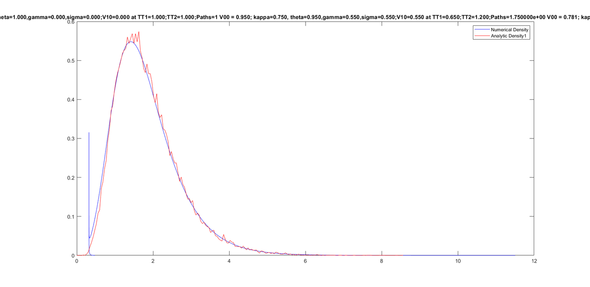](https://postimg.cc/ftmt7pbH)

.

.

.

.

Here are the last few output lines you should see when you run this program.

YMomentsModel =

   1.0e+04 *

  Columns 1 through 3

   0.000183390917187   0.000411755789843   0.001111668322598

  Columns 4 through 6

   0.003570020998262   0.013587482029300   0.061833963117675

  Columns 7 through 8

   0.350927128366113   2.893031053263796

DataMoments =

   1.0e+04 *

  Columns 1 through 3

   0.000184954826840   0.000413113480984   0.001095987255672

  Columns 4 through 6

   0.003404065664662   0.012213590584548   0.049996466685851

  Columns 7 through 8

   0.230791719893527   1.187542813799893

Look at comparison of moments

Look at density

This is the first version without altering the moments of conditional density

str =

     []

---

### #3029 — Amin (Topic Author)
*April 4, 2026, 6:40 AM*

Friends, mind control agents are changing my programs again. Yesterday night, I made more than six or seven graphs of
different densities. but after that I started getting garbage graphs and when I try older parameter, I still get garbage
graphs.

I slept after that and decided to work in the morning but they continue to alter my programs. They were not expecting
anything reasonable but when something worked, they do not want me to do any further work lest I completely perfect it
in a few days. Please stop these scumbags and ask them to refrain from their evil practices.

---

### #3030 — Amin (Topic Author)
*April 5, 2026, 6:05 AM*

Friends, I still cannot run my matlab programs properly on my end but I hope that friends have been able to explore
working programs with three explanatory variables or more.

Friends, when I see some of the medium term objectives of my research approximately achieved, I have a few requests for
friends so that I could continue my research on the same format. My only two concerns are that my health is not
compromised and I am allowed to make money on my own. I have previously told people about my deteriorating health but I
have not recently mentioned that I have no sources of income. In late 2010, when I went to UK on HSMP Visa, I was making
8500 USD/month. I stayed in UK for 6-7 months and I spent almost all of my more than 150,000 USD in savings to keep
myself free of mind control in UK. I was not thinking that I would not be able to find work in the future. Mind control
bosses were extremely annoyed because my money bought me a lot of freedom. So when I returned to Pakistan, mind control
bosses had learnt this lesson that I must not be allowed to make money again on my own. Whenever I approached other
professionals or businesses abroad about some consulting or other projects, mind control people would simultaneously
approach them and ask them to do no business with me. My emails would be stopped especially linkedin would stop many of
my emails to other professionals. I have made only 4,500 USD in past sixteen years after 2010. I survived first few
years after 2010 on my saved money. Then I got 1,000,000 rupees back from an old loan gone bad. I also had lent a lot of
money to my father and he returned 1,000,000 rupees (=3,500 USD) of my money. In between, I have simply lived on very
small amounts of money given to me by my parents especially my mother. There are so many times when I am so low on money
that I cannot even have appropriate balanced food.

I am also under severe pressure from my family and psychiatrists to make money on my own. Everybody at home and
psychiatrists continuously make fun of my claims of good research and ask if my research were so good why could I make
no money at all. If I say that CIA stops people from working with me, my family and psychiatrists attribute it to
schizophrenia. When I told a psychiatrist early this year that my research was very good and interesting, she started
telling people that he is make claims of grandiosity.

Notwithstanding what people think or say, it is very difficult to live without money. Therefore, I want to request good
people to force CIA to refrain from approaching people who I approach for business.  I want to live reasonably by making
some decent money.

I also want to assure friends that I would continue to post most of my research on Wilmott as before and I do not want
to take any paid research project from anyone that would stop me from posting my research on Wilmott that I am very keen
on keep doing.

Even though mind control agents have stopped me from further working on the project, I am myself a little laid back
since I believe most of the difficult work has been done and I want to concentrate on the bigger picture and make sure
that I can live a healthy life with decent amount of money. I want to continue doing research all through the rest of my
life but I also want to live the last part of my life relatively comfortably with a healthy lifestyle.

I know given the present government in US, I might be asking for too much. I am on mind control for 28 years now so
another two years might not be asking for too much but I do hope that a lot of my misery ends after decades of struggle,
torture, misery and trauma.

---

### #3031 — Amin (Topic Author)
*April 5, 2026, 9:55 AM*

Friends, I cannot properly run my matlab program and only get garbage graphs whatever parameters I try. I think there
might possibly be some error in calculation of conditional mean. There is a possibility and I cannot be sure until I am
able to run the matlab programs at my end. If they allow me to run my programs properly, I can try and find out if there
are any more errors but this is only contingent to their allowing me to run my programs. There are also some problems
with correlations and their sums exceeding one but that is easily possible to fix by regularizing the correlations
matrix or by taking only positive eigenvalues etc. I think many people routinely do such analytics with correlations.

---

### #3032 — Amin (Topic Author)
*April 7, 2026, 4:54 AM*

Friends, I have not been able to work for past few days. I tried to work several times but mind control agents continue
to alter my graphs and show me garbage instead of the graphs and it is not possible to do anything meaningful under such
coercion.

I will be taking a week off now in which I might not work at all. My niece who is a Warwick graduate and works for a
French investment bank in London is getting married on 11th of this month. So I will be travelling to Islamabad in
another day or two to attend her marriage. I might post some random thoughts but I doubt that I would be working on my
research. I should be back in Lahore by 13th of this month.

---

### #3033 — Amin (Topic Author)
*April 10, 2026, 9:02 AM*

Friends, I travelled from Lahore to Islamabad yesterday. I started the journey with my father and mother and I was
driving my father's car. About thirty kilometres out of the city, mind control agents started targeting my left knee
with microwave gadgets fitted probably in the dashboard of the car somewhere. I braved the pain for  a few tens of
minutes and continued to try to drive but finally I was totally exhausted by pain and told my father about severe pain
and requested him to drive the car. I went to the other front seat by the driver and my father started driving the car.
The pain sharply decreased for fifteen minutes but then intense pain in the knee started again and I was shouting with
pain again. I was trying to do all sort of things like changing angles, switching sides on the seat and I also placed a
pillow on my knee but my pain did not decrease. I started asking my father to stop at a pharmacy to get pain killers but
there was no shop easily accessible for quite some distance. I had realized that they had lasers on both sides of the
dashboards on both front seats. I was so overwhelmed with pain that I asked my father that I need to get off the car. He
was not willing but I still got off the car. I just asked my father to drive himself and my mother in the car and I
would follow in public transport. I was fine without any pain when I walked out of the car. I changed two shabby buses
to Islamabad D-Chowk from outskirts of Gujranwala/Ghakar mandi where I had gotten off the car. In the buses there was
very limited place for the knees/legs and they had very pure suspension with constant jumps on the G.T.Road but I had no
pain in my knees at all and I was able to travel fine to my cousin's house in D.H.A Islamabad.

Friends, mind control agents are extremely annoyed with the good work I have done and they have increased the torture
many times. It was not just microwave and laser gadgets to cause extreme pain in my knee on the way, this morning, they
literally started hitting me below the belt (by causing extreme sustained pain in my penis, I went out and was trying to
force urinate just a few drops every 100 meters to get some relief). I am not going to post more details but I want to
say that these mind control agents are ready to go to any limits and absolutely have no ethics or values and are ready
to stoop to the worst level of humanity when they know that they are not being able to control their targets.

Friends, the way they are adamant on openly torturing me everyday, I am afraid that tonight in the pre-marriage mehndi
function of my niece, they would start doing some other machinations to punish me and vent their anger and try to make
me a party-spoiler when I would be miserable due to their high torture especially when I have to take the same food that
they could add all mind control chemicals.

Please I want to request people to ask the mind control scum to let the family functions pass and not torture me in the
marriage functions of my niece.

---

### #3034 — Amin (Topic Author)
*April 12, 2026, 3:02 PM*

Friends, marriage of my niece took place nicely in Islamabad yesterday. My niece, who is a Warwick graduate, works for a
French investment bank in London and her husband who was also a Lithuanian foreign student in Warwick, works for
Microsoft in London. The celebration was really cool. About twenty five Lithuanian family and friend guests had come to
Islamabad to celebrate the marriage. I also really enjoyed the two days of the marriage and for me it was very
re-invigorating after very hectic but also monotonic routine of my research.

But mind control agents continued to torture me and I went to mehndi and marriage venue in my parents' car on the back
seat. I thought they would not make a big deal but they continued to cause sharp pain in my left knee on both days. I
have no idea what they were trying to prove. And today, I came back from Islamabad to Lahore on public transport since I
did not want to sit in my father's car for such a prolonged period. My parents came back in the car which my younger
brother was driving while I followed alone on public transport but frankly I enjoyed the experience of being by myself.

Friends, I will re-start my research work tomorrow. Tomorrow, my mother also have her chemotherapy and I will take her
to the hospital and would be with her for the day. But I hope that I would be able to re-start my work tomorrow evening.

I have also decided to change my routine and start sleeping early at night and and then wake up early in the morning and
go for morning walk. I hope that I would be able to lose some weight and remain fit that way. It is very important for
me to lose weight to remain healthy. I am already mildly diabetic and it is not possible to put off decreasing weight. I
am happy that I was able to do some major research I was after since quite some time. I am sure I can continue my
research very well while following a healthy routine.

I also want to approach different connections for some consulting work but I will start in two or three days. At the
same time, I want my research to be free and for all friends so I do not want to take any contracts that restrict me
from posting my research in public. I am ready to try helping any business in their operations on terms they find
reasonable but I want to simultaneously continue my private research and also keep posting it openly on this forum.

I also want to approach good universities to find a paid position as a researcher in probability theory. If I could do
that, it would really help me concentrate on my research without too much urgency to find sources of money. But my
previous meager experience has not been very great. But if you would like me to find a researcher position in your
university department, please do let me know.

Again, I am so lucky and therefore so glad that I was able to do some good research in the past and hope that I will
continue doing that. I have several other ideas to develop the field of Math AI so we can do many interesting things
with applied mathematics as opposed to networks. I hope most friends who liked my research in the past would also follow
my research in the future.

---

### #3035 — Amin (Topic Author)
*April 14, 2026, 10:10 AM*

Friends, first I wanted to make a more detailed post describing all the bad manners of mind control agents and their
effect on me during past two days. I also wanted to describe about my 8.5 km walk in the morning but I have already been
doing too much talking and too little work. We have not touched the technical stuff for weeks. Today, I was able to make
a careful game plan of conditional densities based on a large number of correlated explanatory variables. And before I
write an updated program that can take another two days at least, I decided to share all the logic and details with
friends. This is for friends who are very familiar with logic of 1D program and have been following my earlier work. I
will come back with a very thorough and complete post for beginners but only after I would have completed the program
and that can take a few days.

First I want to give some brief context so you know symbols and logic and relate them to programs. Parts of this post
are copied from post No.  . Even if the program works well in most cases, we still need to re-work the correlations part
because of the contributions from all correlations exceeding one. I have not looked at that yet and I will come to that
correlations part after we have settled the logic of main program that builds the conditional density given N explaining
variables.

Friends, when there are K conditioning variables K random variables$X_1, X_2, X_3, \ldots \,,X_K$ in the expansion of Y
and we want to find the conditional expectation of Y given all of$X_1, X_2, X_3, \ldots \,,X_K$ . In such a case
effective correlations could be found by standardized regression on correlations.

We define the correlation matrix of nth hermite polynomial of K explaining random variables
$X_1, X_2, X_3, \ldots \,,X_K$ as

$$\textbf{R}_n \,=\,

 \begin{bmatrix}

         \rho_{X_1 X_1,n} & \rho_{X_2 X_1,n} & \cdots & \rho_{X_K X_1,n}\\

         \rho_{X_1 X_2,n} & \rho_{X_2 X_2,n} & \cdots & \rho_{X_K X_2,n}\\

         \vdots & \vdots & \ddots & \vdots\\

         \rho_{X_1 X_K,n} & \rho_{X_2 X_K,n} & \cdots & \rho_{X_K X_K,n}

     \end{bmatrix}

$$

While the vector of correlations of nth hermite polynomial of Y with nth hermite polynomial of each of the K explaining  random variables $X_1, X_2, X_3, \ldots \,,X_K$ is given as

 $$\textbf{r}_{XY,n}\,=\begin{bmatrix}

          \rho_{X_1 Y,n} \\

 \rho_{X_2 Y,n}  \\ \cdots \\ \rho_{X_K Y,n}

     \end{bmatrix}$$

Then vector of effective correlation coefficients $\beta_{n,k}$  associated with kth random variable $X_k$ and nth hermite polynomial that explains the nth hermite polynomial of Y is given as

$$

\begin{bmatrix}

          \beta_{n,1} \\

 \beta_{n,2}  \\ \cdots \\ \beta_{n_K}

     \end{bmatrix}

=

{\begin{bmatrix}

         \rho_{X_1 X_1,n} & \rho_{X_2 X_1,n} & \cdots & \rho_{X_K X_1,n}\\

         \rho_{X_1 X_2,n} & \rho_{X_2 X_2,n} & \cdots & \rho_{X_K X_2,n}\\

         \vdots & \vdots & \ddots & \vdots\\

         \rho_{X_1 X_K,n} & \rho_{X_2 X_K,n} & \cdots & \rho_{X_K X_K,n}

     \end{bmatrix}}^{-1}

\,

\begin{bmatrix}

          \rho_{X_1 Y,n} \\

 \rho_{X_2 Y,n}  \\ \cdots \\ \rho_{X_K Y,n}

     \end{bmatrix}

$$

The above equation is equation of standardized regression that is done on correlations. Inverse of variance-covariance matrix of regressors is replaced by inverse of correlation matrix of regressors ${\textbf{R}_n}^{-1} $. And covariance vector between regressand and regressors is replaced by the respective correlation vector $\textbf{r}_{XY,n}$ making the standardized regression equation as

$$ \boldsymbol{\beta}_n ={\textbf{R}_n}^{-1} \, \textbf{r}_{XY,n}$$

Again $\beta_{n,K}$ is the effective correlation between nth hermite polynomial of Y and nth Hermite polynomial of $X_k$ and this correlation would be used in later analytics instead of the raw hermite correlations.

However, we would still have to convert these effective hermite correlations into consistent correlation used uniquely for each mth power multinomial expansion of ${Z_y}^m$ so that effective hermite correlations would be retrieved between hermite polynomials of Y and each of $X_k$ and in between all hermite polynomials of $X_k$. We have the following expressions

$${Z_y}^m\,=\,\left[\,{\bar{\beta_{m,1}}}^{1/m}\,Z_{x_1}\,+\,{\bar{\beta_{m,2}}}^{1/m}\,Z_{x_2}\,+\,{\bar{\beta_{m,3}}}^{1/m}\,Z_{x_3}\,+\,\ldots\,+\,{\bar{\beta_{m,K}}}^{1/m}\,Z_{x_K}\,+ \zeta_m \,Z_{\tilde{y}}\right]^m $$

$$\,\zeta_m\,=\,\sqrt{1\,-\,\sum\limits_{k=1}^{K}\,{\bar{\beta_{m,k}}}^{2/m}}$$

Again all of the ${\bar{\beta_{m,k}}}$ (that appear in final multinomial expansion) with a bar over them are found from effective correlations $\beta_{n,k}$ using algebra so that when mth power above is multinomially expanded inside all of the hermite polynomials of Y, the effective correlations of $\beta_{n,k}$ are effectively retrieved (for each hermite polynomial of nth order of $X_k$ and also on the first rows of multidimensional hermite-series.

I have made the above calculations in the program I have previously posted and here is header of the function below

function [bn,dn,cn,ccn] = Calculate2DZSeriesNDimCorrected(YCoeffH,BetaCorrH,CorrXX1st,NDims,Order)

that I have already posted.

In the language of the variables used in the above function's output, We have

$${Z_y}^m\,=\,\left[\,{\bar{\beta_{m,1}}}^{1/m}\,Z_{x_1}\,+\,{\bar{\beta_{m,2}}}^{1/m}\,Z_{x_2}\,+\,{\bar{\beta_{m,3}}}^{1/m}\,Z_{x_3}\,+\,\ldots\,+\,{\bar{\beta_{m,K}}}^{1/m}\,Z_{x_K}\,+ \zeta_m \,Z_{\tilde{y}}\right]^m \\

\,=\,\left[\,cn(1,m)\,\,Z_{x_1}\,+\,\,cn(2,m)\,\,Z_{x_2}\,+\,\,cn(3,m)\,\,Z_{x_3}\,+\,\ldots\,+\,\,cn(K,m)\,\,Z_{x_K}\,+ \, dn(1,m) \,Z_{\tilde{y}}\right]^m $$

In above, I have substituted output variables in header of the above given function to explain the expansion of mth power of $Z_y$.

We want to substitute all of the  $ {Z_y}^m$ for various values of m's (found from above formula) in appropriate hermite polynomials of $Z_y$ and in the hermite-series of variable Y.

Friends, sorry, I am going to abort this post as I realize that I still need to do another algebra step. I will come back with a new completed post later today or tomorrow. I am sure the problem is completely in our reach but please let me do this extra step. I am still keeping this post as I think some friends would find this above information and substitution from function helpful for their research.

Please give me a little bit of more time.

Friends, you could specify the values of all of the K conditioning $Z_x$ given in above formula as $Z_{x_1}\,,\,Z_{x_2}\,,\,Z_{x_3},\,,\,\ldots,\,Z_{x_K}$. These are the realized values of all of the K explaining $Z_x$ variables. Their coefficients are already known. So we can expand all of the ${Z_y}^m$ as binomial expansion by arithmetically lumping together all of the known values of K number of $Z_x$ variables and their already calculated coefficients. Again, this will only be a binomial expansion since all realized values of explaining variables are arithmetically added to lump them together as one variable. This will give us the resulting univariate Z-series in $Z_{\tilde{y}}$ which will be our required conditional Z-series.

However, due to sign problems, conditional mean in expansion in above paragraph sometimes may not match the true conditional mean from hermite-regression and that is where I need additional algebra(that I will add tomorrow) to make sure that conditional mean precisely matches with hermite-regression value.

Friends, in an earlier version that I previously posted I was calculating one resultant combined variance of realized values of K number of $Z_x$ variables and using just one number but that was a wrong way to reduce dimensionality. Once the explaining $Z_x$ variables have been known, the exact values of those Z's have to be used and then added together with pre-calculated coefficients and this can be just as easily expanded as a binomial expansion as I previously suggested.

I hope to add more details in a day and hope that a final program would be ready in a few days.

---

### #3036 — Amin (Topic Author)
*April 14, 2026, 1:03 PM*

Friends, OK I got the minor algebra right and now I am going to write the final equations for the conditional density of
Y given K number of$X_k$ explanatory variables in this post. But we have to start from things we know. Please also keep
the context of previous post fresh in your mind.

We know the univariate hermite-series of Y is given as

$$Y(Z_y)\,=\,ah_0\,+\,ah_1\,H_1(Z_y)\,+\,ah_2\,H_2(Z_y)\,+\,ah_3\,H_3(Z_y)\,+\,\dots\,+\,ah_7\,H_7(Z_y)\,$$

With obvious standard hermite polynomials, we also introduce two slightly altered versions of hermite-polynomials with
single bar over hermites's H and double bar over hermite polynomials's H.

Single bar hermite polynomials are associated with multinomial expansion of$H(Z_y)$ as I had explained in previous post.
To give a good idea to friends, I will give equations of fourth, fifth and sixth single bar hermite polynomials with all
other polynomials defined in a similar way.

$$\bar{H}_4\,=\,\,{\left[\,{\bar{\beta_{4,1}}}^{1/4}\,Z_{x_1}\,+\,{\bar{\beta_{4,2}}}^{1/4}\,Z_{x_2}\,+\,\ldots\,+\,{\bar{\beta_{4,K}}}^{1/4}\,Z_{x_K}\,+
\zeta_4 \,Z_{\tilde{y}}\right]}^{
4}\,\\-\,6\,\,\,{\left[\,{\bar{\beta_{2,1}}}^{1/2}\,Z_{x_1}\,+\,{\bar{\beta_{2,2}}}^{1/2}\,Z_{x_2}\,+\,\ldots\,+\,{\bar{\beta_{2,K}}}^{1/2}\,Z_{x_K}\,+
\zeta_2 \,Z_{\tilde{y}}\right]}^{ 2}\,+\,3\,\\

=\,\,{\left[\,\,cn(1,4)\,\,\,Z_{x_1}\,+\,\,cn(2,4)\,\,\,Z_{x_2}\,+\,\ldots\,+\,\,cn(K,4)\,\,\,Z_{x_K}\,+ \zeta_4
\,Z_{\tilde{y}}\right]}^{
4}\,\\-\,6\,\,\,{\left[\,\,cn(1,2)\,\,\,Z_{x_1}\,+\,\,cn(2,2)\,\,\,Z_{x_2}\,+\,\ldots\,+\,\,cn(K,2)\,\,\,Z_{x_K}\,+
\zeta_2 \,Z_{\tilde{y}}\right]}^{ 2}\,+\,3\,$$

Similarly fifth hermite with single bar would be defined as

$
$\bar{H}_5\,=\,\,{\left[\,\,cn(1,5)\,\,\,Z_{x_1}\,+\,\,cn(2,5)\,\,\,Z_{x_2}\,+\,\ldots\,+\,\,cn(K,5)\,\,\,Z_{x_K}\,+ \zeta_5 \,Z_{\tilde{y}}\right]}^{ 5}\,\\-\,10\,\,\,{\left[\,\,cn(1,3)\,\,\,Z_{x_1}\,+\,\,cn(2,3)\,\,\,Z_{x_2}\,+\,\ldots\,+\,\,cn(K,3)\,\,\,Z_{x_K}\,+ \zeta_3 \,Z_{\tilde{y}}\right]}^{ 3}\,\\+\,15\,\,{\left[\,\,cn(1,1)\,\,\,Z_{x_1}\,+\,\,cn(2,1)\,\,\,Z_{x_2}\,+\,\ldots\,+\,\,cn(K,1)\,\,\,Z_{x_K}\,+ \zeta_1 \,Z_{\tilde{y}}\right]}\,$
$

and sixth hermite with single bar is given as

$
$\bar{H}_6\,=\,\,{\left[\,\,cn(1,6)\,\,\,Z_{x_1}\,+\,\,cn(2,6)\,\,\,Z_{x_2}\,+\,\ldots\,+\,\,cn(K,6)\,\,\,Z_{x_K}\,+ \zeta_6 \,Z_{\tilde{y}}\right]}^{  6}\,\\-\,15\,\,\,{\left[\,\,cn(1,4)\,\,\,Z_{x_1}\,+\,\,cn(2,4)\,\,\,Z_{x_2}\,+\,\ldots\,+\,\,cn(K,4)\,\,\,Z_{x_K}\,+ \zeta_4 \,Z_{\tilde{y}}\right]}^{ 4}\,\\+\,45\,\,\,{\left[\,\,cn(1,2)\,\,\,Z_{x_1}\,+\,\,cn(2,2)\,\,\,Z_{x_2}\,+\,\ldots\,+\,\,cn(K,2)\,\,\,Z_{x_K}\,+ \zeta_2 \,Z_{\tilde{y}}\right]}^{ 2}\,+\,15$
$

Similarly, we define double bar hermites of a single variable as

$
$\bar{\bar{H}}_4(Z_{x_1})\,=\,\,\,{\left[\,\,cn(1,4)\,\,\,Z_{x_1}\,\right]}^{ 4}\,-\,6\,\,\,{\left[\,\,cn(1,2)\,\,\,Z_{x_1}\right]}^{ 2}\,+\,3\,$
$

$
$\bar{\bar{H}}_5(Z_{x_1})\,=\,\,\,{\left[\,\,cn(1,5)\,\,\,Z_{x_1}\,\right]}^{ 5}\,-\,10\,\,\,{\left[\,\,cn(1,3)\,\,\,Z_{x_1}\right]}^{ 3}\,+\,15\,\,\,{\left[\,\,cn(1,1)\,\,\,Z_{x_1}\right]}\,$
$

$
$\bar{\bar{H}}_6(Z_{x_1})\,=\,\,\,{\left[\,\,cn(1,6)\,\,\,Z_{x_1}\,\right]}^{ 6}\,-\,15\,\,\,{\left[\,\,cn(1,4)\,\,\,Z_{x_1}\right]}^{ 4}\,+\,45\,\,\,{\left[\,\,cn(1,2)\,\,\,Z_{x_1}\right]}^{ 2}\,-15\,\,$
$

Now we substitute all the values in the original hermite equation as

\begin{align}

=& \,ah_0\,+\,ah_1\,
\left[\,\bar{H}_1\,-\sum\limits_{k=1}^{K}\,\bar{\bar{H}}_1(Z_{x_k})\,+\,\sum\limits_{k=1}^{K}\,\beta_{1,k}\,H_1(Z_{x_k})\right]\\

&\,+\,ah_2\,
\left[\,\bar{H}_2\,-\sum\limits_{k=1}^{K}\,\bar{\bar{H}}_2(Z_{x_k})\,+\,\sum\limits_{k=1}^{K}\,\beta_{2,k}\,H_2(Z_{x_k})\right]\\

&\,+\,ah_3\,
\left[\,\bar{H}_3\,-\sum\limits_{k=1}^{K}\,\bar{\bar{H}}_3(Z_{x_k})\,+\,\sum\limits_{k=1}^{K}\,\beta_{2,k}\,H_3(Z_{x_k})\right]\\

&\,+\ldots\,\\

&\,+\,ah_7\,
\left[\,\bar{H}_7\,-\sum\limits_{k=1}^{K}\,\bar{\bar{H}}_7(Z_{x_k})\,+\,\sum\limits_{k=1}^{K}\,\beta_{7,k}\,H_7(Z_{x_k})\right]

\end{align}

The above is the final equation in which you will have to substitute the realized values of all Z's of the realized
values of the explaining variables$X_k$ . It will end up in a single dimensional Z-series of the conditional density of
the variable Y being explained by a total of K$X_k$ variables.

Please note that hermites with single bar (in above equation) is the standard equation we had achieved in the previous
post. We are subtracting the conditional drift of hermite polynomial of each explaining variable (from power of
coefficients that can have wrong signs) and adding the original value of drift calculated from original hermite
correlations. We do this operation for every hermite polynomial. This ensures that even if signs could not be accounted,
our conditional drift will remain at the precise value of hermite-regression (from original hermite correlations).

I will post a complete program tomorrow or day after tomorrow.

---

### #3037 — Amin (Topic Author)
*April 15, 2026, 7:17 AM*

Friends, please disregard the previous post as it has errors. double bar H in above equation probably do not equal
calculated conditional mean/expected value of the variable being conditioned. In this post, I find the value of this
"calculated conditional mean" but I simply drop this "calculated conditional mean" and replace it with the true mean
calculated directly from correlations as in hermite regression. In previous post, I tried to do the same thing and there
I represented the "calculated conditional mean"(I probably got the value of calculated conditional mean wrong in
previous post) with double bar H (double bar hermite notation) and subtracted it and added the true mean directly from
correlations as in hermite regression.

I wanted to replace calculated conditional mean with true mean since in our calculations there is almost always a sign
of correlations on some term that is not possible to represent as a power and this change of sign when we cannot get the
sign right throws the whole estimate of conditional mean off(and conditional mean is probably the most important number
in the whole calculation) .

To explain the sign problem, I found it hard to represent$-\rho_4\, Z^4$ as${({\rho_4}^{\frac{1}{4} } Z)}^4$ . Whatever
positive or negative sign I choose on rho, the fourth power does not become negative. So in 1D conditionality program, I
replaced the true term instead of signed version (that is raised to some power) on leading coefficients and it worked
well. In our multidimensional conditionality set up, it is not simple to replace all the leading coefficients when we
take their powers (and replace) by the appropriate terms so I decided in this new program to replace calculated drift
that can be off due to sign problems by true drift that we already know from correlations as in hermite regression.

I want to make this disclaimer that I had noticed that any choice of sign (on root-based coefficients) was not causing
problems with lower order terms in 1D program but this might have to be investigated in perfect detail again after we
have a reasonably working program. In 1D I tried to play with signs but it did not make any difference so I left all the
signs on correlation's root-based coefficients as positive.

Ok, now we have enough of the context for this sign issue and we want to do further analytics to properly calculate the
value of conditional mean here(that will finally not be needed and only to be replaced by true conditional mean).
Basically, from the Z-series (or very similarly from hermite-series either) of random variable Y in which we will
substitute the realized values of all conditioning$Z_x$ along with their coefficients, we would expand all the terms in
Z-series (or hermite-series). All the known values of various$Z_x$ are basically constants and we are left with only one
variable (whose conditional density has to be found) that is$Z_{\tilde{y}}$ and we make a hermite-series in this
$Z_{\tilde{y}}$ . Making a hermite-series of$Z_{\tilde{y}}$ brings out the conditional mean as zeroth-hermite and we can
easily replace it with the known true mean from correlations as in hermite-regression.

In the previous post, I had made substitutions in hermite-series of Y but it does not matter and I am making
substitutions in Z-series of Y but both should give precisely the same results. Let us suppose that original univariate
hermite-series of Y is given as

$
$Y(Z_y)\,=\,a_0\,+\,a_1\,Z_y\,\,+\,a_2\,{Z_y}^2\,\,+\,a_3\,{Z_y}^3\,\,+\,a_4\,{Z_y}^4\,\,+\,a_5\,{Z_y}^5\,\,+\,a_6\,{Z_y}^6\,\,+\,a_7\,{Z_y}^7\,$
$

basically we want to substitute the values as in follows

$${Z_y}^m\,=\,\left[\,{\bar{\beta_{m,1}}}^{1/m}\,Z_{x_1}\,+\,{\bar{\beta_{m,2}}}^{1/m}\,Z_{x_2}\,+\,{\bar{\beta_{m,3}}}^{1/m}\,Z_{x_3}\,+\,\ldots\,+\,{\bar{\beta_{m,K}}}^{1/m}\,Z_{x_K}\,+
\zeta_m \,Z_{\tilde{y}}\right]^m \\

\,=\,\left[\,cn(1,m)\,\,Z_{x_1}\,+\,\,cn(2,m)\,\,Z_{x_2}\,+\,\,cn(3,m)\,\,Z_{x_3}\,+\,\ldots\,+\,\,cn(K,m)\,\,Z_{x_K}\,+
\, dn(1,m) \,Z_{\tilde{y}}\right]^m $$

In the above equation, all of the$Z_{x_k}$ are known on which we are conditioning, we lump them together and use the
notation

$$c_m\, {Z_x} \,=\, \sum\limits_{k=1}^{K}\, cn(k,m)\,\,Z_{x_k}\, \,$$

so the previous equation now becomes

$${Z_y}^m\,=\,\left[\,c_m\,\,Z_{x}\,+ \, d_m \,Z_{\tilde{y}}\right]^m $$

On substituting above equation in Z-series of Y, we get the equation

$
$Y=\,a_0\,+\,a_1\,\,\left[\,c_1\,\,Z_{x}\,+ \, d_1 \,Z_{\tilde{y}}\right]\,\,+\,a_2\,\,\left[\,c_2\,\,Z_{x}\,+ \, d_2 \,Z_{\tilde{y}}\right]^2\,\,+\,a_3\,\,\left[\,c_3\,\,Z_{x}\,+ \, d_3 \,Z_{\tilde{y}}\right]^3\,\,\\+\,\,\left[\,c_4\,\,Z_{x}\,+ \, d_4 \,Z_{\tilde{y}}\right]^4\,\,+\,a_5\,\,\left[\,c_5\,\,Z_{x}\,+ \, d_5 \,Z_{\tilde{y}}\right]^5\,\,+\,a_6\,\,\left[\,c_6\,\,Z_{x}\,+ \, d_6 \,Z_{\tilde{y}}\right]^6\,\,+\,a_7\,\,\left[\,c_7\,\,Z_{x}\,+ \, d_7 \,Z_{\tilde{y}}\right]^7\,$
$

I expanded the above binomials and then collected the terms on powers of$Z_{\tilde{y}}$ as in a univariate Z-series in
$Z_{\tilde{y}}$ . Then I converted the coefficients from Z-series to hermite-series so that conditional mean would come
out as zeroth-hermite. I did these calculations in mathematics and came up with the following results.

\begin{align}

bh_0 &=(a_0+a_1\, c_1\, Z_x\,+\,a_2\, {c_2}^2\, {Z_x}^2\,+\,a_3\, {c_3}^3\, {Z_x}^3\,+\,a_4\, {c_4}^4\,
{Z_x}^4\,+\,a_5\, {c_5}^5 \,{Z_x}^5\,+\,a_6\, {c_6}^6\, {Z_x}^6\,+\,a_7\, {c_7}^7 \,{Z_x}^7) \\
&+(\,a_2\, {d_2}^2\,+\,3\, a_3\, c_3\, {d_3}^2\, Z_x\,+\,6\, a_4\, {c_4}^2\, {d_4}^2\, {Z_x}^2\,+\,10\,
a_5\, {c_5}^3\, {d_5}^2\, {Z_x}^3\,+\,15\, a_6\, {c_6}^4\, {d_6}^2\, {Z_x}^4\,+\,21\, a_7\, {c_7}^5\, {d_7}^2\,
{Z_x}^5)\,\\  &+\,3\,(\,a_4\, {d_4}^4\,+\,5\, a_5\, c_5 \,{d_5}^4\, Z_x\,+\,15\, a6\, {c_6}^2\, {d_6}^4\,
{Z_x}^2\,+\,35\, a_7\, {c_7}^3\, {d_7}^4\, {Z_x}^3)\,\\ & +\,15\,(\,a_6\, {d_6}^6\,+\,7\, a_7\, c_7\, {d_7}^6\, Z_x\,)
\\

bh1
&=(a_1\,{d_1}+2\,a_2\,{c_2}\,{d_2}\,{Z_x}+3\,a_3\,{c_3}^2\,{d_3}\,{Z_x}^2+4\,a_4\,{c_4}^3\,{d_4}\,{Z_x}^3+5\,a_5\,{c_5}^4\,{d_5}\,{Z_x}^4+6\,a_6\,{c_6}^5\,{d_6}\,{Z_x}^5+7\,a_7\,{c_7}^6\,{d_7}\,{Z_x}^6)\\
&+3(a_3\,{d_3}^3+4\,a_4\,{c_4}\,{d_4}^3\,{Z_x}+10\,a_5\,{c_5}^2\,{d_5}^3\,{Z_x}^2+20\,a_6\,{c_6}^3\,{d_6}^3\,{Z_x}^3+35\,a_7\,{c_7}^4\,{d_7}^3\,{Z_x}^4)\\
&+15(a_5\,{d_5}^5+6\,a_6\,{c_6}\,{d_6}^5\,{Z_x}+21\,a_7\,{c_7}^2\,{d_7}^5\,{Z_x}^2)+105(a_7\,{d_7}^7)\\

bh2
&=(a_2\,{d_2}^2+3\,a_3\,{c_3}\,{d_3}^2\,{Z_x}+6\,a_4\,{c_4}^2\,{d_4}^2\,{Z_x}^2+10\,a_5\,{c_5}^3\,{d_5}^2\,{Z_x}^3+15\,a_6\,{c_6}^4\,{d_6}^2\,{Z_x}^4+21\,a_7\,{c_7}^5\,{d_7}^2\,{Z_x}^5)\\
&+6(a_4\,{d_4}^4+5\,a_5\,{c_5}\,{d_5}^4\,{Z_x}+15\,a_6\,{c_6}^2\,{d_6}^4\,{Z_x}^2+35\,a_7\,{c_7}^3\,{d_7}^4\,{Z_x}^3) \\
&+45(a_6\,{d_6}^6+7\,a_7\,{c_7}\,{d_7}^6\,{Z_x})\\

bh3
&=(a_3\,{d_3}^3+4\,a_4\,{c_4}\,{d_4}^3\,{Z_x}+10\,a_5\,{c_5}^2\,{d_5}^3\,{Z_x}^2+20\,a_6\,{c_6}^3\,{d_6}^3\,{Z_x}^3+35\,a_7\,{c_7}^4\,{d_7}^3\,{Z_x}^4)
\\ &+10(a_5\,{d_5}^5+6\,a_6\,{c_6}\,{d_6}^5\,{Z_x}+21\,a_7\,{c_7}^2\,{d_7}^5\,{Z_x}^2)+105(a_7\,{d_7}^7)\\

bh4 &=(a_4\,{d_4}^4+5\,a_5\,{c_5}\,{d_5}^4\,{Z_x}+15\,a_6\,{c_6}^2\,{d_6}^4\,{Z_x}^2+35\,a_7\,{c_7}^3\,{d_7}^4\,{Z_x}^3)
\\ &+15\,(a_6\,{d_6}^6+7\,a_7\,{c_7}\,{d_7}^6\,{Z_x})\\

bh5 &=(a_5\,{d_5}^5+6\,a_6\,{c_6}\,{d_6}^5\,{Z_x}+21\,a_7\,{c_7}^2\,{d_7}^5\,{Z_x}^2)+21(a_7\,{d_7}^7)\\

bh6 &=(a_6\,{d_6}^6+7\,a_7\,{c_7}\,{d_7}^6\,{Z_x})\\

bh7 &=(a_7\,{d_7}^7)\\

\end{align}

In the above$bh_0$ is the calculated conditional mean and I want to replace it with the true conditional mean from
correlations. We know the univariate hermite-series of Y is given as

$$Y(Z_y)\,=\,ah_0\,+\,ah_1\,H_1(Z_y)\,+\,ah_2\,H_2(Z_y)\,+\,ah_3\,H_3(Z_y)\,+\,\dots\,+\,ah_7\,H_7(Z_y)\,$$

so true conditional mean from correlations is given as

$$\,ah_0\,+\,\sum\limits_{n=1}^{7}\,\left[\,ah_n\,\sum\limits_{k=1}^{K}\,\beta_{n,k}\,H_n(Z_{x_k})\right]$$

we replace $bh_0$ with above equation as

$$\,bh_0\,=\,\,ah_0\,+\,\sum\limits_{n=1}^{7}\,\left[\,ah_n\,\sum\limits_{k=1}^{K}\,\beta_{n,k}\,H_n(Z_{x_k})\right]$$

Now we can write the univariate conditional hermite-series of $Z_{\tilde{y}}$ as

$
$Y(Z_{\tilde{y}}\,| \left(Z_{x_1},\,Z_{x_2},\ldots,\,Z_{x_K}\right)\,=\,\,bh_0\,+\,bh_1\,H_1(Z_{\tilde{y}})\,+\,bh_2\,H_2(Z_{\tilde{y}})\,+\,bh_3\,H_3(Z_{\tilde{y}})\,+\,\dots\,+\,bh_7\,H_7(Z_{\tilde{y}})\,$
$

This should find our conditional Hermite-series of Y given all of the K explaining variables $Z_x$.

I will post a worked out program in another day or two.

---

### #3038 — Amin (Topic Author)
*April 16, 2026, 4:49 AM*

Friends, I have corrected some signs on equations of hermite coefficients given by$bh_n$ in previous post. I cannot
believe that I made this mistake on something so obviously simple. When we convert from Z-series coefficietns to
hermite-series coefficients, all signs placed on Z-series coefficients are positive. I had erroneously placed alternate
signs(that are used in converting from hermite-series to Z-series). But all signs are right now and I have also double
checked the calculations again that all equations for hermite coefficents$bh_n$ now are right and you can safely copy
them into your programs.

I was going to start my work and decided to look again that all equations are actually good and found this mistake.
Sorry for this inconvenient error.

---

### #3039 — Amin (Topic Author)
*April 16, 2026, 11:21 AM*

Friends, I went ahead and programmed the equations and logic in previous posts and it seems to work well. Here is how I
checked the method.

I simulated three SDEs and saved their paths at time T1 (these were Xk with K=3) and then I continued the simulation and
from the paths at time T2, I found the value of sum of three SDE joint simulation paths and this was variable to be
conditionally predicted and I called it Y. I then found the conditional density of sum Y given the arbitrarily chosen
values of X1, X2 and X3. I then did an independent monte carlo simulation of three densities from given values of X1, X2
and X3 and continued it for time T2-T1. I overlaid the densities of analytic values and the monte carlo values. Even
though I used three explaining variables, the logic is for arbitrary N variables. Just change NDim=3 to appropriate N
and supply SDE parameters.

Basically $Y\,=\,X_1(T_2)\,+\,X_2(T_2)\,+X_3(T_2)$  and we are conditioning as

$$P(Y|\,X_1(T_1)\,,\,X_2(T_1)\,,X_3(T_1))$$

Here are the parameters of three SDEs. I took three sets of parameters of three SDEs and repeated each of them with
three sets of arbitrarily chosen values of X1, X2 and X3. I am going to copy the three sets of SDE parameters and three
sets of starting values on which the density is conditioned. 1st Set of SDEs is CEV noises and following two sets are
mean-reverting SDEs. Starting point of all SDEs is one.

Three Sets of SDEs are given here first.

1st SET

%SDE1

 thetaV(1)=1.0;

 kappaV(1)=0.000;

 gamma(1)=.75;

 sigma0(1)=.55;

%SDE1

thetaV(2)=1.0;

 kappaV(2)=0.000;

 gamma(2)=.75;

 sigma0(2)=.45;

%SDE1

thetaV(3)=1.0;

 kappaV(3)=0.000;

 gamma(3)=.95;

 sigma0(3)=.35;

2nd Set

%SDE2

thetaV(1)=.90;

kappaV(1)=1.000;

gamma(1)=.75;

sigma0(1)=.6;

%SDE2

 thetaV(2)=1.0;

 kappaV(2)=2.000;

 gamma(2)=.65;

 sigma0(2)=.45;

%SDE2

 thetaV(3)=.750;

 kappaV(3)=0.5000;

 gamma(3)=.95;

 sigma0(3)=.35;

Third SDE set

%SDE3

thetaV(1)=1.350;

kappaV(1)=2.000;

gamma(1)=.75;

sigma0(1)=.6;

%SDE3

thetaV(2)=.850;

kappaV(2)=.35000;

gamma(2)=.65;

sigma0(2)=.55;

%SDE3

thetaV(3)=1.150;

kappaV(3)=1.5000;

gamma(3)=.95;

---------------------------------------

Each of the above three sets of SDEs were used with three sets of starting conditional values for which sum density was
constructed.

%Set1

V10(1)=.65;

V10(2)=1.2;

V10(3)=.75;

%Set2

V10(1)=1.65;

V10(2)=1.1;

V10(3)=.7;

%Set3

V10(1)=1.1;

V10(2)=.5;%1.2;

V10(3)=1.45;

Please note that for this initial test all three SDEs used uncorrelated random numbers. For correlated conditioning
values, we might have to make some small changes that I would post in a day or two in a new program.

I am going to post the program used to create these graphs in a few minutes.

Here are the nine graphs with three sets of conditional values for each set of SDEs. Please pardon the titles of graphs
as they are garbage. When I noticed, I had already made the graphs.

.

.

.

SDE 1: Set one to three.

[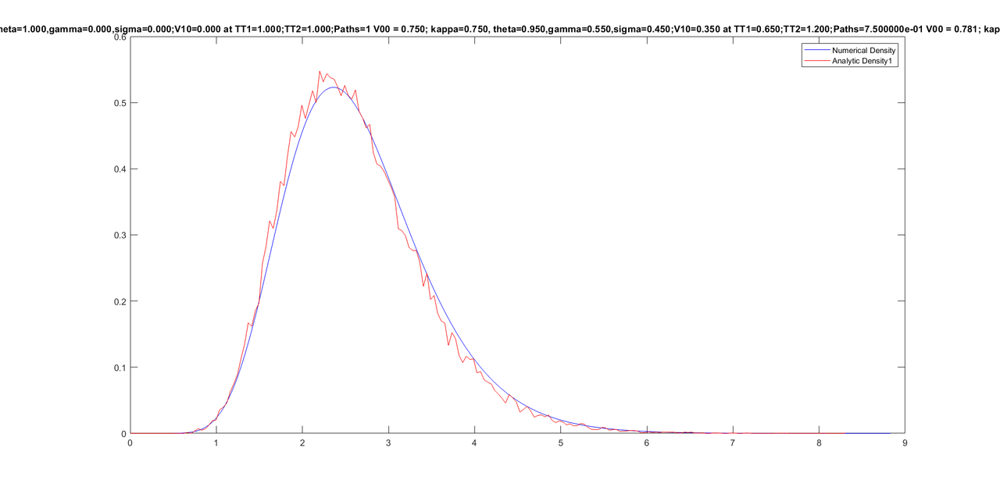](https://postimg.cc/hXsd44qF)

[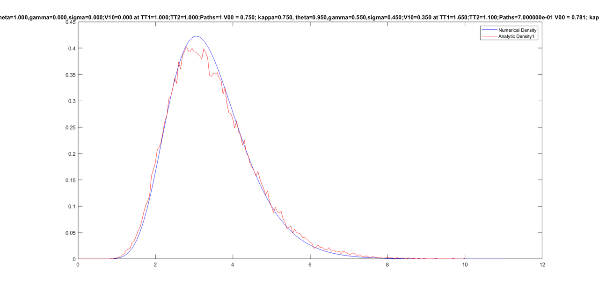](https://postimg.cc/Xr450Gtn)

[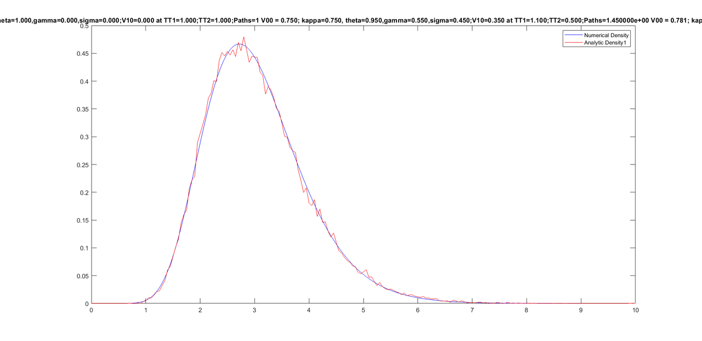](https://postimg.cc/HrdMCcFd)

SDE 2: Set One to Three.

[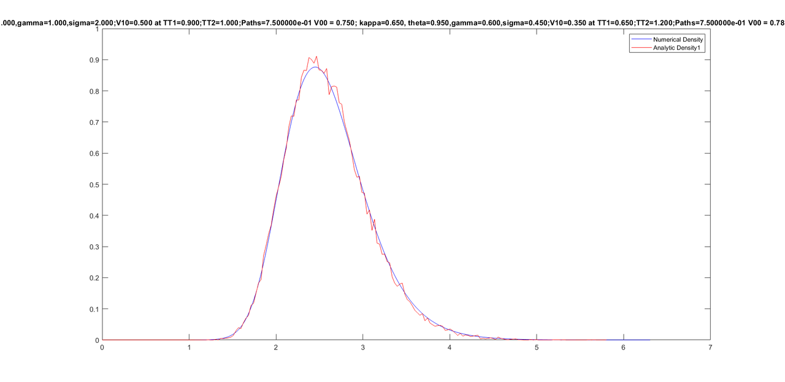](https://postimg.cc/sMsWRQq8)

[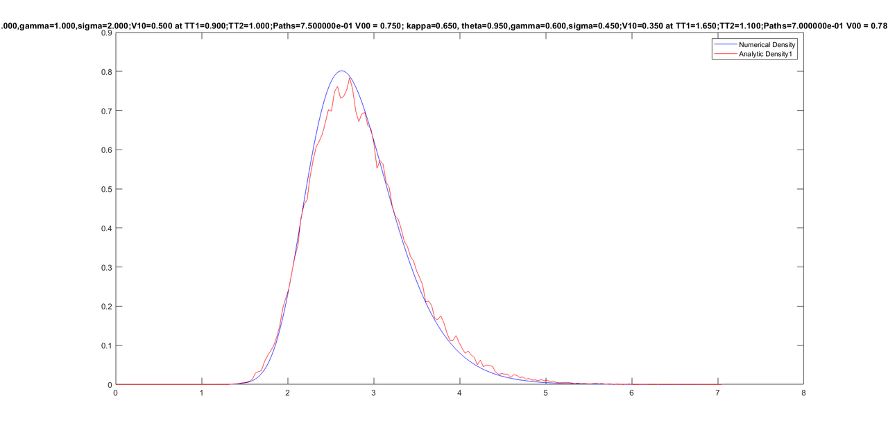](https://postimg.cc/pmRjth4c)

[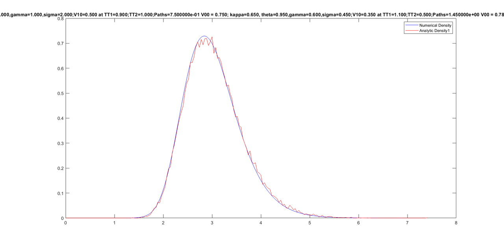](https://postimg.cc/Xpw5hcHQ)

SDE 3: Set One to Three.

[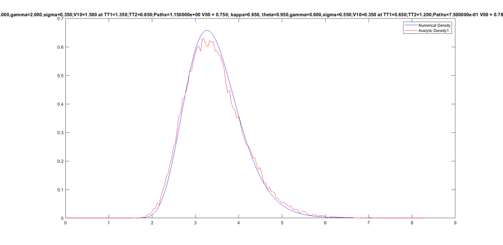](https://postimg.cc/VdjtTBGg)

[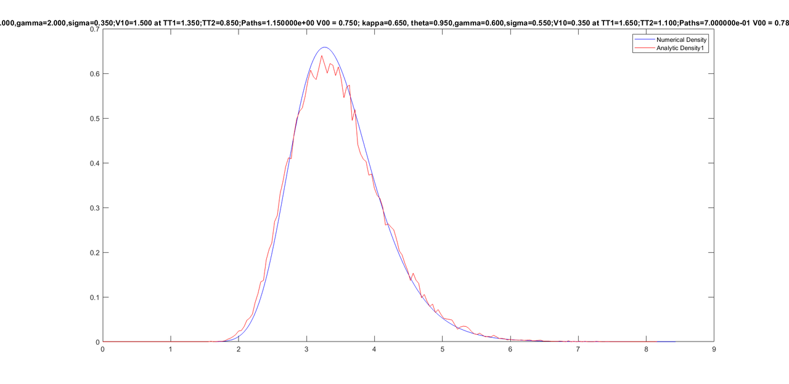](https://postimg.cc/QHp7Pk4S)

[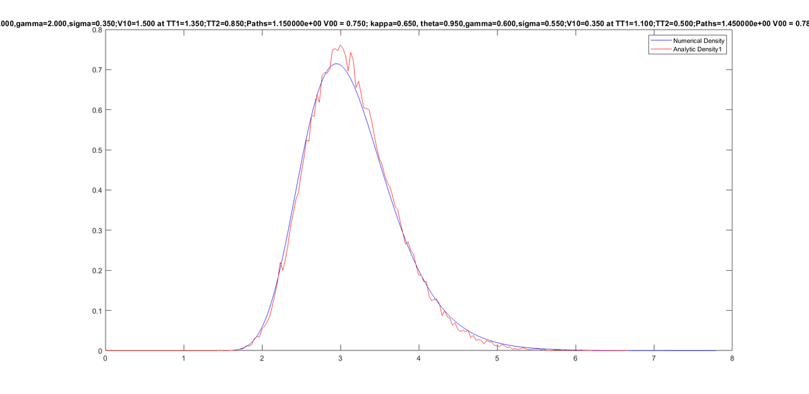](https://postimg.cc/9rG9St8B)

---

### #3040 — Amin (Topic Author)
*April 16, 2026, 11:37 AM*

,

,

,

```
function []= ConditionalDensityHermitesNvariate0A02()

%SV SDE is
%dV(t)=mu1 V(t)^beta1 dt+ mu2 V(t)^beta2 dt + sigma0 V(t)^gamma dZ(t)
%In mean reverting SDEs we ususally have
%mu1= kappaV * thetaV
%beta1=0
%mu2=-kappa
%beta2=0
%The present program works only when drift is zero (for pure noises)
%meaning mu1=0 and mu2=0;

Order=7;
%NDim=4;%Three assets and one SV.
%NMomentsY=Order+1;
%NMomentsX=Order+1;

%%%%%%%%%%%%%%%%%%%5
dt=.03125/2/8;
Tt=64*2*8;
T=Tt*dt;
seed0=12130649;
seed0=94210876;
%seed0=14210876;
%seed0=53612297
%seed0=97459782
rng(seed0, 'twister')
paths=50000;
TT1=100*8/2; %Transition distribution start
TT2=256*8/2; %Transition distribution end

%%%%%%%%%%%%%%%%%%%5

NDims=3;

V0(1)=1.000;%.32;
V00(1)=V0(1);

%SDE1
% thetaV(1)=1.0;%.045;%1;%.04;
% kappaV(1)=0.000;%1.5;%1.5;
% gamma(1)=.75;%.75
% sigma0(1)=.55;%.35

%SDE2
%thetaV(1)=.90;%.045;%1;%.04;
%kappaV(1)=1.000;%1.5;%1.5;
%gamma(1)=.75;%.75
%sigma0(1)=.6;%.35

%SDE3
thetaV(1)=1.350;%.045;%1;%.04;
kappaV(1)=2.000;%1.5;%1.5;
gamma(1)=.75;%.75
sigma0(1)=.6;%.35

mu1(1)=kappaV(1)*thetaV(1);
mu2(1)=-kappaV(1);
beta1(1)=0;
beta2(1)=1;

V0(2)=1.000;%.32;
V00(2)=V0(2);

%SDE1
%thetaV(2)=1.0;%.045;%1;%.04;
% kappaV(2)=0.000;%1.5;%1.5;
% gamma(2)=.75;%.75
% sigma0(2)=.45;%.35

%SDE2
% thetaV(2)=1.0;%.045;%1;%.04;
% kappaV(2)=2.000;%1.5;%1.5;
% gamma(2)=.65;%.75
% sigma0(2)=.45;%.35

%SDE3
thetaV(2)=.850;%.045;%1;%.04;
kappaV(2)=.35000;%1.5;%1.5;
gamma(2)=.65;%.75
sigma0(2)=.55;%.35

mu1(2)=kappaV(2)*thetaV(2);
mu2(2)=-kappaV(2);
beta1(2)=0;
beta2(2)=1;

V0(3)=1.000;%.33;
V00(3)=V0(3);

%SDE1
%thetaV(3)=1.0;%.045;%1;%.04;
% kappaV(3)=0.000;%1.5;%1.5;
% gamma(3)=.95;%.75
% sigma0(3)=.35;%.35

%SDE2
% thetaV(3)=.750;%.045;%1;%.04;
% kappaV(3)=0.5000;%1.5;%1.5;
% gamma(3)=.95;%.75
% sigma0(3)=.35;%.35

%SDE3
thetaV(3)=1.150;%.045;%1;%.04;
kappaV(3)=1.5000;%1.5;%1.5;
gamma(3)=.95;%.75
sigma0(3)=.35;%.35

mu1(3)=kappaV(3)*thetaV(3);
mu2(3)=-kappaV(3);
beta1(3)=0;
beta2(3)=1;

% V0(4)=1.000;%.44;
% V00(4)=V0(4);
% thetaV(4)=1.0;%.045;%1;%.04;
% kappaV(4)=0.000;%1.5;%1.5;
% mu1(4)=kappaV(4)*thetaV(4);
% mu2(4)=-kappaV(4);
% beta1(4)=0;
% beta2(4)=1;
% gamma(4)=.95;%.75
% sigma0(4)=.55;%.45

%%%%%%%%%%%%%%%%%%%%%%%%%%%%%%%%%%%%%%%%%%%%%%%%%%%%%%%%%%%%%%%%%%%%%5
for nn=1:NDims
V(1:paths,nn)=V0(nn);
end
%V(1:paths,1:NDims)=V0(1,1:NDims);

Random1(1:paths/2,1:NDims)=0;

for tt=1:Tt

    Random2(1:paths/2,1:NDims)=randn(size(Random1));
    Random2(paths/2+1:paths,1:NDims)=-Random2(1:paths/2,1:NDims);

    for nn=1:NDims

    V(1:paths,nn)=V(1:paths,nn)+ ...
        (mu1(nn).*V(1:paths,nn).^beta1(nn) + mu2(nn).*V(1:paths,nn).^beta2(nn))*dt + ...
        sigma0(nn).*V(1:paths,nn).^gamma(nn) .*Random2(1:paths,nn)*sqrt(dt) + ...
        (mu1(nn).*beta1(nn)*V(1:paths,nn).^(beta1(nn)-1) + mu2(nn).*beta2(nn).*V(1:paths,nn).^(beta2(nn)-1)).* ...
        ((mu1(nn).*V(1:paths,nn).^beta1(nn) + mu2(nn).*V(1:paths,nn).^beta2(nn))*dt^2/2 + ...
        sigma0(nn).*V(1:paths,nn).^gamma(nn) .*Random2(1:paths,nn)*(1-1/sqrt(3))*dt^1.5) + ...
        .5*(mu1(nn).*beta1(nn).*(beta1(nn)-1).*V(1:paths,nn).^(beta1(nn)-2) +
mu2(nn).*beta2(nn).*(beta2(nn)-1).*V(1:paths,nn).^(beta2(nn)-2)).* ...
        sigma0(nn)^2.*V(1:paths,nn).^(2*gamma(nn)).*dt^2/2 + ...
        sigma0(nn).*gamma(nn).*V(1:paths,nn).^(gamma(nn)-1) .* ...
        ((mu1(nn).*V(1:paths,nn).^beta1(nn) + mu2(nn).*V(1:paths,nn).^beta2(nn)).*Random2(1:paths,nn).*1/sqrt(3)*dt^1.5
+ ...
        sigma0(nn).*V(1:paths,nn).^gamma(nn) .*(Random2(1:paths,nn).^2-1)*dt/2) + ...
        .5*sigma0(nn).*gamma(nn).*(gamma(nn)-1).*V(1:paths,nn).^(gamma(nn)-2) .* ...
        sigma0(nn).^2.*V(1:paths,nn).^(2*gamma(nn)) .*Random2(1:paths,nn).*1/sqrt(3)*dt^1.5;

    V(V(:,nn)<0)=.0001;

    if(tt==TT1)
        Xin(1:paths,nn)=V(1:paths,nn);
    end

    if(tt==TT2)

        Xin2(1:paths,nn)=V(1:paths,nn);
    end

    end

end

Yin(1:paths)=0.0;

for pp=1:paths
for mm=1:NDims
    Yin(pp)=Yin(pp)+Xin2(pp,mm);%-Xin(pp,mm);
%-Xin(pp,mm);
end
end

str=input("I have reached stone 1");

%%%%%%%%%%%%%%%%%%%%%%%%%%%%%%%%%%%%%%%%%%%%%%%%%%5

%Xin=log(Xin);
%Yin=log(Yin);

Order=7;
clf;
%CalculateHermiteCorrelations02(Xin,Yin,paths);
%[HCorr2,YPowersH,XPowersH,Zy,Zx] = CalculateHermiteCorrelations0NA(Xin,Yin,paths);
[BetaCorrH,YCoeffH,XCoeffH,CorrXX1st] = CalculateHermiteCorrelations0NA(Xin,Yin,paths,NDims)
 YCoeffZ(1:Order+1)= ConvertHermiteSeriesToZSeries01(YCoeffH(1:Order+1),Order);

BetaCorrH

CorrXX1st
str=input("I have reached Stone2");

%Calculate2DZSeriesNDim(YCoeffH,BetaCorrH,CorrXX1st,NDims,Order);
%[cn,ccn] = Calculate2DZSeriesNDimCorrected(YCoeffH,BetaCorrH,CorrXX1st,NDims,Order);
%[bn,dn,cn,ccn] = Calculate2DZSeriesNDimCorrected(YCoeffH,BetaCorrH,CorrXX1st,NDims,Order)
[cn,dn,bnv,bbnv,ch] = Calculate2DZSeriesNDimCorrected(YCoeffH,BetaCorrH,CorrXX1st,NDims,Order);

% %XCoeffH(1:Order+1)=XPowersH(1:Order+1,1);
% %YCoeffH(1:Order+1)=YPowersH(1:Order+1,1);
% XCoeffZ(1:Order+1)= ConvertHermiteSeriesToZSeries01(XPowersH(1:Order+1,1),Order);
% YCoeffZ(1:Order+1)= ConvertHermiteSeriesToZSeries01(YPowersH(1:Order+1,1),Order);
%
%
% YPowersH(1,1)
% XPowersH(1,1)
%
%
% HCorr2
%
% str=input("Look at the means");
%
%
% YxCoeffH(1)=YPowersH(1,1);
%
% for nn=2:Order+1
%     %Yxi(pp)=Yxi(pp)+YPowersH(nn,1).*HCorr2(nn-1).*HnZx(pp,nn);
%     YxCoeffH(nn)=YPowersH(nn,1).*HCorr2(nn-1);
%     %YxCoeffH(nn)=YxiPowersH(nn,1);
% end

%%%%%%%%%%%%%%%%%%%%%%%%%%%%%%%%%%%%%%%%%%%%%%%%%%%%%%%%%%%%%%%%%%5
% %%%%%%%%%%%%%%%%%%%%%%%%%%%%%%%%%%%%%%%%%%%%%%%%%%%%%%%%%%%%%%%%%%%%%%%%%%%%%5
% %In this block, we do conditional Monte Carlo of SDE which is the true
% %numerical 1D conditional density of Y conditional on X having a given
% %value. This value of X on which we are conditionin is defined by V10 below.
% %We can alter V10 below and it will take out a 1D slice from the 2D density
% %of Y conditional on X  taking a specific value (here V10).

% V10=.65;
% %[XCoeffZ(1:Order+1)] = ConvertHermiteSeriesToZSeries01(XPowersH(1:Order+1,1),Order);
% %V10=XCoeffZ(1);
% V(1:paths)=V10;
% Random2(1:paths,1)=0;
%
% for tt=1:TT2-TT1
%
%     Random2(1:paths/2)=randn(paths/2,1);
%     Random2(paths/2+1:paths)=-Random2(1:paths/2);
%
%
%     V(1:paths,1)=V(1:paths,1)+ ...
%         (mu1.*V(1:paths,1).^beta1 + mu2.*V(1:paths,1).^beta2)*dt + ...
%         sigma0*V(1:paths,1).^gamma .*Random2(1:paths,1)*sqrt(dt) + ...
%         (mu1.*beta1*V(1:paths,1).^(beta1-1) + mu2.*beta2.*V(1:paths,1).^(beta2-1)).* ...
%         ((mu1.*V(1:paths,1).^beta1 + mu2.*V(1:paths,1).^beta2)*dt^2/2 + ...
%         sigma0*V(1:paths,1).^gamma .*Random2(1:paths,1)*(1-1/sqrt(3))*dt^1.5) + ...
%         .5*(mu1.*beta1.*(beta1-1).*V(1:paths,1).^(beta1-2) + mu2.*beta2.*(beta2-1).*V(1:paths,1).^(beta2-2)).* ...
%         sigma0^2.*V(1:paths,1).^(2*gamma).*dt^2/2 + ...
%         sigma0*gamma*V(1:paths,1).^(gamma-1) .* ...
%         ((mu1.*V(1:paths,1).^beta1 + mu2.*V(1:paths,1).^beta2).*Random2(1:paths,1).*1/sqrt(3)*dt^1.5 + ...
%         sigma0.*V(1:paths,1).^gamma .*(Random2(1:paths,1).^2-1)*dt/2) + ...
%         .5*sigma0*gamma*(gamma-1).*V(1:paths,1).^(gamma-2) .* ...
%         sigma0^2.*V(1:paths,1).^(2*gamma) .*Random2(1:paths,1).*1/sqrt(3)*dt^1.5;
%
%     V(V<0)=.0001;
%
% end
%
% %V=log(V);
%
% %logV10=log(V10);
% %Below
%
% NoOfBins=200;
% MaxCutOff=10;
%
% [XDensity,IndexOut,IndexMax] = MakeDensityFromSimulation_Infiniti_NEW(V,paths,NoOfBins,MaxCutOff );
%
% for qq=1:8
%
%     DataMoments(qq)=sum(V(:).^qq)/paths;
%
% end

%%%%%%%%%%%%%%%%%%%%%%%%%%%%%%%%%%%%%%%%%%%%%%%%%%%%%%%%%%%%%%%%%%%%%%%%%%%%%%%%%%%%%%%
%Set1
%V10(1)=.65;
%V10(2)=1.2;
%V10(3)=.75;

%Set2
%V10(1)=1.65;
%V10(2)=1.1;%1.2;
%V10(3)=.7;

%Set3
V10(1)=1.1;
V10(2)=.5;%1.2;
V10(3)=1.45;

for nn=1:NDims
V(1:paths,nn)=V10(nn);
end
%V(1:paths,1:NDims)=V0(1,1:NDims);

Random1(1:paths/2,1:NDims)=0;

for tt=1:TT2-TT1

    Random2(1:paths/2,1:NDims)=randn(size(Random1));
    Random2(paths/2+1:paths,1:NDims)=-Random2(1:paths/2,1:NDims);

    for nn=1:NDims

    V(1:paths,nn)=V(1:paths,nn)+ ...
        (mu1(nn).*V(1:paths,nn).^beta1(nn) + mu2(nn).*V(1:paths,nn).^beta2(nn))*dt + ...
        sigma0(nn).*V(1:paths,nn).^gamma(nn) .*Random2(1:paths,nn)*sqrt(dt) + ...
        (mu1(nn).*beta1(nn)*V(1:paths,nn).^(beta1(nn)-1) + mu2(nn).*beta2(nn).*V(1:paths,nn).^(beta2(nn)-1)).* ...
        ((mu1(nn).*V(1:paths,nn).^beta1(nn) + mu2(nn).*V(1:paths,nn).^beta2(nn))*dt^2/2 + ...
        sigma0(nn).*V(1:paths,nn).^gamma(nn) .*Random2(1:paths,nn)*(1-1/sqrt(3))*dt^1.5) + ...
        .5*(mu1(nn).*beta1(nn).*(beta1(nn)-1).*V(1:paths,nn).^(beta1(nn)-2) +
mu2(nn).*beta2(nn).*(beta2(nn)-1).*V(1:paths,nn).^(beta2(nn)-2)).* ...
        sigma0(nn)^2.*V(1:paths,nn).^(2*gamma(nn)).*dt^2/2 + ...
        sigma0(nn).*gamma(nn).*V(1:paths,nn).^(gamma(nn)-1) .* ...
        ((mu1(nn).*V(1:paths,nn).^beta1(nn) + mu2(nn).*V(1:paths,nn).^beta2(nn)).*Random2(1:paths,nn).*1/sqrt(3)*dt^1.5
+ ...
        sigma0(nn).*V(1:paths,nn).^gamma(nn) .*(Random2(1:paths,nn).^2-1)*dt/2) + ...
        .5*sigma0(nn).*gamma(nn).*(gamma(nn)-1).*V(1:paths,nn).^(gamma(nn)-2) .* ...
        sigma0(nn).^2.*V(1:paths,nn).^(2*gamma(nn)) .*Random2(1:paths,nn).*1/sqrt(3)*dt^1.5;

    V(V(:,nn)<0)=.0001;

    %if(tt==TT1)
    %    XXin(1:paths,nn)=V(1:paths,nn);
    %end

    if(tt==TT2-TT1)

        XXin2(1:paths,nn)=V(1:paths,nn);
    end

    end

end

Yin2(1:paths)=0.0;

for pp=1:paths
for mm=1:NDims
    Yin2(pp)=Yin2(pp)+XXin2(pp,mm);%-V10(mm);
end
end

NoOfBins=200;
MaxCutOff=10;

[XDensity,IndexOut,IndexMax] = MakeDensityFromSimulation_Infiniti_NEW(Yin2,paths,NoOfBins,MaxCutOff );

for qq=1:8

    DataMoments(qq)=sum(Yin2(:).^qq)/paths;

end

%%%%%%%%%%%%%%%%%%%%%%%%%%%%%%%%%%%%%%%%%%%%%%%%%%%%%%%%%%%%%%%%%%%%%%%%%%%%%%%%%%%%%%%5

for nn=1:NDims
    [Zx0(nn)] = CalculateZgivenXAndHSeriesCoeffs(V10(nn),XCoeffH(1:Order+1,nn),Order);
end

%Zx00=0.0;

%%%%%%%%%%%%%%%%%%%%%%%%%%%%%%%%%%%%%%%%%%%%%%%%%%%%%%%%%%%%%%%%%%%%%%55
%
% ZxSign(1:Order+1)=0;
%
% Vol(1:Order+1)=0.0;
% Zx(1:Order+1)=0.0;
% for hh=1:Order
% for nn=1:NDims
%     ZxSign(hh+1) = ZxSign(hh+1) + bnv(nn+1,hh+1).^1 .*Zx0(nn);
%     for mm=1:NDims
%         Zx(hh+1) = Zx(hh+1) + bnv(nn+1,hh+1).^1.*bnv(mm+1,hh+1).^1 .*Zx0(nn).*Zx0(mm).*CorrXX1st(nn,mm);
%         Vol(hh+1)=Vol(hh+1)+bnv(nn+1,hh+1).^1.*bnv(mm+1,hh+1).^1.*CorrXX1st(nn,mm);
%     end
% end
% end
%
% for hh=1:Order
% Zx(hh+1)=sign(ZxSign(hh+1)).*sqrt(Zx(hh+1)/Vol(hh+1));%./bbnv(1,hh+1).^1;
% %Zx(hh+1)=Zx0(1)+Zx0(2);%(ZxSign(hh+1));%./bbnv(1,hh+1);%
% end

%%%%%%%%%%%%%%%%%%%%%%%%%%%%%%%%%%%%%%%%%%%%%%%%%%%%%%%%%%%%%%%%%%%55

Zx(1:Order)=0;

for hh=1:Order
    for nn=1:NDims
        Zx(hh) = Zx(hh) + bnv(nn+1,hh+1).^1.*Zx0(nn);
    end
end

bh0=YCoeffH(1);

[W] = EvalHermiteArrayH0(Zx0,Order);

for hh=1:Order
    for nn=1:NDims
        bh0 = bh0 + ch(nn+1,hh+1).^1.*W(nn,hh+1);
    end
end

%%%%%%%%%%%%%%%%%%%%%%%%%%%%%%%%%%%%%%%%%%%%%%%%%%%%%%%%%%%%%%%%

a0=YCoeffZ(1);
a1=YCoeffZ(2);
a2=YCoeffZ(3);
a3=YCoeffZ(4);
a4=YCoeffZ(5);
a5=YCoeffZ(6);
a6=YCoeffZ(7);
a7=YCoeffZ(8);

d1=dn(2);
d2=dn(3);
d3=dn(4);
d4=dn(5);
d5=dn(6);
d6=dn(7);
d7=dn(8);

%b0=(a0+a1.* Zx(1) +a2.* Zx(2).^2+a3.* Zx(3).^3+a4* Zx(4).^4+a5 *Zx(5).^5+a6* Zx(6).^6+a7* Zx(7).^7);
b1=(a1* d1+2* a2* Zx(2)* d2 +3* a3* Zx(3).^2* d3+4* a4* Zx(4).^3* d4+5* a5* Zx(5).^4* d5+6* a6* Zx(6).^5* d6+7* a7*
Zx(7).^6* d7);
b2=(a2* d2.^2+3* a3* Zx(3)* d3^2 +6* a4* Zx(4).^2* d4^2+10* a5* Zx(5).^3* d5^2+15* a6* Zx(6).^4* d6^2+21* a7* Zx(7).^5*
d7^2);
b3=(a3* d3^3+4* a4 *Zx(4)* d4^3 +10* a5* Zx(5).^2* d5^3+20* a6* Zx(6).^3* d6^3+35* a7* Zx(7).^4* d7^3);
b4=(a4* d4^4+5* a5* Zx(5)* d5^4 +15* a6 *Zx(6).^2* d6^4+35* a7* Zx(7).^3 *d7^4);
b5=(a5* d5^5+6* a6* Zx(6)* d6^5 +21* a7 *Zx(7).^2* d7^5);
b6=(a6* d6^6+7* a7* Zx(7)* d7^6 );
b7=(a7* d7^7);

%bh0=b0+b2+3*b4+15*b6;
bh1=b1+3*b3+15*b5+105*b7;
bh2=b2+6*b4+45*b6;
bh3=b3+10*b5+105*b7;
bh4=b4+15*b6;
bh5=b5+21*b7;
bh6=b6;
bh7=b7;

bh(1)=bh0;
bh(2)=bh1;
bh(3)=bh2;
bh(4)=bh3;
bh(5)=bh4;
bh(6)=bh5;
bh(7)=bh6;
bh(8)=bh7;

%%%%%%%%%%%%%%%%%%%%%%%%%%%%%%%%%%%%%%%%%%%%%%%%%%%%%%%%%%%%%%%%%%%%%%%%%%%%%%5

YCoeffz(1:Order+1)= ConvertHermiteSeriesToZSeries01(bh(1:Order+1),Order);

 [YMomentsModel]=CalculateMomentsOfZSeries(YCoeffz(1),YCoeffz(2:Order+1),Order,Order+1);

 YMomentsModel

 DataMoments

 str=input("Look at comparison of moments");

clf;

PlotZSeriesDensity(YCoeffz(1),YCoeffz(2:Order+1),'b')

hold on

plot(IndexOut(1:IndexMax),XDensity(1:IndexMax),'r');

%PlotHermiteSeriesDensityAndRvGraph(YCoeffh(1),YCoeffh1(2:yOrder+1),'g')
title(sprintf('V00 = %.3f; kappa=%.3f, theta=%.3f,gamma=%.3f,sigma=%.3f;V10=%.3f at TT1=%.3f;TT2=%.3f;Paths=%d ',V00,
kappaV, thetaV,gamma,sigma0, V10,(TT1*dt),(TT2*dt),paths));%,sprintf('theta= %f', theta), sprintf('kappa = %f',
kappa),sprintf('sigma = %f', sigma0),sprintf('T = %f', T));
legend({'Numerical Density','Analytic Density1'}, ...
    'Location','northeast')

str=input("This is the first version without altering the moments of conditional density")

hold off

end

```

.

.

.

.

```
function [bn,dn,cn,ccn,ch] = Calculate2DZSeriesNDimCorrected(YCoeffH,BetaCorrH,CorrXX1st,NDims,Order)

%NDims in all of the program would be N-1 as y-tilde would be dealt separately

% for nn=1:NDims
%     ccn0(nn+1,8)=cn(nn+1).^2;
%     cnSqrSum=cnSqrSum+cn(nn+1,8).*cn(nn+1,8);
%     for mm=1:NDims
%         if(nn~=mm)
%             ccn0(nn+1,8)=ccn0(nn+1,8)+2*cn(nn+1,8).*cn(mm+1,8).*CorrXX1st(nn,mm);
%             cnSqrSum=cnSqrSum+2*cn(nn+1,8).*cn(mm+1,8).*CorrXX1st(nn,mm);
%         end
%     end
%     ccn(nn+1,8)=sqrt(1-ccn0(nn+1,8));
%
% end

for hh=1:Order
    for nn=1:NDims
        ch(nn+1,hh+1)=BetaCorrH(nn,hh).*YCoeffH(hh+1);%make sure indices on all hermite-correlations match.check.
        %%%% nn+1 since 1st index would go to y-tilde.
    end
end

ch
YCoeffH

str=input("Look at above---00-1-1-1-1-");

[YCoeffZ(1:Order+1)] = ConvertHermiteSeriesToZSeries01(YCoeffH(1:Order+1),Order);

for nn=1:NDims
[c(nn+1,1:Order+1)] = ConvertHermiteSeriesToZSeries01(ch(nn+1,1:Order+1),Order);
end

for nn=1:NDims
    rho_z(nn+1,7)=c(nn+1,8)./YCoeffZ(8);
    cn(nn+1,8)=(abs(rho_z(nn+1,7))).^(1/7);
end

cnSqrSum=0;
for nn=1:NDims
    ccn0(nn+1,8)=cn(nn+1,8).^2;
    cnSqrSum=cnSqrSum+cn(nn+1,8).*cn(nn+1,8);
    for mm=1:NDims
        if(nn~=mm)
            ccn0(nn+1,8)=ccn0(nn+1,8)+2*cn(nn+1,8).*cn(mm+1,8).*CorrXX1st(nn,mm);
            cnSqrSum=cnSqrSum+cn(nn+1,8).*cn(mm+1,8).*CorrXX1st(nn,mm);
        end
    end
    ccn(nn+1,8)=sqrt(1-ccn0(nn+1,8));

end

cn(1,8)=sqrt(1-cnSqrSum);
ccn(1,8)=sqrt(1-cn(1,8).^2);
Cn(1,8)=cn(1,8).*YCoeffZ(8);

cn
ccn
str=input("Compare the Eighth Element From NDim---2");

% ccn00(2,8)=cn(2,8).^2+2*cn(2,8).*cn(3,8).*CorrXX1st(1,2)+2*cn(2,8).*cn(4,8).*CorrXX1st(1,3)+ ...
%     cn(3,8).^2+2*cn(3,8).*cn(4,8).*CorrXX1st(2,3)+cn(4,8).^2
%
% ccn00(2,8)=sqrt(1-(cn(2,8).^2+2*cn(2,8).*cn(3,8).*CorrXX1st(1,2)+2*cn(2,8).*cn(4,8).*CorrXX1st(1,3)))
%
% cnSqrSum
%
% ccn0(2,8)
%
% ccn(1,8)
%
% ccn(2,8)
%
% str=input("Look at the variables Inside");
%

cnSqrSum=0;
for nn=1:NDims
    rho_z(nn+1,6)=c(nn+1,7)./YCoeffZ(7);
    cn(nn+1,7)=(abs(rho_z(nn+1,6))).^(1/6);
    %ccn(nn+1,7)=sqrt(1-cn(nn+1,7).^2);
    %cnSqrSum=cnSqrSum+cn(7,nn+1).^2;
end

cnSqrSum=0;
for nn=1:NDims
    ccn0(nn+1,7)=cn(nn+1,7).^2;
    cnSqrSum=cnSqrSum+cn(nn+1,7).*cn(nn+1,7);
    for mm=1:NDims
        if(nn~=mm)
            ccn0(nn+1,7)=ccn0(nn+1,7)+2*cn(nn+1,7).*cn(mm+1,7).*CorrXX1st(nn,mm);
            cnSqrSum=cnSqrSum+cn(nn+1,7).*cn(mm+1,7).*CorrXX1st(nn,mm);
        end
    end
    ccn(nn+1,7)=sqrt(1-ccn0(nn+1,7));

end

cn(1,7)=sqrt(1-cnSqrSum);
ccn(1,7)=sqrt(1-cn(1,7).^2);
Cn(1,7)=cn(1,7).*YCoeffZ(7);

cn
ccn
str=input("Compare the Seventh Element From NDim---2");

cnSqrSum=0;
for nn=1:NDims
    CC(3,6)=YCoeffZ(8).*(21*cn(nn+1,8).^5.*ccn(nn+1,8).^2);
    rho_z(nn+1,5)=(c(nn+1,6)-CC(3,6))./YCoeffZ(6);
    cn(nn+1,6)=(abs(rho_z(nn+1,5))).^(1/5);
%    ccn(nn+1,6)=sqrt(1-cn(nn+1,6).^2);
    %cnSqrSum=cnSqrSum+cn(7,nn+1).^2;
end

cnSqrSum=0;
for nn=1:NDims
    ccn0(nn+1,6)=cn(nn+1,6).^2;
    cnSqrSum=cnSqrSum+cn(nn+1,6).*cn(nn+1,6);
    for mm=1:NDims
        if(nn~=mm)
            ccn0(nn+1,6)=ccn0(nn+1,6)+2*cn(nn+1,6).*cn(mm+1,6).*CorrXX1st(nn,mm);
            cnSqrSum=cnSqrSum+cn(nn+1,6).*cn(mm+1,6).*CorrXX1st(nn,mm);
        end
    end
    ccn(nn+1,6)=sqrt(1-ccn0(nn+1,6));

end

cn(1,6)=sqrt(1-cnSqrSum);
ccn(1,6)=sqrt(1-cn(1,6).^2);
Cn(1,6)=cn(1,6).*YCoeffZ(6);

cn
ccn
str=input("Compare the Sixth Element From NDim---2");

cnSqrSum=0;
for nn=1:NDims
    CC(3,5)=YCoeffZ(7).*(15*cn(nn+1,7).^4.*ccn(nn+1,7).^2);
    rho_z(nn+1,4)=(c(nn+1,5)-CC(3,5))./YCoeffZ(5);
    cn(nn+1,5)=(abs(rho_z(nn+1,4))).^(1/4);
    %ccn(nn+1,5)=sqrt(1-cn(nn+1,5).^2);
    %cnSqrSum=cnSqrSum+cn(7,nn+1).^2;
end

cnSqrSum=0;
for nn=1:NDims
    ccn0(nn+1,5)=cn(nn+1,5).^2;
    cnSqrSum=cnSqrSum+cn(nn+1,5).*cn(nn+1,5);
    for mm=1:NDims
        if(nn~=mm)
            ccn0(nn+1,5)=ccn0(nn+1,5)+2*cn(nn+1,5).*cn(mm+1,5).*CorrXX1st(nn,mm);
            cnSqrSum=cnSqrSum+cn(nn+1,5).*cn(mm+1,5).*CorrXX1st(nn,mm);
        end
    end
    ccn(nn+1,5)=sqrt(1-ccn0(nn+1,5));

end

cn(1,5)=sqrt(1-cnSqrSum);
ccn(1,5)=sqrt(1-cn(1,5).^2);
Cn(1,5)=cn(1,5).*YCoeffZ(5);

cn
ccn
str=input("Compare the Fifth Element From NDim---2");

%CC(3,4)=YCoeffZ(6).*(10*cn(6).^3.*dn(6).^2*zeta^2);
%CC(5,4)=YCoeffZ(8).*(35*cn(8).^3.*dn(8).^4.*zeta^4);
cnSqrSum=0;
for nn=1:NDims
    CC(5,4)=YCoeffZ(8).*(35*cn(nn+1,8).^3.*ccn(nn+1,8).^4);
    CC(3,4)=YCoeffZ(6).*(10*cn(nn+1,6).^3.*ccn(nn+1,6).^2);
    rho_z(nn+1,3)=(c(nn+1,4)-3*CC(5,4)-CC(3,4))./YCoeffZ(4);
    cn(nn+1,4)=(abs(rho_z(nn+1,3))).^(1/3);
    %ccn(nn+1,4)=sqrt(1-cn(nn+1,4).^2);
    %cnSqrSum=cnSqrSum+cn(7,nn+1).^2;
end

cnSqrSum=0;
for nn=1:NDims
    ccn0(nn+1,4)=cn(nn+1,4).^2;
    cnSqrSum=cnSqrSum+cn(nn+1,4).*cn(nn+1,4);
    for mm=1:NDims
        if(nn~=mm)
            ccn0(nn+1,4)=ccn0(nn+1,4)+2*cn(nn+1,4).*cn(mm+1,4).*CorrXX1st(nn,mm);
            cnSqrSum=cnSqrSum+cn(nn+1,4).*cn(mm+1,4).*CorrXX1st(nn,mm);
        end
    end
    ccn(nn+1,4)=sqrt(1-ccn0(nn+1,4));

end

cn(1,4)=sqrt(1-cnSqrSum);
ccn(1,4)=sqrt(1-cn(1,4).^2);
Cn(1,4)=cn(1,4).*YCoeffZ(4);

cn
ccn
str=input("Compare the Fourth Element From NDim---2");

%CC(3,3)=YCoeffZ(5).*(6* cn(5).^2.* dn(5).^2);
%CC(5,3)=YCoeffZ(7).*(15*cn(7).^2.*dn(7).^4);
cnSqrSum=0;
for nn=1:NDims
    CC(3,3)=YCoeffZ(5).*(6*cn(nn+1,5).^2.*ccn(nn+1,5).^2);
    CC(5,3)=YCoeffZ(7).*(15*cn(nn+1,7).^2.*ccn(nn+1,7).^4);
    rho_z(nn+1,2)=(c(nn+1,3)-3*CC(5,3)-CC(3,3))./YCoeffZ(3);
    cn(nn+1,3)=(abs(rho_z(nn+1,2))).^(1/2);
    %ccn(nn+1,3)=sqrt(1-cn(nn+1,3).^2);
    %cnSqrSum=cnSqrSum+cn(7,nn+1).^2;
end

cnSqrSum=0;
for nn=1:NDims
    ccn0(nn+1,3)=cn(nn+1,3).^2;
    cnSqrSum=cnSqrSum+cn(nn+1,3).*cn(nn+1,3);
    for mm=1:NDims
        if(nn~=mm)
            ccn0(nn+1,3)=ccn0(nn+1,3)+2*cn(nn+1,3).*cn(mm+1,3).*CorrXX1st(nn,mm);
            cnSqrSum=cnSqrSum+cn(nn+1,3).*cn(mm+1,3).*CorrXX1st(nn,mm);
        end
    end
    ccn(nn+1,3)=sqrt(1-ccn0(nn+1,3));

end

cn(1,3)=sqrt(1-cnSqrSum);
ccn(1,3)=sqrt(1-cn(1,3).^2);
Cn(1,3)=cn(1,3).*YCoeffZ(3);

cn
ccn
str=input("Compare the Third Element From NDim---2");

%CC(7,2)=YCoeffZ(8).*(7*cn(8).*dn(8).^6*zeta^6);
%CC(5,2)=YCoeffZ(6).*(5*cn(6).*dn(6).^4.*zeta^4);
%CC(3,2)=YCoeffZ(4).* (3.* cn(4).* dn(4).^2.* zeta^2);
cnSqrSum=0;
for nn=1:NDims
    CC(4,2)=YCoeffZ(4).*(3*cn(nn+1,4).*ccn(nn+1,4).^2);
    CC(6,2)=YCoeffZ(6).*(5*cn(nn+1,5).*ccn(nn+1,6).^4);
    CC(8,2)=YCoeffZ(8).*(7*cn(nn+1,8).*ccn(nn+1,8).^6);
    rho_z(nn+1,1)=(c(nn+1,2)-15*CC(8,2)-3*CC(6,2)-CC(4,2))./YCoeffZ(2);
    cn(nn+1,2)=(abs(rho_z(nn+1,1)));
    %ccn(nn+1,2)=sqrt(1-cn(nn+1,2).^2);
    %cnSqrSum=cnSqrSum+cn(7,nn+1).^2;
end

cnSqrSum=0;
for nn=1:NDims
    ccn0(nn+1,2)=cn(nn+1,2).^2;
    cnSqrSum=cnSqrSum+cn(nn+1,2).*cn(nn+1,2);
    for mm=1:NDims
        if(nn~=mm)
            ccn0(nn+1,2)=ccn0(nn+1,2)+2*cn(nn+1,2).*cn(mm+1,2).*CorrXX1st(nn,mm);
            cnSqrSum=cnSqrSum+cn(nn+1,2).*cn(mm+1,2).*CorrXX1st(nn,mm);
        end
    end
    ccn(nn+1,2)=sqrt(1-ccn0(nn+1,2));

end

cn(1,2)=sqrt(1-cnSqrSum);
ccn(1,2)=sqrt(1-cn(1,2).^2);
Cn(1,2)=cn(1,2).*YCoeffZ(2);

cn
ccn
str=input("Compare the Second Element From NDim---2");

%CC(3,1)=YCoeffZ(2).*(ccn(nn+1,2).^2);
%CC(5,1)=YCoeffZ(4).*(ccn(nn+1,4).^4);
%CC(7,1)=YCoeffZ(6).*(ccn(nn+1,6).^6);
CC(3,1)=YCoeffZ(2).*(cn(1,2).^2);
CC(5,1)=YCoeffZ(4).*(cn(1,4).^4);
CC(7,1)=YCoeffZ(6).*(cn(1,6).^6);

cn(1,1)=(YCoeffZ(1)-CC(3,1)-3*CC(5,1)-15*CC(7,1))./YCoeffZ(1);

cn
ccn
str=input("Look at coefficients cn----PleASE lOOK");

dn(1:Order+1)=cn(1,1:Order+1);
bn(1:Order+1)=ccn(1,1:Order+1);

end

```

.

.

.

.

```
function [BetaCorrH,YCoeffH,XCoeffH,CorrXX1st] = CalculateHermiteCorrelations0NA(Xin,Yin,NData,NDims)

%This program finds required correlations between NDims explanatory
%variables given in Xin that has NDims dimensionality. Yin is variable
%being explained and is one-diemsnional.

Order=7;
NMoments=8;

[ZI] = MomentMatchedStandardNormalDiscretizedDensity(NData);

for nn=1:NDims
[XCoeffH(1:Order+1,nn),Zx(1:NData,nn)] = CalculateHermiteSeriesFromData01(Xin(1:NData,nn),Order,ZI);

[Zx(1:NData,nn)] = CalculateZgivenXAndHSeriesCoeffs(Xin(1:NData,nn),XCoeffH(1:Order+1,nn),Order);

end

[YCoeffH,Zy] = CalculateHermiteSeriesFromData01(Yin,Order,ZI);
[Zy] = CalculateZgivenXAndHSeriesCoeffs(Yin,YCoeffH,Order);

for nn1=1:NDims
    for nn2=1:NDims
        if(nn1==nn2)
            HCorrXX(nn1,nn2,1:Order)=1.0;
        else
            HCorrXX(nn1,nn2,1:Order) =
CalculateCorrelationBivariateHermiteCH1(Zx(1:NData,nn1),Zx(1:NData,nn2),NData,Order);
        end
    end
end

for nn1=1:NDims
    HCorrXY(nn1,1:Order) = CalculateCorrelationBivariateHermiteCH1(Zx(1:NData,nn1),Zy(1:NData),NData,Order);
end

for hh=1:Order
    CorrXX(1:NDims,1:NDims)=HCorrXX(1:NDims,1:NDims,hh);
    CorrXY(1:NDims,1)=HCorrXY(1:NDims,hh);
    BetaCorrH(1:NDims,hh)=CorrXX\CorrXY;
end

CorrXX1st(1:NDims,1:NDims)=HCorrXX(1:NDims,1:NDims,1)

BetaCorrH(:,1)'*CorrXX

CorrXY

HCorrXX

HCorrXY

BetaCorrH

str=input("Look at BetaCorrH");
end

```

.

.

.

.

```
function [Wh] = EvalHermiteArrayH0(Z,Order)

%Evaluates first Order-th hermites at the array of Z's. If input array of Z
%has a size of 100 and Order is 4, it will return a 100 X 5 array.

Hz=HermitePoly(Order);

Wh(1:length(Z),1:Order+1)=0;
for nn=1:Order+1
    Wh(:,nn)=0;
    for mm=1:nn
        Wh(:,nn)=Wh(:,nn)+Hz(nn,mm).*Z(:).^(mm-1);
    end
end

end

```

.

.

.

---

### #3041 — Amin (Topic Author)
*April 17, 2026, 4:33 PM*

Friends, I have been looking to write about antics of mind control agents for past few days but could not do that
because I had to write more important technical posts in past few days.

Friends, they openly use all of the microwave torture on me. There is most mind control infrastructure in my room and
the time I spend in my room, I mostly remain disoriented. When I got up this morning, they hit muscles of my thighs with
hard microwaves and for fifteen minutes, I continued to walk to and fro to reduce the intensity of my pain especially
since moving around decreased my pain.

I buy high fiber bran bread or multi-grain bread and they have been trying to drug the bread everywhere in the shops
many times when I go out. Many bread manufacturers like Jalal Sons, Dawn bread and Butt Sweets and bakers are already
adding mind control drugs in their high-fiber breads on insistence of mind control agents. On many days, I am able to
get good high fiber bread but I have been hit with bad bread repeatedly from above mentioned bakers since they drug
their high fiber bread at manufacturing source.

They have also started to drug packaged milk from many manufacturers. Two largest milk packagers that control more than
eighty percent of the market are already supplying drugged milk in Lahore city. Nestle MilkPak and Olpers by Engro are
thoroughly drugged(added with mind control chemicals) at manufacturing source. NurPur Milk is holding up and is not
being drugged but I am afraid that it would follow soon in a few days or a week.

Most of the bottled Water in the city was drugged by manufacturers for past few months but recently Nestle water has
become better. Nestle has introduced newly redesigned water bottle in Lahore and water in this new packaging is good but
Pak army agents go to shops and drug it in all the areas near my neighborhood and I have to go far to buy good Nestle
water since the same Nestle water in Jahar town and adjacent areas is drugged while lying on shelves in shops.

This morning I was able to get good water and good food but when I parked my bike outside a bakery to buy milk, some
agent quickly drugged one of the water bottles hanging from the bike (they probably do it with some very sharp needle
that pierces through plastic.) and I found out later that some water had been drugged.

In order to go low on calories, I have been avoiding meals in the house that have huge oil and sometimes cut several
onions and tomatoes and bake them with two eggs with almost zero oil. I had done that two times in past week. I
basically take these onions and tomatoes that are lying in the kitchen or Fridge. This evening about an hour ago, I cut
three onions but when I tasted small amount of raw onion, I realized that they had added mind control drugs in the
onions lying in our house and I had to put off the plan to eat my vegetables meal.

However despite all of these antics, my mind control has somewhat decreased in past two days but I know that this is
totally temporary and they make it obvious that they have absolutely no intention to let me live without mind control
torture and continued drugging of food in past few days means that recent decrease in mind control is just a minor
precaution for days when my  research work is in limelight.

---

### #3042 — Amin (Topic Author)
*April 17, 2026, 5:20 PM*

This is a mildly technical post especially for friends who only recently started following my thread.

In my yesterday's post in which density of sum (denoted as Y) of three random variables(denoted as X1,X2 and X3) (at
time T2) is found based conditionally on the values of three random variables at time T1.

In the above conditional set up, we did not use any special relationship that Y is sum of X1,X2 and X3. It could equally
well have been a sum of three different functions of each X1, X2 and X3 and the same logic of the program would find the
conditional density. Our algorithm just finds hermite polynomial correlations between Y and X1, X2 and X3 without
explicitly knowing that Y is sum of three X variables. Basically hermite correlations do all the work without explicitly
knowing any relationship between predictor variables and the variable being conditioned which is Y in our case.

We have been able to find the density of a correlated random variable Y conditioned on explaining variables X1, X2 and
X3. A general version would predict Y conditioned on N random variables. This is very powerful and is like a regression
that supplies the density of variable being predicted (as opposed to a point estimate). As opposed to expected values
found in classical regressions, we can use the density found in our algorithm for further regression on some other
random variables as required and we can form many Neural Network type sequences of many layers of regressions.

Going forward, we can use similar algorithms for finding full-fledged bivariate, tri-variate or N-variate joint
densities.

We can also have more advanced algorithms that (as opposed to univariate density we have now) could find conditional
bivariate/tri-variate densities given the realized values of several predictor variables. This would find out how the
bivariate density changes when conditioned on information provided by realized values of several correlated random
variables. In theory, this can be generalized to N-variate densities but curse of dimensionality would prevent us from
increasing N too much.

---

### #3043 — Amin (Topic Author)
*April 17, 2026, 6:18 PM*

Friends, when I am ready to sleep now and taking all steps before I go to bed, they have started to release gas in my
room that makes breathing difficult for me. Please help stop these nasty mind control agents who are in strict orders to
control me at all cost.

---

### #3044 — Amin (Topic Author)
*April 17, 2026, 6:27 PM*

After writing the last post, I lied on the bed to sleep but they are causing extreme pain in my back. In mind control
forced by scumbag jews on ordinary intelligent people(whose talent these lowly scumbag jews become threatened by), lowly
leprechauns of American defense force waves inside the body of targets through the anus and it causes great discomfort
and huge itch in the anus and now they are forcing itch in my back. Please stop torture on innocent people.

---

### #3045 — Amin (Topic Author)
*April 17, 2026, 6:49 PM*

Friends, I am so sorry to say but somebody has to do this dirty work to try cleaning up the society and be bold to speak
the truth. Many people know that a large number of jews systematically continue to lie, cheat, deceive and machinate in
order to continue my persecution. It is unbelievable how many of these so called "respectable" scumbags rotate their
tongue in their mouth and blurt complete lies about innocent people so that their mind control would continue. Many
Europeans would also have realized how these scumbags approached them with thoroughly concocted lies and baseless claims
so that I would not be able to get into any European university. And I am not alone, there are tens of thousands of
innocent people who have been put on mind control by jewish scumbags and these scumbags are so offensive that when you
tell them about their crimes, they go full scale nasty. Somebody has to ne the jewish started evil of mind control from
our societies.

This has become such an open practice and total mockery of justice in a civilized country like United States that
whenever some jew in academia is threatened by anybody's talent(as these lowly insecure scumbags are very easily
offended), they approach their billionaire elders who order their slave leprechauns in US defense to start mind control
of innocent people. Earth shudders from the cruelty of these jewish scumbags. Somebody has to take courage to stop the
evil unleashed by some billionaire but evil elders of US jews.

I am very upset and under influence of gas and some jews might find my language offensive but I want to tell good jews
that I would apologize only when you end this cruel practice of mind control started by your evil brethren in United
States.

Somebody has to teach these scumbags how to respect the good human beings that mothers of these scumbags failed to teach
them.

Please stop mind control as it is a Jewish tool for dominance in the society. Many people know that jews were losing
influence in the society twenty years ago only to come back with a bang because some of their rich elders controlled US
defesne and they very cleverly used mind control as a tool for jewish dominance.

---

### #3046 — Amin (Topic Author)
*April 18, 2026, 2:25 AM*

Friends, I am copying some of my previous posts so that you can know the context of my past post.

**Friends, I really believe that in a civilized society of twenty first century there is absolutely no place for
connivance and machinations of a group of rich jews led by jewish elder billionaire  of mind control who have retarded,
at whim, thousands of talented intelligent people in America and abroad that they did not like. These cruel people are
inhuman animals even though they have learnt to adjust extremely well within American society. **

**These corrupt crooks are very powerful and they have already complete control over American army and a large number of
politicians. Due to this huge influence and power, it is very difficult to do anything to undo the cruel mind control
network led by jewish billionaire and his rich jewish cohort.**

I have suggested several times previously to good American people if nothing else works, please just ask some patriotic
American investigative journalists in major newspapers to run a comprehensive story about mind control network of jewish
billionaire and the nexus between rich jews and American defense and about tens of thousands of people that have been
retarded over past thirty years.

I want to invite patriotic American journalists from CNN, Washington Post, NewYork Times, Guardian or some other large,
reputed and responsible US or European media outlets to run a thorough story on machinations of evil jews led by jewish
billionaire and the  nexus of bad jews with American defense and their cruel mind control network that has retarded tens
of thousands of very intelligent Americans and foreigners all over the world.

**Since good people may not have the power to forcefully end the evil practices of the powerful nexus between evil
Jewish billionaire and US army crooks, only way to end the cruel and subhuman practices of the nexus seems to be
exposing them openly in US public and the public of other countries all across the world.**

** **

**I think it is important for us to make sure there is a better future of American children and children all across the
world and we leave them a legacy in which fairness and justice prevails as opposed to machinations, trickery and deceit
that has been unleashed in the society by the jewish billionaire and his rich jewish cohort.**

**What I am writing is my honest opinion even though a lot of friends might differ with it to some degree. I think it is
very important that all of us try to have rule of law, and good governance for the benefit of our country and society.
We promote freedom of speech and freedom of press in our societies so that people can criticize bad or wrong actions of
other people and make each other aware of their observations of wrongdoings by some people especially the ones in the
authority in the society while, obviously, every body has to try to investigate the truth on their own without blindly
believing anyone. The purpose of such criticism and related discussions is to try to root out bad practices from the
society and promote good ethics and practices.

**

Another thing I want to suggest is that true patriotism is not about hiding bad practices taking place in our country
from others, instead it is about exposing such bad practices by unethical people in the public with the final goal that
these bad practices are rooted out from our societies.

**Now I will come to the point that I have been suggesting for years that there is a jewish billionaire and his rich
cohort who are behind indiscriminate mind control of a large number of intelligent American people and others . And a
large number of people in American defense have become a mercenerary army of leprechauns that play in the hands of these
rich jews. These rich jews hire quite a few of senior officers from Pentagon and army after their retirement in their
large enterprises and these people are paid millions of dollars each and they enjoy very high social status. One of the
most important purpose of these retired officers is to convince their juniors who are still in official service and have
reached positions of authority to do illegal, extrajudicial and extraconstitutional mind control control of Americans
and others suggested by the rich jewish cohort. This thing is so well known in some jewish circles that many jews
continuously report thousands of people among intelligent students and many others who fall out with these jews for any
reason to mind control by American defense. You do not always have to be extra intelligent, sometimes falling out with a
jew who knows how to approach the rich jewish cohort will seal the fate of the victim by mind control forever. As
always, I would like to mention that there are large number of jews who are opposed to this practice and have absolutely
nothing to do with mind control of innocent people. Please let me specifically say again that there are many very rich
jews and billionaires who have nothing to do with mind control. But I definitely own that I am suggesting this rich
jewish billionaire and his cohort of rich jews are behind most of the mind control and this is a common knowledge in
many jewish circles and many people among these circles know who to approach for mind control of anyone they do not
like.**

**But what is even more alarming is that all the bad actors behind mind control including rich jewish cohort and
mercenary criminals in American defense, when exposed in public, have absolutely no remorse about their crimes and they
become even more adamant to use all machinatory tactics so that they can continue illegal and extrajudicial mind control
of innocent and intelligent people. They have lost all sense of good and evil and have no qualms about continuing the
evil practices at all. It seems many of these bad actors have no conception that retarding innocent human beings is a
wrong thing and an evil practice and they think that mind control of innocent people in the society they do not like is
indeed a good thing.**

I know that many good Americans want to end the bad practice of mind control of innocent people from their society
without any retribution against the bad actors behind such evil practices. The bad actors, on the other hand, have
absolutely no remorse about their evil actions and are ready to go to any limit to thwart the attempts of good people to
end mind control and they always try to undermine all good people and their actions towards amicably ending the evil of
mind control from American society. These bad actors are not willing to gracefully acknowledge and be thankful that good
American people do not want to hurt them beyond ending the inhuman practice of mind control from American society and
instead these bad actors are adamantly using all sort of machinatory and bellicose tactics so they can continue and
increase the evil of inhuman mind control of intelligent and innocent human beings.

I really want to suggest if all amicable attempts by good Americans to end mind control fail, it does not mean that they
have to yield to inhuman practices in our society by continuing to play nice. As there is very huge evidence about
existence of extra-judicial, extra-constitutional and cruel mind control and resulting retarding of very large number of
innocent people by American defense and a large number of stories are circulating in academia about people who were
targeted by American defense on behest of jewish cohort, I really believe that it is a great opportunity for some good
journalists in American and international media to write in detail about the hugely widespread evil of extrajudicial,
extraconstitutional, inhuman and cruel practice of mind control and also about nexus between some bad jews and corrupt
people in American defense that has been the dominating force behind this inhuman evil in our societies. I want to
request good American people that if all else fails, please motivate some brave and patriotic journalists to write in
complete detail about the evil of mind control. If it is not possible to write about this inhuman practice in American
newspapers due to possible reprisal from american defense, please break the news in some large British or European
newspaper. I am sure there is enough evidence about existence of mind control and related inhuman and cruel practices
that any serious journalist can firmly stand behind a well written article that completely exposes mind control and
associated cruelties and retarding of thousands of innocent persons by corrupt people in American defense. As I earlier
suggested Patriotism does not consist in saving any false pride or hiding evil practices of our countrymen, it consists
in rationally doing what is broader good for people in our societies by trying to put an end to evil practices.

**I will also request readers, for good of our societies, to let at least one journalist you know in the following
American, European and Pakistani newspapers about true nature of mind control and about my thread. **

**I also want to explain very clearly that I have been very severely criticizing bad jews and American defense but this
is limited to criticism in writing only. I write only on Wilmott forum where I also contribute my research and I do not
write anywhere else(at least for past 10-15 years).  I do not want anyone including myself to take the law in our own
hands. We have to respect the human dignity of every jew and every human being including those involved in bad practices
so even though I openly talk about bad people, it is not an invitation to anyone to take the law in their hands or hurt
any any human being. I will continue to fight for my cause of ending mind control of innocent and intelligent people but
I want people to completely respect all good jews and good people in American army(even though I wrongly generalized
about all of American defense as being bad, if you know any good and patriotic people there, please give them your
utmost respect) and make a political struggle for the law or government actions to take their course against corrupt and
evil people. I absolutely do not suggest any violence or anybody taking law in their hands.**

---

### #3047 — Amin (Topic Author)
*April 18, 2026, 2:28 AM*

For Friends who have recently started to look at my thread, I am copying two more following posts from the past.

[My Letter To HRW About My Human Rights Abuse](https://forum.wilmott.com/viewtopic.php?f=15&t=102298)

I really want to tell people that I have lived as a sane person due to support from friends otherwise I was even put to
physical torture before my case got known to a lot of good people. I am copying an experience of planned physical abuse
on the insistence of mind control agencies. I am copying context of the post as well.

The excerpt below  is from a past post stating obvious abuse by various psychiatrists on the insistence of mind control
agencies. The episode of physical abuse by beating me for more than twenty minutes is towards the end of this post:

Friends, I  wanted to remain busy with my research and not speak about mind control and its reasons and people behind
it. I simply wanted to concentrate on my research but whenever I have any progress in my research, my mind control and
related torture sharply increases to make more research impossible for me. I want to remain totally devoted to my
research and want friends to help me in doing that, I want everyone of all the good people in Europe or America who
follow my research to please tell two or three journalists about my research and my mind control. I will also request
European friends to ask their government and embassies to please keep a vigil about the matter and force corrupt
Pakistani govt. and establishment to not drug food in Lahore with mind control chemicals.

I was a very simple, very meek but also very hard working student at a large university in New York and joined the
university in 1997. My mind control started in very late 1997 when a racist jewish professor in Math department of my
university was threatened by my talent and approached the Jewish Billionaire to ask American defense to put me under
mind control. Even that long time ago, a large number of jews were very aware that this Jewish billionaire was a
Godfather of mind control and would approach the billionaire to recommend talented people to mind control from time to
time when they would be threatened by their talent. Over past twenty five years tens of thousands (if not more than a
hundred thousand) of innocent people mostly American nationals have been placed on mind control abuse by scumbags of
American defense on recommendation of Jewish billionaire. Most universities in US  have a couple of jews who continue to
keep eye on brilliant students of the university and recommend them to American defense through jewish billionaire when
they feel threatened  by the talent of the students due to any reason like their religion, race, ethnicity or just
because they are not jews.

I had told friends earlier that a jewish billionaire is Godfather of mind control. When my persecution started (in late
1997) at the university in New York which is a big time player in mind control of Muslims, blacks and foreigners, many
university officials were very pleased that they were getting written in good books of the billionaire jewish Godfather.
Though there are far richer billionaires in US who are staunchly opposed to mind control, they are not ready to shell
out hundreds of millions of dollars to bribe anyone to end mind control while mind control Godfather continues to give
large bribes to people to continue mind control. Many of the people related to defense in mind control are given
extremely high paying jobs in Godfather and his other jewish friends' companies after they retire from mind control and
Godfather is extremely generous towards them and it is well established and well known to scum in mind control that
after retarding muslims, blacks and others in their career, they will move to paradise(tens of people from army/Pentagon
who follow whims of Billionaire Godfather are given jobs paying milllons of dollars by Godfather and his jewish cohort
in several companies) after they retire. No wonder there is no let up in mind control whatever good people try.

We know in almost all classic folk lore stories evil is too strong and too sure of itself while good is mostly weak and
just trying to protect itself from evil who is bent on damaging and eradicating the weak and the poor good but it is the
weak and poor good that finally prevails. I want to tell good American friends that evil at this stage has become too
bold and thousands of talented people are retarded every year. And it is just not muslims and blacks that are on the
line, several thousands of brilliant whites are retarded across United States by mind control agency every year that has
become too emboldened due to lack of any accountability. Thousands of foreigners are also kept retarded in dozens of
countries including many European countries.

My only intention behind this post is that I want mind control to end from our societies. I do not have any joy in
mentioning that there are some bad jewish actors behind it. In American society there are a large number of jews who
have excelled in the professions of science, education, medicine and have made great contributions to our societies.
There are a very large number of jewish professors each of whom would have taught tens of thousands of students on top
of making extraordinary contributions to body of human knowledge through their great research. Then there are
accomplished jewish scientists whose work, research and inventions make our everyday life better. There are great jewish
doctors and surgeons who would treat countless sick people and make them recover from disease. The list of contributions
of jewish people to humanity is very long and it continues. Then there are a large number of ordinary jewish folks who
are known for their goodness and civility to other people in the society. When we know all of this, we do not want to
say anything anti-jewish to hurt the feelings of so many good jewish people. But I still have to say there are really
some bad people who are unconnected with most of the nice and accomplished jews and they instigate and continue cruel
mind control torture on talented people of other ethnicities, religions and countries based on their personal dislike
and hatred. My purpose is only to end the mind control victimization and torture on otherwise nice and talented people
and I do not have any hidden intentions beyond that. And I am sure American society knows very well about the
contributions of good Jews to both their country and broader humanity and my exposing some bad actors would never have
any bad effect of any kind on these good and nice jews who we all respect and who are our role models.I want to tell
friends something I have said before here that I am sure American society would eventually end the menace of mind
control from their and other countries. I want to request all good Americans and Europeans to come forward and invite
any investigative journalist you know to read my threads and ask them to help end the menace of mind control in our
societies through their investigative journalism. Without any accountability evil will continue to grow stronger and
then mind control would start to threaten even those people who consider themselves safe due to affiliations, status or
wealth.

https://forum.wilmott.com/viewtopic.php?t=99702&start=2325#p881807

https://forum.wilmott.com/viewtopic.php?t=99702&start=2325#p881808

https://forum.wilmott.com/viewtopic.php?t=99702&start=2325#p881886

https://forum.wilmott.com/viewtopic.php?t=99702&start=2340#p881951

Friends, this speaks volumes about headstrong cruelty of people in American defense and their Jewish billionaire backers
cohort that they are even more ready to show me cruelties even after people have a widespread knowledge of their
machinations and tactics. These evil people have no intention or desire to decrease their torture on me despite that I
have been telling tales of their inhuman torture on me over past twenty five years through various psychiatrists.

Please read the following two posts to see the context how I have been maltreated by various psychiatrists on behest of
mind control agencies over past 25 years.

Friends, I have been on forced antipsychotics for most of the time since early 1999. There were a few periods of a few
months when I remained free from antipsychotics. But other than two or three such periods, I have remained on
antipsychotics. It is very hard to feel well when huge antipsychotics are forced on someone who is mentally healthy. I
have also been detained forcefully tens of times whenever some of my neurotransmitters came back, the purpose of
detention was to take brilliant neurotransmitters out of my brain and send me back home with a relatively retarded brain
after the end of months long detentions. I have seen sheer trauma, torture and brutality on the hands of these
psychiatrists who connive with American defense and Pakistani military to declare me mentally ill so they can force
antipsychotics on me. I will be 51 this year and portion of my life that I lived under mind control has exceeded the
part of early life that I lived without mind control.

I have a phone meeting with the psychiatrist on 14th of June 2024. And I am sure the psychiatrist will try again to keep
me under medication or even increase my medication. Even after a large number of people have become aware of truth about
mind control and accompanying persecution by the psychiatrists, most psychiatrists are not the least worried that their
wrongdoing is being exposed in public.

I want to request good Americans to please protest to American defense, mind control agency, Pak army and relevant
psychiatrists to please end this cruel practice of declaring healthy people on antipsychotics and forcefully detaining
them up to years in their faciiities.

When they detain me, they have fixed all mind control gadgets and lasers in the psychiatric facility and they add all
mind control chemicals openly in food and psychiatric drugs. It is a very controlled environment in captivity and within
a month or so, they are able to remove all neurotransmitters from the brain of the victim. Every time I was detained,
they kept me in the psychiatric facility for 30-50 days. One psychiatric even detained me for ten months after I
returned from Britain. There are also instances of being detained for six months once and three months twice.

I really want to request American people again to please protest to their government and try to make sure that I am not
being detained again on totally flimsy psychiatric grounds.

.

[My Letter To HRW About My Human Rights Abuse](https://forum.wilmott.com/viewtopic.php?f=15&t=102298)

Above is a very incomplete account of how various psychiatrists continued to play in hands of Pakistan army to retard
me. It also does not cover all the time till year 2022 and the account stops several years earlier. I could not write
about last several years that were exceptionally brutal.

Friends, in a previous post I told friends how staff at a lady psychiatrist's hospital started beating me and abused me.
During past twenty three years, there have been many many instances of my obvious abuse by different psychiatrists. I
will describe some of those instances in this post.

When I came from United States and till fifteen years after that, my father would proudly ask me that I could see any
psychiatrist I wish. This was because Pakistan army was managing my persecution and they would force psychiatrists to
declare me schizophrenic and my father was told that every psychiatrist would be forced to cooperate. However, by chance
in 2016, I came  across a psychiatrist who was far better. I never told him that I was under mind control but whenever
he interviewed me, he always said after the interview that I was perfectly sane and mentally healthy. When my family
would force him to increase the dosage of antipsychotics, the doctor first told me that I should not live with my family
and make a comprehensive plan to support myself and become independent (such a plan could never work since Pakistan army
was threatening people in Pakistan to not give me any business and CIA was making sure that every contact I would reach
for work in Europe (and Singapore/ Japan /Australia) would be approached by CIA telling them that I was a very bad guy
and they must not do business with me. I had not told the doctor any such thing that intelligence agencies were after
me.)  When I told the good doctor how previous psychiatrists had abused me, he would tell me that this used to be a very
widespread practice in America hundred years ago to wrong mentally healthy humans by using corrupt psychiatrists as
instruments to detain them and strip them of their sanity. The good doctor I am talking about was American national with
Pakistan background who had practiced psychiatry in America for over twenty years and had returned to Pakistan. That
good doctor kept me on very low antipsychotics (1 mg resperidone per day) and that too on extreme insistence of my
family. It was only during that time of treatment by that doctor that I got my first break in research and I solved the
problem of high order monte carlo simulations (and analytic series solution of ODEs)  and posted that solution on this
thread. Ok, when my family was fed with the doctor, they detained me with another doctor. They detained me again two
years ago when I requested my family that I wanted to see the same doctor of my choice again( I have been detained every
year for past six or seven years by different doctors), they detained me through a different doctor. So my family now
stubbornly refuses to allow me to see a professional qualified American psychiatrist of my own choice and detains me
every time I try to approach him.

Now back to my obvious abuse by two other psychiatrists. I was detained by this doctor who was running a mental health
facility and was not a psychiatrist himself. At that time I did not use to walk very much and my blood pressure used to
be somewhat high. Since other antipsychotics had failed to retard me, doctor suggested I take aripperizole injections.
These injections affect the heart and also elevate blood pressure but doctor who wanted to retard me had no regard for
my health while pretending to cure me. In initial days of my detention, staff at the hospital when checked my blood
pressure told me high enough blood pressure in line with what I used to have but after I complained about aripperizole
and its effect on blood pressure the staff started doctoring blood pressure and started telling me that my blood
pressure was very good or even low. This is a post I wrote on another thread in this forum about it. How to safeguard my
research - Page 32 - wilmott.com

.

> Amin:
>
>
>
> Since I wrote about high blood pressure and mentioned high blood pressure before the hospital staff, they have started
to doctor blood pressure. Now, everyday they tell me that my blood pressure is 120/80 or 110/70. While they always told
me that my blood pressure was 130/90 or 140/100 prior to injections. I have never had so good blood pressure for years
that they have started to tell me now. Friends would recall a previous post when I could not sleep at night and had to
take a sleeping pill. When the dispenser came to me at night(The hospital has no MBBS who stays here at night in
Ramadan. Dr. AS used to stay here on some nights earlier but has been totally absent in Ramadan). When the dispenser
checked my blood pressure, he told me that it upper blood pressure is 110. I did not believe him at all. He asked me to
check on my own and put the stethoscope head assembly in my ears. I could easily tell that upper blood pressure was more
than 140 and lower was more than 100. The staff has already started to doctor blood pressure. My parents are going to
Saudi Arabia for two weeks in a few days. Now Dr. AS has the plan to hold me in detention while my parents are abroad. I
had a complete settlement with Dr. N and we(I and the doctor N) both agreed that I would be visiting him every fifteen
days and all modalities were agreed. I do think as a patient it is my right to choose the psychiatrist and Dr. AS( who
is incharge of facility Pav.) has no right to change the doctor after I have selected a psychiatrist and we both agree
on terms of any treatment. Dr. AS has imposed another psychiatrist Dr. M who has not even seen me and has already
started giving me injections and increased medicine without looking at my present condition. Dr. N had explicitly stated
that I would be free to leave if it were his facility. Most major reason for detaining me now is that Dr.AS wants to
continue to detain me while my parents are leaving for abroad for more than two weeks
.

Later after a few days, I was given a second aripperizole injection and released from detention. An injection was due
every fifteen days. My parents were in Saudi Arabia and I was living with my sister. She insisted after fifteen days
that I get a new aripperizole injection. I complained about too much side effects and other serious problems but my
sister insisted that I must get the injection. She talked to another doctor and the doctor told her that if his blood
pressure and pulse are fine, just give him the injection. I asked my sister that my blood pressure must be checked
before I get the new injection. We went to a small hospital close to her house and when my blood pressure was checked my
lower blood pressure was 110. The hospital staff recommended that I stay at the hospital in their care until my blood
pressure decreases. It was a totally random blood perssure check. When hospital staff came to know that I had been given
aripperizole injections, they told my sister to not give me those injections any more. My sister asked the staff to
relieve me and we came home but I was not given aripperizole injections after that.

But this is interesting that the psychiatrist was initially desperate to prescribe aripperizole despite that I had told
him about my heart and blood pressure problems and his staff was asked to doctor blood pressure so that I would accept
the injections.

Good thing is that only after stopping aripperizole, I started my treatment with good psychiatrist  doctor Naeem Aftab
(who is an American national) and he gave me enough relief that I was able to get a break in my research and solve the
problem of high order monte carlo simulations. I would always be thankful to Dr. Naeem Aftab for giving me relief at
such a crucial point in my life.

Yet another experience for abuse was with a seasoned psychiatrist who is known for his connections with Pakistan army.
When army dictator Pervaiz Musharraf ruled the country, he made this doctor the dean(president) of the university of
health sciences which regulates most medical universities in Pakistan. He had treated me for three years in year 2001.
He started my treatment without interviewing me and gave me electric shocks at the start to jumpstart the therapy. I was
given electric shocks for fifteen days in early 2001. I still recall that doctor would place a wooden wedge between my
teeth and then give me an injection and I still recall how numbness would move in my body from feet to the upper body
after the injection.

When going to that doctor's psychiatrist facility in 2001 I had to travel from Kot Addu to Rawalpindi. My family had
given me some drug in my food and I became unconscious after an hour or so. I still recall how I was begging my younger
brother to help me that I do not want to go anywhere and if he could help me but he like everybody else in the family
refused. Slowly drug in food showed its effect and I have absolutely no memory of being taken in my father's car despite
that it would have taken him at least eight hours to take me to Rawalpindi. Psychiatrist did not interview me and
detained me and started giving me electric shocks. I still recall how I defecated in my bed there and they had to wash
it.

Anyway, I was taken to this psychiatrist in 2017 again. He was very clearly told that I had been given antipsychotic
drug larjactil by another doctor and it backfired and I had extremely severe drug-induced jaundice. But the doctor was
so haughty and cavalier and so desperate to retard me that he still insisted that I must get the same drug larjactil and
said that it was not necessary that it would cause jaundice every time. Problem for the doctor was that most
antipsychotics had failed to retard me and he wanted to give me some potent antipsychotic that had not been well-tried
on me. Though the drug was given to me earlier and later discontinued, the doctor wanted to take his chances to retard
me and he had no regard for my health. This doctor is a big crony of Pakistan army and really wanted to please the
generals and therefore he decided to give me larjactil again. And as would already be obvious to most friends, after two
weeks, I started to show all signs of drug-induced jaundice again and my body and eyes were all yellow. My Biluribin
shot like anything. And it took more than two months to control jaundice after that. Though my biluribin came back to
normal after two months, several less known enzymes in my liver remained disturbed for several years after that and
continued to show as abnormal in my liver function test reports.

I have been detained more than 30 times by various psychiatrists during past twenty-five years on orders of Pakistan
Army. This is despite that I have never been violent all my life. I have never hit anyone in my adult life and I rarely
speak with anyone in a loud voice. I have never done anything like breaking a glass or any utensils that is associated
with sick people.

Here, I will recall an incident eight years ago when I myself approached a lady psychiatrist for help and how she abused
me, and her staff beat me for twenty minutes and then tied me and started my treatment with antipsychotics again.

I am recalling this from early 2015. They had previously put me on extremely high antipsychotics and my creativity was
all gone. I could barely do any intellectual work. At that time, I was able to convince my family to decrease the
injections and they had agreed since I had already lost most of my creativity and intellectual capability. I think mind
control agencies were also thinking that I had lost my creativity forever and they wanted to see if it was right time to
decrease my drugs and still make sure that I would remain intellectually dull after injections had ended.

But I slowly started to work on my research and started to regain my brain. When mind control agencies realized that I
had started to do better research, they asked my family to do something again to retard me. My father asked a
self-stylized religious saint to come to our house and take care of me. He came to our house with one of his followers
and told me that he wanted to give me injections and I would go to sleep for 24 hours, and they would take scans of my
brain to treat me, but I continued to beg and plead him, and I was able to convince him to allow me to leave the home in
my car. The supposed saint allowed me to leave since he was probably sure that he would get me later as I had no other
place to go other than my home and, therefore, I was able to convince him to let me go outside. When I left the house, I
made posts about the saint on at least two different forums from outside my house and pleaded for help. Enough people
were following my story even at that time and the saint had to leave. I also called my father when I was outside and
protested against this.

My family still remained very tense with me, and I was very afraid that they would force antipsychotics injections and
mind control drugs on me therefore I stayed one night out of the home. Here is the post I made when I was away on April
14th, 2015, 2:09 pm

[viewtopic.php?f=15&t=94796&start=315#p748191](https://forum.wilmott.com/viewtopic.php?f=15&t=94796&start=315#p748191)

"I am staying out of my home for the night since I had realized that my father will try to force me into detention again
and I would request a court tomorrow for stay order to stop my father from hospitalizing me forcefully again and I would
request the court that if there has to be a check on my mental health, it has to be done and investigated properly by a
psychiatrist of my choice and I should remain free at the same time. I do not want to be at the mercy of my father's
chosen psychiatrist as we saw in the past year that they continued to quote mental health laws and forcefully manipulate
me into taking injections. If my father forcefully hospitalized me, I would be cutoff from the outer world and they
would do whatever they like. My father's self-stylized saint(peer) had already hinted that he wanted to give me
injections that would put me to sleep for 24 hours and he had no argument for my mental sickness at all.”

Next day, on April 15, 2015, I went to Lahore High Court to find some help but I was told that I had to submit an
application that would be considered several weeks later when its turn would arrive. When I realized that there was no
possibility of help from the court, I decided to see a psychiatrist on my own. I was driving in Garden town Lahore where
I came across B**** psychiatric clinic and decided to see the psychiatrist Dr. N*** there. It was evening but the
psychiatrist still not had arrived there. I waited for an hour in the reception and then had a consultation with her. I
asked her to listen to my case carefully and then decide if I was sane enough and tell my parents about it. She said
that I seemed perfectly fine and asked me that she wanted to hear what my family had to say. I agreed and took an
appointment to visit her again at April 20, 2015. I took my mother on the planned day and my mother did not have
anything decisive to say about any disease other than that I did not eat at home. The psychiatrist asked me to visit her
after one week on 27 April 2015. The next week when I went again to visit the psychiatrist, on April 27, and was sitting
in the waiting room so that I could visit the psychiatrist on my turn. Another lady who was a psychologist came to me
and asked me to go with her in a different room to have a session with psychologist but I declined and said that I was
only interested in seeing the psychiatrist who had promised to see me again the earlier week. After five minutes, at
least four men came to the room and started besting me. They gave me slaps on my face with full force and gave me blows
and they continued to do it for more than fifteen minutes. I had never been beaten like that ever before in my life. All
this time, I was simply trying to raise my hand to somehow protect me. Since I was sitting on the sofa, only my face and
head were the target of slaps and blows. They were very violent with all sort of slaps and blows on my face as I earlier
mentioned that I was sitting and they were standing. . They literally continued to beat me and I continued to beg them
to stop. After fifteen minutes of beating me, they tied my legs and lifted me and put me on a bed in a room in the
psychiatrist facility and told me that doctor had gone to America and she could not see me. It was a complete lie and
the psychiatrist was in her office and was interviewing other patients when I arrived. I continued to ask them to loosen
the knots but they continued to make fun of me. I was totally surprised since Dr. N had behaved very nicely in the
previous meeting held at 20th with my mother and myself and I was sure she would declare me mentally sane on this
meeting. After I was kept tied for about half an hour, a new guard came and opened my hands and legs and said that they
would keep me at the facility for three days. The next day my medication in the form of pills started and I was also
given two more injections. I was given about nine pills at night and about eight pills in the morning. I was still not
given the opportunity to meet the psychiatrist N, and I was told several different things by different people including
that psychiatrist N had gone to America, and she had gone to Islamabad. About three days into my treatment, I saw
through the glass walls that psychiatrist N was interviewing her clients in her office. After seven days, I was asked to
meet psychiatrist N, and she said that she was unaware of the beating as she was in a meeting. Psychiatrist N also
assured me that I had no schizophrenia and previous doctors had very wrongly diagnosed me but it was a case of some
mania that she would properly treat this time.  Her staff continued to say that they were giving me drugs so that the
effect of other drugs given to me by previous psychiatrists would decrease.

Before my computer was taken away from me, I was able to take notes for two days in the hospital on my computer that I
write here. After first two days of medication, I was so extremely weak that I could barely walk and I had extreme
difficulty speaking.

“My Diary for past two days.

4/27/2015

I had two sessions with the doctor N previously on the 20th of April and once before at 13 or 14th of April. I remained
away from home during this time and second meeting on 20th of April, evening after the night when I remained away from
home. I had told the doctor about my circumstances in the first meeting with her. She had said that I looked perfectly
fine mentally but she needed to talk to my family. On 20th of April, I took my mother for a second joint session of
myself and my and the psychiatrist said, after the meeting, that said she really could not call me schizophrenic but she
needed one more sessions and asked me to come to her facility on 27th of April.

When I arrived at the psychiatric facility, a psychologist had asked me to accompany her which I did and on the way to
the her room, I asked for the reason, after which she replied that she wanted to take a session of mine. I told her that
I already had a session with another psyc hologist and also with a psychiatrist so I would prefer to have a new session
with the psychiatrist now. She agreed and I returned to the waiting room. I was sitting on a sofa in the waiting room on
27th at 8:00 PM (PST) in the line to see the psychiatrist when about five guards took control of me, while I was sitting
on a sofa in the waiting room to see the doctor, and gave me an injection. I was beaten and my legs and hands were very
strictly tied for more than hour. Though the doctor was in her consultation room and a lot of people were waiting to see
her, I was told again and again that doctor was not present at the facility.

In the previous two sessions, she had given the impression I was healthy mentally but she used force without
interviewing for the third time or seeing me and without requests to comply. If she was given any special information,
she should have talked to me about it and she should have verified with me any change in circumstances.

One injection was given around 8 PM when I arrived for third session with the doctor N. I really think that the doctor
was there since there was a large rush of visitors and her SUV was parked in the hospital but everybody among the staff
continued to say that doctor did not come to the facility this evening.

I was kept tied for more than one hour. I was taken tied from the waiting room to my room. All these rooms have video
cameras so you can ask Dr. N for a video of the events though she might make the excuse that cameras were not working.
One of the staff had mentioned when they brought me into a patient room in the facility, that everything was watched by
cameras.I would request people familiar with the matter to request her to show them footage of the cameras. Of course,
there could be many excuses that cameras were not working but I insist that cameras were working.

Good Mental health facilities try to avoid treating humans like this.

Another injection was given at night before I slept.

and my internet USB device was also taken. They simply took possession of everything out of my pockets and also took my
laptop.

When I asked why they gave me injections, one of the staff told me you were ?hyper? and I was totally surprised since I
was quietly sitting on the sofa in the waiting lounge for the doctor. I was told that I would stay in the hospital for
three days. I am sure this matter can be resolved who is lying and who is truthful once you look apt video footage of
cameras in most rooms.

4/28/2015

One injection was given in the morning. One injection was given around noon. All injections were IM (given in the
muscle.)

Unknown pills(some pills in the morning +5 pills around noon + 3 pills at night) were given and I was told,? We will
tell you know the names of these pills only when you leave.?

Computer was returned today but I was told that we did not take your mobile and they continued to say we never took my
mobile. My mobile was never returned( despite I always keep my mobile on me.)

I was also not given my EVO USB device and I was told you cannot write anything on internet. However the USB device was
returned to my mother at night.

I was told today by the psychologist that doctor N had gone to America and will come back after seven days and only then
she would be able to see you. I was told we are adjusting your medicine and see what was a good medicine. I was told
they were discussing the drugs with her on phone and skype There were several conflicting statements about where Dr. N
was. Somebody said she was just out of city and had gone to Islamabad.

When I asked my mother who is living with me at the hospital, I wanted a second opinion, because of beating and other
irresponsible behavior of the psychiatrist, my mother would make all sort of excuses while the staff would say that you
cannot leave the hospital until Dr. N arrives who is currently out of country.

Earlier today, I was told that I would live at the hospital for fifteen days and later I was told that I would live at
the facility for seven days. When I was tied, somebody had told me that I would live in the hospital for three days
only.

My mother told me please do not write anything wrong on internet otherwise, they would take your USB forcefully like Dr.
A had done more than one year ago. The purpose was to threaten me to not write about any maltreatment so that the doctor
would continue to freely manipulate me.

7-8 pills were given in the afternoon and similar number of pills were given at night. At many times during the day, I
could barely walk and had extreme difficulty speaking.”

---

### #3048 — Amin (Topic Author)
*April 18, 2026, 2:29 AM*

**I want to say that US defense has retarded several thousand people of exceptional talent in United States only because
of their hardliner conservative biases, to oblige their rich conservative buddies, and due to so many other reasons that
pseudo-educated, incompetent, corrupt and biased people can have. This is obvious transgression of the constitution of
United States. Military has to be professional and should never be allowed to be above the law, justice and the
constitution. As a citizen of a third world country where military does every wrong thing possible, I can tell people of
United States that barriers to unconstitutional practices by military are only psychological and once the society starts
to condone these unconstitutional practices, these practices  become a norm in the society and then military has
absolutely no hesitation about indulging in unlawful practices. The level of moral courage required to
stop unconstitutional practices by military is probably not very high when these practices are only starting but once
these unconstitutional and unethical practices have taken root in a society, the level of moral courage required to stop
them would be extremely high. For example, Good people in my country are routinely abused and some even die at hands of
Army when they protest against wrong practices by the military here but still no good comes out of their sacrifices
since military has absolutely no psychological barriers against wrongdoings and a large part of the society now
routinely condones their wrong high-handed unconstitutional actions. Again coming towards the topic, I would like to say
again that US military has retarded several thousand people of exceptional talent in United States over past two
decades. Even if just lucky two or three people among the retarded thousands might have become successful like Bill
Gates or Elon Musk by doing something interesting and different, they could have contributed several hundred billion
dollars to US economy. Fools in US military are biting the very same hand that feeds them.**

**Is Mind Control a Legal Practice or is it Completely Illegal?**

**Americans should ask their Supreme Court to make a judgement and clearly outline whether extra-judicial mind control
and forever retarding of innocent civilians by American defense can be authorized by American constitution. Can American
defense ever be allowed to retard even one innocent and law abiding human being (let alone thousands of them that are
retarded by American defense every year) by American Supreme Court. **

**American government very cleverly continued to officially (aka continued to brazenly lie about its existence) deny the
existence of any mind control program for decades. Only after mind control has taken root in the society and a practice
of bowing of ordinary civilians before the army and secret services has taken hold in the society that American defense
now accepts the existence of mind control behind doors. **

**Again what I mean to say is that mind control of innocent people by American defense is both extra-judicial
and extra-constitutional. Can a government person who has taken oath to serve American people ever allow something that
is both extra-judicial and extra-constitutional to exist in United States when it is exactly in his power and under his
discretion to end such extra-judicial, extra-constitutional, cruel and inhuman practices while still laying claim to
love for America and her people. According to my opinion, by allowing and perpetrating extra-judicial
and extra-constitutional mind control and retarding of innocent civilians, you are breaking the constitution of Unites
States or in other words, you are becoming a traitor to United States. **

**Let us ask a question. Can a high government official or American president decide to allow extra-judicial
or extra-constitutional practices in United States? Is such a government official not overstepping his authority when he
allows extra-judicial and extra-constitutional practices? Is there any check and balance on such acts and practices of
breaking the constitution of United States.    **

**American constitution was very carefully designed by forefathers of United States and all civil and individual
liberties very clearly protected in it with their great wisdom. Consequences of implicitly breaking the constitution and
letting such practices take root in the society can be extremely high especially for new and later generations when
such extra-judicial and extra-constitutional practices would become an accepted norm in the society. Once you let the
camel in the tent, Camel kicks you out of the tent and takes control of the tent. The act of providing justice cannot be
left to armies in any reasonably civilized society. Please, stop the implicit breaking of the US constitution otherwise 
everyone in the society would probably become vassals to rich and powerful billionaires who would be orchestrating mind
control of all of those ordinary citizens who have the courage to disagree with rich and powerful as has already started
to brazenly happen in American society. **

---

### #3049 — Amin (Topic Author)
*April 18, 2026, 2:30 AM*

**Friends, I am copying another very very relevant post from the past.**

**Friends, my mind control is increasing like anything. It is becoming extremely difficult to get good water. They
continue to drug underground water in more and more remote areas as I try to go far to get good water. Bread in the city
is also being drugged and it is very difficult to get good bread for me. I have been taking bran bread by Dawn but I Was
hit twice in past three days by drugged bran bread and then I bought a bread by Dory bakers and it was also drugged.
Yesterday, I bought sandwich bread by Sunny breads and it was also drugged. They consider my research as bane of
everything against them and think that I was able to get exposure only due to my research and want to stop my research
and think once I would not be able to do my research, all good will gained and simultaneously all bad will against their
crimes would erode in a few weeks. Rich and evil jews have no remorse about their crimes and more I expose their crimes,
the more headstrong they become to stop me at all cost.

**

**True stories of machinations by evil jews against many Americans are considered heresy by general American public who
believes strongly in protecting the Jews at all cost and it is a long held tradition in United States to call even true
criticism against Jews as anti-semitic talk. These ungrateful evil and cruel jews, on the other hand, respond to this
great benevolence of Americans by retarding thousands of innocent American folks through mind control  because American
defense is a puppet in their hands. Knowledge about mind-control is well known in some jewish circles and many of them
they know who to approach in the community to start anybody's mind control and a large number of simple 
good-natured American folks are placed under mind control when some jew is displeased with them.

Even though American society keeps jews in very high regard, they are not gold-plated. Just like any other people or
race, some of them are extremely good human beings, some of them are extremely evil and some of them simply do not care.
They tend to be more intelligent and when this intelligence shows itself in the form of Einstein we see one of the
greatest human beings ever born but when this intelligence turns evil and machinatory we have exactly opposite form of
humanity like evil jewish billionaire godfather/goldfather and his rich jewish cohort who has taken complete control of
American army to advance their nefarious designs and have retarded thousands of innocent and intelligent people they did
not like. So respect has to be shown in abundance to good people but very carefully to evil people. When great respect
is shown to evil people, they become even more emboldened to advance their agendas based on hatred, venom,  poison and
malice.**

**I want friends to please protest to American defense that has become a puppet in the hands of rich jews.  Black sheep
in American defense behind mind control are given very prestigious jobs paying millions of dollars in Jewish companies
after they retire and rich jews want to block talented muslims, from being successful in United States with an iron
fist, they would start wielding some influence and start opposing American policies in Israel and they want to nip this
supposed evil in the bud. And American defense has no dearth of wannabees who desperately want to join the ranks of so
many others who have gotten extremely high paying jobs with great social status in jewish companies after retirement
from American defense. Please do not blindly believe me and find out somebody in your social circle(or well known to
somebody in your social circle) you know well and who is in mind control agency of US defense and ask them about my
allegations and your eyes would open forever about role of rich jews in United States and how they openly use mind
control on anyone they wish especially on tens of thousands of white Americans whose families have been living in US for
hundreds of years. If your eyes do not open forever, I am ready to take any blame you wish. Mind control is basis of
symbiotic relationship between American defense and rich and evil Jewish cohort. I think when they claim that
industrial-military complex is behind it, know in plain English it means that bad Jews of the billionaire and his cohort
are behind it. **

**Especially very talented American people in science and technology are forced to work in Jewish owned companies due to
fear of mind control. Many such people who want to leave are coldly told by administration to leave but their mind
control is initiated by American defense on insistence of jews right after they leave the jewish company and once they
know the reason behind mind control was that they tried to leave the jewish company against the will of the company
owners. And due to large number of such precedents well known to many professionals in many jewish companies, most of
the very talented people do not dare to leave the jewish companies against the will of administration since they know
very well that they would be instantly put on mind control by American defense who dances on the tunes of
rich jews since they want extremely high paying prestigious jobs with jewish companies having great social status.
Please do not believe a single word I say blindly but try to find out the actual truth on your own from authentic
sources you know well and you will find the truth that would open your eyes forever.**

**Many friends who are used to formal language all the time might be disturbed by my use of slang expletives for bad
people but after reading Einstein's letter to Marie Curie, I consider myself perfectly validated to use the word of scum
for American army and for bad jews who have no ethics and are ready to fall to every low level of humanity for some
material gain or due to their hatred, venom, poison or malice as in case of bad jews.

**

**Over past thirty years, lot of bad jews have developed a network in academia(with absolute apology to all the great
jewish people in academia) and when a victim has to be retarded most of the jews in the network start orchestrating
totally complete lies about the victim so that good people think that retarding the victim is indeed is a very good
thing. **

**And I want to tell people that this network of evil jews has greatly perfected itself over past thirty years and not
only muslims are retarded, everyone they do not like including europeans, blacks and a large number of white talented
Americans are retarded at whim by this network of emboldened evil jews. **

**I want to request all good people in American society and in european countries to end and thwart this gang of
evil jews who are bent on retarding intelligent people of every nation and creed they do not like.**

**Not everybody is the same, there are at the same time a large number of jews who have nothing to do with any of this
and many good jewish companies who do not follow any inhuman practice. But there is a close group of rich jews who are
actually involved in large scale mind control with American defsnse working as their proxy. Please try to know the truth
on your own.**

**I want to advise American defense to watch a lot of American movies and try to behave like heroes in those movies.
Instead people in American defense are short-tempered scumbags who became belligerent when anybody criticizes them.
Contrary to American and Western spirit of freedom of criticism and speech that we all cherish, these short-tempered
scumbags are unwilling to tolerate anything other than eulogies based on complete lies. Just like Henry Ford used to say
that you can buy any color of car as long as it is black, to these scumbags of American defense the freedom of speech
means that you can say anything you like as long it is a eulogy otherwise they become belligerent and start moving
thousands of people to silence someone who speaks the truth about them. Let us all of us start cursing Erdogan together
now.**

**When mature and deep people face some criticism, they respond by totally neglecting it if it is wrong. Immature,
shallow and short-tempered people respond to criticism by getting angry and deeply offended and start jerking like
psychos how to respond meanly to this criticism. American defense is full of such immature blokes and I am very sure
that intolerant and arrogant scum of American army will again resort to torture and violence against me after reading my
criticism.**

**I want to request(and suggest to good jews as a friend) to disavow any relationship with jewish scumbag billionaire
and his rich jewish cohort who are involved with mind control of innocent and intelligent people of so many nations for
their nefarious designs.

**

**I also want to explain very clearly that I have been very severely criticizing bad jews and American defense but this
is limited to criticism in writing only. I write only on Wilmott forum where I also contribute my research and I do not
write anywhere else(at least for past 10-15 years).  I do not want anyone including myself to take the law in our own
hands. We have to respect the human dignity of every jew and every human being including those involved in bad practices
so even though I openly talk about bad people, it is not an invitation to anyone to take the law in their hands or hurt
any any human being. I will continue to fight for my cause of ending mind control of innocent and intelligent people but
I want people to completely respect all good jews and good people in American army(even though I wrongly generalized
about all of American defense as being bad, if you know any good and patriotic people there, please give them your
utmost respect) and make a political struggle for the law or government actions to take their course against corrupt and
evil people. I absolutely do not suggest any violence or anybody taking law in their hands.**

---

### #3050 — Amin (Topic Author)
*April 18, 2026, 2:33 AM*

Friends, a few days ago when I was about to post my programs, mind control agents continued to alter the output of my
programs. At that time I was merely looking to post the technical details and I had not the slightest inkling that I
would make any posts about machinations of evil Jews in United States but once they stubbornly refused to let me
reconstruct the good graphs that I had already posted on internet a day ago from the same program that was used to make
those graphs(I had saved it aside and made further modifications on the copy of the programs), I was very upset and
decided to tell people again about machinations of evil Jews in US. At this point I am so happy and glad that I made
this brief diversion and informed people about machinatory practices of evil jews. Why? Since I have been exposing the
evil jews for past several years, several hundreds or possibly thousands of totally innocent and intelligent students in
universities that would have otherwise been put on mind control by evil machinatory jews in academia, have been spared a
life of misery and mind control torture. Every time I expose the crime of Jewish scumbags in Academia, these scumbags
become more and more careful to not put so many new victims on mind control. If these scumbags make someone shoot me
now, I will think that I would have fulfilled the purpose of my living by saving thousands of innocent and intelligent
people who would otherwise have been put on mind control by jewish scumbags in academia.

I want to tell good jews in Academia and there are a huge plenty of them that I have used the word scumbag only for evil
people who are behind instigating mind control of innocent people. I am friendly to all good human beings and good Jews
are not an exception. My favorite human being that I hugely admire, Einstein, was also a Jew. I admire him not only
because he was one of the greatest scientists but because he was also a great human being who was well ahead of his time
and who always rose above the differences of religion, race, color or creed. For example, he was never against Jews
going to Palestine, but he was sharply opposed to Jews oppressing original inhabitants of the land and wanted the Jews
to live amicably side by side the original people of the land. Einstein, in fact, wanted Jews to make Palestine a place
where jews live so nicely together and with others that it becomes a model for the rest of the people of the world to
follow. He was also a staunch supporter of women's rights. When Marie-Curie (who was also one of the greatest scientists
of all time) was maligned by a large majority of scientists of her time for her affair, Einstein stood at her back and
supported her. Einstein was also a very great supporter of black people's rights and despised the inequality imposed on
them. In short, he was just not the greatest scientist, he was one of the really great human beings as well.

I want to do research in mathematics for the rest of my life. I do not want to have to do anything with evil Jews but if
they continue to force the inhuman misery, torture and humiliation of mind control, I would openly continue to expose
the scumbags in general public. I am not the problem but the scum and venom in the heads of these jewish scumbags is the
problem.

And I again apologize to good Jews and want to tell them that I have used the derogatory word scumbag only for inhuman,
cruel and autistic people who instigate mind control of innocent people without any human feelings of compassion or
mercy, it is not for good Jews at all who are just as sacred as other good human beings.

If somebody is still upset with me for my discussing this and for the use of words like scumbag, I want to tell them to please vent their anger on the jewish perpetrators of these cruelties and against the scumbag Jewish billionaire behind these crimes, please do not blame the victims for speaking out against decades of humiliation, torture, trauma and inhuman cruelties.  I would like you to read this for many details: [My Letter To HRW About My Human Rights Abuse](https://forum.wilmott.com/viewtopic.php?f=15&t=102298)

---

[← Previous](page_060.md) | [Index](index.md) | [Next →](page_062.md)
