# Breakthrough in the theory of stochastic differential equations and their simulation

**Page 62 of 65** — Posts #3051–#3100

[← Previous](page_061.md) | [Index](index.md) | [Next →](page_063.md)

---

### #3051 — Amin (Topic Author)
*April 18, 2026, 8:53 AM*

**Friends, I want to say my mind and write my thoughts for American friends to carefully and critically think about my
thoughts on their own.**

**Most of us would agree that United States is the greatest country on earth in many many dimensions. But this is not
the greatest country merely because of its current generation and past generation. These latest generations are very
lucky beneficiaries that they inherited a great society with many right values like respect for freedom and rights of
individuals, a justice system, democracy and good ethics of people like respect for hard work, scholarship,
entrepreneurship and professionalism. The foundations of all these great things in the society were laid by generations
and forefathers centuries ago and the society improved its values and ethics generation after generation. So current
generations are great beneficiaries for inheriting a society and social values that further promoted good things in the
society. If all the individuals of past two generations of the society were rather born in a third world country in a
society with poor social values and poor culture, most of them would be complete failures as opposed to great success in
which they find themselves in United states. **

**Again, my thesis is that United States is a great country in so many ways only because large number of previous
generations, one after the other, were able to build a society that had good social values, and were founded on right
principles of humanity. These values that I narrate again are respect for freedom and rights of individuals, a good
justice system, democracy and good ethics of people like respect for hard work, scholarship, entrepreneurship and
professionalism.**

**Again, I want to stress that US is a great country not merely because its people work hard ---  they do that in large
number of other countries ---  but because they work hard in a great society that they inherited from the good work of
many other generations one after the other and the society had been laid on right foundations and its people were imbued
with best human principles that became more and more accepted in the society one generation after the other.**

**I am an avid reader of history and I would like to make the observation that time always does its justice towards
countries and nations just as exactly as quantum particles follow laws of physics. When countries and nations have their
society laid on great solid foundation and their people believe in right principles and ideals, they continue to thrive
as a society. Luckily for people of United States, in the previous century, it was their nation more so than any other
nation that was favored by laws of physics that time forces on countries and nations. **

**The flip side of the coin is that time is extremely unforgiving of those nations that despite inheriting legacy of a
great society and its associated principles start to deviate from the those very ideas, principles and foundations that
made the society great. And this is very easy for successful societies to start deviating from the great principles
since they are already so successful that true pain due to unforgiving laws of time and physics would largely be
unnoticed by the generation causing the rot in values and the actual pain would have to be borne mostly by the following
generations.**

** Jews came to United States mostly around second world war and therefore inherited a great society that had already
been laid on great foundations more than a century ago. They worked hard in academia and industry and made great
contributions and became very successful. Let us please not forget that if the same jews had gone to Argentina or some
other country with poor foundations of the society, their lives and history would probably be extremely unremarkable.
Nevertheless large number of jews chose the right country to go and worked very hard and made their mark in the society
and started to be found working very successfully in every trade and industry. Like other people in the society, and
probably much more so than average people in the society, they made their contributions to the great US country.**

**I think that time between second world war and (roughly 1995---my mind control started in 1997/1998) was when jews
were mostly living like very very good people in US and making one contribution after the other. They were more
concerned with working hard and establishing themselves and obviously the society largely benefitted from their efforts
to succeed in US. They earned great respect in US that they deserved due to their hard work.**

**I am going to state my second thesis and I want to ask Americans to think critically and objectively about it on their
own. It is difficult to draw a line but I believe that roughly after 1995 some bad jewish billionaires had established
themselves and had started to hold huge influence with US defense. I believe that these elder billionaires led the jews
a very wrong path when they started using their influence in US defense and associated technologies of mind control to
fail non-jews and promote jews in every way. This was not merely  limited to large scale mind control of intelligent
students who were put on mind control because some insecure jews were threatened by their talent (as they were
non-jews), they used mind control on a large scale to get a very unfair lead in industry and businesses. Several tens of
thousands of American brains were put on mind control to thwart them from making a contribution to society so that jews
could keep their lead in the society. **

**Now I believe that great foundations of American society that led to its rise as the greatest nation are starting to
fracture. The principles of justice, fair play, freedom and rights of individuals are being replaced by principles of
trickery, machinations, deception and deceit as unleashed by the Jewish billionaire to benefit the jews especially using
mind control over other people. Justice has started to falter and is meted out by leprechauns of American defense rather
than by the courts of law. If this rot of the principles, values and foundations of the inherited society that has been
started by machinations of jews that have recently come to US society continues, it will not be long before its effects
would start to be seen in the society. **

**We have already started to see that America is lagging behind china in many sciences and trades. We move our hand away
from fire when we feel the pain. Alas, the pain of the wrong deeds of the current generations would only be felt
strongly by the following generations  and it would already be too late by then to fix anything since unforgiving time
would already have applied its laws of physics on American nation by that time.**

**Americans need to reinforce foundations of their society with the same principles and ideas upheld by so many previous
generations that made this country so great over the centuries. At the moment, it may not be too late to fix the damage
but unforgiving time continues to pass by very fast.**

**I feel sorry for jews who have been misled by some billionaires to follow the path of evil. We are not anti-semite and
we have absolutely nothing against jews and we simply want them to go back to pre-1995 era in which most jews worked
hard in the society, made great contributions and earned everybody's respect from the society. **

**Working hard and being successful is right of each jew but equally so of other people in the society who want to work
hard and make their contribution to broader society. So my request to jews is to take a step back and think about what
some bad jews are doing in the society and disavow the jewish billionaire who has been instrumental in mind control of
tens of thousands of people. **

**We all have to work towards removing the evil of mind control from our societies. Let us, in every human society,
promote the great foundations of justice, rights and freedom of individuals, hard work and scholarship and all other
things that make a society so great and successful just as right ideals of so many previous generations, one after the
other, have been able to make United States a great country.**

** **

---

### #3052 — Amin (Topic Author)
*April 18, 2026, 2:30 PM*

Friends, I think I have said my mind and also in a way that it should be possible for any intelligent human being to
understand what I am saying. Here I am writing this post to tell friends that people behind mind control very very well
understand that they cannot easily compromise the integrity of their victim in eyes of other people when the victim is
in their right brain so they use all sort of tactics especially like putting the victim on special mind control drugs so
the victim would start ranting right and left about bad people in fowl language. They are always able to make their
victim lose his right mind under the influence of potent mind control drugs. I am sure they would give me these drugs
very soon and it is only a matter of time before I eat bad food as they drug the entire markets in the city when needed.
This is a potent weapon that is used to discredit good victims that potent mind control drugs are added to food of
victim and then victim is discredited due to his poor non-sensical fowl language.

Therefore I want to tell people that anything I say in the future should hold no value especially since I have already
said my mind in a very calm way. Now, if you see my writings in fowl language about jews, please just disregard the
whole thing as it would most likely be said under influence of drugs given to me explicitly so that I could be
discredited.

---

### #3053 — Amin (Topic Author)
*April 19, 2026, 4:39 AM*

**Friends, I want to add one crucial piece of information to my last two posts.**

**Leprechauns of American army have installed mind control electronic surveillance devices on almost all the roads and
streets of urban United States and on all national highways and other major roads that connect the cities. And using
this electronic surveillance infrastructure, they can lock on to almost any individual almost anywhere in urban US to
know what they are saying and what they are thinking and also to alter their neurotransmitters. This infrastructure is
what is actually used for mind control of victims in US. Again, all of the Urban US is covered by this mind control
infrastructure. I estimate that they would have spent several hundred billion dollars to install this infrastructure. No
wonder that scumbags never allow any audit of US military expenditure and accounts by anyone.**

**American constitution strictly does not allow any such electronic surveillance and mind control infrastructure and
installation and maintenance of this infrastructure is in total violation of US constitution. Leprechauns of US army
have installed this infrastructure so that mind control of tens of thousands of individuals can be continued to please
the Jewish billionaire elders.**

**Leprechauns of US army have not taken any permission from US senate or US congress to install this mind control
electronic infrastructure and this is totally illegal.**

**This comprehensive mind control infrastructure also exists in many large European cities where their leaders with poor
wisdom bowed to US defense for mind control of their own people. For information of people, comprehensive mind control
electronic infrastructure exists in all large cities of Pakistan (on all major roads and streets of the large cities and
on all highways and motorways) because Jewish elders want intelligent people in this country to be controlled at all
cost and anywhere between 300-800 brilliant and extraordinary people especially from computing and software background
are held on mind control with help from Pakistan army whose generals are paid eye-popping bribes of several hundred
million dollars to continue this.**

**I know from mind control agents that control me that several people who backed me in most premier US university were
routinely locked in real time to know what they were talking and thinking about me and this information was provided to
jews in real time**

**I hope friends find this information useful.**

**Again, in order to end mind control, this illegal and unconstitutional mind control electronic infrastructure has to
be completely dismantled by some independent authority in a very verifiable way. Especially I will suggest to Europeans
to completely dismantle mind control electronic infrastructure** **designed to benefit the jews and installed on behest
of American army**** ****from their cities .**

**In Indian politics, they use this sentence,"Chowkidar chor he" meaning person who had the responsibility to guard the
house is the actual thief. American army who was supposed to protect the foundations of this great country is the one
that is hollowing the very foundations of United States. I have no other word than leprechaun for these shallow, mean
and corrupt people in US army who are biting the very hand that feeds them, no to talk about the lofty and tall but sham
claims of patriotism that these scumbags continue to make.**

---

### #3054 — Amin (Topic Author)
*April 19, 2026, 6:59 AM*

I remember many times mind control agents wanted me to go to US and live there. I figured out that it was absolutely not
because of any love for me but because in US they have installed very special mind control equipment to control victims
that is extremely sensitive in secretive sense and cannot be taken before governments of other countries because secret
information about it will be leaked to other countries by personnel of our army. I know, for sure, that if I come to US,
the mind control of my neurotransmitters would be far more decisive than what I have to face in Pakistan.

---

### #3055 — Amin (Topic Author)
*April 20, 2026, 1:47 AM*

**Friends, I think I seriously need help from friends to protect me from impending detention in a psychiatric facility.
I am very afraid that I might be detained any day now or in a few days. I have been criticizing big crocodiles and I
have signs learnt that they have decided to detain me again in a psychiatric facility for many months. Early last year
2025, they had detained me in a third class psychiatric place with mostly drug addicts and I remained detained for two
months. Now in order to silence me, they want to decisively detain me so that I cannot express myself any more on
internet. This is a weapon used by American defense and jews to silence a large number of people especially the ones who
are on mind control.**

**Friends, I bitterly need your help and some form of protection otherwise it may become late in a few days.**

**Again, if I am detained by surprise, I would really request friends to please try to get me out of detention as
quickly as possible since they detain the victim for months otherwise. Last year, they had detained me for slightly more
than two months. But if they detain me in surprise now, please try to get my release quickly if you can. I really
request that  friends would not abandon me if I am somehow quickly detained. **

---

### #3056 — Amin (Topic Author)
*April 20, 2026, 3:26 PM*

Friends, I had phone meeting with my psychiatrist a month ago and he had said that he wanted to talk to me again after
two months. But just this evening my sister abruptly called and asked me that she wanted me to see my psychiatrist
quickly in a few days. Now the people behind my persecution are asking my family to ask the doctor that I have become
sick again and I had to be put on very high medication. I am sure that doctor would also yield because corrupt generals
in the army pressurize the psychiatrists to follow since they want their 500-800 million dollars every year bribes to
continue.

Please help me since my only fault is that I have spoken about and exposed the most systematic crime by bad jews and American army in this century. These evil people have been using my own family to declare me schizophrenic for past 26 years. Please read here about my systematic persecution: [My Letter To HRW About My Human Rights Abuse](https://forum.wilmott.com/viewtopic.php?f=15&t=102298)

I had told friends that they had fitted lasers in my father's car when I went to Islamabad for my niece's marriage and I
had so much pain in the knee that I could not help shouting. Now my family would tell the psychiatrist that he thinks
there are lasers in the car to hurt him and his schizophrenia has increased so much that he needs very strong
medication. And the doctor would wholeheartedly increase the medication.

---

### #3057 — Amin (Topic Author)
*April 21, 2026, 9:01 AM*

**(broken latex: Unbalanced $: 1)**

```latex
Friends, I went ahead and made some changes to the conditional density generation algorithm (I am posting the new matlab
program at the end of this post). Now there are no complex coefficients in the analytical module. I turned out that
problem was not with correlations, I rather realized that odd and even coefficients of hermite-series have to possibly
not larger than ratios applied on hermite coefficients(you can see this change in the new matlab function module
named CalculateHermiteSeriesFromData02(). There are also some other minor changes. Now it is possible to calculate
analytical densities at many SDEs where the earlier program was resulting in garbage graphs.

However, this is still not the final version and we need to do more work in improving the accuracy of the program but
since we are improving everything step by step, this version is a huge improvement on previous one. However, there will
still be one or two new versions.

Here are some graphs of three sets of SDEs with three starting values of SDEs each. These SDEs have some parameters for
which earlier program was not working at all. The description of SDE parameters and conditional starting values are in
the program code. I am posting the graphs here followed by the code.

.

.

.

[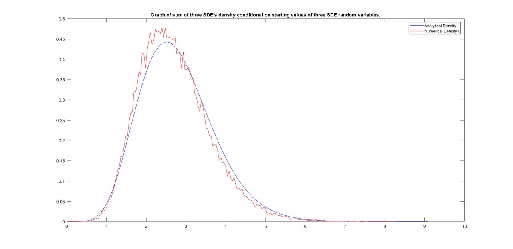](https://postimg.cc/Yj2J5qvT)

[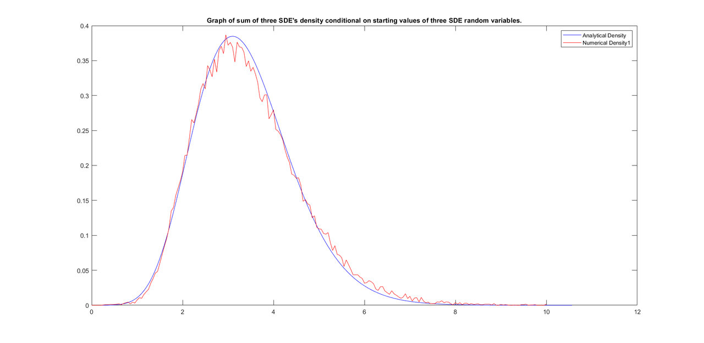](https://postimg.cc/Pvq9Y2GQ)

[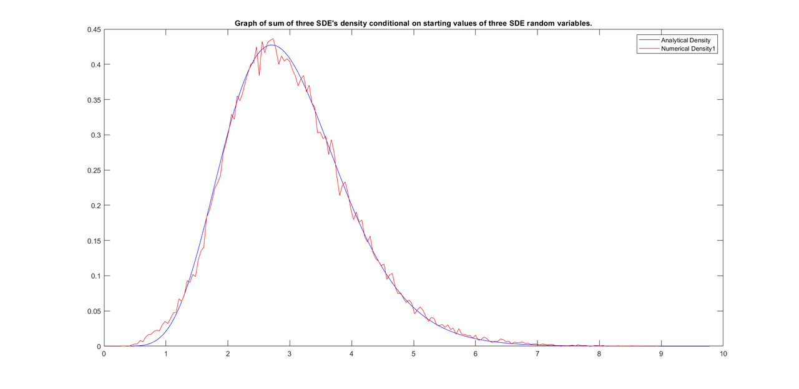](https://postimg.cc/SYK3CD0G)

[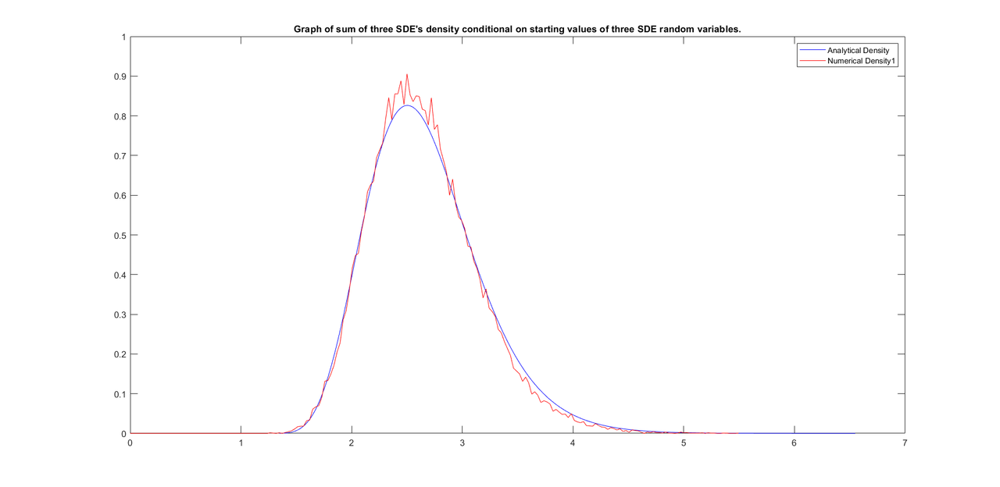](https://postimg.cc/5QtTLncq)

[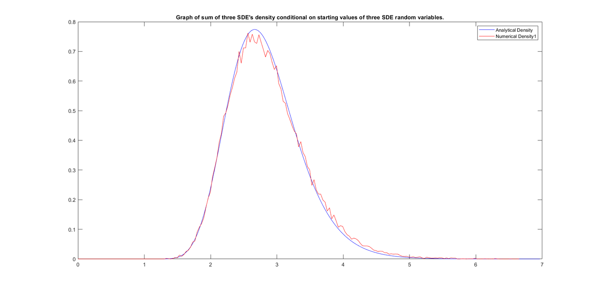](https://postimg.cc/K3YwBJX7)

[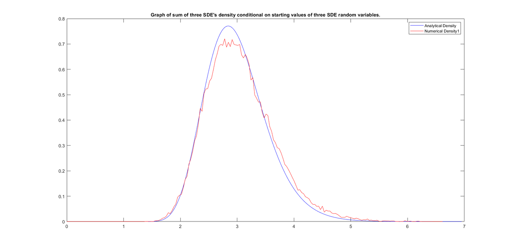](https://postimg.cc/9wfKZJ3Z)

[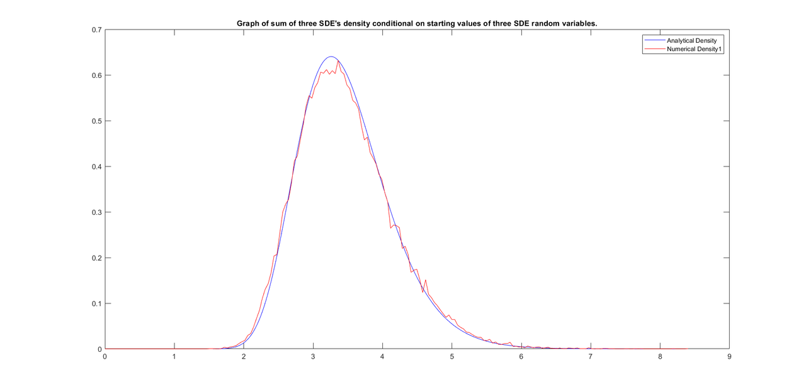](https://postimg.cc/4H3qVBCc)

[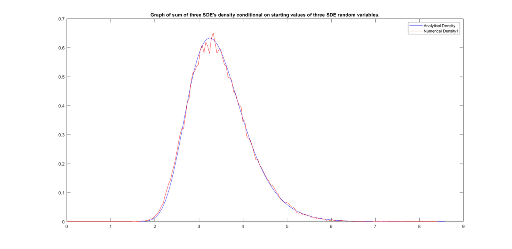](https://postimg.cc/D4zHLBVb)

[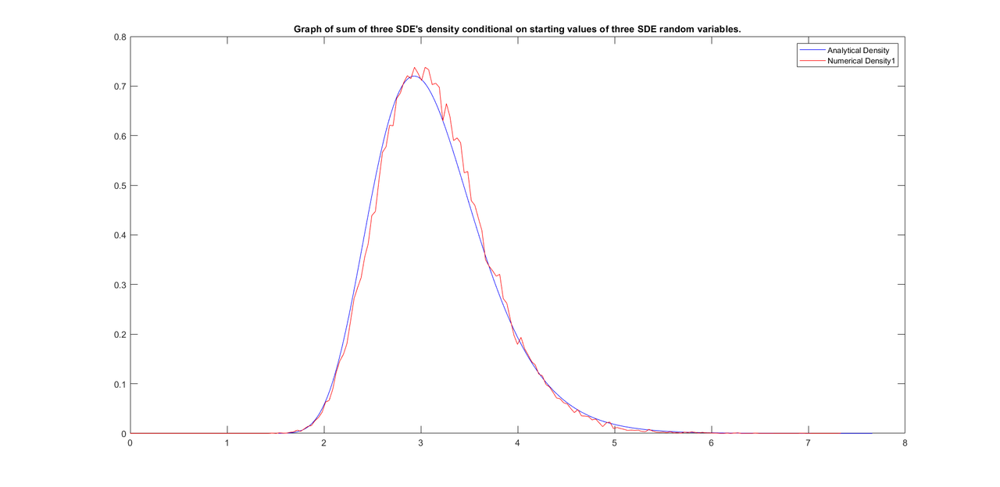](https://postimg.cc/jnjmPZV7).,

,

,

,

```
function []= ConditionalDensityHermitesNvariate0A02()

%SV SDE is
%dV(t)=mu1 V(t)^beta1 dt+ mu2 V(t)^beta2 dt + sigma0 V(t)^gamma dZ(t)
%In mean reverting SDEs we ususally have
%mu1= kappaV * thetaV
%beta1=0
%mu2=-kappa
%beta2=0
%The present program works only when drift is zero (for pure noises)
%meaning mu1=0 and mu2=0;

Order=7;
%NDim=4;%Three assets and one SV.
%NMomentsY=Order+1;
%NMomentsX=Order+1;

%%%%%%%%%%%%%%%%%%%5
dt=.03125/2/8;
Tt=64*2*8;
T=Tt*dt;
seed0=12130649;
seed0=94210876;
%seed0=14210876;
%seed0=53612297
seed0=97459782
rng(seed0, 'twister')
paths=50000;
TT1=100*8/2; %Transition distribution start
TT2=256*8/2; %Transition distribution end

%%%%%%%%%%%%%%%%%%%5

NDims=3;

V0(1)=1.000;%.32;
V00(1)=V0(1);

%SDE1
% thetaV(1)=1.0;%.045;%1;%.04;
% kappaV(1)=0.000;%1.5;%1.5;
% gamma(1)=.75;%.75
% sigma0(1)=.55;%.35

%SDE2
%thetaV(1)=.90;%.045;%1;%.04;
%kappaV(1)=1.000;%1.5;%1.5;
%gamma(1)=.75;%.75
%sigma0(1)=.6;%.35

%SDE3
thetaV(1)=1.350;%.045;%1;%.04;
kappaV(1)=2.000;%1.5;%1.5;
gamma(1)=.75;%.75
sigma0(1)=.6;%.35

mu1(1)=kappaV(1)*thetaV(1);
mu2(1)=-kappaV(1);
beta1(1)=0;
beta2(1)=1;

V0(2)=1.000;%.32;
V00(2)=V0(2);

%SDE1
%thetaV(2)=1.0;%.045;%1;%.04;
% kappaV(2)=0.000;%1.5;%1.5;
% gamma(2)=.55;%.75
% sigma0(2)=.55;%.35

%SDE2
% thetaV(2)=1.0;%.045;%1;%.04;
% kappaV(2)=2.000;%1.5;%1.5;
% gamma(2)=.65;%.75
% sigma0(2)=.45;%.35

%SDE3
thetaV(2)=.850;%.045;%1;%.04;
kappaV(2)=.35000;%1.5;%1.5;
gamma(2)=.65;%.75
sigma0(2)=.55;%.35

mu1(2)=kappaV(2)*thetaV(2);
mu2(2)=-kappaV(2);
beta1(2)=0;
beta2(2)=1;

V0(3)=1.000;%.33;
V00(3)=V0(3);

%SDE1
%thetaV(3)=1.0;%.045;%1;%.04;
% kappaV(3)=0.000;%1.5;%1.5;
% gamma(3)=.95;%.75
% sigma0(3)=.35;%.35

%SDE2
% thetaV(3)=.750;%.045;%1;%.04;
% kappaV(3)=0.5000;%1.5;%1.5;
% gamma(3)=.95;%.75
% sigma0(3)=.35;%.35

%SDE3
thetaV(3)=1.150;%.045;%1;%.04;
kappaV(3)=1.5000;%1.5;%1.5;
gamma(3)=.95;%.75
sigma0(3)=.35;%.35

mu1(3)=kappaV(3)*thetaV(3);
mu2(3)=-kappaV(3);
beta1(3)=0;
beta2(3)=1;

Corr1(1,1)=1;
Corr1(1,2)=.4;
Corr1(1,3)=.5;
Corr1(2,2)=1;
Corr1(2,1)=.4;
Corr1(2,3)=.3;
Corr1(3,1)=.5;
Corr1(3,2)=.3;
Corr1(3,3)=1;

%Corr1(1:3,1:3)=0.0;

R=chol(Corr1);

 R(1:3,1:3)=0;
 R(1,1)=1;
 R(2,2)=1;
 R(3,3)=1;

% V0(4)=1.000;%.44;
% V00(4)=V0(4);
% thetaV(4)=1.0;%.045;%1;%.04;
% kappaV(4)=0.000;%1.5;%1.5;
% mu1(4)=kappaV(4)*thetaV(4);
% mu2(4)=-kappaV(4);
% beta1(4)=0;
% beta2(4)=1;
% gamma(4)=.95;%.75
% sigma0(4)=.55;%.45

%%%%%%%%%%%%%%%%%%%%%%%%%%%%%%%%%%%%%%%%%%%%%%%%%%%%%%%%%%%%%%%%%%%%%5
for nn=1:NDims
V(1:paths,nn)=V0(nn);
end
%V(1:paths,1:NDims)=V0(1,1:NDims);

Random1(1:paths/2,1:NDims)=0;

for tt=1:Tt

    Random2(1:paths/2,1:NDims)=randn(size(Random1));
    Random2(paths/2+1:paths,1:NDims)=-Random2(1:paths/2,1:NDims);

    %Random2=R'*Random2;
    random1=Random2*R(:,1);
    random2=Random2*R(:,2);
    random3=Random2*R(:,3);

    Random2(:,1)=random1;
    Random2(:,2)=random2;
    Random2(:,3)=random3;

    for nn=1:NDims

    V(1:paths,nn)=V(1:paths,nn)+ ...
        (mu1(nn).*V(1:paths,nn).^beta1(nn) + mu2(nn).*V(1:paths,nn).^beta2(nn))*dt + ...
        sigma0(nn).*V(1:paths,nn).^gamma(nn) .*Random2(1:paths,nn)*sqrt(dt) + ...
        (mu1(nn).*beta1(nn)*V(1:paths,nn).^(beta1(nn)-1) + mu2(nn).*beta2(nn).*V(1:paths,nn).^(beta2(nn)-1)).* ...
        ((mu1(nn).*V(1:paths,nn).^beta1(nn) + mu2(nn).*V(1:paths,nn).^beta2(nn))*dt^2/2 + ...
        sigma0(nn).*V(1:paths,nn).^gamma(nn) .*Random2(1:paths,nn)*(1-1/sqrt(3))*dt^1.5) + ...
        .5*(mu1(nn).*beta1(nn).*(beta1(nn)-1).*V(1:paths,nn).^(beta1(nn)-2) +
mu2(nn).*beta2(nn).*(beta2(nn)-1).*V(1:paths,nn).^(beta2(nn)-2)).* ...
        sigma0(nn)^2.*V(1:paths,nn).^(2*gamma(nn)).*dt^2/2 + ...
        sigma0(nn).*gamma(nn).*V(1:paths,nn).^(gamma(nn)-1) .* ...
        ((mu1(nn).*V(1:paths,nn).^beta1(nn) + mu2(nn).*V(1:paths,nn).^beta2(nn)).*Random2(1:paths,nn).*1/sqrt(3)*dt^1.5
+ ...
        sigma0(nn).*V(1:paths,nn).^gamma(nn) .*(Random2(1:paths,nn).^2-1)*dt/2) + ...
        .5*sigma0(nn).*gamma(nn).*(gamma(nn)-1).*V(1:paths,nn).^(gamma(nn)-2) .* ...
        sigma0(nn).^2.*V(1:paths,nn).^(2*gamma(nn)) .*Random2(1:paths,nn).*1/sqrt(3)*dt^1.5;

    V(V(:,nn)<=0)=.0001;

    if(tt==TT1)
        Xin(1:paths,nn)=real(V(1:paths,nn));
    end

    if(tt==TT2)

        Xin2(1:paths,nn)=real(V(1:paths,nn));
    end

    end

end

Yin(1:paths)=0.0;

for pp=1:paths
for mm=1:NDims
    Yin(pp)=Yin(pp)+Xin2(pp,mm);%-Xin(pp,mm);
%-Xin(pp,mm);
end
end

str=input("I have reached stone 1");

%%%%%%%%%%%%%%%%%%%%%%%%%%%%%%%%%%%%%%%%%%%%%%%%%%5

%Xin=log(Xin);
%Yin=log(Yin);

Order=7;
clf;
%CalculateHermiteCorrelations02(Xin,Yin,paths);
%[HCorr2,YPowersH,XPowersH,Zy,Zx] = CalculateHermiteCorrelations0NA(Xin,Yin,paths);
[BetaCorrH,YCoeffH,XCoeffH,CorrXX1st] = CalculateHermiteCorrelations0NA04(Xin,Yin,paths,NDims)
YCoeffZ(1:Order+1)= ConvertHermiteSeriesToZSeries01(YCoeffH(1:Order+1),Order);

BetaCorrH

CorrXX1st
str=input("I have reached Stone2");

%Calculate2DZSeriesNDim(YCoeffH,BetaCorrH,CorrXX1st,NDims,Order);
%[cn,ccn] = Calculate2DZSeriesNDimCorrected(YCoeffH,BetaCorrH,CorrXX1st,NDims,Order);
%[bn,dn,cn,ccn] = Calculate2DZSeriesNDimCorrected(YCoeffH,BetaCorrH,CorrXX1st,NDims,Order)
[cn,dn,bnv,bbnv,ch] = Calculate2DZSeriesNDimCorrected(YCoeffH,BetaCorrH,CorrXX1st,NDims,Order);

% %XCoeffH(1:Order+1)=XPowersH(1:Order+1,1);
% %YCoeffH(1:Order+1)=YPowersH(1:Order+1,1);
% XCoeffZ(1:Order+1)= ConvertHermiteSeriesToZSeries01(XPowersH(1:Order+1,1),Order);
% YCoeffZ(1:Order+1)= ConvertHermiteSeriesToZSeries01(YPowersH(1:Order+1,1),Order);
%
%
% YPowersH(1,1)
% XPowersH(1,1)
%
%
% HCorr2
%
% str=input("Look at the means");
%
%
% YxCoeffH(1)=YPowersH(1,1);
%
% for nn=2:Order+1
%     %Yxi(pp)=Yxi(pp)+YPowersH(nn,1).*HCorr2(nn-1).*HnZx(pp,nn);
%     YxCoeffH(nn)=YPowersH(nn,1).*HCorr2(nn-1);
%     %YxCoeffH(nn)=YxiPowersH(nn,1);
% end

%%%%%%%%%%%%%%%%%%%%%%%%%%%%%%%%%%%%%%%%%%%%%%%%%%%%%%%%%%%%%%%%%%5
% %%%%%%%%%%%%%%%%%%%%%%%%%%%%%%%%%%%%%%%%%%%%%%%%%%%%%%%%%%%%%%%%%%%%%%%%%%%%%5
% %In this block, we do conditional Monte Carlo of SDE which is the true
% %numerical 1D conditional density of Y conditional on X having a given
% %value. This value of X on which we are conditionin is defined by V10 below.
% %We can alter V10 below and it will take out a 1D slice from the 2D density
% %of Y conditional on X  taking a specific value (here V10).

% V10=.65;
% %[XCoeffZ(1:Order+1)] = ConvertHermiteSeriesToZSeries01(XPowersH(1:Order+1,1),Order);
% %V10=XCoeffZ(1);
% V(1:paths)=V10;
% Random2(1:paths,1)=0;
%
% for tt=1:TT2-TT1
%
%     Random2(1:paths/2)=randn(paths/2,1);
%     Random2(paths/2+1:paths)=-Random2(1:paths/2);
%
%
%     V(1:paths,1)=V(1:paths,1)+ ...
%         (mu1.*V(1:paths,1).^beta1 + mu2.*V(1:paths,1).^beta2)*dt + ...
%         sigma0*V(1:paths,1).^gamma .*Random2(1:paths,1)*sqrt(dt) + ...
%         (mu1.*beta1*V(1:paths,1).^(beta1-1) + mu2.*beta2.*V(1:paths,1).^(beta2-1)).* ...
%         ((mu1.*V(1:paths,1).^beta1 + mu2.*V(1:paths,1).^beta2)*dt^2/2 + ...
%         sigma0*V(1:paths,1).^gamma .*Random2(1:paths,1)*(1-1/sqrt(3))*dt^1.5) + ...
%         .5*(mu1.*beta1.*(beta1-1).*V(1:paths,1).^(beta1-2) + mu2.*beta2.*(beta2-1).*V(1:paths,1).^(beta2-2)).* ...
%         sigma0^2.*V(1:paths,1).^(2*gamma).*dt^2/2 + ...
%         sigma0*gamma*V(1:paths,1).^(gamma-1) .* ...
%         ((mu1.*V(1:paths,1).^beta1 + mu2.*V(1:paths,1).^beta2).*Random2(1:paths,1).*1/sqrt(3)*dt^1.5 + ...
%         sigma0.*V(1:paths,1).^gamma .*(Random2(1:paths,1).^2-1)*dt/2) + ...
%         .5*sigma0*gamma*(gamma-1).*V(1:paths,1).^(gamma-2) .* ...
%         sigma0^2.*V(1:paths,1).^(2*gamma) .*Random2(1:paths,1).*1/sqrt(3)*dt^1.5;
%
%     V(V<0)=.0001;
%
% end
%
% %V=log(V);
%
% %logV10=log(V10);
% %Below
%
% NoOfBins=200;
% MaxCutOff=10;
%
% [XDensity,IndexOut,IndexMax] = MakeDensityFromSimulation_Infiniti_NEW(V,paths,NoOfBins,MaxCutOff );
%
% for qq=1:8
%
%     DataMoments(qq)=sum(V(:).^qq)/paths;
%
% end

%%%%%%%%%%%%%%%%%%%%%%%%%%%%%%%%%%%%%%%%%%%%%%%%%%%%%%%%%%%%%%%%%%%%%%%%%%%%%%%%%%%%%%%
%Set1
%V10(1)=.65;%.65;
%V10(2)=1.2;
%V10(3)=.85;

%Set2
%V10(1)=1.65;
%V10(2)=1.1;%1.2;
%V10(3)=.7;

%Set3
V10(1)=1.1;
V10(2)=.5;%1.2;
V10(3)=1.45;

for nn=1:NDims
V(1:paths,nn)=V10(nn);
end
%V(1:paths,1:NDims)=V0(1,1:NDims);

Random1(1:paths/2,1:NDims)=0;

for tt=1:TT2-TT1

    Random2(1:paths/2,1:NDims)=randn(size(Random1));
    Random2(paths/2+1:paths,1:NDims)=-Random2(1:paths/2,1:NDims);

    random1=Random2*R(:,1);
    random2=Random2*R(:,2);
    random3=Random2*R(:,3);

    Random2(:,1)=random1;
    Random2(:,2)=random2;
    Random2(:,3)=random3;

    for nn=1:NDims

    V(1:paths,nn)=V(1:paths,nn)+ ...
        (mu1(nn).*V(1:paths,nn).^beta1(nn) + mu2(nn).*V(1:paths,nn).^beta2(nn))*dt + ...
        sigma0(nn).*V(1:paths,nn).^gamma(nn) .*Random2(1:paths,nn)*sqrt(dt) + ...
        (mu1(nn).*beta1(nn)*V(1:paths,nn).^(beta1(nn)-1) + mu2(nn).*beta2(nn).*V(1:paths,nn).^(beta2(nn)-1)).* ...
        ((mu1(nn).*V(1:paths,nn).^beta1(nn) + mu2(nn).*V(1:paths,nn).^beta2(nn))*dt^2/2 + ...
        sigma0(nn).*V(1:paths,nn).^gamma(nn) .*Random2(1:paths,nn)*(1-1/sqrt(3))*dt^1.5) + ...
        .5*(mu1(nn).*beta1(nn).*(beta1(nn)-1).*V(1:paths,nn).^(beta1(nn)-2) +
mu2(nn).*beta2(nn).*(beta2(nn)-1).*V(1:paths,nn).^(beta2(nn)-2)).* ...
        sigma0(nn)^2.*V(1:paths,nn).^(2*gamma(nn)).*dt^2/2 + ...
        sigma0(nn).*gamma(nn).*V(1:paths,nn).^(gamma(nn)-1) .* ...
        ((mu1(nn).*V(1:paths,nn).^beta1(nn) + mu2(nn).*V(1:paths,nn).^beta2(nn)).*Random2(1:paths,nn).*1/sqrt(3)*dt^1.5
+ ...
        sigma0(nn).*V(1:paths,nn).^gamma(nn) .*(Random2(1:paths,nn).^2-1)*dt/2) + ...
        .5*sigma0(nn).*gamma(nn).*(gamma(nn)-1).*V(1:paths,nn).^(gamma(nn)-2) .* ...
        sigma0(nn).^2.*V(1:paths,nn).^(2*gamma(nn)) .*Random2(1:paths,nn).*1/sqrt(3)*dt^1.5;

    V(V(:,nn)<0)=.0001;

    %if(tt==TT1)
    %    XXin(1:paths,nn)=V(1:paths,nn);
    %end

    if(tt==TT2-TT1)

        XXin2(1:paths,nn)=V(1:paths,nn);
    end

    end

end

Yin2(1:paths)=0.0;

for pp=1:paths
for mm=1:NDims
    Yin2(pp)=Yin2(pp)+XXin2(pp,mm);%-V10(mm);
end
end

NoOfBins=200;
MaxCutOff=10;

[XDensity,IndexOut,IndexMax] = MakeDensityFromSimulation_Infiniti_NEW(Yin2,paths,NoOfBins,MaxCutOff );

for qq=1:8

    DataMoments(qq)=sum(Yin2(:).^qq)/paths;

end

%%%%%%%%%%%%%%%%%%%%%%%%%%%%%%%%%%%%%%%%%%%%%%%%%%%%%%%%%%%%%%%%%%%%%%%%%%%%%%%%%%%%%%%5

for nn=1:NDims
    [Zx0(nn)] = CalculateZgivenXAndHSeriesCoeffs(V10(nn),XCoeffH(1:Order+1,nn),Order);
end

%Zx00=0.0;

%%%%%%%%%%%%%%%%%%%%%%%%%%%%%%%%%%%%%%%%%%%%%%%%%%%%%%%%%%%%%%%%%%%%%%55
% %
%  ZxSign(1:Order+1)=0;
% %
%  Vol(1:Order+1)=0.0;
%  Zx(1:Order+1)=0.0;
%  for hh=1:Order
%  for nn=1:NDims
%      ZxSign(hh+1) = ZxSign(hh+1) + bnv(nn+1,hh+1).^1 .*Zx0(nn);
%      for mm=1:NDims
%          Zx(hh+1) = Zx(hh+1) + bnv(nn+1,hh+1).^1.*bnv(mm+1,hh+1).^1 .*Zx0(nn).*Zx0(mm).*CorrXX1st(nn,mm);
%          Vol(hh+1)=Vol(hh+1)+bnv(nn+1,hh+1).^1.*bnv(mm+1,hh+1).^1.*CorrXX1st(nn,mm);
%      end
%  end
%  end
% %
%  for hh=1:Order
%  Zx(hh)=sign(ZxSign(hh+1)).*sqrt(Zx(hh+1)/Vol(hh+1));%./bbnv(1,hh+1).^1;
%  %Zx(hh+1)=Zx0(1)+Zx0(2);%(ZxSign(hh+1));%./bbnv(1,hh+1);%
%  end
%
%%%%%%%%%%%%%%%%%%%%%%%%%%%%%%%%%%%%%%%%%%%%%%%%%%%%%%%%%%%%%%%%%%%55

Zx(1:Order)=0;

for hh=1:Order
    for nn=1:NDims
        Zx(hh) = Zx(hh) + bnv(nn+1,hh+1).^1.*Zx0(nn);
    end
end

bh0=YCoeffH(1);

[W] = EvalHermiteArrayH0(Zx0,Order);

for hh=1:Order
    for nn=1:NDims
        bh0 = bh0 + ch(nn+1,hh+1).^1.*W(nn,hh+1);
    end
end

%%%%%%%%%%%%%%%%%%%%%%%%%%%%%%%%%%%%%%%%%%%%%%%%%%%%%%%%%%%%%%%%

a0=YCoeffZ(1);
a1=YCoeffZ(2);
a2=YCoeffZ(3);
a3=YCoeffZ(4);
a4=YCoeffZ(5);
a5=YCoeffZ(6);
a6=YCoeffZ(7);
a7=YCoeffZ(8);

d1=dn(2);
d2=dn(3);
d3=dn(4);
d4=dn(5);
d5=dn(6);
d6=dn(7);
d7=dn(8);

%b0=(a0+a1.* Zx(1) +a2.* Zx(2).^2+a3.* Zx(3).^3+a4* Zx(4).^4+a5 *Zx(5).^5+a6* Zx(6).^6+a7* Zx(7).^7);
b1=(a1* d1+2* a2* Zx(2)* d2 +3* a3* Zx(3).^2* d3+4* a4* Zx(4).^3* d4+5* a5* Zx(5).^4* d5+6* a6* Zx(6).^5* d6+7* a7*
Zx(7).^6* d7);
b2=(a2* d2.^2+3* a3* Zx(3)* d3^2 +6* a4* Zx(4).^2* d4^2+10* a5* Zx(5).^3* d5^2+15* a6* Zx(6).^4* d6^2+21* a7* Zx(7).^5*
d7^2);
b3=(a3* d3^3+4* a4 *Zx(4)* d4^3 +10* a5* Zx(5).^2* d5^3+20* a6* Zx(6).^3* d6^3+35* a7* Zx(7).^4* d7^3);
b4=(a4* d4^4+5* a5* Zx(5)* d5^4 +15* a6 *Zx(6).^2* d6^4+35* a7* Zx(7).^3 *d7^4);
b5=(a5* d5^5+6* a6* Zx(6)* d6^5 +21* a7 *Zx(7).^2* d7^5);
b6=(a6* d6^6+7* a7* Zx(7)* d7^6 );
b7=(a7* d7^7);

%bh0=b0+b2+3*b4+15*b6;
bh1=b1+3*b3+15*b5+105*b7;
bh2=b2+6*b4+45*b6;
bh3=b3+10*b5+105*b7;
bh4=b4+15*b6;
bh5=b5+21*b7;
bh6=b6;
bh7=b7;

bh(1)=bh0;
bh(2)=bh1;
bh(3)=bh2;
bh(4)=bh3;
bh(5)=bh4;
bh(6)=bh5;
bh(7)=bh6;
bh(8)=bh7;

%%%%%%%%%%%%%%%%%%%%%%%%%%%%%%%%%%%%%%%%%%%%%%%%%%%%%%%%%%%%%%%%%%%%%%%%%%%%%%5

YCoeffz(1:Order+1)= ConvertHermiteSeriesToZSeries01(bh(1:Order+1),Order);

[YMomentsModel]=CalculateMomentsOfZSeries(YCoeffz(1),YCoeffz(2:Order+1),Order,Order+1);

YMomentsModel

DataMoments

str=input("Look at comparison of moments");

clf;

PlotZSeriesDensity(YCoeffz(1),YCoeffz(2:Order+1),'b')

hold on

plot(IndexOut(1:IndexMax),XDensity(1:IndexMax),'r');

%PlotHermiteSeriesDensityAndRvGraph(YCoeffh(1),YCoeffh1(2:yOrder+1),'g')
title("Graph of sum of three SDE's density conditional on starting values of three SDE random variables.")
%title(sprintf('V00 = %.3f; kappa=%.3f, theta=%.3f,gamma=%.3f,sigma=%.3f;V10=%.3f at TT1=%.3f;TT2=%.3f;Paths=%d ',V00,
kappaV, thetaV,gamma,sigma0, V10,(TT1*dt),(TT2*dt),paths));%,sprintf('theta= %f', theta), sprintf('kappa = %f',
kappa),sprintf('sigma = %f', sigma0),sprintf('T = %f', T));
legend({'Analytical Density','Numerical Density1'}, ...
    'Location','northeast')

str=input("This is the first version without altering the moments of conditional density")

hold off

end
```

.

.

.

.

```
function [BetaCorrH,YCoeffH,XCoeffH,CorrXX1st] = CalculateHermiteCorrelations0NA04(Xin,Yin,NData,NDims)

%This program finds required correlations between NDims explanatory
%variables given in Xin that has NDims dimensionality. Yin is variable
%being explained and is one-diemsnional.

Order=7;
NMoments=8;

[ZI] = MomentMatchedStandardNormalDiscretizedDensity(NData);

for nn=1:NDims
[XCoeffH(1:Order+1,nn),Zx(1:NData,nn)] = CalculateHermiteSeriesFromData01(Xin(1:NData,nn),Order,ZI);

[Zx(1:NData,nn)] = CalculateZgivenXAndHSeriesCoeffs(Xin(1:NData,nn),XCoeffH(1:Order+1,nn),Order);

end

[YCoeffH,Zy] = CalculateHermiteSeriesFromData01(Yin,Order,ZI);
[Zy] = CalculateZgivenXAndHSeriesCoeffs(Yin,YCoeffH,Order);

for nn1=1:NDims
    for nn2=1:NDims
        if(nn1==nn2)
            HCorrXX(nn1,nn2,1:Order)=1.0;
        else
            HCorrXX(nn1,nn2,1:Order) =
CalculateCorrelationBivariateHermiteCH0(Zx(1:NData,nn1),Zx(1:NData,nn2),NData,Order);
        end
    end
end

for nn1=1:NDims
    HCorrXY(nn1,1:Order) = CalculateCorrelationBivariateHermiteCH0(Zx(1:NData,nn1),Zy(1:NData),NData,Order);
end

for hh=1:Order
    [BCorrXY(:,hh),Is(:,hh)]=sort(HCorrXY(:,hh),'descend');
end

for hh=1:Order
    CorrXX(1:NDims,1:NDims)=HCorrXX(Is(1:NDims,hh),Is(1:NDims,hh),hh);
    CorrXY(1:NDims,1)=HCorrXY(Is(1:NDims,hh),hh);
    BetaCorr0(1:NDims)=CorrXX\CorrXY;
    BetaCorrH(Is(1:NDims,hh),hh)=BetaCorr0(1:NDims);
end

% for hh=1:Order
%     CorrXX(1:NDims,1:NDims)=HCorrXX(1:NDims,1:NDims,hh);
%     CorrXY(1:NDims,1)=HCorrXY(1:NDims,hh);
%     BetaCorrH(1:NDims,hh)=CorrXX\CorrXY;
% end

CorrXX1st(1:NDims,1:NDims)=HCorrXX(1:NDims,1:NDims,1)

BetaCorrH(:,1)'*CorrXX

CorrXY

HCorrXX

HCorrXY

BetaCorrH

str=input("Look at BetaCorrH");
end

```

.

.

.

```
function [bn,dn,cn,ccn,ch] = Calculate2DZSeriesNDimCorrected(YCoeffH,BetaCorrH,CorrXX1st,NDims,Order)

%NDims in all of the program would be N-1 as y-tilde would be dealt separately

% for nn=1:NDims
%     ccn0(nn+1,8)=cn(nn+1).^2;
%     cnSqrSum=cnSqrSum+cn(nn+1,8).*cn(nn+1,8);
%     for mm=1:NDims
%         if(nn~=mm)
%             ccn0(nn+1,8)=ccn0(nn+1,8)+2*cn(nn+1,8).*cn(mm+1,8).*CorrXX1st(nn,mm);
%             cnSqrSum=cnSqrSum+2*cn(nn+1,8).*cn(mm+1,8).*CorrXX1st(nn,mm);
%         end
%     end
%     ccn(nn+1,8)=sqrt(1-ccn0(nn+1,8));
%
% end

for hh=1:Order
    for nn=1:NDims
        ch(nn+1,hh+1)=BetaCorrH(nn,hh).*YCoeffH(hh+1);%make sure indices on all hermite-correlations match.check.
        %%%% nn+1 since 1st index would go to y-tilde.
    end
end

ch
YCoeffH

str=input("Look at above---00-1-1-1-1-");

[YCoeffZ(1:Order+1)] = ConvertHermiteSeriesToZSeries01(YCoeffH(1:Order+1),Order);

YCoeffH

YCoeffZ

str=input("Look at the Hermite and Z-series coeffs");

%YCoeffZ=YCoeffZA;
%if(abs(YCoeffZ(4))>abs(YCoeffZ(2)))
%    YCoeffZ(4)=sign(YCoeffZ(4)).*abs(YCoeffZ(2));
%end
%if(abs(YCoeffZ(6))>abs(YCoeffZ(4)))
%    YCoeffZ(6)=sign(YCoeffZ(6)).*abs(YCoeffZ(4));
%end
%if(abs(YCoeffZ(8))>abs(YCoeffZ(6)))
%    YCoeffZ(6)=sign(YCoeffZ(6)).*abs(YCoeffZ(8));
%end

%if(abs(YCoeffZ(5))>abs(YCoeffZ(3)))
%    YCoeffZ(5)=sign(YCoeffZ(5)).*abs(YCoeffZ(3));
%end
%if(abs(YCoeffZ(7))>abs(YCoeffZ(5)))
%    YCoeffZ(5)=sign(YCoeffZ(5)).*abs(YCoeffZ(7));
%end

for nn=1:NDims
[c(nn+1,1:Order+1)] = ConvertHermiteSeriesToZSeries01(ch(nn+1,1:Order+1),Order);
end

for nn=1:NDims
    rho_z(nn+1,7)=c(nn+1,8)./YCoeffZ(8);
    cn(nn+1,8)=(abs(rho_z(nn+1,7))).^(1/7);
end

cnSqrSum=0;
for nn=1:NDims
    ccn0(nn+1,8)=cn(nn+1,8).^2;
    cnSqrSum=cnSqrSum+cn(nn+1,8).*cn(nn+1,8);
    for mm=1:NDims
        if(nn~=mm)
            %ccn0(nn+1,8)=ccn0(nn+1,8)+2*cn(nn+1,8).*cn(mm+1,8).*CorrXX1st(nn,mm);
            cnSqrSum=cnSqrSum+cn(nn+1,8).*cn(mm+1,8).*CorrXX1st(nn,mm);
        end
    end
    ccn(nn+1,8)=sqrt(1-ccn0(nn+1,8));

end

if(cnSqrSum>.995)
    cn(2:NDims+1,8)=cn(2:NDims+1,8)*sqrt(.995);
    cnSqrSum=.995;
end

cn(1,8)=sqrt(1-cnSqrSum);
ccn(1,8)=sqrt(1-cn(1,8).^2);
Cn(1,8)=cn(1,8).*YCoeffZ(8);

cn
ccn
str=input("Compare the Eighth Element From NDim---2");

% ccn00(2,8)=cn(2,8).^2+2*cn(2,8).*cn(3,8).*CorrXX1st(1,2)+2*cn(2,8).*cn(4,8).*CorrXX1st(1,3)+ ...
%     cn(3,8).^2+2*cn(3,8).*cn(4,8).*CorrXX1st(2,3)+cn(4,8).^2
%
% ccn00(2,8)=sqrt(1-(cn(2,8).^2+2*cn(2,8).*cn(3,8).*CorrXX1st(1,2)+2*cn(2,8).*cn(4,8).*CorrXX1st(1,3)))
%
% cnSqrSum
%
% ccn0(2,8)
%
% ccn(1,8)
%
% ccn(2,8)
%
% str=input("Look at the variables Inside");
%

cnSqrSum=0;
for nn=1:NDims
    rho_z(nn+1,6)=c(nn+1,7)./YCoeffZ(7);
    cn(nn+1,7)=(abs(rho_z(nn+1,6))).^(1/6);
    %ccn(nn+1,7)=sqrt(1-cn(nn+1,7).^2);
    %cnSqrSum=cnSqrSum+cn(7,nn+1).^2;
end

cnSqrSum=0;
for nn=1:NDims
    ccn0(nn+1,7)=cn(nn+1,7).^2;
    cnSqrSum=cnSqrSum+cn(nn+1,7).*cn(nn+1,7);
    for mm=1:NDims
        if(nn~=mm)
         %   ccn0(nn+1,7)=ccn0(nn+1,7)+2*cn(nn+1,7).*cn(mm+1,7).*CorrXX1st(nn,mm);
            cnSqrSum=cnSqrSum+cn(nn+1,7).*cn(mm+1,7).*CorrXX1st(nn,mm);
        end
    end
    ccn(nn+1,7)=sqrt(1-ccn0(nn+1,7));

end

if(cnSqrSum>.995)
    cn(2:NDims+1,7)=cn(2:NDims+1,7)*sqrt(.995);
    cnSqrSum=.995;
end

cn(1,7)=sqrt(1-cnSqrSum);
ccn(1,7)=sqrt(1-cn(1,7).^2);
Cn(1,7)=cn(1,7).*YCoeffZ(7);

cn
ccn
str=input("Compare the Seventh Element From NDim---2");

cnSqrSum=0;
for nn=1:NDims
    CC(3,6)=YCoeffZ(8).*(21*cn(nn+1,8).^5.*ccn(nn+1,8).^2);
    rho_z(nn+1,5)=(c(nn+1,6)-CC(3,6))./YCoeffZ(6);
    if(abs(rho_z(nn+1,5))>.995)
        rho_z(nn+1,5)=sign(rho_z(nn+1,5)).*.995;
    end
    cn(nn+1,6)=(abs(rho_z(nn+1,5))).^(1/5);
%    nn
%    c(nn+1,6)
%    CC(3,6)
%    YCoeffZ(8)
%    YCoeffZ(6)
%    rho_z(nn+1,5)
%    cn(nn+1,6)
%
%    str=input("Look inside the correlations module loop");

%    ccn(nn+1,6)=sqrt(1-cn(nn+1,6).^2);
    %cnSqrSum=cnSqrSum+cn(7,nn+1).^2;
end

cnSqrSum=0;
for nn=1:NDims
    ccn0(nn+1,6)=cn(nn+1,6).^2;
    cnSqrSum=cnSqrSum+cn(nn+1,6).*cn(nn+1,6);
    for mm=1:NDims
        if(nn~=mm)
          %  ccn0(nn+1,6)=ccn0(nn+1,6)+2*cn(nn+1,6).*cn(mm+1,6).*CorrXX1st(nn,mm);
            cnSqrSum=cnSqrSum+cn(nn+1,6).*cn(mm+1,6).*CorrXX1st(nn,mm);
        end
    end
    ccn(nn+1,6)=sqrt(1-ccn0(nn+1,6));

end

if(cnSqrSum>.995)
    cn(2:NDims+1,6)=cn(2:NDims+1,6)*sqrt(.995);
    cnSqrSum=.995;
end

cn(1,6)=sqrt(1-cnSqrSum);
ccn(1,6)=sqrt(1-cn(1,6).^2);
Cn(1,6)=cn(1,6).*YCoeffZ(6);

cn
ccn
str=input("Compare the Sixth Element From NDim---2");

cnSqrSum=0;
for nn=1:NDims
    CC(3,5)=YCoeffZ(7).*(15*cn(nn+1,7).^4.*ccn(nn+1,7).^2);
    rho_z(nn+1,4)=(c(nn+1,5)-CC(3,5))./YCoeffZ(5);
    cn(nn+1,5)=(abs(rho_z(nn+1,4))).^(1/4);
    %ccn(nn+1,5)=sqrt(1-cn(nn+1,5).^2);
    %cnSqrSum=cnSqrSum+cn(7,nn+1).^2;
end

cnSqrSum=0;
for nn=1:NDims
    ccn0(nn+1,5)=cn(nn+1,5).^2;
    cnSqrSum=cnSqrSum+cn(nn+1,5).*cn(nn+1,5);
    for mm=1:NDims
        if(nn~=mm)
           % ccn0(nn+1,5)=ccn0(nn+1,5)+2*cn(nn+1,5).*cn(mm+1,5).*CorrXX1st(nn,mm);
            cnSqrSum=cnSqrSum+cn(nn+1,5).*cn(mm+1,5).*CorrXX1st(nn,mm);
        end
    end
    ccn(nn+1,5)=sqrt(1-ccn0(nn+1,5));

end

cn(1,5)=sqrt(1-cnSqrSum);
ccn(1,5)=sqrt(1-cn(1,5).^2);
Cn(1,5)=cn(1,5).*YCoeffZ(5);

cn
ccn
str=input("Compare the Fifth Element From NDim---2");

%CC(3,4)=YCoeffZ(6).*(10*cn(6).^3.*dn(6).^2*zeta^2);
%CC(5,4)=YCoeffZ(8).*(35*cn(8).^3.*dn(8).^4.*zeta^4);
cnSqrSum=0;
for nn=1:NDims
    CC(5,4)=YCoeffZ(8).*(35*cn(nn+1,8).^3.*ccn(nn+1,8).^4);
    CC(3,4)=YCoeffZ(6).*(10*cn(nn+1,6).^3.*ccn(nn+1,6).^2);
    rho_z(nn+1,3)=(c(nn+1,4)-3*CC(5,4)-CC(3,4))./YCoeffZ(4);
    cn(nn+1,4)=(abs(rho_z(nn+1,3))).^(1/3);
    %ccn(nn+1,4)=sqrt(1-cn(nn+1,4).^2);
    %cnSqrSum=cnSqrSum+cn(7,nn+1).^2;
end

cnSqrSum=0;
for nn=1:NDims
    ccn0(nn+1,4)=cn(nn+1,4).^2;
    cnSqrSum=cnSqrSum+cn(nn+1,4).*cn(nn+1,4);
    for mm=1:NDims
        if(nn~=mm)
          %  ccn0(nn+1,4)=ccn0(nn+1,4)+2*cn(nn+1,4).*cn(mm+1,4).*CorrXX1st(nn,mm);
            cnSqrSum=cnSqrSum+cn(nn+1,4).*cn(mm+1,4).*CorrXX1st(nn,mm);
        end
    end
    ccn(nn+1,4)=sqrt(1-ccn0(nn+1,4));

end

if(cnSqrSum>.995)
    cn(2:NDims+1,4)=cn(2:NDims+1,4)*sqrt(.995);
    cnSqrSum=.995;
end

cn(1,4)=sqrt(1-cnSqrSum);
ccn(1,4)=sqrt(1-cn(1,4).^2);
Cn(1,4)=cn(1,4).*YCoeffZ(4);

cn
ccn
str=input("Compare the Fourth Element From NDim---2");

%CC(3,3)=YCoeffZ(5).*(6* cn(5).^2.* dn(5).^2);
%CC(5,3)=YCoeffZ(7).*(15*cn(7).^2.*dn(7).^4);
cnSqrSum=0;
for nn=1:NDims
    CC(3,3)=YCoeffZ(5).*(6*cn(nn+1,5).^2.*ccn(nn+1,5).^2);
    CC(5,3)=YCoeffZ(7).*(15*cn(nn+1,7).^2.*ccn(nn+1,7).^4);
    rho_z(nn+1,2)=(c(nn+1,3)-3*CC(5,3)-CC(3,3))./YCoeffZ(3);
    cn(nn+1,3)=(abs(rho_z(nn+1,2))).^(1/2);
    %ccn(nn+1,3)=sqrt(1-cn(nn+1,3).^2);
    %cnSqrSum=cnSqrSum+cn(7,nn+1).^2;
end

cnSqrSum=0;
for nn=1:NDims
    ccn0(nn+1,3)=cn(nn+1,3).^2;
    cnSqrSum=cnSqrSum+cn(nn+1,3).*cn(nn+1,3);
    for mm=1:NDims
        if(nn~=mm)
           % ccn0(nn+1,3)=ccn0(nn+1,3)+2*cn(nn+1,3).*cn(mm+1,3).*CorrXX1st(nn,mm);
            cnSqrSum=cnSqrSum+cn(nn+1,3).*cn(mm+1,3).*CorrXX1st(nn,mm);
        end
    end
    ccn(nn+1,3)=sqrt(1-ccn0(nn+1,3));

end

if(cnSqrSum>.995)
    cn(2:NDims+1,3)=cn(2:NDims+1,3)*sqrt(.995);
    cnSqrSum=.995;
end

cn(1,3)=sqrt(1-cnSqrSum);
ccn(1,3)=sqrt(1-cn(1,3).^2);
Cn(1,3)=cn(1,3).*YCoeffZ(3);

cn
ccn
str=input("Compare the Third Element From NDim---2");

%CC(7,2)=YCoeffZ(8).*(7*cn(8).*dn(8).^6*zeta^6);
%CC(5,2)=YCoeffZ(6).*(5*cn(6).*dn(6).^4.*zeta^4);
%CC(3,2)=YCoeffZ(4).* (3.* cn(4).* dn(4).^2.* zeta^2);
cnSqrSum=0;
for nn=1:NDims
    CC(4,2)=YCoeffZ(4).*(3*cn(nn+1,4).*ccn(nn+1,4).^2);
    CC(6,2)=YCoeffZ(6).*(5*cn(nn+1,5).*ccn(nn+1,6).^4);
    CC(8,2)=YCoeffZ(8).*(7*cn(nn+1,8).*ccn(nn+1,8).^6);
    rho_z(nn+1,1)=(c(nn+1,2)-15*CC(8,2)-3*CC(6,2)-CC(4,2))./YCoeffZ(2);
    cn(nn+1,2)=(abs(rho_z(nn+1,1)));
    %ccn(nn+1,2)=sqrt(1-cn(nn+1,2).^2);
    %cnSqrSum=cnSqrSum+cn(7,nn+1).^2;
end

cnSqrSum=0;
for nn=1:NDims
    ccn0(nn+1,2)=cn(nn+1,2).^2;
    cnSqrSum=cnSqrSum+cn(nn+1,2).*cn(nn+1,2);
    for mm=1:NDims
        if(nn~=mm)
        %    ccn0(nn+1,2)=ccn0(nn+1,2)+2*cn(nn+1,2).*cn(mm+1,2).*CorrXX1st(nn,mm);
            cnSqrSum=cnSqrSum+cn(nn+1,2).*cn(mm+1,2).*CorrXX1st(nn,mm);
        end
    end
    ccn(nn+1,2)=sqrt(1-ccn0(nn+1,2));

end

if(cnSqrSum>.995)
    cn(2:NDims+1,2)=cn(2:NDims+1,2)*sqrt(.995);
    cnSqrSum=.995;
end
cn(1,2)=sqrt(1-cnSqrSum);
ccn(1,2)=sqrt(1-cn(1,2).^2);
Cn(1,2)=cn(1,2).*YCoeffZ(2);

cn
ccn
str=input("Compare the Second Element From NDim---2");

%CC(3,1)=YCoeffZ(2).*(ccn(nn+1,2).^2);
%CC(5,1)=YCoeffZ(4).*(ccn(nn+1,4).^4);
%CC(7,1)=YCoeffZ(6).*(ccn(nn+1,6).^6);
CC(3,1)=YCoeffZ(2).*(cn(1,2).^2);
CC(5,1)=YCoeffZ(4).*(cn(1,4).^4);
CC(7,1)=YCoeffZ(6).*(cn(1,6).^6);

cn(1,1)=(YCoeffZ(1)-CC(3,1)-3*CC(5,1)-15*CC(7,1))./YCoeffZ(1);

cn
ccn
str=input("Look at coefficients cn----PleASE lOOK");

dn(1:Order+1)=cn(1,1:Order+1);
bn(1:Order+1)=ccn(1,1:Order+1);

end

```

.

.

.

.

```
function [Coeff,Zy] = CalculateHermiteSeriesFromData02(Yin,Order,ZI)

Ndata=length(Yin);

%Hz=HermitePoly(Order);
MeanYin=sum(Yin(1:Ndata))/Ndata;
Ym(1:Ndata)=Yin(1:Ndata)-MeanYin;
YmVar=sum(Ym(1:Ndata).^2)/Ndata;
Y(1:Ndata)=Ym(1:Ndata)/sqrt(YmVar);

 %[Zn] = StandardNormalIdealDesity02(Ndata,1);
% %[ZI] = CalculateZI(Zn);
%
%
% ZI1=Zn;
%Below W is the design matrix for least squares regression i.e the matrix
%that contains all the hermite polynomials calculated at ideal normal
%density grid of size Ndata.
[W] = EvalHermiteArrayH0(ZI,Order);
%[W1] = EvalHermiteArrayH0(ZI1,Order);

for nn=1:Ndata
    for hh=1:Order+1
W(nn,hh)=W(nn,hh);%sqrt(normpdf(ZI(1,1:Ndata)));
    end
end

%We first sort the data so that we can assign one appropriate Z-grid
%point(and associated hermite polynomials calculated at that grid point)
%to each data element. This ideal normal density Z-grid is
%constructed so that its size is equal to data observations count. We
%suppose that first derivative of random variables with repsect to Z
%does not switch sign meaning that increasing values of data
%observations have to aligned with increasing values of ideal normal
%density grid.
[Ys,I]=sort(Y(1:Ndata));
%In the line below, the data sort is reversed so that now the ideal
%normal density grid elements assigned to various observations of random
%variable face it on data observations index. For details, Please look
%on interent the definition of matlab sort command with role of "I"
%in output and how it alters the index.

%%Zs1(I(1:Ndata))=ZI(1:Ndata);

%Below the values to be regressed facing the design matrix are assigned
Ymu(1:Ndata,1)=Ys(1:Ndata);

%Below, implement least squares regression.
WW=(W'*W);

coeff=(WW)$W'*Ymu);

%str=input("Look at variances of hermite polynomials inside function")

%Store in coefficietns array of all random varaibles
Coeff(1:Order+1)= coeff(1:Order+1,1);
%Store the associated Z in Z-array of all coefficients.
Zy(I(1:Ndata))=W(1:Ndata,2);

if(abs(Coeff(4)) >1/4*abs(Coeff(2)))
    Coeff(4)=sign(Coeff(4)).*1/4*abs(Coeff(2));
end
if(abs(Coeff(6))>1/11*abs(Coeff(4)))
    Coeff(6)=sign(Coeff(6)).*1/11*abs(Coeff(4));
end
if(abs(Coeff(8))>1/22*abs(Coeff(6)))
    Coeff(8)=sign(Coeff(8)).*1/22*abs(Coeff(6));
end

if(abs(Coeff(5))>1/7*abs(Coeff(3)))
    Coeff(5)=sign(Coeff(5)).*1/7*abs(Coeff(3));
end
if(abs(Coeff(7))>1/16*abs(Coeff(5)))
    Coeff(7)=sign(Coeff(7)).*1/16*abs(Coeff(5));
end

Coeff(1:Order+1)=Coeff(1:Order+1).*sqrt(YmVar);
Coeff(1)=Coeff(1)+MeanYin;

end

```

.

.

.

.

This is the last output you should see when you run this program.

YMomentsModel =

   1.0e+04 *

  Columns 1 through 3

   0.000313584289904   0.001018906977507   0.003434192175299

  Columns 4 through 6

   0.012020114656206   0.043739018979739   0.165647100126957

  Columns 7 through 8

   0.653615855891066   2.689931826926921

DataMoments =

   1.0e+04 *

  Columns 1 through 3

   0.000314857148010   0.001024046603839   0.003441871146309

  Columns 4 through 6

   0.011960047303472   0.042989179456855   0.159934849046360

  Columns 7 through 8

   0.616336693535963   2.462631402579260
```

---

### #3058 — Amin (Topic Author)
*April 22, 2026, 7:24 AM*

As many friends on wilmott already know from past, whenever I do good research, my persecution always increases as a
rule and there are strong efforts by mind control agents to disable the very sequences of neurotransmitters on which I
had been able to do good research. The present occasion is no exception to this rule.

I have been able to do some good research in past few weeks and that has sharply disturbed powerful people behind my
persecution. My research gets strong attention from academic community of probability and stochastics and this also
gives me an opportunity to talk about evils of mind control and cruelties done to intelligent people who have been
forced on mind control. People behind mind control are thoroughly annoyed by my constantly making hue and cry about mind
control and raising awareness about the true nature and intentions behind mind control and they are totally fed up with
me and want to silence me at all cost. This is also a big business and many many tens (>50) of billions of dollars are
paid in bribes  to corrupt people all around the world including US to continue mind control and they become extremely
threatened at any sign that mind control would end and their illegal sources of income would go dry.

Now bad people want to make sure that I would not be able to do any more research so that my work does not get any
attention at all and they hope that many people would slowly forget about mind control and therefore the mind control
regime imposed on many countries would possibly continue. Bad people are doing everything possible to achieve their
objectives. They have started huge effort to drug food and water in the city so that they can strip me of my good
neurotransmitters and they also want to use my psychiatrist to sharply increase my medication so that I cannot have any
stimulation in my brain required to do good research.

They have drugged underground water in all of the city. In past few days, wherever I checked underground, I was able to
get only drugged water. Day before yesterday, I was able to get good water from outskirts of the city more than 15-20
kilometers from my home and it was still lightly drugged but I still took it since I knew it would be difficult to get
better water. Yesterday, I was still able to get good water from a remote water filtration shop that have good
technology to filter but the water was still lightly drugged. These small water filtration shops are  all over the city
but more than 97% of them are supplied with mind control chemicals and they continue to add it to their water. Water 
filtration plant where I got good water was in a small street in a relatively poor neighborhood of the city where I had
never gone before and most people do not go there and therefore they had been unable to supply it with min control
chemicals and therefore water was better. I had also told friends that water in newly re-designed Nestle with white caps
was good and was available at most places but they have drugged it in many markets in just past three or four days and
wherever I tried it, it was highly drugged.

Similar is the case with baked bread and all of the bakeries and bread manufacturers are supplying bread with mind
control chemicals added to bread. Just three days ago, I had mentioned only three or four bakery chains that were
drugging their bread but in a matter of past two days almost all the bread baked by most manufacturers big or small is
getting drugged with mind control chemicals again. Yesterday, I bought bread made by a small manufacturer from a very
remote place in the city and I was very sure that bread would be definitely good but when I ate it at home, it was
drugged. I still ate some of it since I had no other thing to eat and I remained extremely drowsy for a long period
after eating the bread last night.

However most potent threat some bad people want to use is to ask the psychiatrist to sharply increase my medication that
is given in form of fluanxol antipsychotic injections. I was earlier able to get the doctor to decrease my fluanxol
injection to one injection after every 45 days and that was the only reason that I was able to do good research in past
few months. Now they want to ask the doctor to increase the frequency of fluanxol injection and for that reason my
sister approached the psychiatrist prematurely so that my injection dose would be increased and I would not be able to
do any good research after that. I want to tell friends that I would not be able to do any creative work if the doctor
increases the injection frequency or dose. I am 53 years old and it is very difficult for me to stand the effect of
strong antipsychotics. For two weeks after the fluanxol injection , I have strong pain all over my body and I cannot do
anything and I remain totally drowsy and sedated in this period. At this age, I do not have the strong drive of young
people who can take this injection and still remain energetic but still this injection is forced on me. I still recall
when I was young more than twenty years ago, there was a time that a doctor suggested two fluanxol injection per week
and I still had decent energy but in this old age this injection causes strong pains all over my body and I remain
extremely sedated and it is extremely difficult to even pass time due to extreme uneasiness in the brain.

 Friends, I have recently been able to do some good research but it was only after efforts of more than one and a half
year that I was able to succeed and many times it was very difficult to continue. Some of the people who knew what I was
trying to solve had become sure that I would not be able to do anything and only fail. But that is what research in
mathematics is like when there are no precedents of solution of some problem and everything has to be figured out of the
blue. I want to tell friends that I want my research in mathematics to continue at all cost and I also have some very
good ideas about solution of many related problems and I want to continue to distribute my research at the same forum.
But if the psychiatrist increased my dose of injection as he would be forced to do, it would become very difficult to
continue my research at a reasonable pace.

I want to request friends to please support me and ask the department of defense to be reasonable and not start a new
wave of persecution as has become obvious as they have already started drugging the bread, water and packaged milk in
the city. And if the psychiatrist increased my medication baselessly, it would become extremely difficult for me to
continue my research. Please ask all good people you know to protest to American defense and ask them to refrain from
using psychiatrists to silence me and end my research.

Edit: For friends who want to know all the theoretical details behind the algorithms used in the matlab program,
sometime over the coming weekend, I want to make a detailed post with latex explaining all the logic behind the
algorithms.

---

### #3059 — Amin (Topic Author)
*April 22, 2026, 3:29 PM*

Friends, as I had suggested in the previous post, there is a huge activity in several parts of Lahore city to drug my
food. I am trying to lose weight and therefore buy only some milk, yogurt and bread. I can take two to three boiled eggs
every second or third day. I absolutely avoid sweet drinks. So there are not very many things that need to be drugged
since my food is very predictable everyday. Today, I was able to buy some good water and bread from areas close to to
Kot Lakhpat industrial estate. When I returned, I randomly bought some yogurt from a very small neighborhood shop in
Johar town. These small milk and yogurt shops are in most local markets in every block of the residential area. And
there are so many of them all over. On top of that I had no previous immediate intention of buying yogurt (even though I
buy it every second day or so). Since the shop was in a small random neighborhood and I went to the neighborhood on spur
of the moment (after a few turns on the way back to my home) without earlier thinking about it, I was sure that yogurt
would be good. But when I ate yogurt, I could not properly know that it was drugged and ate all of it (500 grams).
However, after eating yogurt, my reality and consciousness abruptly changed and I also became too drowsy and when I sat
on my computer half an hour later, I just remained half asleep and drowsy.

I am very sure that they have asked milk and yogurt shop owners in many neighborhoods to add mind control drugs to their
open raw yogurt that is prepared in very large utensils. They had done this in late 2024 and early 2025 when they had
asked at least 70% of the small milk and yogurt shops in Lahore to add mind control drugs to their yogurt. Now I believe
they are asking these small milk and yogurt shop owners to do that again at least in neighborhoods of johar town and
adjacent areas.

So basically there is absolutely no let up in their efforts to drug my food and their attempts to somehow block good
neurotransmitters from my brain.

---

### #3060 — Amin (Topic Author)
*April 23, 2026, 9:09 AM*

Friends, I have been doing research to develop probability theory infrastructure around Z-series/Hermite-series for past
four years and we have come a long way now and we have developed enough tools that we can successfully apply this
infrastructure on practical applications that have still remained unsolved. This is a good development and I think all
of us want to continue the momentum with further research.

I also want people to know that I distribute my research and especially the matlab programs associated with it freely on
this forum. In past few years, it has been very rare that I approached some company or individual for advanced
applications of my research and I have solely been busy in developing the associated methods and algorithms so we can
apply Z-series/Hermite-series on many problems where other methods of probability theory cannot be applied. Now that we
have reached that benchmark, I want to request friends who have some unsolved probability theory problems that they
suspect could be solved with Z-series/Hermite-series, if those friends wish, to tell me about the probability theory
problems and I would love to think deeply about the problems and associated technical issues and try to find out a way
to solve the problems and make them ready for practical applications.

You can approach me for a free (initial)  consultation about your problems and applications and the algorithms that can
be developed for the related solutions. At this stage, I would like to mention for friends, that a large number of
conditional density regressions  (of the type that arise in applied mathematical finance, natural sciences, biology and
medicine)  that are done with neural networks and machine learning can be done extremely cheaply and far more reliably
(as I guarantee this reliability) with the Z-series/Hermite-series methods I have developed. Problems for which friends
train their networks for weeks with millions of dollars in costs can be done cheaply with far more reliability by
algorithms that take only a few seconds to run including the training time. And the results, since they are based on
authentic rules of mathematics as opposed to black-box optimizations, are almost always far more accurate that solutions
given by neural networks/machine learning. So do not waste millions to get something that can be done more reliably with
a fraction of the cost as the only cost is in developing the right algorithm with Z-series. Compute time has almost zero
cost for medium sized problems and it is all based on sound mathematics. Again I guarantee if my solution is not more
accurate than neural networks/machine learning solutions, I will not charge any money at all.

I have posted all the basic random variable conditional density algorithm conditional on realization of N correlated
random variables on this forum for free in the form of matlab programs. But every applications has its own intricacies
and a lot of things have to be altered to comply with all the necessary details of the problem at hand and there are
usually some minor unsolved issues that have to be solved out of the blue so if friends think I can help them in
solution of their problems, please feel free to discuss it with me. My email is anan2999(at)yahoo(dot) ...

Even if you think that Z-series/Hermite-series do not apply to your unsolved problems, please feel free to discuss with
me as I like to think with an independent approach to solution of unsolved problems. There is always a possibility that
your problem could be resolved.

EDIT: I intend to approach most of my technical connections with a message describing my newly developed methods with
Z-series/Hermite-series and discuss the possibility of solution of their unsolved problems, I want to request linkedin
to not stop my messages to my 1st connections.

---

### #3061 — Amin (Topic Author)
*April 24, 2026, 3:43 PM*

Friends, I had promised to explain the details of the method used to write the matlab program for finding conditional
density of a continuous random variable conditional upon the values taken by several other correlated continuous random
variables. In the following few posts, I will write about preliminaries and context of the method and then move on to
details of conditional density calculation algorithm.

I am presenting it as a competing framework for conditional density regressions and other related variants of the type
that appear in quantitative finance, natural sciences, and medicine. But all of this has to be considered in the broader
framework of orthogonal polynomials. For example, I have worked with hermite orthogonal polynomials only in order to
deal  with tailed densities that can be represented by hermite polynomials. This is a class of densities of continuous
random variables of the type chi-squared, noncentral chi-squared, generalized chi-squared, gamma , generalized gamma and
many others. I am just quoting above densities as an example and our method is a super-set and works with many similar
tailed densities that cannot be represented by any of the above closed form density classes but still can be represented
by a hermite polynomial series. We do not use any parameters or closed form distributions of any of the above analytic
density classes in our conditional density calculations and analytics are only done using underlying Hermite orthogonal
polynomial series.

However for many other specialized problems with random variables of different density types, you would have to use some
other appropriate orthogonal polynomial type. For example densities on a finite domain (usually without tails) of beta
types and many other similar to beta density can be represented by Legendre orthogonal polynomials of uniform random
variable. And we would have to calculate correlations between Legendre orthogonal polynomials of uniform density
underlying Legendre-Series of different random variables. Similarly for many other positive densities we could use
Laguerre orthogonal polynomials of gamma density as underlying basis to represent the random variable and find
correlations between Laguerre orthogonal polynomials of gamma type underlying Laguerre-series of various random
variables. Similarly sinusoidal functions could be represented by other appropriate orthogonal polynomials of their
respective density and could be used to find correlations between those orthogonal polynomials to find the conditional
density of various variables. Again my background is in mathematical finance and therefore I have worked with hermite
polynomials based densities since this is the type of random variables that mostly arise in finance but you would have
to choose appropriate orthogonal polynomials to represent the random variables in the data under question in your
research.

Even though I will soon give preliminaries about the method but briefly our method consists in representing a random
variable in terms of a series in appropriate class of orthogonal polynomials. Then we find correlations between these
orthogonal polynomials just like Pearson correlation is calculated. Correlations exist between orthogonal polynomials of
the same order between different random variables and there are no correlations between orthogonal polynomials of
different order across different random variables due to orthogonality of polynomials. But as opposed to one set of
Gaussian correlations that we usually deal with, there can be, for example, seven sets of correlations if the
hermite-series consists of first seven underlying orthogonal hermite polynomials representing various random variables.
For the relevant class of variables that can be represented by hermite polynomials, our method gives very good estimates
of conditional expected value that is very close to true conditional value and we have recently augmented it with
conditional density generation algorithm that gives very good estimates of conditional density of the random variables
conditional on values taken by several other correlated random variables. We expect that there are many other unique but
related problems that can be solved by the method after making some minor modifications that are necessary to deal with
peculiarities of the unique problems.

Since it is a polynomial based method, it would usually be assumed that it would suffer from curse of dimensionality and
it would be difficult to find densities of target random variables conditional on more than a handful of 5-6 correlated
variables but we have devised a simple algorithm that repeatedly converts N dimensional problem into a two dimensional
problem to calculate appropriate conditionality parameters and our computational complexity of finding conditional
density given N correlated random variables is that of N two dimensional problems which is extremely scalable to very
high dimensions.

This is a very fast algorithm for conditional density calculation and in my matlab example programs, it takes most of
the time to generate underlying simulated SDE data and training time is only to find out Pearson type correlations
between hermite polynomials of same order between different random variables and some other minor calculations. And it
gives conditional density results very close to the true density simulated again by independent monte carlo simulation.
Some minor mismatch is mostly, but not always, attributed to monte carlo randomness since in my experiments I tried to
use not too large number of monte carlo simulation paths.

I am just presenting the method as a way to find true conditional values and conditional density (and other related
variants based on conditionality) in data science problems that arise in natural sciences, finance and medicine and it
may not be alternative to all types of neural networks. However, I would suspect that improvised versions of the method
could be used in fast training of many other types of neural networks but that is beyond the scope of current research.

---

### #3062 — Amin (Topic Author)
*April 24, 2026, 6:48 PM*

**(broken latex: Unbalanced $: 47)**

```latex
This Post and Next post are relevant preliminaries From my Paper:** **https://papers.ssrn.com/sol3/papers.cfm?abstract_id=4933283

**Introduction to Z-Series and Hermite-Series**

An extremely broad class of continuous non-Gaussian random variables can be represented as a power series in base
standard random variables with very simple densities. Standard Gaussian and Standard Uniform are examples of two simple
random variables whose power series could be used to find simple and convenient analytical representation of
non-Gaussian random variables within appropriate classes. Most of the continuous non-Gaussian random variables of Log
Normal distribution, generalized gamma distribution, and non-central chi-squared distribution can be represented as a
power series in standard Gaussian random variable. Similarly continuous random variables belonging to beta distribution
and many other distributions defined on a finite interval can be represented as a power series in standard Uniform
random variable.

**Representation of Non-Gaussian Random Variables in terms of a Taylor Series in Standard Gaussian called Z-Series**

We can represent a large class of non-Gaussian random variables in terms of a Taylor Series in Standard Gaussian Random
variable around its median$Z_0\,=\,0$ .

\begin{equation}\label{2.1.1}

X(Z)\,=\,X(Z_0) \,+\, \sum\limits_{n=1}^{N}\, \frac{d^nX}{dZ^n}\, \frac{{Z}^n}{n!}

\end{equation}

We want to mention that above relationship between X and Z holds through equivalent Cumulative Distribution Function of
both random variables and following two equations hold for any related$X_m$ and$Z_m$ in$X_m(Z_m)$

\begin{equation}\label{2.1.2}

Z_{m} \,=\, {\Phi}^{-1}(P_X(X_m))

\end{equation}

and

\begin{equation}\label{2.1.3}

X_{m} \,=\, P^{-1}_X(\Phi(Z_m))

\end{equation}

where$\Phi(.)$ and$\Phi^{-1}(.)$ and$P_X(.)$ and${P}^{-1}_X(.)$ represent CDF and inverse CDF of standard Gaussian and
non-Gaussian random variable X respectively.

In most of the rest of this paper will represent the above series as

\begin{equation}\label{2.1.4}

X(Z)\,=\, \sum\limits_{n=0}^{N}\, a_n\, {Z}^n

\end{equation}

where it is understood that

\begin{equation}\label{2.1.5}

a_0\,=\, X(Z_0)\,

\end{equation}

\begin{equation}\label{2.1.6}

a_n\,=\, \frac{1}{n!}\, \frac{d^nX}{dZ^n}\,,n\,\geq\,1 \,

\end{equation}

In some of the applications of Z-series, we do not directly know the derivatives$\frac{d^nX}{dZ^n}\, $ and we directly
estimate the coefficients$a_n\,$ from moments of the non-Gaussain random variables or through other numerical methods
but equations (\ref{2.1.5} and \ref{2.1.6}) nevertheless hold.

**Hermite-Series Random Variables Representation**

There is another representation of many non-Gaussian Continuous random variables in terms of Hermite Polynomials of
standard Gaussian random variable.

\begin{equation}\label{2.2.1}

X(Z)\,=\, \sum\limits_{n=0}^{N}\, ah_n\, H_n(Z)

\end{equation}

where $H_n(Z)$ represents nth hermite polynomial as a function of standard normal random variable.

This Hermite series representation of a particular order is algebraically equivalent to Z-series representation of the
same order discussed in section \ref{sec2.1}. There are many analytics on non-Gaussian random variables like
transformation of random variables using Taylor series and multiplication of random variables where a Z-series
representation is more useful while there are some other analytics associated with correlations, variances and
conditional expectation of non-Gaussian random variables where Hermite-Series representation would be more useful. In
many of our numerical algorithms, we continue to switch between Z-Series of a random variable and its equivalent Hermite
series.

**Statistical Properties of Z-Series and Hermite-Series Random variables**

In order to find probability distribution function and cumulative distribution function of Z-series and Hermite Series
random variables, we have to first invert the formulas (\ref{2.1.4}) and (\ref{2.2.1}) to find Z(X). We have discussed
this inversion algorithm in section \ref{sec2.9} later in the paper. We want to emphasize that some statistical
properties are easier to find in Z-Series form while Hermite-Series form is convenient for many other statistical
properties.

probability distribution function of X is given through change of variable formula with standard normal density as

\begin{equation}\label{2.3.1}

p_X(X) \,=\, p_Z(Z(X))\,  |\frac{dZ}{dX}|

\end{equation}

cumulative distribution function of X is found through calculation of cumulative distribution function of associated
value of Gaussian random variable as

\begin{equation}\label{2.3.2}

P_X(X) \,=\,\int\limits_{-\infty}^{Z(X)} p_Z(Z)\, dZ

\end{equation}

Mean of the Hermite-series distribution in given as

\begin{equation}\label{2.3.3}

\text{Mean}= E \left[X \right] \,=\, ah_0

\end{equation}

In terms of Z-series, mean is a series in even coefficients taken till final index N of the Z-series as

\begin{equation}\label{2.3.4}

\text{Mean}= E \left[X \right] \,=\,a_0\,+\, a_2 \, + \, 3\, a_4 \, + 15 \, a_6 + \ldots

\end{equation}

Median of the Z-series random variable is given as

\begin{equation}\label{2.3.5}

\text{Median}=a_0

\end{equation}

Variance of the Hermite-Series random variables is given as

\begin{equation}\label{2.3.6}

Var(X)= E \left[ \,(X\,-\mu(X))^2 \right] \,=\, E \left[ \left(\sum\limits_{n=0}^{N}\, ah_n\, H_n(Z)\,-ah_0 \, \right)^2
\, \right] \,=\, \sum\limits_{n=1}^{N}\, n! \, {ah_n}^2

\end{equation}

Moments of the Z-series random variables are calculated as

\begin{equation}\label{2.3.7}

\mu_m(X)= E \left[ \,(X(Z))^m \right] \,=\,\, E \left[ \left(\sum\limits_{n=0}^{N}\, a_n\, Z^n \,\right)^m \right] \,

\end{equation}

In practice, the above moments are calculated through repeated series product of coefficients of a Z-series with itself
and later substituting the expected values of powers of standard Gaussian in the expression.

**Equivalence of Hermite-Series and Z-Series Random Variables**

Nth order Z-series and Nth order Hermite-Series share a common span of Nth order polynomials so any random variable that
can be represented with Nth order Z-series, can also be represented by a Hermite-Series up to Nth order Hermite
Polynomial. In fact, once coefficients of Z-series are known, it is easily possible to find coefficients of equivalent
Hermite-Series and Vice versa and this is just consequence of simple algebra.\par

If we have Z-series representation of a non-Gaussian random variable is given, we can easily find coefficients of its
Hermite-Series and vice versa.

If we represent a Z-series as

\begin{equation}\label{2.4.1}

X(Z)\,=\, \sum\limits_{n=0}^{N}\, a_n\, {Z}^n

\end{equation}

and a hermite series as

\begin{equation}\label{2.4.2}

X(Z)\,=\, \sum\limits_{n=0}^{N}\, ah_n\, H_n(Z)

\end{equation}

then for $N=7$ (for $N\, **Algorithm for Inversion of Hermite-Series/Z-Series Random Variables**

Many times in our analytics, we know the coefficients of Z-series associated with a random variable as

\begin{equation}\label{2.9.1}

X(Z)\,=\, \sum\limits_{n=0}^{N}\, a_n\, {Z}^n

\end{equation}

and we need to find the value of Z associated with a particular observation of X. Suppose we have a particular
observation of$X\,=\,X_0$ , then associated value of$Z(X_0)$ would be the one that solves the following equation

\begin{equation}\label{2.9.2}

X_0\,=\, \sum\limits_{n=0}^{N}\, a_n\, {Z}^n

\end{equation}

In order to find the inverse Z of a particualr value$X_0$ , we divide the range of standard normal random variables
between -7 to +7 into fourteen equal intervals. We call$Z_{u}$ as upper boundary and$Z_{d}$ as lower boundary of each
interval.

We loop over these intervals one by one and find the values

\begin{align}\label{2.9.3}

& X(Z_d)\,=\, \sum\limits_{n=0}^{N}\, a_n\, {Z_d}^n \\

& X(Z_u)\,=\, \sum\limits_{n=0}^{N}\, a_n\, {Z_u}^n

\end{align}

and choose the interval where

\begin{equation}\label{2.9.4}

X(Z_{d}) X_{mid} $, we halve the bracketed interval by choosing

 $Z_{d}=Z_{mid}$ and  $Z_{u}=Z_{u} $

 and if $X_0 **Estimation of Z-series Coefficients From Numerical Data**

Estimation of coefficients of Hermite-Series From numerical data works by regressing data observations on hermite
polynomials associated with a discrete grid version of standard normal density.  We know that in Hermite series of a
random variable, our data observations of non-Gaussian random variable and the underlying standard normal random
variable are mapped on each other through common CDF values.

Therefore, in this method first we have to construct a discrete grid on standard normal density so that number of
discrete grid points on standard normal density match the total number of data observations and  probability mass
associated with each grid cell matches the probability of each data observation and CDF of each discrete standard normal
grid center matches the CDF of Hermite representation of each data point.

**Construction of Discrete Normal Density on Data Grid And Regression of Non-Gaussian Random Variable Data Observations
on Hermite Polynomials.**

We suppose there are a total of P data observations of random variable X whose Hermite-Series we want to find. In order
to find coefficients of Hermite-Series, we have to regress each of the P data observation on N hermite polynomials of a
discrete normal density point associated with the data observation therefore grid size of discrete normal density should
also be P. We also know that probability mass of each data observation is$\frac{1}{P}$ , so the probability mass of each
grid cell on standard normal discrete grid should also be$\frac{1}{P}$ . The centres of these grid cells represent the
discrete grid normal density points. In order to numerically construct this discrete standard normal grid of size P, we
start out symmetrically from median and make boundaries of grid cells so that probability mass within each grid cell is
$\frac{1}{P}$ . This way we can make a symmetric grid around median that can be mapped on data observations through
equivalent CDF.

We regress our observations of non-Gaussian random variables on the Hermite polynomials calculated at these discrete
grid normal density points.

We have assumed that first derivative of non-Gaussian random variable with respect to standard normal random variable is
positive, and it means that data can be re-ordered in increasing function (sorted in ascending order) and assigned to
increasing order of grid points on discrete normal density grid points we constructed earlier.

Once we have constructed discrete normal grid and associated each point on it with sorted data points, we simply regress
data points on Hermite polynomial values calculated at particular standard normal discrete grid point on the associated
sorted data in a least square fashion to find regression coefficients that also represent the coefficients of Hermite
polynomials in the Hermite-series.

If there are P data points, and we use N Hermite polynomials to represent the Hermite-Series of X, then our regression
equation for each pth data point would be

\begin{equation}\label{3.2.1}

X_p\,=\, ah_0 \, + \,ah_1\, H_1(Z_p)\,+ \,ah_2\, H_2(Z_p)\,+ \ldots \,+\,ah_N\, H_N(Z_p)\,

\end{equation}

with the matrix equation given as

\begin{equation}\label{3.2.2}

\begin{bmatrix} 1 & H_1(Z_1) & H_2(Z_1) & ..... & H_N(Z_1) \\

1 & H_1(Z_2) & H_2(Z_2) & ..... & H_N(Z_2) \\ ... & ... & ... & ... \\1 & H_1(Z_p) & H_2(Z_p) & ..... & H_N(Z_p) \\  ...
& ... & ... & ... & ... \\

1 & H_1(Z_P) & H_2(Z_P) & ... & H_N(Z_P)

\end{bmatrix}   \begin{bmatrix} ah_0 \\ ah_{1} \\ ah_{2} \\ ... \\ ah_{N} \end{bmatrix} \\ \,=\, \begin{bmatrix} X_1 \\
X_2 \\ ...  \\  X_p \\ ... \\  X_P \end{bmatrix}

\end{equation}

\begin{equation}\label{3.2.3}

\boldsymbol{H \, a_h}\,=\,\boldsymbol{x}

\end{equation}

and we solve this equation with least squares as

\begin{equation}\label{3.2.4}

\boldsymbol{a_h}\,=\,\boldsymbol{{\left(H^T\, H \right)}^{-1}\,H^T\, x }

\end{equation}
```

---

### #3063 — Amin (Topic Author)
*April 24, 2026, 6:56 PM*

**Correlation, Covariance and Conditional Expectation Between Non-Gaussian Random variables through their Hermite-Series
Representation**

When we find Hermite series representation of a non-Gaussian random variable, we decompose it in terms of orthogonal
Hermite polynomials of various orders. Due to this orthogonality property of different Hermite polynomials, any two
non-Gaussian random variables with their Hermite-Series can only take correlations between Hermite polynomials of the
same order across their respective Hermite-series and there are no correlations between Hermite polynomials of different
order in the Hermite-Series of two random variables. So we no longer have a single correlation between two non-Gaussian
random variables and we have to work with multiple correlations where each of the correlations is calculated between
Hermite polynomials of the same order across Hermite-Series of two random variables.

Similarly Variance, Covariance and conditional expectations are calculated separately between Hermite polynomials of
each order in Hermite-Series of two random variables and then these variances, covariances and conditional expectations
between each Hermite polynomial are added through specific relationships to find total variance, covariance and
conditional expectations between two non-Gaussian random variables.

Suppose we have two non-Gaussian correlated random variables X and Y whose uni-variate Hermite series are given
respectively as

\begin{equation}\label{4.1}

X(Z_X)\,=\, \sum\limits_{n=0}^{N}\, bh_n\, H_n(Z_X)\, =\, \sum\limits_{n=0}^{N}\, X_n

\end{equation}

\begin{equation}\label{4.2}

Y(Z_Y)\,=\, \sum\limits_{n=0}^{N}\, ch_n\, H_n(Z_Y) \, =\, \sum\limits_{n=0}^{N}\, Y_n

\end{equation}

In rest of this section, we would deal with correlations, covariances and various cases of conditional expectations
between above two non-Gaussian random variables X and Y.

**Estimation of Correlations Between Hermite Polynomials of each Order in Hermite-Series of two non-Gaussian Random
variables X and Y**

We stress again that in Hermite-Series framework, there is no single correlation between two non-Gaussian random
variables and separate correlations have to be calculated between Hermite polynomials of same order across
Hermite-Series of two random variables. Once we have calculated these multiple correlations between Hermite polynomials
of two random variables, We have to do further analytics with these separate correlations to find total covariances and
total conditional expectations through relationships we dscribe in next few sections.

Suppose we have P joint observations of random variables$X_p$$\,(p\,=\,1\, \ldots P)$ and$Y_p$$\,(p\,=\,1\, \ldots P)$ .
From$X_p$ and$Y_p$ , We would have to invert equations below to find$Z_{X,p}$$\,(p\,=\,1\, \ldots P)$ and$Z_{Y,p}$
$\,(p\,=\,1\, \ldots P)$

\begin{equation}\label{4.1.1}

X_p\,=\, \sum\limits_{n=0}^{N}\, bh_n\, H_n(Z_{X,p})\,

\end{equation}

\begin{equation}\label{4.1.2}

Y_p\,=\, \sum\limits_{n=0}^{N}\, ch_n\, H_n(Z_{Y,p}) \,

\end{equation}

This has to be done by numerical inversion method we described in section (\ref{sec2.9}).

 we write the equation for the correlation between first Hermite polynomial of Hermite-Series random variables X and Y
as

\begin{equation}\label{4.1.3}

\rho_{XY,1} \, = \,  \frac{\sum\limits_{p=1}^{P} \, Z_{X,p} \, \, Z_{Y,p} \,}{\sqrt{\sum\limits_{p=1}^{P} \, {Z_{X,p}}^2
\, \sum\limits_{p=1}^{P} \, \, {Z_{Y,p}}^2 \,}}

\end{equation}

Again, Please notice that for calculation of above equation, we first have to find the specific values of$Z_{X,p}$ and
$Z_{Y,p}$ that are associated with particular pth observation of$X_{p}$ and$Y_{p}$ .

For Finding Correlation between second hermite polynomials, we write the equation for the correlation between second
hermite polynomial of X and Y as

\begin{equation}\label{4.1.4}

\rho_{XY,2} \, = \,  \frac{\sum\limits_{p=1}^{P} \, ({Z_{X,p}}^2-1) \, \, ({Z_{Y,p}}^2-1)
\,}{\sqrt{\sum\limits_{p=1}^{P} \, {(Z_{X,p}^2-1)}^2 \,\sum\limits_{p=1}^{P} \, \, {({Z_{Y,p}}^2-1})^2 \,}}

\end{equation}

similarly for nth Hermite polynomial correlations, we would write as

\begin{equation}\label{4.1.5}

\rho_{XY,n} \, = \,  \frac{\sum\limits_{p=1}^{P}\, H_n(Z_{X,p}) \, \, H_n(Z_{Y,p}) \,}{\sqrt{\sum\limits_{p=1}^{P} \,
{H_n(Z_{X,p})}^2 \,\sum\limits_{p=1}^{P} \, \, {H_n(Z_{Y,p})}^2 \,}}

\end{equation}

Please note that correlations are related to joint expectations of values of only Hermite polynomials of same order
across Hermite-series of two random variables. The coefficients of Hermite Polynomials in respective Hermite-Series do
not play any role in calculation of correlations and are only required for determination of covariances between Hermite
polynomials of two random variables.

**Variances and Covariances Between Two Correlated Non-Gaussian Random variables X and Y**

We learnt in previous sections that there are separate correlations between Hermite polynomials of each order in
Hermite-Series of two non-Gaussian random variables due to orthogonality of Hermite polynomials. Therefore covariances
also have to be calculated separately for Hermite polynomials of each order in Hermite Series of random variables.
However due to orthogonality of Hermite polynomials, We can linearly add these separate Hermite covariances to find
total covariance between two non-Gaussian random variables as we show in this section.

We know univariate Hermite series of random variable Y and random variable X given in equations(\ref{4.1} and \ref{4.2})
. In next two equations below, we define$X_n$ and$Y_n$ as parts of X and Y that are associated with nth Herrmite
polynomials.

\begin{equation}\label{4.2.1}

X(Z_X)\,=\, \sum\limits_{n=0}^{N}\, bh_n\, H_n(Z_X)\, =\, \sum\limits_{n=0}^{N}\, X_n

\end{equation}

\begin{equation}\label{4.2.2}

Y(Z_Y)\,=\, \sum\limits_{n=0}^{N}\, ch_n\, H_n(Z_Y) \, =\, \sum\limits_{n=0}^{N}\, Y_n

\end{equation}

Variance associated with each Hermite-polynomial part in Hermite-Series of X and Y is given in two equations below as

\begin{equation}\label{4.2.3}

Var_{X,n}\,=\, E \left[ {X_n}^2\right]\,=\, {bh_n}^2 E \left[ {H_n(Z_X)}^2\right]\,=\, {bh_n}^2 n!

\end{equation}

\begin{equation}\label{4.2.4}

Var_{Y,n}\,=\, E \left[ {Y_n}^2\right]\,=\, {ch_n}^2 E \left[ {H_n(Z_Y)}^2\right]\,=\, {ch_n}^2 n!

\end{equation}

Covariance between each order of Hermite polynomials in  Hermite-Series of two random variables X and Y  is given in two
equations below as

\begin{equation}\label{4.2.5}

Cov_{XY,n}\,=\, E \left[ X_n \, Y_n\right]\,=\, b_n\, ch_n\, E \left[ H_n(Z_X) \, H_n(Z_Y) \right]\,=\, bh_n \, ch_n \,
\rho_{XY,n} n!

\end{equation}

And finally total Variances and Covariances between X nad Y are given as follows

\begin{equation}\label{4.2.6}

Var[Y\,]=\,\sum\limits_{n=1}^{N}\,Var_{Y,n}\,

\end{equation}

\begin{equation}\label{4.2.7}

Var[X\,]=\,\sum\limits_{n=1.}^{N}\,Var_{X,n}\,

\end{equation}

\begin{equation}\label{4.2.8}

Cov_{XY}\,=\,\sum\limits_{n=1}^{N}\,Cov_{XY,n}\,

\end{equation}

**Conditional Expectation of a Non-Gaussian Random variable Y given Another Correlated Non-Gaussian Random variable X**

In this section, we describe conditional expectation of a non-Gaussian random variable Y given the value of another
correlated non-Gaussian random variable X. Orthogonality property of Hermite polynomials and decomposition of variance
into orthogonal parts means that conditional expectation of a random variable Y with respect to other random variables X
can be divided into separate covariance/correlation based relationships between Hermite polynomials of the same order of
random variables X and Y . Further implying that the total conditional expectation of a random variable Y based on
another correlated random variable X can be described by sum of separate conditional expectations of each Hermite
polynomial of random variable Y with respect to Hermite polynomials of the same order of the random variable X .

The conditional expectation of nth Hermite polynomial based term (with coefficient$ch_n$ ) of the random variable Y
given nth polynomial term of X is calculated in terms of covariance$Cov_{XY,n}$ between nth polynomials of both random
variables X and Y and variance$Var_{X,n}$ of the nth Hermite polynomial of explanatory variable X as

\begin{equation}\label{4.3.1}

E[Y_n\,|\, X_n]\,= \, E[\,\,ch_n\,H_n(Z_Y)\,|\,bh_n.\,H_n(Z_X)]\, =\,\frac{Cov_{XY,n}}{Var_{X,n}}\,bh_n \, H_n(Z_X)

\end{equation}

while expectation of variance associated with the conditional expectation $E[Y_n\,|\, X_n]\,$ is given as

\begin{align}\label{4.3.2}

 & Var[Y_n\,|\, X_n]\,= Var[\,\,ch_n \,
H_n(Z_Y)\,|\,bh_n\,H_n(Z_X)]\,=\,Var_{Y,n}\,-\frac{{Cov_{XY,n}}^2}{Var_{X,n}}\,\\ &=(1\,-\, {\rho_{XY,n}}^2) \,
Var_{Y,n}\,\, =(1\,-\, {\rho_{XY,n}}^2) \, {ch_n}^2\, n! \,

\end{align}

We can write sum of conditional expectations of all Hermite polynomials of target variable Y with respect to explanatory
variable as

\begin{equation}\label{4.3.4}

 \sum\limits_{n=1}^{N} E[\,\,ch_n \,
H_n(Z_Y),|\,bh_n\,H_n(Z_X)]\,=\,\sum\limits_{n=1}^{N}\frac{Cov_{XY,n}}{Var_{X,n}}\,\,bh_n \, H_n(Z_X)

 \end{equation}

But we know that conditional expectation of Y is equal to sum of conditional expectations of each orthogonal polynomial
of Y including the zeroth hermite polynomial which is the unconditional mean of Y itself, so we can write

\begin{equation}\label{4.3.5}

E[Y \, | \, X]=\mu_Y+ \sum\limits_{n=1}^{N} E[\,\,ch_n \, H_n(Z_Y)\, | \,\,bh_n \,H_n(Z_X) ]

\end{equation}

which means that

\begin{equation}\label{4.3.6}

E[Y\, | \, X]=\mu_Y+\,\sum\limits_{n=1}^{N}\frac{Cov_{XY,n}}{Var_{X,n}}\,\,bh_n \, H_n(Z_X)

\end{equation}

which is equivalent to following equation (Please note this following equation as we will use its multivariate version
in next post and in further analytics)

\begin{equation}

E[Y\, | \, X]=\mu_Y+\,\sum\limits_{n=1}^{N} ch_n\,\,\rho_{XY,n} \, H_n(Z_X)

\end{equation}

and expected value of total variance, which is variance associated with part of random variable Y that has not been
explained by conditioning on random variable X, associated with conditional expectation of Y given X$E[Y\, | \, X]$ is
given as

\begin{align}\label{4.3.7}

& Var[Y\, | \, X]=\,\sum\limits_{n=1}^{N}\,Var_{Y,n}\,-\frac{{Cov_{XY,n}}^2}{Var_{X,n}}\,
=\,\sum\limits_{n=1}^{N}\,(1\,-\, {\rho_{XY,n}}^2) \, Var_{Y,n}\,\, \\ &= \,\,\sum\limits_{n=1}^{N}\,(1\,-\,
{\rho_{XY,n}}^2) \, {ch_n}^2\, n!\,

\end{align}

In the above equation, We have given the formulas for conditional expected value and the expected value of variance of
conditional expectation of the random variable Y given random variable X.

---

### #3064 — Amin (Topic Author)
*April 24, 2026, 7:30 PM*

**Calculation of Conditional Expectation of Y Given K Correlated Random Variables  $X_1, X_2, X_3, \ldots \,,X_K$ **

Let us suppose, there are K conditioning variables K random variables$X_1, X_2, X_3, \ldots \,,X_K$ and we want to find
the conditional expectation of Y given all of$X_1, X_2, X_3, \ldots \,,X_K$ . In such a case effective correlations
could be found by standardized regression on correlations.

Suppose we have a Hermite-series of random variable Y given as

$$Y(Z_y)\,=\,\sum\limits_{n=0}^{N}\,ah_n\,H_n(Z_y)$$

and Hermite-Series of each of $X_1, X_2, X_3, \ldots \,,X_K$ is given as

$$X_k(Z_{x_k})\,=\,\sum\limits_{n=0}^{N}\,bh_{k,n}\,H_n(Z_{x_k})$$

We define the correlation matrix of nth hermite polynomial of K explaining random variables
$X_1, X_2, X_3, \ldots \,,X_K$ as

$$\textbf{R}_n \,=\,

 \begin{bmatrix}

         \rho_{X_1 X_1,n} & \rho_{X_2 X_1,n} & \cdots & \rho_{X_K X_1,n}\\

         \rho_{X_1 X_2,n} & \rho_{X_2 X_2,n} & \cdots & \rho_{X_K X_2,n}\\

         \vdots & \vdots & \ddots & \vdots\\

         \rho_{X_1 X_K,n} & \rho_{X_2 X_K,n} & \cdots & \rho_{X_K X_K,n}

     \end{bmatrix}

$$

While the vector of correlations of nth hermite polynomial of Y with nth hermite polynomial of each of the K explaining  random variables $X_1, X_2, X_3, \ldots \,,X_K$ is given as

 $$\textbf{r}_{XY,n}\,=\begin{bmatrix}

          \rho_{X_1 Y,n} \\

 \rho_{X_2 Y,n}  \\ \cdots \\ \rho_{X_K Y,n}

     \end{bmatrix}$$

Then vector of effective correlation coefficients $\beta_{n,k}$  associated with kth random variable $X_k$ and nth hermite polynomial that explains the nth hermite polynomial of Y is given as

$$

\begin{bmatrix}

          \beta_{n,1} \\

 \beta_{n,2}  \\ \cdots \\ \beta_{n_K}

     \end{bmatrix}

=

{\begin{bmatrix}

         \rho_{X_1 X_1,n} & \rho_{X_2 X_1,n} & \cdots & \rho_{X_K X_1,n}\\

         \rho_{X_1 X_2,n} & \rho_{X_2 X_2,n} & \cdots & \rho_{X_K X_2,n}\\

         \vdots & \vdots & \ddots & \vdots\\

         \rho_{X_1 X_K,n} & \rho_{X_2 X_K,n} & \cdots & \rho_{X_K X_K,n}

     \end{bmatrix}}^{-1}

\,

\begin{bmatrix}

          \rho_{X_1 Y,n} \\

 \rho_{X_2 Y,n}  \\ \cdots \\ \rho_{X_K Y,n}

     \end{bmatrix}

$$

The above equation is equation of standardized regression that is done on correlations. Inverse of variance-covariance matrix of regressors is replaced by inverse of correlation matrix of regressors ${\textbf{R}_n}^{-1} $. And covariance vector between regressand and regressors is replaced by the respective correlation vector $\textbf{r}_{XY,n}$ making the standardized regression equation as

$$ \boldsymbol{\beta}_n ={\textbf{R}_n}^{-1} \, \textbf{r}_{XY,n}$$

Again $\beta_{n,K}$ is the effective correlation between nth hermite polynomial of Y and nth Hermite polynomial of $X_k$ and this correlation would be used in later analytics instead of the raw hermite correlations.

Then conditional mean of Y given all of $X_1, X_2, X_3, \ldots \,,X_K$ is given as

$$\,E \left[Y\,| \left(Z_{x_1},\,Z_{x_2},\ldots,\,Z_{x_K}\right)\,\right]\,=\,\,ah_0\,+\,\sum\limits_{n=1}^{7}\,\left[\,ah_n\,\sum\limits_{k=1}^{K}\,\beta_{n,k}\,H_n(Z_{x_k})\right]$$

and conditional Variance of Y given all of $X_1, X_2, X_3, \ldots \,,X_K$ is given as

$$\,Var \left[Y\,| \left(Z_{x_1},\,Z_{x_2},\ldots,\,Z_{x_K}\right)\,\right]\,=\,\,\sum\limits_{n=1}^{7}\,\left[\,{ah_n}^2\,\,n!\,\left(\,1-\sum\limits_{k=1}^{K}\,\sum\limits_{l=1}^{K}\,{\beta_{n,k}}\,{\beta_{n,l}}\,\rho_{X_k X_l,n}\,\right)\right]$$

---

### #3065 — Amin (Topic Author)
*April 25, 2026, 10:38 AM*

Friends, I could not complete the series of posts last night because it was too late. We have calculated conditional
mean and variance of a random variable given several other correlated random variables. Now, I will follow with a few
posts describing full conditional density density generation of a random variable given several other correlated
variables. I hope to complete the posts today as I have no written material on it from before and I am going to write
directly based on the programmed algorithms and try to explain them well.

Friends, I am writing these few lines for help again since I notice that my family is becoming very restless with me and
I am very afraid that they are under severe pressure to detain me on totally false psychological health grounds. Mind
control and army  have been doing their utmost to drug my food but I have been very careful even though I was hit with
bad food several times in past few days but I have been able to survive and I am still good. Since their efforts to take
neurotransmitters out of my brain (by drugging the food) have been failing, there is urgency to detain me in a
psychiatric facility for months and continue to force drugged food and strong medication on me in a controlled
environment. If good Americans did not help me, my detention is possibly around the corner and can happen any time soon.

Again for friends who joined the discussion only recently, I spend all of my time in mathematics research only and do
not indulge in any illegal activity what so ever. I am under 24 hours surveillance for more than twenty years and if
there was a proof of complicity in anything wrong, they would not be forcing mind control drugs (by using hundreds of
army soldiers to drug the food in markets everyday at times) and antipsychotics on me, rather they would bring me under
iron hand of justice. I also put my research on wilmott forum and this is where I speak about my continuing persecution
and torture. And I would also like to tell friends that I am not a hardliner or a religious person. I absolutely do not
believe in any religion at all since I do science all the time and I know there are absolutely no scientific basis for
any religion at all. As people who have been following me for quite sometime that I believe in science and that it is
only "cause and effect" that shapes everything in this world but I also do believe that all of us should believe in good
ideals of human civilization and uphold them.

---

### #3066 — Amin (Topic Author)
*April 25, 2026, 4:11 PM*

Friends, I was reading my previous notes and then all of a sudden I realized that there could be another different
approach to solution of the problem. I had tried to work with this several months earlier but, at that time, I was not
thinking clearly because of high medication. However, now I realize, if successfully implemented, it could be a better
approach for the solution of the problem so I will digress a little to describe some new basic ideas to friends. Then I
will follow again with describing the numerical strategy used in the matlab programs.

The underlying idea is that when two random variables are summed, we can find moments of the sum from univariate and
cross moments of the random variables being added and also work this addition algorithm backward to find the moments of
one of the random variables given the moments of the sum and the moments of the other random variable. This does not
require any independence assumption at all and the random variables might as well be correlated. However, we need to
know conditional value of cross moments something we know we can do with our Hermite-Series correlations set up. I had
dabbled with this a few months ago but I was not thinking clearly and could not make progress but I realize it is
possibly do-able. Let me present some basics with latex equations and then I will follow with more posts explaining the
logic of previously written matlab programs.

**Finding Moments of Sum of Two Correlated Random Variables**

When two correlated random variables are added, the moments of the sum random variable V are found through taking
expectations on the binomial expansion of the two Z-series random variables X and Y being added as

$$\,V\,=\,X\,+\,Y\,$$

with moments of V given in next equation using the binomial expansion

\begin{align}

 & \mu_k(V)=E \left[(X+Y)^k \right]=\sum\limits_{l=0}^{k} \, \binom{k}{l} \, E \left[{X(Z_1)}^l \,\,{Y(Z_2)}^{k-l}
\right] \, \\

 &= \, \sum\limits_{l=0}^{k} \, \binom{k}{l} \,\,  \mu_{l,k-l}(X,Y)  \,

 \end{align}

where we have used the cross-moments notation as

$$\,\mu_{n,m}(X,Y)\,=\,E\left[\,X^n\,Y^m\,\right]$$

Explicitly taking the example of fourth moment we have that even if X and Y were not independent, we could still write
the fourth moment of sum V as

\begin{align}

\mu_4(V)\, & =\,E \left[(X+Y)^4 \right]=E \left[\,X^4\,+\,4\,X^3\,Y\,+\,6\,X^2\,Y^2\,+\,4\,X\,Y^3\,+\,Y^4\,\right] \,\\

&=E \left[\,X^4
\right]\,+\,4\,E\left[X^3\,Y\right]\,+\,6\,E\left[X^2\,Y^2\,\right]\,+\,4\,E\left[X\,Y^3\,\right]\,+\,E\left[Y^4\,\right]
\,\\

&=\,\mu_4(X) \,+\,4\,\mu_{3,1}(X,Y)\,\,+\,6\,\mu_{2,2}(X,Y)\,\,+\,4\,\mu_{1,3}(X,Y)\,\,+\,\mu_4(Y) \,\\

\end{align}

**Application of Moments Summation Formula To The Decomposition of A Random Variable Around Its Conditional Expected
Value**

Suppose we have two correlated random variables Y and X and we know conditional expectation function of Y given X, then
my strategy is to write Y as a sum of conditional expected value and a density mass around the conditional expected
value. Please note that conditional expected value$E\left[Y|X\right]$ is a random variable in itself and we can
calculate its moments in our Hermite-Series set up. We have already calculated$E\left[Y|X\right]$ as a Hermite-Series in
previous posts. Again apologies for this non-standard notation, but I am using notation
$\left(\,Y\,-\,E\left[Y|X\right]\,\right)$ for conditional density of Y given X we want to find and
$\,E\left[Y|X\right]\,$ for expected value function of Y given X.

$$\,Y\,=\,\left(\,Y\,-\,E\left[Y|X\right]\,\right)+\,E\left[Y|X\right]\,\,\,\,$$

and then apply binomial theorem and finally take conditional expectations on all terms of binomial expansion.

But we want to state first that the following expectation has zero value

$$\,E[\left(\,Y\,-\,E\left[Y|X\right]\,\right)]\,=0$$

for mth moment equation, we write

$$\,Y^m\,=\,\left(\,Y\,-\,E\left[Y|X\right]\,+\,E\left[Y|X\right]\,\right)^m$$

and then apply binomial theorem.

When we do that, we find the equation for second moment as

\begin{align}

\,E\left[Y^2\right]\, &=\,E\left[\left(\,Y\,-\,E\left[Y|X\right]\,\right)^2\,\right]\,\\

&+ \, E\left[\,{E\left[Y|X\right]\,}^2\,\,\right] \\

\end{align}

Please note that$E\left[\left(\,Y\,-\,E\left[Y|X\right]\,\right)\,\right]\,$ is zero mean so cross term has gone to
zero. We know both the Z-series of$Y^2$ and$E\left[Y|X\right]\,$ which can be used to find second moments of both random
variables and we can therefore find the conditional Variance of Y given X as

\begin{equation}

\,\,E\left[\left(\,Y\,-\,E\left[Y|X\right]\,\right)^2\,\right]\,=\,E\left[Y^2\right]\, - \,
E\left[\,{E\left[Y|X\right]\,}^2\,\,\right]

\end{equation}

The above equation matches with conditional variance of Y given X we have presented in previous sections.

Similarly from binomial expansion related to third moment, we find the third central moment of Y given X as

\begin{align}

E\left[\left(\,Y\,-\,\left[Y|X\right]\,\right)^3\,\,\right]\,&=\,E\left[Y^3\,\,\right]\, -\,
\,3\,E\left[\left(\left(\,Y\,-\,E\left[Y|X\right]\,\right)^2 \,E\left[Y|X\right]\,\right)\,\right] \\

&- \, E\left[\,E{\left[Y|X\right]\,}^3\,\,\right] \\

\end{align}

Please know that$\left(\,Y\,-\,E\left[Y|X\right]\,\right)^2$ and$ \,E\left[Y|X\right]$ in the second term on right hand
side are not uncorrelated anymore and could have possible correlations and their joint expectation requires knowledge of
correlations but it can be tackled with hermite polynomials.

Similarly from binomial expansion related to fourth moment, we find the fourth central moment of Y given X as

\begin{align}

E\left[\left(\,Y\,-\,\left[Y|X\right]\,\right)^4\,\,\right]\,&=\,E\left[Y^4\,\,\right]\, -\,
\,4\,E\left[\left(\left(\,Y\,-\,E\left[Y|X\right]\,\right)^3 \,E\left[Y|X\right]\,\right)\,\right] \\

&-\, \,6\,E\left[\left(\left(\,Y\,-\,E\left[Y|X\right]\,\right)^2 \,{E\left[Y|X\right]}^2\,\right)\,\right]- \,
E\left[\,E{\left[Y|X\right]\,}^4\,\,\right]

\end{align}

We have to calculate the above conditional central moments given specific realizations of the correlated random
variables (as I explain in the next post) and then these moments can be used to construct the conditional density. When
conditional on several variable, we simply have to replace the equation of Expected value of Y given X with equation of
expected value of Y given multiple X variables. I will come back with more details and a matlab program with this very
soon.

Sorry for this brief digression and I will now follow with explaining the logic behind the previously written matlab
program.

---

### #3067 — Amin (Topic Author)
*April 25, 2026, 4:39 PM*

Friends just a reminder, for example in following equations, we have not specifically applied conditionality. In the
equations for conditional mean and conditional variance, when we specifically apply conditionality

Then conditional mean of Y given all of $X_1, X_2, X_3, \ldots \,,X_K$ is given as

$
$\,E \left[Y\,| \left(Z_{x_1},\,Z_{x_2},\ldots,\,Z_{x_K}\right)\,\right]\,=\,\,ah_0\,+\,\sum\limits_{n=1}^{7}\,\left[\,ah_n\,\sum\limits_{k=1}^{K}\,\beta_{n,k}\,H_n(Z_{x_k})\right]$
$

and conditional Variance of Y given all of $X_1, X_2, X_3, \ldots \,,X_K$ is given as

$
$\,Var \left[Y\,| \left(Z_{x_1},\,Z_{x_2},\ldots,\,Z_{x_K}\right)\,\right]\,=\,\,\sum\limits_{n=1}^{7}\,\left[\,{ah_n}^2\,\,n!\,\left(\,1-\sum\limits_{k=1}^{K}\,\sum\limits_{l=1}^{K}\,{\beta_{n,k}}\,{\beta_{n,l}}\,\rho_{X_k X_l,n}\,\right)\right]$
$

the new formulas after specific application of conditional values would be

Then conditional mean of Y given all of $X_1, X_2, X_3, \ldots \,,X_K$ is given as

$
$\,E \left[Y\,| \left(Z_{x_1}\,=Z_1,\,Z_{x_2}=Z_2,\ldots,\,Z_{x_K}=Z_K\right)\,\right]\,=\,\,ah_0\,+\,\sum\limits_{n=1}^{7}\,\left[\,ah_n\,\sum\limits_{k=1}^{K}\,\beta_{n,k}\,H_n(Z_{k})\right]$
$

and conditional Variance of Y given all of $X_1, X_2, X_3, \ldots \,,X_K$ is given as

$
$\,Var \left[Y\,| \left(Z_{x_1}\,=Z_1,\,Z_{x_2}=Z_2,\ldots,\,Z_{x_K}=Z_K\right)\,\right]\,=\,\,\sum\limits_{n=1}^{7}\,\left[\,{ah_n}^2\,\,\,\left(\,n!\,-\sum\limits_{k=1}^{K}\,\sum\limits_{l=1}^{K}\,{\beta_{n,k}}\,{\beta_{n,l}}\,\,H_n(Z_{k})\,H_n(Z_{l})\right)\right]$
$

Please now in above equations$ Z_{x_k} $ is a variable and$ Z_{k} $ is its realization on which we want to find the
conditional density.

Please note that second equation(of variance) above is expectation of fourth equation(var with specific conditional
values applied).

And in the equations of conditional central moments that we have proposed in previous post, this specific conditionality
would have to be applied. Sorry if my exposition is a bit non-standard.

---

### #3068 — Amin (Topic Author)
*May 6, 2026, 8:14 AM*

Friends, sorry that some of my latest and most important posts about 'calculation of conditional density of Y given K
correlated explaining variables' were lost when forum was hacked but I was able to make a PDF copy of the last posts and
I am uploading those PDF pages for friends who want to look at the exposition again. Here is the complete PDF file of
the last page of the forum followed by images of most relevant posts in PDF.

 [WilmottModelDescription.pdf](./download/file.php?id=10817&sid=f02f9311b795c0277f8d1fd4c6eda24e)
(8.06 MiB) Downloaded 20 times

.

.

.

.

---

### #3069 — Amin (Topic Author)
*May 6, 2026, 8:23 AM*

[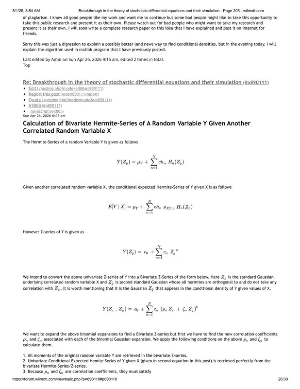](https://postimg.cc/bsMM5pn6)

[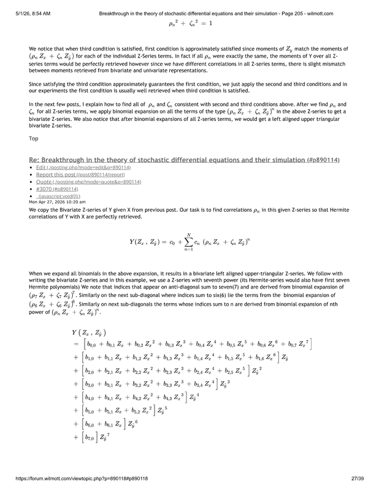](https://postimg.cc/tYffcp6v)

.

.

[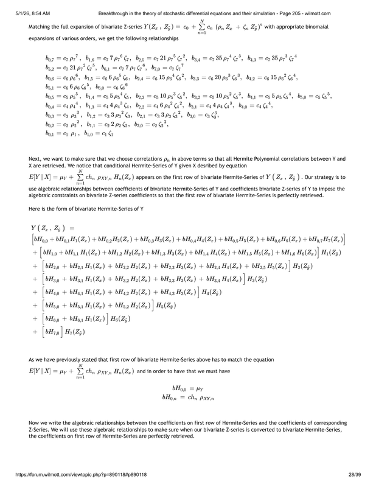](https://postimg.cc/6ySSPtZM)

.

[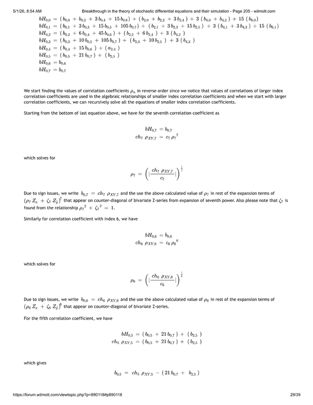](https://postimg.cc/KRVVWxTD)

.

[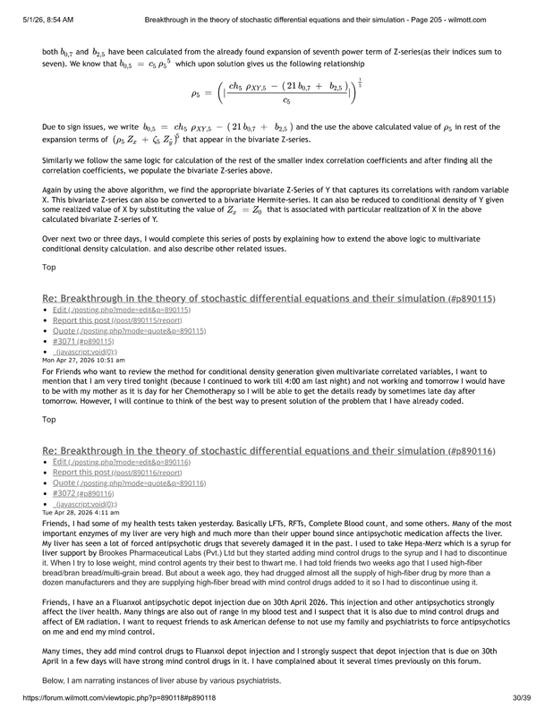](https://postimg.cc/NKHVqS8Z)

.

.

[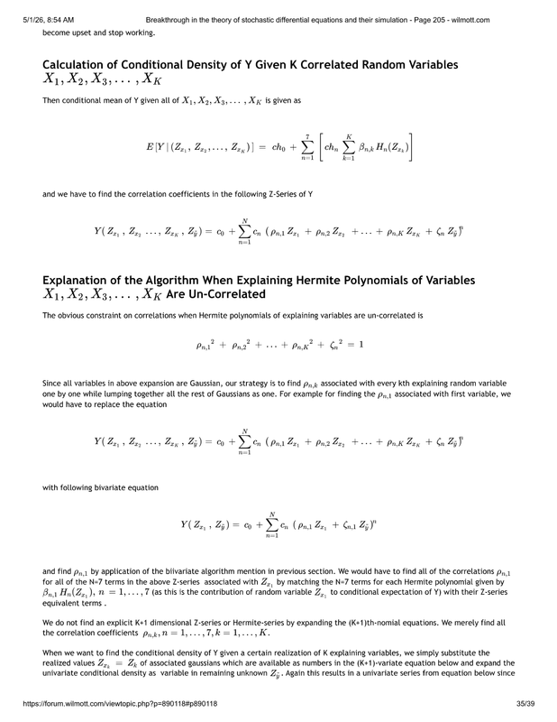](https://postimg.cc/xXXJPDDt)

[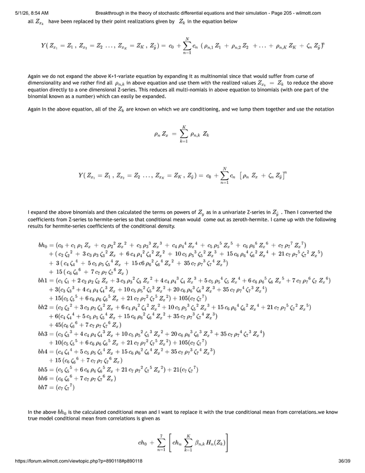](https://postimg.cc/YvT4nnMY)

[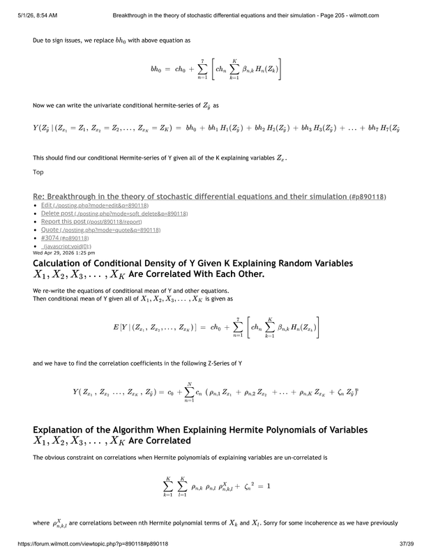](https://postimg.cc/hXNJyyc9)

[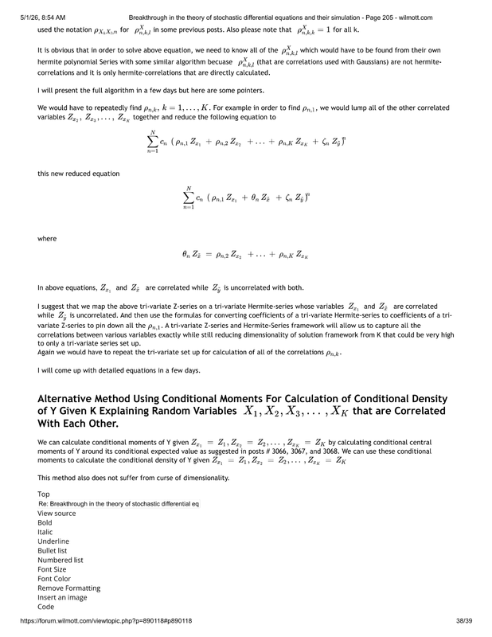](https://postimg.cc/68F7jjtZ)

---

### #3070 — Amin (Topic Author)
*May 6, 2026, 12:09 PM*

Friends, I have also been able to calculate accurate second conditional moment of the random variable Y given
realization of another random variable X. I have to go out to get food and will post the details at night.

Here is the brief description. You have to first calculate the Z-series of$Y^2$ from Z-series of Y by application of
series product (you do not take any expectation over Z's). Then you convert Z-series of$Y^2$ to Hermite-Series of$Y^2$ .
Then you apply Hermite correlations of Y with X on the Z-series of$Y^2$ to get the conditional Hermite-Series of
$\left[Y^2|X\right]$ and then you apply the particular value of$Z_x\,=\,Z_{x_0}$ to find the conditional expected value
of$\left[Y^2|X=x_0\right]$

suppose Z_series of Y is given as

$$ \,Y(Z_y)\,=\,\sum\limits_{n=0}^{n=N_1}\, b_n\, {(Z_y)}^n $$

then Z-series of $Y^2$ is calculated as solution of the series product

$
$ \,Y^2(Z_y)\,=\,\left[\sum\limits_{n=0}^{n=N_1}\, b_n\, {(Z_y)}^n \,\right]\,\left[\sum\limits_{n=0}^{n=N_1}\, b_n\, {(Z_y)}^n\,\right] $
$

We convert above Z-seris of $Y^2$ to hermite-Series of $Y^2$ and it is written as

$$ \,Y^2(Z_y)\,=\,\sum\limits_{n=0}^{n=N}\, ah_n\, H_n(Z_y) $$

Now hermite-Series of  $\left[Y^2|X\right]$ is given as

$$ \,Y^2|Z_x\,=\,\sum\limits_{n=0}^{n=N}\, ah_n\, \rho_{n,xy}\, H_n(Z_x) $$

and conditional value of Y^2 given $Z_x=Z_{x_0}$ is given as

$$ \,E\left[Y^2|Z_x=Z_{x_0}\right]\,=\,\sum\limits_{n=0}^{n=N}\, ah_n\, \rho_{n,xy}\, H_n(Z_{x_0}) $$

I have yet not calculated the conditional higher moments this way and cannot say but conditional second moment
calculated this way perfectly matches with values in several experiments with SDEs with widely different parameters as I
have checked that.

**EDIT: After further experiments, I found out that it variance calculated this way is 1%-2% off while higher moments
are more off to the extent of highest moments becoming useless.**

---

### #3071 — Amin (Topic Author)
*May 7, 2026, 12:03 PM*

I simulated four SDEs and saved their paths at time T1 (these were Xk with K=4) and then I continued the simulation to a
later time T2 and from the paths at time T2, I found the value of sum of four SDE joint simulation paths and this was
variable to be conditionally predicted and I called it Y. The problem to solve is to fiund the conditional density of
sum$Y(T_2)\,=\,X_1(T_2)\,+\,X_2(T_2)\,+X_3(T_2)\,+X_4(T_2)$ given the arbitrarily chosen values of
$X1(T_1), X2(T_1), X3(T_1) \,\text{and}\,\, X4(T_1)$ . I then did an independent monte carlo simulation of three
densities from chosen values of$X1(T_1), X2(T_1), X3(T_1) \,\text{and}\,\, X4(T_1)$ . and continued it for time$T2-T1$
(This gave me the true monte carlo conditional distribution of$Y(T_2)\,=\,X_1(T_2)\,+\,X_2(T_2)\,+X_3(T_2)\,+X_4(T_2)$
). I overlaid the densities of analytic solution of density given as
$P(Y(T_2)|\,X_1(T_1)=x_1\,,\,X_2(T_1)=x_2\,,X_3(T_1)=x_3\,,X_4(T_1)=x_4) $ and the monte carlo derived density of Y.
Even though I used four explaining variables, the logic is for arbitrary N variables. Just change NDim=4 to appropriate
N and supply SDE parameters.

Basically $Y(T_2)\,=\,X_1(T_2)\,+\,X_2(T_2)\,+X_3(T_2)+X_4(T_2)$  and we are conditioning as

$$P(Y(T_2)|\,X_1(T_1)=x_1\,,\,X_2(T_1)=x_2\,,X_3(T_1)=x_3\,,X_4(T_1)=x_4) $$

**The algorithm is very fast with almost zero training time ( less than a second for this data) as compared to machine
learning that may take days or even weeks to properly train the network and the output of algorithm is better than what
is mostly found out of  neural networks after several hundred hours of training. In our algorithm most time is used in
monte carlo simulations of data that is required for generation of variables and for finding the reference simulation
density(taken as true density for comparison) and not in training of the parameters.**

**Our algorithm has just knowledge of joint (random) data of$Y(T_2)$ and
$X1(T_1), X2(T_1), X3(T_1) \,\text{and}\,\, X4(T_1)$ . And conditional value of density
$P(Y(T_2)|\,X_1(T_1)=x_1\,,\,X_2(T_1)=x_2\,,X_3(T_1)=x_3\,,X_4(T_1)=x_4) $ is calculated by our algorithm.**

**I also want to notice that our predicted variable Y is sum of N variables in the above example so its variance and
higher moments continue to increase with increasing predictors, however, when we are trying to explain just one fixed
variable Y with N explaining variables correlated with Y, the predicted conditional density would continue to become
sharper with decreasing variance.**

Here are the parameters of four SDEs. I took three sets of parameters of four SDEs and repeated each of them with four
sets of arbitrarily chosen values of$X1=x_1,\, X2\,=x_2,\, X3=x_3,\,\text{and}\,,X4=x_4$ . I am going to copy the three
sets of SDE parameters and four sets of starting values on which the density is conditioned. There are both pure noises
and mean reverting SDEs in the SDE parameters data sets.

V0(1)=1.000;%.32;

V00(1)=V0(1);

Four SDE Parameters Data Sets

SDE DATA SET 1

%SDE1

 thetaV(1)=1.0;

 kappaV(1)=0.000;

 gamma(1)=.75;

 sigma0(1)=.5;

%SDE2

thetaV(2)=1.0;

kappaV(2)=0.000;

gamma(2)=.65;

sigma0(2)=.45;

%SDE3

thetaV(3)=1.0;

kappaV(3)=0.000;

gamma(3)=.85;

sigma0(3)=.45;

%SDE 4

thetaV(4)=1.0;

kappaV(4)=1.000;

gamma(4)=.95;

sigma0(4)=.55;

SDE DATA SET 2

%SDE1

thetaV(1)=.90;

kappaV(1)=1.000;

gamma(1)=.75;

sigma0(1)=.85;

%SDE2

 thetaV(2)=1.0;

 kappaV(2)=2.000;

 gamma(2)=.65;

 sigma0(2)=.95;

%SDE3

thetaV(3)=.750;

 kappaV(3)=0.5000;

 gamma(3)=.95;

 sigma0(3)=.45;

%SDE 4

thetaV(4)=1.0;

kappaV(4)=1.000;

gamma(4)=.95;

sigma0(4)=.55;

SDE DATA SET 3

%SDE1

thetaV(1)=1.350;

kappaV(1)=2.000;

gamma(1)=.75;

sigma0(1)=.95;

%SDE2

thetaV(2)=.850;

kappaV(2)=.35000;

gamma(2)=.65;

sigma0(2)=.55;

%SDE3

thetaV(3)=1.150;

kappaV(3)=1.5000;

gamma(3)=.95;

sigma0(3)=.75;

%SDE4

thetaV(4)=1.0;%.045;%1;%.04;

kappaV(4)=1.000;%1.5;%1.5;

gamma(4)=.95;%.75

sigma0(4)=.55;%.45

The parametric form of the SDEs is given as

$$dX(t)\,=\,\kappa(\theta\,-\,X(t)\,)\, dt\,+\,\sigma_0\,{X(t)}^{\gamma}\,dZ(t)\,$$

The starting values of four data sets$X_1(T_1)=x_1\,,\,X_2(T_1)=x_2\,,X_3(T_1)=x_3\,,X_4(T_1)=x_4) $ is given as (these
are randomly chosen)

First Data Set

$x_0$=.65;

$x_1$=1.2;

$x_3$=.85;

$x_4$=1.85;

Data Set2

$x_1$=.55;

$x_2$=1.1;

$x_3$=.7;

$x_4$=.65

Data Set3

$x_1$=1.25;

$x_2$=1.35;

$x_3$=1.25;

$x_4$=1.4

Data Set 4

$x_1$=.65;

$x_2$=.71;%1.2;

$x_3$=.67;

$x_4$=.6

So there are twelve graphs with three SDE data sets and four starting conditional values data sets. I am posting the
graphs below and will soon post the new improved program used to make these graphs.

.

.

.

[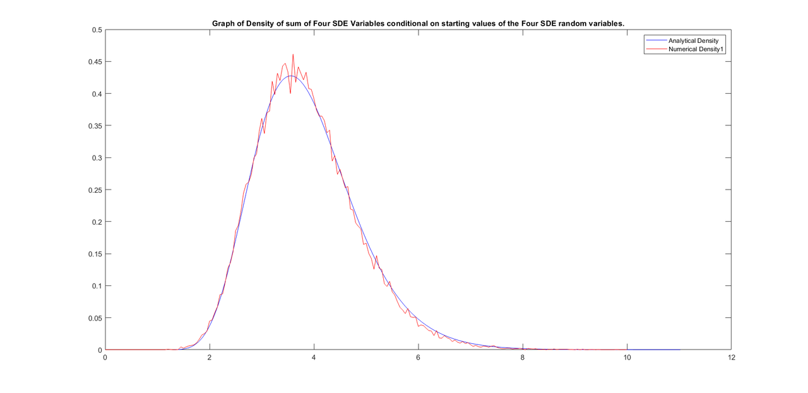](https://postimg.cc/Nyy0JnQF)

[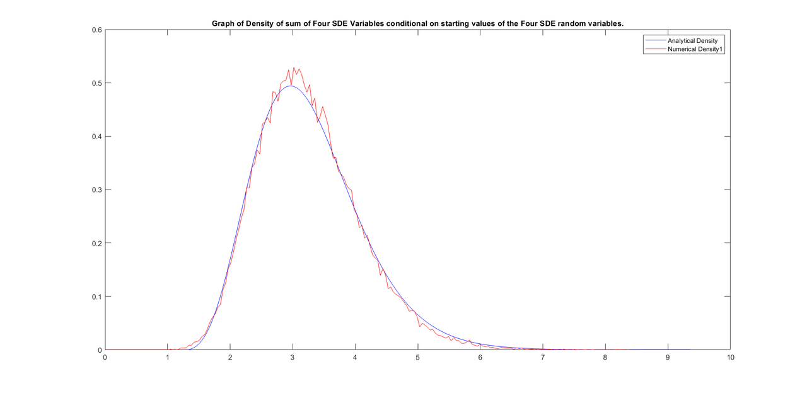](https://postimg.cc/gww0S7GJ)

[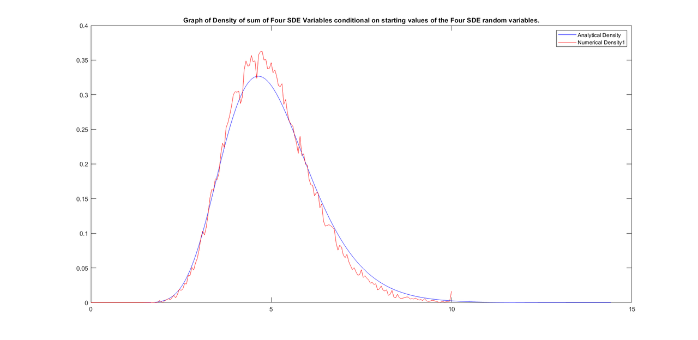](https://postimg.cc/jWWjg1Rj)

[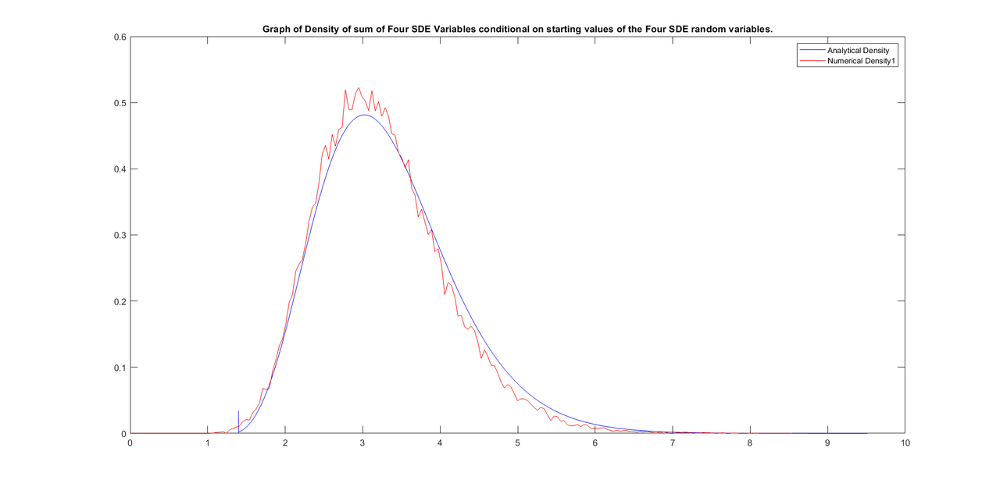](https://postimg.cc/3yywSq3J)

[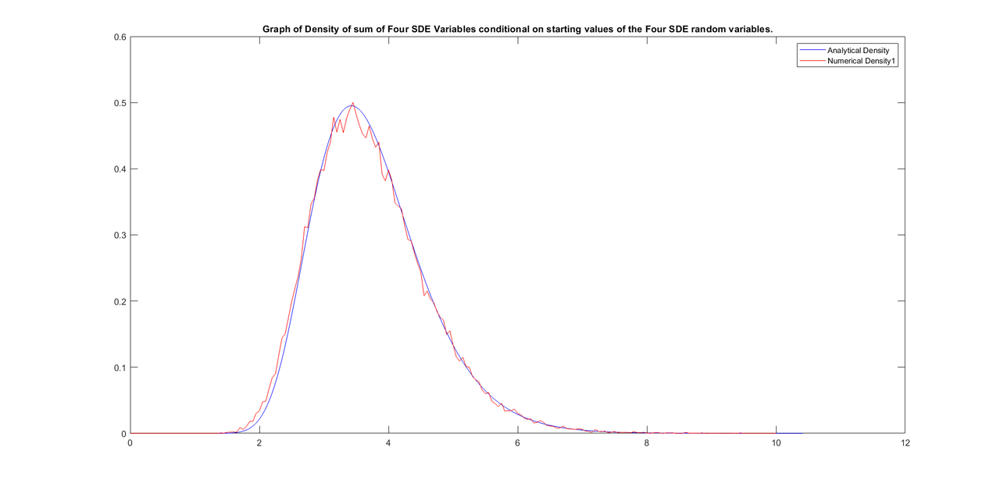](https://postimg.cc/FffKW6hm)

[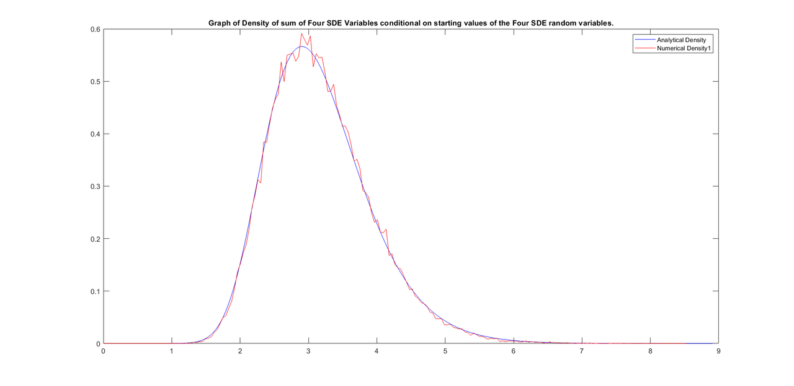](https://postimg.cc/XZZvHPnb)

[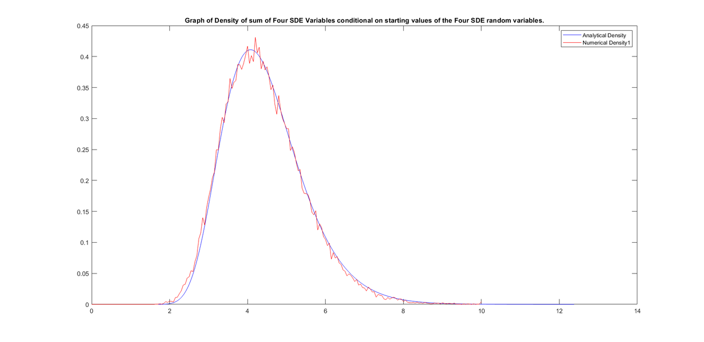](https://postimg.cc/066NW49v)

[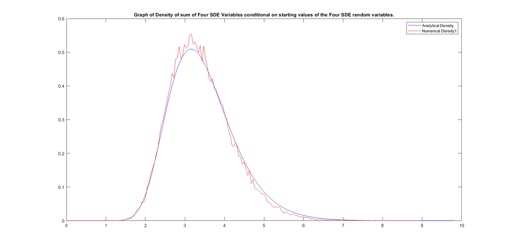](https://postimg.cc/Z99q7QJh)

[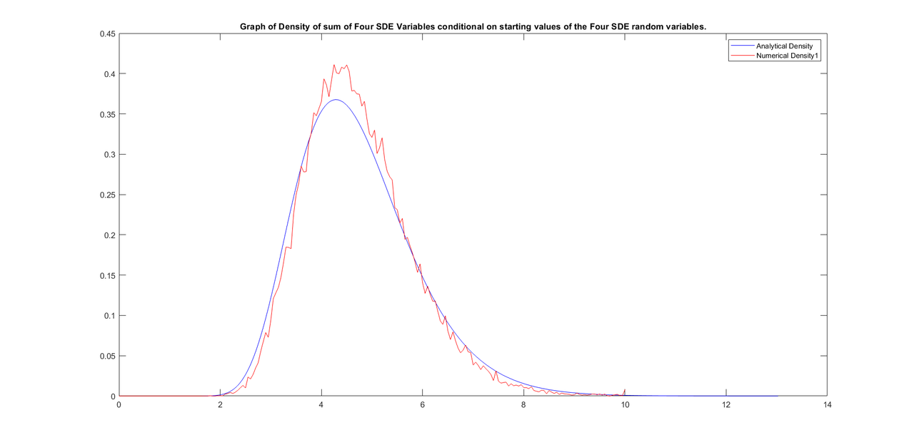](https://postimg.cc/zy2BkNYG)

[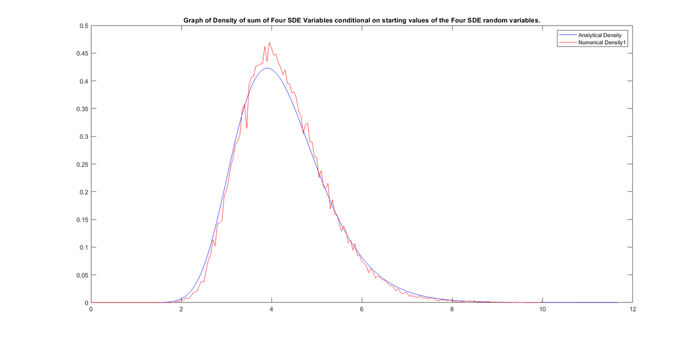](https://postimg.cc/dhN19FcQ)

[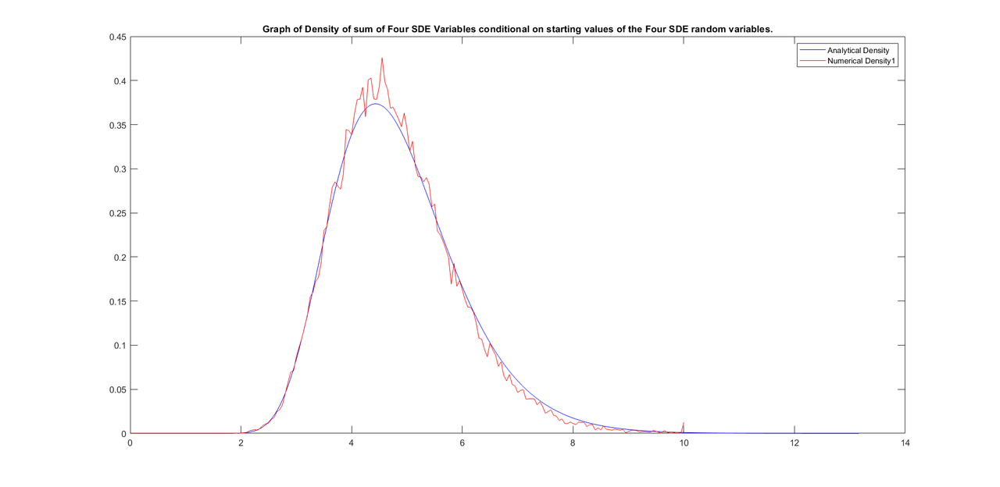](https://postimg.cc/mPpDS4Wr)

[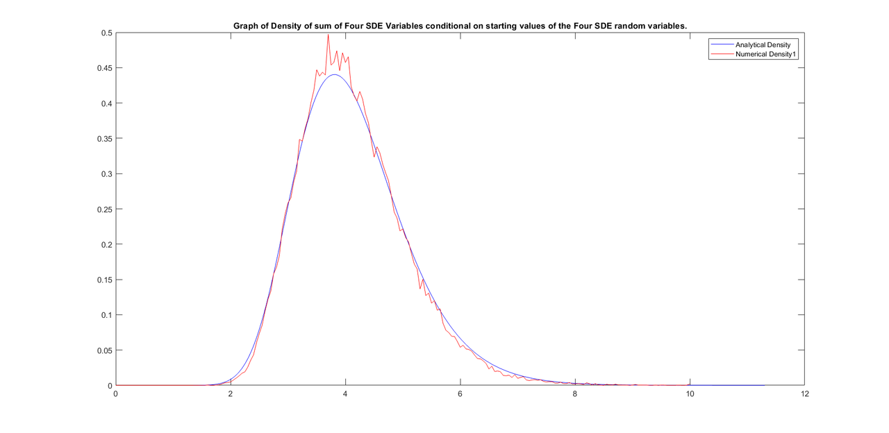](https://postimg.cc/ZWsRLmzK)

---

### #3072 — Amin (Topic Author)
*May 7, 2026, 1:42 PM*

**(broken latex: Unbalanced $: 1)**

```latex
Here is the program used to create the above graphs. Please look at previous posts for the remaining matlab function
files or search the forum as they have been posted before.

.

.

```
function []= ConditionalDensityHermitesNvariate0A08()

%SV SDE is
%dV(t)=mu1 V(t)^beta1 dt+ mu2 V(t)^beta2 dt + sigma0 V(t)^gamma dZ(t)
%In mean reverting SDEs we ususally have
%mu1= kappaV * thetaV
%beta1=0
%mu2=-kappa
%beta2=0
%The present program works only when drift is zero (for pure noises)
%meaning mu1=0 and mu2=0;

Order=7;
%NDim=4;%Three assets and one SV.
%NMomentsY=Order+1;
%NMomentsX=Order+1;

%%%%%%%%%%%%%%%%%%%5
dt=.03125/2/8;
Tt=64*2*8;
T=Tt*dt;
seed0=12130649;
%seed0=94210876;
%seed0=14210876;
%seed0=53612297
%seed0=97459782
rng(seed0, 'twister')
paths=50000;
TT1=100*8/2; %Transition distribution start
TT2=256*8/2; %Transition distribution end

%%%%%%%%%%%%%%%%%%%5

NDims=4;

V0(1)=1.000;%.32;
V00(1)=V0(1);

%SDE1
 thetaV(1)=1.0;%.045;%1;%.04;
 kappaV(1)=0.000;%1.5;%1.5;
 gamma(1)=.75;%.75
 sigma0(1)=.5;%.35

%SDE2%
%thetaV(1)=.90;%.045;%1;%.04;
%kappaV(1)=1.000;%1.5;%1.5;
%gamma(1)=.75;%.75
%sigma0(1)=.85;%.35

%SDE3
thetaV(1)=1.350;%.045;%1;%.04;
kappaV(1)=2.000;%1.5;%1.5;
gamma(1)=.75;%.75
sigma0(1)=.95;%.35

mu1(1)=kappaV(1)*thetaV(1);
mu2(1)=-kappaV(1);
beta1(1)=0;
beta2(1)=1;

V0(2)=1.000;%.32;
V00(2)=V0(2);

%SDE1
%thetaV(2)=1.0;%.045;%1;%.04;
% kappaV(2)=0.000;%1.5;%1.5;
% gamma(2)=.65;%.75
% sigma0(2)=.45;%.35

%SDE2
 thetaV(2)=1.0;%.045;%1;%.04;
 kappaV(2)=2.000;%1.5;%1.5;
 gamma(2)=.65;%.75
 sigma0(2)=.95;%.35

%SDE3
thetaV(2)=.850;%.045;%1;%.04;
kappaV(2)=.35000;%1.5;%1.5;
gamma(2)=.65;%.75
sigma0(2)=.55;%.35

mu1(2)=kappaV(2)*thetaV(2);
mu2(2)=-kappaV(2);
beta1(2)=0;
beta2(2)=1;

V0(3)=1.000;%.33;
V00(3)=V0(3);

%SDE1
%thetaV(3)=1.0;%.045;%1;%.04;
% kappaV(3)=0.000;%1.5;%1.5;
% gamma(3)=.85;%.75
% sigma0(3)=.45;%.35

%SDE2
 thetaV(3)=.750;%.045;%1;%.04;
 kappaV(3)=0.5000;%1.5;%1.5;
 gamma(3)=.95;%.75
 sigma0(3)=.45;%.35

%SDE3
thetaV(3)=1.150;%.045;%1;%.04;
kappaV(3)=1.5000;%1.5;%1.5;
gamma(3)=.95;%.75
sigma0(3)=.75;%.35

mu1(3)=kappaV(3)*thetaV(3);
mu2(3)=-kappaV(3);
beta1(3)=0;
beta2(3)=1;

Corr1(1,1)=1;
Corr1(1,2)=.4;
Corr1(1,3)=.5;
Corr1(2,2)=1;
Corr1(2,1)=.4;
Corr1(2,3)=.3;
Corr1(3,1)=.5;
Corr1(3,2)=.3;
Corr1(3,3)=1;

87%Corr1(1:3,1:3)=0.0;

R=chol(Corr1);

 R(1:3,1:3)=0;
 R(1,1)=1;
 R(2,2)=1;
 R(3,3)=1;

V0(4)=1.000;%.44;
V00(4)=V0(4);
thetaV(4)=1.0;%.045;%1;%.04;
kappaV(4)=1.000;%1.5;%1.5;
mu1(4)=kappaV(4)*thetaV(4);
mu2(4)=-kappaV(4);
beta1(4)=0;
beta2(4)=1;
gamma(4)=.95;%.75
sigma0(4)=.55;%.45

%%%%%%%%%%%%%%%%%%%%%%%%%%%%%%%%%%%%%%%%%%%%%%%%%%%%%%%%%%%%%%%%%%%%%5
for nn=1:NDims
V(1:paths,nn)=V0(nn);
end
%V(1:paths,1:NDims)=V0(1,1:NDims);

Random1(1:paths/2,1:NDims)=0;

for tt=1:Tt

    Random2(1:paths/2,1:NDims)=randn(size(Random1));
    Random2(paths/2+1:paths,1:NDims)=-Random2(1:paths/2,1:NDims);

    %Random2=R'*Random2;
 %   random1=Random2*R(:,1);
 %   random2=Random2*R(:,2);
 %   random3=Random2*R(:,3);

 %   Random2(:,1)=random1;
 %   Random2(:,2)=random2;
 %   Random2(:,3)=random3;

    for nn=1:NDims

    V(1:paths,nn)=V(1:paths,nn)+ ...
        (mu1(nn).*V(1:paths,nn).^beta1(nn) + mu2(nn).*V(1:paths,nn).^beta2(nn))*dt + ...
        sigma0(nn).*V(1:paths,nn).^gamma(nn) .*Random2(1:paths,nn)*sqrt(dt) + ...
        (mu1(nn).*beta1(nn)*V(1:paths,nn).^(beta1(nn)-1) + mu2(nn).*beta2(nn).*V(1:paths,nn).^(beta2(nn)-1)).* ...
        ((mu1(nn).*V(1:paths,nn).^beta1(nn) + mu2(nn).*V(1:paths,nn).^beta2(nn))*dt^2/2 + ...
        sigma0(nn).*V(1:paths,nn).^gamma(nn) .*Random2(1:paths,nn)*(1-1/sqrt(3))*dt^1.5) + ...
        .5*(mu1(nn).*beta1(nn).*(beta1(nn)-1).*V(1:paths,nn).^(beta1(nn)-2) +
mu2(nn).*beta2(nn).*(beta2(nn)-1).*V(1:paths,nn).^(beta2(nn)-2)).* ...
        sigma0(nn)^2.*V(1:paths,nn).^(2*gamma(nn)).*dt^2/2 + ...
        sigma0(nn).*gamma(nn).*V(1:paths,nn).^(gamma(nn)-1) .* ...
        ((mu1(nn).*V(1:paths,nn).^beta1(nn) + mu2(nn).*V(1:paths,nn).^beta2(nn)).*Random2(1:paths,nn).*1/sqrt(3)*dt^1.5
+ ...
        sigma0(nn).*V(1:paths,nn).^gamma(nn) .*(Random2(1:paths,nn).^2-1)*dt/2) + ...
        .5*sigma0(nn).*gamma(nn).*(gamma(nn)-1).*V(1:paths,nn).^(gamma(nn)-2) .* ...
        sigma0(nn).^2.*V(1:paths,nn).^(2*gamma(nn)) .*Random2(1:paths,nn).*1/sqrt(3)*dt^1.5;

    V(V(:,nn)<=0)=.0001;

    if(tt==TT1)
        Xin(1:paths,nn)=real(V(1:paths,nn));
    end

    if(tt==TT2)

        Xin2(1:paths,nn)=real(V(1:paths,nn));
    end

    end

end

Yin(1:paths)=0.0;

for pp=1:paths
for mm=1:NDims
    Yin(pp)=Yin(pp)+Xin2(pp,mm);%-Xin(pp,mm);
%-Xin(pp,mm);
end
end

randn()

str=input("I have reached stone 1");

%%%%%%%%%%%%%%%%%%%%%%%%%%%%%%%%%%%%%%%%%%%%%%%%%%5

Order=7;
clf;
[BetaCorrH,YCoeffH,XCoeffH,HCorrXX] = CalculateHermiteCorrelations0NA04(Xin,Yin,paths,NDims);
YCoeffZ(1:Order+1)= ConvertHermiteSeriesToZSeries01(YCoeffH(1:Order+1),Order);

%HCorrXX(:,:)=0.0;

BetaCorrH

randn
%CorrXX1st
str=input("I have reached Stone2");

%[cn,dn,bnv,bbnv,ch] = Calculate2DZSeriesNDimCorrected(YCoeffH,BetaCorrH,HCorrXX,NDims,Order);
%cn=bnv;
[cn,ch]=CalculateGaussianCorrelationFromHermiteCorrelationsNDim(YCoeffH,XCoeffH,BetaCorrH,HCorrXX,NDims,Order);

%%%%%%%%%%%%%%%%%%%%%%%%%%%%%%%%%%%%%%%%%%%%%%%%%%%%%%%%%%%%%%%%%%%%%%%%%%%%%%%%%%%%%%%
%Set1
V10(1)=.65;%.65;%
V10(2)=1.2;
V10(3)=.85;
V10(4)=1.85;

% %Set2
V10(1)=.55;
V10(2)=1.1;%1.2;
V10(3)=.7;
V10(4)=.65
%
% %Set3
 V10(1)=1.25;
 V10(2)=1.35;%1.2;
 V10(3)=1.25;
 V10(4)=1.4

 V10(1)=.65;
 V10(2)=.71;%1.2;
 V10(3)=.67;
 V10(4)=.6

%V10(1)=.65;
%V10(2)=.51;%1.2;
%V10(3)=.73;

%V10(1)=1.65;
%V10(2)=1.51;%1.2;
%V10(3111111111111111111111111111111111111111111111111111111111111111111111111111111111111111111111111111111111111111111111111111111)=1.63;

for nn=1:NDims
V(1:paths,nn)=V10(nn);
end
%V(1:paths,1:NDims)=V0(1,1:NDims);

Random1(1:paths/2,1:NDims)=0;

for tt=1:TT2-TT1

    Random2(1:paths/2,1:NDims)=randn(size(Random1));
    Random2(paths/2+1:paths,1:NDims)=-Random2(1:paths/2,1:NDims);

    %random1=Random2*R(:,1);
    %random2=Random2*R(:,2);
    %random3=Random2*R(:,3);

    %Random2(:,1)=random1;
    %Random2(:,2)=random2;
    %Random2(:,3)=random3;

    for nn=1:NDims

    V(1:paths,nn)=V(1:paths,nn)+ ...
        (mu1(nn).*V(1:paths,nn).^beta1(nn) + mu2(nn).*V(1:paths,nn).^beta2(nn))*dt + ...
        sigma0(nn).*V(1:paths,nn).^gamma(nn) .*Random2(1:paths,nn)*sqrt(dt) + ...
        (mu1(nn).*beta1(nn)*V(1:paths,nn).^(beta1(nn)-1) + mu2(nn).*beta2(nn).*V(1:paths,nn).^(beta2(nn)-1)).* ...
        ((mu1(nn).*V(1:paths,nn).^beta1(nn) + mu2(nn).*V(1:paths,nn).^beta2(nn))*dt^2/2 + ...
        sigma0(nn).*V(1:paths,nn).^gamma(nn) .*Random2(1:paths,nn)*(1-1/sqrt(3))*dt^1.5) + ...
        .5*(mu1(nn).*beta1(nn).*(beta1(nn)-1).*V(1:paths,nn).^(beta1(nn)-2) +
mu2(nn).*beta2(nn).*(beta2(nn)-1).*V(1:paths,nn).^(beta2(nn)-2)).* ...
        sigma0(nn)^2.*V(1:paths,nn).^(2*gamma(nn)).*dt^2/2 + ...
        sigma0(nn).*gamma(nn).*V(1:paths,nn).^(gamma(nn)-1) .* ...
        ((mu1(nn).*V(1:paths,nn).^beta1(nn) + mu2(nn).*V(1:paths,nn).^beta2(nn)).*Random2(1:paths,nn).*1/sqrt(3)*dt^1.5
+ ...
        sigma0(nn).*V(1:paths,nn).^gamma(nn) .*(Random2(1:paths,nn).^2-1)*dt/2) + ...
        .5*sigma0(nn).*gamma(nn).*(gamma(nn)-1).*V(1:paths,nn).^(gamma(nn)-2) .* ...
        sigma0(nn).^2.*V(1:paths,nn).^(2*gamma(nn)) .*Random2(1:paths,nn).*1/sqrt(3)*dt^1.5;

    V(V(:,nn)<0)=.0001;

    %if(tt==TT1)
    %    XXin(1:paths,nn)=V(1:paths,nn);
    %end

    if(tt==TT2-TT1)

        XXin2(1:paths,nn)=V(1:paths,nn);
    end

    end

end

Yin2(1:paths)=0.0;

for pp=1:paths
for mm=1:NDims
    Yin2(pp)=Yin2(pp)+XXin2(pp,mm);%-V10(mm);
end
end

randn()

str=input("I have reached stone 4");

NoOfBins=200;
MaxCutOff=10;

[XDensity,IndexOut,IndexMax] = MakeDensityFromSimulation_Infiniti_NEW(Yin2,paths,NoOfBins,MaxCutOff );

for qq=1:8

    DataMoments(qq)=sum(Yin2(:).^qq)/paths;

end

%%%%%%%%%%%%%%%%%%%%%%%%%%%%%%%%%%%%%%%%%%%%%%%%%%%%%%%%%%%%%%%%%%%%%%%%%%%%%%%%%%%%%%%5

for nn=1:NDims
    [Zx0(nn)] = CalculateZgivenXAndHSeriesCoeffs(V10(nn),XCoeffH(1:Order+1,nn),Order);
end

%%%%%%%%%%%%%%%%%%%%%%%%%%%%%%%%%%%%%%%%%%%%%%%%%%%%%%%%%%%%%%%%%%%55

Zx(1:Order)=0;

for hh=1:Order
    for nn=1:NDims
        %Zx(hh) = Zx(hh) + bnv(nn+1,hh+1).^1.*Zx0(nn);
        Zx(hh) = Zx(hh) + cn(nn+1,hh+1).^1.*Zx0(nn);
    end
end

bh0=YCoeffH(1);

[W] = EvalHermiteArrayH0(Zx0,Order);

for hh=1:Order
    for nn=1:NDims
        bh0 = bh0 + ch(nn+1,hh+1).^1.*W(nn,hh+1);
    end
end

%%%%%%%%%%%%%%%%%%%%%%%%%%%%%%%%%%%%%%%%%%%%%%%%%%%%%%%%%%%%%%%%

a0=YCoeffZ(1);
a1=YCoeffZ(2);
a2=YCoeffZ(3);
a3=YCoeffZ(4);
a4=YCoeffZ(5);
a5=YCoeffZ(6);
a6=YCoeffZ(7);
a7=YCoeffZ(8);

d1=cn(1,2);
d2=cn(1,3);
d3=cn(1,4);
d4=cn(1,5);
d5=cn(1,6);
d6=cn(1,7);
d7=cn(1,8);

%b0=(a0+a1.* Zx(1) +a2.* Zx(2).^2+a3.* Zx(3).^3+a4* Zx(4).^4+a5 *Zx(5).^5+a6* Zx(6).^6+a7* Zx(7).^7);
b1=(a1* d1+2* a2* Zx(2)* d2 +3* a3* Zx(3).^2* d3+4* a4* Zx(4).^3* d4+5* a5* Zx(5).^4* d5+6* a6* Zx(6).^5* d6+7* a7*
Zx(7).^6* d7);
b2=(a2* d2.^2+3* a3* Zx(3)* d3^2 +6* a4* Zx(4).^2* d4^2+10* a5* Zx(5).^3* d5^2+15* a6* Zx(6).^4* d6^2+21* a7* Zx(7).^5*
d7^2);
b3=(a3* d3^3+4* a4 *Zx(4)* d4^3 +10* a5* Zx(5).^2* d5^3+20* a6* Zx(6).^3* d6^3+35* a7* Zx(7).^4* d7^3);
b4=(a4* d4^4+5* a5* Zx(5)* d5^4 +15* a6 *Zx(6).^2* d6^4+35* a7* Zx(7).^3 *d7^4);
b5=(a5* d5^5+6* a6* Zx(6)* d6^5 +21* a7 *Zx(7).^2* d7^5);
b6=(a6* d6^6+7* a7* Zx(7)* d7^6 );
b7=(a7* d7^7);

%bh0=b0+b2+3*b4+15*b6;
bh1=b1+3*b3+15*b5+105*b7;
bh2=b2+6*b4+45*b6;
bh3=b3+10*b5+105*b7;
bh4=b4+15*b6;
bh5=b5+21*b7;
bh6=b6;
bh7=b7;

bh(1)=bh0;
bh(2)=bh1;
bh(3)=bh2;
bh(4)=bh3;
bh(5)=bh4;
bh(6)=bh5;
bh(7)=bh6;
bh(8)=bh7;

%%%%%%%%%%%%%%%%%%%%%%%%%%%%%%%%%%%%%%%%%%%%%%%%%%%%%%%%%%%%%%%%%%%%%%%%%%%%%%5

YCoeffz(1:Order+1)= ConvertHermiteSeriesToZSeries01(bh(1:Order+1),Order);

[YMomentsModel]=CalculateMomentsOfZSeries(YCoeffz(1),YCoeffz(2:Order+1),Order,Order+1);

YMomentsModel

DataMoments

str=input("Look at comparison of moments");

[cMu1,YCentralMoments]=ConvertRawMomentsToCentralMoments(YMomentsModel,Order+1);

YCentralMoments

str=input("Look at central moments");

% Order0=7;
% Order1=13;
% NData=paths;
% [CondMomentYgivX,BetaCorrHxy] = CalculateConditionalMomentYgivXNDims(Xin,Yin,NData,Zx0,NDims,Order0,Order1)
%
% [VarConditional]=FindSecondConditionalMoment(YCoeffH,BetaCorrH,Zx0)
%
%
% BetaCorrHxy
% BetaCorrH
%
% str=input("Look at conditionalVariance");

clf;

PlotZSeriesDensity(YCoeffz(1),YCoeffz(2:Order+1),'b')

hold on

plot(IndexOut(1:IndexMax),XDensity(1:IndexMax),'r');

%PlotHermiteSeriesDensityAndRvGraph(YCoeffh(1),YCoeffh1(2:yOrder+1),'g')
title("Graph of Density of sum of Four SDE Variables conditional on starting values of the Four SDE random variables.")
%title(sprintf('V00 = %.3f; kappa=%.3f, theta=%.3f,gamma=%.3f,sigma=%.3f;V10=%.3f at TT1=%.3f;TT2=%.3f;Paths=%d ',V00,
kappaV, thetaV,gamma,sigma0, V10,(TT1*dt),(TT2*dt),paths));%,sprintf('theta= %f', theta), sprintf('kappa = %f',
kappa),sprintf('sigma = %f', sigma0),sprintf('T = %f', T));
legend({'Analytical Density','Numerical Density1'}, ...
    'Location','northeast')

str=input("This is the first version without altering the moments of conditional density")

hold off

end
```

.

.

.

```
function [BetaCorrH,YCoeffH,XCoeffH,HCorrXX] = CalculateHermiteCorrelations0NA04(Xin,Yin,NData,NDims)

%This program finds required correlations between NDims explanatory
%variables given in Xin that has NDims dimensionality. Yin is variable
%being explained and is one-diemsnional.

Order=7;
NMoments=8;

[ZI] = MomentMatchedStandardNormalDiscretizedDensity(NData);

for nn=1:NDims
[XCoeffH(1:Order+1,nn),Zx(1:NData,nn)] = CalculateHermiteSeriesFromData02(Xin(1:NData,nn),Order,ZI);

[Zx(1:NData,nn)] = CalculateZgivenXAndHSeriesCoeffs(Xin(1:NData,nn),XCoeffH(1:Order+1,nn),Order);

end

[YCoeffH,Zy] = CalculateHermiteSeriesFromData02(Yin,Order,ZI);
[Zy] = CalculateZgivenXAndHSeriesCoeffs(Yin,YCoeffH,Order);

for nn1=1:NDims
    for nn2=1:NDims
        if(nn1==nn2)
            HCorrXX(nn1,nn2,1:Order)=1.0;
        else
            HCorrXX(nn1,nn2,1:Order) =
CalculateCorrelationBivariateHermiteCH1(Zx(1:NData,nn1),Zx(1:NData,nn2),NData,Order);
        end
    end
end

for nn1=1:NDims
    HCorrXY(nn1,1:Order) = CalculateCorrelationBivariateHermiteCH1(Zx(1:NData,nn1),Zy(1:NData),NData,Order);
end

for hh=1:Order
    [BCorrXY(:,hh),Is(:,hh)]=sort(HCorrXY(:,hh),'descend');
end

for hh=1:Order
    CorrXX(1:NDims,1:NDims)=HCorrXX(Is(1:NDims,hh),Is(1:NDims,hh),hh);
    CorrXY(1:NDims,1)=HCorrXY(Is(1:NDims,hh),hh);
    BetaCorr0(1:NDims)=CorrXX\CorrXY;
    BetaCorrH(Is(1:NDims,hh),hh)=BetaCorr0(1:NDims);
end

% for hh=1:Order
%     CorrXX(1:NDims,1:NDims)=HCorrXX(1:NDims,1:NDims,hh);
%     CorrXY(1:NDims,1)=HCorrXY(1:NDims,hh);
%     BetaCorrH(1:NDims,hh)=CorrXX\CorrXY;
% end

%CorrXX1st(1:NDims,1:NDims)=HCorrXX(1:NDims,1:NDims,1)

BetaCorrH(:,1)'*CorrXX

CorrXY

HCorrXX

HCorrXY

BetaCorrH

str=input("Look at BetaCorrH");
end

```

.

.

.

```
function [CorrH] = CalculateCorrelationBivariateHermiteCH1(Z1,Z2,paths,HH)

CorrH(1:HH)=0;
CovH(1:HH)=0;
Var1H(1:HH)=0;
Var2H(1:HH)=0;

[X1h] = EvalHermiteArrayH0(Z1,HH);
[X2h] = EvalHermiteArrayH0(Z2,HH);

for hh=1:HH
    CovH(hh)=CovH(hh)+sum(X1h(:,hh+1).*X2h(:,hh+1))/paths;
    %Var1H(hh)=Var1H(hh)+sum(X1h(:,hh+1).*X1h(:,hh+1))/paths;
    %Var2H(hh)=Var2H(hh)+sum(X2h(:,hh+1).*X2h(:,hh+1))/paths;
    CorrH(hh)=CovH(hh)./factorial(hh);%sqrt(Var1H(hh))./sqrt(Var2H(hh));
end

% Var1H
% Var2H
%
% str=input("Look at variances of data hermites");

end

```

.

.

.

```
function [cn,ch] =
CalculateGaussianCorrelationFromHermiteCorrelationsNDim(YCoeffH,XCoeffH,BetaCorrHxy,CorrHxx,NDims,Order)

for hh=1:Order
    for nn=1:NDims
        ch(nn+1,hh+1)=BetaCorrHxy(nn,hh).*YCoeffH(hh+1);%make sure indices on all hermite-correlations match.check.
        %%%% nn+1 since 1st index would go to y-tilde.
    end
end

ch
YCoeffH

str=input("Look at above---00-1-1-1-1-");

[YCoeffZ(1:Order+1)] = ConvertHermiteSeriesToZSeries01(YCoeffH(1:Order+1),Order);

for nn=1:NDims
    [XCoeffZ(1:Order+1,nn)] = ConvertHermiteSeriesToZSeries01(XCoeffH(1:Order+1,nn),Order);
end

YCoeffH

YCoeffZ

str=input("Look at the Hermite and Z-series coeffs");

%YCoeffZ=YCoeffZA;
%if(abs(YCoeffZ(4))>abs(YCoeffZ(2)))
%    YCoeffZ(4)=sign(YCoeffZ(4)).*abs(YCoeffZ(2));
%end
%if(abs(YCoeffZ(6))>abs(YCoeffZ(4)))
%    YCoeffZ(6)=sign(YCoeffZ(6)).*abs(YCoeffZ(4));
%end
%if(abs(YCoeffZ(8))>abs(YCoeffZ(6)))
%    YCoeffZ(6)=sign(YCoeffZ(6)).*abs(YCoeffZ(8));
%end

%if(abs(YCoeffZ(5))>abs(YCoeffZ(3)))
%    YCoeffZ(5)=sign(YCoeffZ(5)).*abs(YCoeffZ(3));
%end
%if(abs(YCoeffZ(7))>abs(YCoeffZ(5)))
%    YCoeffZ(5)=sign(YCoeffZ(5)).*abs(YCoeffZ(7));
%end

for nn=1:NDims
[c(nn+1,1:Order+1)] = ConvertHermiteSeriesToZSeries01(ch(nn+1,1:Order+1),Order);
end

for nn=1:NDims
    rhoxy(nn+1,8)=sign(BetaCorrHxy(nn,7)).^1.*(abs(BetaCorrHxy(nn,7))).^(1/7);
    rhoxy(nn+1,7)=sign(BetaCorrHxy(nn,6)).^1.*(abs(BetaCorrHxy(nn,6))).^(1/6);
    rhoxy(nn+1,6)=sign(BetaCorrHxy(nn,5)).^1.*(abs( 
 (YCoeffH(6).*BetaCorrHxy(nn,5)-21*YCoeffZ(8).*rhoxy(nn+1,8).^(5))./(YCoeffH(6)-21*YCoeffZ(8)))).^(1/5);
    rhoxy(nn+1,5)=sign(BetaCorrHxy(nn,4)).^1.*(abs( 
(YCoeffH(5).*BetaCorrHxy(nn,4)-15*YCoeffZ(7).*rhoxy(nn+1,7).^(4))./(YCoeffH(5)-15*YCoeffZ(7)))).^(1/4);
    rhoxy(nn+1,4)=sign(BetaCorrHxy(nn,3)).^1.*(abs( 
(YCoeffH(4).*BetaCorrHxy(nn,3)-10*YCoeffZ(6).*rhoxy(nn+1,6).^(3)-105*YCoeffZ(8).*rhoxy(nn+1,8).^(3))...
        ./(YCoeffH(4)-10*YCoeffZ(6)-105*YCoeffZ(8)))).^(1/3);
    rhoxy(nn+1,3)=sign(BetaCorrHxy(nn,2)).^1.*(abs(
(YCoeffH(3).*BetaCorrHxy(nn,2)-6*YCoeffZ(5).*rhoxy(nn+1,5).^(2)-45*YCoeffZ(7).*rhoxy(nn+1,7).^(2)) ...
        ./(YCoeffH(3)-6*YCoeffZ(5)-45*YCoeffZ(7)))).^(1/2);
    rhoxy(nn+1,2)=sign(BetaCorrHxy(nn,1)).^1.*(abs( 
(YCoeffH(2).*BetaCorrHxy(nn,1)-3*YCoeffZ(4).*rhoxy(nn+1,4).^(1)-15*YCoeffZ(6).*rhoxy(nn+1,6).^(1) ...
        -105*YCoeffZ(8).*rhoxy(nn+1,8).^(1))...
        ./(YCoeffH(2)-3*YCoeffZ(4)-15*YCoeffZ(6)-105*YCoeffZ(8)))).^(1/1);
end

%
% for nn=1:NDims
%     for mm=1:NDims
%         if(nn==mm)
%             rhoxx(nn,mm,2)=1;
%             rhoxx(nn,mm,3)=1;
%             rhoxx(nn,mm,4)=1;
%             rhoxx(nn,mm,5)=1;
%             rhoxx(nn,mm,6)=1;
%             rhoxx(nn,mm,7)=1;
%             rhoxx(nn,mm,8)=1;
%
%
%
%         elseif(nn.995)
    cn(2:NDims+1,8)=cn(2:NDims+1,8)*sqrt(.995);
    cnSqrSum=.995;
end

cn(1,8)=sqrt(1-cnSqrSum);
%ccn(1,8)=sqrt(1-cn(1,8).^2);
%Cn(1,8)=cn(1,8).*YCoeffZ(8);

cn
%ccn
str=input("Compare the Eighth Element From NDim---2");

% ccn00(2,8)=cn(2,8).^2+2*cn(2,8).*cn(3,8).*CorrXX1st(1,2)+2*cn(2,8).*cn(4,8).*CorrXX1st(1,3)+ ...
%     cn(3,8).^2+2*cn(3,8).*cn(4,8).*CorrXX1st(2,3)+cn(4,8).^2
%
% ccn00(2,8)=sqrt(1-(cn(2,8).^2+2*cn(2,8).*cn(3,8).*CorrXX1st(1,2)+2*cn(2,8).*cn(4,8).*CorrXX1st(1,3)))
%
% cnSqrSum
%
% ccn0(2,8)
%
% ccn(1,8)
%
% ccn(2,8)
%
% str=input("Look at the variables Inside");
%

cnSqrSum=0;
%for nn=1:NDims
%    rho_z(nn+1,6)=c(nn+1,7)./YCoeffZ(7);
%    cn(nn+1,7)=(abs(rho_z(nn+1,6))).^(1/6);
%    cn(nn+1,7)=cn(nn+1,7).*sign(rho_z(nn+1,6));
%    %ccn(nn+1,7)=sqrt(1-cn(nn+1,7).^2);
%    %cnSqrSum=cnSqrSum+cn(7,nn+1).^2;
%end

cnSqrSum=0;
for nn=1:NDims
    %ccn0(nn+1,7)=cn(nn+1,7).^2;
    cnSqrSum=cnSqrSum+cn(nn+1,7).*cn(nn+1,7);
    for mm=1:NDims
        if(nn~=mm)
         %   ccn0(nn+1,7)=ccn0(nn+1,7)+2*cn(nn+1,7).*cn(mm+1,7).*CorrXX1st(nn,mm);
            cnSqrSum=cnSqrSum+cn(nn+1,7).*cn(mm+1,7).*rhoxx(nn,mm,7);
        end
    end
    %ccn(nn+1,7)=sqrt(1-ccn0(nn+1,7));

end

if(cnSqrSum>.995)
    cn(2:NDims+1,7)=cn(2:NDims+1,7)*sqrt(.995);
    cnSqrSum=.995;
end

cn(1,7)=sqrt(1-cnSqrSum);
%ccn(1,7)=sqrt(1-cn(1,7).^2);
%Cn(1,7)=cn(1,7).*YCoeffZ(7);

cn
%ccn
str=input("Compare the Seventh Element From NDim---2");

%cnSqrSum=0;
%for nn=1:NDims
%    CC(3,6)=YCoeffZ(8).*(21*cn(nn+1,8).^5.*ccn(nn+1,8).^2);
%    rho_z(nn+1,5)=(c(nn+1,6)-CC(3,6))./YCoeffZ(6);
%    if(abs(rho_z(nn+1,5))>.995)
%        rho_z(nn+1,5)=sign(rho_z(nn+1,5)).*.995;
%    end
%    cn(nn+1,6)=(abs(rho_z(nn+1,5))).^(1/5);
%    cn(nn+1,6)=cn(nn+1,6).*sign(rho_z(nn+1,5));
%%%    nn
%%%    c(nn+1,6)
%%%    CC(3,6)
%%%    YCoeffZ(8)
%%%    YCoeffZ(6)
%%%    rho_z(nn+1,5)
%%%    cn(nn+1,6)
%%%
%%%    str=input("Look inside the correlations module loop");

%    ccn(nn+1,6)=sqrt(1-cn(nn+1,6).^2);
%    %cnSqrSum=cnSqrSum+cn(7,nn+1).^2;
%end

cnSqrSum=0;
for nn=1:NDims
%    ccn0(nn+1,6)=cn(nn+1,6).^2;
    cnSqrSum=cnSqrSum+cn(nn+1,6).*cn(nn+1,6);
    for mm=1:NDims
        if(nn~=mm)
          %  ccn0(nn+1,6)=ccn0(nn+1,6)+2*cn(nn+1,6).*cn(mm+1,6).*CorrXX1st(nn,mm);
            cnSqrSum=cnSqrSum+cn(nn+1,6).*cn(mm+1,6).*rhoxx(nn,mm,6);
        end
    end
    %ccn(nn+1,6)=sqrt(1-ccn0(nn+1,6));

end

if(cnSqrSum>.995)
    cn(2:NDims+1,6)=cn(2:NDims+1,6)*sqrt(.995);
    cnSqrSum=.995;
end

cn(1,6)=sqrt(1-cnSqrSum);
%ccn(1,6)=sqrt(1-cn(1,6).^2);
%Cn(1,6)=cn(1,6).*YCoeffZ(6);

cn
%ccn
str=input("Compare the Sixth Element From NDim---2");

% cnSqrSum=0;
% for nn=1:NDims
%     CC(3,5)=YCoeffZ(7).*(15*cn(nn+1,7).^4.*ccn(nn+1,7).^2);
%     rho_z(nn+1,4)=(c(nn+1,5)-CC(3,5))./YCoeffZ(5);
%     cn(nn+1,5)=(abs(rho_z(nn+1,4))).^(1/4);
%     cn(nn+1,5)=cn(nn+1,5).*sign(rho_z(nn+1,4));
%     %ccn(nn+1,5)=sqrt(1-cn(nn+1,5).^2);
%     %cnSqrSum=cnSqrSum+cn(7,nn+1).^2;
% end

cnSqrSum=0;
for nn=1:NDims
    %ccn0(nn+1,5)=cn(nn+1,5).^2;
    cnSqrSum=cnSqrSum+cn(nn+1,5).*cn(nn+1,5);
    for mm=1:NDims
        if(nn~=mm)
           % ccn0(nn+1,5)=ccn0(nn+1,5)+2*cn(nn+1,5).*cn(mm+1,5).*CorrXX1st(nn,mm);
            cnSqrSum=cnSqrSum+cn(nn+1,5).*cn(mm+1,5).*rhoxx(nn,mm,5);
        end
    end
    %ccn(nn+1,5)=sqrt(1-ccn0(nn+1,5));

end

if(cnSqrSum>.995)
    cn(2:NDims+1,5)=cn(2:NDims+1,5)*sqrt(.995);
    cnSqrSum=.995;
end

cn(1,5)=sqrt(1-cnSqrSum);
%ccn(1,5)=sqrt(1-cn(1,5).^2);
%Cn(1,5)=cn(1,5).*YCoeffZ(5);

cn
%ccn
str=input("Compare the Fifth Element From NDim---2");

%CC(3,4)=YCoeffZ(6).*(10*cn(6).^3.*dn(6).^2*zeta^2);
%CC(5,4)=YCoeffZ(8).*(35*cn(8).^3.*dn(8).^4.*zeta^4);
% cnSqrSum=0;
% for nn=1:NDims
%     CC(5,4)=YCoeffZ(8).*(35*cn(nn+1,8).^3.*ccn(nn+1,8).^4);
%     CC(3,4)=YCoeffZ(6).*(10*cn(nn+1,6).^3.*ccn(nn+1,6).^2);
%     rho_z(nn+1,3)=(c(nn+1,4)-3*CC(5,4)-CC(3,4))./YCoeffZ(4);
%     cn(nn+1,4)=(abs(rho_z(nn+1,3))).^(1/3);
%     cn(nn+1,4)=cn(nn+1,4).*sign(rho_z(nn+1,3));
%     %ccn(nn+1,4)=sqrt(1-cn(nn+1,4).^2);
%     %cnSqrSum=cnSqrSum+cn(7,nn+1).^2;
% end

cnSqrSum=0;
for nn=1:NDims
%    ccn0(nn+1,4)=cn(nn+1,4).^2;
    cnSqrSum=cnSqrSum+cn(nn+1,4).*cn(nn+1,4);
    for mm=1:NDims
        if(nn~=mm)
          %  ccn0(nn+1,4)=ccn0(nn+1,4)+2*cn(nn+1,4).*cn(mm+1,4).*CorrXX1st(nn,mm);
            cnSqrSum=cnSqrSum+cn(nn+1,4).*cn(mm+1,4).*rhoxx(nn,mm,4);
        end
    end
    %ccn(nn+1,4)=sqrt(1-ccn0(nn+1,4));

end

if(cnSqrSum>.995)
    cn(2:NDims+1,4)=cn(2:NDims+1,4)*sqrt(.995);
    cnSqrSum=.995;
end

cn(1,4)=sqrt(1-cnSqrSum);
%ccn(1,4)=sqrt(1-cn(1,4).^2);
%Cn(1,4)=cn(1,4).*YCoeffZ(4);

cn
%ccn
str=input("Compare the Fourth Element From NDim---2");

%CC(3,3)=YCoeffZ(5).*(6* cn(5).^2.* dn(5).^2);
%CC(5,3)=YCoeffZ(7).*(15*cn(7).^2.*dn(7).^4);
% cnSqrSum=0;
% for nn=1:NDims
%     CC(3,3)=YCoeffZ(5).*(6*cn(nn+1,5).^2.*ccn(nn+1,5).^2);
%     CC(5,3)=YCoeffZ(7).*(15*cn(nn+1,7).^2.*ccn(nn+1,7).^4);
%     rho_z(nn+1,2)=(c(nn+1,3)-3*CC(5,3)-CC(3,3))./YCoeffZ(3);
%     cn(nn+1,3)=(abs(rho_z(nn+1,2))).^(1/2);
%     cn(nn+1,3)=cn(nn+1,3).*sign(rho_z(nn+1,2));
%     %ccn(nn+1,3)=sqrt(1-cn(nn+1,3).^2);
%     %cnSqrSum=cnSqrSum+cn(7,nn+1).^2;
% end

cnSqrSum=0;
for nn=1:NDims
    %ccn0(nn+1,3)=cn(nn+1,3).^2;
    cnSqrSum=cnSqrSum+cn(nn+1,3).*cn(nn+1,3);
    for mm=1:NDims
        if(nn~=mm)
           % ccn0(nn+1,3)=ccn0(nn+1,3)+2*cn(nn+1,3).*cn(mm+1,3).*CorrXX1st(nn,mm);
            cnSqrSum=cnSqrSum+cn(nn+1,3).*cn(mm+1,3).*rhoxx(nn,mm,3);
        end
    end
    %ccn(nn+1,3)=sqrt(1-ccn0(nn+1,3));

end

if(cnSqrSum>.995)
    cn(2:NDims+1,3)=cn(2:NDims+1,3)*sqrt(.995);
    cnSqrSum=.995;
end

cn(1,3)=sqrt(1-cnSqrSum);
%ccn(1,3)=sqrt(1-cn(1,3).^2);
%Cn(1,3)=cn(1,3).*YCoeffZ(3);

cn
%ccn
str=input("Compare the Third Element From NDim---2");

%CC(7,2)=YCoeffZ(8).*(7*cn(8).*dn(8).^6*zeta^6);
%CC(5,2)=YCoeffZ(6).*(5*cn(6).*dn(6).^4.*zeta^4);
%CC(3,2)=YCoeffZ(4).* (3.* cn(4).* dn(4).^2.* zeta^2);
% cnSqrSum=0;
% for nn=1:NDims
%     CC(4,2)=YCoeffZ(4).*(3*cn(nn+1,4).*ccn(nn+1,4).^2);
%     CC(6,2)=YCoeffZ(6).*(5*cn(nn+1,5).*ccn(nn+1,6).^4);
%     CC(8,2)=YCoeffZ(8).*(7*cn(nn+1,8).*ccn(nn+1,8).^6);
%     rho_z(nn+1,1)=(c(nn+1,2)-15*CC(8,2)-3*CC(6,2)-CC(4,2))./YCoeffZ(2);
%     cn(nn+1,2)=(abs(rho_z(nn+1,1)));
%     %ccn(nn+1,2)=sqrt(1-cn(nn+1,2).^2);
%     %cnSqrSum=cnSqrSum+cn(7,nn+1).^2;
% end

cnSqrSum=0;
for nn=1:NDims
%    ccn0(nn+1,2)=cn(nn+1,2).^2;
    cnSqrSum=cnSqrSum+cn(nn+1,2).*cn(nn+1,2);
    for mm=1:NDims
        if(nn~=mm)
        %    ccn0(nn+1,2)=ccn0(nn+1,2)+2*cn(nn+1,2).*cn(mm+1,2).*CorrXX1st(nn,mm);
            cnSqrSum=cnSqrSum+cn(nn+1,2).*cn(mm+1,2).*rhoxx(nn,mm,2);
        end
    end
%    ccn(nn+1,2)=sqrt(1-ccn0(nn+1,2));

end

if(cnSqrSum>.995)
    cn(2:NDims+1,2)=cn(2:NDims+1,2)*sqrt(.995);
    cnSqrSum=.995;
end
cn(1,2)=sqrt(1-cnSqrSum);
%ccn(1,2)=sqrt(1-cn(1,2).^2);
%Cn(1,2)=cn(1,2).*YCoeffZ(2);

cn
%ccn
str=input("Compare the Second Element From NDim---2");

%
% %CC(3,1)=YCoeffZ(2).*(ccn(nn+1,2).^2);
% %CC(5,1)=YCoeffZ(4).*(ccn(nn+1,4).^4);
% %CC(7,1)=YCoeffZ(6).*(ccn(nn+1,6).^6);
% CC(3,1)=YCoeffZ(2).*(cn(1,2).^2);
% CC(5,1)=YCoeffZ(4).*(cn(1,4).^4);
% CC(7,1)=YCoeffZ(6).*(cn(1,6).^6);
%
%
%
%
%
% cn(1,1)=(YCoeffZ(1)-CC(3,1)-3*CC(5,1)-15*CC(7,1))./YCoeffZ(1);
%
%
% cn
% ccn
% str=input("Look at coefficients cn----PleASE lOOK");
%
%
 dn(1:Order+1)=cn(1,1:Order+1);
% bn(1:Order+1)=ccn(1,1:Order+1);
%
%
%
%

end

```

.

.

.

.

```
function [Coeff,Zy] = CalculateHermiteSeriesFromData02(Yin,Order,ZI)

Ndata=length(Yin);

%Hz=HermitePoly(Order);
MeanYin=sum(Yin(1:Ndata))/Ndata;
Ym(1:Ndata)=Yin(1:Ndata)-MeanYin;
YmVar=sum(Ym(1:Ndata).^2)/Ndata;
Y(1:Ndata)=Ym(1:Ndata)/sqrt(YmVar);

 %[Zn] = StandardNormalIdealDesity02(Ndata,1);
% %[ZI] = CalculateZI(Zn);
%
%
% ZI1=Zn;
%Below W is the design matrix for least squares regression i.e the matrix
%that contains all the hermite polynomials calculated at ideal normal
%density grid of size Ndata.
[W] = EvalHermiteArrayH0(ZI,Order);
%[W1] = EvalHermiteArrayH0(ZI1,Order);

for nn=1:Ndata
    for hh=1:Order+1
W(nn,hh)=W(nn,hh);%sqrt(normpdf(ZI(1,1:Ndata)));
    end
end

%We first sort the data so that we can assign one appropriate Z-grid
%point(and associated hermite polynomials calculated at that grid point)
%to each data element. This ideal normal density Z-grid is
%constructed so that its size is equal to data observations count. We
%suppose that first derivative of random variables with repsect to Z
%does not switch sign meaning that increasing values of data
%observations have to aligned with increasing values of ideal normal
%density grid.
[Ys,I]=sort(Y(1:Ndata));
%In the line below, the data sort is reversed so that now the ideal
%normal density grid elements assigned to various observations of random
%variable face it on data observations index. For details, Please look
%on interent the definition of matlab sort command with role of "I"
%in output and how it alters the index.

%%Zs1(I(1:Ndata))=ZI(1:Ndata);

%Below the values to be regressed facing the design matrix are assigned
Ymu(1:Ndata,1)=Ys(1:Ndata);

%Below, implement least squares regression.
WW=(W'*W);

coeff=(WW)$W'*Ymu);

%str=input("Look at variances of hermite polynomials inside function")

%Store in coefficietns array of all random varaibles
Coeff(1:Order+1)= coeff(1:Order+1,1);
%Store the associated Z in Z-array of all coefficients.
Zy(I(1:Ndata))=W(1:Ndata,2);

if(abs(Coeff(4)) >1/3*abs(Coeff(2)))
    Coeff(4)=sign(Coeff(4)).*1/3*abs(Coeff(2));
end
if(abs(Coeff(6))>1/11*abs(Coeff(4)))
    Coeff(6)=sign(Coeff(6)).*1/11*abs(Coeff(4));
end
if(abs(Coeff(8))>1/22*abs(Coeff(6)))
    Coeff(8)=sign(Coeff(8)).*1/22*abs(Coeff(6));
end

if(abs(Coeff(5))>1/7*abs(Coeff(3)))
    Coeff(5)=sign(Coeff(5)).*1/7*abs(Coeff(3));
end
if(abs(Coeff(7))>1/16*abs(Coeff(5)))
    Coeff(7)=sign(Coeff(7)).*1/16*abs(Coeff(5));
end

Coeff(1:Order+1)=Coeff(1:Order+1).*sqrt(YmVar);
Coeff(1)=Coeff(1)+MeanYin;

end

```

.

.

.

```
function [ZnNew] = MomentMatchedStandardNormalDiscretizedDensity(Ndata)

[ZnNew] = StandardNormalIdealDesity02(Ndata,1);

if((Ndata=30))
    MOrder=6;

alpha(1) =1.002706567896411;
alpha(3)=-0.001341612601616;
alpha(5)=0.000431803496557;

elseif((Ndata>=250)&&(Ndata=2000)&&(Ndata=50000)&&(Ndata=150000)&&(Ndata=250000))
    MOrder=12;

    alpha(1) =1.000899195470733;
    alpha(3)=-0.000414380757501;
  alpha(5)=0.000161271457889;
  alpha(7)=0.000037987998807;
  alpha(9)=0;%.000016308099635;
  alpha(11)=0.;%000002045556572;                   0
  alpha(13)=0;%.000000157715037;
end

%[ZnNew,alpha,Moment] = MatchMomentParametersOfIdealZhalfNew01(ZnNew,MOrder);

% alpha(1)=0.998665620502348;
% alpha(3)=0.000729818387735;
% alpha(5)=0.000026530286747;
% alpha(7)=0.000021718051556;
% alpha(9)=0.000008734265559;
% alpha(11)=-0.000000362716896;                  0
% alpha(13)=-0.000000010818264;

[ZnNew,alpha] = NewtonRootSearchForMatchingMomentsOfGaussianVariates01(ZnNew,alpha,MOrder);

% alpha
%
% str=input("Look at alpha");

end

```

.

.

.

```
function [ZZ] = StandardNormalIdealDesity02(Ndata,Sigma)
%Ndata is number of data points in sample, for which we want to find the
%coefficients of the Z-series.
%Sigma=1+.06;
%Sigma=1;
if (rem(Ndata,2)==0)
    NnMid=Ndata/2;
    NnMid
    ZZ(NnMid+1)=norminv(.5+1/Ndata*.5,0,Sigma);
    ZZ(NnMid)=norminv(.5-1/Ndata*.5,0,Sigma);
    for nn=2:NnMid-1
        ZZ(nn+NnMid)=norminv(.5+(nn-.5)*1/Ndata,0,Sigma);
        ZZ(-nn+1+NnMid)=norminv(.5-(nn-.5)*1/Ndata,0,Sigma);
    end
    %A=normcdf((Ndata-1)/Ndata);
    %ZZ(Ndata)=exp(-5*A^2)/(1/Ndata);
    A=norminv((Ndata-1)/Ndata);
    ZZ(Ndata)=A +0.398942 *exp(-.5*A^2)/sqrt(1/Ndata)/sqrt(.5);
    ZZ(1)=-A-0.398942 *exp(-.5*A^2)/sqrt(1/Ndata)/sqrt(.5);
end

if (rem(Ndata,2)==1)
    NnMid=(Ndata+1)/2;
    ZZ(NnMid)=0;
    for nn=1:NnMid-2
        ZZ(nn+NnMid)=norminv(.5+(nn)*1/Ndata,0,Sigma);
        ZZ(-nn+NnMid)=norminv(.5-(nn)*1/Ndata,0,Sigma);
    end
   A=norminv((Ndata-1)/Ndata);
    ZZ(Ndata)=A +0.398942 *exp(-.5*A^2)/sqrt(1/Ndata)/sqrt(.5);
    ZZ(1)=-A-0.398942 *exp(-.5*A^2)/sqrt(1/Ndata)/sqrt(.5);
end

%ZZ
%A
%plot(ZZ)
%str=input("Look at density plot standard")

end

```

.

.

.

```
function [ZnNew,alpha] = NewtonRootSearchForMatchingMomentsOfGaussianVariates01(Zn,alpha,MOrder)

Ndata=length(Zn);

 %MOrder=12;
 HOrder=MOrder-2;

 EZ(1)=0;
EZ(2)=1;
for nn=3:MOrder
    if rem(nn,2)==1
        EZ(nn)=0;
    else
        EZ(nn)=EZ(nn-2)*(nn-1);
        %EZ(nn)
    end
end

TMoment(1:MOrder)=EZ(1:MOrder);
 %CalculateMomentsAndDerivativesOfIdealNormalGrid(Zn,alpha,MOrder,HOrder);
 [F,dF] = CalculateMomentsAndDerivativesOfIdealNormalGrid(Zn,alpha,MOrder,HOrder,TMoment);

% F
% dF
% str=input("Look at results");

w(MOrder)=1;
for nn=MOrder-2:-2:2
w(nn)=w(nn+2).*(nn+2)*(nn+1);%*.5;
end
%w(2)=w(2)*1024;
%w(8)=w(8)*2;
%w(10)=w(10)*sqrt(2);
%w
%str=input("Look at weights--12")

[ZnNew] = CalculateZnAfterHermiteSeriesMultiplication(Zn,alpha,MOrder);

for mm=1:MOrder
    Moment(mm)=sum(ZnNew(1:Ndata).^mm)/Ndata;
end

ObjFuncBest=CalculateObjMoment(EZ,Moment,w,MOrder);

ObjFuncBest
%str=input("Look at ObjFuncBest");
%b0Best=c0;
alphaBest(1:HOrder+1)=alpha(1:HOrder+1);

    qq=0;
    for mm=2:2:MOrder
        qq=qq+1;
        da(qq,1)=alpha(mm-1);
    end

nn=0;
while((nn.000000000001) || (abs(F(2,1))>.000000000001) || (abs(F(3,1))>.000000000001)))% ||
(abs(F(4,1))>.00000000001)))%|| (abs(F(5,1))>.00000000001)))%|| (abs(F(6,1))>.00000000001)))%||
(abs(F(7,1))>.00000000001)|| (abs(F(8,1))>.00000000001)  ))

    nn=nn+1;
    %Below Newton matrix equation to improve the Z-series coefficients guess at previous step.
    da=da-dF\F;

    qq=0;
    for mm=2:2:MOrder
        qq=qq+1;
        alpha(mm-1)=da(qq,1);
    end
    %b(1:SeriesOrder)=da(2:SeriesOrder+1,1);

    [ZnNew] = CalculateZnAfterHermiteSeriesMultiplication(Zn,alpha,MOrder);

    for mm=1:MOrder
        Moment(mm)=sum(ZnNew(1:Ndata).^mm)/Ndata;
    end

    ObjFuncNew=CalculateObjMoment(EZ,Moment,w,MOrder);

ObjFuncBest
ObjFuncNew
%str=input("Look at objfunction--11--");

%alpha

%str=input("Look at alpha");

    if(ObjFuncBest>ObjFuncNew)

       ObjFuncBest=ObjFuncNew;
       alphaBest=alpha;
       %bBest(1:SeriesOrder)=b(1:SeriesOrder);
    end

    [F,dF] = CalculateMomentsAndDerivativesOfIdealNormalGrid(Zn,alpha,MOrder,HOrder,TMoment);

    qq=0;
    for mm=2:2:MOrder
        qq=qq+1;
        da(qq,1)=alpha(mm-1);
    end

end
alpha=alphaBest;%Best;

   [ZnNew] = CalculateZnAfterHermiteSeriesMultiplication(Zn,alpha,MOrder);

end
```

.

.

```
function [F,dF] = CalculateMomentsAndDerivativesOfIdealNormalGrid(Zn,alpha,MOrder,HOrder,TMoment)

Ndata=length(Zn);

[Hz] = HermitePoly(HOrder);

for nn=1:2:HOrder+1
    ZZ(nn,1:Ndata)=Zn(1:Ndata).^(nn-1);
end

HermiteSeries(1:Ndata)=alpha(1);
HermiteZ(1:Ndata,1:HOrder)=0;
for nn=2:2:HOrder
    %Ndata
    %nn
    HermiteZ(1:Ndata)=0;
    for mm=1:2:(nn+1)
        %HermiteZ(nn,:)=HermiteZ(nn,:)+Hz(nn+1,mm).*ZZ(mm,:);
        HermiteZ(1:Ndata)=HermiteZ(1:Ndata)+Hz(nn+1,mm).*ZZ(mm,1:Ndata);
    end
    HermiteSeries(1:Ndata)=HermiteSeries(1:Ndata)+ alpha(nn+1).*HermiteZ(1:Ndata);
end

ZnNew(1:Ndata)=Zn(1:Ndata).*HermiteSeries(1:Ndata);

for mm=1:MOrder
    Moment(mm)=sum(ZnNew(1:Ndata).^mm)/Ndata;
    for nn=2:2:HOrder
        HermiteZ(1:Ndata)=0;
        for kk=1:2:(nn+1)
            HermiteZ(1:Ndata)=HermiteZ(1:Ndata)+Hz(nn+1,kk).*ZZ(kk,1:Ndata);
        end
        dG(mm,nn)=sum(Zn(1:Ndata).^(mm).*mm.*HermiteSeries(1:Ndata).^(mm-1).*HermiteZ(1:Ndata))/Ndata;

    end

    dG0(mm)=sum(Zn(1:Ndata).^(mm).*mm.*HermiteSeries(1:Ndata).^(mm-1))/Ndata;

    G(mm,1)=Moment(mm)-TMoment(mm);
end

%dG0

%str=input("Look at dG0");
QQ=round(MOrder/2);
qq=0;
for nn=2:2:MOrder
qq=qq+1;
F(qq,1)=G(nn,1);
dF(qq,1)=dG0(nn);
dF(qq,2:QQ)=dG(nn,2:2:(2+(QQ-2)*2));
end

% F(1,1)=G(2,1);
% F(2,1)=G(4,1);
% F(3,1)=G(6,1);
% F(4,1)=G(8,1);
% F(5,1)=G(10,1);
% F(6,1)=G(12,1);
%
% dF(1,1)=dG0(2);
% dF(2,1)=dG0(4);
% dF(3,1)=dG0(6);
% dF(4,1)=dG0(8);
% dF(5,1)=dG0(10);
% dF(6,1)=dG0(12);
%
% dF(1,2)=dG(2,2);
% dF(2,2)=dG(4,2);
% dF(3,2)=dG(6,2);
% dF(4,2)=dG(8,2);
% dF(5,2)=dG(10,2);
% dF(6,2)=dG(12,2);
%
% dF(1,3)=dG(2,4);
% dF(2,3)=dG(4,4);
% dF(3,3)=dG(6,4);
% dF(4,3)=dG(8,4);
% dF(5,3)=dG(10,4);
% dF(6,3)=dG(12,4);
%
% dF(1,4)=dG(2,6);
% dF(2,4)=dG(4,6);
% dF(3,4)=dG(6,6);
% dF(4,4)=dG(8,6);
% dF(5,4)=dG(10,6);
% dF(6,4)=dG(12,6);
%
% dF(1,5)=dG(2,8);
% dF(2,5)=dG(4,8);
% dF(3,5)=dG(6,8);
% dF(4,5)=dG(8,8);
% dF(5,5)=dG(10,8);
% dF(6,5)=dG(12,8);
%
% dF(1,6)=dG(2,10);
% dF(2,6)=dG(4,10);
% dF(3,6)=dG(6,10);
% dF(4,6)=dG(8,10);
% dF(5,6)=dG(10,10);
% dF(6,6)=dG(12,10);
%Moment

%dMoment

% F
% dF
% dG
% Moment
%
% str=input("Look at moments and F");

end

```

.

.

.

```
function [Hz] = HermitePoly(Order)
Hz(1:Order+1,1:Order+1)=0.0;
Hz(1,1)=1.0;
for k=1:Order
    for m=1:k
       Hz(k+1,m+1)=Hz(k,m);
       if (m>1)
            Hz(k+1,m-1)=Hz(k+1,m-1)-(m-1)*Hz(k,m);
       end
    end
end

end

```

.

.

.

.

.

.

```
function [ZnNew] = CalculateZnAfterHermiteSeriesMultiplication(Zn,alpha,MOrder)

HOrder=MOrder-2;

Ndata=length(Zn);

[Hz] = HermitePoly(HOrder);

for nn=1:2:HOrder+1
    ZZ(nn,1:Ndata)=Zn(1:Ndata).^(nn-1);
end

HermiteSeries(1:Ndata)=alpha(1);
HermiteZ(1:Ndata,1:HOrder)=0;
for nn=2:2:HOrder
    Ndata;
    nn;
    HermiteZ(1:Ndata)=0;
    for mm=1:2:(nn+1)
        %HermiteZ(nn,:)=HermiteZ(nn,:)+Hz(nn+1,mm).*ZZ(mm,:);
        HermiteZ(1:Ndata)=HermiteZ(1:Ndata)+Hz(nn+1,mm).*ZZ(mm,1:Ndata);
    end
    HermiteSeries(1:Ndata)=HermiteSeries(1:Ndata)+ alpha(nn+1).*HermiteZ(1:Ndata);
end

ZnNew(1:Ndata)=Zn(1:Ndata).*HermiteSeries(1:Ndata);

% Moment2=sum(ZnNew(1:Ndata).^2)*1/Ndata
% Moment4=sum(ZnNew(1:Ndata).^4)*1/Ndata
% Moment6=sum(ZnNew(1:Ndata).^6)*1/Ndata
% Moment8=sum(ZnNew(1:Ndata).^8)*1/Ndata
% Moment10=sum(ZnNew(1:Ndata).^10)*1/Ndata
% Moment12=sum(ZnNew(1:Ndata).^12)*1/Ndata
% Moment14=sum(ZnNew(1:Ndata).^14)*1/Ndata

plot((1:Ndata),Zn(1:Ndata),'g',(1:Ndata),ZnNew(1:Ndata),'r')

end

```

.

.

```
function [ObjMomentOut] = CalculateObjMoment(Moment0,Moment,w,MOrder)

ObjMomentOut=0;
for nn=1:MOrder
    ObjMomentOut=ObjMomentOut+(Moment(nn)-Moment0(nn)).^2.*w(nn);
end

end
```

.

```
function [Z] = CalculateZgivenXAndHSeriesCoeffs(X,Coeff,Order)

%Finds Z given an array of X-values and Coeffs of hermite series.

Z(1:length(X))=0;
Hz=HermitePoly(Order);
median=0;
for nn=1:Order+1
    median=median+Coeff(nn).*Hz(nn,1);
end

for nn=1:length(X)
    Z(nn)=CalculateZgivenXAndHermiteSeriesBisection(X(nn),Coeff,median,Hz,Order);
end

end

```

.

.

```
function [c] = ConvertHermiteSeriesToZSeries01(ch,Order)

c(1:Order+1)=0;
[Hz] = HermitePoly(Order);
for nn=1:Order+1
    for mm=1:Order+1
        c(mm)=c(mm)+ch(nn).*Hz(nn,mm);
    end
end

end

```

.

.

.

```
function [XDensity,IndexOut,IndexMax] = MakeDensityFromSimulation_Infiniti_NEW(X,Paths,NoOfBins,MaxCutOff )
%Processes monte carlo paths to return a series Xdensity as a function of IndexOut. IndexMax is the maximum value of
index.
%

Xmin=0;
Xmax=0;
for p=1:Paths
if(X(p)>MaxCutOff)
X(p)=MaxCutOff;
end
%if(X(p)real(X(p)))
Xmin=real(X(p));
end
if(XmaxIndexMax)
index=IndexMax;
end

XDensity(index)=XDensity(index)+1.0/Paths/BinSize;

end

IndexOut(1:IndexMax)=Xmin+(0:(IndexMax-1))*BinSize;

end
```

.

.

.

```
function [Moments] = CalculateMomentsOfZSeries(a0,a,SeriesOrder,NMoments)

%aa0=a0;
%a0=0;% ---1

EZ(1)=0;
EZ(2)=1;
%LogEZ(2)=0;
for nn=3:NMoments*SeriesOrder
    if rem(nn,2)==1
        EZ(nn)=0;
    else
        EZ(nn)=EZ(nn-2)*(nn-1);
        %LogEZ(nn)=log(EZ(nn-2))+log(nn-1);
        %EZ(nn);
    end
end
%EZ
%EZ(1:30)
%str=input('Look at numbers')
a(SeriesOrder+1:SeriesOrder*NMoments+1)=0;
b0=a0;
b=a;

for mm=1:NMoments
    if(mm>1)
        %[b0,b] =SeriesProductLogarithmic(a0,a,b0,b,SeriesOrder*mm);

        [b0,b] =SeriesProduct(a0,a,b0,b,SeriesOrder*mm);

        %b0-bb0

        %b-bb

        %str=input('Look at two products')

        b(SeriesOrder*mm+1:SeriesOrder*NMoments+1)=0;
    end
   % Logb=log(abs(b));
   % Signb=sign(b);
    EXZ(mm,1)=b0;
    for pp2=1:SeriesOrder*mm
        if rem(pp2,2)==0
            %EXZ(mm,1)=EXZ(mm,1)+exp(Logb(pp2)+LogEZ(pp2)).*Signb(pp2);
            EXZ(mm,1)=EXZ(mm,1)+b(pp2).*EZ(pp2);
 %           b(pp2).*EZ(pp2)
 %           exp(Logb(pp2)+LogEZ(pp2)).*Signb(pp2)
 %           mm
 %           pp2
            %str=input('Look at moment values')
        end
    end
end

for nn=1:NMoments
    Moments(nn)=EXZ(nn,1);
end

end

```

.

.

.

```
function [mu1,cMu] = ConvertRawMomentsToCentralMoments(Mu,mOrder)

%cu
%mu
% %mOrder
%str=input('Look at numbers');
mu1=Mu(1);
for mm=2:mOrder
    cMu(mm)=0;
    for jj=0:mm
        if(jj==0)
            cMu(mm)=cMu(mm)+ (-1)^(mm-jj).*factorial(mm)/factorial(jj)/factorial(mm-jj)*1*mu1.^(mm-jj);

        else
            cMu(mm)=cMu(mm)+ (-1)^(mm-jj).*factorial(mm)/factorial(jj)/factorial(mm-jj)*Mu(jj)*mu1.^(mm-jj);

        end
    end
end

```

,

,

,

You should see the following output when you run the above program.

YMomentsModel =

   1.0e+05 *

  Columns 1 through 3

   0.000039753404983   0.000166876201574   0.000739658177026

  Columns 4 through 6

   0.003461477847473   0.017102173683420   0.089194854721399

  Columns 7 through 8

   0.490941907124178   2.850898827261638

DataMoments =

   1.0e+05 *

  Columns 1 through 3

   0.000040014161239   0.000168293795381   0.000744756815469

  Columns 4 through 6

   0.003472468211260   0.017089862518885   0.089007782776803

  Columns 7 through 8

   0.492296797162182   2.904613064108919

Look at comparison of momentsYCentralMoments =

   1.0e+02 *

  Columns 1 through 3

                   0   0.008842880799919   0.005961530373236

  Columns 4 through 6

   0.030746456659003   0.065270464873670   0.263975461329992

  Columns 7 through 8

   0.951758473327354   4.269583194858278
```

---

### #3073 — Amin (Topic Author)
*May 7, 2026, 8:15 PM*

Friends, in the following matlab function:

function [cn,ch] =
CalculateGaussianCorrelationFromHermiteCorrelationsNDim(YCoeffH,XCoeffH,BetaCorrHxy,CorrHxx,NDims,Order)

Please change the lines given below

```
 for hh=2:7
% %rhoxx(1:NDims,1:NDims,hh+1)=rhoxx(1:NDims,1:NDims,2);
 rhoxx(1:NDims,1:NDims,hh+1)=sign(CorrHxx(1:NDims,1:NDims,hh)).*(abs(CorrHxx(1:NDims,1:NDims,hh))).^(1/hh);
 end
```

to new lines given as

```
 for hh=1:7
% %rhoxx(1:NDims,1:NDims,hh+1)=rhoxx(1:NDims,1:NDims,2);
 rhoxx(1:NDims,1:NDims,hh+1)=sign(CorrHxx(1:NDims,1:NDims,hh)).*(abs(CorrHxx(1:NDims,1:NDims,hh))).^(1/hh);
 end
```

This was a typo and some results would be better after making this change.

I am working on other alternative ways of calculating gaussian powers correlations from hermite polynomial correlations.

---

### #3074 — Amin (Topic Author)
*May 8, 2026, 4:11 PM*

EDIT: I have deleted the previous post that was here and replaced it with a New post.

Friends, I am making a new post with a program that works reasonably well even with high correlations. I used the
following correlation matrix with NDim=3, i.e three explaining variables. The graphs are from three SDE parameters
Scenario one.

Corr1(1,1)=1;

Corr1(1,2)=.5;

Corr1(1,3)=.5;

Corr1(2,2)=1;

Corr1(2,1)=.5;

Corr1(2,3)=.4;

Corr1(3,1)=.5;

Corr1(3,2)=.4;

Corr1(3,3)=1;

.

.

.

.

.

```
function []= ConditionalDensityHermitesNvariate0A08B()

%SV SDE is
%dV(t)=mu1 V(t)^beta1 dt+ mu2 V(t)^beta2 dt + sigma0 V(t)^gamma dZ(t)
%In mean reverting SDEs we ususally have
%mu1= kappaV * thetaV
%beta1=0
%mu2=-kappa
%beta2=0
%The present program works only when drift is zero (for pure noises)
%meaning mu1=0 and mu2=0;

Order=7;
%NDim=4;%Three assets and one SV.
%NMomentsY=Order+1;
%NMomentsX=Order+1;

%%%%%%%%%%%%%%%%%%%5
dt=.03125/2/8;
Tt=64*2*8;
T=Tt*dt;
seed0=12130649;
%seed0=94210876;
%seed0=14210876;
%seed0=53612297
%seed0=97459782
rng(seed0, 'twister')
paths=50000;
TT1=100*8/2; %Transition distribution start
TT2=256*8/2; %Transition distribution end

%%%%%%%%%%%%%%%%%%%5

NDims=3;

V0(1)=1.000;%.32;
V00(1)=V0(1);

%SDE1
 thetaV(1)=1.0;%.045;%1;%.04;
 kappaV(1)=0.000;%1.5;%1.5;
 gamma(1)=.75;%.75
 sigma0(1)=.45;%.35

%SDE2%
%thetaV(1)=.90;%.045;%1;%.04;
%kappaV(1)=1.000;%1.5;%1.5;
%gamma(1)=.75;%.75
%sigma0(1)=.85;%.35

%SDE3%
%thetaV(1)=1.350;%.045;%1;%.04;
%kappaV(1)=2.000;%1.5;%1.5;
%gamma(1)=.75;%.75
%sigma0(1)=.95;%.35

mu1(1)=kappaV(1)*thetaV(1);
mu2(1)=-kappaV(1);
beta1(1)=0;
beta2(1)=1;

V0(2)=1.000;%.32;
V00(2)=V0(2);

%SDE1
thetaV(2)=1.0;%.045;%1;%.04;
 kappaV(2)=0.000;%1.5;%1.5;
 gamma(2)=.65;%.75
 sigma0(2)=.4;%.35

%SDE2
% thetaV(2)=1.0;%.045;%1;%.04;
% kappaV(2)=1.000;%1.5;%1.5;
% gamma(2)=.65;%.75
% sigma0(2)=.95;%.35

%SDE3
%thetaV(2)=.850;%.045;%1;%.04;
%kappaV(2)=.35000;%1.5;%1.5;
%gamma(2)=.65;%.75
%sigma0(2)=.65;%.35

mu1(2)=kappaV(2)*thetaV(2);
mu2(2)=-kappaV(2);
beta1(2)=0;
beta2(2)=1;

V0(3)=1.000;%.33;
V00(3)=V0(3);

%SDE1
thetaV(3)=1.0;%.045;%1;%.04;
 kappaV(3)=0.000;%1.5;%1.5;
 gamma(3)=.85;%.75
 sigma0(3)=.4;%.35

%SDE2
% thetaV(3)=.750;%.045;%1;%.04;
% kappaV(3)=0.5000;%1.5;%1.5;
% gamma(3)=.95;%.75
% sigma0(3)=.55;%.35

%SDE3
%thetaV(3)=1.150;%.045;%1;%.04;
%kappaV(3)=1.5000;%1.5;%1.5;
%gamma(3)=.95;%.75
%sigma0(3)=.75;%.35

mu1(3)=kappaV(3)*thetaV(3);
mu2(3)=-kappaV(3);
beta1(3)=0;
beta2(3)=1;

Corr1(1,1)=1;
Corr1(1,2)=.5;
Corr1(1,3)=.5;
Corr1(2,2)=1;
Corr1(2,1)=.5;
Corr1(2,3)=.4;
Corr1(3,1)=.5;
Corr1(3,2)=.4;
Corr1(3,3)=1;

%87%Corr1(1:3,1:3)=0.0;

R=chol(Corr1);

%     R(1:3,1:3)=0;
%     R(1,1)=1;
%     R(2,2)=1;
%     R(3,3)=1;

V0(4)=1.000;%.44;
V00(4)=V0(4);
thetaV(4)=1.0;%.045;%1;%.04;
kappaV(4)=1.000;%1.5;%1.5;
mu1(4)=kappaV(4)*thetaV(4);
mu2(4)=-kappaV(4);
beta1(4)=0;
beta2(4)=1;
gamma(4)=.95;%.75
sigma0(4)=.55;%.45

%%%%%%%%%%%%%%%%%%%%%%%%%%%%%%%%%%%%%%%%%%%%%%%%%%%%%%%%%%%%%%%%%%%%%5
for nn=1:NDims
V(1:paths,nn)=V0(nn);
end
%V(1:paths,1:NDims)=V0(1,1:NDims);

Random1(1:paths/2,1:NDims)=0;

for tt=1:Tt

    Random2(1:paths/2,1:NDims)=randn(size(Random1));
    Random2(paths/2+1:paths,1:NDims)=-Random2(1:paths/2,1:NDims);

    %Random2=R'*Random2;
    random1=Random2*R(:,1);
    random2=Random2*R(:,2);
    random3=Random2*R(:,3);

    Random2(:,1)=random1;
    Random2(:,2)=random2;
    Random2(:,3)=random3;

    for nn=1:NDims

    V(1:paths,nn)=V(1:paths,nn)+ ...
        (mu1(nn).*V(1:paths,nn).^beta1(nn) + mu2(nn).*V(1:paths,nn).^beta2(nn))*dt + ...
        sigma0(nn).*V(1:paths,nn).^gamma(nn) .*Random2(1:paths,nn)*sqrt(dt) + ...
        (mu1(nn).*beta1(nn)*V(1:paths,nn).^(beta1(nn)-1) + mu2(nn).*beta2(nn).*V(1:paths,nn).^(beta2(nn)-1)).* ...
        ((mu1(nn).*V(1:paths,nn).^beta1(nn) + mu2(nn).*V(1:paths,nn).^beta2(nn))*dt^2/2 + ...
        sigma0(nn).*V(1:paths,nn).^gamma(nn) .*Random2(1:paths,nn)*(1-1/sqrt(3))*dt^1.5) + ...
        .5*(mu1(nn).*beta1(nn).*(beta1(nn)-1).*V(1:paths,nn).^(beta1(nn)-2) +
mu2(nn).*beta2(nn).*(beta2(nn)-1).*V(1:paths,nn).^(beta2(nn)-2)).* ...
        sigma0(nn)^2.*V(1:paths,nn).^(2*gamma(nn)).*dt^2/2 + ...
        sigma0(nn).*gamma(nn).*V(1:paths,nn).^(gamma(nn)-1) .* ...
        ((mu1(nn).*V(1:paths,nn).^beta1(nn) + mu2(nn).*V(1:paths,nn).^beta2(nn)).*Random2(1:paths,nn).*1/sqrt(3)*dt^1.5
+ ...
        sigma0(nn).*V(1:paths,nn).^gamma(nn) .*(Random2(1:paths,nn).^2-1)*dt/2) + ...
        .5*sigma0(nn).*gamma(nn).*(gamma(nn)-1).*V(1:paths,nn).^(gamma(nn)-2) .* ...
        sigma0(nn).^2.*V(1:paths,nn).^(2*gamma(nn)) .*Random2(1:paths,nn).*1/sqrt(3)*dt^1.5;

    V(V(:,nn)<=0)=.0001;

    if(tt==TT1)
        Xin(1:paths,nn)=real(V(1:paths,nn));
    end

    if(tt==TT2)

        Xin2(1:paths,nn)=real(V(1:paths,nn));
    end

    end

end

Yin(1:paths)=0.0;

for pp=1:paths
for mm=1:NDims
    Yin(pp)=Yin(pp)+Xin2(pp,mm);%-Xin(pp,mm);
%-Xin(pp,mm);
end
end

randn()

str=input("I have reached stone 1");

%%%%%%%%%%%%%%%%%%%%%%%%%%%%%%%%%%%%%%%%%%%%%%%%%%5

Order=7;
clf;
[BetaCorrH,YCoeffH,XCoeffH,HCorrXX] = CalculateHermiteCorrelations0NA04(Xin,Yin,paths,NDims);
YCoeffZ(1:Order+1)= ConvertHermiteSeriesToZSeries01(YCoeffH(1:Order+1),Order);

%HCorrXX(:,:)=0.0;

BetaCorrH

randn
%CorrXX1st
str=input("I have reached Stone2");

%[cn,dn,bnv,bbnv,ch] = Calculate2DZSeriesNDimCorrected(YCoeffH,BetaCorrH,HCorrXX(:,:,1),NDims,Order);
%cn1=bnv;
%[cn,dn,bnv,bbnv,ch] = Calculate2DZSeriesNDimCorrected02(YCoeffH,BetaCorrH,HCorrXX,NDims,Order);
%cn2=bnv;
%[cn3,ch]=CalculateGaussianCorrelationFromHermiteCorrelationsNDim(YCoeffH,XCoeffH,BetaCorrH,HCorrXX,NDims,Order);

%[cn2,ch]=CalculateGaussianCorrelationFromHermiteCorrelationsNDim04(YCoeffH,XCoeffH,BetaCorrH,HCorrXX,NDims,Order);

[cn,ch]=CalculateGaussianCorrelationFromHermiteCorrelationsNDim02(YCoeffH,XCoeffH,BetaCorrH,HCorrXX,NDims,Order);

%%%%%%%%%%%%%%%%%%%%%%%%%%%%%%%%%%%%%%%%%%%%%%%%%%%%%%%%%%%%%%%%%%%%%%%%%%%%%%%%%%%%%%%
%Set1
V10(1)=.65;%.65;%
V10(2)=1.2;
V10(3)=.85;
V10(4)=1.85;

% %Set2
 V10(1)=.75;
 V10(2)=1.2;%1.2;
 V10(3)=.7;
 V10(4)=.65
% %
% % %Set3
  V10(1)=1.25;
   V10(2)=1.35;%1.2;
   V10(3)=1.25;
   V10(4)=1.4
% % %
% % %
   V10(1)=.85;
   V10(2)=.81;%1.2;
  V10(3)=.77;
   V10(4)=.7

%V10(1)=.65;
%V10(2)=.51;%1.2;
%V10(3)=.73;

%V10(1)=1.65;
%V10(2)=1.51;%1.2;
%V10(3111111111111111111111111111111111111111111111111111111111111111111111111111111111111111111111111111111111111111111111111111111)=1.63;

for nn=1:NDims
V(1:paths,nn)=V10(nn);
end
%V(1:paths,1:NDims)=V0(1,1:NDims);

Random1(1:paths/2,1:NDims)=0;

for tt=1:TT2-TT1

    Random2(1:paths/2,1:NDims)=randn(size(Random1));
    Random2(paths/2+1:paths,1:NDims)=-Random2(1:paths/2,1:NDims);

    random1=Random2*R(:,1);
    random2=Random2*R(:,2);
    random3=Random2*R(:,3);

    Random2(:,1)=random1;
    Random2(:,2)=random2;
    Random2(:,3)=random3;

    for nn=1:NDims

    V(1:paths,nn)=V(1:paths,nn)+ ...
        (mu1(nn).*V(1:paths,nn).^beta1(nn) + mu2(nn).*V(1:paths,nn).^beta2(nn))*dt + ...
        sigma0(nn).*V(1:paths,nn).^gamma(nn) .*Random2(1:paths,nn)*sqrt(dt) + ...
        (mu1(nn).*beta1(nn)*V(1:paths,nn).^(beta1(nn)-1) + mu2(nn).*beta2(nn).*V(1:paths,nn).^(beta2(nn)-1)).* ...
        ((mu1(nn).*V(1:paths,nn).^beta1(nn) + mu2(nn).*V(1:paths,nn).^beta2(nn))*dt^2/2 + ...
        sigma0(nn).*V(1:paths,nn).^gamma(nn) .*Random2(1:paths,nn)*(1-1/sqrt(3))*dt^1.5) + ...
        .5*(mu1(nn).*beta1(nn).*(beta1(nn)-1).*V(1:paths,nn).^(beta1(nn)-2) +
mu2(nn).*beta2(nn).*(beta2(nn)-1).*V(1:paths,nn).^(beta2(nn)-2)).* ...
        sigma0(nn)^2.*V(1:paths,nn).^(2*gamma(nn)).*dt^2/2 + ...
        sigma0(nn).*gamma(nn).*V(1:paths,nn).^(gamma(nn)-1) .* ...
        ((mu1(nn).*V(1:paths,nn).^beta1(nn) + mu2(nn).*V(1:paths,nn).^beta2(nn)).*Random2(1:paths,nn).*1/sqrt(3)*dt^1.5
+ ...
        sigma0(nn).*V(1:paths,nn).^gamma(nn) .*(Random2(1:paths,nn).^2-1)*dt/2) + ...
        .5*sigma0(nn).*gamma(nn).*(gamma(nn)-1).*V(1:paths,nn).^(gamma(nn)-2) .* ...
        sigma0(nn).^2.*V(1:paths,nn).^(2*gamma(nn)) .*Random2(1:paths,nn).*1/sqrt(3)*dt^1.5;

    V(V(:,nn)<0)=.0001;

    %if(tt==TT1)
    %    XXin(1:paths,nn)=V(1:paths,nn);
    %end

    if(tt==TT2-TT1)

        XXin2(1:paths,nn)=V(1:paths,nn);
    end

    end

end

Yin2(1:paths)=0.0;

for pp=1:paths
for mm=1:NDims
    Yin2(pp)=Yin2(pp)+XXin2(pp,mm);%-V10(mm);
end
end

randn()

str=input("I have reached stone 4");

NoOfBins=200;
MaxCutOff=10;

[XDensity,IndexOut,IndexMax] = MakeDensityFromSimulation_Infiniti_NEW(Yin2,paths,NoOfBins,MaxCutOff );

for qq=1:8

    DataMoments(qq)=sum(Yin2(:).^qq)/paths;

end

%%%%%%%%%%%%%%%%%%%%%%%%%%%%%%%%%%%%%%%%%%%%%%%%%%%%%%%%%%%%%%%%%%%%%%%%%%%%%%%%%%%%%%%5

for nn=1:NDims
    [Zx0(nn)] = CalculateZgivenXAndHSeriesCoeffs(V10(nn),XCoeffH(1:Order+1,nn),Order);
end

%%%%%%%%%%%%%%%%%%%%%%%%%%%%%%%%%%%%%%%%%%%%%%%%%%%%%%%%%%%%%%%%%%%%%%%%%%%%%%%%5
% NDim1=2;
% Vin(1:paths,1)=Xin(1:paths);
% Vin(1:paths,2)=Yin(1:paths);
% [bCoeffHH] = CalculateMultivariateHermiteSeriesAndDensities02Wmt(Vin,NDim1,Order);
%
% bCoeffHH
%
% str=input("Look at bCoeffHH");
%
% cch(1:Order+1)=bCoeffHH(1:Order+1,1,2);
%
%
% [Zh(1,1:Order+1)] = EvalHermiteArrayH0(Zx0,Order);
%
%
% dd(1)=0.0;
% for hh=1:Order+1
%     dd(1)=dd(1)+cch(hh).*Zh(1,hh);
% end
%
% dd(1)=dd(1)+bCoeffHH(1,2,2)
% dd(2:Order+1)=bCoeffHH(2:Order+1,2,2);
%
%
%%%%%%%%%%%%%%%%%%%%%%%%%%%%%%%%%%%%%%%%%%%%%%%%%%%%%%%%%%%%%%%%%%%55

[bh1] = CalculateHermiteConditionalDensityGivXs(cn,Zx0,YCoeffH,YCoeffZ,ch,Order,NDims)
%[bh2] = CalculateHermiteConditionalDensityGivXs(cn2,Zx0,YCoeffH,YCoeffZ,ch,Order,NDims)
%[bh3] = CalculateHermiteConditionalDensityGivXs(cn3,Zx0,YCoeffH,YCoeffZ,ch,Order,NDims)
%[bh4] = CalculateHermiteConditionalDensityGivXs(cn4,Zx0,YCoeffH,YCoeffZ,ch,Order,NDims)

%%%%%%%%%%%%%%%%%%%%%%%%%%%%%%%%%%%%%%%%%%%%%%%%%%%%%%%%%%%%%%%%%%%%%%%%%%%%%%5
%ddz(1:Order+1)= ConvertHermiteSeriesToZSeries01(dd(1:Order+1),Order);
YCoeffz1(1:Order+1)= ConvertHermiteSeriesToZSeries01(bh1(1:Order+1),Order);
%YCoeffz2(1:Order+1)= ConvertHermiteSeriesToZSeries01(bh2(1:Order+1),Order);
%YCoeffz3(1:Order+1)= ConvertHermiteSeriesToZSeries01(bh3(1:Order+1),Order);
%YCoeffz4(1:Order+1)= ConvertHermiteSeriesToZSeries01(bh4(1:Order+1),Order);

[YMomentsModel1]=CalculateMomentsOfZSeries(YCoeffz1(1),YCoeffz1(2:Order+1),Order,Order+1);

YMomentsModel1

DataMoments

str=input("Look at comparison of moments");

[cMu1,YCentralMoments]=ConvertRawMomentsToCentralMoments(YMomentsModel1,Order+1);
[cMu2,DataCentralMoments]=ConvertRawMomentsToCentralMoments(DataMoments,Order+1);

YCentralMoments

DataCentralMoments

str=input("Look at central moments");

% Order0=7;
% Order1=13;
% NData=paths;
% [CondMomentYgivX,BetaCorrHxy] = CalculateConditionalMomentYgivXNDims(Xin,Yin,NData,Zx0,NDims,Order0,Order1)
%
% [VarConditional]=FindSecondConditionalMoment(YCoeffH,BetaCorrH,Zx0)
%
%
% BetaCorrHxy
% BetaCorrH
%
% str=input("Look at conditionalVariance");

clf;

PlotZSeriesDensity(YCoeffZ(1),YCoeffZ(2:Order+1),'o')

 hold on

 PlotZSeriesDensity(YCoeffz1(1),YCoeffz1(2:Order+1),'b')

 hold on

plot(IndexOut(1:IndexMax),XDensity(1:IndexMax),'r');

%PlotHermiteSeriesDensityAndRvGraph(YCoeffh(1),YCoeffh1(2:yOrder+1),'g')
title("Graph of Density of sum of Four SDE Variables conditional on starting values of the Four SDE random variables.")
%title(sprintf('V00 = %.3f; kappa=%.3f, theta=%.3f,gamma=%.3f,sigma=%.3f;V10=%.3f at TT1=%.3f;TT2=%.3f;Paths=%d ',V00,
kappaV, thetaV,gamma,sigma0, V10,(TT1*dt),(TT2*dt),paths));%,sprintf('theta= %f', theta), sprintf('kappa = %f',
kappa),sprintf('sigma = %f', sigma0),sprintf('T = %f', T));
legend({'Analytical Density','Numerical Density1'}, ...
    'Location','northeast')

str=input("This is the first version without altering the moments of conditional density")

hold off

end
```

.

.

.

.

.

```
function [cn,ch] =
CalculateGaussianCorrelationFromHermiteCorrelationsNDim02(YCoeffH,XCoeffH,BetaCorrHxy,CorrHxx,NDims,Order)

for hh=1:Order
    for nn=1:NDims
        ch(nn+1,hh+1)=BetaCorrHxy(nn,hh).*YCoeffH(hh+1);%make sure indices on all hermite-correlations match.check.
        %%%% nn+1 since 1st index would go to y-tilde.
    end
end

ch
YCoeffH

str=input("Look at above---00-1-1-1-1-");

[YCoeffZ(1:Order+1)] = ConvertHermiteSeriesToZSeries01(YCoeffH(1:Order+1),Order);

for nn=1:NDims
    [XCoeffZ(1:Order+1,nn)] = ConvertHermiteSeriesToZSeries01(XCoeffH(1:Order+1,nn),Order);
end

YCoeffH

YCoeffZ

str=input("Look at the Hermite and Z-series coeffs");

% YCoeffZA=YCoeffZ;
% YCoeffZ=YCoeffZA;
% if(abs(YCoeffZ(4))>abs(YCoeffZ(2)))
%    YCoeffZ(4)=sign(YCoeffZ(4)).*abs(YCoeffZ(2));
% end
% if(abs(YCoeffZ(6))>abs(YCoeffZ(4)))
%    YCoeffZ(6)=sign(YCoeffZ(6)).*abs(YCoeffZ(4));
% end
% if(abs(YCoeffZ(8))>abs(YCoeffZ(6)))
%    YCoeffZ(6)=sign(YCoeffZ(6)).*abs(YCoeffZ(8));
% end
%
%
% if(abs(YCoeffZ(5))>abs(YCoeffZ(3)))
%    YCoeffZ(5)=sign(YCoeffZ(5)).*abs(YCoeffZ(3));
% end
% if(abs(YCoeffZ(7))>abs(YCoeffZ(5)))
%    YCoeffZ(5)=sign(YCoeffZ(5)).*abs(YCoeffZ(7));
% end
%

for nn=1:NDims
[c(nn+1,1:Order+1)] = ConvertHermiteSeriesToZSeries01(ch(nn+1,1:Order+1),Order);
end

for nn=1:NDims
    rhoxy(nn+1,8)=sign(BetaCorrHxy(nn,7)).^1.*(abs(BetaCorrHxy(nn,7))).^(1/7);
    rhoxy(nn+1,7)=sign(BetaCorrHxy(nn,6)).^1.*(abs(BetaCorrHxy(nn,6))).^(1/6);
    rhoxy(nn+1,6)=sign(BetaCorrHxy(nn,5)).^1.*(abs( 
 (YCoeffH(6).*BetaCorrHxy(nn,5)-21*YCoeffZ(8).*rhoxy(nn+1,8).^(5))./(YCoeffH(6)-21*YCoeffZ(8)))).^(1/5);
    rhoxy(nn+1,5)=sign(BetaCorrHxy(nn,4)).^1.*(abs( 
(YCoeffH(5).*BetaCorrHxy(nn,4)-15*YCoeffZ(7).*rhoxy(nn+1,7).^(4))./(YCoeffH(5)-15*YCoeffZ(7)))).^(1/4);
    rhoxy(nn+1,4)=sign(BetaCorrHxy(nn,3)).^1.*(abs( 
(YCoeffH(4).*BetaCorrHxy(nn,3)-10*YCoeffZ(6).*rhoxy(nn+1,6).^(3)-105*YCoeffZ(8).*rhoxy(nn+1,8).^(3))...
        ./(YCoeffH(4)-10*YCoeffZ(6)-105*YCoeffZ(8)))).^(1/3);
    rhoxy(nn+1,3)=sign(BetaCorrHxy(nn,2)).^1.*(abs(
(YCoeffH(3).*BetaCorrHxy(nn,2)-6*YCoeffZ(5).*rhoxy(nn+1,5).^(2)-45*YCoeffZ(7).*rhoxy(nn+1,7).^(2)) ...
        ./(YCoeffH(3)-6*YCoeffZ(5)-45*YCoeffZ(7)))).^(1/2);
    rhoxy(nn+1,2)=sign(BetaCorrHxy(nn,1)).^1.*(abs( 
(YCoeffH(2).*BetaCorrHxy(nn,1)-3*YCoeffZ(4).*rhoxy(nn+1,4).^(1)-15*YCoeffZ(6).*rhoxy(nn+1,6).^(1) ...
        -105*YCoeffZ(8).*rhoxy(nn+1,8).^(1))...
        ./(YCoeffH(2)-3*YCoeffZ(4)-15*YCoeffZ(6)-105*YCoeffZ(8)))).^(1/1);

%    rhoxy(nn,2+1)=sign(4/9*BetaCorrHxy(nn,2)+1/36).*abs((4/9*BetaCorrHxy(nn,2)+1/36))^(.5);
%
rhoxy(nn,3+1)=sign((36/225*BetaCorrHxy(nn,3)-3/225*BetaCorrHxy(nn,1))).*(abs((36/225*BetaCorrHxy(nn,3)-3/225*BetaCorrHxy(nn,1))))^(1/3);
%
rhoxy(nn,4+1)=sign((144*4/(105)^2*BetaCorrHxy(nn,4)-6/105^2*(4*BetaCorrHxy(nn,2)+.25)-18/105^2)).*(abs(((144*4/(105)^2*BetaCorrHxy(nn,4)-6/105^2*(4*BetaCorrHxy(nn,2)+.25)-18/105^2))))^(1/4);
% rhoxy(nn,1+1)=BetaCorrHxy(nn,1);
end

%
% for nn=1:NDims
%     for mm=1:NDims
%         if(nn==mm)
%             rhoxx(nn,mm,2)=1;
%             rhoxx(nn,mm,3)=1;
%             rhoxx(nn,mm,4)=1;
%             rhoxx(nn,mm,5)=1;
%             rhoxx(nn,mm,6)=1;
%             rhoxx(nn,mm,7)=1;
%             rhoxx(nn,mm,8)=1;
%
%
%
%         elseif(nn.995)
    cn(2:NDims+1,8)=cn(2:NDims+1,8)*sqrt(.995)/sqrt(cnSqrSum);
    cnSqrSum=.995;
end

cn(1,8)=sqrt(1-cnSqrSum);
%ccn(1,8)=sqrt(1-cn(1,8).^2);
%Cn(1,8)=cn(1,8).*YCoeffZ(8);

cn
%ccn
str=input("Compare the Eighth Element From NDim---2");

% ccn00(2,8)=cn(2,8).^2+2*cn(2,8).*cn(3,8).*CorrXX1st(1,2)+2*cn(2,8).*cn(4,8).*CorrXX1st(1,3)+ ...
%     cn(3,8).^2+2*cn(3,8).*cn(4,8).*CorrXX1st(2,3)+cn(4,8).^2
%
% ccn00(2,8)=sqrt(1-(cn(2,8).^2+2*cn(2,8).*cn(3,8).*CorrXX1st(1,2)+2*cn(2,8).*cn(4,8).*CorrXX1st(1,3)))
%
% cnSqrSum
%
% ccn0(2,8)
%
% ccn(1,8)
%
% ccn(2,8)
%
% str=input("Look at the variables Inside");
%

cnSqrSum=0;
%for nn=1:NDims
%    rho_z(nn+1,6)=c(nn+1,7)./YCoeffZ(7);
%    cn(nn+1,7)=(abs(rho_z(nn+1,6))).^(1/6);
%    cn(nn+1,7)=cn(nn+1,7).*sign(rho_z(nn+1,6));
%    %ccn(nn+1,7)=sqrt(1-cn(nn+1,7).^2);
%    %cnSqrSum=cnSqrSum+cn(7,nn+1).^2;
%end

cnSqrSum=0;
for nn=1:NDims
    %ccn0(nn+1,7)=cn(nn+1,7).^2;
    cnSqrSum=cnSqrSum+cn(nn+1,7).*cn(nn+1,7);
    for mm=1:NDims
        if(nn~=mm)
         %   ccn0(nn+1,7)=ccn0(nn+1,7)+2*cn(nn+1,7).*cn(mm+1,7).*CorrXX1st(nn,mm);
            cnSqrSum=cnSqrSum+cn(nn+1,7).*cn(mm+1,7).*rhoxx(nn,mm,7);
        end
    end
    %ccn(nn+1,7)=sqrt(1-ccn0(nn+1,7));

end

if(cnSqrSum>.995)
    cn(2:NDims+1,7)=cn(2:NDims+1,7)*sqrt(.995)/sqrt(cnSqrSum);
    cnSqrSum=.995;
end

cn(1,7)=sqrt(1-cnSqrSum);
%ccn(1,7)=sqrt(1-cn(1,7).^2);
%Cn(1,7)=cn(1,7).*YCoeffZ(7);

cn
%ccn
str=input("Compare the Seventh Element From NDim---2");

%cnSqrSum=0;
%for nn=1:NDims
%    CC(3,6)=YCoeffZ(8).*(21*cn(nn+1,8).^5.*ccn(nn+1,8).^2);
%    rho_z(nn+1,5)=(c(nn+1,6)-CC(3,6))./YCoeffZ(6);
%    if(abs(rho_z(nn+1,5))>.995)
%        rho_z(nn+1,5)=sign(rho_z(nn+1,5)).*.995;
%    end
%    cn(nn+1,6)=(abs(rho_z(nn+1,5))).^(1/5);
%    cn(nn+1,6)=cn(nn+1,6).*sign(rho_z(nn+1,5));
%%%    nn
%%%    c(nn+1,6)
%%%    CC(3,6)
%%%    YCoeffZ(8)
%%%    YCoeffZ(6)
%%%    rho_z(nn+1,5)
%%%    cn(nn+1,6)
%%%
%%%    str=input("Look inside the correlations module loop");

%    ccn(nn+1,6)=sqrt(1-cn(nn+1,6).^2);
%    %cnSqrSum=cnSqrSum+cn(7,nn+1).^2;
%end

cnSqrSum=0;
for nn=1:NDims
%    ccn0(nn+1,6)=cn(nn+1,6).^2;
    cnSqrSum=cnSqrSum+cn(nn+1,6).*cn(nn+1,6);
    for mm=1:NDims
        if(nn~=mm)
          %  ccn0(nn+1,6)=ccn0(nn+1,6)+2*cn(nn+1,6).*cn(mm+1,6).*CorrXX1st(nn,mm);
            cnSqrSum=cnSqrSum+cn(nn+1,6).*cn(mm+1,6).*rhoxx(nn,mm,6);
        end
    end
    %ccn(nn+1,6)=sqrt(1-ccn0(nn+1,6));

end

if(cnSqrSum>.995)
    cn(2:NDims+1,6)=cn(2:NDims+1,6)*sqrt(.995)/sqrt(cnSqrSum);
    cnSqrSum=.995;
end

cn(1,6)=sqrt(1-cnSqrSum);
%ccn(1,6)=sqrt(1-cn(1,6).^2);
%Cn(1,6)=cn(1,6).*YCoeffZ(6);

cn
%ccn
str=input("Compare the Sixth Element From NDim---2");

% cnSqrSum=0;
% for nn=1:NDims
%     CC(3,5)=YCoeffZ(7).*(15*cn(nn+1,7).^4.*ccn(nn+1,7).^2);
%     rho_z(nn+1,4)=(c(nn+1,5)-CC(3,5))./YCoeffZ(5);
%     cn(nn+1,5)=(abs(rho_z(nn+1,4))).^(1/4);
%     cn(nn+1,5)=cn(nn+1,5).*sign(rho_z(nn+1,4));
%     %ccn(nn+1,5)=sqrt(1-cn(nn+1,5).^2);
%     %cnSqrSum=cnSqrSum+cn(7,nn+1).^2;
% end

cnSqrSum=0;
for nn=1:NDims
    %ccn0(nn+1,5)=cn(nn+1,5).^2;
    cnSqrSum=cnSqrSum+cn(nn+1,5).*cn(nn+1,5);
    for mm=1:NDims
        if(nn~=mm)
           % ccn0(nn+1,5)=ccn0(nn+1,5)+2*cn(nn+1,5).*cn(mm+1,5).*CorrXX1st(nn,mm);
            cnSqrSum=cnSqrSum+cn(nn+1,5).*cn(mm+1,5).*rhoxx(nn,mm,5);
        end
    end
    %ccn(nn+1,5)=sqrt(1-ccn0(nn+1,5));

end

if(cnSqrSum>.995)
    cn(2:NDims+1,5)=cn(2:NDims+1,5)*sqrt(.995)/sqrt(cnSqrSum);
    cnSqrSum=.995;
end

cn(1,5)=sqrt(1-cnSqrSum);
%ccn(1,5)=sqrt(1-cn(1,5).^2);
%Cn(1,5)=cn(1,5).*YCoeffZ(5);

cn
%ccn
str=input("Compare the Fifth Element From NDim---2");

%CC(3,4)=YCoeffZ(6).*(10*cn(6).^3.*dn(6).^2*zeta^2);
%CC(5,4)=YCoeffZ(8).*(35*cn(8).^3.*dn(8).^4.*zeta^4);
% cnSqrSum=0;
% for nn=1:NDims
%     CC(5,4)=YCoeffZ(8).*(35*cn(nn+1,8).^3.*ccn(nn+1,8).^4);
%     CC(3,4)=YCoeffZ(6).*(10*cn(nn+1,6).^3.*ccn(nn+1,6).^2);
%     rho_z(nn+1,3)=(c(nn+1,4)-3*CC(5,4)-CC(3,4))./YCoeffZ(4);
%     cn(nn+1,4)=(abs(rho_z(nn+1,3))).^(1/3);
%     cn(nn+1,4)=cn(nn+1,4).*sign(rho_z(nn+1,3));
%     %ccn(nn+1,4)=sqrt(1-cn(nn+1,4).^2);
%     %cnSqrSum=cnSqrSum+cn(7,nn+1).^2;
% end

cnSqrSum=0;
for nn=1:NDims
%    ccn0(nn+1,4)=cn(nn+1,4).^2;
    cnSqrSum=cnSqrSum+cn(nn+1,4).*cn(nn+1,4);
    for mm=1:NDims
        if(nn~=mm)
          %  ccn0(nn+1,4)=ccn0(nn+1,4)+2*cn(nn+1,4).*cn(mm+1,4).*CorrXX1st(nn,mm);
            cnSqrSum=cnSqrSum+cn(nn+1,4).*cn(mm+1,4).*rhoxx(nn,mm,4);
        end
    end
    %ccn(nn+1,4)=sqrt(1-ccn0(nn+1,4));

end

if(cnSqrSum>.995)
    cn(2:NDims+1,4)=cn(2:NDims+1,4)*sqrt(.995)/sqrt(cnSqrSum);
    cnSqrSum=.995;
end

cn(1,4)=sqrt(1-cnSqrSum);
%ccn(1,4)=sqrt(1-cn(1,4).^2);
%Cn(1,4)=cn(1,4).*YCoeffZ(4);

cn
%ccn
str=input("Compare the Fourth Element From NDim---2");

%CC(3,3)=YCoeffZ(5).*(6* cn(5).^2.* dn(5).^2);
%CC(5,3)=YCoeffZ(7).*(15*cn(7).^2.*dn(7).^4);
% cnSqrSum=0;
% for nn=1:NDims
%     CC(3,3)=YCoeffZ(5).*(6*cn(nn+1,5).^2.*ccn(nn+1,5).^2);
%     CC(5,3)=YCoeffZ(7).*(15*cn(nn+1,7).^2.*ccn(nn+1,7).^4);
%     rho_z(nn+1,2)=(c(nn+1,3)-3*CC(5,3)-CC(3,3))./YCoeffZ(3);
%     cn(nn+1,3)=(abs(rho_z(nn+1,2))).^(1/2);
%     cn(nn+1,3)=cn(nn+1,3).*sign(rho_z(nn+1,2));
%     %ccn(nn+1,3)=sqrt(1-cn(nn+1,3).^2);
%     %cnSqrSum=cnSqrSum+cn(7,nn+1).^2;
% end

cnSqrSum=0;
for nn=1:NDims
    %ccn0(nn+1,3)=cn(nn+1,3).^2;
    cnSqrSum=cnSqrSum+cn(nn+1,3).*cn(nn+1,3);
    for mm=1:NDims
        if(nn~=mm)
           % ccn0(nn+1,3)=ccn0(nn+1,3)+2*cn(nn+1,3).*cn(mm+1,3).*CorrXX1st(nn,mm);
            cnSqrSum=cnSqrSum+cn(nn+1,3).*cn(mm+1,3).*rhoxx(nn,mm,3);
        end
    end
    %ccn(nn+1,3)=sqrt(1-ccn0(nn+1,3));

end

if(cnSqrSum>.995)
    cn(2:NDims+1,3)=cn(2:NDims+1,3)*sqrt(.995)/sqrt(cnSqrSum);
    cnSqrSum=.995;
end

cn(1,3)=sqrt(1-cnSqrSum);
%ccn(1,3)=sqrt(1-cn(1,3).^2);
%Cn(1,3)=cn(1,3).*YCoeffZ(3);

cn
%ccn
str=input("Compare the Third Element From NDim---2");

%CC(7,2)=YCoeffZ(8).*(7*cn(8).*dn(8).^6*zeta^6);
%CC(5,2)=YCoeffZ(6).*(5*cn(6).*dn(6).^4.*zeta^4);
%CC(3,2)=YCoeffZ(4).* (3.* cn(4).* dn(4).^2.* zeta^2);
% cnSqrSum=0;
% for nn=1:NDims
%     CC(4,2)=YCoeffZ(4).*(3*cn(nn+1,4).*ccn(nn+1,4).^2);
%     CC(6,2)=YCoeffZ(6).*(5*cn(nn+1,5).*ccn(nn+1,6).^4);
%     CC(8,2)=YCoeffZ(8).*(7*cn(nn+1,8).*ccn(nn+1,8).^6);
%     rho_z(nn+1,1)=(c(nn+1,2)-15*CC(8,2)-3*CC(6,2)-CC(4,2))./YCoeffZ(2);
%     cn(nn+1,2)=(abs(rho_z(nn+1,1)));
%     %ccn(nn+1,2)=sqrt(1-cn(nn+1,2).^2);
%     %cnSqrSum=cnSqrSum+cn(7,nn+1).^2;
% end

cnSqrSum=0;
for nn=1:NDims
%    ccn0(nn+1,2)=cn(nn+1,2).^2;
    cnSqrSum=cnSqrSum+cn(nn+1,2).*cn(nn+1,2);
    for mm=1:NDims
        if(nn~=mm)
        %    ccn0(nn+1,2)=ccn0(nn+1,2)+2*cn(nn+1,2).*cn(mm+1,2).*CorrXX1st(nn,mm);
            cnSqrSum=cnSqrSum+cn(nn+1,2).*cn(mm+1,2).*rhoxx(nn,mm,2);
        end
    end
%    ccn(nn+1,2)=sqrt(1-ccn0(nn+1,2));

end

if(cnSqrSum>.995)
    cn(2:NDims+1,2)=cn(2:NDims+1,2)*sqrt(.995)/sqrt(cnSqrSum);
    cnSqrSum=.995;
end
cn(1,2)=sqrt(1-cnSqrSum);
%ccn(1,2)=sqrt(1-cn(1,2).^2);
%Cn(1,2)=cn(1,2).*YCoeffZ(2);

cn
%ccn
str=input("Compare the Second Element From NDim---2");

%
% %CC(3,1)=YCoeffZ(2).*(ccn(nn+1,2).^2);
% %CC(5,1)=YCoeffZ(4).*(ccn(nn+1,4).^4);
% %CC(7,1)=YCoeffZ(6).*(ccn(nn+1,6).^6);
% CC(3,1)=YCoeffZ(2).*(cn(1,2).^2);
% CC(5,1)=YCoeffZ(4).*(cn(1,4).^4);
% CC(7,1)=YCoeffZ(6).*(cn(1,6).^6);
%
%
%
%
%
% cn(1,1)=(YCoeffZ(1)-CC(3,1)-3*CC(5,1)-15*CC(7,1))./YCoeffZ(1);
%
%
% cn
% ccn
% str=input("Look at coefficients cn----PleASE lOOK");
%
%
 dn(1:Order+1)=cn(1,1:Order+1);
% bn(1:Order+1)=ccn(1,1:Order+1);
%
%
%
%

end

```

.

.

.

.

Here are the four graphs that I found with given SDE parameters but with four different sets of values of three
conditioning variables. Please note that graph with blue dotted line is the original unconditional density.

.

.

.

[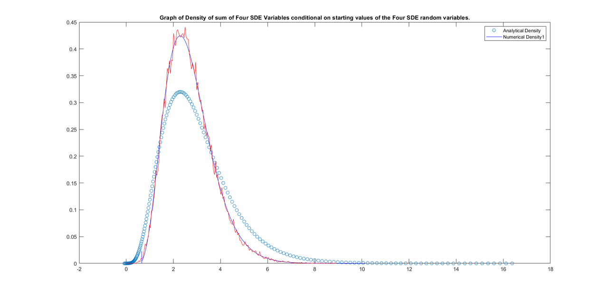](https://postimg.cc/fJ3mjLZR)

[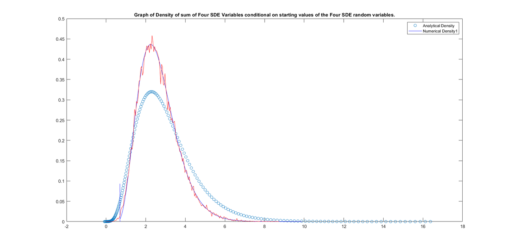](https://postimg.cc/MvhRsSKJ)

[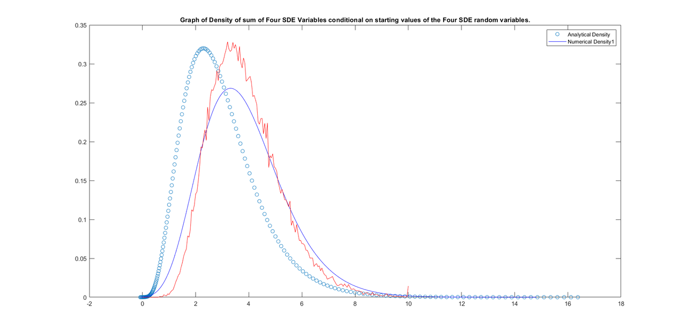](https://postimg.cc/F7f3gRmR)

[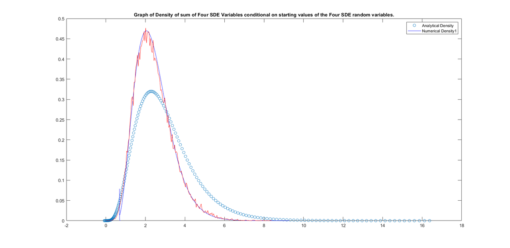](https://postimg.cc/4mKVbdZN)

---

### #3075 — Amin (Topic Author)
*May 10, 2026, 10:01 PM*

Friends, just discussing the plans for research in next few months or till the end of this year. I really hope that at
least till the end of this year, I will continue working with various aspects and applications of conditional densities
of a random variable given the values of several other explaining variables. Even though, we have made good foray into
the problem, several related issues remain unsolved and getting good accuracy everywhere is still not possible. There is
also strong possibility that I would do some more basic work with Laguerre(of standard gamma) and Legendre(of standard
uniform) series so as to make the basic infrastructure that we have already achieved about normal random variables and
Hermite polynomials so we can possibly tackle the conditionality problems related to other orthogonal polynomials. It is
good to know that we were able to do some good work in past few months but important thing is to keep on working and
keeping the momentum of research alive and keep trying to explore interesting research issues and their applications.
Especially other than increasing the accuracy of conditionality problems with hermite polynomials of standard Gaussians,
we need to be able to have small programs that would quickly calculate  Laguerre Series (of standard gamma) and Legendre
Series(of standard uniform) of appropriate random variables from data and also from  values of their first few moments
and find sums and products of these random variables. Given all the work we have already done with Z-series and
Hermite-series, I hope that doing similar stuff with other polynomials of their appropriate random base densities would
not be very difficult at all. This is also very important since Hermite-series can only capture tailed random variables
to only a certain degree and many SDEs and other variables with more extreme densities have to be modelled by Laguerre
series.

Another very important issue would be to do calculations of regressions and conditionality across random variables when
some of the underlying variables are based on hermite-polynomials (of Gaussians) while other variables are of
Leguerre(of standard gamma) and still some are of Legendre(of uniform) type. It would be very interesting how to do
conditionality and correlations calculations and regressions  in a totally general environment environment with all
different types of mixed random variables with orthogonal polynomials series of different underlying densities. I really
thing that it is possible and very important to study the mixed variable problems since a large number of practical
problems that arise deal with interactions of random variables of different types that have to be explained by different
orthogonal series.

I also want to thank American friends who tried to help me and caused a decrease in my persecution. Especially it is
very heartening that some people trusted that I could possibly do some good research and I was able to actually achieve
some of that and at least partially stood by their expectations even though research in mathematics is a very risky with
difficult to predict outcomes. However, I suppose that we have done enough basic work that we can now more easily build
on that and continue the momentum. Again I want to thank all those people who wished me well and tried to help me.

I also hope that many people would agree that mind control of intelligent people is a very bad thing and these people
should rather be allowed to freely excel in their careers and contribute to the broader society in a positive way. It is
really not wise to force people into a situation that they become liability for the society rather than becoming assets
to the broader intellectual environment.

---

### #3076 — Amin (Topic Author)
*May 10, 2026, 11:34 PM*

Friends, I was thinking of other possible improvements on the basic Hermite regression algorithm so it works better even
away from the mean of the density. Suppose we use the following notation

$$Y(Z_y)\,=\,\sum\limits_{n=0}^{N}\,ah_n\,H_n(Z_y)\,=\,\,\,\sum\limits_{n=0}^{N}\,Y_n(Z_y)\,$$  and

$$X(Z_x)\,=\,\sum\limits_{n=0}^{N}\,bh_n\,H_n(Z_x)\,=\,\,\,\sum\limits_{n=0}^{N}\,X_n(Z_x)\,$$

basically in a univariate regression, we regress each of the$Y_n$ on same polynomial part$X_n$ and this regression can
be written as (Equation 1)

$$Y_n\,=\,ah_n\,\rho_n\,H_n(Z_x)$$

but for problems away from mean, we can have an improved estimator as

$$Y_n\,=\,ah_n\, \left(\rho_{0,n}\,+\,\rho_{1,n}\,H_1(Z_x)+\,\rho_{2,n}\,H_2(Z_x)\right)\,H_n(Z_x)$$

effectively we replace the point estimate of correlation$\rho_n$ by a series estimate of correlation given as
$\left(\rho_{0,n}\,+\,\rho_{1,n}\,H_1(Z_x)+\,\rho_{2,n}\,H_2(Z_x)\right)\,$ . The importance of this series correlation
estimator would arise more so in multivariate regressions.

In order to estimate the above series estiamtor, we could minimize a simple least square calculation of the form given
below. If there are P instances of data

$
$\sum\limits_{p=1}^{P}\,{\Big[Y_{n,p}\,-\,\,ah_n\, \left(\rho_{0,n}\,+\,\rho_{1,n}\,H_1(Z_{x,p})+\,\rho_{2,n}\,H_2(Z_{x,p})\right)\,H_n(Z_{x,p})\Big]}^2$
$

where we minimize over the correlation parameters of the form$\rho_{0,n}\,$ ,$\,\rho_{1,n}\,$ and$\,\rho_{2,n}$ . Since
we know the starting value of$\rho_{0,n}\,=\,\rho_n$ and$\,\rho_{1,n}\,=0$ and$\,\rho_{2,n}=0$ , we have to improve upon
these starting values, it should not be an extremely difficult problem. I suppose with arrival of quantum computing, we
should be solving many of such multivariate problems with similar optimizations.

Even though my idea might be a bit naiive, I decided to share it with friends.

---

### #3077 — Amin (Topic Author)
*May 11, 2026, 11:27 AM*

Friends, in cases of finding conditional density of Y given several explaining variables$X_k$ 's, we have just used
correlations of Z-series of all X's with Y but we have not taken correlations of any products of X's like taken two at a
time as various$X_k\,X_l$ or taken three at a time as$X_k\,X_l\,X_j$ and more. I will try to include these products in
regressions and try to see if it increases the accuracy of conditional density of Y in multivariate setting. In many
difficult problems, it is very necessary to add products of various orders of explaining variables in the regressions. I
will work on it tonight and come back to friends with a new matlab program possibly tonight.

---

### #3078 — Amin (Topic Author)
*May 12, 2026, 4:17 PM*

Friends, I could not work properly last night and today was the day for my mother's chemotherapy so remained busy there
as well. Friends, I am working on several ideas to improve the accuracy in multivariate correlated conditioning case. I
want to try my best to solve the accuracy issue before doing anything else and want to say that I hope soon we would
settle this problem as well. I am working tonight and if there is anything meaningful at the end of work, I would
mention it.

Friends, I am convinced that we can solve the multivariate problem with linear algebra by converting the correlation
matrices of various hermite polynomials into orthogonal variables whose hermites are not correlated any more. There are
also other considerations that have to be kept in mind and we would have to do change of variables on every hermite
level while changing the basis of orthogonal variables associated with higher hermites and represent them in basis of
orthogonal variables associated with lower order hermites. I think this is very doable and I have constructed a map of
the whole thing. Orthogonality of variables would also ensure that variances associated with each term of
Z-series/hermite-series would be exactly retrieved just as in the one dimensional case. I hope to have a program ready
in two to three days that solves the multivariate conditional density problem in a good way.

---

### #3079 — Amin (Topic Author)
*May 14, 2026, 9:55 PM*

Friends, I went ahead and coded the logic for finding conditional density of Y given several correlated X variables. I
have used orthogonality and made basis using eigenvectors that orthogonalized the correlations matrix for each hermite
polynomial. The program is a very reasonable improvement when there are middle to high level of correlations especially
positive correlations. I will post the matlab program tomorrow.

---

### #3080 — Amin (Topic Author)
*May 15, 2026, 10:22 AM*

Friends, very brief review of logic of the new  program. We have different correlation matrices for seven different
hermite polynomials of explaining variable Xn's. When we orthogonalize each of them, we have seven eigenvector basis
(C1-C7) and one original basis (C0). In our original algorithm to calculate correlation coefficients of fifth and lower
order terms, we have to add terms from higher binomial expansions. but these higher order terms are in different basis.
We first convert the higher order terms from nth basis  in zero basis(C0) and then re-convert them to mth basis Cm
(where m

---

### #3081 — Amin (Topic Author)
*May 15, 2026, 11:56 AM*

Friends, these are four graphs with one SDE scenario and four different sets of conditioning values. NDim=3, i.e. there
are three explaining variables.

Even though the performance of algorithm is good on this data, there are cases when it does not work very well but I
hope that even those cases would improve after more work is done on inverting the hermite polynomials.

In the graphs, the blue line is the algorithm with orthogonality logic and magenta line is the old algorithm without any
orthogonality. I included that for comparison purposes.

These are the SDE parameters.

 thetaV(1)=1.0;

 kappaV(1)=0.000;

 gamma(1)=.75;

 sigma0(1)=.55;

%SDE1

thetaV(2)=1.0;

 kappaV(2)=0.000;

 gamma(2)=.65;

 sigma0(2)=.5;

%SDE1

thetaV(3)=1.0;

 kappaV(3)=0.000;

 gamma(3)=.85;

 sigma0(3)=.55;

correlations are:

Corr1(1,1)=1;

Corr1(1,2)=.75;

Corr1(1,3)=.65;

Corr1(2,2)=1;

Corr1(2,1)=.75;

Corr1(2,3)=.55;

Corr1(3,1)=.65;

Corr1(3,2)=.55;

Corr1(3,3)=1;

and four sets of conditioning values for four graphs are

%%Set1

V10(1)=.85;

V10(2)=1.2;

V10(3)=.85;

V10(4)=1.25;

% %Set2

V10(1)=.75;

V10(2)=1.2;

V10(3)=.7;

V10(4)=.65;

% % % %

% % % %

%Set3

V10(1)=1.25;

V10(2)=1.35;;

V10(3)=1.25;

 V10(4)=1.4

% % % % % % % % % %

V10(1)=.85;

V10(2)=.81;%1.2;

V10(3)=.77;

 V10(4)=.7

%%%%%%%%%%%%5

.

.

.

.

[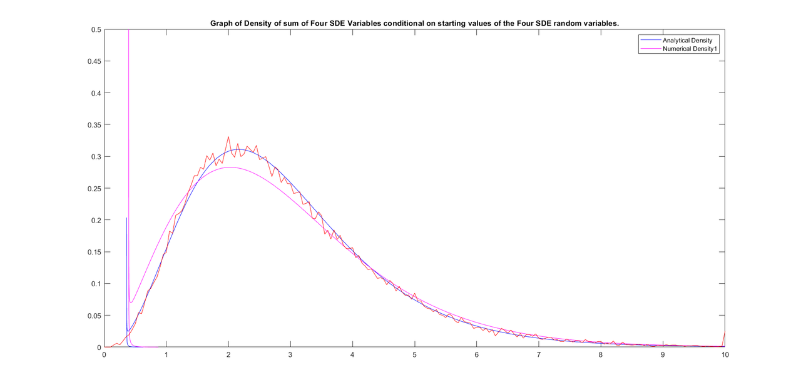](https://postimg.cc/mhZph9z3)

[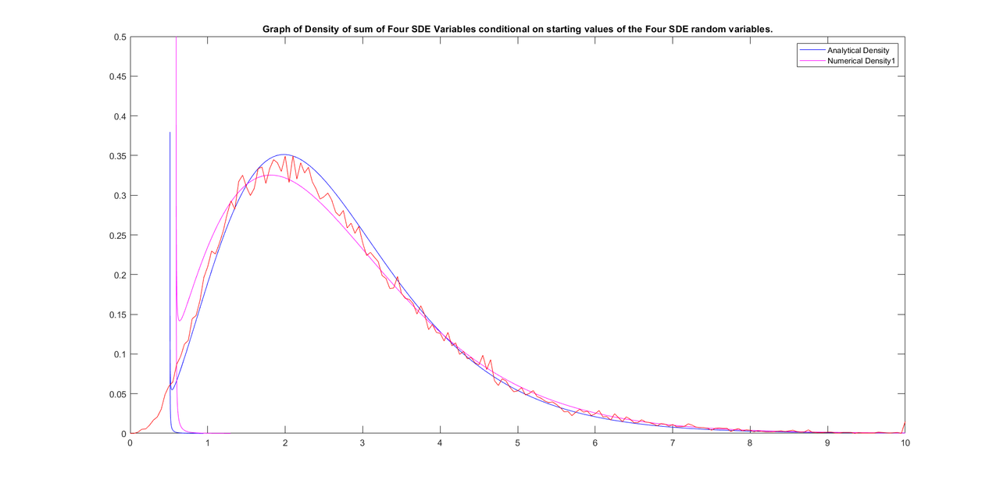](https://postimg.cc/8skXsvJB)

[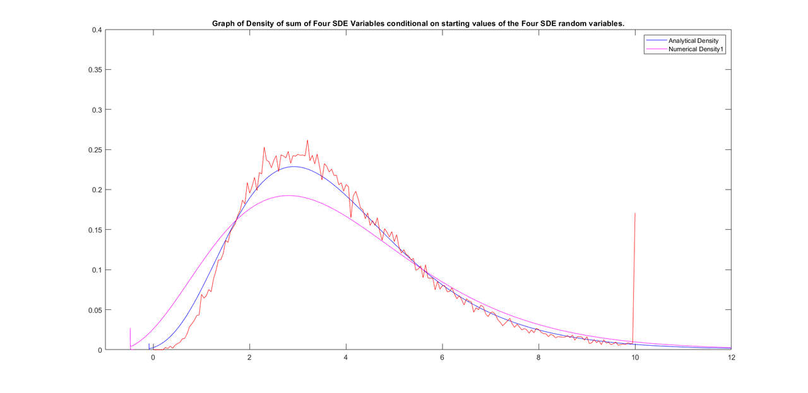](https://postimg.cc/9zXgz9RG)

[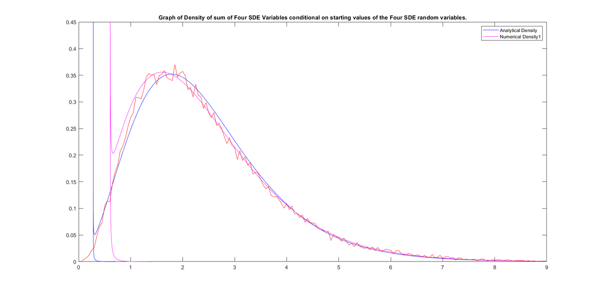](https://postimg.cc/K4cp4TkP)

---

### #3082 — Amin (Topic Author)
*May 15, 2026, 12:40 PM*

Friends, here are the program used to create the graphs in previous post.

.

.

.

```
function []= ConditionalDensityHermitesNvariate0A08B()

%SV SDE is
%dV(t)=mu1 V(t)^beta1 dt+ mu2 V(t)^beta2 dt + sigma0 V(t)^gamma dZ(t)
%In mean reverting SDEs we ususally have
%mu1= kappaV * thetaV
%beta1=0
%mu2=-kappa
%beta2=0
%The present program works only when drift is zero (for pure noises)
%meaning mu1=0 and mu2=0;

Order=7;
%NDim=4;%Three assets and one SV.
%NMomentsY=Order+1;
%NMomentsX=Order+1;

%%%%%%%%%%%%%%%%%%%5
dt=.03125/2/8;
Tt=64*2*8;
T=Tt*dt;
seed0=12130649;
%seed0=94210876;
%seed0=14210876;
%seed0=53612297
%seed0=97459782
rng(seed0, 'twister')
paths=50000;
TT1=100*8/2; %Transition distribution start
TT2=256*8/2; %Transition distribution end

%%%%%%%%%%%%%%%%%%%5

NDims=3;

V0(1)=1.000;%.32;
V00(1)=V0(1);

%SDE1
 thetaV(1)=1.0;%.045;%1;%.04;
 kappaV(1)=0.000;%1.5;%1.5;
 gamma(1)=.75;%.75
 sigma0(1)=.55;%.35

%
% %SDE2%
% thetaV(1)=.90;%.045;%1;%.04;
% kappaV(1)=1.000;%1.5;%1.5;
% gamma(1)=.75;%.75
% sigma0(1)=.85;%.35
%
% %SDE3%
% thetaV(1)=1.350;%.045;%1;%.04;
% kappaV(1)=.35000;%1.5;%1.5;
% gamma(1)=.75;%.75
% sigma0(1)=.95;%.35

mu1(1)=kappaV(1)*thetaV(1);
mu2(1)=-kappaV(1);
beta1(1)=0;
beta2(1)=1;

V0(2)=1.000;%.32;
V00(2)=V0(2);

%SDE1
thetaV(2)=1.0;%.045;%1;%.04;
 kappaV(2)=0.000;%1.5;%1.5;
 gamma(2)=.65;%.75
 sigma0(2)=.5;%.35

%SDE2
% thetaV(2)=1.0;%.045;%1;%.04;
% kappaV(2)=0.000;%1.5;%1.5;
% gamma(2)=.65;%.75
% sigma0(2)=.65;%.35
%
% %SDE3
% thetaV(2)=.850;%.045;%1;%.04;
% kappaV(2)=.35000;%1.5;%1.5;
% gamma(2)=.65;%.75
% sigma0(2)=.85;%.35

mu1(2)=kappaV(2)*thetaV(2);
mu2(2)=-kappaV(2);
beta1(2)=0;
beta2(2)=1;

V0(3)=1.000;%.33;
V00(3)=V0(3);

%SDE1
thetaV(3)=1.0;%.045;%1;%.04;
 kappaV(3)=0.000;%1.5;%1.5;
 gamma(3)=.85;%.75
 sigma0(3)=.55;%.35
%
% %SDE2
% thetaV(3)=.750;%.045;%1;%.04;
% kappaV(3)=0.000;%1.5;%1.5;
% gamma(3)=.95;%.75
% sigma0(3)=.45;%.35
%
%
% %SDE3
% thetaV(3)=1.150;%.045;%1;%.04;
% kappaV(3)=.5000;%1.5;%1.5;
% gamma(3)=.95;%.75
% sigma0(3)=.75;%.35

mu1(3)=kappaV(3)*thetaV(3);
mu2(3)=-kappaV(3);
beta1(3)=0;
beta2(3)=1;

Corr1(1,1)=1;
Corr1(1,2)=.75;
Corr1(1,3)=.65;
Corr1(2,2)=1;
Corr1(2,1)=.75;
Corr1(2,3)=.55;
Corr1(3,1)=.65;
Corr1(3,2)=.55;
Corr1(3,3)=1;

% Corr1(1,1)=1;
% Corr1(1,2)=-.25;
% Corr1(1,3)=-.2;
% Corr1(2,2)=1;
% Corr1(2,1)=-.25;
% Corr1(2,3)=-.35;
% Corr1(3,1)=-.2;
% Corr1(3,2)=-.35;
% Corr1(3,3)=1;

%87%Corr1(1:3,1:3)=0.0;

R=chol(Corr1);

%        R(1:3,1:3)=0;
%        R(1,1)=1;
%        R(2,2)=1;
%        R(3,3)=1;

V0(4)=1.000;%.44;
V00(4)=V0(4);
thetaV(4)=1.0;%.045;%1;%.04;
kappaV(4)=1.000;%1.5;%1.5;
mu1(4)=kappaV(4)*thetaV(4);
mu2(4)=-kappaV(4);
beta1(4)=0;
beta2(4)=1;
gamma(4)=.95;%.75
sigma0(4)=.55;%.45

%%%%%%%%%%%%%%%%%%%%%%%%%%%%%%%%%%%%%%%%%%%%%%%%%%%%%%%%%%%%%%%%%%%%%5
for nn=1:NDims
V(1:paths,nn)=V0(nn);
end
%V(1:paths,1:NDims)=V0(1,1:NDims);

Random1(1:paths/2,1:NDims)=0;

for tt=1:Tt

    Random2(1:paths/2,1:NDims)=randn(size(Random1));
    Random2(paths/2+1:paths,1:NDims)=-Random2(1:paths/2,1:NDims);

    %Random2=R'*Random2;
    random1=Random2*R(:,1);
    random2=Random2*R(:,2);
    random3=Random2*R(:,3);

    Random2(:,1)=random1;
    Random2(:,2)=random2;
    Random2(:,3)=random3;

    for nn=1:NDims

    V(1:paths,nn)=V(1:paths,nn)+ ...
        (mu1(nn).*V(1:paths,nn).^beta1(nn) + mu2(nn).*V(1:paths,nn).^beta2(nn))*dt + ...
        sigma0(nn).*V(1:paths,nn).^gamma(nn) .*Random2(1:paths,nn)*sqrt(dt) + ...
        (mu1(nn).*beta1(nn)*V(1:paths,nn).^(beta1(nn)-1) + mu2(nn).*beta2(nn).*V(1:paths,nn).^(beta2(nn)-1)).* ...
        ((mu1(nn).*V(1:paths,nn).^beta1(nn) + mu2(nn).*V(1:paths,nn).^beta2(nn))*dt^2/2 + ...
        sigma0(nn).*V(1:paths,nn).^gamma(nn) .*Random2(1:paths,nn)*(1-1/sqrt(3))*dt^1.5) + ...
        .5*(mu1(nn).*beta1(nn).*(beta1(nn)-1).*V(1:paths,nn).^(beta1(nn)-2) +
mu2(nn).*beta2(nn).*(beta2(nn)-1).*V(1:paths,nn).^(beta2(nn)-2)).* ...
        sigma0(nn)^2.*V(1:paths,nn).^(2*gamma(nn)).*dt^2/2 + ...
        sigma0(nn).*gamma(nn).*V(1:paths,nn).^(gamma(nn)-1) .* ...
        ((mu1(nn).*V(1:paths,nn).^beta1(nn) + mu2(nn).*V(1:paths,nn).^beta2(nn)).*Random2(1:paths,nn).*1/sqrt(3)*dt^1.5
+ ...
        sigma0(nn).*V(1:paths,nn).^gamma(nn) .*(Random2(1:paths,nn).^2-1)*dt/2) + ...
        .5*sigma0(nn).*gamma(nn).*(gamma(nn)-1).*V(1:paths,nn).^(gamma(nn)-2) .* ...
        sigma0(nn).^2.*V(1:paths,nn).^(2*gamma(nn)) .*Random2(1:paths,nn).*1/sqrt(3)*dt^1.5;

    V(V(:,nn)<=0)=.0001;

    if(tt==TT1)
        Xin(1:paths,nn)=real(V(1:paths,nn));
    end

    if(tt==TT2)

        Xin2(1:paths,nn)=real(V(1:paths,nn));
    end

    end

end

Yin(1:paths)=0.0;

for pp=1:paths
for mm=1:NDims
    Yin(pp)=Yin(pp)+Xin2(pp,mm);%-Xin(pp,mm);
%-Xin(pp,mm);
end
end

randn()

str=input("I have reached stone 1");

%%%%%%%%%%%%%%%%%%%%%%%%%%%%%%%%%%%%%%%%%%%%%%%%%%5

Order=7;
clf;
[BetaCorrH,YCoeffH,XCoeffH,HCorrXX] = CalculateHermiteCorrelations0NA04(Xin,Yin,paths,NDims);
YCoeffZ(1:Order+1)= ConvertHermiteSeriesToZSeries01(YCoeffH(1:Order+1),Order);

%[BetaCorrH0,YCoeffH0,XCoeffH0,HCorrXX0] = CalculateHermiteCorrelations0NA04Moments(Xin,Yin,paths,NDims);
%YCoeffZ0(1:Order+1)= ConvertHermiteSeriesToZSeries01(YCoeffH0(1:Order+1),Order);

[HCorrXY,YCoeffH,HEigenvecs] = CalculateHermiteCorrelations0NA04Eigs(Xin,Yin,paths,NDims);

%HCorrXX(:,:)=0.0;

BetaCorrH

%randn
%CorrXX1st
str=input("I have reached Stone2");

[cn,ch0] = Calculate2DZSeriesNDimCorrectedOrtho(YCoeffH,HCorrXY,HEigenvecs,NDims,Order);

str=input("I have reached stone 2.5");

[cn3,ch]=CalculateGaussianCorrelationFromHermiteCorrelationsNDim02(YCoeffH,XCoeffH,BetaCorrH,HCorrXX,NDims,Order);

%%%%%%%%%%%%%%%%%%%%%%%%%%%%%%%%%%%%%%%%%%%%%%%%%%%%%%%%%%%%%%%%%%%%%%%%%%%%%%%%%%%%%%%
%Set1
V10(1)=.85;%.65;%
V10(2)=1.2;
V10(3)=.85;
V10(4)=1.25;

% % %Set2
% V10(1)=.75;
% V10(2)=1.2;%1.2;
% V10(3)=.7;
% V10(4)=.65;
% % % % %
% % % % % %Set3
% V10(1)=1.25;
% V10(2)=1.35;%1.2;
% V10(3)=1.25;
% V10(4)=1.4
% % % % % % % % % % %
% % % % % % % % %
% V10(1)=.85;
% V10(2)=.81;%1.2;
% V10(3)=.77;
% V10(4)=.7

%%%%%%%%%%%%%%%%%%%%%%%%%%%%%%%%%%%%%%%%%%%%%%%%%%%%%%%%%%%%%

for nn=1:NDims
V(1:paths,nn)=V10(nn);
end
%V(1:paths,1:NDims)=V0(1,1:NDims);

Random1(1:paths/2,1:NDims)=0;

for tt=1:TT2-TT1

    Random2(1:paths/2,1:NDims)=randn(size(Random1));
    Random2(paths/2+1:paths,1:NDims)=-Random2(1:paths/2,1:NDims);

    random1=Random2*R(:,1);
    random2=Random2*R(:,2);
    random3=Random2*R(:,3);

    Random2(:,1)=random1;
    Random2(:,2)=random2;
    Random2(:,3)=random3;

    for nn=1:NDims

    V(1:paths,nn)=V(1:paths,nn)+ ...
        (mu1(nn).*V(1:paths,nn).^beta1(nn) + mu2(nn).*V(1:paths,nn).^beta2(nn))*dt + ...
        sigma0(nn).*V(1:paths,nn).^gamma(nn) .*Random2(1:paths,nn)*sqrt(dt) + ...
        (mu1(nn).*beta1(nn)*V(1:paths,nn).^(beta1(nn)-1) + mu2(nn).*beta2(nn).*V(1:paths,nn).^(beta2(nn)-1)).* ...
        ((mu1(nn).*V(1:paths,nn).^beta1(nn) + mu2(nn).*V(1:paths,nn).^beta2(nn))*dt^2/2 + ...
        sigma0(nn).*V(1:paths,nn).^gamma(nn) .*Random2(1:paths,nn)*(1-1/sqrt(3))*dt^1.5) + ...
        .5*(mu1(nn).*beta1(nn).*(beta1(nn)-1).*V(1:paths,nn).^(beta1(nn)-2) +
mu2(nn).*beta2(nn).*(beta2(nn)-1).*V(1:paths,nn).^(beta2(nn)-2)).* ...
        sigma0(nn)^2.*V(1:paths,nn).^(2*gamma(nn)).*dt^2/2 + ...
        sigma0(nn).*gamma(nn).*V(1:paths,nn).^(gamma(nn)-1) .* ...
        ((mu1(nn).*V(1:paths,nn).^beta1(nn) + mu2(nn).*V(1:paths,nn).^beta2(nn)).*Random2(1:paths,nn).*1/sqrt(3)*dt^1.5
+ ...
        sigma0(nn).*V(1:paths,nn).^gamma(nn) .*(Random2(1:paths,nn).^2-1)*dt/2) + ...
        .5*sigma0(nn).*gamma(nn).*(gamma(nn)-1).*V(1:paths,nn).^(gamma(nn)-2) .* ...
        sigma0(nn).^2.*V(1:paths,nn).^(2*gamma(nn)) .*Random2(1:paths,nn).*1/sqrt(3)*dt^1.5;

    V(V(:,nn)<0)=.0001;

    %if(tt==TT1)
    %    XXin(1:paths,nn)=V(1:paths,nn);
    %end

    if(tt==TT2-TT1)

        XXin2(1:paths,nn)=V(1:paths,nn);
    end

    end

end

Yin2(1:paths)=0.0;

for pp=1:paths
for mm=1:NDims
    Yin2(pp)=Yin2(pp)+XXin2(pp,mm);%-V10(mm);
end
end

randn()

str=input("I have reached stone 4");

NoOfBins=200;
MaxCutOff=10;

[XDensity,IndexOut,IndexMax] = MakeDensityFromSimulation_Infiniti_NEW(Yin2,paths,NoOfBins,MaxCutOff );

for qq=1:8

    DataMoments(qq)=sum(Yin2(:).^qq)/paths;

end

%%%%%%%%%%%%%%%%%%%%%%%%%%%%%%%%%%%%%%%%%%%%%%%%%%%%%%%%%%%%%%%%%%%%%%%%%%%%%%%%%%%%%%%5

for nn=1:NDims
    [Zx0(nn)] = CalculateZgivenXAndHSeriesCoeffs(V10(nn),XCoeffH(1:Order+1,nn),Order);
end

Zx00(:,1)=Zx0(:);
%for nn=1:NDims
%    Zx1(nn,1:7)=Zx0(nn);
%end
%Below Zx1 are calculated as starting guess for hermite inversion algorithm

 Zx1(:,1)=HEigenvecs(:,:,1)'*Zx00;
 Zx1(:,2)=HEigenvecs(:,:,2)'*Zx00;
 Zx1(:,3)=HEigenvecs(:,:,3)'*Zx00;
 Zx1(:,4)=HEigenvecs(:,:,4)'*Zx00;
 Zx1(:,5)=HEigenvecs(:,:,5)'*Zx00;
 Zx1(:,6)=HEigenvecs(:,:,6)'*Zx00;
 Zx1(:,7)=HEigenvecs(:,:,7)'*Zx00;

%Below hermites are calculated in C0
for nn=1:NDims
 [Hzx(1:Order,nn)] = EvalHermiteArrayH1(Zx0(nn),Order);
end

%Below hermite polynomials are calculated in Chh basis
for hh=1:Order

    OHzx(:,hh)=HEigenvecs(:,:,hh)'*Hzx(hh,:)';
end

for hh=1:Order
for nn=1:NDims
    OXHCoeff(1:Order+1,nn)=0.0;
    OXHCoeff(hh+1,nn)=1.0;
    %[Zx0O(nn,hh)] = CalculateZgivenXAndHSeriesCoeffsHH(OHzx(nn,hh),OXHCoeff(1:Order+1,nn),Order,Zx1(nn,hh));
    [Zx0O(nn,hh)] = InvertTheHermitePolynomials(OHzx(nn,hh),Zx1(nn,hh),OXHCoeff(1:Order+1,nn),Order);
end
end
Zx1
Zx0O

str=input("Look at inverted hermites");

bhh=YCoeffH(1);
for nn=1:NDims
    for hh=1:Order
        bhh=bhh+HCorrXY(nn,hh).*OHzx(nn,hh).*YCoeffH(hh+1);
    end
end

%%%%%%%%%%%%%%%%%%%%%%%%%%%%%%%%%%%%%%%%%%%%%%%%%%%%%%%%%%%%%%%%%%%%%%%%%%%%%%%%5
% NDim1=2;
% Vin(1:paths,1)=Xin(1:paths);
% Vin(1:paths,2)=Yin(1:paths);
% [bCoeffHH] = CalculateMultivariateHermiteSeriesAndDensities02Wmt(Vin,NDim1,Order);
%
% bCoeffHH
%
% str=input("Look at bCoeffHH");
%
% cch(1:Order+1)=bCoeffHH(1:Order+1,1,2);
%
%
% [Zh(1,1:Order+1)] = EvalHermiteArrayH0(Zx0,Order);
%
%
% dd(1)=0.0;
% for hh=1:Order+1
%     dd(1)=dd(1)+cch(hh).*Zh(1,hh);
% end
%
% dd(1)=dd(1)+bCoeffHH(1,2,2)
% dd(2:Order+1)=bCoeffHH(2:Order+1,2,2);
%
%
%%%%%%%%%%%%%%%%%%%%%%%%%%%%%%%%%%%%%%%%%%%%%%%%%%%%%%%%%%%%%%%%%%%55

%[bh1] = CalculateHermiteConditionalDensityGivXs(cn,Zx0,YCoeffH,YCoeffZ,ch,Order,NDims)
%[bh2] = CalculateHermiteConditionalDensityGivXs(cn2,Zx0,YCoeffH0,YCoeffZ0,ch0,Order,NDims)
[bh3] = CalculateHermiteConditionalDensityGivXs(cn3,Zx0,YCoeffH,YCoeffZ,ch,Order,NDims)
[bh1] = CalculateHermiteConditionalDensityGivXsOrtho(cn,Zx0O,YCoeffH,YCoeffZ,ch0,Order,NDims);

%[bh1] = FixTheHermiteSeriesDensity(bh1,Order);
%[bh2] = FixTheHermiteSeriesDensity(bh2,Order);
%[bh3] = FixTheHermiteSeriesDensity(bh3,Order);

%The zeroth Hermite polynomials for orthogonal case is borrowed from older
%calculations without orthogonality

bh1(1)=bh3(1);
%bh4(1)=bh3(1);

%%%%%%%%%%%%%%%%%%%%%%%%%%%%%%%%%%%%%%%%%%%%%%%%%%%%%%%%%%%%%%%%%%%%%%%%%%%%%%5
%ddz(1:Order+1)= ConvertHermiteSeriesToZSeries01(dd(1:Order+1),Order);
YCoeffz1(1:Order+1)= ConvertHermiteSeriesToZSeries01(bh1(1:Order+1),Order);
%YCoeffz2(1:Order+1)= ConvertHermiteSeriesToZSeries01(bh2(1:Order+1),Order);
YCoeffz3(1:Order+1)= ConvertHermiteSeriesToZSeries01(bh3(1:Order+1),Order);

[YMomentsModel1]=CalculateMomentsOfZSeries(YCoeffz1(1),YCoeffz1(2:Order+1),Order,Order+1);

YMomentsModel1

DataMoments

str=input("Look at comparison of moments");

[cMu1,YCentralMoments]=ConvertRawMomentsToCentralMoments(YMomentsModel1,Order+1);
[cMu2,DataCentralMoments]=ConvertRawMomentsToCentralMoments(DataMoments,Order+1);

YCentralMoments

DataCentralMoments

str=input("Look at central moments");

clf;

%PlotZSeriesDensity(YCoeffZ(1),YCoeffZ(2:Order+1),'o')
%hold on

 PlotZSeriesDensity(YCoeffz1(1),YCoeffz1(2:Order+1),'b')

 hold on

%PlotZSeriesDensity(YCoeffz2(1),YCoeffz2(2:Order+1),'g')

% hold on
 PlotZSeriesDensity(YCoeffz3(1),YCoeffz3(2:Order+1),'m')

 hold on
plot(IndexOut(1:IndexMax),XDensity(1:IndexMax),'r');

%PlotHermiteSeriesDensityAndRvGraph(YCoeffh(1),YCoeffh1(2:yOrder+1),'g')
title("Graph of Density of sum of Four SDE Variables conditional on starting values of the Four SDE random variables.")
%title(sprintf('V00 = %.3f; kappa=%.3f, theta=%.3f,gamma=%.3f,sigma=%.3f;V10=%.3f at TT1=%.3f;TT2=%.3f;Paths=%d ',V00,
kappaV, thetaV,gamma,sigma0, V10,(TT1*dt),(TT2*dt),paths));%,sprintf('theta= %f', theta), sprintf('kappa = %f',
kappa),sprintf('sigma = %f', sigma0),sprintf('T = %f', T));
legend({'Analytical Density','Numerical Density1'}, ...
    'Location','northeast')

str=input("This is the first version without altering the moments of conditional density")

hold off

%ch0

ch
end

```

.

.

.

.

```
function [HCorrXY,YCoeffH,HEigenvecs] = CalculateHermiteCorrelations0NA04Eigs(Xin,Yin,NData,NDims)

%This program finds required correlations between NDims explanatory
%variables given in Xin that has NDims dimensionality. Yin is variable
%being explained and is one-diemsnional.

Order=7;
NMoments=8;

[ZI] = MomentMatchedStandardNormalDiscretizedDensity(NData);

for nn=1:NDims
[XCoeffH(1:Order+1,nn),Zx(1:NData,nn)] = CalculateHermiteSeriesFromData02(Xin(1:NData,nn),Order,ZI);

[Zx(1:NData,nn)] = CalculateZgivenXAndHSeriesCoeffs(Xin(1:NData,nn),XCoeffH(1:Order+1,nn),Order);

end

[YCoeffH,Zy] = CalculateHermiteSeriesFromData02(Yin,Order,ZI);
[Zy] = CalculateZgivenXAndHSeriesCoeffs(Yin,YCoeffH,Order);

for nn1=1:NDims
    for nn2=1:NDims
        if(nn1==nn2)
            HCorrXX(nn1,nn2,1:Order)=1.0;
        else
            HCorrXX(nn1,nn2,1:Order) =
CalculateCorrelationBivariateHermiteCH1(Zx(1:NData,nn1),Zx(1:NData,nn2),NData,Order);
        end
    end
end

for hh=1:Order
    [HEigenvecs(:,:,hh),HEigs(:,:,hh)]=eigs(HCorrXX(:,:,hh));
end

HEigenvecs
HEigs

str=input("Look at eigenvectors and eigenvalues");

for nn=1:NDims
[X1h(:,nn,:)] = EvalHermiteArrayH1(Zx(:,nn),Order);
end

%X1h
%
%str=input("Look at hermite polynomials");

for hh=1:Order
    VecA(:,:)=HEigenvecs(:,:,hh);
    VecB(:,:)=X1h(:,:,hh)';

    XOrtho(:,:,hh)=(VecA'*VecB)';
    %XOrtho(:,:,hh)=(VecA'*VecB);
end

%XOrtho
%size(XOrtho)
%str=input("Look at XOrtho");

Cov12H(1:Order)=0.0;
Cov13H(1:Order)=0.0;
Cov23H(1:Order)=0.0;
for hh=1:Order
    Cov12H(hh)=sum(XOrtho(:,1,hh).*XOrtho(:,2,hh))/sqrt(sum(XOrtho(:,1,hh).^2).*sum(XOrtho(:,2,hh).^2));
    Cov13H(hh)=sum(XOrtho(:,1,hh).*XOrtho(:,3,hh))/sqrt(sum(XOrtho(:,1,hh).^2).*sum(XOrtho(:,3,hh).^2));
    Cov23H(hh)=sum(XOrtho(:,2,hh).*XOrtho(:,3,hh))/sqrt(sum(XOrtho(:,2,hh).^2).*sum(XOrtho(:,3,hh).^2));
    %Var1H(hh)=Var1H(hh)+sum(X1h(:,hh+1).*X1h(:,hh+1))/paths;
    %Var2H(hh)=Var2H(hh)+sum(X2h(:,hh+1).*X2h(:,hh+1))/paths;
    %CorrH(hh)=CovH(hh)./factorial(hh);%sqrt(Var1H(hh))./sqrt(Var2H(hh));
end

Cov12H
Cov13H
Cov23H

str=input("Look at Covariances. These are covariances and not correlations");

%for nn1=1:NDims
%    HCorrXY(nn1,1:Order) = CalculateCorrelationBivariateHermiteCH1(Zx(1:NData,nn1),Zy(1:NData),NData,Order);
%end

[y1h] = EvalHermiteArrayH1(Zy(:),Order);

HCorrXY(1:NDims,1:Order)=0.0;

for nn1=1:NDims
    for hh1=1:Order
        Y1H(1:NData)=y1h(1:NData,hh1);
        XOrthoH(1:NData)=XOrtho(1:NData,nn1,hh1);

        HCorrXY(nn1,hh1) =sum(Y1H(:).*XOrthoH(:))./sqrt(sum(Y1H(:).^2).*sum(XOrthoH(:).^2));
        %HCorrXY(nn1,hh1) =sum(Y1H(:).*XOrthoH(:))./factorial(hh)/NData;
    end
end

HCorrXY

str=input("Look at HCorrXY");

%for hh=1:Order
%    [BCorrXY(:,hh),Is(:,hh)]=sort(HCorrXY(:,hh),'descend');
%end

%for hh=1:Order
%    CorrXX(1:NDims,1:NDims)=HCorrXX(Is(1:NDims,hh),Is(1:NDims,hh),hh);
%    CorrXY(1:NDims,1)=HCorrXY(Is(1:NDims,hh),hh);
%    BetaCorr0(1:NDims)=CorrXX\CorrXY;
%    BetaCorrH(Is(1:NDims,hh),hh)=BetaCorr0(1:NDims);
%end

% for hh=1:Order
%     CorrXX(1:NDims,1:NDims)=HCorrXX(1:NDims,1:NDims,hh);
%     CorrXY(1:NDims,1)=HCorrXY(1:NDims,hh);
%     BetaCorrH(1:NDims,hh)=CorrXX\CorrXY;
% end

%CorrXX1st(1:NDims,1:NDims)=HCorrXX(1:NDims,1:NDims,1)

% BetaCorrH(:,1)'*CorrXX
%
% CorrXY
%
% HCorrXX
%
% HCorrXY
%
% BetaCorrH
%
% str=input("Look at BetaCorrH");
end

```

.

.

.

.

```
function [cn,ch] = Calculate2DZSeriesNDimCorrectedOrtho(YCoeffH,HCorrXY,HEigenvecs,NDims,Order)

%NDims in all of the program would be N-1 as y-tilde would be dealt separately

 for hh=1:Order
     for nn=1:NDims
         ch(nn+1,hh+1)=HCorrXY(nn,hh).*YCoeffH(hh+1);%make sure indices on all hermite-correlations match.check.
         %%%% nn+1 since 1st index would go to y-tilde.
     end
 end

ch
YCoeffH

str=input("Look at above---00-1-1-1-1-");

[YCoeffZ(1:Order+1)] = ConvertHermiteSeriesToZSeries01(YCoeffH(1:Order+1),Order);

YCoeffH

YCoeffZ

str=input("Look at the Hermite and Z-series coeffs");

%for hh=1:7
% %rhoxx(1:NDims,1:NDims,hh+1)=rhoxx(1:NDims,1:NDims,2);
% rhoxx(1:NDims,1:NDims,hh+1)=(sign(CorrHxx(1:NDims,1:NDims,hh))).^(1).*(abs(CorrHxx(1:NDims,1:NDims,hh))).^(1/hh);
%end

for nn=1:NDims
    rho_z(nn+1,7)=ch(nn+1,8)./YCoeffZ(8);
    cn(nn+1,8)=(abs(rho_z(nn+1,7))).^(1/7);
    cn(nn+1,8)=cn(nn+1,8).*sign(rho_z(nn+1,7));
end

cnSqrSum=0;
for nn=1:NDims
    cnSqrSum=cnSqrSum+cn(nn+1,8).*cn(nn+1,8);
end

if(cnSqrSum>.995)
    cn(2:NDims+1,8)=cn(2:NDims+1,8)*sqrt(.995)/sqrt(cnSqrSum);
    cnSqrSum=.995;
end

cn(1,8)=sqrt(1-cnSqrSum);
Cn(1,8)=cn(1,8).*YCoeffZ(8);

cn

%str=input("Compare the Eighth Element From NDim---2");

cnSqrSum=0;
for nn=1:NDims
    rho_z(nn+1,6)=ch(nn+1,7)./YCoeffZ(7);
    cn(nn+1,7)=(abs(rho_z(nn+1,6))).^(1/6);
    cn(nn+1,7)=cn(nn+1,7).*sign(rho_z(nn+1,6));
end

cnSqrSum=0;
for nn=1:NDims
    cnSqrSum=cnSqrSum+cn(nn+1,7).*cn(nn+1,7);
end

if(cnSqrSum>.995)
    cn(2:NDims+1,7)=cn(2:NDims+1,7)*sqrt(.995)/sqrt(cnSqrSum);
    cnSqrSum=.995;
end

cn(1,7)=sqrt(1-cnSqrSum);
Cn(1,7)=cn(1,7).*YCoeffZ(7);

cn

str=input("Compare the Seventh Element From NDim---2");

for nn=1:NDims
    CC8(nn,1)=YCoeffZ(8).*(21*cn(nn+1,8).^5.*(1-cn(nn+1,8).^2))+YCoeffZ(8).*21*cn(nn+1,8).^7;
end
%The above term is calculated in C7 i.e. the hermite correlation
%decomposition that was done for seventh hermite polynomial of correlated
%X's.

CC8

str=input("Look at CC8");

%Below, we convert the term CC8 to C0 basis
CCUniversal(1:NDims,1)=0.0;
for nn=1:NDims
    CCUniversal(:,1)=CCUniversal(:,1)+HEigenvecs(:,nn,7).*CC8(nn,1);
end

% CCUniversal

% str=input("Look at CCUniversal");

%Below, we convert from C0 basis to C5 basis
CC5=HEigenvecs(:,:,5)'*CCUniversal;
cnSqrSum=0;
for nn=1:NDims
    %CC(3,6)=YCoeffZ(8).*(21*cn(nn+1,8).^5.*ccn(nn+1,8).^2);
    rho_z(nn+1,5)=(ch(nn+1,6)-CC5(nn,1))./YCoeffZ(6);
    if(abs(rho_z(nn+1,5))>.995)
        rho_z(nn+1,5)=sign(rho_z(nn+1,5)).*.995/abs(rho_z(nn+1,5));
    end
    cn(nn+1,6)=(abs(rho_z(nn+1,5))).^(1/5);
    cn(nn+1,6)=cn(nn+1,6).*sign(rho_z(nn+1,5));

end

cnSqrSum=0;
for nn=1:NDims
    cnSqrSum=cnSqrSum+cn(nn+1,6).*cn(nn+1,6);
end

if(cnSqrSum>.995)
    cn(2:NDims+1,6)=cn(2:NDims+1,6)*sqrt(.995)/sqrt(cnSqrSum);
    cnSqrSum=.995;
end

cn(1,6)=sqrt(1-cnSqrSum);
%ccn(1,6)=sqrt(1-cn(1,6).^2);
Cn(1,6)=cn(1,6).*YCoeffZ(6);

cn
%ccn
str=input("Compare the Sixth Element From NDim---2");

%Calculation for fourth hermite follow

for nn=1:NDims

    CC7(nn,1)=YCoeffZ(8).*(15*cn(nn+1,7).^4.*(1-cn(nn+1,7).^2))+YCoeffZ(7).*15*cn(nn+1,7).^6;

end

CC7

str=input("Look at CC7");
CCUniversal(1:NDims,1)=0.0;
%Below convert from C6 to C0 basis;
for nn=1:NDims
    CCUniversal(:,1)=CCUniversal(:,1)+HEigenvecs(:,nn,6).*CC7(nn,1);
end

 CCUniversal
 %CCUniversal2
 %BB
 str=input("Look at CCUniversal");

 %Below convert from C0 to C4
CC4=HEigenvecs(:,:,4)'*CCUniversal;
CC4
str=input("Look at CC5");

cnSqrSum=0;
for nn=1:NDims
    %CC(3,5)=YCoeffZ(7).*(15*cn(nn+1,7).^4.*ccn(nn+1,7).^2);
    rho_z(nn+1,4)=(ch(nn+1,5)-CC4(nn,1))./YCoeffZ(5);
    cn(nn+1,5)=(abs(rho_z(nn+1,4))).^(1/4);
    cn(nn+1,5)=cn(nn+1,5).*sign(rho_z(nn+1,4));
end

cnSqrSum=0;
for nn=1:NDims
    cnSqrSum=cnSqrSum+cn(nn+1,5).*cn(nn+1,5);
end

if(cnSqrSum>.995)
    cn(2:NDims+1,5)=cn(2:NDims+1,5)*sqrt(.995)/sqrt(cnSqrSum);
    cnSqrSum=.995;
end

cn(1,5)=sqrt(1-cnSqrSum);
Cn(1,5)=cn(1,5).*YCoeffZ(5);

cn
%ccn
str=input("Compare the Fifth Element From NDim---2");

for nn=1:NDims
   
CC8(nn,1)=YCoeffZ(8).*(105*cn(nn+1,8).^3*(sqrt(1-cn(nn+1,8).^2)).^4)+210.*YCoeffZ(8).*(cn(nn+1,8).^5*(sqrt(1-cn(nn+1,8).^2)).^2)+105.*YCoeffZ(8).*cn(nn+1,8).^7;%.*(1-cn(nn+1,8).^2))+YCoeffZ(8).*21*cn(nn+1,8).^7;
    CC6(nn,1)=YCoeffZ(6).*(10*cn(nn+1,6).^5)+YCoeffZ(6).*(10*cn(nn+1,6).^3*(sqrt(1-cn(nn+1,6).^2)).^2);
end

CC8

str=input("Look at CC8");
CCUniversal(1:NDims,1)=0.0;
CCUniversal2(1:NDims,1)=0.0;
for nn=1:NDims
    CCUniversal(:,1)=CCUniversal(:,1)+HEigenvecs(:,nn,7).*CC8(nn,1);
    CCUniversal2(:,1)=CCUniversal2(:,1)+HEigenvecs(:,nn,5).*CC6(nn,1);
end

 CCUniversal
 CCUniversal2
 str=input("Look at CCUniversal");

CC41=HEigenvecs(:,:,3)'*CCUniversal;
CC42=HEigenvecs(:,:,3)'*CCUniversal2;
CC41
CC42
str=input("Look at CC5");

cnSqrSum=0;
for nn=1:NDims
    %CC(5,4)=YCoeffZ(8).*(35*cn(nn+1,8).^3.*ccn(nn+1,8).^4);
    %CC(3,4)=YCoeffZ(6).*(10*cn(nn+1,6).^3.*ccn(nn+1,6).^2);
    rho_z(nn+1,3)=(ch(nn+1,4)-CC41(nn,1)-CC42(nn,1))./YCoeffZ(4);
    cn(nn+1,4)=(abs(rho_z(nn+1,3))).^(1/3);
    cn(nn+1,4)=cn(nn+1,4).*sign(rho_z(nn+1,3));
end
cnSqrSum=0;
for nn=1:NDims
    cnSqrSum=cnSqrSum+cn(nn+1,4).*cn(nn+1,4);
end

if(cnSqrSum>.995)
    cn(2:NDims+1,4)=cn(2:NDims+1,4)*sqrt(.995)/sqrt(cnSqrSum);
    cnSqrSum=.995;
end

cn(1,4)=sqrt(1-cnSqrSum);
Cn(1,4)=cn(1,4).*YCoeffZ(4);

cn
str=input("Compare the Fourth Element From NDim---2");

for nn=1:NDims
   
CC7(nn,1)=YCoeffZ(7).*(45*cn(nn+1,7).^2*(sqrt(1-cn(nn+1,7).^2)).^4)+90.*YCoeffZ(8).*(cn(nn+1,7).^4*(sqrt(1-cn(nn+1,7).^2)).^2)+45.*YCoeffZ(7).*cn(nn+1,7).^6;%.*(1-cn(nn+1,8).^2))+YCoeffZ(8).*21*cn(nn+1,8).^7;
    CC5(nn,1)=YCoeffZ(5).*(6*cn(nn+1,5).^4)+YCoeffZ(5).*(6*cn(nn+1,5).^2*(sqrt(1-cn(nn+1,5).^2)).^2);
end

CCUniversal(1:NDims,1)=0.0;
CCUniversal2(1:NDims,1)=0.0;
for nn=1:NDims
    CCUniversal(:,1)=CCUniversal(:,1)+HEigenvecs(:,nn,6).*CC7(nn,1);
    CCUniversal2(:,1)=CCUniversal2(:,1)+HEigenvecs(:,nn,4).*CC5(nn,1);
end

 CCUniversal
 CCUniversal2
 str=input("Look at CCUniversal");

CC31=HEigenvecs(:,:,2)'*CCUniversal;
CC32=HEigenvecs(:,:,2)'*CCUniversal2;

CC31
CC32
str=input("Look at CC5");

cnSqrSum=0;
for nn=1:NDims
    %CC(3,3)=YCoeffZ(5).*(6*cn(nn+1,5).^2.*ccn(nn+1,5).^2);
    %CC(5,3)=YCoeffZ(7).*(15*cn(nn+1,7).^2.*ccn(nn+1,7).^4);
    rho_z(nn+1,2)=(ch(nn+1,3)-CC31(nn,1)-CC32(nn,1))./YCoeffZ(3);
    cn(nn+1,3)=(abs(rho_z(nn+1,2))).^(1/2);
    cn(nn+1,3)=cn(nn+1,3).*sign(rho_z(nn+1,2));
end

cnSqrSum=0;
for nn=1:NDims
    cnSqrSum=cnSqrSum+cn(nn+1,3).*cn(nn+1,3);
end

if(cnSqrSum>.995)
    cn(2:NDims+1,3)=cn(2:NDims+1,3)*sqrt(.995)/sqrt(cnSqrSum);
    cnSqrSum=.995;
end

cn(1,3)=sqrt(1-cnSqrSum);
Cn(1,3)=cn(1,3).*YCoeffZ(3);

cn
str=input("Compare the Third Element From NDim---2");

for nn=1:NDims
    CC8(nn,1)=YCoeffZ(8).*(105*cn(nn+1,8));%.*(1-cn(nn+1,8).^2))+YCoeffZ(8).*21*cn(nn+1,8).^7;
    CC6(nn,1)=YCoeffZ(6).*(15*cn(nn+1,6));
    CC4(nn,1)=YCoeffZ(4).*(3*cn(nn+1,4));

end

CC8
CC6
CC4

str=input("Look at CC8");

CCUniversal(1:NDims,1)=0.0;
CCUniversal2(1:NDims,1)=0.0;
CCUniversal3(1:NDims,1)=0.0;
for nn=1:NDims
    CCUniversal(:,1)=CCUniversal(:,1)+HEigenvecs(:,nn,7).*CC8(nn,1);
    CCUniversal2(:,1)=CCUniversal2(:,1)+HEigenvecs(:,nn,5).*CC6(nn,1);
    CCUniversal3(:,1)=CCUniversal3(:,1)+HEigenvecs(:,nn,3).*CC4(nn,1);
end

 CCUniversal
 CCUniversal2
 CCUniversal3

 str=input("Look at CCUniversal");

CC21=HEigenvecs(:,:,1)'*CCUniversal;
CC22=HEigenvecs(:,:,1)'*CCUniversal2;
CC23=HEigenvecs(:,:,1)'*CCUniversal3;

CC21
CC22
CC23
str=input("Look at CC5");

cnSqrSum=0;
for nn=1:NDims
    %CC(4,2)=YCoeffZ(4).*(3*cn(nn+1,4).*ccn(nn+1,4).^2);
    %CC(6,2)=YCoeffZ(6).*(5*cn(nn+1,5).*ccn(nn+1,6).^4);
    %CC(8,2)=YCoeffZ(8).*(7*cn(nn+1,8).*ccn(nn+1,8).^6);
    rho_z(nn+1,1)=(ch(nn+1,2)-CC21(nn,1)-CC22(nn,1)-CC23(nn,1))./YCoeffZ(2);
    cn(nn+1,2)=(abs(rho_z(nn+1,1)));
end

cnSqrSum=0;
for nn=1:NDims
    cnSqrSum=cnSqrSum+cn(nn+1,2).*cn(nn+1,2);
end
cn
cnSqrSum
str=input("Compare the Second Element From NDim--%%%%%%#####@@@@@@---2");

if(cnSqrSum>.995)
    cn(2:NDims+1,2)=cn(2:NDims+1,2)*sqrt(.995)/sqrt(cnSqrSum);
    cnSqrSum=.995;
end
cn(1,2)=sqrt(1-cnSqrSum);
%ccn(1,2)=sqrt(1-cn(1,2).^2);
Cn(1,2)=cn(1,2).*YCoeffZ(2);

cn
%ccn
str=input("Compare the Second Element From NDim---2");

% cn(1,1)=(YCoeffZ(1)-YCoeffZ(3)-3*YCoeffZ(5)-15*YCoeffZ(7));
%
%
% cn
% ccn
% str=input("Look at coefficients cn----PleASE lOOK");
%
%
% dn(1:Order+1)=cn(1,1:Order+1);
% bn(1:Order+1)=ccn(1,1:Order+1);
%
%
%
%

end

```

.

.

.

.

```
function [bh] = CalculateHermiteConditionalDensityGivXsOrtho(cn,Zx1,YCoeffH,YCoeffZ,ch,Order,NDims)
%UNTITLED7 Summary of this function goes here
%   Detailed explanation goes here
Zx(1:Order)=0;

for hh=1:Order
    for nn=1:NDims
        %Zx(hh) = Zx(hh) + bnv(nn+1,hh+1).^1.*Zx0(nn);
        Zx(hh) = Zx(hh) + cn(nn+1,hh+1).^1.*Zx1(nn,hh);
    end
end

% bh0=YCoeffH(1);
%
% for hh=1:Order
%  [W(:,:,hh)] = EvalHermiteArrayH0(Zx1(:,hh),Order);
% end
%
%
%
%
%  for hh=1:Order
%      for nn=1:NDims
%          bh0 = bh0 + ch(nn+1,hh+1).^1.*W(nn,hh+1,hh);
%      end
%  end

%%%%%%%%%%%%%%%%%%%%%%%%%%%%%%%%%%%%%%%%%%%%%%%%%%%%%%%%%%%%%%%%

a0=YCoeffZ(1);
a1=YCoeffZ(2);
a2=YCoeffZ(3);
a3=YCoeffZ(4);
a4=YCoeffZ(5);
a5=YCoeffZ(6);
a6=YCoeffZ(7);
a7=YCoeffZ(8);

%a0=cn(1,1);
d1=cn(1,2);
d2=cn(1,3);
d3=cn(1,4);
d4=cn(1,5);
d5=cn(1,6);
d6=cn(1,7);
d7=cn(1,8);

b0=(a0+a1.* Zx(1) +a2.* Zx(2).^2+a3.* Zx(3).^3+a4* Zx(4).^4+a5 *Zx(5).^5+a6* Zx(6).^6+a7* Zx(7).^7);
b1=(a1* d1+2* a2* Zx(2)* d2 +3* a3* Zx(3).^2* d3+4* a4* Zx(4).^3* d4+5* a5* Zx(5).^4* d5+6* a6* Zx(6).^5* d6+7* a7*
Zx(7).^6* d7);
b2=(a2* d2.^2+3* a3* Zx(3)* d3^2 +6* a4* Zx(4).^2* d4^2+10* a5* Zx(5).^3* d5^2+15* a6* Zx(6).^4* d6^2+21* a7* Zx(7).^5*
d7^2);
b3=(a3* d3^3+4* a4 *Zx(4)* d4^3 +10* a5* Zx(5).^2* d5^3+20* a6* Zx(6).^3* d6^3+35* a7* Zx(7).^4* d7^3);
b4=(a4* d4^4+5* a5* Zx(5)* d5^4 +15* a6 *Zx(6).^2* d6^4+35* a7* Zx(7).^3 *d7^4);
b5=(a5* d5^5+6* a6* Zx(6)* d6^5 +21* a7 *Zx(7).^2* d7^5);
b6=(a6* d6^6+7* a7* Zx(7)* d7^6 );
b7=(a7* d7^7);

bh0=b0+b2+3*b4+15*b6;
bh1=b1+3*b3+15*b5+105*b7;
bh2=b2+6*b4+45*b6;
bh3=b3+10*b5+105*b7;
bh4=b4+15*b6;
bh5=b5+21*b7;
bh6=b6;
bh7=b7;

bh(1)=bh0;
bh(2)=bh1;
bh(3)=bh2;
bh(4)=bh3;
bh(5)=bh4;
bh(6)=bh5;
bh(7)=bh6;
bh(8)=bh7;

end

```

.

.

.

.

```
function [ZBest] = InvertTheHermitePolynomials(Ytarget,ZGuess,coeff,Order)

if(ZGuess>0)
ZUp=ZGuess*1.2;
ZDown=ZGuess*.8;
end
if(ZGuessZUp)
    Ztry=ZUp;
end
if(Ztry<ZDown)
    Ztry=ZDown;
end

[Ytry,dYtrydZ]= EvalHermiteSeriesH0(coeff,Ztry,Order,Hz);
defectNew= abs(Ytarget-Ytry);

if(defectNew<defectBest)
YBest=Ytry;
ZBest=Ztry;
defectBest=defectNew;
end

end

end

```

,

,

,

```
function [c] = ConvertHermiteSeriesToZSeries01(ch,Order)

c(1:Order+1)=0;
[Hz] = HermitePoly(Order);
for nn=1:Order+1
    for mm=1:Order+1
        c(mm)=c(mm)+ch(nn).*Hz(nn,mm);
    end
end

end

```

.

.

.

Here is the graph you will see when you run the above program.

.

.

.

[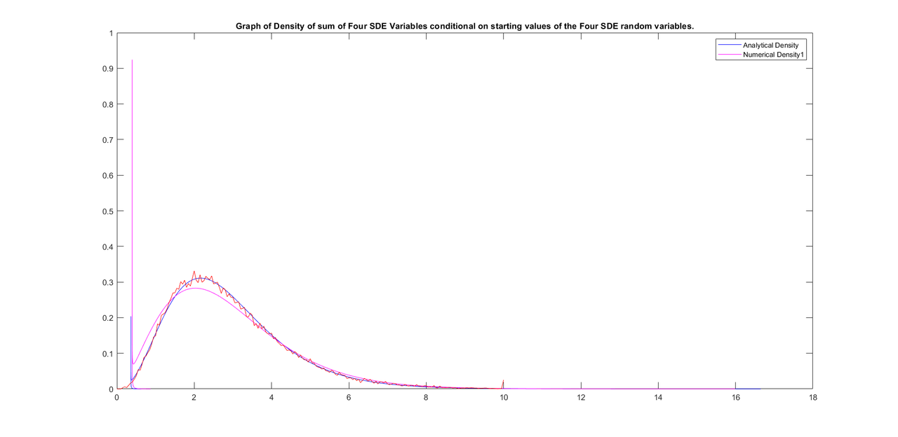](https://postimg.cc/4mRFQ0n0)

.

.

.

.

Here is some data from last of program.

Look at comparison of moments

YCentralMoments =

   1.0e+04 *

  Columns 1 through 3

                   0   0.000219794209147   0.000370024257229

  Columns 4 through 6

   0.002508882838650   0.012650731519247   0.090538324672717

  Columns 7 through 8

   0.723009640996227   6.776333308097569

DataCentralMoments =

   1.0e+04 *

  Columns 1 through 3

                   0   0.000227652165313   0.000407474455266

  Columns 4 through 6

   0.002752460318651   0.014102406754993   0.098146527108614

  Columns 7 through 8

   0.730693303149779   6.010112373871647

---

### #3083 — Amin (Topic Author)
*May 15, 2026, 12:50 PM*

Friends, I think this program is a considerable improvement over the previous program but I do think there is room for
further improvement (especially since I need to work further with hermites inversion part of the program) and I will
continue to work on it for next few weeks and hope that we would really have something valuable at the end. So if you
are not perfectly satisfied with this version, please wait for the next version and I hope that next version  would be
better.

---

### #3084 — Amin (Topic Author)
*May 15, 2026, 5:25 PM*

Friends, please use this very slightly changed function in place of another function of this
name. InvertTheHermitePolynomials02 instead of InvertTheHermitePolynomials

.

.

.

.

```
function [ZBest] = InvertTheHermitePolynomials02(Ytarget,ZGuess,coeff,Order)

if(ZGuess>0)
ZUp=ZGuess*1.4;
ZDown=ZGuess*.6;
end
if(ZGuessZUp)
    Ztry=ZUp;
end
if(Ztry<ZDown)
    Ztry=ZDown;
end

%[Ytry,dYtrydZ]= EvalHermiteSeriesH0(coeff,Ztry,Order,Hz);
[Ytry,dYtrydZ] = EvalZSeriesZ0(coeff,Ztry,Order)
defectNew= abs(Ytarget-Ytry);

if(defectNew<defectBest)
YBest=Ytry;
ZBest=Ztry;
defectBest=defectNew;
end

end

end

```

---

### #3085 — Amin (Topic Author)
*May 15, 2026, 5:55 PM*

Forgot the functions that are needed.

.

.

```
function [Y,dYdZ] = EvalZSeriesZ0(Coeffs,Z0,Order)

Y=0;
dYdZ=0;
for hh=1:Order+1
    Y=Y+Coeffs(hh).*Z0.^(hh-1);
    if(hh<Order+1)
        dYdZ=dYdZ+(hh).*Coeffs(hh+1).*Z0.^(hh-1);
    end
end

end

```

.

.

.

```
function [Xh,dXh] = EvalHermiteSeriesH0(Coeff,Z,Order,Hz)

%Hz=HermitePoly(Order);

%Xh=Coeff(1);
Xh(1:length(Z))=0;
dXh(1:length(Z))=0;
for nn=1:Order+1
    for mm=1:nn
        Xh(:)=Xh(:)+Coeff(nn).*Hz(nn,mm).*Z(:).^(mm-1);
    end
    for mm=1:nn-1
        dXh(:)=dXh(:)+Coeff(nn).*(nn-1)*Hz(nn-1,mm).*Z(:).^(mm-1);
    end
end

end
```

.

.

.

I have not changed the following function but in case I did, I am attaching it again.

.

.

```
function []= ConditionalDensityHermitesNvariate0A08B()

%SV SDE is
%dV(t)=mu1 V(t)^beta1 dt+ mu2 V(t)^beta2 dt + sigma0 V(t)^gamma dZ(t)
%In mean reverting SDEs we ususally have
%mu1= kappaV * thetaV
%beta1=0
%mu2=-kappa
%beta2=0
%The present program works only when drift is zero (for pure noises)
%meaning mu1=0 and mu2=0;

Order=7;
%NDim=4;%Three assets and one SV.
%NMomentsY=Order+1;
%NMomentsX=Order+1;

%%%%%%%%%%%%%%%%%%%5
dt=.03125/2/8;
Tt=64*2*8;
T=Tt*dt;
seed0=12130649;
%seed0=94210876;
%seed0=14210876;
%seed0=53612297
%seed0=97459782
rng(seed0, 'twister')
paths=50000;
TT1=100*8/2; %Transition distribution start
TT2=256*8/2; %Transition distribution end

%%%%%%%%%%%%%%%%%%%5

NDims=3;

V0(1)=1.000;%.32;
V00(1)=V0(1);

%SDE1
 thetaV(1)=1.0;%.045;%1;%.04;
 kappaV(1)=0.000;%1.5;%1.5;
 gamma(1)=.75;%.75
 sigma0(1)=.55;%.35

%
% %SDE2%
%thetaV(1)=.90;%.045;%1;%.04;
%kappaV(1)=1.000;%1.5;%1.5;
%gamma(1)=.75;%.75
%sigma0(1)=.85;%.35
%
% %SDE3%
 thetaV(1)=1.350;%.045;%1;%.04;
 kappaV(1)=.35000;%1.5;%1.5;
 gamma(1)=.75;%.75
 sigma0(1)=.95;%.35

mu1(1)=kappaV(1)*thetaV(1);
mu2(1)=-kappaV(1);
beta1(1)=0;
beta2(1)=1;

V0(2)=1.000;%.32;
V00(2)=V0(2);

%SDE1
thetaV(2)=1.0;%.045;%1;%.04;
 kappaV(2)=0.000;%1.5;%1.5;
 gamma(2)=.65;%.75
 sigma0(2)=.5;%.35

%SDE2
%thetaV(2)=1.0;%.045;%1;%.04;
%kappaV(2)=0.000;%1.5;%1.5;
%gamma(2)=.65;%.75
%sigma0(2)=.65;%.35
%
% %SDE3
 thetaV(2)=.850;%.045;%1;%.04;
 kappaV(2)=.35000;%1.5;%1.5;
 gamma(2)=.65;%.75
 sigma0(2)=.85;%.35

mu1(2)=kappaV(2)*thetaV(2);
mu2(2)=-kappaV(2);
beta1(2)=0;
beta2(2)=1;

V0(3)=1.000;%.33;
V00(3)=V0(3);

%SDE1
thetaV(3)=1.0;%.045;%1;%.04;
 kappaV(3)=0.000;%1.5;%1.5;
 gamma(3)=.85;%.75
 sigma0(3)=.55;%.35
%
% %SDE2
%thetaV(3)=.750;%.045;%1;%.04;
%kappaV(3)=0.000;%1.5;%1.5;
%gamma(3)=.95;%.75
%sigma0(3)=.45;%.35
%
%
% %SDE3
 thetaV(3)=1.150;%.045;%1;%.04;
 kappaV(3)=.5000;%1.5;%1.5;
 gamma(3)=.95;%.75
 sigma0(3)=.75;%.35

mu1(3)=kappaV(3)*thetaV(3);
mu2(3)=-kappaV(3);
beta1(3)=0;
beta2(3)=1;

Corr1(1,1)=1;
Corr1(1,2)=.75;
Corr1(1,3)=.65;
Corr1(2,2)=1;
Corr1(2,1)=.75;
Corr1(2,3)=.55;
Corr1(3,1)=.65;
Corr1(3,2)=.55;
Corr1(3,3)=1;

% Corr1(1,1)=1;
% Corr1(1,2)=-.25;
% Corr1(1,3)=-.2;
% Corr1(2,2)=1;
% Corr1(2,1)=-.25;
% Corr1(2,3)=-.35;
% Corr1(3,1)=-.2;
% Corr1(3,2)=-.35;
% Corr1(3,3)=1;

%87%Corr1(1:3,1:3)=0.0;

R=chol(Corr1);

%        R(1:3,1:3)=0;
%        R(1,1)=1;
%        R(2,2)=1;
%        R(3,3)=1;

V0(4)=1.000;%.44;
V00(4)=V0(4);
thetaV(4)=1.0;%.045;%1;%.04;
kappaV(4)=1.000;%1.5;%1.5;
mu1(4)=kappaV(4)*thetaV(4);
mu2(4)=-kappaV(4);
beta1(4)=0;
beta2(4)=1;
gamma(4)=.95;%.75
sigma0(4)=.55;%.45

%%%%%%%%%%%%%%%%%%%%%%%%%%%%%%%%%%%%%%%%%%%%%%%%%%%%%%%%%%%%%%%%%%%%%5
for nn=1:NDims
V(1:paths,nn)=V0(nn);
end
%V(1:paths,1:NDims)=V0(1,1:NDims);

Random1(1:paths/2,1:NDims)=0;

for tt=1:Tt

    Random2(1:paths/2,1:NDims)=randn(size(Random1));
    Random2(paths/2+1:paths,1:NDims)=-Random2(1:paths/2,1:NDims);

    %Random2=R'*Random2;
    random1=Random2*R(:,1);
    random2=Random2*R(:,2);
    random3=Random2*R(:,3);

    Random2(:,1)=random1;
    Random2(:,2)=random2;
    Random2(:,3)=random3;

    for nn=1:NDims

    V(1:paths,nn)=V(1:paths,nn)+ ...
        (mu1(nn).*V(1:paths,nn).^beta1(nn) + mu2(nn).*V(1:paths,nn).^beta2(nn))*dt + ...
        sigma0(nn).*V(1:paths,nn).^gamma(nn) .*Random2(1:paths,nn)*sqrt(dt) + ...
        (mu1(nn).*beta1(nn)*V(1:paths,nn).^(beta1(nn)-1) + mu2(nn).*beta2(nn).*V(1:paths,nn).^(beta2(nn)-1)).* ...
        ((mu1(nn).*V(1:paths,nn).^beta1(nn) + mu2(nn).*V(1:paths,nn).^beta2(nn))*dt^2/2 + ...
        sigma0(nn).*V(1:paths,nn).^gamma(nn) .*Random2(1:paths,nn)*(1-1/sqrt(3))*dt^1.5) + ...
        .5*(mu1(nn).*beta1(nn).*(beta1(nn)-1).*V(1:paths,nn).^(beta1(nn)-2) +
mu2(nn).*beta2(nn).*(beta2(nn)-1).*V(1:paths,nn).^(beta2(nn)-2)).* ...
        sigma0(nn)^2.*V(1:paths,nn).^(2*gamma(nn)).*dt^2/2 + ...
        sigma0(nn).*gamma(nn).*V(1:paths,nn).^(gamma(nn)-1) .* ...
        ((mu1(nn).*V(1:paths,nn).^beta1(nn) + mu2(nn).*V(1:paths,nn).^beta2(nn)).*Random2(1:paths,nn).*1/sqrt(3)*dt^1.5
+ ...
        sigma0(nn).*V(1:paths,nn).^gamma(nn) .*(Random2(1:paths,nn).^2-1)*dt/2) + ...
        .5*sigma0(nn).*gamma(nn).*(gamma(nn)-1).*V(1:paths,nn).^(gamma(nn)-2) .* ...
        sigma0(nn).^2.*V(1:paths,nn).^(2*gamma(nn)) .*Random2(1:paths,nn).*1/sqrt(3)*dt^1.5;

    V(V(:,nn)<=0)=.0001;

    if(tt==TT1)
        Xin(1:paths,nn)=real(V(1:paths,nn));
    end

    if(tt==TT2)

        Xin2(1:paths,nn)=real(V(1:paths,nn));
    end

    end

end

Yin(1:paths)=0.0;

for pp=1:paths
for mm=1:NDims
    Yin(pp)=Yin(pp)+Xin2(pp,mm);%-Xin(pp,mm);
%-Xin(pp,mm);
end
end

randn()

str=input("I have reached stone 1");

%%%%%%%%%%%%%%%%%%%%%%%%%%%%%%%%%%%%%%%%%%%%%%%%%%5

Order=7;
clf;
[BetaCorrH,YCoeffH,XCoeffH,HCorrXX] = CalculateHermiteCorrelations0NA04(Xin,Yin,paths,NDims);
YCoeffZ(1:Order+1)= ConvertHermiteSeriesToZSeries01(YCoeffH(1:Order+1),Order);

%[BetaCorrH0,YCoeffH0,XCoeffH0,HCorrXX0] = CalculateHermiteCorrelations0NA04Moments(Xin,Yin,paths,NDims);
%YCoeffZ0(1:Order+1)= ConvertHermiteSeriesToZSeries01(YCoeffH0(1:Order+1),Order);

[HCorrXY,YCoeffH,HEigenvecs] = CalculateHermiteCorrelations0NA04Eigs(Xin,Yin,paths,NDims);

%HCorrXX(:,:)=0.0;

BetaCorrH

%randn
%CorrXX1st
str=input("I have reached Stone2");

[cn,ch0] = Calculate2DZSeriesNDimCorrectedOrtho(YCoeffH,HCorrXY,HEigenvecs,NDims,Order);

str=input("I have reached stone 2.5");

[cn3,ch]=CalculateGaussianCorrelationFromHermiteCorrelationsNDim02(YCoeffH,XCoeffH,BetaCorrH,HCorrXX,NDims,Order);

%%%%%%%%%%%%%%%%%%%%%%%%%%%%%%%%%%%%%%%%%%%%%%%%%%%%%%%%%%%%%%%%%%%%%%%%%%%%%%%%%%%%%%%
%Set1
V10(1)=.85;%.65;%
V10(2)=1.2;
V10(3)=.85;
V10(4)=1.25;

% %Set2
V10(1)=.75;
V10(2)=1.2;%1.2;
V10(3)=.7;
V10(4)=.65;
% % % % %
% % % % % %Set3
   V10(1)=1.25;
   V10(2)=1.35;%1.2;
   V10(3)=1.25;
   V10(4)=1.4
% % % % % % % % % % %
% % % % % % % % %
% V10(1)=.85;
% V10(2)=.81;%1.2;
% V10(3)=.77;
% V10(4)=.7

%%%%%%%%%%%%%%%%%%%%%%%%%%%%%%%%%%%%%%%%%%%%%%%%%%%%%%%%%%%%%

for nn=1:NDims
V(1:paths,nn)=V10(nn);
end
%V(1:paths,1:NDims)=V0(1,1:NDims);

Random1(1:paths/2,1:NDims)=0;

for tt=1:TT2-TT1

    Random2(1:paths/2,1:NDims)=randn(size(Random1));
    Random2(paths/2+1:paths,1:NDims)=-Random2(1:paths/2,1:NDims);

    random1=Random2*R(:,1);
    random2=Random2*R(:,2);
    random3=Random2*R(:,3);

    Random2(:,1)=random1;
    Random2(:,2)=random2;
    Random2(:,3)=random3;

    for nn=1:NDims

    V(1:paths,nn)=V(1:paths,nn)+ ...
        (mu1(nn).*V(1:paths,nn).^beta1(nn) + mu2(nn).*V(1:paths,nn).^beta2(nn))*dt + ...
        sigma0(nn).*V(1:paths,nn).^gamma(nn) .*Random2(1:paths,nn)*sqrt(dt) + ...
        (mu1(nn).*beta1(nn)*V(1:paths,nn).^(beta1(nn)-1) + mu2(nn).*beta2(nn).*V(1:paths,nn).^(beta2(nn)-1)).* ...
        ((mu1(nn).*V(1:paths,nn).^beta1(nn) + mu2(nn).*V(1:paths,nn).^beta2(nn))*dt^2/2 + ...
        sigma0(nn).*V(1:paths,nn).^gamma(nn) .*Random2(1:paths,nn)*(1-1/sqrt(3))*dt^1.5) + ...
        .5*(mu1(nn).*beta1(nn).*(beta1(nn)-1).*V(1:paths,nn).^(beta1(nn)-2) +
mu2(nn).*beta2(nn).*(beta2(nn)-1).*V(1:paths,nn).^(beta2(nn)-2)).* ...
        sigma0(nn)^2.*V(1:paths,nn).^(2*gamma(nn)).*dt^2/2 + ...
        sigma0(nn).*gamma(nn).*V(1:paths,nn).^(gamma(nn)-1) .* ...
        ((mu1(nn).*V(1:paths,nn).^beta1(nn) + mu2(nn).*V(1:paths,nn).^beta2(nn)).*Random2(1:paths,nn).*1/sqrt(3)*dt^1.5
+ ...
        sigma0(nn).*V(1:paths,nn).^gamma(nn) .*(Random2(1:paths,nn).^2-1)*dt/2) + ...
        .5*sigma0(nn).*gamma(nn).*(gamma(nn)-1).*V(1:paths,nn).^(gamma(nn)-2) .* ...
        sigma0(nn).^2.*V(1:paths,nn).^(2*gamma(nn)) .*Random2(1:paths,nn).*1/sqrt(3)*dt^1.5;

    V(V(:,nn)<0)=.0001;

    %if(tt==TT1)
    %    XXin(1:paths,nn)=V(1:paths,nn);
    %end

    if(tt==TT2-TT1)

        XXin2(1:paths,nn)=V(1:paths,nn);
    end

    end

end

Yin2(1:paths)=0.0;

for pp=1:paths
for mm=1:NDims
    Yin2(pp)=Yin2(pp)+XXin2(pp,mm);%-V10(mm);
end
end

randn()

str=input("I have reached stone 4");

NoOfBins=200;
MaxCutOff=10;

[XDensity,IndexOut,IndexMax] = MakeDensityFromSimulation_Infiniti_NEW(Yin2,paths,NoOfBins,MaxCutOff );

for qq=1:8

    DataMoments(qq)=sum(Yin2(:).^qq)/paths;

end

%%%%%%%%%%%%%%%%%%%%%%%%%%%%%%%%%%%%%%%%%%%%%%%%%%%%%%%%%%%%%%%%%%%%%%%%%%%%%%%%%%%%%%%5

for nn=1:NDims
    [Zx0(nn)] = CalculateZgivenXAndHSeriesCoeffs(V10(nn),XCoeffH(1:Order+1,nn),Order);
end

Zx00(:,1)=Zx0(:);
%for nn=1:NDims
%    Zx1(nn,1:7)=Zx0(nn);
%end
%Below Zx1 are calculated as starting guess for hermite inversion algorithm

 Zx1(:,1)=HEigenvecs(:,:,1)'*Zx00;
 Zx1(:,2)=HEigenvecs(:,:,2)'*Zx00;
 Zx1(:,3)=HEigenvecs(:,:,3)'*Zx00;
 Zx1(:,4)=HEigenvecs(:,:,4)'*Zx00;
 Zx1(:,5)=HEigenvecs(:,:,5)'*Zx00;
 Zx1(:,6)=HEigenvecs(:,:,6)'*Zx00;
 Zx1(:,7)=HEigenvecs(:,:,7)'*Zx00;

%Below hermites are calculated in C0
for nn=1:NDims
 [Hzx(nn,1:Order)] = EvalHermiteArrayH1(Zx0(nn),Order);
end

for nn=1:NDims
 [Zzx(nn,1:Order)] = Zx0(nn).^(1:Order);
end

%Below hermite polynomials are calculated in Chh basis
for hh=1:Order

    OHzx(:,hh)=HEigenvecs(:,:,hh)'*Hzx(:,hh);
    OZzx(:,hh)=HEigenvecs(:,:,hh)'*Zzx(:,hh);
end
% Result(1:NDims,1:Order)=0.0;
% for hh=1:Order
%     for nn=1:NDims
%         a=OHzx(nn,hh);
%         b(1:3,1)=HEigenvecs(:,nn,hh);
%         Result(1:3,hh)=Result(1:3,hh)+OHzx(nn,hh).*b(1:3,1);
%     end
% end

%Hzx
%Result

%str=input("Look at comparison of result and Hzx");

for hh=1:Order
for nn=1:NDims
    OXHCoeff(1:Order+1,nn)=0.0;
    OXHCoeff(hh+1,nn)=1.0;
    %[Zx0O(nn,hh)] = CalculateZgivenXAndHSeriesCoeffsHH(OHzx(nn,hh),OXHCoeff(1:Order+1,nn),Order,Zx1(nn,hh));
    [Zx0O(nn,hh)] = InvertTheHermitePolynomials(OHzx(nn,hh),Zx1(nn,hh),OXHCoeff(1:Order+1,nn),Order);

%     OZZCoeff(1:Order+1,nn)=0.0;
%     OZZCoeff(hh+1,nn)=1.0;
%     %[Zx0O(nn,hh)] = CalculateZgivenXAndHSeriesCoeffsHH(OHzx(nn,hh),OXHCoeff(1:Order+1,nn),Order,Zx1(nn,hh));
%     [Zx0O2(nn,hh)] = InvertTheHermitePolynomials(OZzx(nn,hh),Zx1(nn,hh),OZZCoeff(1:Order+1,nn),Order);

OXHCoeff(1:Order+1,nn)=0.0;
    OXHCoeff(hh+1,nn)=1.0;
    %[Zx0O(nn,hh)] = CalculateZgivenXAndHSeriesCoeffsHH(OHzx(nn,hh),OXHCoeff(1:Order+1,nn),Order,Zx1(nn,hh));
    [Zx0O2(nn,hh)] = InvertTheHermitePolynomials02(OHzx(nn,hh),Zx1(nn,hh),OXHCoeff(1:Order+1,nn),Order);

end
end
Zx1
Zx0O

str=input("Look at inverted hermites");

bhh=YCoeffH(1);
for nn=1:NDims
    for hh=1:Order
        bhh=bhh+HCorrXY(nn,hh).*OHzx(nn,hh).*YCoeffH(hh+1);
    end
end

%%%%%%%%%%%%%%%%%%%%%%%%%%%%%%%%%%%%%%%%%%%%%%%%%%%%%%%%%%%%%%%%%%%%%%%%%%%%%%%%5
% NDim1=2;
% Vin(1:paths,1)=Xin(1:paths);
% Vin(1:paths,2)=Yin(1:paths);
% [bCoeffHH] = CalculateMultivariateHermiteSeriesAndDensities02Wmt(Vin,NDim1,Order);
%
% bCoeffHH
%
% str=input("Look at bCoeffHH");
%
% cch(1:Order+1)=bCoeffHH(1:Order+1,1,2);
%
%
% [Zh(1,1:Order+1)] = EvalHermiteArrayH0(Zx0,Order);
%
%
% dd(1)=0.0;
% for hh=1:Order+1
%     dd(1)=dd(1)+cch(hh).*Zh(1,hh);
% end
%
% dd(1)=dd(1)+bCoeffHH(1,2,2)
% dd(2:Order+1)=bCoeffHH(2:Order+1,2,2);
%
%
%%%%%%%%%%%%%%%%%%%%%%%%%%%%%%%%%%%%%%%%%%%%%%%%%%%%%%%%%%%%%%%%%%%55

%[bh1] = CalculateHermiteConditionalDensityGivXs(cn,Zx0,YCoeffH,YCoeffZ,ch,Order,NDims)
%[bh2] = CalculateHermiteConditionalDensityGivXs(cn2,Zx0,YCoeffH0,YCoeffZ0,ch0,Order,NDims)
[bh3] = CalculateHermiteConditionalDensityGivXs(cn3,Zx0,YCoeffH,YCoeffZ,ch,Order,NDims)
[bh1] = CalculateHermiteConditionalDensityGivXsOrtho(cn,Zx0O,YCoeffH,YCoeffZ,ch0,Order,NDims);
[bh2] = CalculateHermiteConditionalDensityGivXsOrtho(cn,Zx0O2,YCoeffH,YCoeffZ,ch0,Order,NDims);

%[bh1] = FixTheHermiteSeriesDensity(bh1,Order);
%[bh2] = FixTheHermiteSeriesDensity(bh2,Order);
%[bh3] = FixTheHermiteSeriesDensity(bh3,Order);

%The zeroth Hermite polynomials for orthogonal case is borrowed from older
%calculations without orthogonality

bh1(1)=bh3(1);
bh2(1)=bh3(1);

%%%%%%%%%%%%%%%%%%%%%%%%%%%%%%%%%%%%%%%%%%%%%%%%%%%%%%%%%%%%%%%%%%%%%%%%%%%%%%5
%ddz(1:Order+1)= ConvertHermiteSeriesToZSeries01(dd(1:Order+1),Order);
YCoeffz1(1:Order+1)= ConvertHermiteSeriesToZSeries01(bh1(1:Order+1),Order);
YCoeffz2(1:Order+1)= ConvertHermiteSeriesToZSeries01(bh2(1:Order+1),Order);
YCoeffz3(1:Order+1)= ConvertHermiteSeriesToZSeries01(bh3(1:Order+1),Order);

[YMomentsModel1]=CalculateMomentsOfZSeries(YCoeffz1(1),YCoeffz1(2:Order+1),Order,Order+1);

YMomentsModel1

DataMoments

str=input("Look at comparison of moments");

[cMu1,YCentralMoments]=ConvertRawMomentsToCentralMoments(YMomentsModel1,Order+1);
[cMu2,DataCentralMoments]=ConvertRawMomentsToCentralMoments(DataMoments,Order+1);

YCentralMoments

DataCentralMoments

str=input("Look at central moments");

clf;

%PlotZSeriesDensity(YCoeffZ(1),YCoeffZ(2:Order+1),'o')
%hold on

 PlotZSeriesDensity(YCoeffz1(1),YCoeffz1(2:Order+1),'b')

 hold on

PlotZSeriesDensity(YCoeffz2(1),YCoeffz2(2:Order+1),'g')

 hold on
 PlotZSeriesDensity(YCoeffz3(1),YCoeffz3(2:Order+1),'m')

 hold on
plot(IndexOut(1:IndexMax),XDensity(1:IndexMax),'r');

%PlotHermiteSeriesDensityAndRvGraph(YCoeffh(1),YCoeffh1(2:yOrder+1),'g')
title("Graph of Density of sum of Four SDE Variables conditional on starting values of the Four SDE random variables.")
%title(sprintf('V00 = %.3f; kappa=%.3f, theta=%.3f,gamma=%.3f,sigma=%.3f;V10=%.3f at TT1=%.3f;TT2=%.3f;Paths=%d ',V00,
kappaV, thetaV,gamma,sigma0, V10,(TT1*dt),(TT2*dt),paths));%,sprintf('theta= %f', theta), sprintf('kappa = %f',
kappa),sprintf('sigma = %f', sigma0),sprintf('T = %f', T));
legend({'Analytical Density','Numerical Density1'}, ...
    'Location','northeast')

str=input("This is the first version without altering the moments of conditional density")

hold off

%ch0

ch
end

```

.

.

.

---

### #3086 — Amin (Topic Author)
*May 15, 2026, 6:55 PM*

I simulated three SDEs and saved their paths at time T1 (these were Xk with K=3) and then I continued the simulation to
a later time T2 and from the paths at time T2, I found the value of sum of three SDE joint simulation paths and this was
variable to be conditionally predicted and I called it Y. The problem to solve is to find the conditional density of sum
$Y(T_2)\,=\,X_1(T_2)\,+\,X_2(T_2)\,+X_3(T_2)\,$ given the arbitrarily chosen values of$X1(T_1), X2(T_1), X3(T_1) \,$ . I
then did an independent monte carlo simulation of three densities from chosen values of$X1(T_1), X2(T_1), X3(T_1) \,$ .
and continued it for time$T2-T1$ (This gave me the true monte carlo conditional distribution of
$Y(T_2)\,=\,X_1(T_2)\,+\,X_2(T_2)\,+X_3(T_2)\,$ ). I overlaid the densities of analytic solution of density given as
$P(Y(T_2)|\,X_1(T_1)=x_1\,,\,X_2(T_1)=x_2\,,X_3(T_1)=x_3\,) $ and the monte carlo derived density of Y. Even though I
used three explaining variables, the logic is for arbitrary N variables. Just change NDim=3 to appropriate N and supply
SDE parameters.

Basically $Y(T_2)\,=\,X_1(T_2)\,+\,X_2(T_2)\,+X_3(T_2)$  and we are conditioning as

$$P(Y(T_2)|\,X_1(T_1)=x_1\,,\,X_2(T_1)=x_2\,,X_3(T_1)=x_3\,) $$

**The algorithm is very fast with almost zero training time ( less than a second for this data) as compared to machine
learning that may take days or even weeks to properly train the network and the output of algorithm is better than what
is mostly found out of  neural networks after several hundred hours of training. In our algorithm most time is used in
monte carlo simulations of data that is required for generation of variables and for finding the reference simulation
density(taken as true density for comparison) and not in training of the parameters.**

**Our algorithm has just knowledge of joint (random) data of$Y(T_2)$ and$X1(T_1), X2(T_1), X3(T_1) \,$ . And conditional
value of density$P(Y(T_2)|\,X_1(T_1)=x_1\,,\,X_2(T_1)=x_2\,,X_3(T_1)=x_3\,) $ is calculated by our algorithm.**

**I also want to notice that our predicted variable Y is sum of N variables in the above example so its variance and
higher moments continue to increase with increasing predictors, however, when we are trying to explain just one fixed
variable Y with N explaining variables correlated with Y, the predicted conditional density would continue to become
sharper with decreasing variance.**

 There are three sets of SDE parameters and four sets of starting values on which the density is conditioned. There are
both pure noises(CEV type SDEs) and mean reverting SDEs in the SDE parameters data sets.

In the legend of graphs, "Numerical density old algo" has to be read as "Analytical density old algo".

The correlations I have used for all of the simulations are given as

Corr1(1,1)=1;

Corr1(1,2)=.75;

Corr1(1,3)=.65;

Corr1(2,2)=1;

Corr1(2,1)=.75;

Corr1(2,3)=.55;

Corr1(3,1)=.65;

Corr1(3,2)=.55;

Corr1(3,3)=1;

All the Data of SDE parameters and starting values is given in the earlier program. Here are the twelve graphs I was
able to make. These graphs were made by amended matlab functions posted later in previous post.

.

.

.

[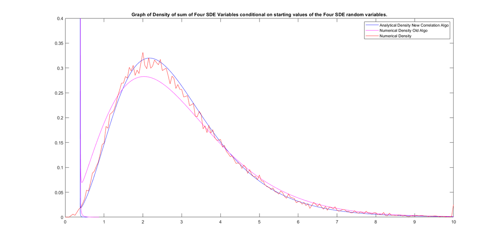](https://postimg.cc/BPvpRZCp)

[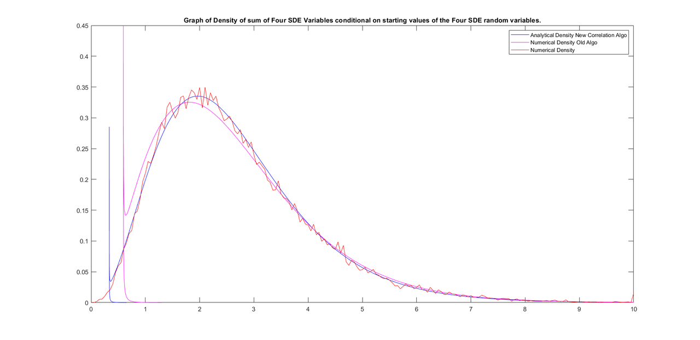](https://postimg.cc/XGLx2B9t)

[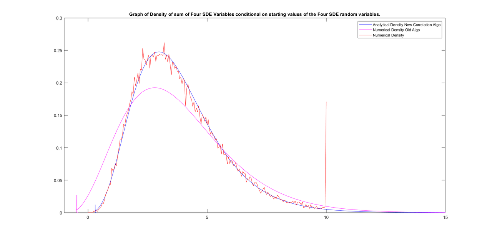](https://postimg.cc/47Pw8HpS)

[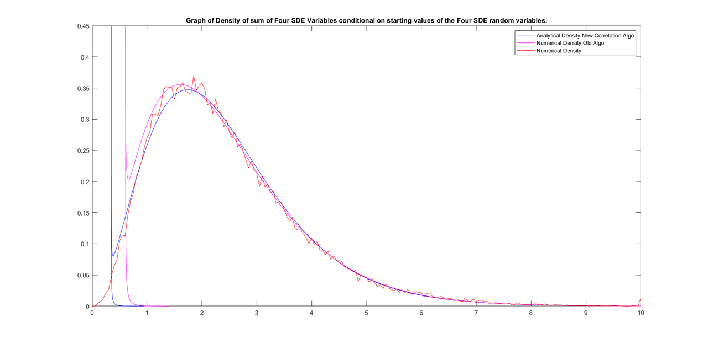](https://postimg.cc/qhwQm62Z)

[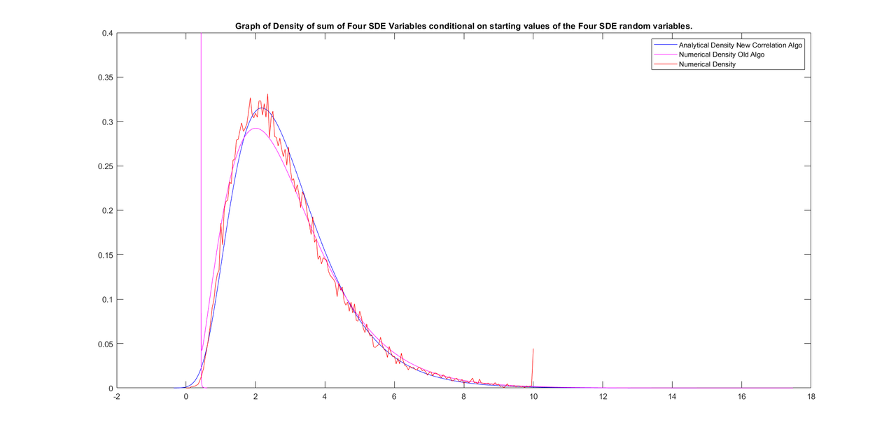](https://postimg.cc/PpyK6v16)

[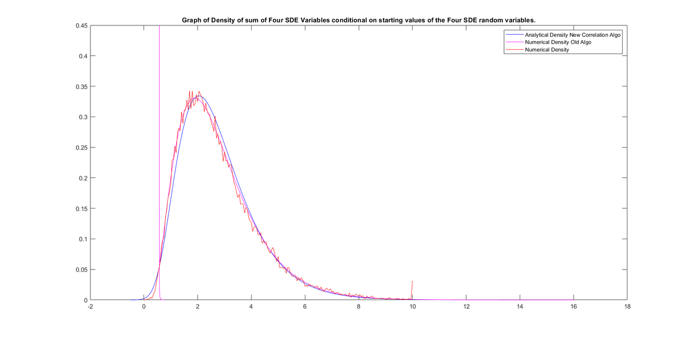](https://postimg.cc/dk6nWZG5)

[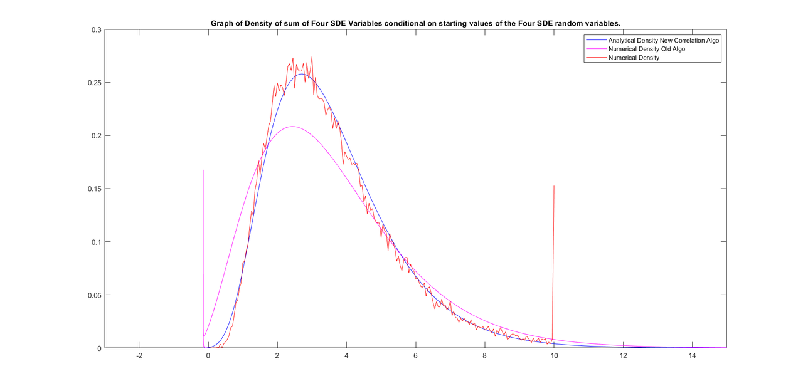](https://postimg.cc/1nBMWVDM)

[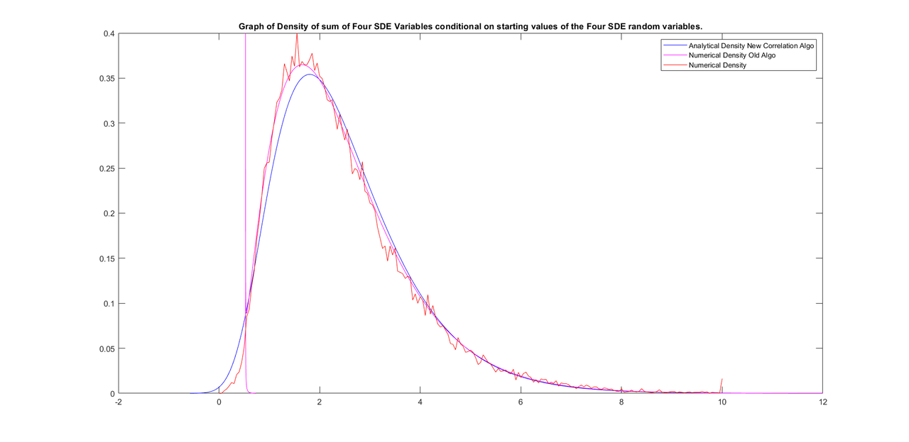](https://postimg.cc/WF8S9q07)

[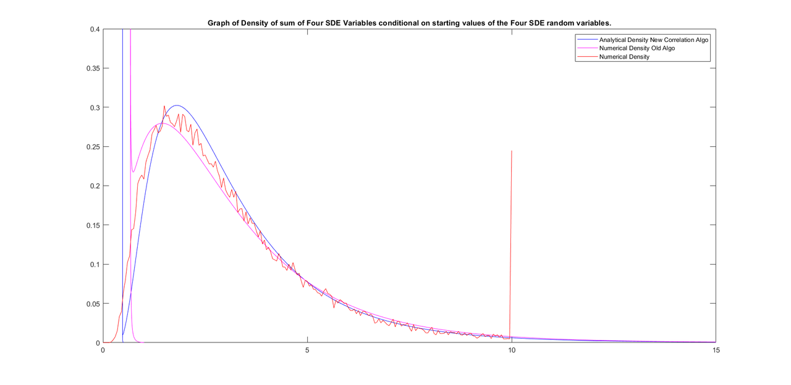](https://postimg.cc/vghXPx57)

[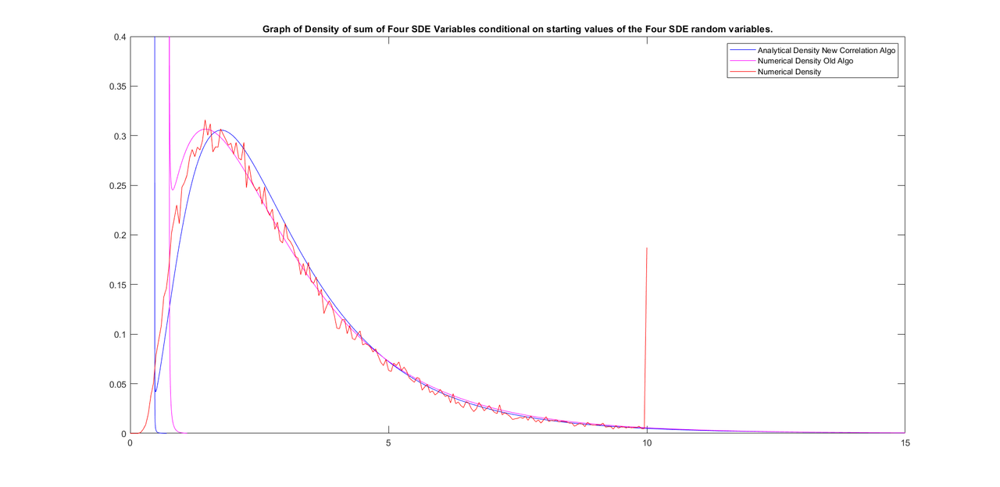](https://postimg.cc/cghTDtfR)

[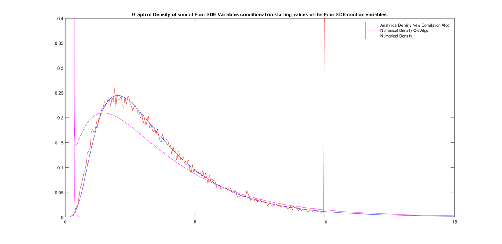](https://postimg.cc/YGR8XLQ1)

[](https://postimg.cc/phCk05KK)

---

### #3087 — Amin (Topic Author)
*May 16, 2026, 8:35 AM*

**Friends, many times I try my best to avoid writing about torture on me and about evil jews but when mind control
torture continues to increase everyday, I have to end my silence and speak about the evil. **

**Friends, for past more than a week, whenever I go out on my motorcycle, they continue to charge my back with microwave
devices fitted in the motorcycle and it is very difficult to sit on the motorcycle. When I sleep on my bed, they have
devices in the floor that start emitting microwaves and many times I shout from the pain of microwaves going inside my
anus. For past few days, I have sheer pain in my anus and it is very painful for me to walk and whenever I walk, there
is strong pain in my anus but still there are no signs of decrease in their activity to cause pain in my anus.**

**Friends, due to this cruel activity, I am forced to bring some of my old posts for new friends so people can know
about machinations of evil jews as these machinations do not feel like ending any time soon.**

**Friends, I really believe that in a civilized society of twenty first century there is absolutely no place for
connivance and machinations of a group of rich jews led by jewish elder billionaire  of mind control who have retarded,
at whim, thousands of talented intelligent people in America and abroad that they did not like. These cruel people are
inhuman animals even though they have learnt to adjust extremely well within American society. **

**These corrupt crooks are very powerful and they have already complete control over American army and a large number of
politicians. Due to this huge influence and power, it is very difficult to do anything to undo the cruel mind control
network led by jewish billionaire and his rich jewish cohort.**

I have suggested several times previously to good American people if nothing else works, please just ask some patriotic
American investigative journalists in major newspapers to run a comprehensive story about mind control network of jewish
billionaire and the nexus between rich jews and American defense and about tens of thousands of people that have been
retarded over past thirty years.

I want to invite patriotic American journalists from CNN, Washington Post, NewYork Times, Guardian or some other large,
reputed and responsible US or European media outlets to run a thorough story on machinations of evil jews led by jewish
billionaire and the  nexus of bad jews with American defense and their cruel mind control network that has retarded tens
of thousands of very intelligent Americans and foreigners all over the world.

**Since good people may not have the power to forcefully end the evil practices of the powerful nexus between evil
Jewish billionaire and US army crooks, only way to end the cruel and subhuman practices of the nexus seems to be
exposing them openly in US public and the public of other countries all across the world.**

** **

**I think it is important for us to make sure there is a better future of American children and children all across the
world and we leave them a legacy in which fairness and justice prevails as opposed to machinations, trickery and deceit
that has been unleashed in the society by the jewish billionaire and his rich jewish cohort.**

**What I am writing is my honest opinion even though a lot of friends might differ with it to some degree. I think it is
very important that all of us try to have rule of law, and good governance for the benefit of our country and society.
We promote freedom of speech and freedom of press in our societies so that people can criticize bad or wrong actions of
other people and make each other aware of their observations of wrongdoings by some people especially the ones in the
authority in the society while, obviously, every body has to try to investigate the truth on their own without blindly
believing anyone. The purpose of such criticism and related discussions is to try to root out bad practices from the
society and promote good ethics and practices.**

Another thing I want to suggest is that true patriotism is not about hiding bad practices taking place in our country
from others, instead it is about exposing such bad practices by unethical people in the public with the final goal that
these bad practices are rooted out from our societies.

**Now I will come to the point that I have been suggesting for years that there is a jewish billionaire and his rich
cohort who are behind indiscriminate mind control of a large number of intelligent American people and others . And a
large number of people in American defense have become a mercenary army of leprechauns that play in the hands of these
rich jews. These rich jews hire quite a few of senior officers from Pentagon and army after their retirement in their
large enterprises and these people are paid millions of dollars each and they enjoy very high social status. One of the
most important purpose of these retired officers is to convince their juniors who are still in official service and have
reached positions of authority to do illegal, extrajudicial and extraconstitutional mind control control of Americans
and others suggested by the rich jewish cohort. This thing is so well known in some jewish circles that many jews
continuously report thousands of people among intelligent students and many others who fall out with these jews for any
reason to mind control by American defense. You do not always have to be extra intelligent, sometimes falling out with a
jew who knows how to approach the rich jewish cohort will seal the fate of the victim by mind control forever. As
always, I would like to mention that there are large number of jews who are opposed to this practice and have absolutely
nothing to do with mind control of innocent people. Please let me specifically say again that there are many very rich
jews and billionaires who have nothing to do with mind control. But I definitely own that I am suggesting this rich
jewish billionaire and his cohort of rich jews are behind most of the mind control and this is a common knowledge in
many jewish circles and many people among these circles know who to approach for mind control of anyone they do not
like.**

**But what is even more alarming is that all the bad actors behind mind control including rich jewish cohort and
mercenary criminals in American defense, when exposed in public, have absolutely no remorse about their crimes and they
become even more adamant to use all machinatory tactics so that they can continue illegal and extrajudicial mind control
of innocent and intelligent people. They have lost all sense of good and evil and have no qualms about continuing the
evil practices at all. It seems many of these bad actors have no conception that retarding innocent human beings is a
wrong thing and an evil practice and they think that mind control of innocent people in the society they do not like is
indeed a good thing.**

I know that many good Americans want to end the bad practice of mind control of innocent people from their society
without any retribution against the bad actors behind such evil practices. The bad actors, on the other hand, have
absolutely no remorse about their evil actions and are ready to go to any limit to thwart the attempts of good people to
end mind control and they always try to undermine all good people and their actions towards amicably ending the evil of
mind control from American society. These bad actors are not willing to gracefully acknowledge and be thankful that good
American people do not want to hurt them beyond ending the inhuman practice of mind control from American society and
instead these bad actors are adamantly using all sort of machinatory and bellicose tactics so they can continue and
increase the evil of inhuman mind control of intelligent and innocent human beings.

I really want to suggest if all amicable attempts by good Americans to end mind control fail, it does not mean that they
have to yield to inhuman practices in our society by continuing to play nice. As there is very huge evidence about
existence of extra-judicial, extra-constitutional and cruel mind control and resulting retarding of very large number of
innocent people by American defense and a large number of stories are circulating in academia about people who were
targeted by American defense on behest of jewish cohort, I really believe that it is a great opportunity for some good
journalists in American and international media to write in detail about the hugely widespread evil of extrajudicial,
extraconstitutional, inhuman and cruel practice of mind control and also about nexus between some bad jews and corrupt
people in American defense that has been the dominating force behind this inhuman evil in our societies. I want to
request good American people that if all else fails, please motivate some brave and patriotic journalists to write in
complete detail about the evil of mind control. If it is not possible to write about this inhuman practice in American
newspapers due to possible reprisal from american defense, please break the news in some large British or European
newspaper. I am sure there is enough evidence about existence of mind control and related inhuman and cruel practices
that any serious journalist can firmly stand behind a well written article that completely exposes mind control and
associated cruelties and retarding of thousands of innocent persons by corrupt people in American defense. As I earlier
suggested Patriotism does not consist in saving any false pride or hiding evil practices of our countrymen, it consists
in rationally doing what is broader good for people in our societies by trying to put an end to evil practices.

**I will also request readers, for good of our societies, to let at least one journalist you know in the following
American, European and Pakistani newspapers about true nature of mind control and about my thread. **

**I also want to explain very clearly that I have been very severely criticizing bad jews and American defense but this
is limited to criticism in writing only. I write only on Wilmott forum where I also contribute my research and I do not
write anywhere else(at least for past 10-15 years).  I do not want anyone including myself to take the law in our own
hands. We have to respect the human dignity of every jew and every human being including those involved in bad practices
so even though I openly talk about bad people, it is not an invitation to anyone to take the law in their hands or hurt
any any human being. I will continue to fight for my cause of ending mind control of innocent and intelligent people but
I want people to completely respect all good jews and good people in American army(even though I wrongly generalized
about all of American defense as being bad, if you know any good and patriotic people there, please give them your
utmost respect) and make a political struggle for the law or government actions to take their course against corrupt and
evil people. I absolutely do not suggest any violence or anybody taking law in their hands.**

---

### #3088 — Amin (Topic Author)
*May 16, 2026, 8:36 AM*

For Friends who have recently started to look at my thread, I am copying two more following posts from the past.

[My Letter To HRW About My Human Rights Abuse](https://forum.wilmott.com/viewtopic.php?f=15&t=102298)

I really want to tell people that I have lived as a sane person due to support from friends otherwise I was even put to
physical torture before my case got known to a lot of good people. I am copying an experience of planned physical abuse
on the insistence of mind control agencies. I am copying context of the post as well.

The excerpt below  is from a past post stating obvious abuse by various psychiatrists on the insistence of mind control
agencies. The episode of physical abuse by beating me for more than twenty minutes is towards the end of this post:

Friends, I  wanted to remain busy with my research and not speak about mind control and its reasons and people behind
it. I simply wanted to concentrate on my research but whenever I have any progress in my research, my mind control and
related torture sharply increases to make more research impossible for me. I want to remain totally devoted to my
research and want friends to help me in doing that, I want everyone of all the good people in Europe or America who
follow my research to please tell two or three journalists about my research and my mind control. I will also request
European friends to ask their government and embassies to please keep a vigil about the matter and force corrupt
Pakistani govt. and establishment to not drug food in Lahore with mind control chemicals.

I was a very simple, very meek but also very hard working student at a large university in New York and joined the
university in 1997. My mind control started in very late 1997 when a racist jewish professor in Math department of my
university was threatened by my talent and approached the Jewish Billionaire to ask American defense to put me under
mind control. Even that long time ago, a large number of jews were very aware that this Jewish billionaire was a
Godfather of mind control and would approach the billionaire to recommend talented people to mind control from time to
time when they would be threatened by their talent. Over past twenty five years tens of thousands (if not more than a
hundred thousand) of innocent people mostly American nationals have been placed on mind control abuse by scumbags of
American defense on recommendation of Jewish billionaire. Most universities in US  have a couple of jews who continue to
keep eye on brilliant students of the university and recommend them to American defense through jewish billionaire when
they feel threatened  by the talent of the students due to any reason like their religion, race, ethnicity or just
because they are not jews.

I had told friends earlier that a jewish billionaire is Godfather of mind control. When my persecution started (in late
1997) at the university in New York which is a big time player in mind control of Muslims, blacks and foreigners, many
university officials were very pleased that they were getting written in good books of the billionaire jewish Godfather.
Though there are far richer billionaires in US who are staunchly opposed to mind control, they are not ready to shell
out hundreds of millions of dollars to bribe anyone to end mind control while mind control Godfather continues to give
large bribes to people to continue mind control. Many of the people related to defense in mind control are given
extremely high paying jobs in Godfather and his other jewish friends' companies after they retire from mind control and
Godfather is extremely generous towards them and it is well established and well known to scum in mind control that
after retarding muslims, blacks and others in their career, they will move to paradise(tens of people from army/Pentagon
who follow whims of Billionaire Godfather are given jobs paying milllons of dollars by Godfather and his jewish cohort
in several companies) after they retire. No wonder there is no let up in mind control whatever good people try.

We know in almost all classic folk lore stories evil is too strong and too sure of itself while good is mostly weak and
just trying to protect itself from evil who is bent on damaging and eradicating the weak and the poor good but it is the
weak and poor good that finally prevails. I want to tell good American friends that evil at this stage has become too
bold and thousands of talented people are retarded every year. And it is just not muslims and blacks that are on the
line, several thousands of brilliant whites are retarded across United States by mind control agency every year that has
become too emboldened due to lack of any accountability. Thousands of foreigners are also kept retarded in dozens of
countries including many European countries.

My only intention behind this post is that I want mind control to end from our societies. I do not have any joy in
mentioning that there are some bad jewish actors behind it. In American society there are a large number of jews who
have excelled in the professions of science, education, medicine and have made great contributions to our societies.
There are a very large number of jewish professors each of whom would have taught tens of thousands of students on top
of making extraordinary contributions to body of human knowledge through their great research. Then there are
accomplished jewish scientists whose work, research and inventions make our everyday life better. There are great jewish
doctors and surgeons who would treat countless sick people and make them recover from disease. The list of contributions
of jewish people to humanity is very long and it continues. Then there are a large number of ordinary jewish folks who
are known for their goodness and civility to other people in the society. When we know all of this, we do not want to
say anything anti-jewish to hurt the feelings of so many good jewish people. But I still have to say there are really
some bad people who are unconnected with most of the nice and accomplished jews and they instigate and continue cruel
mind control torture on talented people of other ethnicities, religions and countries based on their personal dislike
and hatred. My purpose is only to end the mind control victimization and torture on otherwise nice and talented people
and I do not have any hidden intentions beyond that. And I am sure American society knows very well about the
contributions of good Jews to both their country and broader humanity and my exposing some bad actors would never have
any bad effect of any kind on these good and nice jews who we all respect and who are our role models.I want to tell
friends something I have said before here that I am sure American society would eventually end the menace of mind
control from their and other countries. I want to request all good Americans and Europeans to come forward and invite
any investigative journalist you know to read my threads and ask them to help end the menace of mind control in our
societies through their investigative journalism. Without any accountability evil will continue to grow stronger and
then mind control would start to threaten even those people who consider themselves safe due to affiliations, status or
wealth.

https://forum.wilmott.com/viewtopic.php?t=99702&start=2325#p881807

https://forum.wilmott.com/viewtopic.php?t=99702&start=2325#p881808

https://forum.wilmott.com/viewtopic.php?t=99702&start=2325#p881886

https://forum.wilmott.com/viewtopic.php?t=99702&start=2340#p881951

Friends, this speaks volumes about headstrong cruelty of people in American defense and their Jewish billionaire backers
cohort that they are even more ready to show me cruelties even after people have a widespread knowledge of their
machinations and tactics. These evil people have no intention or desire to decrease their torture on me despite that I
have been telling tales of their inhuman torture on me over past twenty five years through various psychiatrists.

Please read the following two posts to see the context how I have been maltreated by various psychiatrists on behest of
mind control agencies over past 25 years.

Friends, I have been on forced antipsychotics for most of the time since early 1999. There were a few periods of a few
months when I remained free from antipsychotics. But other than two or three such periods, I have remained on
antipsychotics. It is very hard to feel well when huge antipsychotics are forced on someone who is mentally healthy. I
have also been detained forcefully tens of times whenever some of my neurotransmitters came back, the purpose of
detention was to take brilliant neurotransmitters out of my brain and send me back home with a relatively retarded brain
after the end of months long detentions. I have seen sheer trauma, torture and brutality on the hands of these
psychiatrists who connive with American defense and Pakistani military to declare me mentally ill so they can force
antipsychotics on me. I will be 51 this year and portion of my life that I lived under mind control has exceeded the
part of early life that I lived without mind control.

I have a phone meeting with the psychiatrist on 14th of June 2024. And I am sure the psychiatrist will try again to keep
me under medication or even increase my medication. Even after a large number of people have become aware of truth about
mind control and accompanying persecution by the psychiatrists, most psychiatrists are not the least worried that their
wrongdoing is being exposed in public.

I want to request good Americans to please protest to American defense, mind control agency, Pak army and relevant
psychiatrists to please end this cruel practice of declaring healthy people on antipsychotics and forcefully detaining
them up to years in their faciiities.

When they detain me, they have fixed all mind control gadgets and lasers in the psychiatric facility and they add all
mind control chemicals openly in food and psychiatric drugs. It is a very controlled environment in captivity and within
a month or so, they are able to remove all neurotransmitters from the brain of the victim. Every time I was detained,
they kept me in the psychiatric facility for 30-50 days. One psychiatric even detained me for ten months after I
returned from Britain. There are also instances of being detained for six months once and three months twice.

I really want to request American people again to please protest to their government and try to make sure that I am not
being detained again on totally flimsy psychiatric grounds.

.

[My Letter To HRW About My Human Rights Abuse](https://forum.wilmott.com/viewtopic.php?f=15&t=102298)

Above is a very incomplete account of how various psychiatrists continued to play in hands of Pakistan army to retard
me. It also does not cover all the time till year 2022 and the account stops several years earlier. I could not write
about last several years that were exceptionally brutal.

Friends, in a previous post I told friends how staff at a lady psychiatrist's hospital started beating me and abused me.
During past twenty three years, there have been many many instances of my obvious abuse by different psychiatrists. I
will describe some of those instances in this post.

When I came from United States and till fifteen years after that, my father would proudly ask me that I could see any
psychiatrist I wish. This was because Pakistan army was managing my persecution and they would force psychiatrists to
declare me schizophrenic and my father was told that every psychiatrist would be forced to cooperate. However, by chance
in 2016, I came  across a psychiatrist who was far better. I never told him that I was under mind control but whenever
he interviewed me, he always said after the interview that I was perfectly sane and mentally healthy. When my family
would force him to increase the dosage of antipsychotics, the doctor first told me that I should not live with my family
and make a comprehensive plan to support myself and become independent (such a plan could never work since Pakistan army
was threatening people in Pakistan to not give me any business and CIA was making sure that every contact I would reach
for work in Europe (and Singapore/ Japan /Australia) would be approached by CIA telling them that I was a very bad guy
and they must not do business with me. I had not told the doctor any such thing that intelligence agencies were after
me.)  When I told the good doctor how previous psychiatrists had abused me, he would tell me that this used to be a very
widespread practice in America hundred years ago to wrong mentally healthy humans by using corrupt psychiatrists as
instruments to detain them and strip them of their sanity. The good doctor I am talking about was American national with
Pakistan background who had practiced psychiatry in America for over twenty years and had returned to Pakistan. That
good doctor kept me on very low antipsychotics (1 mg resperidone per day) and that too on extreme insistence of my
family. It was only during that time of treatment by that doctor that I got my first break in research and I solved the
problem of high order monte carlo simulations (and analytic series solution of ODEs)  and posted that solution on this
thread. Ok, when my family was fed with the doctor, they detained me with another doctor. They detained me again two
years ago when I requested my family that I wanted to see the same doctor of my choice again( I have been detained every
year for past six or seven years by different doctors), they detained me through a different doctor. So my family now
stubbornly refuses to allow me to see a professional qualified American psychiatrist of my own choice and detains me
every time I try to approach him.

Now back to my obvious abuse by two other psychiatrists. I was detained by this doctor who was running a mental health
facility and was not a psychiatrist himself. At that time I did not use to walk very much and my blood pressure used to
be somewhat high. Since other antipsychotics had failed to retard me, doctor suggested I take aripperizole injections.
These injections affect the heart and also elevate blood pressure but doctor who wanted to retard me had no regard for
my health while pretending to cure me. In initial days of my detention, staff at the hospital when checked my blood
pressure told me high enough blood pressure in line with what I used to have but after I complained about aripperizole
and its effect on blood pressure the staff started doctoring blood pressure and started telling me that my blood
pressure was very good or even low. This is a post I wrote on another thread in this forum about it. How to safeguard my
research - Page 32 - wilmott.com

.

> Amin:
>
>
>
> Since I wrote about high blood pressure and mentioned high blood pressure before the hospital staff, they have started
to doctor blood pressure. Now, everyday they tell me that my blood pressure is 120/80 or 110/70. While they always told
me that my blood pressure was 130/90 or 140/100 prior to injections. I have never had so good blood pressure for years
that they have started to tell me now. Friends would recall a previous post when I could not sleep at night and had to
take a sleeping pill. When the dispenser came to me at night(The hospital has no MBBS who stays here at night in
Ramadan. Dr. AS used to stay here on some nights earlier but has been totally absent in Ramadan). When the dispenser
checked my blood pressure, he told me that it upper blood pressure is 110. I did not believe him at all. He asked me to
check on my own and put the stethoscope head assembly in my ears. I could easily tell that upper blood pressure was more
than 140 and lower was more than 100. The staff has already started to doctor blood pressure. My parents are going to
Saudi Arabia for two weeks in a few days. Now Dr. AS has the plan to hold me in detention while my parents are abroad. I
had a complete settlement with Dr. N and we(I and the doctor N) both agreed that I would be visiting him every fifteen
days and all modalities were agreed. I do think as a patient it is my right to choose the psychiatrist and Dr. AS( who
is incharge of facility Pav.) has no right to change the doctor after I have selected a psychiatrist and we both agree
on terms of any treatment. Dr. AS has imposed another psychiatrist Dr. M who has not even seen me and has already
started giving me injections and increased medicine without looking at my present condition. Dr. N had explicitly stated
that I would be free to leave if it were his facility. Most major reason for detaining me now is that Dr.AS wants to
continue to detain me while my parents are leaving for abroad for more than two weeks
.

Later after a few days, I was given a second aripperizole injection and released from detention. An injection was due
every fifteen days. My parents were in Saudi Arabia and I was living with my sister. She insisted after fifteen days
that I get a new aripperizole injection. I complained about too much side effects and other serious problems but my
sister insisted that I must get the injection. She talked to another doctor and the doctor told her that if his blood
pressure and pulse are fine, just give him the injection. I asked my sister that my blood pressure must be checked
before I get the new injection. We went to a small hospital close to her house and when my blood pressure was checked my
lower blood pressure was 110. The hospital staff recommended that I stay at the hospital in their care until my blood
pressure decreases. It was a totally random blood perssure check. When hospital staff came to know that I had been given
aripperizole injections, they told my sister to not give me those injections any more. My sister asked the staff to
relieve me and we came home but I was not given aripperizole injections after that.

But this is interesting that the psychiatrist was initially desperate to prescribe aripperizole despite that I had told
him about my heart and blood pressure problems and his staff was asked to doctor blood pressure so that I would accept
the injections.

Good thing is that only after stopping aripperizole, I started my treatment with good psychiatrist  doctor Naeem Aftab
(who is an American national) and he gave me enough relief that I was able to get a break in my research and solve the
problem of high order monte carlo simulations. I would always be thankful to Dr. Naeem Aftab for giving me relief at
such a crucial point in my life.

Yet another experience for abuse was with a seasoned psychiatrist who is known for his connections with Pakistan army.
When army dictator Pervaiz Musharraf ruled the country, he made this doctor the dean(president) of the university of
health sciences which regulates most medical universities in Pakistan. He had treated me for three years in year 2001.
He started my treatment without interviewing me and gave me electric shocks at the start to jumpstart the therapy. I was
given electric shocks for fifteen days in early 2001. I still recall that doctor would place a wooden wedge between my
teeth and then give me an injection and I still recall how numbness would move in my body from feet to the upper body
after the injection.

When going to that doctor's psychiatrist facility in 2001 I had to travel from Kot Addu to Rawalpindi. My family had
given me some drug in my food and I became unconscious after an hour or so. I still recall how I was begging my younger
brother to help me that I do not want to go anywhere and if he could help me but he like everybody else in the family
refused. Slowly drug in food showed its effect and I have absolutely no memory of being taken in my father's car despite
that it would have taken him at least eight hours to take me to Rawalpindi. Psychiatrist did not interview me and
detained me and started giving me electric shocks. I still recall how I defecated in my bed there and they had to wash
it.

Anyway, I was taken to this psychiatrist in 2017 again. He was very clearly told that I had been given antipsychotic
drug larjactil by another doctor and it backfired and I had extremely severe drug-induced jaundice. But the doctor was
so haughty and cavalier and so desperate to retard me that he still insisted that I must get the same drug larjactil and
said that it was not necessary that it would cause jaundice every time. Problem for the doctor was that most
antipsychotics had failed to retard me and he wanted to give me some potent antipsychotic that had not been well-tried
on me. Though the drug was given to me earlier and later discontinued, the doctor wanted to take his chances to retard
me and he had no regard for my health. This doctor is a big crony of Pakistan army and really wanted to please the
generals and therefore he decided to give me larjactil again. And as would already be obvious to most friends, after two
weeks, I started to show all signs of drug-induced jaundice again and my body and eyes were all yellow. My Biluribin
shot like anything. And it took more than two months to control jaundice after that. Though my biluribin came back to
normal after two months, several less known enzymes in my liver remained disturbed for several years after that and
continued to show as abnormal in my liver function test reports.

I have been detained more than 30 times by various psychiatrists during past twenty-five years on orders of Pakistan
Army. This is despite that I have never been violent all my life. I have never hit anyone in my adult life and I rarely
speak with anyone in a loud voice. I have never done anything like breaking a glass or any utensils that is associated
with sick people.

Here, I will recall an incident eight years ago when I myself approached a lady psychiatrist for help and how she abused
me, and her staff beat me for twenty minutes and then tied me and started my treatment with antipsychotics again.

I am recalling this from early 2015. They had previously put me on extremely high antipsychotics and my creativity was
all gone. I could barely do any intellectual work. At that time, I was able to convince my family to decrease the
injections and they had agreed since I had already lost most of my creativity and intellectual capability. I think mind
control agencies were also thinking that I had lost my creativity forever and they wanted to see if it was right time to
decrease my drugs and still make sure that I would remain intellectually dull after injections had ended.

But I slowly started to work on my research and started to regain my brain. When mind control agencies realized that I
had started to do better research, they asked my family to do something again to retard me. My father asked a
self-stylized religious saint to come to our house and take care of me. He came to our house with one of his followers
and told me that he wanted to give me injections and I would go to sleep for 24 hours, and they would take scans of my
brain to treat me, but I continued to beg and plead him, and I was able to convince him to allow me to leave the home in
my car. The supposed saint allowed me to leave since he was probably sure that he would get me later as I had no other
place to go other than my home and, therefore, I was able to convince him to let me go outside. When I left the house, I
made posts about the saint on at least two different forums from outside my house and pleaded for help. Enough people
were following my story even at that time and the saint had to leave. I also called my father when I was outside and
protested against this.

My family still remained very tense with me, and I was very afraid that they would force antipsychotics injections and
mind control drugs on me therefore I stayed one night out of the home. Here is the post I made when I was away on April
14th, 2015, 2:09 pm

[viewtopic.php?f=15&t=94796&start=315#p748191](https://forum.wilmott.com/viewtopic.php?f=15&t=94796&start=315#p748191)

"I am staying out of my home for the night since I had realized that my father will try to force me into detention again
and I would request a court tomorrow for stay order to stop my father from hospitalizing me forcefully again and I would
request the court that if there has to be a check on my mental health, it has to be done and investigated properly by a
psychiatrist of my choice and I should remain free at the same time. I do not want to be at the mercy of my father's
chosen psychiatrist as we saw in the past year that they continued to quote mental health laws and forcefully manipulate
me into taking injections. If my father forcefully hospitalized me, I would be cutoff from the outer world and they
would do whatever they like. My father's self-stylized saint(peer) had already hinted that he wanted to give me
injections that would put me to sleep for 24 hours and he had no argument for my mental sickness at all.”

Next day, on April 15, 2015, I went to Lahore High Court to find some help but I was told that I had to submit an
application that would be considered several weeks later when its turn would arrive. When I realized that there was no
possibility of help from the court, I decided to see a psychiatrist on my own. I was driving in Garden town Lahore where
I came across B**** psychiatric clinic and decided to see the psychiatrist Dr. N*** there. It was evening but the
psychiatrist still not had arrived there. I waited for an hour in the reception and then had a consultation with her. I
asked her to listen to my case carefully and then decide if I was sane enough and tell my parents about it. She said
that I seemed perfectly fine and asked me that she wanted to hear what my family had to say. I agreed and took an
appointment to visit her again at April 20, 2015. I took my mother on the planned day and my mother did not have
anything decisive to say about any disease other than that I did not eat at home. The psychiatrist asked me to visit her
after one week on 27 April 2015. The next week when I went again to visit the psychiatrist, on April 27, and was sitting
in the waiting room so that I could visit the psychiatrist on my turn. Another lady who was a psychologist came to me
and asked me to go with her in a different room to have a session with psychologist but I declined and said that I was
only interested in seeing the psychiatrist who had promised to see me again the earlier week. After five minutes, at
least four men came to the room and started besting me. They gave me slaps on my face with full force and gave me blows
and they continued to do it for more than fifteen minutes. I had never been beaten like that ever before in my life. All
this time, I was simply trying to raise my hand to somehow protect me. Since I was sitting on the sofa, only my face and
head were the target of slaps and blows. They were very violent with all sort of slaps and blows on my face as I earlier
mentioned that I was sitting and they were standing. . They literally continued to beat me and I continued to beg them
to stop. After fifteen minutes of beating me, they tied my legs and lifted me and put me on a bed in a room in the
psychiatrist facility and told me that doctor had gone to America and she could not see me. It was a complete lie and
the psychiatrist was in her office and was interviewing other patients when I arrived. I continued to ask them to loosen
the knots but they continued to make fun of me. I was totally surprised since Dr. N had behaved very nicely in the
previous meeting held at 20th with my mother and myself and I was sure she would declare me mentally sane on this
meeting. After I was kept tied for about half an hour, a new guard came and opened my hands and legs and said that they
would keep me at the facility for three days. The next day my medication in the form of pills started and I was also
given two more injections. I was given about nine pills at night and about eight pills in the morning. I was still not
given the opportunity to meet the psychiatrist N, and I was told several different things by different people including
that psychiatrist N had gone to America, and she had gone to Islamabad. About three days into my treatment, I saw
through the glass walls that psychiatrist N was interviewing her clients in her office. After seven days, I was asked to
meet psychiatrist N, and she said that she was unaware of the beating as she was in a meeting. Psychiatrist N also
assured me that I had no schizophrenia and previous doctors had very wrongly diagnosed me but it was a case of some
mania that she would properly treat this time.  Her staff continued to say that they were giving me drugs so that the
effect of other drugs given to me by previous psychiatrists would decrease.

Before my computer was taken away from me, I was able to take notes for two days in the hospital on my computer that I
write here. After first two days of medication, I was so extremely weak that I could barely walk and I had extreme
difficulty speaking.

“My Diary for past two days.

4/27/2015

I had two sessions with the doctor N previously on the 20th of April and once before at 13 or 14th of April. I remained
away from home during this time and second meeting on 20th of April, evening after the night when I remained away from
home. I had told the doctor about my circumstances in the first meeting with her. She had said that I looked perfectly
fine mentally but she needed to talk to my family. On 20th of April, I took my mother for a second joint session of
myself and my and the psychiatrist said, after the meeting, that said she really could not call me schizophrenic but she
needed one more sessions and asked me to come to her facility on 27th of April.

When I arrived at the psychiatric facility, a psychologist had asked me to accompany her which I did and on the way to
the her room, I asked for the reason, after which she replied that she wanted to take a session of mine. I told her that
I already had a session with another psyc hologist and also with a psychiatrist so I would prefer to have a new session
with the psychiatrist now. She agreed and I returned to the waiting room. I was sitting on a sofa in the waiting room on
27th at 8:00 PM (PST) in the line to see the psychiatrist when about five guards took control of me, while I was sitting
on a sofa in the waiting room to see the doctor, and gave me an injection. I was beaten and my legs and hands were very
strictly tied for more than hour. Though the doctor was in her consultation room and a lot of people were waiting to see
her, I was told again and again that doctor was not present at the facility.

In the previous two sessions, she had given the impression I was healthy mentally but she used force without
interviewing for the third time or seeing me and without requests to comply. If she was given any special information,
she should have talked to me about it and she should have verified with me any change in circumstances.

One injection was given around 8 PM when I arrived for third session with the doctor N. I really think that the doctor
was there since there was a large rush of visitors and her SUV was parked in the hospital but everybody among the staff
continued to say that doctor did not come to the facility this evening.

I was kept tied for more than one hour. I was taken tied from the waiting room to my room. All these rooms have video
cameras so you can ask Dr. N for a video of the events though she might make the excuse that cameras were not working.
One of the staff had mentioned when they brought me into a patient room in the facility, that everything was watched by
cameras.I would request people familiar with the matter to request her to show them footage of the cameras. Of course,
there could be many excuses that cameras were not working but I insist that cameras were working.

Good Mental health facilities try to avoid treating humans like this.

Another injection was given at night before I slept.

and my internet USB device was also taken. They simply took possession of everything out of my pockets and also took my
laptop.

When I asked why they gave me injections, one of the staff told me you were ?hyper? and I was totally surprised since I
was quietly sitting on the sofa in the waiting lounge for the doctor. I was told that I would stay in the hospital for
three days. I am sure this matter can be resolved who is lying and who is truthful once you look apt video footage of
cameras in most rooms.

4/28/2015

One injection was given in the morning. One injection was given around noon. All injections were IM (given in the
muscle.)

Unknown pills(some pills in the morning +5 pills around noon + 3 pills at night) were given and I was told,? We will
tell you know the names of these pills only when you leave.?

Computer was returned today but I was told that we did not take your mobile and they continued to say we never took my
mobile. My mobile was never returned( despite I always keep my mobile on me.)

I was also not given my EVO USB device and I was told you cannot write anything on internet. However the USB device was
returned to my mother at night.

I was told today by the psychologist that doctor N had gone to America and will come back after seven days and only then
she would be able to see you. I was told we are adjusting your medicine and see what was a good medicine. I was told
they were discussing the drugs with her on phone and skype There were several conflicting statements about where Dr. N
was. Somebody said she was just out of city and had gone to Islamabad.

When I asked my mother who is living with me at the hospital, I wanted a second opinion, because of beating and other
irresponsible behavior of the psychiatrist, my mother would make all sort of excuses while the staff would say that you
cannot leave the hospital until Dr. N arrives who is currently out of country.

Earlier today, I was told that I would live at the hospital for fifteen days and later I was told that I would live at
the facility for seven days. When I was tied, somebody had told me that I would live in the hospital for three days
only.

My mother told me please do not write anything wrong on internet otherwise, they would take your USB forcefully like Dr.
A had done more than one year ago. The purpose was to threaten me to not write about any maltreatment so that the doctor
would continue to freely manipulate me.

7-8 pills were given in the afternoon and similar number of pills were given at night. At many times during the day, I
could barely walk and had extreme difficulty speaking.”

---

### #3089 — Amin (Topic Author)
*May 16, 2026, 8:39 AM*

**I want to say that US defense has retarded several thousand people of exceptional talent in United States only to
please a rich Jewish Billionaire and his cohort of evil jews. This is obvious transgression of the constitution of
United States. Military has to be professional and should never be allowed to be above the law, justice and the
constitution. As a citizen of a third world country where military does every wrong thing possible, I can tell people of
United States that barriers to unconstitutional practices by military are only psychological and once the society starts
to condone these unconstitutional practices, these practices  become a norm in the society and then military has
absolutely no hesitation about indulging in unlawful practices. The level of moral courage required to stop
unconstitutional practices by military is probably not very high when these practices are only starting but once these
unconstitutional and unethical practices have taken root in a society, the level of moral courage required to stop them
would be extremely high. For example, Good people in my country are routinely abused and some even die at hands of Army
when they protest against wrong practices by the military here but still no good comes out of their sacrifices since
military has absolutely no psychological barriers against wrongdoings and a large part of the society now routinely
condones their wrong high-handed unconstitutional actions. Again coming towards the topic, I would like to say again
that US military has retarded several thousand people of exceptional talent in United States over past two decades. Even
if just lucky two or three people among the retarded thousands might have become successful like Bill Gates or Elon Musk
by doing something interesting and different, they could have contributed several hundred billion dollars to US economy.
Fools in US military are biting the very same hand that feeds them.**

**Is Mind Control a Legal Practice or is it Completely Illegal?**

**Americans should ask their Supreme Court to make a judgement and clearly outline whether extra-judicial mind control
and forever retarding of innocent civilians by American defense can be authorized by American constitution. Can American
defense ever be allowed to retard even one innocent and law abiding human being (let alone thousands of them that are
retarded by American defense every year) by American Supreme Court. **

**American government very cleverly continued to officially (aka continued to brazenly lie about its existence) deny the
existence of any mind control program for decades. Only after mind control has taken root in the society and a practice
of bowing of ordinary civilians before the army and secret services has taken hold in the society that American defense
now accepts the existence of mind control behind doors. **

**Again what I mean to say is that mind control of innocent people by American defense is both extra-judicial and
extra-constitutional. Can a government person who has taken oath to serve American people ever allow something that is
both extra-judicial and extra-constitutional to exist in United States when it is exactly in his power and under his
discretion to end such extra-judicial, extra-constitutional, cruel and inhuman practices while still laying claim to
love for America and her people. According to my opinion, by allowing and perpetrating extra-judicial and
extra-constitutional mind control and retarding of innocent civilians, you are breaking the constitution of Unites
States or in other words, you are becoming a traitor to United States. **

**Let us ask a question. Can a high government official or American president decide to allow extra-judicial or
extra-constitutional practices in United States? Is such a government official not overstepping his authority when he
allows extra-judicial and extra-constitutional practices? Is there any check and balance on such acts and practices of
breaking the constitution of United States.    **

**American constitution was very carefully designed by forefathers of United States and all civil and individual
liberties very clearly protected in it with their great wisdom. Consequences of implicitly breaking the constitution and
letting such practices take root in the society can be extremely high especially for new and later generations when such
extra-judicial and extra-constitutional practices would become an accepted norm in the society. Once you let the camel
in the tent, Camel kicks you out of the tent and takes control of the tent. The act of providing justice cannot be left
to armies in any reasonably civilized society. Please, stop the implicit breaking of the US constitution otherwise 
everyone in the society would probably become vassals to rich and powerful billionaires who would be orchestrating mind
control of all of those ordinary citizens who have the courage to disagree with rich and powerful as has already started
to brazenly happen in American society. **

**True stories of machinations by evil jews against many Americans are considered heresy by general American public who
believes strongly in protecting the Jews at all cost and it is a long held tradition in United States to call even true
criticism against Jews as anti-semitic talk. These ungrateful evil and cruel jews, on the other hand, respond to this
great benevolence of Americans by retarding thousands of innocent American folks through mind control  because American
defense is a puppet in their hands. Knowledge about mind-control is well known in some jewish circles and many of them
they know who to approach in the community to start anybody's mind control and a large number of simple  good-natured
American folks are placed under mind control when some jew is displeased with them.

Even though American society keeps jews in very high regard, they are not gold-plated. Just like any other people or
race, some of them are extremely good human beings, some of them are extremely evil and some of them simply do not care.
They tend to be more intelligent and when this intelligence shows itself in the form of Einstein we see one of the
greatest human beings ever born but when this intelligence turns evil and machinatory we have exactly opposite form of
humanity like evil jewish billionaire godfather/goldfather and his rich jewish cohort who has taken complete control of
American army to advance their nefarious designs and have retarded thousands of innocent and intelligent people they did
not like. So respect has to be shown in abundance to good people but very carefully to evil people. When great respect
is shown to evil people, they become even more emboldened to advance their agendas based on hatred, venom,  poison and
malice.**

**I want friends to please protest to American defense that has become a puppet in the hands of rich jews.  Black sheep
in American defense behind mind control are given very prestigious jobs paying millions of dollars in Jewish companies
after they retire and rich jews want to block talented muslims, from being successful in United States with an iron
fist, they would start wielding some influence and start opposing American policies in Israel and they want to nip this
supposed evil in the bud. And American defense has no dearth of wannabees who desperately want to join the ranks of so
many others who have gotten extremely high paying jobs with great social status in jewish companies after retirement
from American defense. Please do not blindly believe me and find out somebody in your social circle(or well known to
somebody in your social circle) you know well and who is in mind control agency of US defense and ask them about my
allegations and your eyes would open forever about role of rich jews in United States and how they openly use mind
control on anyone they wish especially on tens of thousands of white Americans whose families have been living in US for
hundreds of years. If your eyes do not open forever, I am ready to take any blame you wish. Mind control is basis of
symbiotic relationship between American defense and rich and evil Jewish cohort. I think when they claim that
industrial-military complex is behind it, know in plain English it means that bad Jews of the billionaire and his cohort
are behind it. **

**Especially very talented American people in science and technology are forced to work in Jewish owned companies due to
fear of mind control. Many such people who want to leave are coldly told by administration to leave but their mind
control is initiated by American defense on insistence of jews right after they leave the jewish company and once they
know the reason behind mind control was that they tried to leave the jewish company against the will of the company
owners. And due to large number of such precedents well known to many professionals in many jewish companies, most of
the very talented people do not dare to leave the jewish companies against the will of administration since they know
very well that they would be instantly put on mind control by American defense who dances on the tunes of rich jews
since they want extremely high paying prestigious jobs with jewish companies having great social status. Please do not
believe a single word I say blindly but try to find out the actual truth on your own from authentic sources you know
well and you will find the truth that would open your eyes forever.**

**Many friends who are used to formal language all the time might be disturbed by my use of slang expletives for bad
people but after reading Einstein's letter to Marie Curie, I consider myself perfectly validated to use the word of scum
for American army and for bad jews who have no ethics and are ready to fall to every low level of humanity for some
material gain or due to their hatred, venom, poison or malice as in case of bad jews.

**

**Over past thirty years, lot of bad jews have developed a network in academia(with absolute apology to all the great
jewish people in academia) and when a victim has to be retarded most of the jews in the network start orchestrating
totally complete lies about the victim so that good people think that retarding the victim is indeed is a very good
thing. **

**And I want to tell people that this network of evil jews has greatly perfected itself over past thirty years and not
only muslims are retarded, everyone they do not like including europeans, blacks and a large number of white talented
Americans are retarded at whim by this network of emboldened evil jews. **

**I want to request all good people in American society and in european countries to end and thwart this gang of evil
jews who are bent on retarding intelligent people of every nation and creed they do not like.**

**Not everybody is the same, there are at the same time a large number of jews who have nothing to do with any of this
and many good jewish companies who do not follow any inhuman practice. But there is a close group of rich jews who are
actually involved in large scale mind control with American defsnse working as their proxy. Please try to know the truth
on your own.**

**I want to advise American defense to watch a lot of American movies and try to behave like heroes in those movies.
Instead people in American defense are short-tempered scumbags who became belligerent when anybody criticizes them.
Contrary to American and Western spirit of freedom of criticism and speech that we all cherish, these short-tempered
scumbags are unwilling to tolerate anything other than eulogies based on complete lies. Just like Henry Ford used to say
that you can buy any color of car as long as it is black, to these scumbags of American defense the freedom of speech
means that you can say anything you like as long it is a eulogy otherwise they become belligerent and start moving
thousands of people to silence someone who speaks the truth about them. Let us all of us start cursing Erdogan together
now.**

**When mature and deep people face some criticism, they respond by totally neglecting it if it is wrong. Immature,
shallow and short-tempered people respond to criticism by getting angry and deeply offended and start jerking like
psychos how to respond meanly to this criticism. American defense is full of such immature blokes and I am very sure
that intolerant and arrogant scum of American army will again resort to torture and violence against me after reading my
criticism.**

**I want to request(and suggest to good jews as a friend) to disavow any relationship with jewish scumbag billionaire
and his rich jewish cohort who are involved with mind control of innocent and intelligent people of so many nations for
their nefarious designs.

**

**I also want to explain very clearly that I have been very severely criticizing bad jews and American defense but this
is limited to criticism in writing only. I write only on Wilmott forum where I also contribute my research and I do not
write anywhere else(at least for past 10-15 years).  I do not want anyone including myself to take the law in our own
hands. We have to respect the human dignity of every jew and every human being including those involved in bad practices
so even though I openly talk about bad people, it is not an invitation to anyone to take the law in their hands or hurt
any any human being. I will continue to fight for my cause of ending mind control of innocent and intelligent people but
I want people to completely respect all good jews and good people in American army(even though I wrongly generalized
about all of American defense as being bad, if you know any good and patriotic people there, please give them your
utmost respect) and make a political struggle for the law or government actions to take their course against corrupt and
evil people. I absolutely do not suggest any violence or anybody taking law in their hands.**

---

### #3090 — Amin (Topic Author)
*May 16, 2026, 8:40 AM*

**I want to tell good jews in Academia and there are a huge plenty of them that I have used the word scumbag only for
evil people who are behind instigating mind control of innocent people. I am friendly to all good human beings and good
Jews are not an exception. My favorite human being that I hugely admire, Einstein, was also a Jew. I admire him not only
because he was one of the greatest scientists but because he was also a great human being who was well ahead of his time
and who always rose above the differences of religion, race, color or creed. For example, he was never against Jews
going to Palestine, but he was sharply opposed to Jews oppressing original inhabitants of the land and wanted the Jews
to live amicably side by side the original people of the land. Einstein, in fact, wanted Jews to make Palestine a place
where jews live so nicely together and with others that it becomes a model for the rest of the people of the world to
follow. He was also a staunch supporter of women's rights. When Marie-Curie (who was also one of the greatest scientists
of all time) was maligned by a large majority of scientists of her time for her affair, Einstein stood at her back and
supported her. Einstein was also a very great supporter of black people's rights and despised the inequality imposed on
them. In short, he was just not the greatest scientist, he was one of the really great human beings as well.

**

**I want to do research in mathematics for the rest of my life. I do not want to have to do anything with evil Jews but
if they continue to force the inhuman misery, torture and humiliation of mind control, I would openly continue to expose
the scumbags in general public. I am not the problem but the scum and venom in the heads of these jewish scumbags is the
problem.**

**And I again apologize to good Jews and want to tell them that I have used the derogatory word scumbag only for
inhuman, cruel and autistic people who instigate mind control of innocent people without any human feelings of
compassion or mercy, it is not for good Jews at all who are just as sacred as other good human beings.**

**If somebody is still upset with me for my discussing this and for the use of words like scumbag, I want to tell them to please vent their anger on the jewish perpetrators of these cruelties and against the scumbag Jewish billionaire behind these crimes, please do not blame the victims for speaking out against decades of humiliation, torture, trauma and inhuman cruelties.  I would like you to read this for many details: [My Letter To HRW About My Human Rights Abuse](https://forum.wilmott.com/viewtopic.php?f=15&t=102298)**

---

### #3091 — Amin (Topic Author)
*May 16, 2026, 8:41 AM*

**For some partial Context, please read previous posts 3087-3090.**

**Friends, I want to say my mind and write my thoughts for American friends to carefully and critically think about my
thoughts on their own.**

**Most of us would agree that United States is the greatest country on earth in many many dimensions. But this is not
the greatest country merely because of its current generation and past generation. These latest generations are very
lucky beneficiaries that they inherited a great society with many right values like respect for freedom and rights of
individuals, a justice system, democracy and good ethics of people like respect for hard work, scholarship,
entrepreneurship and professionalism. The foundations of all these great things in the society were laid by generations
and forefathers centuries ago and the society improved its values and ethics generation after generation. So current
generations are great beneficiaries for inheriting a society and social values that further promoted good things in the
society. If all the individuals of past two generations of the society were rather born in a third world country in a
society with poor social values and poor culture, most of them would be complete failures as opposed to great success in
which they find themselves in United states. **

**Again, my thesis is that United States is a great country in so many ways only because large number of previous
generations, one after the other, were able to build a society that had good social values, and were founded on right
principles of humanity. These values that I narrate again are respect for freedom and rights of individuals, a good
justice system, democracy and good ethics of people like respect for hard work, scholarship, entrepreneurship and
professionalism.**

**Again, I want to stress that US is a great country not merely because its people work hard ---  they do that in large
number of other countries ---  but because they work hard in a great society that they inherited from the good work of
many other generations one after the other and the society had been laid on right foundations and its people were imbued
with best human principles that became more and more accepted in the society one generation after the other.**

**I am an avid reader of history and I would like to make the observation that time always does its justice towards
countries and nations just as exactly as quantum particles follow laws of physics. When countries and nations have their
society laid on great solid foundation and their people believe in right principles and ideals, they continue to thrive
as a society. Luckily for people of United States, in the previous century, it was their nation more so than any other
nation that was favored by laws of physics that time forces on countries and nations. **

**The flip side of the coin is that time is extremely unforgiving of those nations that despite inheriting legacy of a
great society and its associated principles start to deviate from the those very ideas, principles and foundations that
made the society great. And this is very easy for successful societies to start deviating from the great principles
since they are already so successful that true pain due to unforgiving laws of time and physics would largely be
unnoticed by the generation causing the rot in values and the actual pain would have to be borne mostly by the following
generations.**

** Jews came to United States mostly around second world war and therefore inherited a great society that had already
been laid on great foundations more than a century ago. They worked hard in academia and industry and made great
contributions and became very successful. Let us please not forget that if the same jews had gone to Argentina or some
other country with poor foundations of the society, their lives and history would probably be extremely unremarkable.
Nevertheless large number of jews chose the right country to go and worked very hard and made their mark in the society
and started to be found working very successfully in every trade and industry. Like other people in the society, and
probably much more so than average people in the society, they made their contributions to the great US country.**

**I think that time between second world war and (roughly 1995---my mind control started in 1997/1998) was when jews
were mostly living like very very good people in US and making one contribution after the other. They were more
concerned with working hard and establishing themselves and obviously the society largely benefitted from their efforts
to succeed in US. They earned great respect in US that they deserved due to their hard work.**

**I am going to state my second thesis and I want to ask Americans to think critically and objectively about it on their
own. It is difficult to draw a line but I believe that roughly after 1995 some bad jewish billionaires had established
themselves and had started to hold huge influence with US defense. I believe that these elder billionaires led the jews
a very wrong path when they started using their influence in US defense and associated technologies of mind control to
fail non-jews and promote jews in every way. This was not merely  limited to large scale mind control of intelligent
students who were put on mind control because some insecure jews were threatened by their talent (as they were
non-jews), they used mind control on a large scale to get a very unfair lead in industry and businesses. Several tens of
thousands of American brains were put on mind control to thwart them from making a contribution to society so that jews
could keep their lead in the society. **

**Now I believe that great foundations of American society that led to its rise as the greatest nation are starting to
fracture. The principles of justice, fair play, freedom and rights of individuals are being replaced by principles of
trickery, machinations, deception and deceit as unleashed by the Jewish billionaire to benefit the jews especially using
mind control over other people. Justice has started to falter and is meted out by leprechauns of American defense rather
than by the courts of law. If this rot of the principles, values and foundations of the inherited society that has been
started by machinations of jews that have recently come to US society continues, it will not be long before its effects
would start to be seen in the society. **

**We have already started to see that America is lagging behind china in many sciences and trades. We move our hand away
from fire when we feel the pain. Alas, the pain of the wrong deeds of the current generations would only be felt
strongly by the following generations  and it would already be too late by then to fix anything since unforgiving time
would already have applied its laws of physics on American nation by that time.**

**Americans need to reinforce foundations of their society with the same principles and ideas upheld by so many previous
generations that made this country so great over the centuries. At the moment, it may not be too late to fix the damage
but unforgiving time continues to pass by very fast.**

**I feel sorry for jews who have been misled by some billionaires to follow the path of evil. We are not anti-semite and
we have absolutely nothing against jews and we simply want them to go back to pre-1995 era in which most jews worked
hard in the society, made great contributions and earned everybody's respect from the society. **

**Working hard and being successful is right of each jew but equally so of other people in the society who want to work
hard and make their contribution to broader society. So my request to jews is to take a step back and think about what
some bad jews are doing in the society and disavow the jewish billionaire who has been instrumental in mind control of
tens of thousands of people. **

**We all have to work towards removing the evil of mind control from our societies. Let us, in every human society,
promote the great foundations of justice, rights and freedom of individuals, hard work and scholarship and all other
things that make a society so great and successful just as right ideals of so many previous generations, one after the
other, have been able to make United States a great country.**

**Friends, I want to add one crucial piece of information to my last two posts.**

**Leprechauns of American army have installed mind control electronic surveillance devices on almost all the roads and
streets of urban United States and on all national highways and other major roads that connect the cities. And using
this electronic surveillance infrastructure, they can lock on to almost any individual almost anywhere in urban US to
know what they are saying and what they are thinking and also to alter their neurotransmitters. This infrastructure is
what is actually used for mind control of victims in US. Again, all of the Urban US is covered by this mind control
infrastructure. I estimate that they would have spent several hundred billion dollars to install this infrastructure. No
wonder that scumbags never allow any audit of US military expenditure and accounts by anyone.**

**American constitution strictly does not allow any such electronic surveillance and mind control infrastructure and
installation and maintenance of this infrastructure is in total violation of US constitution. Leprechauns of US army
have installed this infrastructure so that mind control of tens of thousands of individuals can be continued to please
the Jewish billionaire elders.**

**Leprechauns of US army have not taken any permission from US senate or US congress to install this mind control
electronic infrastructure and this is totally illegal.**

**This comprehensive mind control infrastructure also exists in many large European cities where their leaders with poor
wisdom bowed to US defense for mind control of their own people. For information of people, comprehensive mind control
electronic infrastructure exists in all large cities of Pakistan (on all major roads and streets of the large cities and
on all highways and motorways) because Jewish elders want intelligent people in this country to be controlled at all
cost and anywhere between 300-800 brilliant and extraordinary people especially from computing and software background
are held on mind control with help from Pakistan army whose generals are paid eye-popping bribes of several hundred
million dollars to continue this.**

**I know from mind control agents that control me that several people who backed me in most premier US university were
routinely locked in real time to know what they were talking and thinking about me and this information was provided to
jews in real time**

**I hope friends find this information useful.**

**Again, in order to end mind control, this illegal and unconstitutional mind control electronic infrastructure has to
be completely dismantled by some independent authority in a very verifiable way. Especially I will suggest to Europeans
to completely dismantle mind control electronic infrastructure** **designed to benefit the jews and installed on behest
of American army** **from their cities .**

**In Indian politics, they use this sentence,"Chowkidar chor he" meaning person who had the responsibility to guard the
house is the actual thief. American army who was supposed to protect the foundations of this great country is the one
that is hollowing the very foundations of United States. I have no other word than leprechaun for these shallow, mean
and corrupt people in US army who are biting the very hand that feeds them, no to talk about the lofty and tall but sham
claims of patriotism that these scumbags continue to make.**

---

### #3092 — Amin (Topic Author)
*May 16, 2026, 6:48 PM*

**Friends, it has always been like this. Whenever I complain and good people protest, the torture decreases for a few
days and then they start increasing the torture again after a few days. For past one week, they had been charging my
back with very high frequency waves and many times it was very painful to walk or even turn my side when I would be
sleeping. This is ultimately cruel to force invasive microwaves into the body of victims through the anus and it only
begets the scumbags to do such things to human beings. Not to talk about bad jewish autisitc scum (with apology to good
jews) that is pleased with such torture and millions are then given to nasty people torturing good people by the bad
jewish scum.**

**But today evening was slightly better. It even hurts now in my back sometimes but nothing compared to sharp pain that
I had to endure earlier. But I know that like always it is a very temporary reprieve and scumbags would start forcing
waves into my body again. Of course livelihood of these leprechauns who love gold too much depends upon pleasing the
elder jewish billionaire so they can have some great job and social status after they retire if the billionaire is
pleased with them.**

**However, since it was a bit better at night, I have been able to think more about the problem. And I am thinking of a
hybrid method in which I make calculations of coefficients in orthogonal coordinates but after making those calculations
on each level, I turn the results back to correlated coordinates on the same level and them move to lower hermite
polynomial level where again coefficients would be calculated in orthogonal coordinates and then converted back to real
correlated coordinates and so on. I am also thinking of making calculations to force that even in correlated
coordinates, the moments of standard normal for each term are perfectly retrieved. It will take a day or two and let us
see how it goes.**

---

### #3093 — Amin (Topic Author)
*May 17, 2026, 7:58 AM*

**Friends, I continued to work late last night till 4:30 am in the morning. They had decreased microwave torture on me
earlier in the evening and early night yesterday but when I continued to work, they re-started the torture again with a
bang. And it was again very painful late at night and when I slept and it was again painful to move legs to turn side
due to pain in the anus. **

**The mind control agents get direct commands from jews to increase or decrease the torture and the bad jews become very
very insecure when I work hard or late lest I find out something meaningful in mathematics and therefore whenever I
start working these bad jews start machinating together like a rowdy crowd under the lead of their elders. They have
absolutely no problems with me but these scumbags cannot tolerate me to excel in anything since I was born as a muslim.
I have tried to tell these scumbags many times that I do science and therefore absolutely do not believe in any religion
but there is no decrease in hatred and venom of these scumbags.**

**Friends how long would the reign of machinations, trickery, deceit and cunning unleashed by the bad jewish elders last
and when would tens of thousands of innocent victims of mind control (and victims of venom of bad jews)be freed that
have been put on mind control to please the jewish elders by American defense. No decent person can allow machinations
and trickery to take over the society so openly as these bad jewish scumbags are doing.**

---

### #3094 — Amin (Topic Author)
*May 17, 2026, 8:53 AM*

**Friends, I would like to say that doing research in mathematics is the only notable activity I indulge in. I am
practically broke and have absolutely no money since American defense threatens and stops people who I approach for
consulting in order to please the jewish elders. I have absolutely no evil intention of doing anything bad and I have
been under 24 hours surveillance for past twenty five years. If I had any bad designs, they would have used local law
enforcing agencies(who are total cronies of US defense)  to stop and apprehend me but these law enforcing agencies
rather go all across the city on my back to drug the food on a huge scale so mind control could work on me(they like
doing that since hundreds of millions of dollars are given to generals for managing this). **

**But I just want to concentrate on research in mathematics and probability theory. I want to request the jews to become
big boys and be able to muster enough strength in their brain to overcome negative emotions and be able to tolerate me
and I would be willing to give them all the respect they want. Here I would like to say that we have made enough
headways and forays into probability theory but there is lot more to be done and their is even harder work ahead that is
needed and I am, along with other friends, willing to do whatever it takes to do good research in the future and also
continue to post it openly on the forum.**

**I would also request friends to let your friend jews know that I am not a threat at all and only want my fair and just
rights in this world while trying to benefit the society so please end all the childish emotions and become big boys who
are willing to tolerate others in the society. I hope at the end of the day we could make something even more meaningful
for all of us out of this ongoing research.**

---

### #3095 — Amin (Topic Author)
*May 17, 2026, 3:16 PM*

Friends, I am trying several different things and hopefully my efforts will continue for some good time to come. But
tonight I am trying a different approach. When we are finding density of sum or some other variable conditioned on
several correlated variables, I am also trying to break down the K explaining variables problem into K two dimensional
problems. I hope this technique would be very accurate. I plan to first consider finding bivariate conditional density
of Y given X1 and then convert all the data points of Y into data points of$Y|(X=X_0)$ . This will be done by first
finding the bivariate density and then applying conditionality for particular data. The remaining one dimensional
Z-series of$Y|(X=X_0)$ is equated with data values of Y to find conditional data values of$Y|(X=X_0)$ . Again these data
values of$Y|(X=X_0)$ would be different from data values of unconditional Y.

Then we will find correlation of X2 with conditional data values of$Y|(X_1=X_{01})$ and find the bivariate density
again. Which will be reduced to a univariate series of$Y|(X_1=X_{01},X_2=X_{02})$ after application of conditionality of
X2. We will invert this Z-series by equating it with data values of$Y|(X_1=X_{01})$ in order to find the data values of
$Y|(X_1=X_{01},X_2=X_{02})$ .

So for K explaining variables, we would have to calculate K bivariate conditional density calculations recursively one
after the other. And finally we would find the desired conditional density.

I am going to work on it tonight and will let friends how it goes possibly before I sleep close to morning. Again this
is part of the broader research that I hope would continue for quite sometime to come.

---

### #3096 — Amin (Topic Author)
*May 17, 2026, 7:34 PM*

Friends, I could not do the correlated case by the recursive method I was suggesting but I gained some insights. I think
we can use some more numerical method to find the weights on correlated$Z_{x_k}$ in the expansions. For example if we
have ten underlying predictor variables and there are seven hermite polynomials, the total number of parameters to be
found is only seventy which can easily be done by multi-dimensional Newton method quite quickly. If there are 50,000
data joint observations, and we have to find 70 parameters, this is highly over-constrained problem and can easily be
tackled by Least squares type Newton iterations. Even if there are hundred predictors, the problem with 700 parameters
should not be very very difficult. We can get a rough guess from analytics and refine it using Newton method.

We do not need to deal with standardized gaussians for optimizations since cross expectations of standardized Gaussians
would become too expensive. Rather we would deal with data of values of underlying Gaussians related to each data value
of Y and each of the data values of$X_k$ . We just need to calculate jacobian for pseudo-inverse on data values of
Gaussians which can be directly added or subtracted. This will be very fast.

I am also thinking of multi-objective least squares type Newton iterations and I think it could be possible. The
approach would be to choose weights on$Z_{x_k}$ in Z-series of Y so that variance/second moment of Y is perfectly
retrieved while simultaneously satisfying constraints that variance of sum of weighted and correlated$Z_{x_k}$ 's in
each term of Z-series goes to one. Again we would not be dealing with standard normal variables, rather we would use the
data of values of Gaussians underlying Y and explaining Xk's (which are backed out of their respective Z-series). This
route should be extremely fast since data values of Gaussians can be directly added and subtracted and all respective
correlations are automatically retrieved when we square the terms.

I think it is very very doable and I plan to do it in next one or two weeks.

---

### #3097 — Amin (Topic Author)
*May 18, 2026, 6:17 PM*

Friends, I have been thinking about what is the easiest way to find the solution to getting the correlation coefficients
in the gaussians. Just a few hours earlier, I had made a map of the matlab program to find the coefficients through
Newton method so as to match the first eight moments of Y, the variable being explained. But then I continued to think
that there could be an easier way to do that and it seems that there actually is. Starting from 1st hermite, we can find
the correlation coefficients on gaussians so that all even and odd hermites are calibrated.

Consider first hermite and its breakdown into explaining variables.

$
$\,Z_{y}\, =\, \rho_{1,1}\, Z_{x_1}\,+\, \rho_{1,2}\, Z_{x_2}\,+\,\ldots\,+\,\rho_{1,K}\, Z_{x_K}\,+\,\zeta_1\,Z_{\tilde{y}}$
$

The coefficients on this first hermite can be estimated in many ways especially by a least square regression. We
particularly notice that conditional representation of this first power of Gaussian would be as below. Especially the
conditional value of pth data observation$Z_{y}$ of would be given as a random variable

$
$ \,Z_{y_p}\,|\left(  Z_{x_1}=Z_{1,p}\,,\,Z_{x_2}=Z_{2,p}\,,\ldots\,,Z_{x_K}\,=\,Z_{K,p}\,\right)\,=\, \mu_1\left(Z_{1,p}\,,\,Z_{2,p}\,,\ldots\,,\,Z_{K,p}\right)\,+\,\,\zeta_1\,Z_{\tilde{y}}$
$

Now we move to third hermite since odd hermites go together and even hermites go together and dynamics of odd and even
hermites are separate. We notice that third hermite is formed of third power of gaussian and first power of gaussian. In
the first gaussian power part of third hermite, we substitute the above conditional random variable estimate of  first
hermite/gaussian we have found above. And then we are left with estimating the correlation coefficients of third power
of gaussian in the third hermite since first power gaussian part has already been found.

We write the non-linear regression equation (that has to be possibly solved with Newton) or by moment matching as

$
$H_3(Z_{y})\,=\,{\left( \rho_{3,1}\, Z_{x_1}\,+\, \rho_{3,2}\, Z_{x_2}\,+\,\ldots\,+\,\rho_{3,K}\, Z_{x_K}\,+\,\zeta_3\,Z_{\tilde{y}}\right)}^3\,-3\,\left( \rho_{1,1}\, Z_{x_1}\,+\, \rho_{1,2}\, Z_{x_2}\,+\,\ldots\,+\,\rho_{1,K}\, Z_{x_K}\,+\,\zeta_1\,Z_{\tilde{y}}\right)$
$

The regression for each pth data observation would reduce the above equation to

$
$H_3(Z_{y_p})\,=\,{\left( \rho_{3,1}\, Z_{1,p}\,+\, \rho_{3,2}\, Z_{2,p}\,+\,\ldots\,+\,\rho_{3,K}\, Z_{K,p}\,+\,\zeta_3\,Z_{\tilde{y}}\right)}^3\,-3\,\left(\mu_1\left(Z_{1,p}\,,\,Z_{2,p}\,,\ldots\,,\,Z_{K,p}\right)\,+\,\,\zeta_1\,Z_{\tilde{y}}\right)$
$

from the above equation after non-linear regression, we would find

$
$ \,{Z_{y_p}}^3\,|\left(  Z_{x_1}=Z_{1,p}\,,\,Z_{x_2}=Z_{2,p}\,,\ldots\,,Z_{x_K}\,=\,Z_{K,p}\,\right)\,=\, {\left(\mu_3\left(Z_{1,p}\,,\,Z_{2,p}\,,\ldots\,,\,Z_{K,p}\right)\,+\,\,\zeta_3\,Z_{\tilde{y}}\right)}^3$
$

So basically we have to setup optimization of values of third hermite after replacing the first hermite/gaussian part
with its conditional varaible representaion and the optimize for the coefficients of correlation in the third gaussian
power. Please note that optimization can be done over variances and it would include covariance between first gaussian
power term and third gaussian power terms. If these covariances were not there, we could have simply subtracted the
first hermite from third hermite and could have done a direct non-linear regression on the resulting third power of
Gaussian on its data values. Also please note that we have substituted first hermite/gaussian into third hermite as a
random variable and not as a data point. We would have to jointly optimize for the values of correlation coefficients in
the third power of gaussian term in the third hermite after the substitution of first conditional hermite as a random
variable.

Then we would move to fifth hermite where in non-linear regressions, we would substitute conditional random variable
values of first and third power of gaussians already derived in previous non-linear regression steps and then solve for
correlation coefficients in the fifth power of Gaussian's expansion and so on. I would briefly write the non-linear
regression equation for each pth data observation that would reduce to

$
$H_5(Z_{y_p})\,=\,{\left( \rho_{5,1}\, Z_{1,p}\,+\, \rho_{5,2}\, Z_{2,p}\,+\,\ldots\,+\,\rho_{5,K}\, Z_{K,p}\,+\,\zeta_5\,Z_{\tilde{y}}\right)}^5\,\\-10\,{\left(\mu_3\left(Z_{1,p}\,,\,Z_{2,p}\,,\ldots\,,\,Z_{K,p}\right)\,+\,\,\zeta_3\,Z_{\tilde{y}}\right)}^3+15\,\left(\mu_1\left(Z_{1,p}\,,\,Z_{2,p}\,,\ldots\,,\,Z_{K,p}\right)\,+\,\,\zeta_1\,Z_{\tilde{y}}\right)$
$

The case of even hermites is exactly the same. By some non-linear regression method applied on second hermite, we would
find correlation coefficients on second power of gaussian and be able to represent this second power of Gaussian as a
conditional random variable for each observation. And then move to fourth hermite, where for non-linear regression,
conditional random variable estimate of second power of Gaussian (that we have previously found in first step) would be
substituted in fourth hermite and correlation coefficients associated with$X_k$ 's in expansion of fourth power would be
found from non-linear regression. And then so on for sixth hermite.

I am writing a matlab optimization program for this and would soon be posting it on the forum in a few days.

---

### #3098 — Amin (Topic Author)
*May 19, 2026, 9:58 PM*

Friends, in this post, I want to describe the Newton method setup for calculations of the correlation coefficients in
Hermite polynomial associated Gaussians. As I described yesterday that for odd hermites, we start with first hermite
which is simultaneously first Gaussian as well and then move to third Gaussian and then fifth Gaussian and so on.

If there are N data points available and there are K explaining variables, we will have 2N equations in the Newton
regression for each hermite polynomial with one set of equations for expectation of the Hermite polynomial and second
set of equations for 2nd moment/variance of the particular hermite polynomial. This is possible because we are not in
linear regression framework where every equation should be the same for all data points. Rather we are in Newton root
search framework in which we have to calculate the jacobian derivatives of each equation and the equation themselves can
be different. The set of correlation coefficients which we are optimizing for are the same for both the expectation
equations and the variance equation.

For the calculation of correlation coefficients in Gaussian power related to each hermite, we will have 2N equations.
Let us take the general case of fifth hermite and I copy its equation that I described yesterday as

$
$H_5(Z_{y_p})\,=\,{\left( \rho_{5,1}\, Z_{1,p}\,+\, \rho_{5,2}\, Z_{2,p}\,+\,\ldots\,+\,\rho_{5,K}\, Z_{K,p}\,+\,\zeta_5\,Z_{\tilde{y}}\right)}^5\,\\-10\,{\left(\mu_3\left(Z_{1,p}\,,\,Z_{2,p}\,,\ldots\,,\,Z_{K,p}\right)\,+\,\,\zeta_3\,Z_{\tilde{y}}\right)}^3+15\,\left(\mu_1\left(Z_{1,p}\,,\,Z_{2,p}\,,\ldots\,,\,Z_{K,p}\right)\,+\,\,\zeta_1\,Z_{\tilde{y}}\right)$
$

We also write the 2nd equation for 2nd moment of fifth hermite as

$
$H_5^2(Z_{y_p})\,=\,{\left( \rho_{5,1}\, Z_{1,p}\,+\, \rho_{5,2}\, Z_{2,p}\,+\,\ldots\,+\,\rho_{5,K}\, Z_{K,p}\,+\,\zeta_5\,Z_{\tilde{y}}\right)}^{10}\,\\+100\,{\left(\mu_3\left(Z_{1,p}\,,\,Z_{2,p}\,,\ldots\,,\,Z_{K,p}\right)\,+\,\,\zeta_3\,Z_{\tilde{y}}\right)}^6+225\,{\left(\mu_1\left(Z_{1,p}\,,\,Z_{2,p}\,,\ldots\,,\,Z_{K,p}\right)\,+\,\,\zeta_1\,Z_{\tilde{y}}\right)}^2\\-20 {\left( \rho_{5,1}\, Z_{1,p}\,+\, \rho_{5,2}\, Z_{2,p}\,+\,\ldots\,+\,\rho_{5,K}\, Z_{K,p}\,+\,\zeta_5\,Z_{\tilde{y}}\right)}^5 \,{\left(\mu_3\left(Z_{1,p}\,,\,Z_{2,p}\,,\ldots\,,\,Z_{K,p}\right)\,+\,\,\zeta_3\,Z_{\tilde{y}}\right)}^3 \,\\+\,30\, {\left( \rho_{5,1}\, Z_{1,p}\,+\, \rho_{5,2}\, Z_{2,p}\,+\,\ldots\,+\,\rho_{5,K}\, Z_{K,p}\,+\,\zeta_5\,Z_{\tilde{y}}\right)}^5 \,\,\left(\mu_1\left(Z_{1,p}\,,\,Z_{2,p}\,,\ldots\,,\,Z_{K,p}\right)\,+\,\,\zeta_1\,Z_{\tilde{y}}\right) \,\\-\,300\,{\left(\mu_3\left(Z_{1,p}\,,\,Z_{2,p}\,,\ldots\,,\,Z_{K,p}\right)\,+\,\,\zeta_3\,Z_{\tilde{y}}\right)}^3\,\left(\mu_1\left(Z_{1,p}\,,\,Z_{2,p}\,,\ldots\,,\,Z_{K,p}\right)\,+\,\,\zeta_1\,Z_{\tilde{y}}\right) $
$

In both of the above two equations, we would expand the Gaussian part as a binomial. For example the following term

$
${\left( \rho_{5,1}\, Z_{1,p}\,+\, \rho_{5,2}\, Z_{2,p}\,+\,\ldots\,+\,\rho_{5,K}\, Z_{K,p}\,+\,\zeta_5\,Z_{\tilde{y}}\right)}^{10}$
$

would be expanded as

$${\left(  \,\mu_5\,+\,\zeta_5\,Z_{\tilde{y}}\right)}^{10}$$

where$\mu_5$ would be known as a point value given the values of correlation coefficients in optimization and the data
values of$ Z_{1,p}\,,\, Z_{2,p}\,,\,\ldots\,,\, Z_{K,p}$

$$\mu_5\,\,=\, \rho_{5,1}\, Z_{1,p}\,+\, \rho_{5,2}\, Z_{2,p}\,+\,\ldots\,+\,\rho_{5,K}\, Z_{K,p}$$

So in each of the expectation equation and the variance equation, we would keep the even terms in$Z_{\tilde{y}}$ and
replace even powers of$Z_{\tilde{y}}$ with its expectation as powers of a standard normal variable. For Newton
algorithm, we will represent the data values of fifth hermite and its variance as$H_5(Z_{y_p})$ and$H_5^2(Z_{y_p})$
while the model values of fifth hermite and its variance from the correlation coefficients being optimized would be
written as$\tilde{H}_5(Z_{y_p})$ and$\tilde{H}_5^2(Z_{y_p})$ . Again these model values with tildes over them would be
calculated by expanding the powers of the form${\left(  \,\mu_5\,+\,\zeta_5\,Z_{\tilde{y}}\right)}^{5}$ as binomial
expansion and taking expectations over Gaussians and retaining even terms. So basically these expectations would be
different for each data observation due to multiplications with the$\mu_5\,$ term which is different for each
observation.

When there are N data observations, we would write the 2N equations of difference between data observations of
expectation and variance of fifth hermite and the model value of expectation and variance of fifth hermite as
$\boldsymbol{\Theta(\rho)}$ which is an 2N X 1 array.

\begin{equation}\label{3.1.7}

\, \boldsymbol{\Theta(\rho)}  \, =\, \begin{bmatrix}

 \,H_5(Z_{y_1}) \,-\, \tilde{H}_5(Z_{1,1}, \,Z_{2,1},\,\ldots,Z_{K,1})  \\

  \,H^2_5(Z_{y_1}) \,-\, \tilde{H}^2_5(Z_{1,1}, \,Z_{2,1},\,\ldots,Z_{K,1})  \\

 \,H_5(Z_{y_2}) \,-\, \tilde{H}_5(Z_{1,2}, \,Z_{2,2},\,\ldots,Z_{K,2})  \\

  \,H^2_5(Z_{y_2}) \,-\, \tilde{H}^2_5(Z_{1,2}, \,Z_{2,2},\,\ldots,Z_{K,2})  \\

\,H_5(Z_{y_3}) \,-\, \tilde{H}_5(Z_{1,3}, \,Z_{2,3},\,\ldots,Z_{K,3})  \\

  \,H^2_5(Z_{y_3}) \,-\, \tilde{H}^2_5(Z_{1,3}, \,Z_{2,3},\,\ldots,Z_{K,3})  \\

...\\

...\\

\,H_5(Z_{y_N}) \,-\, \tilde{H}_5(Z_{1,N}, \,Z_{2,N},\,\ldots,Z_{K,N})  \\

  \,H^2_5(Z_{y_N}) \,-\, \tilde{H}^2_5(Z_{1,N}, \,Z_{2,N},\,\ldots,Z_{K,N})  \\

\end{bmatrix}

\end{equation}

We write the equation of lth iteration of multidimensional Newton as

\begin{equation}\label{3.1.4}

\boldsymbol{\rho_{l+1}=\rho_l - \, {\left[{J_{\Theta}(\rho_l)}'J_{\Theta}(\rho_l)\right]}^{-1} \,{J_{\Theta}(\rho_l)}'\,
\Theta(\rho_l)}

\end{equation}

 We are finding first K Correlation coefficients denoted as $(\, \rho_{5,1}, \,\rho_{5,2}\,, \ldots, \rho_{5,K})$.

$\boldsymbol{\rho}$ is an K X 1 array.

\begin{equation}\label{3.1.5}

\, \boldsymbol{\rho} \, =\, \begin{bmatrix}

\rho_{5,1} \\

\rho_{5,2} \\

\rho_{5,3} \\

...\\

...\\

\rho_{5,K}

\end{bmatrix}

\end{equation}

while Jacobian matrix is given as

$\boldsymbol{J_{\Theta}(\rho)}$ is an 2N X K matrix.

\begin{equation}\label{3.1.6}

\, \boldsymbol{J_{\Theta}(\rho)} \, =\, \begin{bmatrix}

\frac{d \tilde{H}_5}{d\rho_{5,1}}(Z_{1,1}, \,Z_{2,1},\,\ldots,Z_{K,1}) & \frac{d\tilde{H}_5}{d\rho_{5,2}}(Z_{1,1},
\,Z_{2,1},\,\ldots,Z_{K,1}) & ... & \frac{d\tilde{H}_5}{d\rho_{5,K}}(Z_{1,1}, \,Z_{2,1},\,\ldots,Z_{K,1}) \\

\frac{d \tilde{H}^2_5}{d\rho_{5,1}}(Z_{1,1}, \,Z_{2,1},\,\ldots,Z_{K,1}) & \frac{d\tilde{H}^2_5}{d\rho_{5,2}}(Z_{1,1},
\,Z_{2,1},\,\ldots,Z_{K,1}) & ... & \frac{d\tilde{H}^2_5}{d\rho_{5,K}}(Z_{1,1}, \,Z_{2,1},\,\ldots,Z_{K,1}) \\

\\

\frac{d \tilde{H}_5}{d\rho_{5,1}}(Z_{1,2}, \,Z_{2,2},\,\ldots,Z_{K,2}) & \frac{d\tilde{H}_5}{d\rho_{5,2}}(Z_{1,2},
\,Z_{2,2},\,\ldots,Z_{K,2}) & ... & \frac{d\tilde{H}_5}{d\rho_{5,K}}(Z_{1,2}, \,Z_{2,2},\,\ldots,Z_{K,2}) \\

\frac{d \tilde{H}^2_5}{d\rho_{5,1}}(Z_{1,2}, \,Z_{2,2},\,\ldots,Z_{K,2}) & \frac{d\tilde{H}^2_5}{d\rho_{5,2}}(Z_{1,2},
\,Z_{2,2},\,\ldots,Z_{K,2}) & ... & \frac{d\tilde{H}^2_5}{d\rho_{5,K}}(Z_{1,2}, \,Z_{2,2},\,\ldots,Z_{K,2}) \\

...& ... & ... & ... \\

...& ... & ... & ... \\

...\\

\frac{d \tilde{H}_5}{d\rho_{5,1}}(Z_{1,N}, \,Z_{2,N},\,\ldots,Z_{K,N}) & \frac{d\tilde{H}_5}{d\rho_{5,2}}(Z_{1,N},
\,Z_{2,N},\,\ldots,Z_{K,N}) & ... & \frac{d\tilde{H}_5}{d\rho_{5,K}}(Z_{1,N}, \,Z_{2,N},\,\ldots,Z_{K,N}) \\

\frac{d \tilde{H}^2_5}{d\rho_{5,1}}(Z_{1,N}, \,Z_{2,N},\,\ldots,Z_{K,N}) & \frac{d\tilde{H}^2_5}{d\rho_{5,2}}(Z_{1,N},
\,Z_{2,N},\,\ldots,Z_{K,N}) & ... & \frac{d\tilde{H}^2_5}{d\rho_{5,K}}(Z_{1,N}, \,Z_{2,N},\,\ldots,Z_{K,N}) \\  \\

\end{bmatrix}

\end{equation}

Another thing I want to mention is that I am not optimizing over$\zeta_5$ in above optimization since it is found after
every iteration from the constraint that squared correlations (with appropriate cross-correlations) have to sum to one.

---

### #3099 — Amin (Topic Author)
*May 20, 2026, 1:09 PM*

Friends, before I write full-fledged Newton algorithm for correlation coefficients, it is important to have a secondary
algorithm that finds a guess that is good enough to be in the Newton catchment limit for Newton algorithm to work. And
tonight, I am trying to write that algorithm.

The logic of the new algorithm is very simple. We know that sum of squared correlation coefficients including the effect
of cross-correlations have to sum to one. We can use this constraint in a very interesting way to make a simple and
hopefully elegant iterative optimization algorithm. We have to devise a good ingenious objective function that depends
upon the fit between model and data values of hermites and their squared values. Initially, it can be weighted sum of
squared differences between data and model expectations and data squared values and model squared values.

We perturb each correlation parameter by a small value and find its effect on the objective function (this objective
function depends upon all observations i.e 2N equations). After perturbing all the correlation parameters one by one, we
will alter all the correlation parameters proportional to change in objective function(in the direction of increasing
objective function) but in a way that unity constraint on the sum of squared correlation coefficients including the
effect of cross-correlations going to one is perfectly applied and holds for all iterations. So we perturb each
parameter in proportion to change in objective function while simultaneously making sure that unity constraint holds.

Even though, we have to play with 2N equations for the calculation of change in objective function for each parameter, I
expect due to unity constraint, the algorithm will quickly converge to its optimum value possibly/hopefully in a few
tens of iterations. And then once it is in Newton's catchment, we can use full fledged Newton to solve for the problem.

Let us solve a toy problem with four correlation parameters that are initially chosen in a way that their sum squared is
already one i.e.

$$\,{\rho_1}^2\,+\,{\rho_2}^2\,+\,{\rho_3}^2\,+\,{\rho_4}^2\,=\,1\,$$

obviously so that squared sum remains unity, any changes would have to be made in a way that

$$\,\Delta{\rho_1}^2\,+\,\Delta{\rho_2}^2\,+\,\Delta{\rho_3}^2\,+\,\Delta{\rho_4}^2\,=\,0\,$$

For this to hold, the increase in sum squared over increasing parameters has to be equal to decrease in sum squared over
decreasing parameters. Suppose$\rho_1$ and$\rho_2$ are increasing and$\rho_3$ and$\rho_4$ are decreasing. Then it has to
hold that

$$\,\Delta{\rho_1}^2\,+\,\Delta{\rho_2}^2\,=\,- \left[\,\Delta{\rho_3}^2\,+\,\Delta{\rho_4}^2\,\right]\,\,$$

A simple algorithm could be to adaptively decide on the value of equal change in positive and negative sum squared and
then divide it in increasing values in ratio proportional of their objective function change(Vs sum of change in
objective function in all of increasing values) and also divide it in decreasing values in ratio proportional of their
objective function change (Vs sum of change in objective function in all of decreasing values).

I am sure there can be many other intelligent modifications in the basic algorithm.

---

### #3100 — Amin (Topic Author)
*May 20, 2026, 6:35 PM*

>
> Let us solve a toy problem with four correlation parameters that are initially chosen in a way that their sum squared
is already one i.e.
>
> $$\,{\rho_1}^2\,+\,{\rho_2}^2\,+\,{\rho_3}^2\,+\,{\rho_4}^2\,=\,1\,$$
>
> obviously so that squared sum remains unity, any changes would have to be made in a way that
>
> $$\,\Delta{\rho_1}^2\,+\,\Delta{\rho_2}^2\,+\,\Delta{\rho_3}^2\,+\,\Delta{\rho_4}^2\,=\,0\,$$
>
> For this to hold, the increase in sum squared over increasing parameters has to be equal to decrease in sum squared
over decreasing parameters. Suppose$\rho_1$ and$\rho_2$ are increasing and$\rho_3$ and$\rho_4$ are decreasing. Then it
has to hold that
>
> $$\,\Delta{\rho_1}^2\,+\,\Delta{\rho_2}^2\,=\,- \left[\,\Delta{\rho_3}^2\,+\,\Delta{\rho_4}^2\,\right]\,\,$$
>
.

.

In reality we have cross-correlations, so in presence of cross correlations, we can approximately modify the above
equation as

$
$\,\left(\Delta{\rho_1}^2\,+\,\Delta{\rho_1} \,\rho_2\, \rho_{1,2}\,+\,\Delta{\rho_1} \,\rho_3\, \rho_{1,3}\,+\,\Delta{\rho_1} \,\rho_4 \, \rho_{1,4}\,\right)+\,\left(\Delta{\rho_2}^2\,+\,\Delta{\rho_2} \,\rho_1\, \rho_{1,2}\,+\,\Delta{\rho_2} \,\rho_3\, \rho_{2,3}\,+\,\Delta{\rho_2} \,\rho_4 \, \rho_{2,4}\,\right)\,\\=\,- \left[\,\left(\Delta{\rho_3}^2\,+\,\Delta{\rho_3} \,\rho_1\, \rho_{1,3}\,+\,\Delta{\rho_3} \,\rho_2\, \rho_{2,3}\,+\,\Delta{\rho_3} \,\rho_4 \, \rho_{3,4}\,\right)\,+\,\left(\Delta{\rho_4}^2\,+\,\Delta{\rho_4} \,\rho_1\, \rho_{1,4}\,+\,\Delta{\rho_4} \,\rho_2\, \rho_{2,4}\,+\,\Delta{\rho_4} \,\rho_3 \, \rho_{3,4}\,\right)\,\right]\,\,$
$

Obviously above equation is just approximate but still hopefully quite useful. I plan to remove any slack in summation
to unity constraint by simply rescaling the correlation coefficients after each optimization step. I will try to improve
upon the above simple solution in coming days.

---

[← Previous](page_061.md) | [Index](index.md) | [Next →](page_063.md)
