# Breakthrough in the theory of stochastic differential equations and their simulation

**Page 63 of 65** — Posts #3101–#3150

[← Previous](page_062.md) | [Index](index.md) | [Next →](page_064.md)

---

### #3101 — Amin (Topic Author)
*May 21, 2026, 8:23 PM*

Friends, I have run out of my coffee and therefore waking up too late has become difficult. From earlier analysis, it
seems that the iterative method I suggested yesterday would work very well. However, I hope to have more final results
possibly later today or possibly tomorrow. I hope that it would become clear by later tomorrow if the method works
perfectly well.

I hope to post the new program in another day or two with all the required details.

---

### #3102 — Amin (Topic Author)
*May 22, 2026, 4:40 PM*

Friends, I have made significant progress and will continue to let friends know as I do further work. I am sure we are
on right track with right ideas to solve the problem.

But some serious issues remain that I want to bring to notice of my friends. There is a huge drugging activity going on
in the city to drug my food. They have distributed mind control drugs to street food vendors on a huge scale covering
the entire markets and Pakistan army tells the food shop keepers to openly add the mind control drugs in their cooked
food and tell them that it would only harm the targeted bad people.

Yesterday, I was able to get good water in two six liter bottles from a remote area in the city. But I went inside a
small shop and parked my motorcycle outside the shop. Even though the shop has a glass wall, I think I was not perfectly
careful and somebody drugged the six liter bottles hanging in plastic bags from the handle of my motorcycle. They
probably have some large but sharp needle that they simply touch into the plastic bottles and water becomes
contaminated. When I came out of the shop, I noticed that street vendor outside was behaving strange and I realized that
something was wrong. When I tried a few sips of my water to be sure, my reality changed completely and I started ranting
against jews and other evil people. In scorching sun and temperatures well in middle 40's degree Celsius, I had to
continue to go from market to market on my motorcycle to try to get good water and it was very painful. I was very upset
at their tactics since I already had good water and they later drugged it while lying on my motorcycle. It took me
several hours yesterday noon into afternoon to get good water after that. It was very difficult. There was water at
another water shop and I am sure the water there was was good but they send message to people using voice over skull and
the water shop owner refused to sell me water. I was very very upset after that but could not do anything.

And the day before yesterday, I wanted to buy coffee and they had traced my route and I bought this expensive coffee
from a departmental store but they had already drugged it before I reached the store and when I reached home and tried
it, it was totally bad and I kept cursing myself since I already had very little money and I spent most of it on buying
the expensive coffee and my budget for several days was totally out.

For past three or four days, I have not been able to work long hours properly and they continue to alter my brain to not
let me work late at night. This is easily possible since a lot of food I have is drugged and they use it to sedate me
out of my enthusiasm. There was some let up in persecution and food drugging activity about six or seven days ago but
that totally changed since last four days and army has become very active in persecution again.

On the other hand, when I talked to my psychiatrist about three weeks ago, I had assured him that I would find some
source of income within a month. I had earlier thought about emailing people about some consulting activity in past week
but I became too tied up with my research and could not do that. My sister called me today and told me that I had
promised the doctor that I would find some source of income and if I did not do that, my medication would be drastically
increased and I would be responsible for that.

Another very bad thing that actually became the reason me to write this post (and I did not mention it in the first
version) is because I think they are altering my programs again using hidden devices on my laptop. I continue to work on
the program and they continue to make mistakes in the earlier program. Many times, I would just think that this was a
mistake I had possibly forgotten to remove earlier but it started to happen too much and then on two or three occasions,
I very clearly recalled that I had actually very meticulously checked for those points by running the program several
times and the whole thing was coming back to me that I had carefully checked. My memory is probably below average and I
forget things many times and they try to take advantage of that and continue to alter my programs.

Here I would like to tell friends again that if I have been able to do some good research, it is only because many good
Americans tried to protect me and strongly protested to american defense against my persecution and whenever my
persecution decreased, I was able to work better and therefore was able to make something decent out of my research over
the years. I want to ask friends again to support me and please try to have an environment that is conducive to my
research. I am very grateful to American friends who helped me and want to request them to please continue to support
me. I already distribute all my research and want to continue doing that and hope that there could be some positive
impact of my research.

---

### #3103 — Amin (Topic Author)
*May 22, 2026, 5:13 PM*

Friends, despite all problems I am working, and I have checked the main algorithm to work fine, and I hope that I would
be able to produce a basic program for optimization of correlation coefficients  sometime over this weekend that will at
least work with the basic algorithm. But this might just be an intermediate program with more improvements to follow for
the program for calculation of correlations and their will be more versions out over the next week.

---

### #3104 — Amin (Topic Author)
*May 23, 2026, 3:09 PM*

Friends, I can verify that Newton method is working for optimization in simple cases. I hope to be able to post a new
program later tonight or tomorrow. For first hermite polynomial, starting from a very good guess, Newton continued to
improve the guess for about 35 iterations while I had weighted Newton iteration with a multiple of .1(1/10) and then it
stopped improving. The change over all iterations was quite reasonable and improved the squared objective function by
about 1%. This is because I was using a refined final guess from elsewhere. After about 1% change, Newton evened out and
there was little improvement in objective function. But in my small program with Newton, it does work and that was very
good to know.

However, when I tried the algorithm on 2nd hermite, its least square fit objective function improved more than 15% from
the value I was using from the earlier program.

---

### #3105 — Amin (Topic Author)
*May 23, 2026, 8:19 PM*

Friends, I think I have been able to write a good basic version for Newton method for finding the correlation
coefficients as described in previous programs. It seems a very major improvement on the earlier programs.

Here are parameters of the SDE

%SDE1

 thetaV(1)=1.0;

 kappaV(1)=0.000;

 gamma(1)=.75;

 sigma0(1)=.5;

%SDE2

thetaV(2)=1.0;

 kappaV(2)=0.000;

 gamma(2)=.65;

 sigma0(2)=.55;

%SDE3

thetaV(3)=1.0;

 kappaV(3)=0.000;

 gamma(3)=.85;

 sigma0(3)=.45;

 and correlation matrix is given as

Corr1(1,1)=1;

Corr1(1,2)=.7;

Corr1(1,3)=.8;

Corr1(2,2)=1;

Corr1(2,1)=.7;

Corr1(2,3)=.5;

Corr1(3,1)=.8;

Corr1(3,2)=.5;

Corr1(3,3)=1;

and here are the four conditional starting points for the SDEs in each of the following graphs.

Set1

V10(1)=.65;

V10(2)=1.2;

V10(3)=.85;

%Set2

V10(1)=.75;

V10(2)=1.2;

V10(3)=.7;

%Set3

  V10(1)=1.25;

  V10(2)=1.35;

  V10(3)=1.25;

%Set4

  V10(1)=.85;

  V10(2)=.81;%1.2;

  V10(3)=.77;

And here are four very nice graphs for the sum of SDEs conditional on above four starting values given in four sets
above.

EDIT: I had posted some graphs earlier but they were with a parameter value reversed. These graphs are right ones you
will reproduce with the program in following post.

.

.

[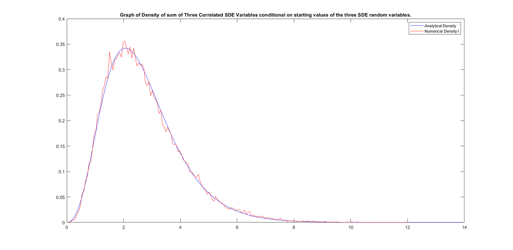](https://postimg.cc/ZCCchmf2)

[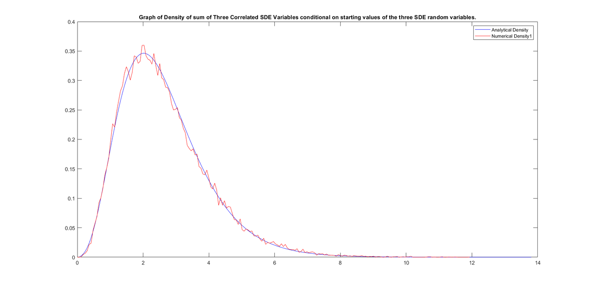](https://postimg.cc/BXXgG3hy)

[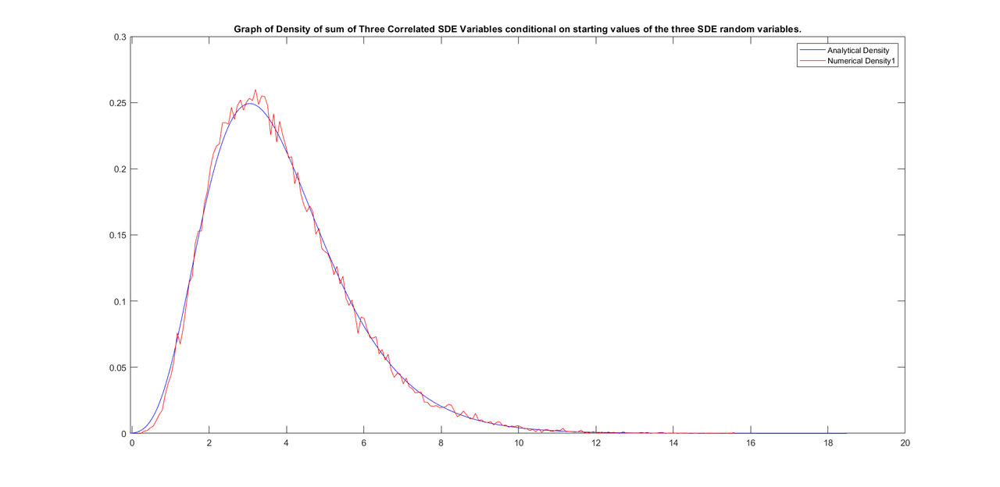](https://postimg.cc/Xpp80W21)

[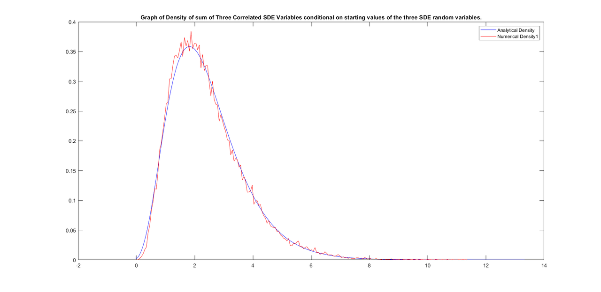](https://postimg.cc/1ffHZSWY)

I am posting the program used to make the above graphs in the following post.

---

### #3106 — Amin (Topic Author)
*May 23, 2026, 8:54 PM*

.

.

Friends, I tried to write a good modular and re-usable code for the hermite to Gaussian correlation by Newton part of
the program but it is too late at the moment so I will post a new fully commented version of the code tomorrow. Its
basically very very simple and I hope most friends would like using this code.

.

.

```
function []= ConditionalDensityHermitesNvariateNewton()

%SV SDE is
%dV(t)=mu1 V(t)^beta1 dt+ mu2 V(t)^beta2 dt + sigma0 V(t)^gamma dZ(t)
%In mean reverting SDEs we ususally have
%mu1= kappaV * thetaV
%beta1=0
%mu2=-kappa
%beta2=0
%The present program works only when drift is zero (for pure noises)
%meaning mu1=0 and mu2=0;

Order=7;
%NDim=4;%Three assets and one SV.
%NMomentsY=Order+1;
%NMomentsX=Order+1;

%%%%%%%%%%%%%%%%%%%5
dt=.03125/2/8;
Tt=64*2*8;
T=Tt*dt;
seed0=12130649;
%seed0=94210876;
%seed0=14210876;
%seed0=53612297
%seed0=97459782
rng(seed0, 'twister')
paths=50000;
TT1=100*8/2; %Transition distribution start
TT2=256*8/2; %Transition distribution end

%%%%%%%%%%%%%%%%%%%5

NDims=3;
%
V0(1)=1.000;%.32;
V00(1)=V0(1);

%SDE1
 thetaV(1)=1.0;%.045;%1;%.04;
 kappaV(1)=0.000;%1.5;%1.5;
 gamma(1)=.75;%.75
 sigma0(1)=.5;%.35

%SDE2%
%thetaV(1)=.90;%.045;%1;%.04;
%kappaV(1)=1.000;%1.5;%1.5;
%gamma(1)=.75;%.75
%sigma0(1)=.85;%.35

%SDE3%
%thetaV(1)=1.350;%.045;%1;%.04;
%kappaV(1)=2.000;%1.5;%1.5;
%gamma(1)=.75;%.75
%sigma0(1)=.95;%.35

mu1(1)=kappaV(1)*thetaV(1);
mu2(1)=-kappaV(1);
beta1(1)=0;
beta2(1)=1;

V0(2)=1.000;%.32;
V00(2)=V0(2);

%SDE1
thetaV(2)=1.0;%.045;%1;%.04;
 kappaV(2)=0.000;%1.5;%1.5;
 gamma(2)=.65;%.75
 sigma0(2)=.55;%.35

%SDE2
% thetaV(2)=1.0;%.045;%1;%.04;
% kappaV(2)=2.000;%1.5;%1.5;
% gamma(2)=.65;%.75
% sigma0(2)=.95;%.35

%SDE3
%thetaV(2)=.850;%.045;%1;%.04;
%kappaV(2)=.35000;%1.5;%1.5;
%gamma(2)=.65;%.75
%sigma0(2)=.55;%.35

mu1(2)=kappaV(2)*thetaV(2);
mu2(2)=-kappaV(2);
beta1(2)=0;
beta2(2)=1;

V0(3)=1.000;%.33;
V00(3)=V0(3);

%SDE1
thetaV(3)=1.0;%.045;%1;%.04;
 kappaV(3)=0.000;%1.5;%1.5;
 gamma(3)=.85;%.75
 sigma0(3)=.45;%.35

%SDE2
% thetaV(3)=.750;%.045;%1;%.04;
% kappaV(3)=0.5000;%1.5;%1.5;
% gamma(3)=.95;%.75
% sigma0(3)=.45;%.35

%SDE3
%thetaV(3)=1.150;%.045;%1;%.04;
%kappaV(3)=1.5000;%1.5;%1.5;
%gamma(3)=.95;%.75
%sigma0(3)=.75;%.35

mu1(3)=kappaV(3)*thetaV(3);
mu2(3)=-kappaV(3);
beta1(3)=0;
beta2(3)=1;

Corr1(1,1)=1;
Corr1(1,2)=.7;
Corr1(1,3)=.8;
Corr1(2,2)=1;
Corr1(2,1)=.7;
Corr1(2,3)=.5;
Corr1(3,1)=.8;
Corr1(3,2)=.5;
Corr1(3,3)=1;

%87%Corr1(1:3,1:3)=0.0;

R=chol(Corr1);

 % R(1:3,1:3)=0;
 % R(1,1)=1;
 % R(2,2)=1;
 % R(3,3)=1;

V0(4)=1.000;%.44;
V00(4)=V0(4);
thetaV(4)=1.0;%.045;%1;%.04;
kappaV(4)=1.000;%1.5;%1.5;
mu1(4)=kappaV(4)*thetaV(4);
mu2(4)=-kappaV(4);
beta1(4)=0;
beta2(4)=1;
gamma(4)=.95;%.75
sigma0(4)=.55;%.45

%%%%%%%%%%%%%%%%%%%%%%%%%%%%%%%%%%%%%%%%%%%%%%%%%%%%%%%%%%%%%%%%%%%%%5
for nn=1:NDims
V(1:paths,nn)=V0(nn);
end
%V(1:paths,1:NDims)=V0(1,1:NDims);

Random1(1:paths/2,1:NDims)=0;

for tt=1:Tt

    Random2(1:paths/2,1:NDims)=randn(size(Random1));
    Random2(paths/2+1:paths,1:NDims)=-Random2(1:paths/2,1:NDims);

    %Random2=R'*Random2;
    random1=Random2*R(:,1);
    random2=Random2*R(:,2);
    random3=Random2*R(:,3);

    Random2(:,1)=random1;
    Random2(:,2)=random2;
    Random2(:,3)=random3;

    for nn=1:NDims

    V(1:paths,nn)=V(1:paths,nn)+ ...
        (mu1(nn).*V(1:paths,nn).^beta1(nn) + mu2(nn).*V(1:paths,nn).^beta2(nn))*dt + ...
        sigma0(nn).*V(1:paths,nn).^gamma(nn) .*Random2(1:paths,nn)*sqrt(dt) + ...
        (mu1(nn).*beta1(nn)*V(1:paths,nn).^(beta1(nn)-1) + mu2(nn).*beta2(nn).*V(1:paths,nn).^(beta2(nn)-1)).* ...
        ((mu1(nn).*V(1:paths,nn).^beta1(nn) + mu2(nn).*V(1:paths,nn).^beta2(nn))*dt^2/2 + ...
        sigma0(nn).*V(1:paths,nn).^gamma(nn) .*Random2(1:paths,nn)*(1-1/sqrt(3))*dt^1.5) + ...
        .5*(mu1(nn).*beta1(nn).*(beta1(nn)-1).*V(1:paths,nn).^(beta1(nn)-2) +
mu2(nn).*beta2(nn).*(beta2(nn)-1).*V(1:paths,nn).^(beta2(nn)-2)).* ...
        sigma0(nn)^2.*V(1:paths,nn).^(2*gamma(nn)).*dt^2/2 + ...
        sigma0(nn).*gamma(nn).*V(1:paths,nn).^(gamma(nn)-1) .* ...
        ((mu1(nn).*V(1:paths,nn).^beta1(nn) + mu2(nn).*V(1:paths,nn).^beta2(nn)).*Random2(1:paths,nn).*1/sqrt(3)*dt^1.5
+ ...
        sigma0(nn).*V(1:paths,nn).^gamma(nn) .*(Random2(1:paths,nn).^2-1)*dt/2) + ...
        .5*sigma0(nn).*gamma(nn).*(gamma(nn)-1).*V(1:paths,nn).^(gamma(nn)-2) .* ...
        sigma0(nn).^2.*V(1:paths,nn).^(2*gamma(nn)) .*Random2(1:paths,nn).*1/sqrt(3)*dt^1.5;

    V(V(:,nn)<=0)=.0001;

    if(tt==TT1)
        Xin(1:paths,nn)=real(V(1:paths,nn));
    end

    if(tt==TT2)

        Xin2(1:paths,nn)=real(V(1:paths,nn));
    end

    end

end

Yin(1:paths)=0.0;

for pp=1:paths
for mm=1:NDims
    Yin(pp)=Yin(pp)+Xin2(pp,mm);%-Xin(pp,mm);
%-Xin(pp,mm);
end
end

str=input("I have reached stone 1");

% %%%%%%%%%%%%%%%%%%%%%%%%%%%%%%%%%%%%%%%%%%%%%%%%%%5
%

%save("C:\Users\Lenovo\Documents\MATLAB\MATLAB1\YXfile.mat","Yin","Xin")

%str=input("Data has been saved");

% load("C:\Users\Lenovo\Documents\MATLAB\MATLAB1\YXfile.mat","Yin","Xin")
%
% str=input("Data has been loaded");
%
%
%
%
 Order=7;
 clf;
[BetaCorrH,YCoeffH,XCoeffH,HCorrXX,Zy,Zx] = CalculateHermiteCorrelations0NA04(Xin,Yin,paths,NDims);
YCoeffZ(1:Order+1)= ConvertHermiteSeriesToZSeries01(YCoeffH(1:Order+1),Order);

%HCorrXX(:,:)=0.0;

BetaCorrH

%CorrXX1st
str=input("I have reached Stone2");

%[cn,dn,bnv,bbnv,ch] = Calculate2DZSeriesNDimCorrected(YCoeffH,BetaCorrH,HCorrXX,NDims,Order);
%cn=bnv;
[cn,ch]=CalculateGaussianCorrelationFromHermiteCorrelationsNDim(YCoeffH,XCoeffH,BetaCorrH,HCorrXX,NDims,Order);
%
%
%
% save("C:\Users\Lenovo\Documents\MATLAB\MATLAB1\Zyxfile.mat","Zy","Zx","cn","HCorrXX")
%
%
% str=input("Data has been saved");

%load("C:\Users\Lenovo\Documents\MATLAB\MATLAB1\Zyxfile.mat","Zy","Zx","cn","HCorrXX")

%str=input("Data has been loaded");

size(Zy)
size(Zx)
size(cn)

%OptimizeCorrFromHermitesIterative(Zy,Zx,cn,HCorrXX,NDims,paths,Order);

%OptimizeCorrFromHermitesIterative02(Zy,Zx,cn,HCorrXX,NDims,paths,Order);

%OptimizeCorrFromHermitesNewton02(Zy,Zx,cn,HCorrXX,NDims,paths,Order);

[cnOptim] = OptimizeCorrFromHermitesNewton(Zy,Zx,cn,HCorrXX,NDims,paths,Order);

cn=cnOptim;

%%%%%%%%%%%%%%%%%%%%%%%%%%%%%%%%%%%%%%%%%%%%%%%%%%%%%%%%%%%%%%%%%%%%%%%%%%%%%%5555

%%%%%%%%%%%%%%%%%%%%%%%%%%%%%%%%%%%%%%%%%%%%%%%%%%%%%%%%%%%%%%%%%%%%%%%%%%%%%%%%%%%%%%%
%Set1
V10(1)=.65;%.65;%
V10(2)=1.2;
V10(3)=.85;
V10(4)=1.85;

% % %Set2
V10(1)=.75;
V10(2)=1.2;%1.2;
V10(3)=.7;
% %V10(4)=.65
% %
% % %Set3
  V10(1)=1.25;
  V10(2)=1.35;%1.2;
  V10(3)=1.25;
%   V10(4)=1.4
% %
% %
  V10(1)=.85;
  V10(2)=.81;%1.2;
  V10(3)=.77;
% %  V10(4)=.7

%V10(1)=.65;
%V10(2)=.51;%1.2;
%V10(3)=.73;

%V10(1)=1.65;
%V10(2)=1.51;%1.2;
%V10(3111111111111111111111111111111111111111111111111111111111111111111111111111111111111111111111111111111111111111111111111111111)=1.63;

for nn=1:NDims
V(1:paths,nn)=V10(nn);
end
%V(1:paths,1:NDims)=V0(1,1:NDims);

Random1(1:paths/2,1:NDims)=0;

for tt=1:TT2-TT1

    Random2(1:paths/2,1:NDims)=randn(size(Random1));
    Random2(paths/2+1:paths,1:NDims)=-Random2(1:paths/2,1:NDims);

    random1=Random2*R(:,1);
    random2=Random2*R(:,2);
    random3=Random2*R(:,3);

    Random2(:,1)=random1;
    Random2(:,2)=random2;
    Random2(:,3)=random3;

    for nn=1:NDims

    V(1:paths,nn)=V(1:paths,nn)+ ...
        (mu1(nn).*V(1:paths,nn).^beta1(nn) + mu2(nn).*V(1:paths,nn).^beta2(nn))*dt + ...
        sigma0(nn).*V(1:paths,nn).^gamma(nn) .*Random2(1:paths,nn)*sqrt(dt) + ...
        (mu1(nn).*beta1(nn)*V(1:paths,nn).^(beta1(nn)-1) + mu2(nn).*beta2(nn).*V(1:paths,nn).^(beta2(nn)-1)).* ...
        ((mu1(nn).*V(1:paths,nn).^beta1(nn) + mu2(nn).*V(1:paths,nn).^beta2(nn))*dt^2/2 + ...
        sigma0(nn).*V(1:paths,nn).^gamma(nn) .*Random2(1:paths,nn)*(1-1/sqrt(3))*dt^1.5) + ...
        .5*(mu1(nn).*beta1(nn).*(beta1(nn)-1).*V(1:paths,nn).^(beta1(nn)-2) +
mu2(nn).*beta2(nn).*(beta2(nn)-1).*V(1:paths,nn).^(beta2(nn)-2)).* ...
        sigma0(nn)^2.*V(1:paths,nn).^(2*gamma(nn)).*dt^2/2 + ...
        sigma0(nn).*gamma(nn).*V(1:paths,nn).^(gamma(nn)-1) .* ...
        ((mu1(nn).*V(1:paths,nn).^beta1(nn) + mu2(nn).*V(1:paths,nn).^beta2(nn)).*Random2(1:paths,nn).*1/sqrt(3)*dt^1.5
+ ...
        sigma0(nn).*V(1:paths,nn).^gamma(nn) .*(Random2(1:paths,nn).^2-1)*dt/2) + ...
        .5*sigma0(nn).*gamma(nn).*(gamma(nn)-1).*V(1:paths,nn).^(gamma(nn)-2) .* ...
        sigma0(nn).^2.*V(1:paths,nn).^(2*gamma(nn)) .*Random2(1:paths,nn).*1/sqrt(3)*dt^1.5;

    V(V(:,nn)<0)=.0001;

    %if(tt==TT1)
    %    XXin(1:paths,nn)=V(1:paths,nn);
    %end

    if(tt==TT2-TT1)

        XXin2(1:paths,nn)=V(1:paths,nn);
    end

    end

end

Yin2(1:paths)=0.0;

for pp=1:paths
for mm=1:NDims
    Yin2(pp)=Yin2(pp)+XXin2(pp,mm);%-V10(mm);
end
end

randn()

str=input("I have reached stone 4");

NoOfBins=200;
MaxCutOff=20;

[XDensity,IndexOut,IndexMax] = MakeDensityFromSimulation_Infiniti_NEW(Yin2,paths,NoOfBins,MaxCutOff );

for qq=1:8

    DataMoments(qq)=sum(Yin2(:).^qq)/paths;

end

%%%%%%%%%%%%%%%%%%%%%%%%%%%%%%%%%%%%%%%%%%%%%%%%%%%%%%%%%%%%%%%%%%%%%%%%%%%%%%%%%%%%%%%5

for nn=1:NDims
    [Zx0(nn)] = CalculateZgivenXAndHSeriesCoeffs(V10(nn),XCoeffH(1:Order+1,nn),Order);
end

%%%%%%%%%%%%%%%%%%%%%%%%%%%%%%%%%%%%%%%%%%%%%%%%%%%%%%%%%%%%%%%%%%%55

%%%%%%%%%%%%%%%%%%%%%%%%%%%%%%%%%%%%%%%%%%%%%%%%%%%%%%%%%%%%%%%%%%%%%%%%%%%%%%%55
Zx(1:Order)=0;

for hh=1:Order
    for nn=1:NDims
        %Zx(hh) = Zx(hh) + bnv(nn+1,hh+1).^1.*Zx0(nn);
        Zx(hh) = Zx(hh) + cn(nn,hh).^1.*Zx0(nn);
    end
end

bh0=YCoeffH(1);

[W] = EvalHermiteArrayH0(Zx0,Order);

for hh=1:Order
    for nn=1:NDims
        bh0 = bh0 + ch(nn+1,hh+1).^1.*W(nn,hh+1);
    end
end

%%%%%%%%%%%%%%%%%%%%%%%%%%%%%%%%%%%%%%%%%%%%%%%%%%%%%%%%%%%%%%%%

a0=YCoeffZ(1);
a1=YCoeffZ(2);
a2=YCoeffZ(3);
a3=YCoeffZ(4);
a4=YCoeffZ(5);
a5=YCoeffZ(6);
a6=YCoeffZ(7);
a7=YCoeffZ(8);

d1=cn(4,1);
d2=cn(4,2);
d3=cn(4,3);
d4=cn(4,4);
d5=cn(4,5);
d6=cn(4,6);
d7=cn(4,7);

%b0=(a0+a1.* Zx(1) +a2.* Zx(2).^2+a3.* Zx(3).^3+a4* Zx(4).^4+a5 *Zx(5).^5+a6* Zx(6).^6+a7* Zx(7).^7);
b1=(a1* d1+2* a2* Zx(2)* d2 +3* a3* Zx(3).^2* d3+4* a4* Zx(4).^3* d4+5* a5* Zx(5).^4* d5+6* a6* Zx(6).^5* d6+7* a7*
Zx(7).^6* d7);
b2=(a2* d2.^2+3* a3* Zx(3)* d3^2 +6* a4* Zx(4).^2* d4^2+10* a5* Zx(5).^3* d5^2+15* a6* Zx(6).^4* d6^2+21* a7* Zx(7).^5*
d7^2);
b3=(a3* d3^3+4* a4 *Zx(4)* d4^3 +10* a5* Zx(5).^2* d5^3+20* a6* Zx(6).^3* d6^3+35* a7* Zx(7).^4* d7^3);
b4=(a4* d4^4+5* a5* Zx(5)* d5^4 +15* a6 *Zx(6).^2* d6^4+35* a7* Zx(7).^3 *d7^4);
b5=(a5* d5^5+6* a6* Zx(6)* d6^5 +21* a7 *Zx(7).^2* d7^5);
b6=(a6* d6^6+7* a7* Zx(7)* d7^6 );
b7=(a7* d7^7);

%bh0=b0+b2+3*b4+15*b6;
bh1=b1+3*b3+15*b5+105*b7;
bh2=b2+6*b4+45*b6;
bh3=b3+10*b5+105*b7;
bh4=b4+15*b6;
bh5=b5+21*b7;
bh6=b6;
bh7=b7;

bh(1)=bh0;
bh(2)=bh1;
bh(3)=bh2;
bh(4)=bh3;
bh(5)=bh4;
bh(6)=bh5;
bh(7)=bh6;
bh(8)=bh7;

%%%%%%%%%%%%%%%%%%%%%%%%%%%%%%%%%%%%%%%%%%%%%%%%%%%%%%%%%%%%%%%%%%%%%%%%%%%%%%5

YCoeffz(1:Order+1)= ConvertHermiteSeriesToZSeries01(bh(1:Order+1),Order);

[YMomentsModel]=CalculateMomentsOfZSeries(YCoeffz(1),YCoeffz(2:Order+1),Order,Order+1);

YMomentsModel

DataMoments

str=input("Look at comparison of moments");

[cMu1,YCentralMoments]=ConvertRawMomentsToCentralMoments(YMomentsModel,Order+1);
[cMu2,DataCentralMoments]=ConvertRawMomentsToCentralMoments(DataMoments,Order+1);

YCentralMoments

DataCentralMoments

str=input("Look at central moments");

% Order0=7;
% Order1=13;
% NData=paths;
% [CondMomentYgivX,BetaCorrHxy] = CalculateConditionalMomentYgivXNDims(Xin,Yin,NData,Zx0,NDims,Order0,Order1)
%
% [VarConditional]=FindSecondConditionalMoment(YCoeffH,BetaCorrH,Zx0)
%
%
% BetaCorrHxy
% BetaCorrH
%
% str=input("Look at conditionalVariance");

clf;

PlotZSeriesDensity(YCoeffz(1),YCoeffz(2:Order+1),'b')

hold on

plot(IndexOut(1:IndexMax),XDensity(1:IndexMax),'r');

%PlotHermiteSeriesDensityAndRvGraph(YCoeffh(1),YCoeffh1(2:yOrder+1),'g')
title("Graph of Density of sum of Three Correlated SDE Variables conditional on starting values of the three SDE random
variables.")
%title(sprintf('V00 = %.3f; kappa=%.3f, theta=%.3f,gamma=%.3f,sigma=%.3f;V10=%.3f at TT1=%.3f;TT2=%.3f;Paths=%d ',V00,
kappaV, thetaV,gamma,sigma0, V10,(TT1*dt),(TT2*dt),paths));%,sprintf('theta= %f', theta), sprintf('kappa = %f',
kappa),sprintf('sigma = %f', sigma0),sprintf('T = %f', T));
legend({'Analytical Density','Numerical Density1'}, ...
    'Location','northeast')

str=input("This is the first version without altering the moments of conditional density")

hold off

end
```

.

.

.

.

.

```
function [cnOptim] = OptimizeCorrFromHermitesNewton(Zy,Zx,cnn,HCorrXX,NDims,paths,Order)

%Order;Max Order of Hermites Calibration is seven.

ccn(1:NDims+1,1:Order)=cnn(1:NDims+1,2:Order+1);

cn(1:NDims,1:Order)=ccn(2:NDims+1,1:Order);

cn(NDims+1,1:Order)=ccn(1,1:Order);

[WHy] = EvalHermiteArrayH1(Zy,Order);

[EZ] = EZZ2();

for nH=1:Order
    cnIn(1:NDims+1,1:nH)=0.0;
    if(nH==1)
        cnIn(1:NDims+1,1)=cn(1:NDims+1,1);
    else
        cnIn(1:NDims+1,1:nH-1)=cnOptim(1:NDims+1,1:nH-1);
        cnIn(1:NDims+1,nH)=cn(1:NDims+1,nH);
    end

    WHyn(1:paths,1)=WHy(1:paths,nH);

    Iterations=20;

    [cnbest,InitialObj(nH),FinalObj(nH)] = OptimizenthHermiteGaussianWithNewton(cnIn,Zx,WHyn,HCorrXX,nH,EZ,NDims,paths,
Iterations);

    cnOptim(1:NDims+1,nH)=cnbest(1:NDims+1,1);

    nH
end

InitialObj
FinalObj
str=input("Look at initial and Final Objs");

end
```

.

.

.

.

```
function [Wh1] = EvalHermiteArrayH1(Z,Order)

%Evaluates first Order-th hermites at the array of Z's. If input array of Z
%has a size of 100 and Order is 4, it will return a 100 X 4 array without the first constant.

Hz=HermitePoly(Order);

Wh(1:length(Z),1:Order+1)=0;
for nn=1:Order+1
    Wh(:,nn)=0;
    for mm=1:nn
        Wh(:,nn)=Wh(:,nn)+Hz(nn,mm).*Z(:).^(mm-1);
    end
end

Wh1(:,1:Order)=Wh(:,2:Order+1);

end
```

.

.

.

```
function [bnbest,InitialObj,FinalObj] =
OptimizenthHermiteGaussianWithNewton(cn,Zx,WHyn,HCorrXX,nH,EZ,NDims,paths,Iterations)

%Why0 in array of nth Hermite Values

KK=NDims;

bn(1:NDims+1,1)=cn(1:NDims+1,nH);

[dHermite] = EvaluatePrevGaussPowersForHCorrs(nH,cn,Zx,NDims,paths,EZ);

WHy0=WHyn+dHermite;

var=0.0;
for kk1=1:KK
    for kk2=1:KK
        var=var+bn(kk1,1).*bn(kk2,1).*HCorrXX(kk1,kk2,1);
    end
end

var=var+bn(KK+1,1).^2;

bn

var

bn(:,1)=bn(:,1)/sqrt(var);

%str=input("have reached 1st Stone")

%[EZ] = EZZ2();

GG1(1:paths,1)=0.0;
for kk=1:KK
    GG1(1:paths,1)=GG1(1:paths,1)+bn(kk,1).*Zx(1:paths,kk);
end

Zeta0=bn(KK+1,1);

[GaussPH,GaussPh] = EvaluateHermitePolyForGaussCorrs(GG1,Zeta0,EZ,nH,paths);

%%%%%%%%%%%%%%%%%%%%%%%%%%%%%%%%%%%%%%%%%%%%%%%%%%%%%%%%%%%%%%%%%%%%%%%%%%%%%
%Starting ObjBest and calculations here
%cnbest here
bnbest(1:NDims+1,1)=bn(1:NDims+1);

ObjSqrdBestNewton=sum((GaussPH(:,1)-WHy0(:,1)).^2)/paths;

InitialObj=ObjSqrdBestNewton;
%%%%%%%%%%%%%%%%%%%%%%%%%%%%%%%%%%%%%%%%%%%%%%%%%%%%%%%%%%%%%%%%%%%%%%%%%5

for iter =1:Iterations

    dGG1(1:paths,1:NDims)=0.0;
    for kk=1:KK
        dGG1(1:paths,kk)=Zx(1:paths,kk);
    end

    bn=bnbest;

    GG1(1:paths,1)=0.0;
    for kk=1:KK
        GG1(1:paths,1)=GG1(1:paths,1)+bn(kk,1).*Zx(1:paths,kk);
    end

    Zeta0=bn(KK+1,1);

    bbn=0;
    bbn(1:NDims,1)=bn(1:NDims,1);

    [GaussPH,GaussPh,DGaussPH] = EvaluateHermitePolyAndDerivsForGaussCorrs(GG1,dGG1,Zeta0,EZ,nH,NDims,paths);

    %size(DGaussPH')
    %size(DGaussPH)
    %size(GaussPH)
    %size(WHy0(:,1))

    %str=input("Look at sizes");

    bbn=bbn+.1*(inv(DGaussPH'*DGaussPH)*(DGaussPH'*(WHy0(:,1)-GaussPH)));

    %DGaussPH'*DGaussPH

    %str=input("Look at matrix product");
%%%%%%%%%%%%%%%%%%%%%%%%%%%%%%%%%%%%%%%%%%%%%%%%%%%%%%%%%%%%%%%%%%%%%%%%%%%%%
%Midfunction ObjBest and calculations here
%cnbest here

var=0.0;
for kk1=1:KK
    for kk2=1:KK
        var=var+bbn(kk1,1).*bbn(kk2,1).*HCorrXX(kk1,kk2,1);
    end
end

bbn(KK+1,1)=sqrt(1-var);

var=var+bbn(KK+1,1).^2;
bn
bbn

var

bbn=bbn/sqrt(var);

GG1(1:paths,1)=0.0;
for kk=1:KK
    GG1(1:paths,1)=GG1(1:paths,1)+bbn(kk,1).*Zx(1:paths,kk);
end

Zeta0=bbn(KK+1,1);

[GaussPH,GaussPh] = EvaluateHermitePolyForGaussCorrs(GG1,Zeta0,EZ,nH,paths);

ObjSqrdNewton=sum((GaussPH(:,1)-WHy0(:,1)).^2)/paths;
ObjSqrdBestNewton
if(ObjSqrdNewton<ObjSqrdBestNewton)
    ObjSqrdBestNewton=ObjSqrdNewton;
    bnbest=bbn;
else
    %%%%change-step or Newton parameters
end

ObjSqrdBestNewton
ObjSqrdNewton
iter

%str=input("Look at the solution");
%%%%%%%%%%%%%%%%%%%%%%%%%%%%%%%%%%%%%%%%%%%%%%%%%%%%%%%%%%%%%%%%%%%%%%%%%5

end

FinalObj=ObjSqrdBestNewton;

end

```

.

.

.

```
function [dHermite] = EvaluatePrevGaussPowersForHCorrs(nH,ccn,Zx,NDims,paths,EZ)

if(nH==1)
    dHermite(1:paths,1)=0.0;
end

if(nH==2)
    dHermite(1:paths,1)=1.0;
end

if(nH==3)
    nH1=1;
    [GaussPH1] = EvaluateGaussianPowerForHCorrs(ccn,nH1,Zx,NDims,paths,EZ);
    dHermite(1:paths,1)=3*GaussPH1(1:paths,1);
end

if(nH==4)
     nH1=2;
    [GaussPH1] = EvaluateGaussianPowerForHCorrs(ccn,nH1,Zx,NDims,paths,EZ);
     dHermite(1:paths,1)=6*GaussPH1(1:paths,1)-3;
end

if(nH==5)
    nH1=1;
    [GaussPH1] = EvaluateGaussianPowerForHCorrs(ccn,nH1,Zx,NDims,paths,EZ);

    nH2=3;
    [GaussPH2] = EvaluateGaussianPowerForHCorrs(ccn,nH2,Zx,NDims,paths,EZ);
    dHermite(1:paths,1)=-(-10*GaussPH2(1:paths,1)+15*GaussPH1(1:paths,1));
end

if(nH==6)
    nH1=2;
    [GaussPH1] = EvaluateGaussianPowerForHCorrs(ccn,nH1,Zx,NDims,paths,EZ);

    nH2=4;
    [GaussPH2] = EvaluateGaussianPowerForHCorrs(ccn,nH2,Zx,NDims,paths,EZ);
    dHermite(1:paths,1)=-(-15*GaussPH2(1:paths,1)+45*GaussPH1(1:paths,1)-15);
end

if(nH==7)
    nH1=1;
    [GaussPH1] = EvaluateGaussianPowerForHCorrs(ccn,nH1,Zx,NDims,paths,EZ);

    nH2=3;
    [GaussPH2] = EvaluateGaussianPowerForHCorrs(ccn,nH2,Zx,NDims,paths,EZ);

    nH3=5;
    [GaussPH3] = EvaluateGaussianPowerForHCorrs(ccn,nH3,Zx,NDims,paths,EZ);

    dHermite(1:paths,1)=-(-21*GaussPH3(1:paths,1)+105*GaussPH2(1:paths,1)-105*GaussPH1(1:paths,1));
end

end

```

.

.

.

```
function [GaussPH] = EvaluateGaussianPowerForHCorrs(ccn,nH,Zx,NDims,paths,EZ)

KK=NDims;

GG1(1:paths,1)=0.0;

for kk=1:KK
    GG1(1:paths,1)=GG1(1:paths,1)+ccn(kk,nH).*Zx(1:paths,kk);
end
Zeta0=ccn(KK+1,nH);
[GaussPH,GaussPh] = EvaluateHermitePolyForGaussCorrs(GG1,Zeta0,EZ,nH,paths);

end

```

.

.

.

```
function [GaussPH,GaussPh] = EvaluateHermitePolyForGaussCorrs(GG1,Zeta0,EZ,HH,paths)
GaussPH(1:paths,1)=0.0;
GaussPh(1:paths,1:HH+1)=0.0;

for hh=0:HH
    GaussPh(1:paths,hh+1)=factorial(HH)/factorial(hh)/factorial(HH-hh).*GG1(1:paths).^(HH-hh).*Zeta0.^(hh).*EZ(hh+1);
    GaussPH(1:paths,1)=GaussPH(1:paths,1)+GaussPh(1:paths,hh+1);
end
end

```

.

.

.

```
function [GaussPH,GaussPh,DGaussPH] = EvaluateHermitePolyAndDerivsForGaussCorrs(GG1,dGG1,Zeta0,EZ,HH,NDims,paths)

GaussPH(1:paths,1)=0.0;
GaussPh(1:paths,1:HH+1)=0.0;
DGaussPh(1:paths,1:HH+1)=0.0;
DGaussPh0(1:paths,1:HH+1)=0.0;
%dGG1(1:paths,1:NDims)=0;
DGaussPH(1:paths,1:NDims)=0.0;
for hh=0:HH
    GaussPh(1:paths,hh+1)=factorial(HH)/factorial(hh)/factorial(HH-hh).*GG1(1:paths).^(HH-hh).*Zeta0.^(hh).*EZ(hh+1);
    GaussPH(1:paths,1)=GaussPH(1:paths,1)+GaussPh(1:paths,hh+1);
   
DGaussPh(1:paths,hh+1)=factorial(HH)/factorial(hh)/factorial(HH-hh).*(HH-hh).*dGG1(1:paths).^(HH-hh-1).*Zeta0.^(hh).*EZ(hh+1);
   
DGaussPh0(1:paths,hh+1)=factorial(HH)/factorial(hh)/factorial(HH-hh).*GG1(1:paths).^(HH-hh).*hh.*Zeta0.^(hh-1).*EZ(hh+1);
    DGaussPH(1:paths,1:NDims)=DGaussPH(1:paths,1:NDims)+DGaussPh(1:paths,hh+1).*dGG1(1:paths,1:NDims);
    %DGaussPH(1:paths,NDims+1)=DGaussPH(1:paths,NDims+1)+DGaussPh0(1:paths,hh+1);
end

%DGaussPh0
%DGaussPh0(1:paths,2)
%Zeta0

%str=input("Look at DGauss Ph0");

end

```

.

.

.

```
function [EZ] = EZZ2()

EZ(1)=1;
EZ(2)=0;
EZ(3)=1;
for nn=4:128 %Increase for larger products.
    if rem(nn,2)==0
        EZ(nn)=0;
    else
        EZ(nn)=EZ(nn-2)*(nn-2);
        EZ(nn);
    end
end
% EZ(64)
% EZ(64).*EZ(64)

end

```

.

.

.

---

### #3107 — Amin (Topic Author)
*May 24, 2026, 9:07 AM*

Friends, I will come back with a detailed latex post and commented code later tonight.

But very quickly for friends trying to play with the program, I have changed the order of variables and indexing and it
is different in new output variable cnOptim that comes out of Newton optimization. Please let me explain here. In the
expansion of nth power of Gaussian, if there are K correlated variables, the correlation coefficients are denoted as

$${(\,\rho_{1,m}\,Z_1\,+\,\rho_{2,m}\,Z_2\,+\,\ldots\,+\,\rho_{K,m}\,Z_K\,+\,\zeta_m)}^m$$

earlier in previous function that was written weeks ago, cn they were arranged as

$$cn(1,m+1)\,=\,\zeta_m$$

and

$$cn(k+1,m+1)\,=\,\rho_{k,m}$$

however, in the new out put variable cnOptim, zeta that was at first row, has gone to last row. the indexing for cnOptim
is given as (Please note that K is the last index related to explainingvaribels)

$$cnOptim(k,m)\,=\,\rho_{k,m}$$

and

$$cnOptim(K+1,m)\,=\,\zeta_m$$

As you can see , In my later program, I have changed indices of variables to reflect the change in indexing of cnOptim.
If you want to plug my code in your program, you would have to slightly change this indexing.

Especially again zeta variable that was in first row earlier has gone to the last (K+1)th row (resulting in one step
upward shift in rows associated with each correlation coefficient). And indexing of correlation coefficients and zeta of
mth power that was earlier at column m+1 has now gone to column m.

Please check how I have changed indexing and position of zeta_m in my new program as I altered them to comply with the
new changes and therefore the program works well. If you do not want to do anything, you might want to copy the last
part of my program into your code where I have changed everything so that new changes in indexing continue to work well
with slightly modified density construction program.

My program also mentions starting value of Objective function when optimization started and ending value of objective
function when Newton optimization ended and the difference is mostly huge in case of larger hermites. But for difficult
problem, you might want different starting values for Newton since I suppose it is a Gradient descent type algorithm.

You might try extremely small steps of Newton with very large number of iterations for very difficult problems but
starting seed has to be good.

I am sure in coming weeks friends will do all sort of new things and experiments with the algorithm.

---

### #3108 — Amin (Topic Author)
*May 24, 2026, 4:41 PM*

Friends, I am commenting the new program and will post a commented version in a few hours. In the meantime, I want to
mention how to calculate the model values of hermite polynomials that are matched with data values of hermite
polynomials. And also describe how to calculate its derivatives for Newton.

But first please look at the details of Newton method in a previous post 3098 here: https://forum.wilmott.com/viewtopic.php?t=99702&start=3090#p890259

In that post I had described that I want to match second power/moment of hermite polynomials simultaneously with its
first power but I have not dealt with the second moment in this program I posted yesterday. It works only by matching
the values of hermite polynomials by optimizing over the correlation coefficients. It still needs to be seen if matching
squared values adds to robustness of the regression and I would continue to see that in coming week. The current program
just matches the values of first powers of hermites directly. I will continue to play (over next week) with the idea of
including second power later and try to see if it improves the optimization in any way.

Here I want to describe how to calculate model values of hermite polynomials for each observation.

First we optimize the only highest power of Gaussian in each hermite and lower order Gaussians (in higher hermites) are
calculated from the correlation coefficients associated with lower order hermites. For example consider fifth hermite
given below in terms of its Gaussians expansion as

$
$H_5(Z_{y_p})\,=\,{\left( \rho_{1,5}\, Z_{p,1}\,+\, \rho_{2,5}\, Z_{p,2}\,+\,\ldots\,+\,\rho_{K,5}\, Z_{p,K}\,+\,\zeta_5\,Z_{\tilde{y}}\right)}^5\,\\-10\,{\left( \rho_{1,3}\, Z_{p,1}\,+\, \rho_{2,3}\, Z_{p,2}\,+\,\ldots\,+\,\rho_{K,3}\, Z_{p,K}\,+\,\zeta_3\,Z_{\tilde{y}}\right)}^3\\+15\,{\left( \rho_{1,1}\, Z_{p,1}\,+\, \rho_{2,1}\, Z_{p,2}\,+\,\ldots\,+\,\rho_{K,1}\, Z_{p,K}\,+\,\zeta_1\,Z_{\tilde{y}}\right)}$
$

Basically when reach optimization of fifth hermite, we have already calculated the correlation coefficients in third
power multinomial and first power multinomial from third and first hermite respectively already. We just subtract the
first and third Gaussian power multinomials from the data values of fifth hermite and are left with finding the
correlation coefficients in the fifth Gaussian power multinomial only.

Now I will describe how to calculate mth power of the Gaussian multinomial for a general mth hermite.

$
$\,{\left( \rho_{1,m}\, Z_{p,1}\,+\, \rho_{2,m}\, Z_{p,2}\,+\,\ldots\,+\,\rho_{K,m}\, Z_{p,K}\,+\,\zeta_m\,Z_{\tilde{y}}\right)}^m\,\\=\, {\left(G\,+\,\,\zeta_m\,Z_{\tilde{y}}\right)}^m$
$

where

$$\,G\,=\,\left( \rho_{1,m}\, Z_{p,1}\,+\, \rho_{2,m}\, Z_{p,2}\,+\,\ldots\,+\,\rho_{K,m}\, Z_{p,K}\,\right)$$

Please know that all variables and parameters required to calculate G are already known either from data or their trial
values in Newton iterations. So we can basically just calculate one G and use binomial expansion as

$$\,{\left( \rho_{1,m}\, Z_{p,1}\,+\, \rho_{2,m}\, Z_{p,2}\,+\,\ldots\,+\,\rho_{K,m}\,
Z_{p,K}\,+\,\zeta_m\,Z_{\tilde{y}}\right)}^m\,\\=\, {\left(G\,+\,\,\zeta_m\,Z_{\tilde{y}}\right)}^m \\

=\,\sum\limits_{n=0}^{n=m}\,\frac{m!}{(m-n)!\,n!}G^{m-n}\,{\left(\zeta_m\,\right)}^{n}\,E\left[{\,Z_{\tilde{y}}}^{n}\right]$$

I take expectation over powers of$Z_{\tilde{y}}$ and the above calculation of expectation is done over all data paths to
calculate model values of the mth power of Gaussian that is regressed on mth Hermite. This value is different for every
path since G is different for all paths in the data.

Similarly for Newton derivatives of above expectation with respect to a general correlation coefficient$\rho_{k,m}$ , we
will use the simple formula

$
$\,\sum\limits_{n=0}^{n=m}\,\frac{m!}{(m-n)!\,n!}\,\left(m-n\right)\,\,G^{m-n-1}\,\frac{dG}{d\rho_{k,m}}\,{\left(\zeta_m\,\right)}^{n}\,E\left[{\,Z_{\tilde{y}}}^{n}\right]$
$

This last formula is how I calculated sensitivities in Newton method.$\zeta_m$ was a constrained parameter in the model
and was not directly optimized and its value was found from constraint that total variance of the Gaussian term goes to
one i.e.

$
$\,{\left( \rho_{1,m}\, Z_{p,1}\,+\, \rho_{2,m}\, Z_{p,2}\,+\,\ldots\,+\,\rho_{K,m}\, Z_{p,K}\,+\,\zeta_m\,Z_{\tilde{y}}\right)}^2\,=\,1\,$
$

Please also note that $Z_{\tilde{y}}$ is uncorrelated with all of the K explaining variables.

In the above expansion of second power, cross correlations between different explaining$Z_x$ 's also appears. I just
used first order correlation from data for all the correlations of the form

$$\rho_{k_1,k_2}\,=\,\sum\limits_{p=1}^{paths}\,Z_{p,k_1}\,\,Z_{p,k_2}$$

I had the temptation that above cross-correlation should be different for each mth Gaussian power expansion but then I
was thinking that when substitute the data of$Z_{k_1}$ and$Z_{k_2}$ , they must have the correlation described in above
formula.

---

### #3109 — Amin (Topic Author)
*May 24, 2026, 6:42 PM*

**(broken latex: Unbalanced $: 1)**

```latex
Here is the matlab code with light comments to explain the logic of Newton method. These are only functions related to
over-constrained Newton root search.

.

.

.

```
function [cnOptim] = OptimizeCorrFromHermitesNewton(Zy,Zx,cnn,HCorrXX,NDims,paths,Order)

%Order;Max Order of Hermites Calibration is seven.
%Zx is paths X K array for joint values of Zx arranged for "paths" number of observations
%Zy is paths X 1 array for Zy associated with each obsewrvation.
%cnn is the original input of correlation coefficients used to derive seed for Newton methjod.
%cnn is in format of the old program and its order and indexing is changed
%in this NEwton program.

ccn(1:NDims+1,1:Order)=cnn(1:NDims+1,2:Order+1); %Shift the indices back by one index.
%so that index matches with order of associated hermite polynomial.

cn(1:NDims,1:Order)=ccn(2:NDims+1,1:Order);%The first row in each hermite column earlier was
%associated zeta but zeta is shifted from first row to (K+1)th row.

cn(NDims+1,1:Order)=ccn(1,1:Order);

%The function below calculates the first hermites till "Order" from data of
%Zy. WHy is (paths X K) array. kth hermite associated with pth observation appears in
%WHy(p,k)
[WHy] = EvalHermiteArrayH1(Zy,Order);

%The program below calculates moments of standard normal. Odd moments are
%zero.
[EZ] = EZZ2();

%The loop below repeats itself for optimization of correlation coefficients
%associated with highest power in each hermite. It repeatrs over all hermites one by one.
for nH=1:Order
    cnIn(1:NDims+1,1:nH)=0.0;
    if(nH==1)
        cnIn(1:NDims+1,1)=cn(1:NDims+1,1);
    else
        %cnOptim is already optimized value of lower powers of Gaussians
        %calculated in earlier loops of optimization over smaller hermites.
        %This is already known from previous iterations of this loop.
        cnIn(1:NDims+1,1:nH-1)=cnOptim(1:NDims+1,1:nH-1);
        %The value of cnIn below is initial guess for correlation
        %coefficients associated with optimization of current hermite
        cnIn(1:NDims+1,nH)=cn(1:NDims+1,nH);
    end

    %Below nH-th hermite observation values are assigned to one dimensional array for optimization target in Newton.
    WHyn(1:paths,1)=WHy(1:paths,nH);

    %Total iterations of Newton root search.
    Iterations=50;
    %Below is the function that actually does the Multi-dimensional Newton.
    [cnbest,InitialObj(nH),FinalObj(nH)] = OptimizenthHermiteGaussianWithNewton(cnIn,Zx,WHyn,HCorrXX,nH,EZ,NDims,paths,
Iterations);

    %Below is optimum value of correlation coefficients associated with
    %nH-th hermite after optimization. This will be used by the program as
    %an input to optimization of higher hermites
    cnOptim(1:NDims+1,nH)=cnbest(1:NDims+1,1);

    nH
end

InitialObj %Obj function at start of optimization of correlation coefficients for nH-th hermite
FinalObj%Obj function after optimization of correlation coefficients for nH-th hermite
str=input("Look at initial and Final Objs");

end
```

.

.

.

```
function [bnbest,InitialObj,FinalObj] =
OptimizenthHermiteGaussianWithNewton(cn,Zx,WHyn,HCorrXX,nH,EZ,NDims,paths,Iterations)

%Why0 in array of nth Hermite Values

KK=NDims;

bn(1:NDims+1,1)=cn(1:NDims+1,nH);
%Below, Calculate the model contribution of lower Gaussian powers that have
%already been calculated through associated lower hermites towards current
%hermite polynomial.
[dHermite] = EvaluatePrevGaussPowersForHCorrs(nH,cn,Zx,NDims,paths,EZ);
%Remove the model contribution of lower Gaussian powers from data value of
%current hermite.
WHy0=WHyn+dHermite;

%Below calcualte variance
var=0.0;
for kk1=1:KK
    for kk2=1:KK
        var=var+bn(kk1,1).*bn(kk2,1).*HCorrXX(kk1,kk2,1);
    end
end

var=var+bn(KK+1,1).^2;

bn

var
%Below, make sure that variance is one.
bn(:,1)=bn(:,1)/sqrt(var);

%str=input("have reached 1st Stone")

%Below calculate the combined value of K correlated variables as described
%on Wilmott post and Calculate G.
GG1(1:paths,1)=0.0;
for kk=1:KK
    GG1(1:paths,1)=GG1(1:paths,1)+bn(kk,1).*Zx(1:paths,kk);
end

Zeta0=bn(KK+1,1);
%Evaluate the nHth Gaussian power below.
[GaussPH,GaussPh] = EvaluateHermitePolyForGaussCorrs(GG1,Zeta0,EZ,nH,paths);

%%%%%%%%%%%%%%%%%%%%%%%%%%%%%%%%%%%%%%%%%%%%%%%%%%%%%%%%%%%%%%%%%%%%%%%%%%%%%
%Starting ObjBest and calculations here
%cnbest here
bnbest(1:NDims+1,1)=bn(1:NDims+1);

ObjSqrdBestNewton=sum((GaussPH(:,1)-WHy0(:,1)).^2)/paths;

InitialObj=ObjSqrdBestNewton;
%%%%%%%%%%%%%%%%%%%%%%%%%%%%%%%%%%%%%%%%%%%%%%%%%%%%%%%%%%%%%%%%%%%%%%%%%5
%Below, enter the Newton loop.
for iter =1:Iterations

    dGG1(1:paths,1:NDims)=0.0;
    for kk=1:KK
        dGG1(1:paths,kk)=Zx(1:paths,kk);
    end

    bn=bnbest;

    GG1(1:paths,1)=0.0;
    for kk=1:KK
        GG1(1:paths,1)=GG1(1:paths,1)+bn(kk,1).*Zx(1:paths,kk);
    end

    Zeta0=bn(KK+1,1);

    bbn=0;
    bbn(1:NDims,1)=bn(1:NDims,1);

    [GaussPH,GaussPh,DGaussPH] = EvaluateHermitePolyAndDerivsForGaussCorrs(GG1,dGG1,Zeta0,EZ,nH,NDims,paths);

    %size(DGaussPH')
    %size(DGaussPH)
    %size(GaussPH)
    %size(WHy0(:,1))

    %str=input("Look at sizes");

    %I am using a multiple of .1 in Newton equation below. this might have
    %to be further decreased for some cases. Below is the Newton
    %over-constrained iteration.
    bbn=bbn+.1*((DGaussPH'*DGaussPH)$DGaussPH'*(WHy0(:,1)-GaussPH)));

    %DGaussPH'*DGaussPH

    %str=input("Look at matrix product");
%%%%%%%%%%%%%%%%%%%%%%%%%%%%%%%%%%%%%%%%%%%%%%%%%%%%%%%%%%%%%%%%%%%%%%%%%%%%%
%Midfunction ObjBest and calculations here
%cnbest here

var=0.0;
for kk1=1:KK
    for kk2=1:KK
        var=var+bbn(kk1,1).*bbn(kk2,1).*HCorrXX(kk1,kk2,1);
    end
end

bbn(KK+1,1)=sqrt(1-var);

var=var+bbn(KK+1,1).^2;
bn
bbn

var

bbn=bbn/sqrt(var);

GG1(1:paths,1)=0.0;
for kk=1:KK
    GG1(1:paths,1)=GG1(1:paths,1)+bbn(kk,1).*Zx(1:paths,kk);
end

Zeta0=bbn(KK+1,1);

[GaussPH,GaussPh] = EvaluateHermitePolyForGaussCorrs(GG1,Zeta0,EZ,nH,paths);

ObjSqrdNewton=sum((GaussPH(:,1)-WHy0(:,1)).^2)/paths;
ObjSqrdBestNewton
if(ObjSqrdNewton<ObjSqrdBestNewton)
    ObjSqrdBestNewton=ObjSqrdNewton;
    bnbest=bbn;
else
    %%%%change-step or Newton parameters
end

ObjSqrdBestNewton
ObjSqrdNewton
iter

%str=input("Look at the solution");
%%%%%%%%%%%%%%%%%%%%%%%%%%%%%%%%%%%%%%%%%%%%%%%%%%%%%%%%%%%%%%%%%%%%%%%%%5

end

FinalObj=ObjSqrdBestNewton;

end

```

.

.

.

```
function [GaussPH] = EvaluateGaussianPowerForHCorrs(ccn,nH,Zx,NDims,paths,EZ)

KK=NDims;

GG1(1:paths,1)=0.0;
%Below calculate the binomial expansion related to nH-th power of the sum
%of correlated Gaussians
for kk=1:KK
    GG1(1:paths,1)=GG1(1:paths,1)+ccn(kk,nH).*Zx(1:paths,kk);
end
Zeta0=ccn(KK+1,nH);
[GaussPH,GaussPh] = EvaluateHermitePolyForGaussCorrs(GG1,Zeta0,EZ,nH,paths);

end

```

.

.

.

```
function [dHermite] = EvaluatePrevGaussPowersForHCorrs(nH,ccn,Zx,NDims,paths,EZ)
%This function clculates the contribution of lower Gaussian powers of sum
%of K correlated Zx's towards the value of higher hermites. Please note
%that sign is reversed so they are basically added in the calling function
%to subtract them.
if(nH==1)
    dHermite(1:paths,1)=0.0;
end

if(nH==2)
    dHermite(1:paths,1)=1.0;
end

if(nH==3)
    nH1=1;
    [GaussPH1] = EvaluateGaussianPowerForHCorrs(ccn,nH1,Zx,NDims,paths,EZ);
    dHermite(1:paths,1)=3*GaussPH1(1:paths,1);
end

if(nH==4)
     nH1=2;
    [GaussPH1] = EvaluateGaussianPowerForHCorrs(ccn,nH1,Zx,NDims,paths,EZ);
     dHermite(1:paths,1)=6*GaussPH1(1:paths,1)-3;
end

if(nH==5)
    nH1=1;
    [GaussPH1] = EvaluateGaussianPowerForHCorrs(ccn,nH1,Zx,NDims,paths,EZ);

    nH2=3;
    [GaussPH2] = EvaluateGaussianPowerForHCorrs(ccn,nH2,Zx,NDims,paths,EZ);
    dHermite(1:paths,1)=-(-10*GaussPH2(1:paths,1)+15*GaussPH1(1:paths,1));
end

if(nH==6)
    nH1=2;
    [GaussPH1] = EvaluateGaussianPowerForHCorrs(ccn,nH1,Zx,NDims,paths,EZ);

    nH2=4;
    [GaussPH2] = EvaluateGaussianPowerForHCorrs(ccn,nH2,Zx,NDims,paths,EZ);
    dHermite(1:paths,1)=-(-15*GaussPH2(1:paths,1)+45*GaussPH1(1:paths,1)-15);
end

if(nH==7)
    nH1=1;
    [GaussPH1] = EvaluateGaussianPowerForHCorrs(ccn,nH1,Zx,NDims,paths,EZ);

    nH2=3;
    [GaussPH2] = EvaluateGaussianPowerForHCorrs(ccn,nH2,Zx,NDims,paths,EZ);

    nH3=5;
    [GaussPH3] = EvaluateGaussianPowerForHCorrs(ccn,nH3,Zx,NDims,paths,EZ);

    dHermite(1:paths,1)=-(-21*GaussPH3(1:paths,1)+105*GaussPH2(1:paths,1)-105*GaussPH1(1:paths,1));
end

end

```

.

.

.

```
function [GaussPH,GaussPh,DGaussPH] = EvaluateHermitePolyAndDerivsForGaussCorrs(GG1,dGG1,Zeta0,EZ,HH,NDims,paths)
%this function calculates the binomial expansion terms and their combined
%expectations. The binaomial expansion is over G and zeta Z-tilde{y} as
%described in Wilmott post. This function also calculates the sensitivities
%of the Gaussian power terms expanded as binomial with respect to
%correlation parameters.

GaussPH(1:paths,1)=0.0;
GaussPh(1:paths,1:HH+1)=0.0;
DGaussPh(1:paths,1:HH+1)=0.0;
DGaussPh0(1:paths,1:HH+1)=0.0;
%dGG1(1:paths,1:NDims)=0;
DGaussPH(1:paths,1:NDims)=0.0;
for hh=0:HH
    GaussPh(1:paths,hh+1)=factorial(HH)/factorial(hh)/factorial(HH-hh).*GG1(1:paths).^(HH-hh).*Zeta0.^(hh).*EZ(hh+1);
    GaussPH(1:paths,1)=GaussPH(1:paths,1)+GaussPh(1:paths,hh+1);
   
DGaussPh(1:paths,hh+1)=factorial(HH)/factorial(hh)/factorial(HH-hh).*(HH-hh).*dGG1(1:paths).^(HH-hh-1).*Zeta0.^(hh).*EZ(hh+1);
   
DGaussPh0(1:paths,hh+1)=factorial(HH)/factorial(hh)/factorial(HH-hh).*GG1(1:paths).^(HH-hh).*hh.*Zeta0.^(hh-1).*EZ(hh+1);
    DGaussPH(1:paths,1:NDims)=DGaussPH(1:paths,1:NDims)+DGaussPh(1:paths,hh+1).*dGG1(1:paths,1:NDims);
    %DGaussPH(1:paths,NDims+1)=DGaussPH(1:paths,NDims+1)+DGaussPh0(1:paths,hh+1);
end

%DGaussPh0
%DGaussPh0(1:paths,2)
%Zeta0

%str=input("Look at DGauss Ph0");

end

```

```

---

### #3110 — Amin (Topic Author)
*May 25, 2026, 9:50 AM*

Friends, I noticed that cases of negative correlations and zero correlations between explaining variables are not being
properly captured by the model. I think this is because, I naively set the cross correlations to first order
cross-correlations as mentioned at the end of previous post. It was working so well for positive correlation cases that
I thought this was probably right.

I think I know  how to fix the problem and, in another day or two, I hope to come with a new version of matlab program
that fixes this problem.

---

### #3111 — Amin (Topic Author)
*May 25, 2026, 1:16 PM*

Friends, It is always like that whenever I do some good work or good research, they increase torture on me manifold. Now
I am trying to work to fix the program and mind control agents have focused high frequency lasers on my temple and it
causes very sharp pain in my temple. They have previously done that several times in the past and there were many times
when they continued to focus lasers on my temple for 5-6 days in a row and I suffered from agony of very sharp pain. I
tried to plead to mind control agents to not focus lasers on my temple but they respond by increasing the torture.

More than ten years ago when I started doing my research, I used to think that doing good research would decrease
torture on me but now I am always prepared since I know whenever I do good research, they always, as a rule. respond by
increasing the torture.

Please protest to scumbags of defense and ask them to learn to respect dignity of good people.

---

### #3112 — Amin (Topic Author)
*May 25, 2026, 7:21 PM*

Friends, I have made a few changes to the program algorithm. And now zero correlations and mixed correlations are just
as precise as positive correlations. But for the case in which all explaining variables have negative correlations, the
results are still off.

I found that conditional mean from separate regressions for each hermite is quite less precise than conditional mean
from the single regression in which all X variables based hermites are in a single least square regression against Y.
Therefore I want to find Newton guess coefficients also from coefficients found from one single least square regression.
I also want to normalize this regression with square-root of variance so we would have a very good estimate of
correlations as a start. In the earlier algorithm, we were taking seventh root and sixth root of coefficients of sixth
and seventh hermite polynomial but this was basically sixth and seventh root of covariances and not correlations. We
needed to normalize coefficients of hermites of explaining X variables in our equation of Y with variance of Y. We have
been taking roots of covariances earlier rather than roots of correlations. I will change this in the new program.

There is huge improvement on the program I posted two days ago and I hope that I would be able to fix the all negative
correlations case as well sometime later tonight.

---

### #3113 — Amin (Topic Author)
*May 25, 2026, 11:13 PM*

Friends, a lot of work needs to be done but I am posting some preliminary programs. Conditional Mean is especially
improved where it was bad.

,

,

,

```
function []= ConditionalDensityHermitesNvariateNewton()

%SV SDE is
%dV(t)=mu1 V(t)^beta1 dt+ mu2 V(t)^beta2 dt + sigma0 V(t)^gamma dZ(t)
%In mean reverting SDEs we ususally have
%mu1= kappaV * thetaV
%beta1=0
%mu2=-kappa
%beta2=0
%The present program works only when drift is zero (for pure noises)
%meaning mu1=0 and mu2=0;

Order=7;
%NDim=4;%Three assets and one SV.
%NMomentsY=Order+1;
%NMomentsX=Order+1;

%%%%%%%%%%%%%%%%%%%5
dt=.03125/2/8;
Tt=64*2*8;
T=Tt*dt;
seed0=12130649;
%seed0=94210876;
%seed0=14210876;
%seed0=53612297
seed0=97459782
rng(seed0, 'twister')
paths=50000;
TT1=100*8/2; %Transition distribution start
TT2=256*8/2; %Transition distribution end

%%%%%%%%%%%%%%%%%%%5

NDims=3;
%
V0(1)=1.000;%.32;
V00(1)=V0(1);

%SDE1
 thetaV(1)=1.0;%.045;%1;%.04;
 kappaV(1)=0.000;%1.5;%1.5;
 gamma(1)=.75;%.75
 sigma0(1)=.5;%.35

%SDE2%
%thetaV(1)=.90;%.045;%1;%.04;
%kappaV(1)=1.000;%1.5;%1.5;
%gamma(1)=.75;%.75
%sigma0(1)=.85;%.35

%SDE3%
%thetaV(1)=1.350;%.045;%1;%.04;
%kappaV(1)=2.000;%1.5;%1.5;
%gamma(1)=.75;%.75
%sigma0(1)=.95;%.35

mu1(1)=kappaV(1)*thetaV(1);
mu2(1)=-kappaV(1);
beta1(1)=0;
beta2(1)=1;

V0(2)=1.000;%.32;
V00(2)=V0(2);

%SDE1
thetaV(2)=1.0;%.045;%1;%.04;
 kappaV(2)=0.000;%1.5;%1.5;
 gamma(2)=.65;%.75
 sigma0(2)=.5;%.35

%SDE2
% thetaV(2)=1.0;%.045;%1;%.04;
% kappaV(2)=2.000;%1.5;%1.5;
% gamma(2)=.65;%.75
% sigma0(2)=.95;%.35

%SDE3
%thetaV(2)=.850;%.045;%1;%.04;
%kappaV(2)=.35000;%1.5;%1.5;
%gamma(2)=.65;%.75
%sigma0(2)=.55;%.35

mu1(2)=kappaV(2)*thetaV(2);
mu2(2)=-kappaV(2);
beta1(2)=0;
beta2(2)=1;

V0(3)=1.000;%.33;
V00(3)=V0(3);

%SDE1
thetaV(3)=1.0;%.045;%1;%.04;
 kappaV(3)=0.000;%1.5;%1.5;
 gamma(3)=.95;%.75
 sigma0(3)=.45;%.35

%SDE2
% thetaV(3)=.750;%.045;%1;%.04;
% kappaV(3)=0.5000;%1.5;%1.5;
% gamma(3)=.95;%.75
% sigma0(3)=.45;%.35

%SDE3
%thetaV(3)=1.150;%.045;%1;%.04;
%kappaV(3)=1.5000;%1.5;%1.5;
%gamma(3)=.95;%.75
%sigma0(3)=.75;%.35

mu1(3)=kappaV(3)*thetaV(3);
mu2(3)=-kappaV(3);
beta1(3)=0;
beta2(3)=1;

Corr1(1,1)=1;
Corr1(1,2)=.7;
Corr1(1,3)=.8;
Corr1(2,2)=1;
Corr1(2,1)=.7;
Corr1(2,3)=.5;
Corr1(3,1)=.8;
Corr1(3,2)=.5;
Corr1(3,3)=1;

% Corr1(1,1)=1;
% Corr1(1,2)=-.7/3;
% Corr1(1,3)=.8/3;
% Corr1(2,2)=1;
% Corr1(2,1)=-.7/3;
% Corr1(2,3)=-.5/3;
% Corr1(3,1)=.8/3;
% Corr1(3,2)=-.5/3;
% Corr1(3,3)=1;

% Corr1(1,1)=1;
% Corr1(1,2)=-.27;
% Corr1(1,3)=-.28;
% Corr1(2,2)=1;
% Corr1(2,1)=-.27;
% Corr1(2,3)=-.15;
% Corr1(3,1)=-.28;
% Corr1(3,2)=-.15;
% Corr1(3,3)=1;
%87%Corr1(1:3,1:3)=0.0;

R=chol(Corr1);
%
%   R(1:3,1:3)=0;
%   R(1,1)=1;
%   R(2,2)=1;
%   R(3,3)=1;

V0(4)=1.000;%.44;
V00(4)=V0(4);
thetaV(4)=1.0;%.045;%1;%.04;
kappaV(4)=1.000;%1.5;%1.5;
mu1(4)=kappaV(4)*thetaV(4);
mu2(4)=-kappaV(4);
beta1(4)=0;
beta2(4)=1;
gamma(4)=.95;%.75
sigma0(4)=.55;%.45

%%%%%%%%%%%%%%%%%%%%%%%%%%%%%%%%%%%%%%%%%%%%%%%%%%%%%%%%%%%%%%%%%%%%%5
for nn=1:NDims
V(1:paths,nn)=V0(nn);
end
%V(1:paths,1:NDims)=V0(1,1:NDims);

Random1(1:paths/2,1:NDims)=0;

for tt=1:Tt

    Random2(1:paths/2,1:NDims)=randn(size(Random1));
    Random2(paths/2+1:paths,1:NDims)=-Random2(1:paths/2,1:NDims);

    %Random2=R'*Random2;
    random1=Random2*R(:,1);
    random2=Random2*R(:,2);
    random3=Random2*R(:,3);

    Random2(:,1)=random1;
    Random2(:,2)=random2;
    Random2(:,3)=random3;

    for nn=1:NDims

    V(1:paths,nn)=V(1:paths,nn)+ ...
        (mu1(nn).*V(1:paths,nn).^beta1(nn) + mu2(nn).*V(1:paths,nn).^beta2(nn))*dt + ...
        sigma0(nn).*V(1:paths,nn).^gamma(nn) .*Random2(1:paths,nn)*sqrt(dt) + ...
        (mu1(nn).*beta1(nn)*V(1:paths,nn).^(beta1(nn)-1) + mu2(nn).*beta2(nn).*V(1:paths,nn).^(beta2(nn)-1)).* ...
        ((mu1(nn).*V(1:paths,nn).^beta1(nn) + mu2(nn).*V(1:paths,nn).^beta2(nn))*dt^2/2 + ...
        sigma0(nn).*V(1:paths,nn).^gamma(nn) .*Random2(1:paths,nn)*(1-1/sqrt(3))*dt^1.5) + ...
        .5*(mu1(nn).*beta1(nn).*(beta1(nn)-1).*V(1:paths,nn).^(beta1(nn)-2) +
mu2(nn).*beta2(nn).*(beta2(nn)-1).*V(1:paths,nn).^(beta2(nn)-2)).* ...
        sigma0(nn)^2.*V(1:paths,nn).^(2*gamma(nn)).*dt^2/2 + ...
        sigma0(nn).*gamma(nn).*V(1:paths,nn).^(gamma(nn)-1) .* ...
        ((mu1(nn).*V(1:paths,nn).^beta1(nn) + mu2(nn).*V(1:paths,nn).^beta2(nn)).*Random2(1:paths,nn).*1/sqrt(3)*dt^1.5
+ ...
        sigma0(nn).*V(1:paths,nn).^gamma(nn) .*(Random2(1:paths,nn).^2-1)*dt/2) + ...
        .5*sigma0(nn).*gamma(nn).*(gamma(nn)-1).*V(1:paths,nn).^(gamma(nn)-2) .* ...
        sigma0(nn).^2.*V(1:paths,nn).^(2*gamma(nn)) .*Random2(1:paths,nn).*1/sqrt(3)*dt^1.5;

    V(V(:,nn)<=0)=.0001;

    if(tt==TT1)
        Xin(1:paths,nn)=real(V(1:paths,nn));
    end

    if(tt==TT2)

        Xin2(1:paths,nn)=real(V(1:paths,nn));
    end

    end

end

Yin(1:paths)=0.0;

for pp=1:paths
for mm=1:NDims
    Yin(pp)=Yin(pp)+Xin2(pp,mm);%-Xin(pp,mm);
%-Xin(pp,mm);
end
end

str=input("I have reached stone 1");

% %%%%%%%%%%%%%%%%%%%%%%%%%%%%%%%%%%%%%%%%%%%%%%%%%%5
%

%save("C:\Users\Lenovo\Documents\MATLAB\MATLAB1\YXfile.mat","Yin","Xin")

%str=input("Data has been saved");

% load("C:\Users\Lenovo\Documents\MATLAB\MATLAB1\YXfile.mat","Yin","Xin")
%
% str=input("Data has been loaded");
%
%
%
%
 Order=7;
 clf;
[BetaCorrH,YCoeffH,XCoeffH,HCorrXX,Zy,Zx] = CalculateHermiteCorrelations0NA04(Xin,Yin,paths,NDims);
YCoeffZ(1:Order+1)= ConvertHermiteSeriesToZSeries01(YCoeffH(1:Order+1),Order);

%HCorrXX(:,:)=0.0;

BetaCorrH

HCorrXX
%CorrXX1st
str=input("I have reached Stone2");

%[cn,dn,bnv,bbnv,ch] = Calculate2DZSeriesNDimCorrected(YCoeffH,BetaCorrH,HCorrXX,NDims,Order);
%cn=bnv;
[cn,ch]=CalculateGaussianCorrelationFromHermiteCorrelationsNDimNew(YCoeffH,XCoeffH,BetaCorrH,HCorrXX,NDims,Order);
%
%
%
% save("C:\Users\Lenovo\Documents\MATLAB\MATLAB1\Zyxfile.mat","Zy","Zx","cn","HCorrXX")
%
%
% str=input("Data has been saved");

%load("C:\Users\Lenovo\Documents\MATLAB\MATLAB1\Zyxfile.mat","Zy","Zx","cn","HCorrXX")

%str=input("Data has been loaded");

%size(Zy)
%size(Zx)
%size(cn)
%[HCorrXY,HCorrXX,YCoeffHNorm,XCoeffHNorm]=CalculateHermiteCorrelationCoefficientsForGaussianCorrs(Xin,Yin,paths,NDims);

%[rhoxy,rhoxx] = CalculateGaussianCorrelationFromHermiteCorrelations001(YCoeffH,XCoeffH,HCorrXY,HCorrXX,NDims,Order)
[rhoxy,rhoxx] = CalculateGaussianCorrelationFromHermiteCorrelations001(YCoeffH,XCoeffH,BetaCorrH,HCorrXX,NDims,Order)
%rhoxy
%rhoxx

%str=input("Look at these correlations")

%OptimizeCorrFromHermitesIterative(Zy,Zx,cn,HCorrXX,NDims,paths,Order);

%OptimizeCorrFromHermitesIterative02(Zy,Zx,cn,HCorrXX,NDims,paths,Order);

%OptimizeCorrFromHermitesNewton02(Zy,Zx,cn,HCorrXX,NDims,paths,Order);

% HCorrXX0=HCorrXX;
% for nn1=1:NDims
%     for nn2=1:NDims
%         VariableHIn(2:Order+1)=HCorrXX(nn1,nn2,1:Order);
%         VariableZOut(1:Order+1)= ConvertHermiteSeriesToZSeries01(VariableHIn(1:Order+1),Order);
%         HCorrXXZ(nn1,nn2,1:Order)=VariableZOut(2:Order+1);
%     end
% end

%[cnOptim] = OptimizeCorrFromHermitesNewton(Zy,Zx,cn,HCorrXX,NDims,paths,Order);
[cnOptim] = OptimizeCorrFromHermitesNewton(Zy,Zx,rhoxy,rhoxx(:,:,2:8),NDims,paths,Order);

cn=cnOptim;

%%%%%%%%%%%%%%%%%%%%%%%%%%%%%%%%%%%%%%%%%%%%%%%%%%%%%%%%%%%%%%%%%%%%%%%%%%%%%%5555

[CoeffR,XCoeffH,ZI] = RegressYOnX(Yin,Xin,paths,NDims,Order);

%%%%%%%%%%%%%%%%%%%%%%%%%%%%%%%%%%%%%%%%%%%%%%%%%%%%%%%%%%%%%%%%%%%%%%%%%%%%%%%%%%%%%%%
%Set1
V10(1)=.65;%.65;%
V10(2)=1.2;
V10(3)=.85;
%V10(4)=1.85;

% % %Set2
 V10(1)=.75;
 V10(2)=1.2;%1.2;
 V10(3)=.7;
% %V10(4)=.65
% %
% % %Set3
  V10(1)=1.25;
  V10(2)=1.35;%1.2;
  V10(3)=1.25;
%   V10(4)=1.4
% %
% %
%   V10(1)=.85;
%   V10(2)=.81;%1.2;
%   V10(3)=.77;
% %  V10(4)=.7

%V10(1)=.65;
%V10(2)=.51;%1.2;
%V10(3)=.73;

%V10(1)=1.65;
%V10(2)=1.51;%1.2;
%V10(3111111111111111111111111111111111111111111111111111111111111111111111111111111111111111111111111111111111111111111111111111111)=1.63;

for nn=1:NDims
V(1:paths,nn)=V10(nn);
end
%V(1:paths,1:NDims)=V0(1,1:NDims);

Random1(1:paths/2,1:NDims)=0;

for tt=1:TT2-TT1

    Random2(1:paths/2,1:NDims)=randn(size(Random1));
    Random2(paths/2+1:paths,1:NDims)=-Random2(1:paths/2,1:NDims);

    random1=Random2*R(:,1);
    random2=Random2*R(:,2);
    random3=Random2*R(:,3);

    Random2(:,1)=random1;
    Random2(:,2)=random2;
    Random2(:,3)=random3;

    for nn=1:NDims

    V(1:paths,nn)=V(1:paths,nn)+ ...
        (mu1(nn).*V(1:paths,nn).^beta1(nn) + mu2(nn).*V(1:paths,nn).^beta2(nn))*dt + ...
        sigma0(nn).*V(1:paths,nn).^gamma(nn) .*Random2(1:paths,nn)*sqrt(dt) + ...
        (mu1(nn).*beta1(nn)*V(1:paths,nn).^(beta1(nn)-1) + mu2(nn).*beta2(nn).*V(1:paths,nn).^(beta2(nn)-1)).* ...
        ((mu1(nn).*V(1:paths,nn).^beta1(nn) + mu2(nn).*V(1:paths,nn).^beta2(nn))*dt^2/2 + ...
        sigma0(nn).*V(1:paths,nn).^gamma(nn) .*Random2(1:paths,nn)*(1-1/sqrt(3))*dt^1.5) + ...
        .5*(mu1(nn).*beta1(nn).*(beta1(nn)-1).*V(1:paths,nn).^(beta1(nn)-2) +
mu2(nn).*beta2(nn).*(beta2(nn)-1).*V(1:paths,nn).^(beta2(nn)-2)).* ...
        sigma0(nn)^2.*V(1:paths,nn).^(2*gamma(nn)).*dt^2/2 + ...
        sigma0(nn).*gamma(nn).*V(1:paths,nn).^(gamma(nn)-1) .* ...
        ((mu1(nn).*V(1:paths,nn).^beta1(nn) + mu2(nn).*V(1:paths,nn).^beta2(nn)).*Random2(1:paths,nn).*1/sqrt(3)*dt^1.5
+ ...
        sigma0(nn).*V(1:paths,nn).^gamma(nn) .*(Random2(1:paths,nn).^2-1)*dt/2) + ...
        .5*sigma0(nn).*gamma(nn).*(gamma(nn)-1).*V(1:paths,nn).^(gamma(nn)-2) .* ...
        sigma0(nn).^2.*V(1:paths,nn).^(2*gamma(nn)) .*Random2(1:paths,nn).*1/sqrt(3)*dt^1.5;

    V(V(:,nn)<0)=.0001;

    %if(tt==TT1)
    %    XXin(1:paths,nn)=V(1:paths,nn);
    %end

    if(tt==TT2-TT1)

        XXin2(1:paths,nn)=V(1:paths,nn);
    end

    end

end

Yin2(1:paths)=0.0;

for pp=1:paths
for mm=1:NDims
    Yin2(pp)=Yin2(pp)+XXin2(pp,mm);%-V10(mm);
end
end

randn()

str=input("I have reached stone 4");

NoOfBins=200;
MaxCutOff=20;

[XDensity,IndexOut,IndexMax] = MakeDensityFromSimulation_Infiniti_NEW(Yin2,paths,NoOfBins,MaxCutOff );

for qq=1:8

    DataMoments(qq)=sum(Yin2(:).^qq)/paths;

end

%%%%%%%%%%%%%%%%%%%%%%%%%%%%%%%%%%%%%%%%%%%%%%%%%%%%%%%%%%%%%%%%%%%%%%%%%%%%%%%%%%%%%%%5

for nn=1:NDims
    [Zx0(nn)] = CalculateZgivenXAndHSeriesCoeffs(V10(nn),XCoeffH(1:Order+1,nn),Order);
end

%%%%%%%%%%%%%%%%%%%%%%%%%%%%%%%%%%%%%%%%%%%%%%%%%%%%%%%%%%%%%%%%%%%55

WW(1,1:Order+1)=EvalHermiteArrayH0(Zx0(1),Order);
for mm=2:NDims
    WW(1,(mm-1)*Order+2:mm*Order+1)=EvalHermiteArrayH1(Zx0(mm),Order);
end

     YProjected=0.0;
    for mm=1:NDims*Order+1
    YProjected=YProjected+WW(1,mm).*CoeffR(mm,1);

    end

%%%%%%%%%%%%%%%%%%%%%%%%%%%%%%%%%%%%%%%%%%%%%%%%%%%%%%%%%%%%%%%%%%%%%%%%%%%%%%%55
Zx(1:Order)=0;

for hh=1:Order
    for nn=1:NDims
        %Zx(hh) = Zx(hh) + bnv(nn+1,hh+1).^1.*Zx0(nn);
        Zx(hh) = Zx(hh) + cn(nn,hh).^1.*Zx0(nn);
    end
end

bh0=YCoeffH(1);

[W] = EvalHermiteArrayH0(Zx0,Order);

for hh=1:Order
    for nn=1:NDims
        bh0 = bh0 + ch(nn+1,hh+1).^1.*W(nn,hh+1);
    end
end
bh00=bh0;

%%%%%%%%%%%%%%%%%%%%%%%%%%%%%%%%%%%%%%%%%%%%%%%%%%%%%%%%%%%%%%%%

a0=YCoeffZ(1);
a1=YCoeffZ(2);
a2=YCoeffZ(3);
a3=YCoeffZ(4);
a4=YCoeffZ(5);
a5=YCoeffZ(6);
a6=YCoeffZ(7);
a7=YCoeffZ(8);

d1=cn(4,1);
d2=cn(4,2);
d3=cn(4,3);
d4=cn(4,4);
d5=cn(4,5);
d6=cn(4,6);
d7=cn(4,7);

%b0=(a0+a1.* Zx(1) +a2.* Zx(2).^2+a3.* Zx(3).^3+a4* Zx(4).^4+a5 *Zx(5).^5+a6* Zx(6).^6+a7* Zx(7).^7);
b1=(a1* d1+2* a2* Zx(2)* d2 +3* a3* Zx(3).^2* d3+4* a4* Zx(4).^3* d4+5* a5* Zx(5).^4* d5+6* a6* Zx(6).^5* d6+7* a7*
Zx(7).^6* d7);
b2=(a2* d2.^2+3* a3* Zx(3)* d3^2 +6* a4* Zx(4).^2* d4^2+10* a5* Zx(5).^3* d5^2+15* a6* Zx(6).^4* d6^2+21* a7* Zx(7).^5*
d7^2);
b3=(a3* d3^3+4* a4 *Zx(4)* d4^3 +10* a5* Zx(5).^2* d5^3+20* a6* Zx(6).^3* d6^3+35* a7* Zx(7).^4* d7^3);
b4=(a4* d4^4+5* a5* Zx(5)* d5^4 +15* a6 *Zx(6).^2* d6^4+35* a7* Zx(7).^3 *d7^4);
b5=(a5* d5^5+6* a6* Zx(6)* d6^5 +21* a7 *Zx(7).^2* d7^5);
b6=(a6* d6^6+7* a7* Zx(7)* d7^6 );
b7=(a7* d7^7);

%bh0=b0+b2+3*b4+15*b6;
bh1=b1+3*b3+15*b5+105*b7;
bh2=b2+6*b4+45*b6;
bh3=b3+10*b5+105*b7;
bh4=b4+15*b6;
bh5=b5+21*b7;
bh6=b6;
bh7=b7;

bh(1)=YProjected;
bh(2)=bh1;
bh(3)=bh2;
bh(4)=bh3;
bh(5)=bh4;
bh(6)=bh5;
bh(7)=bh6;
bh(8)=bh7;

%%%%%%%%%%%%%%%%%%%%%%%%%%%%%%%%%%%%%%%%%%%%%%%%%%%%%%%%%%%%%%%%%%%%%%%%%%%%%%5

YCoeffz(1:Order+1)= ConvertHermiteSeriesToZSeries01(bh(1:Order+1),Order);

[YMomentsModel]=CalculateMomentsOfZSeries(YCoeffz(1),YCoeffz(2:Order+1),Order,Order+1);

YMomentsModel

DataMoments

str=input("Look at comparison of moments");

[cMu1,YCentralMoments]=ConvertRawMomentsToCentralMoments(YMomentsModel,Order+1);
[cMu2,DataCentralMoments]=ConvertRawMomentsToCentralMoments(DataMoments,Order+1);

YCentralMoments

DataCentralMoments

bh00
YProjected
str=input("Look at central moments");

% Order0=7;
% Order1=13;
% NData=paths;
% [CondMomentYgivX,BetaCorrHxy] = CalculateConditionalMomentYgivXNDims(Xin,Yin,NData,Zx0,NDims,Order0,Order1)
%
% [VarConditional]=FindSecondConditionalMoment(YCoeffH,BetaCorrH,Zx0)
%
%
% BetaCorrHxy
% BetaCorrH
%
% str=input("Look at conditionalVariance");

clf;

PlotZSeriesDensity(YCoeffz(1),YCoeffz(2:Order+1),'b')

hold on

plot(IndexOut(1:IndexMax),XDensity(1:IndexMax),'r');

%PlotHermiteSeriesDensityAndRvGraph(YCoeffh(1),YCoeffh1(2:yOrder+1),'g')
title("Graph of Density of sum of Three Correlated SDE Variables conditional on starting values of the three SDE random
variables.")
%title(sprintf('V00 = %.3f; kappa=%.3f, theta=%.3f,gamma=%.3f,sigma=%.3f;V10=%.3f at TT1=%.3f;TT2=%.3f;Paths=%d ',V00,
kappaV, thetaV,gamma,sigma0, V10,(TT1*dt),(TT2*dt),paths));%,sprintf('theta= %f', theta), sprintf('kappa = %f',
kappa),sprintf('sigma = %f', sigma0),sprintf('T = %f', T));
legend({'Analytical Density','Numerical Density1'}, ...
    'Location','northeast')

str=input("This is the first version without altering the moments of conditional density")

hold off

end
```

.

.

.

```
function [BetaCorrH,YCoeffH,XCoeffH,HCorrXX,Zy,Zx] = CalculateHermiteCorrelations0NA04(Xin,Yin,NData,NDims)

%This program finds required correlations between NDims explanatory
%variables given in Xin that has NDims dimensionality. Yin is variable
%being explained and is one-diemsnional.

Order=7;
NMoments=8;

[ZI] = MomentMatchedStandardNormalDiscretizedDensity(NData);

for nn=1:NDims
[XCoeffH(1:Order+1,nn),Zx(1:NData,nn)] = CalculateHermiteSeriesFromData02(Xin(1:NData,nn),Order,ZI);

[Zx(1:NData,nn)] = CalculateZgivenXAndHSeriesCoeffs(Xin(1:NData,nn),XCoeffH(1:Order+1,nn),Order);

end

[YCoeffH,Zy] = CalculateHermiteSeriesFromData02(Yin,Order,ZI);
[Zy] = CalculateZgivenXAndHSeriesCoeffs(Yin,YCoeffH,Order);

for nn1=1:NDims
    for nn2=1:NDims
        if(nn1==nn2)
            HCorrXX(nn1,nn2,1:Order)=1.0;
        else
            HCorrXX(nn1,nn2,1:Order) =
CalculateCorrelationBivariateHermiteCH0(Zx(1:NData,nn1),Zx(1:NData,nn2),NData,Order);
        end
    end
end
for nn1=1:NDims
    HCorrXX(nn1,nn1,1:Order)=1.0;
end

for hh=1:Order
    for nn1=1:NDims
        HCorrXX
        ss2=0;
        for nn2=1:NDims
            if(nn2~=nn1)
                ss2=ss2+1;
                ss3=0;
                for nn3=1:NDims
                    if(nn3~=nn1)
                        ss3=ss3+1;
                            HCorrXXmn(ss2,ss3)=HCorrXX(nn2,nn3,hh);
                    end
                    HCorrXmXn(ss2,1)=HCorrXX(nn1,nn2,hh);
                end
            end
        end
        BetaCorrXX(1:NDims-1,nn1,hh)=HCorrXXmn(:,:)\HCorrXmXn(1:NDims-1,1);

    end

    BetaCorrXX

    nn1

        str=input("Look at important variables");

end
BetaCorrXX
str=input("look at the BetacorrXX");
for nn1=1:NDims
    for nn2=1:NDims-1
        if(nn2<nn1)
    BetaCorrXX0(nn2,nn1,1:Order)=BetaCorrXX(nn2,nn1,1:Order);
        elseif(nn2==nn1)
               % BetaCorrXX0(nn2,nn1,1:Order)=1;

            BetaCorrXX0(nn2+1:NDims,nn1,1:Order)=BetaCorrXX(nn2:NDims-1,nn1,1:Order);
        end
    end
    BetaCorrXX0(nn1,nn1,1:Order)=1;
end
BetaCorrXX
BetaCorrXX0
%
% % % % str=input("Look at BetaCorrXX pairs");
% % % % for hh=1:Order
% % % %     for nn1=1:NDims
% % % %         for nn2=1:NDims-1
% % % %             BetaCorrXXn(nn1,nn2,hh)=sign(BetaCorrXXn(nn1,nn2,hh)).*(abs(BetaCorrXXn(nn1,nn2,hh))).^(1/hh);
% % % %         end
% % % %     end
% % % % end

for nn1=1:NDims
    HCorrXY(nn1,1:Order) = CalculateCorrelationBivariateHermiteCH0(Zx(1:NData,nn1),Zy(1:NData),NData,Order);
end

for hh=1:Order
    [BCorrXY(:,hh),Is(:,hh)]=sort(HCorrXY(:,hh),'descend');
end

for hh=1:Order
    CorrXX(1:NDims,1:NDims)=HCorrXX(Is(1:NDims,hh),Is(1:NDims,hh),hh);
    CorrXY(1:NDims,1)=HCorrXY(Is(1:NDims,hh),hh);
    BetaCorr0(1:NDims)=CorrXX\CorrXY;
    BetaCorrH(Is(1:NDims,hh),hh)=BetaCorr0(1:NDims);
end

HCorrXX=BetaCorrXX0;
HCorrXX
str=input("Look at HCOrrXX");

% for hh=1:Order
%     CorrXX(1:NDims,1:NDims)=HCorrXX(1:NDims,1:NDims,hh);
%     CorrXY(1:NDims,1)=HCorrXY(1:NDims,hh);
%     BetaCorrH(1:NDims,hh)=CorrXX\CorrXY;
% end

%CorrXX1st(1:NDims,1:NDims)=HCorrXX(1:NDims,1:NDims,1)

BetaCorrH(:,1)'*CorrXX

CorrXY

HCorrXX

HCorrXY

BetaCorrH

str=input("Look at BetaCorrH");
end

```

.

.

.

```
function [cn,ch] =
CalculateGaussianCorrelationFromHermiteCorrelationsNDimNew(YCoeffH,XCoeffH,BetaCorrHxy,CorrHxx,NDims,Order)

for hh=1:Order
    for nn=1:NDims
        ch(nn+1,hh+1)=BetaCorrHxy(nn,hh).*YCoeffH(hh+1);%make sure indices on all hermite-correlations match.check.
        %%%% nn+1 since 1st index would go to y-tilde.
    end
end

ch
YCoeffH

str=input("Look at above---00-1-1-1-1-");

[YCoeffZ(1:Order+1)] = ConvertHermiteSeriesToZSeries01(YCoeffH(1:Order+1),Order);

for nn=1:NDims
    [XCoeffZ(1:Order+1,nn)] = ConvertHermiteSeriesToZSeries01(XCoeffH(1:Order+1,nn),Order);
end

YCoeffH

YCoeffZ

str=input("Look at the Hermite and Z-series coeffs");

% YCoeffZA=YCoeffZ;
% YCoeffZ=YCoeffZA;
% if(abs(YCoeffZ(4))>abs(YCoeffZ(2)))
%    YCoeffZ(4)=sign(YCoeffZ(4)).*abs(YCoeffZ(2));
% end
% if(abs(YCoeffZ(6))>abs(YCoeffZ(4)))
%    YCoeffZ(6)=sign(YCoeffZ(6)).*abs(YCoeffZ(4));
% end
% if(abs(YCoeffZ(8))>abs(YCoeffZ(6)))
%    YCoeffZ(6)=sign(YCoeffZ(6)).*abs(YCoeffZ(8));
% end
%
%
% if(abs(YCoeffZ(5))>abs(YCoeffZ(3)))
%    YCoeffZ(5)=sign(YCoeffZ(5)).*abs(YCoeffZ(3));
% end
% if(abs(YCoeffZ(7))>abs(YCoeffZ(5)))
%    YCoeffZ(5)=sign(YCoeffZ(5)).*abs(YCoeffZ(7));
% end
%

for nn=1:NDims
[c(nn+1,1:Order+1)] = ConvertHermiteSeriesToZSeries01(ch(nn+1,1:Order+1),Order);
end

for nn=1:NDims
    rhoxy(nn+1,8)=sign(BetaCorrHxy(nn,7)).^1.*(abs(BetaCorrHxy(nn,7))).^(1/7);
    rhoxy(nn+1,7)=sign(BetaCorrHxy(nn,6)).^1.*(abs(BetaCorrHxy(nn,6))).^(1/6);
    rhoxy(nn+1,6)=sign(BetaCorrHxy(nn,5)).^1.*(abs( 
 (YCoeffH(6).*BetaCorrHxy(nn,5)-21*YCoeffZ(8).*rhoxy(nn+1,8).^(5))./(YCoeffH(6)-21*YCoeffZ(8)))).^(1/5);
    rhoxy(nn+1,5)=sign(BetaCorrHxy(nn,4)).^1.*(abs( 
(YCoeffH(5).*BetaCorrHxy(nn,4)-15*YCoeffZ(7).*rhoxy(nn+1,7).^(4))./(YCoeffH(5)-15*YCoeffZ(7)))).^(1/4);
    rhoxy(nn+1,4)=sign(BetaCorrHxy(nn,3)).^1.*(abs( 
(YCoeffH(4).*BetaCorrHxy(nn,3)-10*YCoeffZ(6).*rhoxy(nn+1,6).^(3)-105*YCoeffZ(8).*rhoxy(nn+1,8).^(3))...
        ./(YCoeffH(4)-10*YCoeffZ(6)-105*YCoeffZ(8)))).^(1/3);
    rhoxy(nn+1,3)=sign(BetaCorrHxy(nn,2)).^1.*(abs(
(YCoeffH(3).*BetaCorrHxy(nn,2)-6*YCoeffZ(5).*rhoxy(nn+1,5).^(2)-45*YCoeffZ(7).*rhoxy(nn+1,7).^(2)) ...
        ./(YCoeffH(3)-6*YCoeffZ(5)-45*YCoeffZ(7)))).^(1/2);
    rhoxy(nn+1,2)=sign(BetaCorrHxy(nn,1)).^1.*(abs( 
(YCoeffH(2).*BetaCorrHxy(nn,1)-3*YCoeffZ(4).*rhoxy(nn+1,4).^(1)-15*YCoeffZ(6).*rhoxy(nn+1,6).^(1) ...
        -105*YCoeffZ(8).*rhoxy(nn+1,8).^(1))...
        ./(YCoeffH(2)-3*YCoeffZ(4)-15*YCoeffZ(6)-105*YCoeffZ(8)))).^(1/1);

%    rhoxy(nn,2+1)=sign(4/9*BetaCorrHxy(nn,2)+1/36).*abs((4/9*BetaCorrHxy(nn,2)+1/36))^(.5);
%
rhoxy(nn,3+1)=sign((36/225*BetaCorrHxy(nn,3)-3/225*BetaCorrHxy(nn,1))).*(abs((36/225*BetaCorrHxy(nn,3)-3/225*BetaCorrHxy(nn,1))))^(1/3);
%
rhoxy(nn,4+1)=sign((144*4/(105)^2*BetaCorrHxy(nn,4)-6/105^2*(4*BetaCorrHxy(nn,2)+.25)-18/105^2)).*(abs(((144*4/(105)^2*BetaCorrHxy(nn,4)-6/105^2*(4*BetaCorrHxy(nn,2)+.25)-18/105^2))))^(1/4);
% rhoxy(nn,1+1)=BetaCorrHxy(nn,1);
end

%
for nn=1:NDims
    for mm=1:NDims
        if(nn==mm)
            rhoxx(nn,mm,2)=1;
            rhoxx(nn,mm,3)=1;
            rhoxx(nn,mm,4)=1;
            rhoxx(nn,mm,5)=1;
            rhoxx(nn,mm,6)=1;
            rhoxx(nn,mm,7)=1;
            rhoxx(nn,mm,8)=1;

        elseif(nn.995)
    cn(2:NDims+1,8)=cn(2:NDims+1,8)*sqrt(.995)/sqrt(cnSqrSum);
    cnSqrSum=.995;
end

cn(1,8)=sqrt(1-cnSqrSum);
%ccn(1,8)=sqrt(1-cn(1,8).^2);
%Cn(1,8)=cn(1,8).*YCoeffZ(8);

cn
%ccn
str=input("Compare the Eighth Element From NDim---2");

% ccn00(2,8)=cn(2,8).^2+2*cn(2,8).*cn(3,8).*CorrXX1st(1,2)+2*cn(2,8).*cn(4,8).*CorrXX1st(1,3)+ ...
%     cn(3,8).^2+2*cn(3,8).*cn(4,8).*CorrXX1st(2,3)+cn(4,8).^2
%
% ccn00(2,8)=sqrt(1-(cn(2,8).^2+2*cn(2,8).*cn(3,8).*CorrXX1st(1,2)+2*cn(2,8).*cn(4,8).*CorrXX1st(1,3)))
%
% cnSqrSum
%
% ccn0(2,8)
%
% ccn(1,8)
%
% ccn(2,8)
%
% str=input("Look at the variables Inside");
%

cnSqrSum=0;
%for nn=1:NDims
%    rho_z(nn+1,6)=c(nn+1,7)./YCoeffZ(7);
%    cn(nn+1,7)=(abs(rho_z(nn+1,6))).^(1/6);
%    cn(nn+1,7)=cn(nn+1,7).*sign(rho_z(nn+1,6));
%    %ccn(nn+1,7)=sqrt(1-cn(nn+1,7).^2);
%    %cnSqrSum=cnSqrSum+cn(7,nn+1).^2;
%end

cnSqrSum=0;
for nn=1:NDims
    %ccn0(nn+1,7)=cn(nn+1,7).^2;
    cnSqrSum=cnSqrSum+cn(nn+1,7).*cn(nn+1,7);
    for mm=1:NDims
        if(nn~=mm)
         %   ccn0(nn+1,7)=ccn0(nn+1,7)+2*cn(nn+1,7).*cn(mm+1,7).*CorrXX1st(nn,mm);
            cnSqrSum=cnSqrSum+cn(nn+1,7).*cn(mm+1,7).*rhoxx(nn,mm,7);
        end
    end
    %ccn(nn+1,7)=sqrt(1-ccn0(nn+1,7));

end

if(cnSqrSum>.995)
    cn(2:NDims+1,7)=cn(2:NDims+1,7)*sqrt(.995)/sqrt(cnSqrSum);
    cnSqrSum=.995;
end

cn(1,7)=sqrt(1-cnSqrSum);
%ccn(1,7)=sqrt(1-cn(1,7).^2);
%Cn(1,7)=cn(1,7).*YCoeffZ(7);

cn
%ccn
str=input("Compare the Seventh Element From NDim---2");

%cnSqrSum=0;
%for nn=1:NDims
%    CC(3,6)=YCoeffZ(8).*(21*cn(nn+1,8).^5.*ccn(nn+1,8).^2);
%    rho_z(nn+1,5)=(c(nn+1,6)-CC(3,6))./YCoeffZ(6);
%    if(abs(rho_z(nn+1,5))>.995)
%        rho_z(nn+1,5)=sign(rho_z(nn+1,5)).*.995;
%    end
%    cn(nn+1,6)=(abs(rho_z(nn+1,5))).^(1/5);
%    cn(nn+1,6)=cn(nn+1,6).*sign(rho_z(nn+1,5));
%%%    nn
%%%    c(nn+1,6)
%%%    CC(3,6)
%%%    YCoeffZ(8)
%%%    YCoeffZ(6)
%%%    rho_z(nn+1,5)
%%%    cn(nn+1,6)
%%%
%%%    str=input("Look inside the correlations module loop");

%    ccn(nn+1,6)=sqrt(1-cn(nn+1,6).^2);
%    %cnSqrSum=cnSqrSum+cn(7,nn+1).^2;
%end

cnSqrSum=0;
for nn=1:NDims
%    ccn0(nn+1,6)=cn(nn+1,6).^2;
    cnSqrSum=cnSqrSum+cn(nn+1,6).*cn(nn+1,6);
    for mm=1:NDims
        if(nn~=mm)
          %  ccn0(nn+1,6)=ccn0(nn+1,6)+2*cn(nn+1,6).*cn(mm+1,6).*CorrXX1st(nn,mm);
            cnSqrSum=cnSqrSum+cn(nn+1,6).*cn(mm+1,6).*rhoxx(nn,mm,6);
        end
    end
    %ccn(nn+1,6)=sqrt(1-ccn0(nn+1,6));

end

if(cnSqrSum>.995)
    cn(2:NDims+1,6)=cn(2:NDims+1,6)*sqrt(.995)/sqrt(cnSqrSum);
    cnSqrSum=.995;
end

cn(1,6)=sqrt(1-cnSqrSum);
%ccn(1,6)=sqrt(1-cn(1,6).^2);
%Cn(1,6)=cn(1,6).*YCoeffZ(6);

cn
%ccn
str=input("Compare the Sixth Element From NDim---2");

% cnSqrSum=0;
% for nn=1:NDims
%     CC(3,5)=YCoeffZ(7).*(15*cn(nn+1,7).^4.*ccn(nn+1,7).^2);
%     rho_z(nn+1,4)=(c(nn+1,5)-CC(3,5))./YCoeffZ(5);
%     cn(nn+1,5)=(abs(rho_z(nn+1,4))).^(1/4);
%     cn(nn+1,5)=cn(nn+1,5).*sign(rho_z(nn+1,4));
%     %ccn(nn+1,5)=sqrt(1-cn(nn+1,5).^2);
%     %cnSqrSum=cnSqrSum+cn(7,nn+1).^2;
% end

cnSqrSum=0;
for nn=1:NDims
    %ccn0(nn+1,5)=cn(nn+1,5).^2;
    cnSqrSum=cnSqrSum+cn(nn+1,5).*cn(nn+1,5);
    for mm=1:NDims
        if(nn~=mm)
           % ccn0(nn+1,5)=ccn0(nn+1,5)+2*cn(nn+1,5).*cn(mm+1,5).*CorrXX1st(nn,mm);
            cnSqrSum=cnSqrSum+cn(nn+1,5).*cn(mm+1,5).*rhoxx(nn,mm,5);
        end
    end
    %ccn(nn+1,5)=sqrt(1-ccn0(nn+1,5));

end

if(cnSqrSum>.995)
    cn(2:NDims+1,5)=cn(2:NDims+1,5)*sqrt(.995)/sqrt(cnSqrSum);
    cnSqrSum=.995;
end

cn(1,5)=sqrt(1-cnSqrSum);
%ccn(1,5)=sqrt(1-cn(1,5).^2);
%Cn(1,5)=cn(1,5).*YCoeffZ(5);

cn
%ccn
str=input("Compare the Fifth Element From NDim---2");

%CC(3,4)=YCoeffZ(6).*(10*cn(6).^3.*dn(6).^2*zeta^2);
%CC(5,4)=YCoeffZ(8).*(35*cn(8).^3.*dn(8).^4.*zeta^4);
% cnSqrSum=0;
% for nn=1:NDims
%     CC(5,4)=YCoeffZ(8).*(35*cn(nn+1,8).^3.*ccn(nn+1,8).^4);
%     CC(3,4)=YCoeffZ(6).*(10*cn(nn+1,6).^3.*ccn(nn+1,6).^2);
%     rho_z(nn+1,3)=(c(nn+1,4)-3*CC(5,4)-CC(3,4))./YCoeffZ(4);
%     cn(nn+1,4)=(abs(rho_z(nn+1,3))).^(1/3);
%     cn(nn+1,4)=cn(nn+1,4).*sign(rho_z(nn+1,3));
%     %ccn(nn+1,4)=sqrt(1-cn(nn+1,4).^2);
%     %cnSqrSum=cnSqrSum+cn(7,nn+1).^2;
% end

cnSqrSum=0;
for nn=1:NDims
%    ccn0(nn+1,4)=cn(nn+1,4).^2;
    cnSqrSum=cnSqrSum+cn(nn+1,4).*cn(nn+1,4);
    for mm=1:NDims
        if(nn~=mm)
          %  ccn0(nn+1,4)=ccn0(nn+1,4)+2*cn(nn+1,4).*cn(mm+1,4).*CorrXX1st(nn,mm);
            cnSqrSum=cnSqrSum+cn(nn+1,4).*cn(mm+1,4).*rhoxx(nn,mm,4);
        end
    end
    %ccn(nn+1,4)=sqrt(1-ccn0(nn+1,4));

end

if(cnSqrSum>.995)
    cn(2:NDims+1,4)=cn(2:NDims+1,4)*sqrt(.995)/sqrt(cnSqrSum);
    cnSqrSum=.995;
end

cn(1,4)=sqrt(1-cnSqrSum);
%ccn(1,4)=sqrt(1-cn(1,4).^2);
%Cn(1,4)=cn(1,4).*YCoeffZ(4);

cn
%ccn
str=input("Compare the Fourth Element From NDim---2");

%CC(3,3)=YCoeffZ(5).*(6* cn(5).^2.* dn(5).^2);
%CC(5,3)=YCoeffZ(7).*(15*cn(7).^2.*dn(7).^4);
% cnSqrSum=0;
% for nn=1:NDims
%     CC(3,3)=YCoeffZ(5).*(6*cn(nn+1,5).^2.*ccn(nn+1,5).^2);
%     CC(5,3)=YCoeffZ(7).*(15*cn(nn+1,7).^2.*ccn(nn+1,7).^4);
%     rho_z(nn+1,2)=(c(nn+1,3)-3*CC(5,3)-CC(3,3))./YCoeffZ(3);
%     cn(nn+1,3)=(abs(rho_z(nn+1,2))).^(1/2);
%     cn(nn+1,3)=cn(nn+1,3).*sign(rho_z(nn+1,2));
%     %ccn(nn+1,3)=sqrt(1-cn(nn+1,3).^2);
%     %cnSqrSum=cnSqrSum+cn(7,nn+1).^2;
% end

cnSqrSum=0;
for nn=1:NDims
    %ccn0(nn+1,3)=cn(nn+1,3).^2;
    cnSqrSum=cnSqrSum+cn(nn+1,3).*cn(nn+1,3);
    for mm=1:NDims
        if(nn~=mm)
           % ccn0(nn+1,3)=ccn0(nn+1,3)+2*cn(nn+1,3).*cn(mm+1,3).*CorrXX1st(nn,mm);
            cnSqrSum=cnSqrSum+cn(nn+1,3).*cn(mm+1,3).*rhoxx(nn,mm,3);
        end
    end
    %ccn(nn+1,3)=sqrt(1-ccn0(nn+1,3));

end

if(cnSqrSum>.995)
    cn(2:NDims+1,3)=cn(2:NDims+1,3)*sqrt(.995)/sqrt(cnSqrSum);
    cnSqrSum=.995;
end

cn(1,3)=sqrt(1-cnSqrSum);
%ccn(1,3)=sqrt(1-cn(1,3).^2);
%Cn(1,3)=cn(1,3).*YCoeffZ(3);

cn
%ccn
str=input("Compare the Third Element From NDim---2");

%CC(7,2)=YCoeffZ(8).*(7*cn(8).*dn(8).^6*zeta^6);
%CC(5,2)=YCoeffZ(6).*(5*cn(6).*dn(6).^4.*zeta^4);
%CC(3,2)=YCoeffZ(4).* (3.* cn(4).* dn(4).^2.* zeta^2);
% cnSqrSum=0;
% for nn=1:NDims
%     CC(4,2)=YCoeffZ(4).*(3*cn(nn+1,4).*ccn(nn+1,4).^2);
%     CC(6,2)=YCoeffZ(6).*(5*cn(nn+1,5).*ccn(nn+1,6).^4);
%     CC(8,2)=YCoeffZ(8).*(7*cn(nn+1,8).*ccn(nn+1,8).^6);
%     rho_z(nn+1,1)=(c(nn+1,2)-15*CC(8,2)-3*CC(6,2)-CC(4,2))./YCoeffZ(2);
%     cn(nn+1,2)=(abs(rho_z(nn+1,1)));
%     %ccn(nn+1,2)=sqrt(1-cn(nn+1,2).^2);
%     %cnSqrSum=cnSqrSum+cn(7,nn+1).^2;
% end

cnSqrSum=0;
for nn=1:NDims
%    ccn0(nn+1,2)=cn(nn+1,2).^2;
    cnSqrSum=cnSqrSum+cn(nn+1,2).*cn(nn+1,2);
    for mm=1:NDims
        if(nn~=mm)
        %    ccn0(nn+1,2)=ccn0(nn+1,2)+2*cn(nn+1,2).*cn(mm+1,2).*CorrXX1st(nn,mm);
            cnSqrSum=cnSqrSum+cn(nn+1,2).*cn(mm+1,2).*rhoxx(nn,mm,2);
        end
    end
%    ccn(nn+1,2)=sqrt(1-ccn0(nn+1,2));

end

if(cnSqrSum>.995)
    cn(2:NDims+1,2)=cn(2:NDims+1,2)*sqrt(.995)/sqrt(cnSqrSum);
    cnSqrSum=.995;
end
cn(1,2)=sqrt(1-cnSqrSum);
%ccn(1,2)=sqrt(1-cn(1,2).^2);
%Cn(1,2)=cn(1,2).*YCoeffZ(2);

cn
%ccn
str=input("Compare the Second Element From NDim---2");

%
% %CC(3,1)=YCoeffZ(2).*(ccn(nn+1,2).^2);
% %CC(5,1)=YCoeffZ(4).*(ccn(nn+1,4).^4);
% %CC(7,1)=YCoeffZ(6).*(ccn(nn+1,6).^6);
% CC(3,1)=YCoeffZ(2).*(cn(1,2).^2);
% CC(5,1)=YCoeffZ(4).*(cn(1,4).^4);
% CC(7,1)=YCoeffZ(6).*(cn(1,6).^6);
%
%
%
%
%
% cn(1,1)=(YCoeffZ(1)-CC(3,1)-3*CC(5,1)-15*CC(7,1))./YCoeffZ(1);
%
%
% cn
% ccn
% str=input("Look at coefficients cn----PleASE lOOK");
%
%
 dn(1:Order+1)=cn(1,1:Order+1);
% bn(1:Order+1)=ccn(1,1:Order+1);
%
%
%
%

end

```

.

.

.

```
function [rhoxy,rhoxx] =
CalculateGaussianCorrelationFromHermiteCorrelations001(YCoeffH,XCoeffH,BetaCorrHxy,CorrHxx,NDims,Order)

for hh=1:Order
    for nn=1:NDims
        ch(nn+1,hh+1)=BetaCorrHxy(nn,hh).*YCoeffH(hh+1);%make sure indices on all hermite-correlations match.check.
        %%%% nn+1 since 1st index would go to y-tilde.
    end
end

ch
YCoeffH

str=input("Look at above---00-1-1-1-1-");

[YCoeffZ(1:Order+1)] = ConvertHermiteSeriesToZSeries01(YCoeffH(1:Order+1),Order);

for nn=1:NDims
    [XCoeffZ(1:Order+1,nn)] = ConvertHermiteSeriesToZSeries01(XCoeffH(1:Order+1,nn),Order);
end

YCoeffH

YCoeffZ

str=input("Look at the Hermite and Z-series coeffs-----here---here");

% YCoeffZA=YCoeffZ;
% YCoeffZ=YCoeffZA;
% if(abs(YCoeffZ(4))>abs(YCoeffZ(2)))
%    YCoeffZ(4)=sign(YCoeffZ(4)).*abs(YCoeffZ(2));
% end
% if(abs(YCoeffZ(6))>abs(YCoeffZ(4)))
%    YCoeffZ(6)=sign(YCoeffZ(6)).*abs(YCoeffZ(4));
% end
% if(abs(YCoeffZ(8))>abs(YCoeffZ(6)))
%    YCoeffZ(6)=sign(YCoeffZ(6)).*abs(YCoeffZ(8));
% end
%
%
% if(abs(YCoeffZ(5))>abs(YCoeffZ(3)))
%    YCoeffZ(5)=sign(YCoeffZ(5)).*abs(YCoeffZ(3));
% end
% if(abs(YCoeffZ(7))>abs(YCoeffZ(5)))
%    YCoeffZ(5)=sign(YCoeffZ(5)).*abs(YCoeffZ(7));
% end
%

for nn=1:NDims
[c(nn+1,1:Order+1)] = ConvertHermiteSeriesToZSeries01(ch(nn+1,1:Order+1),Order);
end

for nn=1:NDims
    rhoxy(nn+1,8)=sign(BetaCorrHxy(nn,7)).^0.*(abs(BetaCorrHxy(nn,7))).^(1/7);
    rhoxy(nn+1,7)=sign(BetaCorrHxy(nn,6)).^0.*(abs(BetaCorrHxy(nn,6))).^(1/6);
    rhoxy(nn+1,6)=sign(BetaCorrHxy(nn,5)).^0.*(abs( 
 (YCoeffH(6).*BetaCorrHxy(nn,5)-21*YCoeffZ(8).*rhoxy(nn+1,8).^(5))./(YCoeffH(6)-21*YCoeffZ(8)))).^(1/5);
    rhoxy(nn+1,5)=sign(BetaCorrHxy(nn,4)).^0.*(abs( 
(YCoeffH(5).*BetaCorrHxy(nn,4)-15*YCoeffZ(7).*rhoxy(nn+1,7).^(4))./(YCoeffH(5)-15*YCoeffZ(7)))).^(1/4);
    rhoxy(nn+1,4)=sign(BetaCorrHxy(nn,3)).^0.*(abs( 
(YCoeffH(4).*BetaCorrHxy(nn,3)-10*YCoeffZ(6).*rhoxy(nn+1,6).^(3)-105*YCoeffZ(8).*rhoxy(nn+1,8).^(3))...
        ./(YCoeffH(4)-10*YCoeffZ(6)-105*YCoeffZ(8)))).^(1/3);
    rhoxy(nn+1,3)=sign(BetaCorrHxy(nn,2)).^0.*(abs(
(YCoeffH(3).*BetaCorrHxy(nn,2)-6*YCoeffZ(5).*rhoxy(nn+1,5).^(2)-45*YCoeffZ(7).*rhoxy(nn+1,7).^(2)) ...
        ./(YCoeffH(3)-6*YCoeffZ(5)-45*YCoeffZ(7)))).^(1/2);
    rhoxy(nn+1,2)=sign(BetaCorrHxy(nn,1)).^0.*(( 
(YCoeffH(2).*BetaCorrHxy(nn,1)-3*YCoeffZ(4).*rhoxy(nn+1,4).^(1)-15*YCoeffZ(6).*rhoxy(nn+1,6).^(1) ...
        -105*YCoeffZ(8).*rhoxy(nn+1,8).^(1))...
        ./(YCoeffH(2)-3*YCoeffZ(4)-15*YCoeffZ(6)-105*YCoeffZ(8)))).^(1/1);

%    rhoxy(nn,2+1)=sign(4/9*BetaCorrHxy(nn,2)+1/36).*abs((4/9*BetaCorrHxy(nn,2)+1/36))^(.5);
%
rhoxy(nn,3+1)=sign((36/225*BetaCorrHxy(nn,3)-3/225*BetaCorrHxy(nn,1))).*(abs((36/225*BetaCorrHxy(nn,3)-3/225*BetaCorrHxy(nn,1))))^(1/3);
%
rhoxy(nn,4+1)=sign((144*4/(105)^2*BetaCorrHxy(nn,4)-6/105^2*(4*BetaCorrHxy(nn,2)+.25)-18/105^2)).*(abs(((144*4/(105)^2*BetaCorrHxy(nn,4)-6/105^2*(4*BetaCorrHxy(nn,2)+.25)-18/105^2))))^(1/4);
% rhoxy(nn,1+1)=BetaCorrHxy(nn,1);
end

%
for nn=1:NDims
    for mm=1:NDims
        if(nn==mm)
            rhoxx(nn,mm,2)=1;
            rhoxx(nn,mm,3)=1;
            rhoxx(nn,mm,4)=1;
            rhoxx(nn,mm,5)=1;
            rhoxx(nn,mm,6)=1;
            rhoxx(nn,mm,7)=1;
            rhoxx(nn,mm,8)=1;

        elseif(nn<mm)
            rhoxx(nn,mm,8)=sign(CorrHxx(nn,mm,7)).^0.*(abs(CorrHxx(nn,mm,7))).^(1/7);
            rhoxx(nn,mm,7)=sign(CorrHxx(nn,mm,6)).^0.*(abs(CorrHxx(nn,mm,6))).^(1/6);
            rhoxx(nn,mm,6)=sign(CorrHxx(nn,mm,5)).^0.*(abs(
(XCoeffH(6,nn).*CorrHxx(nn,mm,5)-21*XCoeffZ(8,nn).*rhoxx(nn,mm,8).^(5))./(XCoeffH(6,nn)-21*XCoeffZ(8,nn)))).^(1/5);
            rhoxx(nn,mm,5)=sign(CorrHxx(nn,mm,4)).^0.*(abs(
(XCoeffH(5,nn).*CorrHxx(nn,mm,4)-15*XCoeffZ(7,nn).*rhoxx(nn,mm,7).^(4))./(XCoeffH(5,nn)-15*XCoeffZ(7,nn)))).^(1/4);
            rhoxx(nn,mm,4)=sign(CorrHxx(nn,mm,3)).^0.*(abs(
(XCoeffH(4,nn).*CorrHxx(nn,mm,3)-10*XCoeffZ(6,nn).*rhoxx(nn,mm,6).^(3)-105*XCoeffZ(8,nn).*rhoxx(nn,mm,8).^(3))...
                ./(XCoeffH(4,nn)-10*XCoeffZ(6,nn)-105*XCoeffZ(8,nn)))).^(1/3);
            rhoxx(nn,mm,3)=sign(CorrHxx(nn,mm,2)).^0.*(abs(
(XCoeffH(3,nn).*CorrHxx(nn,mm,2)-6*XCoeffZ(5,nn).*rhoxx(nn,mm,5).^(2)-45*XCoeffZ(7,nn).*rhoxx(nn,mm,7).^(2)) ...
                ./(XCoeffH(3,nn)-6*XCoeffZ(5,nn)-45*XCoeffZ(7,nn)))).^(1/2);
            rhoxx(nn,mm,2)=sign(CorrHxx(nn,mm,1)).^0.*((
(XCoeffH(2,nn).*CorrHxx(nn,mm,1)-3*XCoeffZ(4,nn).*rhoxx(nn,mm,4).^(1)-15*XCoeffZ(6,nn).*rhoxx(nn,mm,6).^(1) ...
                -105*XCoeffZ(8,nn).*rhoxx(nn,mm,8).^(1))...
                ./(XCoeffH(2,nn)-3*XCoeffZ(4,nn)-15*XCoeffZ(6,nn)-105*XCoeffZ(8,nn)))).^(1/1);

           % rhoxx1(nn,mm,6)=sign(CorrHxx(nn,mm,5)).*(abs( (CorrHxx(nn,mm,5)-21.*rhoxx(nn,mm,8).^(5)))).^(1/5);
           % rhoxx1(nn,mm,5)=(abs( CorrHxx(nn,mm,4)-15.*rhoxx(nn,mm,7).^(4))).^(1/4);
           %rhoxx1(mm,nn,6)=rhoxx1(nn,mm,6);
           % rhoxx1(mm,nn,5)=rhoxx1(nn,mm,5);

           % rhoxx(mm,nn,8)=rhoxx(nn,mm,8);
           % rhoxx(mm,nn,7)=rhoxx(nn,mm,7);

           rhoxx(mm,nn,8)=rhoxx(nn,mm,8);
            rhoxx(mm,nn,7)=rhoxx(nn,mm,7);
           rhoxx(mm,nn,6)=rhoxx(nn,mm,6);

            rhoxx(mm,nn,5)=rhoxx(nn,mm,5);
            rhoxx(mm,nn,4)=rhoxx(nn,mm,4);
            rhoxx(mm,nn,3)=rhoxx(nn,mm,3);
            rhoxx(mm,nn,2)=rhoxx(nn,mm,2);
        end
    end
end

rhoxy

rhoxx

str=input("Look at rhoxy and rhoxx at end");
end

```

.

.

.

.

```
function [cnOptim] = OptimizeCorrFromHermitesNewton(Zy,Zx,cnn,HCorrXX,NDims,paths,Order)

%Order;Max Order of Hermites Calibration is seven.
%Zx is paths X K array for joint values of Zx arranged for "paths" number of observations
%Zy is paths X 1 array for Zy associated with each obsewrvation.
%cnn is the original input of correlation coefficients used to derive seed for Newton methjod.
%cnn is in format of the old program and its order and indexing is changed
%in this NEwton program.

ccn(1:NDims+1,1:Order)=cnn(1:NDims+1,2:Order+1); %Shift the indices back by one index.
%so that index matches with order of associated hermite polynomial.

cn(1:NDims,1:Order)=ccn(2:NDims+1,1:Order);%The first row in each hermite column earlier was
%associated zeta but zeta is shifted from first row to (K+1)th row.

cn(NDims+1,1:Order)=ccn(1,1:Order);

% cn(1:NDims+1,1:Order)=1/(NDims+1);
%
% for nn=1:NDims
%     cn(nn,1:Order)=cn(nn,1:Order)+sum(HCorrXX(nn,:,1));
% end

%The function below calculates the first hermites till "Order" from data of
%Zy. WHy is (paths X K) array. kth hermite associated with pth observation appears in
%WHy(p,k)
[WHy] = EvalHermiteArrayH1(Zy,Order);

%The program below calculates moments of standard normal. Odd moments are
%zero.
[EZ] = EZZ2();

%The loop below repeats itself for optimization of correlation coefficients
%associated with highest power in each hermite. It repeatrs over all hermites one by one.
for nH=1:Order
    cnIn(1:NDims+1,1:nH)=0.0;
    if(nH==1)
        cnIn(1:NDims+1,1)=cn(1:NDims+1,1);
    else
        %cnOptim is already optimized value of lower powers of Gaussians
        %calculated in earlier loops of optimization over smaller hermites.
        %This is already known from previous iterations of this loop.
        cnIn(1:NDims+1,1:nH-1)=cnOptim(1:NDims+1,1:nH-1);
        %The value of cnIn below is initial guess for correlation
        %coefficients associated with optimization of current hermite
        cnIn(1:NDims+1,nH)=cn(1:NDims+1,nH);
    end

    %Below nH-th hermite observation values are assigned to one dimensional array for optimization target in Newton.
    WHyn(1:paths,1)=WHy(1:paths,nH);

    %Total iterations of Newton root search.
    Iterations=500;
    %Below is the function that actually does the Multi-dimensional Newton.
    [cnbest,InitialObj(nH),FinalObj(nH)] = OptimizenthHermiteGaussianWithNewton(cnIn,Zx,WHyn,HCorrXX,nH,EZ,NDims,paths,
Iterations);

    %Below is optimum value of correlation coefficients associated with
    %nH-th hermite after optimization. This will be used by the program as
    %an input to optimization of higher hermites
    cnOptim(1:NDims+1,nH)=cnbest(1:NDims+1,1);

    nH
end

InitialObj %Obj function at start of optimization of correlation coefficients for nH-th hermite
FinalObj%Obj function after optimization of correlation coefficients for nH-th hermite
str=input("Look at initial and Final Objs");

end
```

.

.

.

```
function [bnbest,InitialObj,FinalObj] =
OptimizenthHermiteGaussianWithNewton(cn,Zx,WHyn,HCorrXX,nH,EZ,NDims,paths,Iterations)

%Why0 in array of nth Hermite Values

KK=NDims;

bn(1:NDims+1,1)=cn(1:NDims+1,nH);
%Below, Calculate the model contribution of lower Gaussian powers that have
%already been calculated through associated lower hermites towards current
%hermite polynomial.
[dHermite] = EvaluatePrevGaussPowersForHCorrs(nH,cn,Zx,NDims,paths,EZ);
%Remove the model contribution of lower Gaussian powers from data value of
%current hermite.
WHy0=WHyn+dHermite;

%Below calcualte variance
var=0.0;
for kk1=1:KK
    for kk2=1:KK
        var=var+bn(kk1,1).*bn(kk2,1).*sign(HCorrXX(kk1,kk2,nH)).*(abs(HCorrXX(kk1,kk2,nH)));%.^(1/nH);%Changed.
    end
end

var=var+bn(KK+1,1).^2;

bn

var
%Below, make sure that variance is one.
bn(:,1)=bn(:,1)/sqrt(var);

%str=input("have reached 1st Stone")

%Below calculate the combined value of K correlated variables as described
%on Wilmott post and Calculate G.
GG1(1:paths,1)=0.0;
for kk=1:KK
    GG1(1:paths,1)=GG1(1:paths,1)+bn(kk,1).*Zx(1:paths,kk);
end

Zeta0=bn(KK+1,1);
%Evaluate the nHth Gaussian power below.
[GaussPH,GaussPh] = EvaluateHermitePolyForGaussCorrs(GG1,Zeta0,EZ,nH,paths);

%%%%%%%%%%%%%%%%%%%%%%%%%%%%%%%%%%%%%%%%%%%%%%%%%%%%%%%%%%%%%%%%%%%%%%%%%%%%%
%Starting ObjBest and calculations here
%cnbest here
bnbest(1:NDims+1,1)=bn(1:NDims+1);

ObjSqrdBestNewton=sum((GaussPH(:,1)-WHy0(:,1)).^2)/paths;

InitialObj=ObjSqrdBestNewton;
%%%%%%%%%%%%%%%%%%%%%%%%%%%%%%%%%%%%%%%%%%%%%%%%%%%%%%%%%%%%%%%%%%%%%%%%%5
%Below, enter the Newton loop.

StallCount=0;
iter=0;
Mul=.1;
while ((iter < Iterations) &&(StallCount<=5))
    iter=iter+1;
    dGG1(1:paths,1:NDims)=0.0;
    for kk=1:KK
        dGG1(1:paths,kk)=Zx(1:paths,kk);
    end

    bn=bnbest;

    GG1(1:paths,1)=0.0;
    for kk=1:KK
        GG1(1:paths,1)=GG1(1:paths,1)+bn(kk,1).*Zx(1:paths,kk);
    end

    Zeta0=bn(KK+1,1);

    bbn=0;
    bbn(1:NDims,1)=bn(1:NDims,1);

    [GaussPH,GaussPh,DGaussPH] = EvaluateHermitePolyAndDerivsForGaussCorrs(GG1,dGG1,Zeta0,EZ,nH,NDims,paths);

    %size(DGaussPH')
    %size(DGaussPH)
    %size(GaussPH)
    %size(WHy0(:,1))

    %str=input("Look at sizes");

    %I am using a multiple of .1 in Newton equation below. this might have
    %to be further decreased for some cases. Below is the Newton
    %over-constrained iteration.
    bbn=bbn+Mul*((DGaussPH'*DGaussPH)$DGaussPH'*(WHy0(:,1)-GaussPH)));

    %DGaussPH'*DGaussPH

    %str=input("Look at matrix product");
%%%%%%%%%%%%%%%%%%%%%%%%%%%%%%%%%%%%%%%%%%%%%%%%%%%%%%%%%%%%%%%%%%%%%%%%%%%%%
%Midfunction ObjBest and calculations here
%cnbest here

var=0.0;
for kk1=1:KK
    for kk2=1:KK
        var=var+bbn(kk1,1).*bbn(kk2,1).*sign(HCorrXX(kk1,kk2,nH)).*(abs(HCorrXX(kk1,kk2,nH)));%.^(1/nH);%changed
    end
end

bbn(KK+1,1)=sqrt(1-var);

var=var+bbn(KK+1,1).^2;
bn
bbn

var

bbn=bbn/sqrt(var);

GG1(1:paths,1)=0.0;
for kk=1:KK
    GG1(1:paths,1)=GG1(1:paths,1)+bbn(kk,1).*Zx(1:paths,kk);
end

Zeta0=bbn(KK+1,1);

[GaussPH,GaussPh] = EvaluateHermitePolyForGaussCorrs(GG1,Zeta0,EZ,nH,paths);

ObjSqrdNewton=sum((GaussPH(:,1)-WHy0(:,1)).^2)/paths;
ObjSqrdBestNewton
if(ObjSqrdNewton<ObjSqrdBestNewton)
    if((ObjSqrdBestNewton-ObjSqrdNewton)/ObjSqrdBestNewton<.00001)
        StallCount=StallCount+1;
        Mul=Mul*.75

    end

    ObjSqrdBestNewton=ObjSqrdNewton;
    bnbest=bbn;

else

    StallCount=StallCount+1;
    %%%%change-step or Newton parameters
end

ObjSqrdBestNewton
ObjSqrdNewton
iter

%str=input("Look at the solution");
%%%%%%%%%%%%%%%%%%%%%%%%%%%%%%%%%%%%%%%%%%%%%%%%%%%%%%%%%%%%%%%%%%%%%%%%%5

end

FinalObj=ObjSqrdBestNewton;

end

```

.

.

.

```
function [CoeffR,XCoeffH,ZI] = RegressYOnX(Y,Xin,NData,Dim,Order)

[ZI] = StandardNormalIdealDesity02(NData,1);
for mm=1:Dim
    %[CoeffX(mm,1:Order+1),Zx(1:NData,mm)] = CalculateHermiteSeriesFromData(Xin(1:NData,mm),Order,ZI);
    [XCoeffH(1:Order+1,mm),Zx(1:NData,mm)] = CalculateHermiteSeriesFromData02(Xin(1:NData,mm),Order,ZI);

    [Zx(1:NData,mm)] = CalculateZgivenXAndHSeriesCoeffs(Xin(1:NData,mm),XCoeffH(1:Order+1,mm),Order);
end

%Zx

%str=input("Match Zx with Zx in python")

WW(1:NData,1:Order+1)=EvalHermiteArrayH0(Zx(1:NData,1),Order);

%WW

%str=input("Show me match of first EvalHermite Array0 with python")

for mm=2:Dim
    WW(1:NData,(mm-1)*Order+2:mm*Order+1)=EvalHermiteArrayH1(Zx(1:NData,mm),Order);
    WW0(1:NData,1:Order)=EvalHermiteArrayH1(Zx(1:NData,mm),Order);
    %WW0
    %mm

    %str=input("Compare with EvalHermiteArray1")

end

Ymu(1:NData,1)=Y(1:NData);

WWW=(WW'*WW);

for mm=1:Dim*Order+1
    WWW(mm,mm)=WWW(mm,mm)+.000001;
end

CoeffR=(WWW)$WW'*Ymu);

%
% for nn=1:NData
%     YProjected(nn,1)=0.0;
%    for mm=1:Dim*Order+1
%    YProjected(nn,1)=YProjected(nn,1)+WW(nn,mm).*CoeffR(mm,1);
%
%    end
% end
%
%  STot=sum((Ymu(1:NData,1)-sum(Ymu(1:NData,1))/NData).^2);
%  SRes=sum((Ymu(1:NData,1)-YProjected(1:NData,1)).^2);
% %
%  RSquared=1-SRes/STot;
% %
%  RSquared
% %
% YRight=0.0;
% YWrong=0.0;
% YPRExp=0.0;
% YNRExp=0.0;
% YPWExp=0.0;
% YNWExp=0.0;
% for nn=1:NData
%
%    for mm=1:Dim*Order+1
%    YProjected(nn,1)=YProjected(nn,1)+WW(nn,mm).*CoeffR(mm,1);
%    end
%    if(Ymu(nn,1)>=0)
%        if(YProjected(nn,1)>=0)
%            YRight=YRight+1;
%            YPRExp=YPRExp+(Ymu(nn,1));
%        else
%            YWrong=YWrong+1;
%            YPWExp=YPWExp+(Ymu(nn,1));
%        end
%    end
%    if(Ymu(nn,1)<0)
%        if(YProjected(nn,1)<0)
%            YRight=YRight+1;
%            YNRExp=YNRExp+(Ymu(nn,1));
%        else
%            YWrong=YWrong+1;
%            YNWExp=YNWExp+Ymu(nn,1);
%        end
%    end
% end
%
% YRight
% YWrong
%
% YPRExp
% YNRExp
%
% YPWExp
% YNWExp
%
% abs(YPRExp)+abs(YNRExp)-abs(YPWExp)-abs(YNWExp)
%
% str=input("Look at RSquared--0002")
%
%
%
%  mdl=fitlm(WW,Ymu)
%
% str=input("Matlab's first regression")
%
%

end

```

.

.

.

---

### #3114 — Amin (Topic Author)
*May 26, 2026, 3:57 PM*

Friends, I am posting a few graphs for some SDE scenarios. These are conditional density of added SDE at T2 given the
starting values of component SDEs at time T1.  This post will be followed by another post in which I will give brief
notes. And in third post I will attach matlab code used to make these graphs.

.

.

.

Here are parameters of the SDE

%SDE1

 thetaV(1)=1.0;

 kappaV(1)=0.000;

 gamma(1)=.75;

 sigma0(1)=.5;

%SDE2

thetaV(2)=1.0;

 kappaV(2)=0.000;

 gamma(2)=.65;

 sigma0(2)=.5;

%SDE3

thetaV(3)=1.0;

 kappaV(3)=0.000;

 gamma(3)=.95;

 sigma0(3)=.45;

and here are the four conditional starting points for the SDEs in each of the following graphs.

Set1

V10(1)=1.2;

V10(2)=.65;

V10(3)=1.2;

%Set2

V10(1)=.75;

V10(2)=1.2;

V10(3)=.7;

%Set3

  V10(1)=1.25;

  V10(2)=1.35;

  V10(3)=1.25;

%Set4

  V10(1)=.85;

  V10(2)=.81;%1.2;

  V10(3)=.77;

I have made three sets of graphs for three different correlation scenarios.

and correlation matrix for first scenario has zero correlations

Corr1(1,1)=1;

Corr1(1,2)=0;

Corr1(1,3)=0;

Corr1(2,2)=1;

Corr1(2,1)=0;

Corr1(2,3)=0;

Corr1(3,1)=0;

Corr1(3,2)=0;

Corr1(3,3)=1;

Here are four sets of graphs(four sets of starting conditional values) with zero correlation scenario.

.

.

[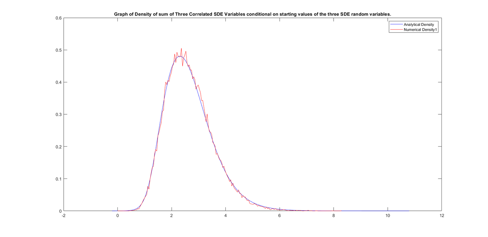](https://postimg.cc/r0Fw98f1)

[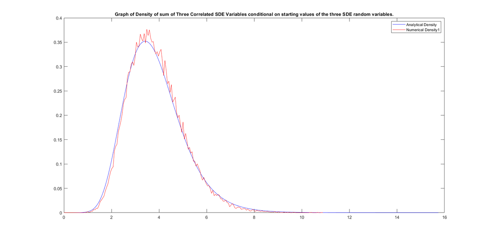](https://postimg.cc/Q9xdqXfc)

[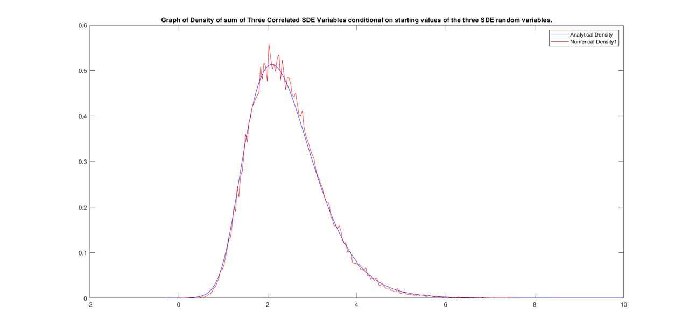](https://postimg.cc/CBLx4Fcf)

[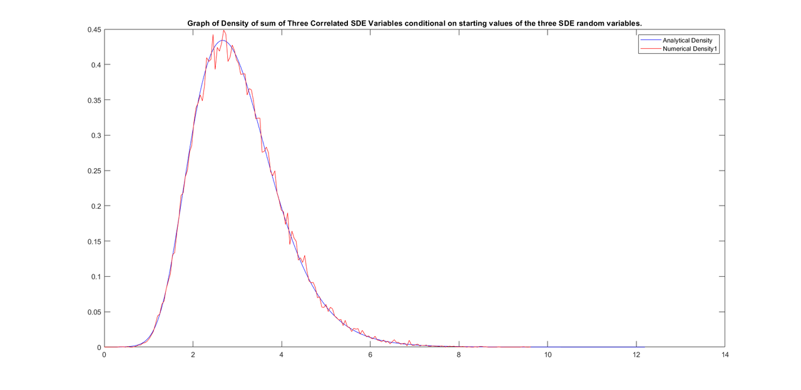](https://postimg.cc/qhMvGk18)

Correlation matrix for second scenario:

Corr1(1,1)=1;

Corr1(1,2)=.7/3;

Corr1(1,3)=.8/3;

Corr1(2,2)=1;

Corr1(2,1)=.7/3;

Corr1(2,3)=.5/3;

Corr1(3,1)=.8/3;

Corr1(3,2)=.5/3;

Corr1(3,3)=1;

.

.

.

[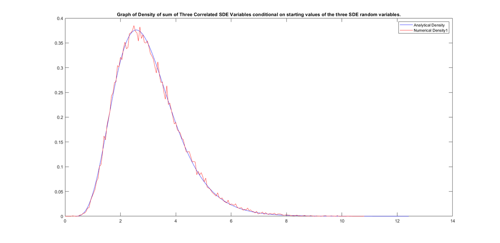](https://postimg.cc/qNxrDP6M)

[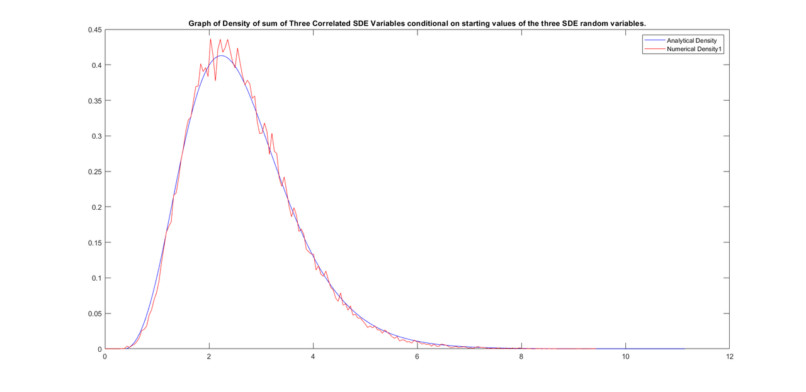](https://postimg.cc/7CPkFK0F)

[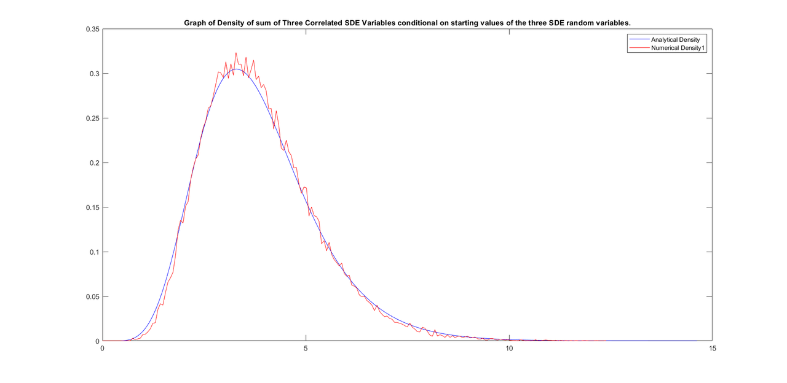](https://postimg.cc/G4xRgWT3)

[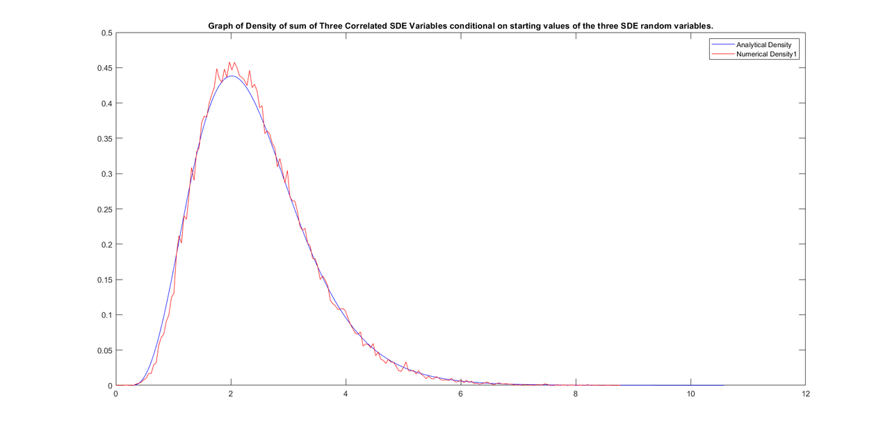](https://postimg.cc/Js58YfHr)

Third correlation scenario:

Corr1(1,1)=1;

Corr1(1,2)=-.7/3;

Corr1(1,3)=.8/3;

Corr1(2,2)=1;

Corr1(2,1)=-.7/3;

Corr1(2,3)=-.5/3;

Corr1(3,1)=.8/3;

Corr1(3,2)=-.5/3;

Corr1(3,3)=1;

[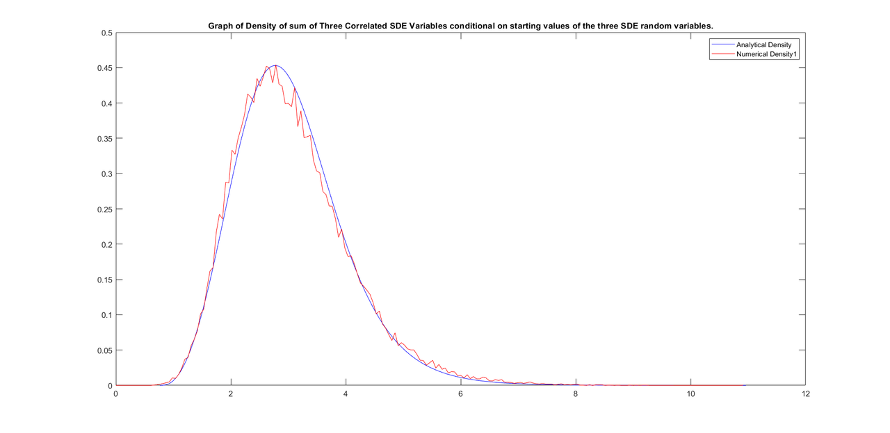](https://postimg.cc/K4Mds6Ck)

[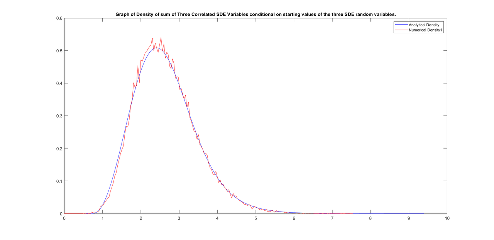](https://postimg.cc/n9BgjmvV)

[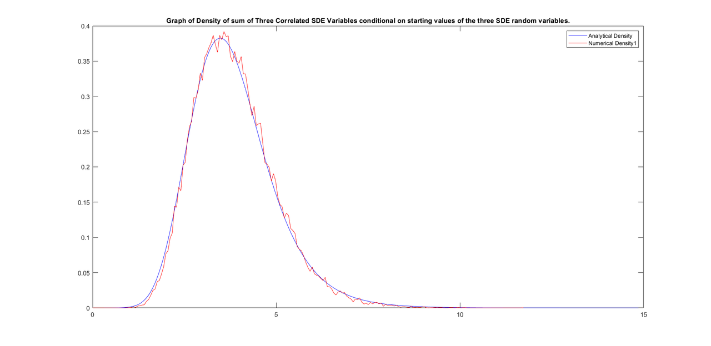](https://postimg.cc/H8XRcMQY)

[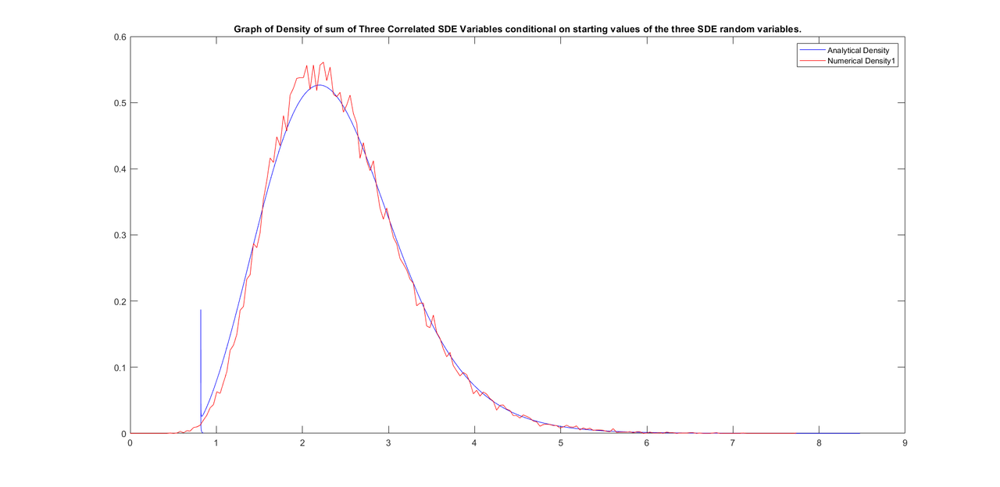](https://postimg.cc/rRx304SF)

---

### #3115 — Amin (Topic Author)
*May 26, 2026, 4:14 PM*

Friends, here are some notes.

But first I would like to say that everyday, we are improving on previous work but it will still take a few weeks to
make things totally perfect.

I noticed that conditional mean from regression is more precise (as compared to earlier algorithm that we have used) for
low correlations scenarios, and negative correlation scenarios.  For high correlations scenarios, the conditional mean
from earlier algorithm is more precise than the one from regression. So basically these two types of SDEs, at least as a
start, has to be dealt a bit differently. Large number of things are common but we still need some differences in
algorithm to deal with high correlation SDEs and the rest of the SDEs.

I have in above graphs dealt with  small to medium positive correlations, and mixed positive and negative correlations
and zero correlations. I have not dealth with high positive correlations and high negative correlations with this
algorithm.

The algorithm would be clear to friends from the code but I noticed that for most of the SDEs in this category (small to
medium positiv-negative correlations), the conditional mean from earlier method was higher while true mean was lower.
Our conditional mean from regression is very close to true mean. I noticed that error in coefficients of hermites was
also proportional to mean from old method and true mean. (slightly greater than ratio of first power of both means and
slightly lesser than ratio of second power of both condiitional means).

Using the above logic, I ad-hocly improved the coefficients by following line of code: (Here YProjected is conditional
mean from regression while bh00 is conditional mean from old algorithm).

YCoeffz(2:Order+1)=YCoeffz(2:Order+1).*YProjected/bh00;

I noticed that using squred ratio was somewhat better but I remained conservative and used the above formula in all of
the above graphs. The above equation does not hold for high positive correlations scenario since there YProjected is
worse than bh00 and bh00 is very close to true conditional mean.

You have to use improved versions of the old algorithm for very high positive correlations scenarios.

There is still a lot of work that needs to be done and I am sure we would do that in the following few weeks to get all
theory on solid grounds. We are making progress.

In next post, I will attach the code used to make the graphs in previous post.

---

### #3116 — Amin (Topic Author)
*May 26, 2026, 4:26 PM*

Please note that following program has some repetitions where some of the things are calculated again in different parts
but a later version will make everything more compact. Please note that this is still a very intermediate preliminary
version and many new versions will follow in coming weeks.

.

.

```
function []= ConditionalDensityHermitesNvariateNewton()

%SV SDE is
%dV(t)=mu1 V(t)^beta1 dt+ mu2 V(t)^beta2 dt + sigma0 V(t)^gamma dZ(t)
%In mean reverting SDEs we ususally have
%mu1= kappaV * thetaV
%beta1=0
%mu2=-kappa
%beta2=0
%The present program works only when drift is zero (for pure noises)
%meaning mu1=0 and mu2=0;

Order=7;
%NDim=4;%Three assets and one SV.
%NMomentsY=Order+1;
%NMomentsX=Order+1;

%%%%%%%%%%%%%%%%%%%5
dt=.03125/2/8;
Tt=64*2*8;
T=Tt*dt;
seed0=12130649;
%seed0=94210876;
%seed0=14210876;
%seed0=53612297
seed0=97459782
rng(seed0, 'twister')
paths=50000;
TT1=100*8/2; %Transition distribution start
TT2=256*8/2; %Transition distribution end

%%%%%%%%%%%%%%%%%%%5

NDims=3;
%
V0(1)=1.000;%.32;
V00(1)=V0(1);

%SDE1
 thetaV(1)=1.0;%.045;%1;%.04;
 kappaV(1)=0.000;%1.5;%1.5;
 gamma(1)=.75;%.75
 sigma0(1)=.5;%.35

%SDE2%
%thetaV(1)=.90;%.045;%1;%.04;
%kappaV(1)=1.000;%1.5;%1.5;
%gamma(1)=.75;%.75
%sigma0(1)=.85;%.35

%SDE3%
%thetaV(1)=1.350;%.045;%1;%.04;
%kappaV(1)=2.000;%1.5;%1.5;
%gamma(1)=.75;%.75
%sigma0(1)=.95;%.35

mu1(1)=kappaV(1)*thetaV(1);
mu2(1)=-kappaV(1);
beta1(1)=0;
beta2(1)=1;

V0(2)=1.000;%.32;
V00(2)=V0(2);

%SDE1
thetaV(2)=1.0;%.045;%1;%.04;
 kappaV(2)=0.000;%1.5;%1.5;
 gamma(2)=.65;%.75
 sigma0(2)=.5;%.35

%SDE2
% thetaV(2)=1.0;%.045;%1;%.04;
% kappaV(2)=2.000;%1.5;%1.5;
% gamma(2)=.65;%.75
% sigma0(2)=.95;%.35

%SDE3
%thetaV(2)=.850;%.045;%1;%.04;
%kappaV(2)=.35000;%1.5;%1.5;
%gamma(2)=.65;%.75
%sigma0(2)=.55;%.35

mu1(2)=kappaV(2)*thetaV(2);
mu2(2)=-kappaV(2);
beta1(2)=0;
beta2(2)=1;

V0(3)=1.000;%.33;
V00(3)=V0(3);

%SDE1
thetaV(3)=1.0;%.045;%1;%.04;
 kappaV(3)=0.000;%1.5;%1.5;
 gamma(3)=.95;%.75
 sigma0(3)=.45;%.35

%SDE2
% thetaV(3)=.750;%.045;%1;%.04;
% kappaV(3)=0.5000;%1.5;%1.5;
% gamma(3)=.95;%.75
% sigma0(3)=.45;%.35

%SDE3
%thetaV(3)=1.150;%.045;%1;%.04;
%kappaV(3)=1.5000;%1.5;%1.5;
%gamma(3)=.95;%.75
%sigma0(3)=.75;%.35

mu1(3)=kappaV(3)*thetaV(3);
mu2(3)=-kappaV(3);
beta1(3)=0;
beta2(3)=1;

% Corr1(1,1)=1;
% Corr1(1,2)=.7;
% Corr1(1,3)=.8;
% Corr1(2,2)=1;
% Corr1(2,1)=.7;
% Corr1(2,3)=.5;
% Corr1(3,1)=.8;
% Corr1(3,2)=.5;
% Corr1(3,3)=1;

Corr1(1,1)=1;
Corr1(1,2)=.7/3;
Corr1(1,3)=.8/3;
Corr1(2,2)=1;
Corr1(2,1)=.7/3;
Corr1(2,3)=.5/3;
Corr1(3,1)=.8/3;
Corr1(3,2)=.5/3;
Corr1(3,3)=1;

Corr1(1,1)=1;
Corr1(1,2)=-.7/3;
Corr1(1,3)=.8/3;
Corr1(2,2)=1;
Corr1(2,1)=-.7/3;
Corr1(2,3)=-.5/3;
Corr1(3,1)=.8/3;
Corr1(3,2)=-.5/3;
Corr1(3,3)=1;

% Corr1(1,1)=1;
% Corr1(1,2)=-.27;
% Corr1(1,3)=-.28;
% Corr1(2,2)=1;
% Corr1(2,1)=-.27;
% Corr1(2,3)=-.15;
% Corr1(3,1)=-.28;
% Corr1(3,2)=-.15;
% Corr1(3,3)=1;
%87%Corr1(1:3,1:3)=0.0;

R=chol(Corr1);
%
%  R(1:3,1:3)=0;
%  R(1,1)=1;
%  R(2,2)=1;
%  R(3,3)=1;

V0(4)=1.000;%.44;
V00(4)=V0(4);
thetaV(4)=1.0;%.045;%1;%.04;
kappaV(4)=1.000;%1.5;%1.5;
mu1(4)=kappaV(4)*thetaV(4);
mu2(4)=-kappaV(4);
beta1(4)=0;
beta2(4)=1;
gamma(4)=.95;%.75
sigma0(4)=.55;%.45

%%%%%%%%%%%%%%%%%%%%%%%%%%%%%%%%%%%%%%%%%%%%%%%%%%%%%%%%%%%%%%%%%%%%%5
for nn=1:NDims
V(1:paths,nn)=V0(nn);
end
%V(1:paths,1:NDims)=V0(1,1:NDims);

Random1(1:paths/2,1:NDims)=0;

for tt=1:Tt

    Random2(1:paths/2,1:NDims)=randn(size(Random1));
    Random2(paths/2+1:paths,1:NDims)=-Random2(1:paths/2,1:NDims);

    %Random2=R'*Random2;
    random1=Random2*R(:,1);
    random2=Random2*R(:,2);
    random3=Random2*R(:,3);

    Random2(:,1)=random1;
    Random2(:,2)=random2;
    Random2(:,3)=random3;

    for nn=1:NDims

    V(1:paths,nn)=V(1:paths,nn)+ ...
        (mu1(nn).*V(1:paths,nn).^beta1(nn) + mu2(nn).*V(1:paths,nn).^beta2(nn))*dt + ...
        sigma0(nn).*V(1:paths,nn).^gamma(nn) .*Random2(1:paths,nn)*sqrt(dt) + ...
        (mu1(nn).*beta1(nn)*V(1:paths,nn).^(beta1(nn)-1) + mu2(nn).*beta2(nn).*V(1:paths,nn).^(beta2(nn)-1)).* ...
        ((mu1(nn).*V(1:paths,nn).^beta1(nn) + mu2(nn).*V(1:paths,nn).^beta2(nn))*dt^2/2 + ...
        sigma0(nn).*V(1:paths,nn).^gamma(nn) .*Random2(1:paths,nn)*(1-1/sqrt(3))*dt^1.5) + ...
        .5*(mu1(nn).*beta1(nn).*(beta1(nn)-1).*V(1:paths,nn).^(beta1(nn)-2) +
mu2(nn).*beta2(nn).*(beta2(nn)-1).*V(1:paths,nn).^(beta2(nn)-2)).* ...
        sigma0(nn)^2.*V(1:paths,nn).^(2*gamma(nn)).*dt^2/2 + ...
        sigma0(nn).*gamma(nn).*V(1:paths,nn).^(gamma(nn)-1) .* ...
        ((mu1(nn).*V(1:paths,nn).^beta1(nn) + mu2(nn).*V(1:paths,nn).^beta2(nn)).*Random2(1:paths,nn).*1/sqrt(3)*dt^1.5
+ ...
        sigma0(nn).*V(1:paths,nn).^gamma(nn) .*(Random2(1:paths,nn).^2-1)*dt/2) + ...
        .5*sigma0(nn).*gamma(nn).*(gamma(nn)-1).*V(1:paths,nn).^(gamma(nn)-2) .* ...
        sigma0(nn).^2.*V(1:paths,nn).^(2*gamma(nn)) .*Random2(1:paths,nn).*1/sqrt(3)*dt^1.5;

    V(V(:,nn)<=0)=.0001;

    if(tt==TT1)
        Xin(1:paths,nn)=real(V(1:paths,nn));
    end

    if(tt==TT2)

        Xin2(1:paths,nn)=real(V(1:paths,nn));
    end

    end

end

Yin(1:paths)=0.0;

for pp=1:paths
for mm=1:NDims
    Yin(pp)=Yin(pp)+Xin2(pp,mm);%-Xin(pp,mm);
%-Xin(pp,mm);
end
end

str=input("I have reached stone 1");

% %%%%%%%%%%%%%%%%%%%%%%%%%%%%%%%%%%%%%%%%%%%%%%%%%%5
%

%save("C:\Users\Lenovo\Documents\MATLAB\MATLAB1\YXfile.mat","Yin","Xin")

%str=input("Data has been saved");

% load("C:\Users\Lenovo\Documents\MATLAB\MATLAB1\YXfile.mat","Yin","Xin")
%
% str=input("Data has been loaded");
%
%
%
%
 Order=7;
 clf;
[BetaCorrH,YCoeffH,XCoeffH,HCorrXX,Zy,Zx] = CalculateHermiteCorrelations0NA04(Xin,Yin,paths,NDims);
YCoeffZ(1:Order+1)= ConvertHermiteSeriesToZSeries01(YCoeffH(1:Order+1),Order);

%HCorrXX(:,:)=0.0;

BetaCorrH

HCorrXX
%CorrXX1st
str=input("I have reached Stone2");

%[cn,dn,bnv,bbnv,ch] = Calculate2DZSeriesNDimCorrected(YCoeffH,BetaCorrH,HCorrXX,NDims,Order);
%cn=bnv;
[cn,ch]=CalculateGaussianCorrelationFromHermiteCorrelationsNDimNew(YCoeffH,XCoeffH,BetaCorrH,HCorrXX,NDims,Order);
%
%
%
% save("C:\Users\Lenovo\Documents\MATLAB\MATLAB1\Zyxfile.mat","Zy","Zx","cn","HCorrXX")
%
%
% str=input("Data has been saved");

%load("C:\Users\Lenovo\Documents\MATLAB\MATLAB1\Zyxfile.mat","Zy","Zx","cn","HCorrXX")

%str=input("Data has been loaded");

%size(Zy)
%size(Zx)
%size(cn)
HCorrXX0=HCorrXX;
[HCorrXY,HCorrXX,YCoeffHNorm,XCoeffHNorm]=CalculateHermiteCorrelationCoefficientsForGaussianCorrs(Xin,Yin,paths,NDims);

HCorrXX
HCorrXX0

str=input("Look at HCorrXX and HCorrXX0");

%[rhoxy,rhoxx] = CalculateGaussianCorrelationFromHermiteCorrelations001(YCoeffH,XCoeffH,HCorrXY,HCorrXX,NDims,Order)
%[rhoxy,rhoxx] = CalculateGaussianCorrelationFromHermiteCorrelations001(YCoeffH,XCoeffH,BetaCorrH,HCorrXX,NDims,Order)
[rhoxy,rhoxx] =
CalculateGaussianCorrelationFromHermiteCorrelations001(YCoeffHNorm,XCoeffH,HCorrXY,HCorrXX0,NDims,Order);

%rhoxy
%rhoxx

%str=input("Look at these correlations")

%OptimizeCorrFromHermitesIterative(Zy,Zx,cn,HCorrXX,NDims,paths,Order);

%OptimizeCorrFromHermitesIterative02(Zy,Zx,cn,HCorrXX,NDims,paths,Order);

%OptimizeCorrFromHermitesNewton02(Zy,Zx,cn,HCorrXX,NDims,paths,Order);

% HCorrXX0=HCorrXX;
% for nn1=1:NDims
%     for nn2=1:NDims
%         VariableHIn(2:Order+1)=HCorrXX(nn1,nn2,1:Order);
%         VariableZOut(1:Order+1)= ConvertHermiteSeriesToZSeries01(VariableHIn(1:Order+1),Order);
%         HCorrXXZ(nn1,nn2,1:Order)=VariableZOut(2:Order+1);
%     end
% end

%[cnOptim] = OptimizeCorrFromHermitesNewton(Zy,Zx,cn,HCorrXX,NDims,paths,Order);
[cnOptim] = OptimizeCorrFromHermitesNewton(Zy,Zx,rhoxy,rhoxx(:,:,2:8),NDims,paths,Order);

cn=cnOptim;

%%%%%%%%%%%%%%%%%%%%%%%%%%%%%%%%%%%%%%%%%%%%%%%%%%%%%%%%%%%%%%%%%%%%%%%%%%%%%%5555

[CoeffR,XCoeffH,ZI] = RegressYOnX(Yin,Xin,paths,NDims,Order);

%%%%%%%%%%%%%%%%%%%%%%%%%%%%%%%%%%%%%%%%%%%%%%%%%%%%%%%%%%%%%%%%%%%%%%%%%%%%%%%%%%%%%%%
%Set1
V10(1)=1.2;%.65;%
V10(2)=.65;
V10(3)=1.2;
%V10(4)=1.85;

%
% % % % %Set2
 V10(1)=.75;
 V10(2)=1.2;%1.2;
 V10(3)=.7;
% % % %V10(4)=.65
% % % %
% % % % %Set3
  V10(1)=1.25;
  V10(2)=1.35;%1.2;
  V10(3)=1.25;
% % %   V10(4)=1.4
% % % %
% % % %
  V10(1)=.85;
  V10(2)=.81;%1.2;
  V10(3)=.77;
% % %  V10(4)=.7

%V10(1)=.65;
%V10(2)=.51;%1.2;
%V10(3)=.73;

%V10(1)=1.65;
%V10(2)=1.51;%1.2;
%V10(3111111111111111111111111111111111111111111111111111111111111111111111111111111111111111111111111111111111111111111111111111111)=1.63;

for nn=1:NDims
V(1:paths,nn)=V10(nn);
end
%V(1:paths,1:NDims)=V0(1,1:NDims);

Random1(1:paths/2,1:NDims)=0;

for tt=1:TT2-TT1

    Random2(1:paths/2,1:NDims)=randn(size(Random1));
    Random2(paths/2+1:paths,1:NDims)=-Random2(1:paths/2,1:NDims);

    random1=Random2*R(:,1);
    random2=Random2*R(:,2);
    random3=Random2*R(:,3);

    Random2(:,1)=random1;
    Random2(:,2)=random2;
    Random2(:,3)=random3;

    for nn=1:NDims

    V(1:paths,nn)=V(1:paths,nn)+ ...
        (mu1(nn).*V(1:paths,nn).^beta1(nn) + mu2(nn).*V(1:paths,nn).^beta2(nn))*dt + ...
        sigma0(nn).*V(1:paths,nn).^gamma(nn) .*Random2(1:paths,nn)*sqrt(dt) + ...
        (mu1(nn).*beta1(nn)*V(1:paths,nn).^(beta1(nn)-1) + mu2(nn).*beta2(nn).*V(1:paths,nn).^(beta2(nn)-1)).* ...
        ((mu1(nn).*V(1:paths,nn).^beta1(nn) + mu2(nn).*V(1:paths,nn).^beta2(nn))*dt^2/2 + ...
        sigma0(nn).*V(1:paths,nn).^gamma(nn) .*Random2(1:paths,nn)*(1-1/sqrt(3))*dt^1.5) + ...
        .5*(mu1(nn).*beta1(nn).*(beta1(nn)-1).*V(1:paths,nn).^(beta1(nn)-2) +
mu2(nn).*beta2(nn).*(beta2(nn)-1).*V(1:paths,nn).^(beta2(nn)-2)).* ...
        sigma0(nn)^2.*V(1:paths,nn).^(2*gamma(nn)).*dt^2/2 + ...
        sigma0(nn).*gamma(nn).*V(1:paths,nn).^(gamma(nn)-1) .* ...
        ((mu1(nn).*V(1:paths,nn).^beta1(nn) + mu2(nn).*V(1:paths,nn).^beta2(nn)).*Random2(1:paths,nn).*1/sqrt(3)*dt^1.5
+ ...
        sigma0(nn).*V(1:paths,nn).^gamma(nn) .*(Random2(1:paths,nn).^2-1)*dt/2) + ...
        .5*sigma0(nn).*gamma(nn).*(gamma(nn)-1).*V(1:paths,nn).^(gamma(nn)-2) .* ...
        sigma0(nn).^2.*V(1:paths,nn).^(2*gamma(nn)) .*Random2(1:paths,nn).*1/sqrt(3)*dt^1.5;

    V(V(:,nn)<0)=.0001;

    %if(tt==TT1)
    %    XXin(1:paths,nn)=V(1:paths,nn);
    %end

    if(tt==TT2-TT1)

        XXin2(1:paths,nn)=V(1:paths,nn);
    end

    end

end

Yin2(1:paths)=0.0;

for pp=1:paths
for mm=1:NDims
    Yin2(pp)=Yin2(pp)+XXin2(pp,mm);%-V10(mm);
end
end

randn()

str=input("I have reached stone 4");

NoOfBins=200;
MaxCutOff=20;

[XDensity,IndexOut,IndexMax] = MakeDensityFromSimulation_Infiniti_NEW(Yin2,paths,NoOfBins,MaxCutOff );

for qq=1:8

    DataMoments(qq)=sum(Yin2(:).^qq)/paths;

end

%%%%%%%%%%%%%%%%%%%%%%%%%%%%%%%%%%%%%%%%%%%%%%%%%%%%%%%%%%%%%%%%%%%%%%%%%%%%%%%%%%%%%%%5

for nn=1:NDims
    [Zx0(nn)] = CalculateZgivenXAndHSeriesCoeffs(V10(nn),XCoeffH(1:Order+1,nn),Order);
end

%%%%%%%%%%%%%%%%%%%%%%%%%%%%%%%%%%%%%%%%%%%%%%%%%%%%%%%%%%%%%%%%%%%55

WW(1,1:Order+1)=EvalHermiteArrayH0(Zx0(1),Order);
for mm=2:NDims
    WW(1,(mm-1)*Order+2:mm*Order+1)=EvalHermiteArrayH1(Zx0(mm),Order);
end

     YProjected=0.0;
    for mm=1:NDims*Order+1
    YProjected=YProjected+WW(1,mm).*CoeffR(mm,1);

    end

%%%%%%%%%%%%%%%%%%%%%%%%%%%%%%%%%%%%%%%%%%%%%%%%%%%%%%%%%%%%%%%%%%%%%%%%%%%%%%%55
Zx(1:Order)=0;

for hh=1:Order
    for nn=1:NDims
        %Zx(hh) = Zx(hh) + bnv(nn+1,hh+1).^1.*Zx0(nn);
        Zx(hh) = Zx(hh) + cn(nn,hh).^1.*Zx0(nn);
    end
end

bh0=YCoeffH(1);

[W] = EvalHermiteArrayH0(Zx0,Order);

for hh=1:Order
    for nn=1:NDims
        bh0 = bh0 + ch(nn+1,hh+1).^1.*W(nn,hh+1);
    end
end
bh00=bh0;

%%%%%%%%%%%%%%%%%%%%%%%%%%%%%%%%%%%%%%%%%%%%%%%%%%%%%%%%%%%%%%%%

a0=YCoeffZ(1);
a1=YCoeffZ(2);
a2=YCoeffZ(3);
a3=YCoeffZ(4);
a4=YCoeffZ(5);
a5=YCoeffZ(6);
a6=YCoeffZ(7);
a7=YCoeffZ(8);

d1=cn(4,1);
d2=cn(4,2);
d3=cn(4,3);
d4=cn(4,4);
d5=cn(4,5);
d6=cn(4,6);
d7=cn(4,7);

%b0=(a0+a1.* Zx(1) +a2.* Zx(2).^2+a3.* Zx(3).^3+a4* Zx(4).^4+a5 *Zx(5).^5+a6* Zx(6).^6+a7* Zx(7).^7);
b1=(a1* d1+2* a2* Zx(2)* d2 +3* a3* Zx(3).^2* d3+4* a4* Zx(4).^3* d4+5* a5* Zx(5).^4* d5+6* a6* Zx(6).^5* d6+7* a7*
Zx(7).^6* d7);
b2=(a2* d2.^2+3* a3* Zx(3)* d3^2 +6* a4* Zx(4).^2* d4^2+10* a5* Zx(5).^3* d5^2+15* a6* Zx(6).^4* d6^2+21* a7* Zx(7).^5*
d7^2);
b3=(a3* d3^3+4* a4 *Zx(4)* d4^3 +10* a5* Zx(5).^2* d5^3+20* a6* Zx(6).^3* d6^3+35* a7* Zx(7).^4* d7^3);
b4=(a4* d4^4+5* a5* Zx(5)* d5^4 +15* a6 *Zx(6).^2* d6^4+35* a7* Zx(7).^3 *d7^4);
b5=(a5* d5^5+6* a6* Zx(6)* d6^5 +21* a7 *Zx(7).^2* d7^5);
b6=(a6* d6^6+7* a7* Zx(7)* d7^6 );
b7=(a7* d7^7);

%bh0=b0+b2+3*b4+15*b6;
bh1=b1+3*b3+15*b5+105*b7;
bh2=b2+6*b4+45*b6;
bh3=b3+10*b5+105*b7;
bh4=b4+15*b6;
bh5=b5+21*b7;
bh6=b6;
bh7=b7;

bh(1)=YProjected;
bh(2)=bh1;
bh(3)=bh2;
bh(4)=bh3;
bh(5)=bh4;
bh(6)=bh5;
bh(7)=bh6;
bh(8)=bh7;

%%%%%%%%%%%%%%%%%%%%%%%%%%%%%%%%%%%%%%%%%%%%%%%%%%%%%%%%%%%%%%%%%%%%%%%%%%%%%%5

YCoeffz(1:Order+1)= ConvertHermiteSeriesToZSeries01(bh(1:Order+1),Order);

[YMomentsModel]=CalculateMomentsOfZSeries(YCoeffz(1),YCoeffz(2:Order+1),Order,Order+1);

YMomentsModel

DataMoments

str=input("Look at comparison of moments");

[cMu1,YCentralMoments]=ConvertRawMomentsToCentralMoments(YMomentsModel,Order+1);
[cMu2,DataCentralMoments]=ConvertRawMomentsToCentralMoments(DataMoments,Order+1);

YCentralMoments

DataCentralMoments

bh00
YProjected

YCoeffz(2:Order+1)=YCoeffz(2:Order+1).*YProjected/bh00;
str=input("Look at central moments");

% Order0=7;
% Order1=13;
% NData=paths;
% [CondMomentYgivX,BetaCorrHxy] = CalculateConditionalMomentYgivXNDims(Xin,Yin,NData,Zx0,NDims,Order0,Order1)
%
% [VarConditional]=FindSecondConditionalMoment(YCoeffH,BetaCorrH,Zx0)
%
%
% BetaCorrHxy
% BetaCorrH
%
% str=input("Look at conditionalVariance");

clf;

PlotZSeriesDensity(YCoeffz(1),YCoeffz(2:Order+1),'b')

hold on

plot(IndexOut(1:IndexMax),XDensity(1:IndexMax),'r');

%PlotHermiteSeriesDensityAndRvGraph(YCoeffh(1),YCoeffh1(2:yOrder+1),'g')
title("Graph of Density of sum of Three Correlated SDE Variables conditional on starting values of the three SDE random
variables.")
%title(sprintf('V00 = %.3f; kappa=%.3f, theta=%.3f,gamma=%.3f,sigma=%.3f;V10=%.3f at TT1=%.3f;TT2=%.3f;Paths=%d ',V00,
kappaV, thetaV,gamma,sigma0, V10,(TT1*dt),(TT2*dt),paths));%,sprintf('theta= %f', theta), sprintf('kappa = %f',
kappa),sprintf('sigma = %f', sigma0),sprintf('T = %f', T));
legend({'Analytical Density','Numerical Density1'}, ...
    'Location','northeast')

str=input("This is the first version without altering the moments of conditional density")

hold off

end
```

.

.

.

.

```
function [BetaCorrH,YCoeffH,XCoeffH,HCorrXX,Zy,Zx] = CalculateHermiteCorrelations0NA04(Xin,Yin,NData,NDims)

%This program finds required correlations between NDims explanatory
%variables given in Xin that has NDims dimensionality. Yin is variable
%being explained and is one-diemsnional.

Order=7;
NMoments=8;

[ZI] = MomentMatchedStandardNormalDiscretizedDensity(NData);

for nn=1:NDims
[XCoeffH(1:Order+1,nn),Zx(1:NData,nn)] = CalculateHermiteSeriesFromData02(Xin(1:NData,nn),Order,ZI);

[Zx(1:NData,nn)] = CalculateZgivenXAndHSeriesCoeffs(Xin(1:NData,nn),XCoeffH(1:Order+1,nn),Order);

end

[YCoeffH,Zy] = CalculateHermiteSeriesFromData02(Yin,Order,ZI);
[Zy] = CalculateZgivenXAndHSeriesCoeffs(Yin,YCoeffH,Order);

for nn1=1:NDims
    for nn2=1:NDims
        if(nn1==nn2)
            HCorrXX(nn1,nn2,1:Order)=1.0;
        else
            HCorrXX(nn1,nn2,1:Order) =
CalculateCorrelationBivariateHermiteCH0(Zx(1:NData,nn1),Zx(1:NData,nn2),NData,Order);
        end
    end
end
for nn1=1:NDims
    HCorrXX(nn1,nn1,1:Order)=1.0;
end

for hh=1:Order
    for nn1=1:NDims
        HCorrXX
        ss2=0;
        for nn2=1:NDims
            if(nn2~=nn1)
                ss2=ss2+1;
                ss3=0;
                for nn3=1:NDims
                    if(nn3~=nn1)
                        ss3=ss3+1;
                            HCorrXXmn(ss2,ss3)=HCorrXX(nn2,nn3,hh);
                    end
                    HCorrXmXn(ss2,1)=HCorrXX(nn1,nn2,hh);
                end
            end
        end
        BetaCorrXX(1:NDims-1,nn1,hh)=HCorrXXmn(:,:)\HCorrXmXn(1:NDims-1,1);

    end

    BetaCorrXX

    nn1

        str=input("Look at important variables");

end
BetaCorrXX
str=input("look at the BetacorrXX");
for nn1=1:NDims
    for nn2=1:NDims-1
        if(nn2<nn1)
    BetaCorrXX0(nn2,nn1,1:Order)=BetaCorrXX(nn2,nn1,1:Order);
        elseif(nn2==nn1)
               % BetaCorrXX0(nn2,nn1,1:Order)=1;

            BetaCorrXX0(nn2+1:NDims,nn1,1:Order)=BetaCorrXX(nn2:NDims-1,nn1,1:Order);
        end
    end
    BetaCorrXX0(nn1,nn1,1:Order)=1;
end
BetaCorrXX
BetaCorrXX0
%
% % % % str=input("Look at BetaCorrXX pairs");
% % % % for hh=1:Order
% % % %     for nn1=1:NDims
% % % %         for nn2=1:NDims-1
% % % %             BetaCorrXXn(nn1,nn2,hh)=sign(BetaCorrXXn(nn1,nn2,hh)).*(abs(BetaCorrXXn(nn1,nn2,hh))).^(1/hh);
% % % %         end
% % % %     end
% % % % end

for nn1=1:NDims
    HCorrXY(nn1,1:Order) = CalculateCorrelationBivariateHermiteCH0(Zx(1:NData,nn1),Zy(1:NData),NData,Order);
end

for hh=1:Order
    [BCorrXY(:,hh),Is(:,hh)]=sort(HCorrXY(:,hh),'descend');
end

for hh=1:Order
    CorrXX(1:NDims,1:NDims)=HCorrXX(Is(1:NDims,hh),Is(1:NDims,hh),hh);
    CorrXY(1:NDims,1)=HCorrXY(Is(1:NDims,hh),hh);
    BetaCorr0(1:NDims)=CorrXX\CorrXY;
    BetaCorrH(Is(1:NDims,hh),hh)=BetaCorr0(1:NDims);
end

HCorrXX=BetaCorrXX0;
HCorrXX
str=input("Look at HCOrrXX");

% for hh=1:Order
%     CorrXX(1:NDims,1:NDims)=HCorrXX(1:NDims,1:NDims,hh);
%     CorrXY(1:NDims,1)=HCorrXY(1:NDims,hh);
%     BetaCorrH(1:NDims,hh)=CorrXX\CorrXY;
% end

%CorrXX1st(1:NDims,1:NDims)=HCorrXX(1:NDims,1:NDims,1)

BetaCorrH(:,1)'*CorrXX

CorrXY

HCorrXX

HCorrXY

BetaCorrH

str=input("Look at BetaCorrH");
end

```

.

.

.

.

```
function [cn,ch] =
CalculateGaussianCorrelationFromHermiteCorrelationsNDimNew(YCoeffH,XCoeffH,BetaCorrHxy,CorrHxx,NDims,Order)

for hh=1:Order
    for nn=1:NDims
        ch(nn+1,hh+1)=BetaCorrHxy(nn,hh).*YCoeffH(hh+1);%make sure indices on all hermite-correlations match.check.
        %%%% nn+1 since 1st index would go to y-tilde.
    end
end

ch
YCoeffH

str=input("Look at above---00-1-1-1-1-");

[YCoeffZ(1:Order+1)] = ConvertHermiteSeriesToZSeries01(YCoeffH(1:Order+1),Order);

for nn=1:NDims
    [XCoeffZ(1:Order+1,nn)] = ConvertHermiteSeriesToZSeries01(XCoeffH(1:Order+1,nn),Order);
end

YCoeffH

YCoeffZ

str=input("Look at the Hermite and Z-series coeffs");

% YCoeffZA=YCoeffZ;
% YCoeffZ=YCoeffZA;
% if(abs(YCoeffZ(4))>abs(YCoeffZ(2)))
%    YCoeffZ(4)=sign(YCoeffZ(4)).*abs(YCoeffZ(2));
% end
% if(abs(YCoeffZ(6))>abs(YCoeffZ(4)))
%    YCoeffZ(6)=sign(YCoeffZ(6)).*abs(YCoeffZ(4));
% end
% if(abs(YCoeffZ(8))>abs(YCoeffZ(6)))
%    YCoeffZ(6)=sign(YCoeffZ(6)).*abs(YCoeffZ(8));
% end
%
%
% if(abs(YCoeffZ(5))>abs(YCoeffZ(3)))
%    YCoeffZ(5)=sign(YCoeffZ(5)).*abs(YCoeffZ(3));
% end
% if(abs(YCoeffZ(7))>abs(YCoeffZ(5)))
%    YCoeffZ(5)=sign(YCoeffZ(5)).*abs(YCoeffZ(7));
% end
%

for nn=1:NDims
[c(nn+1,1:Order+1)] = ConvertHermiteSeriesToZSeries01(ch(nn+1,1:Order+1),Order);
end

for nn=1:NDims
    rhoxy(nn+1,8)=sign(BetaCorrHxy(nn,7)).^1.*(abs(BetaCorrHxy(nn,7))).^(1/7);
    rhoxy(nn+1,7)=sign(BetaCorrHxy(nn,6)).^1.*(abs(BetaCorrHxy(nn,6))).^(1/6);
    rhoxy(nn+1,6)=sign(BetaCorrHxy(nn,5)).^1.*(abs( 
 (YCoeffH(6).*BetaCorrHxy(nn,5)-21*YCoeffZ(8).*rhoxy(nn+1,8).^(5))./(YCoeffH(6)-21*YCoeffZ(8)))).^(1/5);
    rhoxy(nn+1,5)=sign(BetaCorrHxy(nn,4)).^1.*(abs( 
(YCoeffH(5).*BetaCorrHxy(nn,4)-15*YCoeffZ(7).*rhoxy(nn+1,7).^(4))./(YCoeffH(5)-15*YCoeffZ(7)))).^(1/4);
    rhoxy(nn+1,4)=sign(BetaCorrHxy(nn,3)).^1.*(abs( 
(YCoeffH(4).*BetaCorrHxy(nn,3)-10*YCoeffZ(6).*rhoxy(nn+1,6).^(3)-105*YCoeffZ(8).*rhoxy(nn+1,8).^(3))...
        ./(YCoeffH(4)-10*YCoeffZ(6)-105*YCoeffZ(8)))).^(1/3);
    rhoxy(nn+1,3)=sign(BetaCorrHxy(nn,2)).^1.*(abs(
(YCoeffH(3).*BetaCorrHxy(nn,2)-6*YCoeffZ(5).*rhoxy(nn+1,5).^(2)-45*YCoeffZ(7).*rhoxy(nn+1,7).^(2)) ...
        ./(YCoeffH(3)-6*YCoeffZ(5)-45*YCoeffZ(7)))).^(1/2);
    rhoxy(nn+1,2)=sign(BetaCorrHxy(nn,1)).^1.*(abs( 
(YCoeffH(2).*BetaCorrHxy(nn,1)-3*YCoeffZ(4).*rhoxy(nn+1,4).^(1)-15*YCoeffZ(6).*rhoxy(nn+1,6).^(1) ...
        -105*YCoeffZ(8).*rhoxy(nn+1,8).^(1))...
        ./(YCoeffH(2)-3*YCoeffZ(4)-15*YCoeffZ(6)-105*YCoeffZ(8)))).^(1/1);

%    rhoxy(nn,2+1)=sign(4/9*BetaCorrHxy(nn,2)+1/36).*abs((4/9*BetaCorrHxy(nn,2)+1/36))^(.5);
%
rhoxy(nn,3+1)=sign((36/225*BetaCorrHxy(nn,3)-3/225*BetaCorrHxy(nn,1))).*(abs((36/225*BetaCorrHxy(nn,3)-3/225*BetaCorrHxy(nn,1))))^(1/3);
%
rhoxy(nn,4+1)=sign((144*4/(105)^2*BetaCorrHxy(nn,4)-6/105^2*(4*BetaCorrHxy(nn,2)+.25)-18/105^2)).*(abs(((144*4/(105)^2*BetaCorrHxy(nn,4)-6/105^2*(4*BetaCorrHxy(nn,2)+.25)-18/105^2))))^(1/4);
% rhoxy(nn,1+1)=BetaCorrHxy(nn,1);
end

%
for nn=1:NDims
    for mm=1:NDims
        if(nn==mm)
            rhoxx(nn,mm,2)=1;
            rhoxx(nn,mm,3)=1;
            rhoxx(nn,mm,4)=1;
            rhoxx(nn,mm,5)=1;
            rhoxx(nn,mm,6)=1;
            rhoxx(nn,mm,7)=1;
            rhoxx(nn,mm,8)=1;

        elseif(nn.995)
    cn(2:NDims+1,8)=cn(2:NDims+1,8)*sqrt(.995)/sqrt(cnSqrSum);
    cnSqrSum=.995;
end

cn(1,8)=sqrt(1-cnSqrSum);
%ccn(1,8)=sqrt(1-cn(1,8).^2);
%Cn(1,8)=cn(1,8).*YCoeffZ(8);

cn
%ccn
str=input("Compare the Eighth Element From NDim---2");

% ccn00(2,8)=cn(2,8).^2+2*cn(2,8).*cn(3,8).*CorrXX1st(1,2)+2*cn(2,8).*cn(4,8).*CorrXX1st(1,3)+ ...
%     cn(3,8).^2+2*cn(3,8).*cn(4,8).*CorrXX1st(2,3)+cn(4,8).^2
%
% ccn00(2,8)=sqrt(1-(cn(2,8).^2+2*cn(2,8).*cn(3,8).*CorrXX1st(1,2)+2*cn(2,8).*cn(4,8).*CorrXX1st(1,3)))
%
% cnSqrSum
%
% ccn0(2,8)
%
% ccn(1,8)
%
% ccn(2,8)
%
% str=input("Look at the variables Inside");
%

cnSqrSum=0;
%for nn=1:NDims
%    rho_z(nn+1,6)=c(nn+1,7)./YCoeffZ(7);
%    cn(nn+1,7)=(abs(rho_z(nn+1,6))).^(1/6);
%    cn(nn+1,7)=cn(nn+1,7).*sign(rho_z(nn+1,6));
%    %ccn(nn+1,7)=sqrt(1-cn(nn+1,7).^2);
%    %cnSqrSum=cnSqrSum+cn(7,nn+1).^2;
%end

cnSqrSum=0;
for nn=1:NDims
    %ccn0(nn+1,7)=cn(nn+1,7).^2;
    cnSqrSum=cnSqrSum+cn(nn+1,7).*cn(nn+1,7);
    for mm=1:NDims
        if(nn~=mm)
         %   ccn0(nn+1,7)=ccn0(nn+1,7)+2*cn(nn+1,7).*cn(mm+1,7).*CorrXX1st(nn,mm);
            cnSqrSum=cnSqrSum+cn(nn+1,7).*cn(mm+1,7).*rhoxx(nn,mm,7);
        end
    end
    %ccn(nn+1,7)=sqrt(1-ccn0(nn+1,7));

end

if(cnSqrSum>.995)
    cn(2:NDims+1,7)=cn(2:NDims+1,7)*sqrt(.995)/sqrt(cnSqrSum);
    cnSqrSum=.995;
end

cn(1,7)=sqrt(1-cnSqrSum);
%ccn(1,7)=sqrt(1-cn(1,7).^2);
%Cn(1,7)=cn(1,7).*YCoeffZ(7);

cn
%ccn
str=input("Compare the Seventh Element From NDim---2");

%cnSqrSum=0;
%for nn=1:NDims
%    CC(3,6)=YCoeffZ(8).*(21*cn(nn+1,8).^5.*ccn(nn+1,8).^2);
%    rho_z(nn+1,5)=(c(nn+1,6)-CC(3,6))./YCoeffZ(6);
%    if(abs(rho_z(nn+1,5))>.995)
%        rho_z(nn+1,5)=sign(rho_z(nn+1,5)).*.995;
%    end
%    cn(nn+1,6)=(abs(rho_z(nn+1,5))).^(1/5);
%    cn(nn+1,6)=cn(nn+1,6).*sign(rho_z(nn+1,5));
%%%    nn
%%%    c(nn+1,6)
%%%    CC(3,6)
%%%    YCoeffZ(8)
%%%    YCoeffZ(6)
%%%    rho_z(nn+1,5)
%%%    cn(nn+1,6)
%%%
%%%    str=input("Look inside the correlations module loop");

%    ccn(nn+1,6)=sqrt(1-cn(nn+1,6).^2);
%    %cnSqrSum=cnSqrSum+cn(7,nn+1).^2;
%end

cnSqrSum=0;
for nn=1:NDims
%    ccn0(nn+1,6)=cn(nn+1,6).^2;
    cnSqrSum=cnSqrSum+cn(nn+1,6).*cn(nn+1,6);
    for mm=1:NDims
        if(nn~=mm)
          %  ccn0(nn+1,6)=ccn0(nn+1,6)+2*cn(nn+1,6).*cn(mm+1,6).*CorrXX1st(nn,mm);
            cnSqrSum=cnSqrSum+cn(nn+1,6).*cn(mm+1,6).*rhoxx(nn,mm,6);
        end
    end
    %ccn(nn+1,6)=sqrt(1-ccn0(nn+1,6));

end

if(cnSqrSum>.995)
    cn(2:NDims+1,6)=cn(2:NDims+1,6)*sqrt(.995)/sqrt(cnSqrSum);
    cnSqrSum=.995;
end

cn(1,6)=sqrt(1-cnSqrSum);
%ccn(1,6)=sqrt(1-cn(1,6).^2);
%Cn(1,6)=cn(1,6).*YCoeffZ(6);

cn
%ccn
str=input("Compare the Sixth Element From NDim---2");

% cnSqrSum=0;
% for nn=1:NDims
%     CC(3,5)=YCoeffZ(7).*(15*cn(nn+1,7).^4.*ccn(nn+1,7).^2);
%     rho_z(nn+1,4)=(c(nn+1,5)-CC(3,5))./YCoeffZ(5);
%     cn(nn+1,5)=(abs(rho_z(nn+1,4))).^(1/4);
%     cn(nn+1,5)=cn(nn+1,5).*sign(rho_z(nn+1,4));
%     %ccn(nn+1,5)=sqrt(1-cn(nn+1,5).^2);
%     %cnSqrSum=cnSqrSum+cn(7,nn+1).^2;
% end

cnSqrSum=0;
for nn=1:NDims
    %ccn0(nn+1,5)=cn(nn+1,5).^2;
    cnSqrSum=cnSqrSum+cn(nn+1,5).*cn(nn+1,5);
    for mm=1:NDims
        if(nn~=mm)
           % ccn0(nn+1,5)=ccn0(nn+1,5)+2*cn(nn+1,5).*cn(mm+1,5).*CorrXX1st(nn,mm);
            cnSqrSum=cnSqrSum+cn(nn+1,5).*cn(mm+1,5).*rhoxx(nn,mm,5);
        end
    end
    %ccn(nn+1,5)=sqrt(1-ccn0(nn+1,5));

end

if(cnSqrSum>.995)
    cn(2:NDims+1,5)=cn(2:NDims+1,5)*sqrt(.995)/sqrt(cnSqrSum);
    cnSqrSum=.995;
end

cn(1,5)=sqrt(1-cnSqrSum);
%ccn(1,5)=sqrt(1-cn(1,5).^2);
%Cn(1,5)=cn(1,5).*YCoeffZ(5);

cn
%ccn
str=input("Compare the Fifth Element From NDim---2");

%CC(3,4)=YCoeffZ(6).*(10*cn(6).^3.*dn(6).^2*zeta^2);
%CC(5,4)=YCoeffZ(8).*(35*cn(8).^3.*dn(8).^4.*zeta^4);
% cnSqrSum=0;
% for nn=1:NDims
%     CC(5,4)=YCoeffZ(8).*(35*cn(nn+1,8).^3.*ccn(nn+1,8).^4);
%     CC(3,4)=YCoeffZ(6).*(10*cn(nn+1,6).^3.*ccn(nn+1,6).^2);
%     rho_z(nn+1,3)=(c(nn+1,4)-3*CC(5,4)-CC(3,4))./YCoeffZ(4);
%     cn(nn+1,4)=(abs(rho_z(nn+1,3))).^(1/3);
%     cn(nn+1,4)=cn(nn+1,4).*sign(rho_z(nn+1,3));
%     %ccn(nn+1,4)=sqrt(1-cn(nn+1,4).^2);
%     %cnSqrSum=cnSqrSum+cn(7,nn+1).^2;
% end

cnSqrSum=0;
for nn=1:NDims
%    ccn0(nn+1,4)=cn(nn+1,4).^2;
    cnSqrSum=cnSqrSum+cn(nn+1,4).*cn(nn+1,4);
    for mm=1:NDims
        if(nn~=mm)
          %  ccn0(nn+1,4)=ccn0(nn+1,4)+2*cn(nn+1,4).*cn(mm+1,4).*CorrXX1st(nn,mm);
            cnSqrSum=cnSqrSum+cn(nn+1,4).*cn(mm+1,4).*rhoxx(nn,mm,4);
        end
    end
    %ccn(nn+1,4)=sqrt(1-ccn0(nn+1,4));

end

if(cnSqrSum>.995)
    cn(2:NDims+1,4)=cn(2:NDims+1,4)*sqrt(.995)/sqrt(cnSqrSum);
    cnSqrSum=.995;
end

cn(1,4)=sqrt(1-cnSqrSum);
%ccn(1,4)=sqrt(1-cn(1,4).^2);
%Cn(1,4)=cn(1,4).*YCoeffZ(4);

cn
%ccn
str=input("Compare the Fourth Element From NDim---2");

%CC(3,3)=YCoeffZ(5).*(6* cn(5).^2.* dn(5).^2);
%CC(5,3)=YCoeffZ(7).*(15*cn(7).^2.*dn(7).^4);
% cnSqrSum=0;
% for nn=1:NDims
%     CC(3,3)=YCoeffZ(5).*(6*cn(nn+1,5).^2.*ccn(nn+1,5).^2);
%     CC(5,3)=YCoeffZ(7).*(15*cn(nn+1,7).^2.*ccn(nn+1,7).^4);
%     rho_z(nn+1,2)=(c(nn+1,3)-3*CC(5,3)-CC(3,3))./YCoeffZ(3);
%     cn(nn+1,3)=(abs(rho_z(nn+1,2))).^(1/2);
%     cn(nn+1,3)=cn(nn+1,3).*sign(rho_z(nn+1,2));
%     %ccn(nn+1,3)=sqrt(1-cn(nn+1,3).^2);
%     %cnSqrSum=cnSqrSum+cn(7,nn+1).^2;
% end

cnSqrSum=0;
for nn=1:NDims
    %ccn0(nn+1,3)=cn(nn+1,3).^2;
    cnSqrSum=cnSqrSum+cn(nn+1,3).*cn(nn+1,3);
    for mm=1:NDims
        if(nn~=mm)
           % ccn0(nn+1,3)=ccn0(nn+1,3)+2*cn(nn+1,3).*cn(mm+1,3).*CorrXX1st(nn,mm);
            cnSqrSum=cnSqrSum+cn(nn+1,3).*cn(mm+1,3).*rhoxx(nn,mm,3);
        end
    end
    %ccn(nn+1,3)=sqrt(1-ccn0(nn+1,3));

end

if(cnSqrSum>.995)
    cn(2:NDims+1,3)=cn(2:NDims+1,3)*sqrt(.995)/sqrt(cnSqrSum);
    cnSqrSum=.995;
end

cn(1,3)=sqrt(1-cnSqrSum);
%ccn(1,3)=sqrt(1-cn(1,3).^2);
%Cn(1,3)=cn(1,3).*YCoeffZ(3);

cn
%ccn
str=input("Compare the Third Element From NDim---2");

%CC(7,2)=YCoeffZ(8).*(7*cn(8).*dn(8).^6*zeta^6);
%CC(5,2)=YCoeffZ(6).*(5*cn(6).*dn(6).^4.*zeta^4);
%CC(3,2)=YCoeffZ(4).* (3.* cn(4).* dn(4).^2.* zeta^2);
% cnSqrSum=0;
% for nn=1:NDims
%     CC(4,2)=YCoeffZ(4).*(3*cn(nn+1,4).*ccn(nn+1,4).^2);
%     CC(6,2)=YCoeffZ(6).*(5*cn(nn+1,5).*ccn(nn+1,6).^4);
%     CC(8,2)=YCoeffZ(8).*(7*cn(nn+1,8).*ccn(nn+1,8).^6);
%     rho_z(nn+1,1)=(c(nn+1,2)-15*CC(8,2)-3*CC(6,2)-CC(4,2))./YCoeffZ(2);
%     cn(nn+1,2)=(abs(rho_z(nn+1,1)));
%     %ccn(nn+1,2)=sqrt(1-cn(nn+1,2).^2);
%     %cnSqrSum=cnSqrSum+cn(7,nn+1).^2;
% end

cnSqrSum=0;
for nn=1:NDims
%    ccn0(nn+1,2)=cn(nn+1,2).^2;
    cnSqrSum=cnSqrSum+cn(nn+1,2).*cn(nn+1,2);
    for mm=1:NDims
        if(nn~=mm)
        %    ccn0(nn+1,2)=ccn0(nn+1,2)+2*cn(nn+1,2).*cn(mm+1,2).*CorrXX1st(nn,mm);
            cnSqrSum=cnSqrSum+cn(nn+1,2).*cn(mm+1,2).*rhoxx(nn,mm,2);
        end
    end
%    ccn(nn+1,2)=sqrt(1-ccn0(nn+1,2));

end

if(cnSqrSum>.995)
    cn(2:NDims+1,2)=cn(2:NDims+1,2)*sqrt(.995)/sqrt(cnSqrSum);
    cnSqrSum=.995;
end
cn(1,2)=sqrt(1-cnSqrSum);
%ccn(1,2)=sqrt(1-cn(1,2).^2);
%Cn(1,2)=cn(1,2).*YCoeffZ(2);

cn
%ccn
str=input("Compare the Second Element From NDim---2");

%
% %CC(3,1)=YCoeffZ(2).*(ccn(nn+1,2).^2);
% %CC(5,1)=YCoeffZ(4).*(ccn(nn+1,4).^4);
% %CC(7,1)=YCoeffZ(6).*(ccn(nn+1,6).^6);
% CC(3,1)=YCoeffZ(2).*(cn(1,2).^2);
% CC(5,1)=YCoeffZ(4).*(cn(1,4).^4);
% CC(7,1)=YCoeffZ(6).*(cn(1,6).^6);
%
%
%
%
%
% cn(1,1)=(YCoeffZ(1)-CC(3,1)-3*CC(5,1)-15*CC(7,1))./YCoeffZ(1);
%
%
% cn
% ccn
% str=input("Look at coefficients cn----PleASE lOOK");
%
%
 dn(1:Order+1)=cn(1,1:Order+1);
% bn(1:Order+1)=ccn(1,1:Order+1);
%
%
%
%

end

```

.

.

.

```
function [HCorrXY,HCorrXX,YCoeffHNorm,XCoeffHNorm] =
CalculateHermiteCorrelationCoefficientsForGaussianCorrs(Xin,Yin,NData,NDims)

Order=7;
NMoments=8;

[ZI] = MomentMatchedStandardNormalDiscretizedDensity(NData);

for nn=1:NDims
[XCoeffH(1:Order+1,nn),Zx(1:NData,nn)] = CalculateHermiteSeriesFromData02(Xin(1:NData,nn),Order,ZI);

[Zx(1:NData,nn)] = CalculateZgivenXAndHSeriesCoeffs(Xin(1:NData,nn),XCoeffH(1:Order+1,nn),Order);

end

[YCoeffH,Zy] = CalculateHermiteSeriesFromData02(Yin,Order,ZI);
[Zy] = CalculateZgivenXAndHSeriesCoeffs(Yin,YCoeffH,Order);

for nn1=1:NDims
    XXin(1:NData,nn1)=Xin(1:NData,nn1)./(sum(Xin(1:NData,nn1).^2)/NData-(sum(Xin(1:NData,nn1))/NData).^2);
    ss2=0;
    for nn2=1:NDims
        if(nn2~=nn1)
            ss2=ss2+1;
            XX(1:NData,ss2)=Xin(1:NData,nn2);%/(sum(Xin(1:NData,nn2).^2)/NData-(sum(Xin(1:NData,nn2))/NData).^2);
        end
    end
    [CoeffR(1,:),XCoeffH,ZI] = RegressYOnX(XXin(1:NData,nn1),XX,NData,NDims-1,Order);
    CoeffRX(:,nn1)=CoeffR';
end

%for mm=1:NDims*Order+1
%    YProjected=YProjected+WW(1,mm).*CoeffR(mm,1);
%end

for nn=1:NDims
    ss=1;
    for mm=1:NDims-1
        if(mmnn)
            for hh=1:Order
                ss=ss+1;
                HCorrXX(mm+1,nn,hh)=CoeffRX(ss,nn);
            end
        end
    end
end
HCorrXX(NDims,NDims,1:Order)=1;

for nn=1:NDims
[XCoeffHNorm(1:Order+1,nn),Zx(1:NData,nn)] = CalculateHermiteSeriesFromData02(XXin(1:NData,nn),Order,ZI);
end

YYin(1:NData)=Yin(1:NData)./(sum(Yin(1:NData).^2)/NData-(sum(Yin(1:NData))/NData).^2);
[CoeffRY(1,:),XCoeffH,ZI] = RegressYOnX(YYin(1:NData),XXin,NData,NDims,Order);

ss=1;
for nn=1:NDims
    for hh=1:Order
        ss=ss+1;
        HCorrXY(nn,hh)=CoeffRY(1,ss);
    end
end

CoeffRY
HCorrXY

[YCoeffHNorm(1:Order+1),Zy(1:NData)] = CalculateHermiteSeriesFromData02(YYin(1:NData),Order,ZI);

%CoeffRX

%HCorrXX

str=input("Look at comparison of values");

end

```

.

.

.

.

```
function [cn,rhoxx] =
CalculateGaussianCorrelationFromHermiteCorrelations001(YCoeffH,XCoeffH,BetaCorrHxy,CorrHxx,NDims,Order)

for hh=1:Order
    for nn=1:NDims
        ch(nn+1,hh+1)=BetaCorrHxy(nn,hh).*YCoeffH(hh+1);%make sure indices on all hermite-correlations match.check.
        %%%% nn+1 since 1st index would go to y-tilde.
    end
end

ch
YCoeffH

str=input("Look at above---00-1-1-1-1-");

[YCoeffZ(1:Order+1)] = ConvertHermiteSeriesToZSeries01(YCoeffH(1:Order+1),Order);

for nn=1:NDims
    [XCoeffZ(1:Order+1,nn)] = ConvertHermiteSeriesToZSeries01(XCoeffH(1:Order+1,nn),Order);
end

YCoeffH

YCoeffZ

str=input("Look at the Hermite and Z-series coeffs-----here---here");

% YCoeffZA=YCoeffZ;
% YCoeffZ=YCoeffZA;
% if(abs(YCoeffZ(4))>abs(YCoeffZ(2)))
%    YCoeffZ(4)=sign(YCoeffZ(4)).*abs(YCoeffZ(2));
% end
% if(abs(YCoeffZ(6))>abs(YCoeffZ(4)))
%    YCoeffZ(6)=sign(YCoeffZ(6)).*abs(YCoeffZ(4));
% end
% if(abs(YCoeffZ(8))>abs(YCoeffZ(6)))
%    YCoeffZ(6)=sign(YCoeffZ(6)).*abs(YCoeffZ(8));
% end
%
%
% if(abs(YCoeffZ(5))>abs(YCoeffZ(3)))
%    YCoeffZ(5)=sign(YCoeffZ(5)).*abs(YCoeffZ(3));
% end
% if(abs(YCoeffZ(7))>abs(YCoeffZ(5)))
%    YCoeffZ(5)=sign(YCoeffZ(5)).*abs(YCoeffZ(7));
% end
%

for nn=1:NDims
[c(nn+1,1:Order+1)] = ConvertHermiteSeriesToZSeries01(ch(nn+1,1:Order+1),Order);
end

for nn=1:NDims
    rhoxy(nn+1,8)=sign(BetaCorrHxy(nn,7)).^1.*(abs(BetaCorrHxy(nn,7))).^(1/7);
    rhoxy(nn+1,7)=sign(BetaCorrHxy(nn,6)).^1.*(abs(BetaCorrHxy(nn,6))).^(1/6);
    rhoxy(nn+1,6)=sign(BetaCorrHxy(nn,5)).^1.*(abs( 
 (YCoeffH(6).*BetaCorrHxy(nn,5)-21*YCoeffZ(8).*rhoxy(nn+1,8).^(5))./(YCoeffH(6)-21*YCoeffZ(8)))).^(1/5);
    rhoxy(nn+1,5)=sign(BetaCorrHxy(nn,4)).^1.*(abs( 
(YCoeffH(5).*BetaCorrHxy(nn,4)-15*YCoeffZ(7).*rhoxy(nn+1,7).^(4))./(YCoeffH(5)-15*YCoeffZ(7)))).^(1/4);
    rhoxy(nn+1,4)=sign(BetaCorrHxy(nn,3)).^1.*(abs( 
(YCoeffH(4).*BetaCorrHxy(nn,3)-10*YCoeffZ(6).*rhoxy(nn+1,6).^(3)-105*YCoeffZ(8).*rhoxy(nn+1,8).^(3))...
        ./(YCoeffH(4)-10*YCoeffZ(6)-105*YCoeffZ(8)))).^(1/3);
    rhoxy(nn+1,3)=sign(BetaCorrHxy(nn,2)).^1.*(abs(
(YCoeffH(3).*BetaCorrHxy(nn,2)-6*YCoeffZ(5).*rhoxy(nn+1,5).^(2)-45*YCoeffZ(7).*rhoxy(nn+1,7).^(2)) ...
        ./(YCoeffH(3)-6*YCoeffZ(5)-45*YCoeffZ(7)))).^(1/2);
    rhoxy(nn+1,2)=sign(BetaCorrHxy(nn,1)).^0.*((( 
(YCoeffH(2).*BetaCorrHxy(nn,1)-3*YCoeffZ(4).*rhoxy(nn+1,4).^(1)-15*YCoeffZ(6).*rhoxy(nn+1,6).^(1) ...
        -105*YCoeffZ(8).*rhoxy(nn+1,8).^(1))...
        ./(YCoeffH(2)-3*YCoeffZ(4)-15*YCoeffZ(6)-105*YCoeffZ(8)))).^(1/1));

%    rhoxy(nn,2+1)=sign(4/9*BetaCorrHxy(nn,2)+1/36).*abs((4/9*BetaCorrHxy(nn,2)+1/36))^(.5);
%
rhoxy(nn,3+1)=sign((36/225*BetaCorrHxy(nn,3)-3/225*BetaCorrHxy(nn,1))).*(abs((36/225*BetaCorrHxy(nn,3)-3/225*BetaCorrHxy(nn,1))))^(1/3);
%
rhoxy(nn,4+1)=sign((144*4/(105)^2*BetaCorrHxy(nn,4)-6/105^2*(4*BetaCorrHxy(nn,2)+.25)-18/105^2)).*(abs(((144*4/(105)^2*BetaCorrHxy(nn,4)-6/105^2*(4*BetaCorrHxy(nn,2)+.25)-18/105^2))))^(1/4);
% rhoxy(nn,1+1)=BetaCorrHxy(nn,1);
end

%
for nn=1:NDims
    for mm=1:NDims
        if(nn==mm)
            rhoxx(nn,mm,2)=1;
            rhoxx(nn,mm,3)=1;
            rhoxx(nn,mm,4)=1;
            rhoxx(nn,mm,5)=1;
            rhoxx(nn,mm,6)=1;
            rhoxx(nn,mm,7)=1;
            rhoxx(nn,mm,8)=1;

        else    %if(nn.995)
    cn(2:NDims+1,8)=cn(2:NDims+1,8)*sqrt(.995)/sqrt(cnSqrSum);
    cnSqrSum=.995;
end

cn(1,8)=sqrt(1-cnSqrSum);
%ccn(1,8)=sqrt(1-cn(1,8).^2);
%Cn(1,8)=cn(1,8).*YCoeffZ(8);

cn
%ccn
str=input("Compare the Eighth Element From NDim---2");

% ccn00(2,8)=cn(2,8).^2+2*cn(2,8).*cn(3,8).*CorrXX1st(1,2)+2*cn(2,8).*cn(4,8).*CorrXX1st(1,3)+ ...
%     cn(3,8).^2+2*cn(3,8).*cn(4,8).*CorrXX1st(2,3)+cn(4,8).^2
%
% ccn00(2,8)=sqrt(1-(cn(2,8).^2+2*cn(2,8).*cn(3,8).*CorrXX1st(1,2)+2*cn(2,8).*cn(4,8).*CorrXX1st(1,3)))
%
% cnSqrSum
%
% ccn0(2,8)
%
% ccn(1,8)
%
% ccn(2,8)
%
% str=input("Look at the variables Inside");
%

cnSqrSum=0;
%for nn=1:NDims
%    rho_z(nn+1,6)=c(nn+1,7)./YCoeffZ(7);
%    cn(nn+1,7)=(abs(rho_z(nn+1,6))).^(1/6);
%    cn(nn+1,7)=cn(nn+1,7).*sign(rho_z(nn+1,6));
%    %ccn(nn+1,7)=sqrt(1-cn(nn+1,7).^2);
%    %cnSqrSum=cnSqrSum+cn(7,nn+1).^2;
%end

cnSqrSum=0;
for nn=1:NDims
    %ccn0(nn+1,7)=cn(nn+1,7).^2;
    cnSqrSum=cnSqrSum+cn(nn+1,7).*cn(nn+1,7);
    for mm=1:NDims
        if(nn~=mm)
         %   ccn0(nn+1,7)=ccn0(nn+1,7)+2*cn(nn+1,7).*cn(mm+1,7).*CorrXX1st(nn,mm);
            cnSqrSum=cnSqrSum+cn(nn+1,7).*cn(mm+1,7).*rhoxx(nn,mm,7);
        end
    end
    %ccn(nn+1,7)=sqrt(1-ccn0(nn+1,7));

end

if(cnSqrSum>.995)
    cn(2:NDims+1,7)=cn(2:NDims+1,7)*sqrt(.995)/sqrt(cnSqrSum);
    cnSqrSum=.995;
end

cn(1,7)=sqrt(1-cnSqrSum);
%ccn(1,7)=sqrt(1-cn(1,7).^2);
%Cn(1,7)=cn(1,7).*YCoeffZ(7);

cn
%ccn
str=input("Compare the Seventh Element From NDim---2");

%cnSqrSum=0;
%for nn=1:NDims
%    CC(3,6)=YCoeffZ(8).*(21*cn(nn+1,8).^5.*ccn(nn+1,8).^2);
%    rho_z(nn+1,5)=(c(nn+1,6)-CC(3,6))./YCoeffZ(6);
%    if(abs(rho_z(nn+1,5))>.995)
%        rho_z(nn+1,5)=sign(rho_z(nn+1,5)).*.995;
%    end
%    cn(nn+1,6)=(abs(rho_z(nn+1,5))).^(1/5);
%    cn(nn+1,6)=cn(nn+1,6).*sign(rho_z(nn+1,5));
%%%    nn
%%%    c(nn+1,6)
%%%    CC(3,6)
%%%    YCoeffZ(8)
%%%    YCoeffZ(6)
%%%    rho_z(nn+1,5)
%%%    cn(nn+1,6)
%%%
%%%    str=input("Look inside the correlations module loop");

%    ccn(nn+1,6)=sqrt(1-cn(nn+1,6).^2);
%    %cnSqrSum=cnSqrSum+cn(7,nn+1).^2;
%end

cnSqrSum=0;
for nn=1:NDims
%    ccn0(nn+1,6)=cn(nn+1,6).^2;
    cnSqrSum=cnSqrSum+cn(nn+1,6).*cn(nn+1,6);
    for mm=1:NDims
        if(nn~=mm)
          %  ccn0(nn+1,6)=ccn0(nn+1,6)+2*cn(nn+1,6).*cn(mm+1,6).*CorrXX1st(nn,mm);
            cnSqrSum=cnSqrSum+cn(nn+1,6).*cn(mm+1,6).*rhoxx(nn,mm,6);
        end
    end
    %ccn(nn+1,6)=sqrt(1-ccn0(nn+1,6));

end

if(cnSqrSum>.995)
    cn(2:NDims+1,6)=cn(2:NDims+1,6)*sqrt(.995)/sqrt(cnSqrSum);
    cnSqrSum=.995;
end

cn(1,6)=sqrt(1-cnSqrSum);
%ccn(1,6)=sqrt(1-cn(1,6).^2);
%Cn(1,6)=cn(1,6).*YCoeffZ(6);

cn
%ccn
str=input("Compare the Sixth Element From NDim---2");

% cnSqrSum=0;
% for nn=1:NDims
%     CC(3,5)=YCoeffZ(7).*(15*cn(nn+1,7).^4.*ccn(nn+1,7).^2);
%     rho_z(nn+1,4)=(c(nn+1,5)-CC(3,5))./YCoeffZ(5);
%     cn(nn+1,5)=(abs(rho_z(nn+1,4))).^(1/4);
%     cn(nn+1,5)=cn(nn+1,5).*sign(rho_z(nn+1,4));
%     %ccn(nn+1,5)=sqrt(1-cn(nn+1,5).^2);
%     %cnSqrSum=cnSqrSum+cn(7,nn+1).^2;
% end

cnSqrSum=0;
for nn=1:NDims
    %ccn0(nn+1,5)=cn(nn+1,5).^2;
    cnSqrSum=cnSqrSum+cn(nn+1,5).*cn(nn+1,5);
    for mm=1:NDims
        if(nn~=mm)
           % ccn0(nn+1,5)=ccn0(nn+1,5)+2*cn(nn+1,5).*cn(mm+1,5).*CorrXX1st(nn,mm);
            cnSqrSum=cnSqrSum+cn(nn+1,5).*cn(mm+1,5).*rhoxx(nn,mm,5);
        end
    end
    %ccn(nn+1,5)=sqrt(1-ccn0(nn+1,5));

end

if(cnSqrSum>.995)
    cn(2:NDims+1,5)=cn(2:NDims+1,5)*sqrt(.995)/sqrt(cnSqrSum);
    cnSqrSum=.995;
end

cn(1,5)=sqrt(1-cnSqrSum);
%ccn(1,5)=sqrt(1-cn(1,5).^2);
%Cn(1,5)=cn(1,5).*YCoeffZ(5);

cn
%ccn
str=input("Compare the Fifth Element From NDim---2");

%CC(3,4)=YCoeffZ(6).*(10*cn(6).^3.*dn(6).^2*zeta^2);
%CC(5,4)=YCoeffZ(8).*(35*cn(8).^3.*dn(8).^4.*zeta^4);
% cnSqrSum=0;
% for nn=1:NDims
%     CC(5,4)=YCoeffZ(8).*(35*cn(nn+1,8).^3.*ccn(nn+1,8).^4);
%     CC(3,4)=YCoeffZ(6).*(10*cn(nn+1,6).^3.*ccn(nn+1,6).^2);
%     rho_z(nn+1,3)=(c(nn+1,4)-3*CC(5,4)-CC(3,4))./YCoeffZ(4);
%     cn(nn+1,4)=(abs(rho_z(nn+1,3))).^(1/3);
%     cn(nn+1,4)=cn(nn+1,4).*sign(rho_z(nn+1,3));
%     %ccn(nn+1,4)=sqrt(1-cn(nn+1,4).^2);
%     %cnSqrSum=cnSqrSum+cn(7,nn+1).^2;
% end

cnSqrSum=0;
for nn=1:NDims
%    ccn0(nn+1,4)=cn(nn+1,4).^2;
    cnSqrSum=cnSqrSum+cn(nn+1,4).*cn(nn+1,4);
    for mm=1:NDims
        if(nn~=mm)
          %  ccn0(nn+1,4)=ccn0(nn+1,4)+2*cn(nn+1,4).*cn(mm+1,4).*CorrXX1st(nn,mm);
            cnSqrSum=cnSqrSum+cn(nn+1,4).*cn(mm+1,4).*rhoxx(nn,mm,4);
        end
    end
    %ccn(nn+1,4)=sqrt(1-ccn0(nn+1,4));

end

if(cnSqrSum>.995)
    cn(2:NDims+1,4)=cn(2:NDims+1,4)*sqrt(.995)/sqrt(cnSqrSum);
    cnSqrSum=.995;
end

cn(1,4)=sqrt(1-cnSqrSum);
%ccn(1,4)=sqrt(1-cn(1,4).^2);
%Cn(1,4)=cn(1,4).*YCoeffZ(4);

cn
%ccn
str=input("Compare the Fourth Element From NDim---2");

%CC(3,3)=YCoeffZ(5).*(6* cn(5).^2.* dn(5).^2);
%CC(5,3)=YCoeffZ(7).*(15*cn(7).^2.*dn(7).^4);
% cnSqrSum=0;
% for nn=1:NDims
%     CC(3,3)=YCoeffZ(5).*(6*cn(nn+1,5).^2.*ccn(nn+1,5).^2);
%     CC(5,3)=YCoeffZ(7).*(15*cn(nn+1,7).^2.*ccn(nn+1,7).^4);
%     rho_z(nn+1,2)=(c(nn+1,3)-3*CC(5,3)-CC(3,3))./YCoeffZ(3);
%     cn(nn+1,3)=(abs(rho_z(nn+1,2))).^(1/2);
%     cn(nn+1,3)=cn(nn+1,3).*sign(rho_z(nn+1,2));
%     %ccn(nn+1,3)=sqrt(1-cn(nn+1,3).^2);
%     %cnSqrSum=cnSqrSum+cn(7,nn+1).^2;
% end

cnSqrSum=0;
for nn=1:NDims
    %ccn0(nn+1,3)=cn(nn+1,3).^2;
    cnSqrSum=cnSqrSum+cn(nn+1,3).*cn(nn+1,3);
    for mm=1:NDims
        if(nn~=mm)
           % ccn0(nn+1,3)=ccn0(nn+1,3)+2*cn(nn+1,3).*cn(mm+1,3).*CorrXX1st(nn,mm);
            cnSqrSum=cnSqrSum+cn(nn+1,3).*cn(mm+1,3).*rhoxx(nn,mm,3);
        end
    end
    %ccn(nn+1,3)=sqrt(1-ccn0(nn+1,3));

end

if(cnSqrSum>.995)
    cn(2:NDims+1,3)=cn(2:NDims+1,3)*sqrt(.995)/sqrt(cnSqrSum);
    cnSqrSum=.995;
end

cn(1,3)=sqrt(1-cnSqrSum);
%ccn(1,3)=sqrt(1-cn(1,3).^2);
%Cn(1,3)=cn(1,3).*YCoeffZ(3);

cn
%ccn
str=input("Compare the Third Element From NDim---2");

%CC(7,2)=YCoeffZ(8).*(7*cn(8).*dn(8).^6*zeta^6);
%CC(5,2)=YCoeffZ(6).*(5*cn(6).*dn(6).^4.*zeta^4);
%CC(3,2)=YCoeffZ(4).* (3.* cn(4).* dn(4).^2.* zeta^2);
% cnSqrSum=0;
% for nn=1:NDims
%     CC(4,2)=YCoeffZ(4).*(3*cn(nn+1,4).*ccn(nn+1,4).^2);
%     CC(6,2)=YCoeffZ(6).*(5*cn(nn+1,5).*ccn(nn+1,6).^4);
%     CC(8,2)=YCoeffZ(8).*(7*cn(nn+1,8).*ccn(nn+1,8).^6);
%     rho_z(nn+1,1)=(c(nn+1,2)-15*CC(8,2)-3*CC(6,2)-CC(4,2))./YCoeffZ(2);
%     cn(nn+1,2)=(abs(rho_z(nn+1,1)));
%     %ccn(nn+1,2)=sqrt(1-cn(nn+1,2).^2);
%     %cnSqrSum=cnSqrSum+cn(7,nn+1).^2;
% end

cnSqrSum=0;
for nn=1:NDims
%    ccn0(nn+1,2)=cn(nn+1,2).^2;
    cnSqrSum=cnSqrSum+cn(nn+1,2).*cn(nn+1,2);
    for mm=1:NDims
        if(nn~=mm)
        %    ccn0(nn+1,2)=ccn0(nn+1,2)+2*cn(nn+1,2).*cn(mm+1,2).*CorrXX1st(nn,mm);
            cnSqrSum=cnSqrSum+cn(nn+1,2).*cn(mm+1,2).*rhoxx(nn,mm,2);
        end
    end
%    ccn(nn+1,2)=sqrt(1-ccn0(nn+1,2));

end

if(cnSqrSum>.995)
    cn(2:NDims+1,2)=cn(2:NDims+1,2)*sqrt(.995)/sqrt(cnSqrSum);
    cnSqrSum=.995;
end

if(cnSqrSum<.01)
    cn(2:NDims+1,2)=cn(2:NDims+1,2)*sqrt(.01)/sqrt(abs(cnSqrSum))/sign(cnSqrSum);
    cnSqrSum=.01;
end

cn(1,2)=sqrt(1-cnSqrSum);
%ccn(1,2)=sqrt(1-cn(1,2).^2);
%Cn(1,2)=cn(1,2).*YCoeffZ(2);

cn
%ccn
str=input("Compare the Second Element From NDim---2");

%
% %CC(3,1)=YCoeffZ(2).*(ccn(nn+1,2).^2);
% %CC(5,1)=YCoeffZ(4).*(ccn(nn+1,4).^4);
% %CC(7,1)=YCoeffZ(6).*(ccn(nn+1,6).^6);
% CC(3,1)=YCoeffZ(2).*(cn(1,2).^2);
% CC(5,1)=YCoeffZ(4).*(cn(1,4).^4);
% CC(7,1)=YCoeffZ(6).*(cn(1,6).^6);
%
%
%
%
%
% cn(1,1)=(YCoeffZ(1)-CC(3,1)-3*CC(5,1)-15*CC(7,1))./YCoeffZ(1);
%
%
% cn
% ccn
% str=input("Look at coefficients cn----PleASE lOOK");
%
%
 dn(1:Order+1)=cn(1,1:Order+1);
% bn(1:Order+1)=ccn(1,1:Order+1);
%
%
%
%

end

```

.

.

.

.

```
function [cnOptim] = OptimizeCorrFromHermitesNewton(Zy,Zx,cnn,HCorrXX,NDims,paths,Order)

%Order;Max Order of Hermites Calibration is seven.
%Zx is paths X K array for joint values of Zx arranged for "paths" number of observations
%Zy is paths X 1 array for Zy associated with each obsewrvation.
%cnn is the original input of correlation coefficients used to derive seed for Newton methjod.
%cnn is in format of the old program and its order and indexing is changed
%in this NEwton program.

ccn(1:NDims+1,1:Order)=cnn(1:NDims+1,2:Order+1); %Shift the indices back by one index.
%so that index matches with order of associated hermite polynomial.

cn(1:NDims,1:Order)=ccn(2:NDims+1,1:Order);%The first row in each hermite column earlier was
%associated zeta but zeta is shifted from first row to (K+1)th row.

cn(NDims+1,1:Order)=ccn(1,1:Order);

% cn(1:NDims+1,1:Order)=1/(NDims+1);
%
% for nn=1:NDims
%     cn(nn,1:Order)=cn(nn,1:Order)+sum(HCorrXX(nn,:,1));
% end

%The function below calculates the first hermites till "Order" from data of
%Zy. WHy is (paths X K) array. kth hermite associated with pth observation appears in
%WHy(p,k)
[WHy] = EvalHermiteArrayH1(Zy,Order);

%The program below calculates moments of standard normal. Odd moments are
%zero.
[EZ] = EZZ2();

%The loop below repeats itself for optimization of correlation coefficients
%associated with highest power in each hermite. It repeatrs over all hermites one by one.
for nH=1:Order
    cnIn(1:NDims+1,1:nH)=0.0;
    if(nH==1)
        cnIn(1:NDims+1,1)=cn(1:NDims+1,1);
    else
        %cnOptim is already optimized value of lower powers of Gaussians
        %calculated in earlier loops of optimization over smaller hermites.
        %This is already known from previous iterations of this loop.
        cnIn(1:NDims+1,1:nH-1)=cnOptim(1:NDims+1,1:nH-1);
        %The value of cnIn below is initial guess for correlation
        %coefficients associated with optimization of current hermite
        cnIn(1:NDims+1,nH)=cn(1:NDims+1,nH);
    end

    %Below nH-th hermite observation values are assigned to one dimensional array for optimization target in Newton.
    WHyn(1:paths,1)=WHy(1:paths,nH);

    %Total iterations of Newton root search.
    Iterations=500;
    %Below is the function that actually does the Multi-dimensional Newton.
    [cnbest,InitialObj(nH),FinalObj(nH)] = OptimizenthHermiteGaussianWithNewton(cnIn,Zx,WHyn,HCorrXX,nH,EZ,NDims,paths,
Iterations);

    %Below is optimum value of correlation coefficients associated with
    %nH-th hermite after optimization. This will be used by the program as
    %an input to optimization of higher hermites
    cnOptim(1:NDims+1,nH)=cnbest(1:NDims+1,1);

    nH
end

cnOptim
InitialObj %Obj function at start of optimization of correlation coefficients for nH-th hermite
FinalObj%Obj function after optimization of correlation coefficients for nH-th hermite
str=input("Look at initial and Final Objs");

end
```

.

.

.

.

```
function [bnbest,InitialObj,FinalObj] =
OptimizenthHermiteGaussianWithNewton(cn,Zx,WHyn,HCorrXX,nH,EZ,NDims,paths,Iterations)

%Why0 in array of nth Hermite Values

KK=NDims;

bn(1:NDims+1,1)=cn(1:NDims+1,nH);
%Below, Calculate the model contribution of lower Gaussian powers that have
%already been calculated through associated lower hermites towards current
%hermite polynomial.
[dHermite] = EvaluatePrevGaussPowersForHCorrs(nH,cn,Zx,NDims,paths,EZ);
%Remove the model contribution of lower Gaussian powers from data value of
%current hermite.
WHy0=WHyn+dHermite;

%Below calcualte variance
var=0.0;
for kk1=1:KK
    for kk2=1:KK
        var=var+bn(kk1,1).*bn(kk2,1).*sign(HCorrXX(kk1,kk2,nH)).*(abs(HCorrXX(kk1,kk2,nH)));%.^(1/nH);%Changed.
    end
end

var=var+bn(KK+1,1).^2;

bn

var
%Below, make sure that variance is one.
bn(:,1)=bn(:,1)/sqrt(var);

str=input("have reached 1st Stone")

%Below calculate the combined value of K correlated variables as described
%on Wilmott post and Calculate G.
GG1(1:paths,1)=0.0;
for kk=1:KK
    GG1(1:paths,1)=GG1(1:paths,1)+bn(kk,1).*Zx(1:paths,kk);
end

Zeta0=bn(KK+1,1);
%Evaluate the nHth Gaussian power below.
[GaussPH,GaussPh] = EvaluateHermitePolyForGaussCorrs(GG1,Zeta0,EZ,nH,paths);

%%%%%%%%%%%%%%%%%%%%%%%%%%%%%%%%%%%%%%%%%%%%%%%%%%%%%%%%%%%%%%%%%%%%%%%%%%%%%
%Starting ObjBest and calculations here
%cnbest here
bnbest(1:NDims+1,1)=bn(1:NDims+1);

ObjSqrdBestNewton=sum((GaussPH(:,1)-WHy0(:,1)).^2)/paths;

InitialObj=ObjSqrdBestNewton;
%%%%%%%%%%%%%%%%%%%%%%%%%%%%%%%%%%%%%%%%%%%%%%%%%%%%%%%%%%%%%%%%%%%%%%%%%5
%Below, enter the Newton loop.

StallCount=0;
iter=0;
Mul=.1;
while ((iter .9925)
    bbn(:,1)=bbn(:,1)/sqrt(var)*sqrt(.9925);
    var=.9925;
end

bbn(KK+1,1)=sqrt(1-var);

var=var+bbn(KK+1,1).^2;
bn
bbn

var

bbn=bbn/sqrt(var);

GG1(1:paths,1)=0.0;
for kk=1:KK
    GG1(1:paths,1)=GG1(1:paths,1)+bbn(kk,1).*Zx(1:paths,kk);
end

Zeta0=bbn(KK+1,1);

[GaussPH,GaussPh] = EvaluateHermitePolyForGaussCorrs(GG1,Zeta0,EZ,nH,paths);

ObjSqrdNewton=sum((GaussPH(:,1)-WHy0(:,1)).^2)/paths;
ObjSqrdBestNewton
if(ObjSqrdNewton<ObjSqrdBestNewton)
    if((ObjSqrdBestNewton-ObjSqrdNewton)/ObjSqrdBestNewton<.00001)
        StallCount=StallCount+1;
        Mul=Mul*.75

    end

    ObjSqrdBestNewton=ObjSqrdNewton;
    bnbest=bbn;

else

    StallCount=StallCount+1;
    %%%%change-step or Newton parameters
end

ObjSqrdBestNewton
ObjSqrdNewton
bnbest
iter

%str=input("Look at the solution");
%%%%%%%%%%%%%%%%%%%%%%%%%%%%%%%%%%%%%%%%%%%%%%%%%%%%%%%%%%%%%%%%%%%%%%%%%5

end

FinalObj=ObjSqrdBestNewton;

end

```

.

.

.

---

### #3117 — Amin (Topic Author)
*May 27, 2026, 10:35 AM*

>
> Friends, I have been thinking about what is the easiest way to find the solution to getting the correlation
coefficients in the gaussians. Just a few hours earlier, I had made a map of the matlab program to find the coefficients
through Newton method so as to match the first eight moments of Y, the variable being explained. But then I continued to
think that there could be an easier way to do that and it seems that there actually is. Starting from 1st hermite, we
can find the correlation coefficients on gaussians so that all even and odd hermites are calibrated.
>
>
>
> Consider first hermite and its breakdown into explaining variables.
>
>
>
> $
$\,Z_{y}\, =\, \rho_{1,1}\, Z_{x_1}\,+\, \rho_{1,2}\, Z_{x_2}\,+\,\ldots\,+\,\rho_{1,K}\, Z_{x_K}\,+\,\zeta_1\,Z_{\tilde{y}}$
$
>
>
>
> The coefficients on this first hermite can be estimated in many ways especially by a least square regression. We
particularly notice that conditional representation of this first power of Gaussian would be as below. Especially the
conditional value of pth data observation$Z_{y}$ of would be given as a random variable
>
>
>
> $
$ \,Z_{y_p}\,|\left(  Z_{x_1}=Z_{1,p}\,,\,Z_{x_2}=Z_{2,p}\,,\ldots\,,Z_{x_K}\,=\,Z_{K,p}\,\right)\,=\, \mu_1\left(Z_{1,p}\,,\,Z_{2,p}\,,\ldots\,,\,Z_{K,p}\right)\,+\,\,\zeta_1\,Z_{\tilde{y}}$
$
>
>
>
> Now we move to third hermite since odd hermites go together and even hermites go together and dynamics of odd and even
hermites are separate. We notice that third hermite is formed of third power of gaussian and first power of gaussian. In
the first gaussian power part of third hermite, we substitute the above conditional random variable estimate of  first
hermite/gaussian we have found above. And then we are left with estimating the correlation coefficients of third power
of gaussian in the third hermite since first power gaussian part has already been found.
>
>
>
> We write the non-linear regression equation (that has to be possibly solved with Newton) or by moment matching as
>
>
>
> $
$H_3(Z_{y})\,=\,{\left( \rho_{3,1}\, Z_{x_1}\,+\, \rho_{3,2}\, Z_{x_2}\,+\,\ldots\,+\,\rho_{3,K}\, Z_{x_K}\,+\,\zeta_3\,Z_{\tilde{y}}\right)}^3\,-3\,\left( \rho_{1,1}\, Z_{x_1}\,+\, \rho_{1,2}\, Z_{x_2}\,+\,\ldots\,+\,\rho_{1,K}\, Z_{x_K}\,+\,\zeta_1\,Z_{\tilde{y}}\right)$
$
>
>
>
> The regression for each pth data observation would reduce the above equation to
>
>
>
> $
$H_3(Z_{y_p})\,=\,{\left( \rho_{3,1}\, Z_{1,p}\,+\, \rho_{3,2}\, Z_{2,p}\,+\,\ldots\,+\,\rho_{3,K}\, Z_{K,p}\,+\,\zeta_3\,Z_{\tilde{y}}\right)}^3\,-3\,\left(\mu_1\left(Z_{1,p}\,,\,Z_{2,p}\,,\ldots\,,\,Z_{K,p}\right)\,+\,\,\zeta_1\,Z_{\tilde{y}}\right)$
$
>
>
>
> from the above equation after non-linear regression, we would find
>
>
>
> $
$ \,{Z_{y_p}}^3\,|\left(  Z_{x_1}=Z_{1,p}\,,\,Z_{x_2}=Z_{2,p}\,,\ldots\,,Z_{x_K}\,=\,Z_{K,p}\,\right)\,=\, {\left(\mu_3\left(Z_{1,p}\,,\,Z_{2,p}\,,\ldots\,,\,Z_{K,p}\right)\,+\,\,\zeta_3\,Z_{\tilde{y}}\right)}^3$
$
>
>
>
>
>
> So basically we have to setup optimization of values of third hermite after replacing the first hermite/gaussian part
with its conditional varaible representaion and the optimize for the coefficients of correlation in the third gaussian
power. Please note that optimization can be done over variances and it would include covariance between first gaussian
power term and third gaussian power terms. If these covariances were not there, we could have simply subtracted the
first hermite from third hermite and could have done a direct non-linear regression on the resulting third power of
Gaussian on its data values. Also please note that we have substituted first hermite/gaussian into third hermite as a
random variable and not as a data point. We would have to jointly optimize for the values of correlation coefficients in
the third power of gaussian term in the third hermite after the substitution of first conditional hermite as a random
variable.
>
>
>
> Then we would move to fifth hermite where in non-linear regressions, we would substitute conditional random variable
values of first and third power of gaussians already derived in previous non-linear regression steps and then solve for
correlation coefficients in the fifth power of Gaussian's expansion and so on. I would briefly write the non-linear
regression equation for each pth data observation that would reduce to
>
>
>
> $
$H_5(Z_{y_p})\,=\,{\left( \rho_{5,1}\, Z_{1,p}\,+\, \rho_{5,2}\, Z_{2,p}\,+\,\ldots\,+\,\rho_{5,K}\, Z_{K,p}\,+\,\zeta_5\,Z_{\tilde{y}}\right)}^5\,\\-10\,{\left(\mu_3\left(Z_{1,p}\,,\,Z_{2,p}\,,\ldots\,,\,Z_{K,p}\right)\,+\,\,\zeta_3\,Z_{\tilde{y}}\right)}^3+15\,\left(\mu_1\left(Z_{1,p}\,,\,Z_{2,p}\,,\ldots\,,\,Z_{K,p}\right)\,+\,\,\zeta_1\,Z_{\tilde{y}}\right)$
$
>
>
>
>
>
> The case of even hermites is exactly the same. By some non-linear regression method applied on second hermite, we
would find correlation coefficients on second power of gaussian and be able to represent this second power of Gaussian
as a conditional random variable for each observation. And then move to fourth hermite, where for non-linear regression,
conditional random variable estimate of second power of Gaussian (that we have previously found in first step) would be
substituted in fourth hermite and correlation coefficients associated with$X_k$ 's in expansion of fourth power would be
found from non-linear regression. And then so on for sixth hermite.
>
>
>
> I am writing a matlab optimization program for this and would soon be posting it on the forum in a few days.
>
.

.

.

Friends, I had tried to present a solution to finding the correlation coefficients of Gaussians by using
over-constrained Newton method to match the values of hermite polynomial associated with each data observation.

But the algorithm had the problem that after doing each iteration of Newton on correlation coefficients, we found
associated zeta by matching variances and substituting the total variance of Gaussian as one. This process of finding
zeta by matching variances was not done on data level and required knowledge of cross-correlations that were still not
properly determined.

I think the total algorithm has to be improved and we should not match the variance of Gaussian being one, rather we
should be able to retrieve the variance of associate hermite polynomial on which we are optimizing. And this
optimization does not have to be done on parameter/variable level by including any unknown corss-correlations. This
optimization has to be done on data level where cross correlations of various order are found by substituting the
relevant data arrays.

Again, It was slightly misguided to find the zetas by matching the variance to that of a standard normal. Matching to
standard normal can be done in so many number of ways and I have been naiively looking for cross-correlations that would
actually give the right solution. Instead zeta has to be found so that variance that has to be matched is that of the
associated hermite polynomial and all cross-correlations/covariances involved are the ones that are required to
calculate the variance of the hermite polynomial. Matching the variance of hermite polynomial given the data would have
a unique solution and could not be done in infinite number of ways. Matching variance of standard normal was problematic
since cross-correlations needed to be changed while dealing with different order of hermite polynomial but once we match
the hermite polynomial variance directly, this problem with ad-hoc cross-correlations would go away.

I think that I can find a good algorithm that equates the variance of higher higher polynomials over data to find the
values of zeta in a computationally efficient way. I am sure slowly we are moving towards a proper solution of the
problem and soon we would have a good algorithm to solve the problem.

Again the new algorithm would be a part like old where we were optimizing the correlation coefficients of explaining
Gaussian variables using Newton but after every iteration, we would have to solve for the value of zeta so that variance
of the associated hermite polynomial is matched with the newly iterated correlation coefficient values and this variance
has to be found using the data itself (and there would be no unknown cross-correlations as we earlier had).

Please give me a few days and I would come up with an appropriate algorithm to solve for the problem.

---

### #3118 — Amin (Topic Author)
*May 29, 2026, 6:11 AM*

Friends, I had been very busy yesterday trying to contact my linkedIn connections and trying to work out possibility of
some consulting work. A lot of people were very receptive and I hope that I would be able to find some interesting
consulting work in a few days.

Now coming back to our research. I have worked out the logic of program that would optimize for both first and second
moments of each hermite polynomial on data and back out correlation coefficients of the Gaussian form using Constrained
Newton iterations. I hope I would complete this work any time on this weekend and it should not be difficult at all. I
look forward to posting the new matlab program on forum within next two days. I really hope that friends would like this
new version of the program.

Meanwhile for friends here: Here is my article post on LinkedIn: [Applied Mathematics Beyond AI: Expanding the Boundaries of Quantitative Intelligence With Magic of Applied Mathematics.](https://www.linkedin.com/pulse/magic-extends-far-beyond-ai-let-us-solve-our-problems-ahsan-amin-xo1ff/)

For those friends who do not want to go to LinkedIn, here I copy the post on this forum.

And please let me take this opportunity to thank friends due to whose support I was able to make this research effort
possible. If they had not supported me, I could probably never have done anything meaningful related to current
research.

Applied Mathematics Beyond AI: Expanding the Boundaries of Quantitative Intelligence With Magic of Applied Mathematics.

I have always believed that mathematics is the closest thing humanity possesses to true magic — a discipline whose
discoveries have continuously transformed our civilization and expanded the limits of what we consider possible.

Over the past four years, I have been conducting research on developing a probability theory framework based on Z-series
and Hermite-series methods. During this time, I have developed a substantial body of mathematical tools that can now be
successfully applied to practical problems that have remained analytically unsolved.

In brief, Hermite-Series Calculus uses Taylor series framework for random variables, and uses smart change of variables
of the probability distributions and approaches problems in probability theory — such as prediction, conditional density
modelling, and regression — by mapping them onto suitable probability distributions and decomposing them into orthogonal
components using the orthogonal polynomials associated with those distributions. Each orthogonal subproblem
corresponding to a polynomial order is then solved separately while remaining part of the overall problem structure.

Random variables belonging to many of the probability distributions commonly encountered in finance — including gamma,
generalized gamma, central and non-central chi-squared, lognormal, and many others — can be mapped onto the normal
distribution through an appropriate change of variable and represented as expansions in orthogonal Hermite polynomials.
This is a new methodology and should not be confused with traditional Hermite polynomial regression techniques.

The algorithms and techniques I have developed have significant applications in quantitative finance, algorithmic
trading, factor modelling, portfolio management, and option pricing. In particular, they provide powerful tools for
working with implied and projected distributions related to derivatives pricing and for efficiently estimating
conditional distributions, even within Monte Carlo simulations.

A large class of conditional density regression problems arising in mathematical finance, natural sciences, biology, and
medicine — many of which are currently addressed using neural networks and machine learning — can potentially be solved
far more efficiently and reliably using these Z-series/Hermite-series methods. Unlike black-box optimization techniques,
these methods are grounded in rigorous mathematical structure and provide not only point estimates but also accurate
conditional density estimates based on realized values of correlated random variables.

Problems that may currently require weeks of neural-network training and substantial computational resources can, in
many cases, be solved in seconds using appropriately designed Z-series algorithms. The computational cost is extremely
low for medium-sized problems, with most of the effort lying in developing the correct mathematical formulation rather
than expensive compute infrastructure.

You may download MATLAB programs from posts #3057 and #3039 on the Wilmott technical forum thread titled:

“Breakthrough in the Theory of Stochastic Differential Equations and Their Simulation.”

https://forum.wilmott.com/viewtopic.php?t=99702&start=3045#p890034

Here is my research paper introducing the fundamentals of Z-series and Hermite-series:

https://papers.ssrn.com/sol3/papers.cfm?abstract_id=4933283

I have shared many of the foundational algorithms on the Wilmott forum in the form of MATLAB programs. However, each
practical application has its own technical subtleties, and adapting the methods to specific real-world problems often
requires further refinement and problem-specific innovation.

If you believe these methods may be relevant to challenges you are working on, I would be very interested in discussing
them further.

My email address is: [[email protected]](/cdn-cgi/l/email-protection#b5d4dbd4db878c8c8cf5ccd4dddada9bd6dad8)

Please feel free to share any comments or questions.

---

### #3119 — Amin (Topic Author)
*May 29, 2026, 1:50 PM*

Friends, I am working on the next version of the matlab program and mind control agents continue to release gas on me
from time to time. I stayed up late last night trying to contact people about my research work and many times they
released huge gas on me and many times it was completely suffocating. Though they have been using small amount of gas
from time to time in previous week, their main method of torture was to use high frequency lasers but for past two days,
they have been using huge gas on me totally openly without any restraint.

I want to request friends to please ask US defense that has gone completely rabid in past few days to please stop
torturing innocent people.

As I am working, I am sure there will be many more episodes of torture so I will try writing again describing their new
torture techniques.

---

### #3120 — Amin (Topic Author)
*May 30, 2026, 11:38 AM*

Friends, I am working on the new program and hope to complete it by tomorrow. Meanwhile, I am writing this post to
mention that I have a phone meeting with my psychiatrist on 2nd of June and I am sure he would increase the
antipsychotic injection frequency from earlier six weeks to one month. In that case, I would need to get the injection
on 2nd since on 2nd June, 32 days would have passed after earlier injection. Friends, I am extremely worried that army
here would distribute injections with mind control drugs in it especially to be given to me. Something like this
happened last month as well when I bought the previous injection given to me thirty days ago. At that time, I was being
very careful but shop after shop were refusing that did not have the injection. Mind control agents already tell most
pharmacies in advance that when a victim would come to buy something, they would be instructed by voice to skull about
what to do and they should not be worried and rather comply with orders of voice to skull. So when I bought the last
injection and reached a shop where I thought I would get a good injection, they refused that they did not have the
injection. But I could see from a distance of a few meters that injection was lying in the fridge with glass wall as it
has a distinct packaging. In fact the pharmacy staff reached close to the fridge and advanced their hands towards the
injection but turned back and told me that injection was not available. But I had also seen the injection and I pointed
that injection was lying in the fridge. The pharmacy staff was relatively decent and when I pointed towards the
injection, he went again towards the fridge and gave me the injection (many pharmacy owners become totally rude and
refuse to give the injection and sometime say that this is expired merchandise that we cannot give you even though they
would be holding it carefully in the fridge.) So by chance, I was able to get a good Fluanxol injection last time even
though they were trying to force the pharmacy staff to not give me the injection so that I would go to some other
pharmacy nearby where they would have already arranged a drugged Fluanxol injection waiting for me.

 Friends, I am very very sure that they want to give me a fluanxol injection this time that is totally drugged and I
bitterly want to request friends to please protest to American defense to not drug the injections to be given to me. I
have noticed earlier that when friends complain about injections, they still keep trying to make me buy a drugged
injection but they are still a bit careful to not cross the limits and do not ask the pharmacy owners to become rude. I
want to try to keep doing good research but this becomes impossible when I get a drugged Fluanxol injection since they
suck a large number of neurotransmitters out of the body and it takes weeks for those neurotransmitters to come back.

---

### #3121 — Amin (Topic Author)
*May 31, 2026, 5:33 AM*

Friends, I am still working on the program. I have coded the algorithm and now trying to put everything together. But I
am writing this post to tell friends that it is very difficult as mind control guys are trying their best to not let me
work. They continue to try to alter my brain and it is difficult for me to have periods of concentration exceeding
twenty minutes. After every little while, I have to take some food to sort of reset my brain and start working again.

Yesterday, I was able to get good water. Later my mother asked me to buy insulin for my mother and when I entered the
pharmacy I noticed a suspicious guy cleaning the medicine boxes. I had good water on my motorcycle and I was very
careful. When I entered the pharmacy, the guy stopped cleaning and moved out of the pharmacy towards my motorcycle. I
was very careful and I quickly moved out of the pharmacy myself. When he saw that I was being very careful and was next
to motorcycle, he moved back and started cleaning the medicine again. I took the bags that had water in it and carried
them with me inside the pharmacy so he would not be able to try again. I am very sure they were trying to drug my water
again and there was no way I would have been able to work last night if they had drugged my water.

When I slept today, they did not allow me to have a sound sleep and I have pain in two different places in my skull
because they targeted my skull all night with high frequency lasers. I was able to sleep but I remained disturbed all
night.

Friends, I am working on the new program and hopefully would complete it sometime tonight or tomorrow. It is a bit late
since even though I continued to work, I was not able to work in my best senses.

---

### #3122 — Amin (Topic Author)
*May 31, 2026, 10:45 PM*

Friends, I would still need more time to get the regression with second power of hermites included. But I was able to
improve some of the earlier parts of the program. I have been able to get a very good estimate of conditional variance
using a regression on NDims+(NDims*(NDims-1))/2 variables including unique products. This improved estimate of variance
vastly improves the quality of conditional density.

I will post this variance improved version of the previous program tomorrow.

Another major change that improved the program was that I noticed that hermite inversion function (to find the point
estimate of Zx or Zy underlying the observation of X or Y ) seemed to work not so well for many cases and I noticed that
using the values of underlying Z directly from the grid vastly improved the quality of conditional density and variances
of underlying hermite polynomials were much better retrieved.

For example, I simply commented the following second line of code using the estimate of Z from the first function

[YCoeffH,Zy] = CalculateHermiteSeriesFromData02(Yin,Order,ZI);

% %[Zy] = CalculateZgivenXAndHSeriesCoeffs(Yin,YCoeffH,Order);

I noticed that values of Zy that come as a byproduct of first regression in the function  ([YCoeffH,Zy] =
CalculateHermiteSeriesFromData02(Yin,Order,ZI); ) are much more well behaved and I commented the following second line
after that as I have done in the above code. I tried to avoid using the function ([Zy] =
CalculateZgivenXAndHSeriesCoeffs(Yin,YCoeffH,Order);) wherever I could.

---

### #3123 — Amin (Topic Author)
*June 1, 2026, 7:02 AM*

Friends, another interesting thing I noticed while working last night that usually it is better to use two sets of
correlations coefficients on gaussians, one single set of  correlations for Gaussins in expansion of even hermites and
another different single set of different correlations for Gaussians in the expansion of odd hermites.

I will go out now to get food and water and post the new programs sometime later today.

I have a meeting with my psychiatrist possibly tomorrow and I am sure he would stress that I need to be given fluanxol
injections after 30 days instead of earlier 45 days. My mother and family, under pressure, were already asking me to get
injection even before the phone meeting with the psychiatrist.

---

### #3124 — Amin (Topic Author)
*June 1, 2026, 10:10 AM*

Friends, I want to embed optimization on cross-correlations in the previous Newton program by introducing a parameter
that moves all cross-correlations related to each hernite's optimization slightly up or down in the direction of
increasing objective function. After a few iterations of Newton method as in old program, or after the previous program
is close enough to convergence, we change all the cross-correlations for particular hermite by multiplying with a single
parameter in the direction of increasing objective function. This is separate from previous Newton iterations loop but
embedded in the same loop. And after every few iterations of the Newton on correlations, we can slightly alter the
cross-correlations in the Newton loop, even though it is not part of Newton correlations update.

Even though update of cross-correlations is not part of Newton update but our objective function would be sensitive to
change in cross-correlations so we can use that fact to slightly alter cross-correlations after every few iterations of
Newton update.

I still have to go out to get food and I would try to make these changes in the new program in the evening.

---

### #3125 — Amin (Topic Author)
*June 1, 2026, 6:59 PM*

Friends, I am posting the new program which is very good. I am attaching the matlab code in next post but some security
checks first. Once you run the program you should see the following data at the end.

YCentralMoments =

   1.0e+02 *

  Columns 1 through 3

                   0   0.005992745206436   0.003426919529580

  Columns 4 through 6

   0.014798687743481   0.028435298739209   0.102252201283768

  Columns 7 through 8

   0.357398551083515   1.582283223980194

DataCentralMoments =

   1.0e+02 *

  Columns 1 through 3

                   0   0.005863316825948   0.003383748270627

  Columns 4 through 6

   0.014558909449087   0.028795352201425   0.104070476228426

  Columns 7 through 8

   0.361278299753612   1.506558845083782

bh00 =

   3.162706769382653

YProjected =

   3.052363074150762

Y2Projected =

   9.916194857082660

ans =

   9.899650210960568

ans =

   0.599274520643572

ans =

   0.586331682594802

And you should see the following graph.

[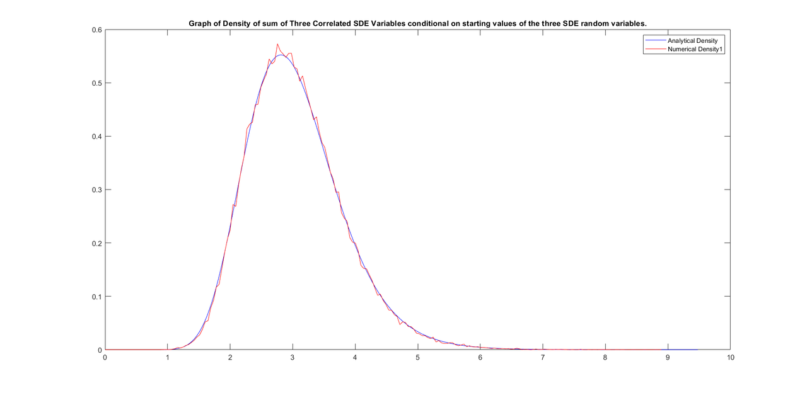](https://postimg.cc/hJ8cMNsZ)

I am attaching the matlab program right now in the next post.

---

### #3126 — Amin (Topic Author)
*June 1, 2026, 7:21 PM*

```
function []= ConditionalDensityHermitesNvariateNewton()

%SV SDE is
%dV(t)=mu1 V(t)^beta1 dt+ mu2 V(t)^beta2 dt + sigma0 V(t)^gamma dZ(t)
%In mean reverting SDEs we ususally have
%mu1= kappaV * thetaV
%beta1=0
%mu2=-kappa
%beta2=0
%The present program works only when drift is zero (for pure noises)
%meaning mu1=0 and mu2=0;

Order=7;
%NDim=4;%Three assets and one SV.
%NMomentsY=Order+1;
%NMomentsX=Order+1;

%%%%%%%%%%%%%%%%%%%5
dt=.03125/2/8;
Tt=64*2*8;
T=Tt*dt;
seed0=12130649;
%seed0=94210876;
%seed0=14210876;
%seed0=53612297
seed0=97459782
rng(seed0, 'twister')
paths=100000;
TT1=100*8/2; %Transition distribution start
TT2=256*8/2; %Transition distribution end

%%%%%%%%%%%%%%%%%%%5

NDims=3;
%
V0(1)=1.000;%.32;
V00(1)=V0(1);

%SDE1
 thetaV(1)=1.0;%.045;%1;%.04;
 kappaV(1)=0.000;%1.5;%1.5;
 gamma(1)=.75;%.75
 sigma0(1)=.5;%.35

%SDE2%
%thetaV(1)=.90;%.045;%1;%.04;
%kappaV(1)=1.000;%1.5;%1.5;
%gamma(1)=.75;%.75
%sigma0(1)=.85;%.35

%SDE3%
%thetaV(1)=1.350;%.045;%1;%.04;
%kappaV(1)=2.000;%1.5;%1.5;
%gamma(1)=.75;%.75
%sigma0(1)=.95;%.35

mu1(1)=kappaV(1)*thetaV(1);
mu2(1)=-kappaV(1);
beta1(1)=0;
beta2(1)=1;

V0(2)=1.000;%.32;
V00(2)=V0(2);

%SDE1
thetaV(2)=1.0;%.045;%1;%.04;
 kappaV(2)=0.000;%1.5;%1.5;
 gamma(2)=.65;%.75
 sigma0(2)=.5;%.35

%SDE2
% thetaV(2)=1.0;%.045;%1;%.04;
% kappaV(2)=2.000;%1.5;%1.5;
% gamma(2)=.65;%.75
% sigma0(2)=.95;%.35

%SDE3
%thetaV(2)=.850;%.045;%1;%.04;
%kappaV(2)=.35000;%1.5;%1.5;
%gamma(2)=.65;%.75
%sigma0(2)=.55;%.35

mu1(2)=kappaV(2)*thetaV(2);
mu2(2)=-kappaV(2);
beta1(2)=0;
beta2(2)=1;

V0(3)=1.000;%.33;
V00(3)=V0(3);

%SDE1
thetaV(3)=1.0;%.045;%1;%.04;
 kappaV(3)=0.000;%1.5;%1.5;
 gamma(3)=.95;%.75
 sigma0(3)=.45;%.35

%SDE2
% thetaV(3)=.750;%.045;%1;%.04;
% kappaV(3)=0.5000;%1.5;%1.5;
% gamma(3)=.95;%.75
% sigma0(3)=.45;%.35

%SDE3
%thetaV(3)=1.150;%.045;%1;%.04;
%kappaV(3)=1.5000;%1.5;%1.5;
%gamma(3)=.95;%.75
%sigma0(3)=.75;%.35

mu1(3)=kappaV(3)*thetaV(3);
mu2(3)=-kappaV(3);
beta1(3)=0;
beta2(3)=1;

% Corr1(1,1)=1;
% Corr1(1,2)=.7;
% Corr1(1,3)=.8;
% Corr1(2,2)=1;
% Corr1(2,1)=.7;
% Corr1(2,3)=.5;
% Corr1(3,1)=.8;
% Corr1(3,2)=.5;
% Corr1(3,3)=1;
%
% % % Was very good.
% Corr1(1,1)=1;
% Corr1(1,2)=.7/3;
% Corr1(1,3)=.8/3;
% Corr1(2,2)=1;
% Corr1(2,1)=.7/3;
% Corr1(2,3)=.5/3;
% Corr1(3,1)=.8/3;
% Corr1(3,2)=.5/3;
% Corr1(3,3)=1;
% % % % % %
% % % % % %
% % % % %
% Corr1(1,1)=1;
% Corr1(1,2)=-.7/3;
% Corr1(1,3)=.8/3;
% Corr1(2,2)=1;
% Corr1(2,1)=-.7/3;
% Corr1(2,3)=-.5/3;
% Corr1(3,1)=.8/3;
% Corr1(3,2)=-.5/3;
% Corr1(3,3)=1;
% %
% %
% %
Corr1(1,1)=1;
Corr1(1,2)=-.27;
Corr1(1,3)=-.28;
Corr1(2,2)=1;
Corr1(2,1)=-.27;
Corr1(2,3)=-.15;
Corr1(3,1)=-.28;
Corr1(3,2)=-.15;
Corr1(3,3)=1;
%87%Corr1(1:3,1:3)=0.0;

R=chol(Corr1);
%
%  R(1:3,1:3)=0;
%  R(1,1)=1;
%  R(2,2)=1;
%  R(3,3)=1;

V0(4)=1.000;%.44;
V00(4)=V0(4);
thetaV(4)=1.0;%.045;%1;%.04;
kappaV(4)=1.000;%1.5;%1.5;
mu1(4)=kappaV(4)*thetaV(4);
mu2(4)=-kappaV(4);
beta1(4)=0;
beta2(4)=1;
gamma(4)=.95;%.75
sigma0(4)=.55;%.45

%%%%%%%%%%%%%%%%%%%%%%%%%%%%%%%%%%%%%%%%%%%%%%%%%%%%%%%%%%%%%%%%%%%%%5
for nn=1:NDims
V(1:paths,nn)=V0(nn);
end
%V(1:paths,1:NDims)=V0(1,1:NDims);

Random1(1:paths/2,1:NDims)=0;

for tt=1:Tt

    Random2(1:paths/2,1:NDims)=randn(size(Random1));
    Random2(paths/2+1:paths,1:NDims)=-Random2(1:paths/2,1:NDims);

    %Random2=R'*Random2;
    random1=Random2*R(:,1);
    random2=Random2*R(:,2);
    random3=Random2*R(:,3);

    Random2(:,1)=random1;
    Random2(:,2)=random2;
    Random2(:,3)=random3;

    for nn=1:NDims

    V(1:paths,nn)=V(1:paths,nn)+ ...
        (mu1(nn).*V(1:paths,nn).^beta1(nn) + mu2(nn).*V(1:paths,nn).^beta2(nn))*dt + ...
        sigma0(nn).*V(1:paths,nn).^gamma(nn) .*Random2(1:paths,nn)*sqrt(dt) + ...
        (mu1(nn).*beta1(nn)*V(1:paths,nn).^(beta1(nn)-1) + mu2(nn).*beta2(nn).*V(1:paths,nn).^(beta2(nn)-1)).* ...
        ((mu1(nn).*V(1:paths,nn).^beta1(nn) + mu2(nn).*V(1:paths,nn).^beta2(nn))*dt^2/2 + ...
        sigma0(nn).*V(1:paths,nn).^gamma(nn) .*Random2(1:paths,nn)*(1-1/sqrt(3))*dt^1.5) + ...
        .5*(mu1(nn).*beta1(nn).*(beta1(nn)-1).*V(1:paths,nn).^(beta1(nn)-2) +
mu2(nn).*beta2(nn).*(beta2(nn)-1).*V(1:paths,nn).^(beta2(nn)-2)).* ...
        sigma0(nn)^2.*V(1:paths,nn).^(2*gamma(nn)).*dt^2/2 + ...
        sigma0(nn).*gamma(nn).*V(1:paths,nn).^(gamma(nn)-1) .* ...
        ((mu1(nn).*V(1:paths,nn).^beta1(nn) + mu2(nn).*V(1:paths,nn).^beta2(nn)).*Random2(1:paths,nn).*1/sqrt(3)*dt^1.5
+ ...
        sigma0(nn).*V(1:paths,nn).^gamma(nn) .*(Random2(1:paths,nn).^2-1)*dt/2) + ...
        .5*sigma0(nn).*gamma(nn).*(gamma(nn)-1).*V(1:paths,nn).^(gamma(nn)-2) .* ...
        sigma0(nn).^2.*V(1:paths,nn).^(2*gamma(nn)) .*Random2(1:paths,nn).*1/sqrt(3)*dt^1.5;

    V(V(:,nn)=nn2))
        ss=ss+1;
        XX(1:paths,ss)=Xin(1:paths,nn1).*Xin(1:paths,nn2);
        end
    end
end
SS=ss;

[Coeff2R,X2CoeffH,ZI] = RegressYOnX(Yin.^2,XX,paths,SS,Order);

%%%%%%%%%%%%%%%%%%%%%%%%%%%%%%%%%%%%%%%%%%%%%%%%%%%%%%%%%%%%%%%%%%%%%%%%%%%%%%%%%%%%%%%
%Set1
V10(1)=1.2;%.65;%
V10(2)=.65;
V10(3)=1.2;
%V10(4)=1.85;

% % %
% % % % % % % % %Set2
%      V10(1)=.75;
%      V10(2)=1.2;%1.2;
%      V10(3)=.7;
% % % % % % % % % % %V10(4)=.65
% % % % % % % % % % %
% % % % % % % % % % % %Set3
%     V10(1)=1.25;
%     V10(2)=1.35;%1.2;
%     V10(3)=1.25;
% % % % % % % % % %   V10(4)=1.4
% % % % % % % % % % %
% % % % % % % % % % %
%       V10(1)=.85;
%       V10(2)=.81;%1.2;
%       V10(3)=.77;
% % % % % % %  V10(4)=.7
%

%V10(1)=.65;
%V10(2)=.51;%1.2;
%V10(3)=.73;

%V10(1)=1.65;
%V10(2)=1.51;%1.2;
%V10(3111111111111111111111111111111111111111111111111111111111111111111111111111111111111111111111111111111111111111111111111111111)=1.63;

for nn=1:NDims
V(1:paths,nn)=V10(nn);
end
%V(1:paths,1:NDims)=V0(1,1:NDims);

Random1(1:paths/2,1:NDims)=0;

for tt=1:TT2-TT1

    Random2(1:paths/2,1:NDims)=randn(size(Random1));
    Random2(paths/2+1:paths,1:NDims)=-Random2(1:paths/2,1:NDims);

    random1=Random2*R(:,1);
    random2=Random2*R(:,2);
    random3=Random2*R(:,3);

    Random2(:,1)=random1;
    Random2(:,2)=random2;
    Random2(:,3)=random3;

    for nn=1:NDims

    V(1:paths,nn)=V(1:paths,nn)+ ...
        (mu1(nn).*V(1:paths,nn).^beta1(nn) + mu2(nn).*V(1:paths,nn).^beta2(nn))*dt + ...
        sigma0(nn).*V(1:paths,nn).^gamma(nn) .*Random2(1:paths,nn)*sqrt(dt) + ...
        (mu1(nn).*beta1(nn)*V(1:paths,nn).^(beta1(nn)-1) + mu2(nn).*beta2(nn).*V(1:paths,nn).^(beta2(nn)-1)).* ...
        ((mu1(nn).*V(1:paths,nn).^beta1(nn) + mu2(nn).*V(1:paths,nn).^beta2(nn))*dt^2/2 + ...
        sigma0(nn).*V(1:paths,nn).^gamma(nn) .*Random2(1:paths,nn)*(1-1/sqrt(3))*dt^1.5) + ...
        .5*(mu1(nn).*beta1(nn).*(beta1(nn)-1).*V(1:paths,nn).^(beta1(nn)-2) +
mu2(nn).*beta2(nn).*(beta2(nn)-1).*V(1:paths,nn).^(beta2(nn)-2)).* ...
        sigma0(nn)^2.*V(1:paths,nn).^(2*gamma(nn)).*dt^2/2 + ...
        sigma0(nn).*gamma(nn).*V(1:paths,nn).^(gamma(nn)-1) .* ...
        ((mu1(nn).*V(1:paths,nn).^beta1(nn) + mu2(nn).*V(1:paths,nn).^beta2(nn)).*Random2(1:paths,nn).*1/sqrt(3)*dt^1.5
+ ...
        sigma0(nn).*V(1:paths,nn).^gamma(nn) .*(Random2(1:paths,nn).^2-1)*dt/2) + ...
        .5*sigma0(nn).*gamma(nn).*(gamma(nn)-1).*V(1:paths,nn).^(gamma(nn)-2) .* ...
        sigma0(nn).^2.*V(1:paths,nn).^(2*gamma(nn)) .*Random2(1:paths,nn).*1/sqrt(3)*dt^1.5;

    V(V(:,nn)=nn2))
        ss=ss+1;
        Zxx0(ss)= CalculateZgivenXAndHSeriesCoeffs(V10(nn1).*V10(nn2),X2CoeffH(1:Order+1,ss),Order);
        end
    end
end

%%%%%%%%%%%%%%%%%%%%%%%%%%%%%%%%%%%%%%%%%%%%%%%%%%%%%%%%%%%%%%%%%%%55

WW(1,1:Order+1)=EvalHermiteArrayH0(Zx0(1),Order);
for mm=2:NDims
    WW(1,(mm-1)*Order+2:mm*Order+1)=EvalHermiteArrayH1(Zx0(mm),Order);
end

     YProjected=0.0;
    for mm=1:NDims*Order+1
    YProjected=YProjected+WW(1,mm).*CoeffR(mm,1);

    end

WW(1,1:Order+1)=EvalHermiteArrayH0(Zxx0(1),Order);
for mm=2:SS
    WW(1,(mm-1)*Order+2:mm*Order+1)=EvalHermiteArrayH1(Zxx0(mm),Order);
end

     Y2Projected=0.0;
    for mm=1:SS*Order+1
    Y2Projected=Y2Projected+WW(1,mm).*Coeff2R(mm,1);
    end

% XX(1:paths,1:NDims)=Xin(1:paths,1:NDims);
% ss=NDim;
% for nn1=1:NDims
%     for nn2=1:NDims
%         ss=ss+1;
%         XX(1:paths,ss)=Xin(1:paths,nn1).*Xin(1:paths,nn2);
%     end
% end
% SS=ss;
%
% [Coeff2R,XCoeff2H,ZI] = RegressYOnX(Yin.^2,XXin,paths,NDims,Order);
%

%%%%%%%%%%%%%%%%%%%%%%%%%%%%%%%%%%%%%%%%%%%%%%%%%%%%%%%%%%%%%%%%%%%%%%%%%%%%%%%55
Zx(1:Order)=0;

for hh=1:Order
    for nn=1:NDims
        %Zx(hh) = Zx(hh) + bnv(nn+1,hh+1).^1.*Zx0(nn);
        Zx(hh) = Zx(hh) + cn(nn,hh).^1.*Zx0(nn);
    end
end

bh0=YCoeffH(1);

[W] = EvalHermiteArrayH0(Zx0,Order);

for hh=1:Order
    for nn=1:NDims
        bh0 = bh0 + ch(nn+1,hh+1).^1.*W(nn,hh+1);
    end
end
bh00=bh0;

%%%%%%%%%%%%%%%%%%%%%%%%%%%%%%%%%%%%%%%%%%%%%%%%%%%%%%%%%%%%%%%%

a0=YCoeffZ(1);
a1=YCoeffZ(2);
a2=YCoeffZ(3);
a3=YCoeffZ(4);
a4=YCoeffZ(5);
a5=YCoeffZ(6);
a6=YCoeffZ(7);
a7=YCoeffZ(8);

d1=cn(4,1);
d2=cn(4,2);
d3=cn(4,3);
d4=cn(4,4);
d5=cn(4,5);
d6=cn(4,6);
d7=cn(4,7);

%b0=(a0+a1.* Zx(1) +a2.* Zx(2).^2+a3.* Zx(3).^3+a4* Zx(4).^4+a5 *Zx(5).^5+a6* Zx(6).^6+a7* Zx(7).^7);
b1=(a1* d1+2* a2* Zx(2)* d2 +3* a3* Zx(3).^2* d3+4* a4* Zx(4).^3* d4+5* a5* Zx(5).^4* d5+6* a6* Zx(6).^5* d6+7* a7*
Zx(7).^6* d7);
b2=(a2* d2.^2+3* a3* Zx(3)* d3^2 +6* a4* Zx(4).^2* d4^2+10* a5* Zx(5).^3* d5^2+15* a6* Zx(6).^4* d6^2+21* a7* Zx(7).^5*
d7^2);
b3=(a3* d3^3+4* a4 *Zx(4)* d4^3 +10* a5* Zx(5).^2* d5^3+20* a6* Zx(6).^3* d6^3+35* a7* Zx(7).^4* d7^3);
b4=(a4* d4^4+5* a5* Zx(5)* d5^4 +15* a6 *Zx(6).^2* d6^4+35* a7* Zx(7).^3 *d7^4);
b5=(a5* d5^5+6* a6* Zx(6)* d6^5 +21* a7 *Zx(7).^2* d7^5);
b6=(a6* d6^6+7* a7* Zx(7)* d7^6 );
b7=(a7* d7^7);

%bh0=b0+b2+3*b4+15*b6;
bh1=b1+3*b3+15*b5+105*b7;
bh2=b2+6*b4+45*b6;
bh3=b3+10*b5+105*b7;
bh4=b4+15*b6;
bh5=b5+21*b7;
bh6=b6;
bh7=b7;

bh(1)=YProjected;
bh(2)=bh1;
bh(3)=bh2;
bh(4)=bh3;
bh(5)=bh4;
bh(6)=bh5;
bh(7)=bh6;
bh(8)=bh7;

YCentralMoment2=0;
for nn=1:Order
    YCentralMoment2=YCentralMoment2+bh(nn+1).^2*factorial(nn);
end

bh(2:Order+1)=bh(2:Order+1).*sqrt(Y2Projected-YProjected.^2)/sqrt(YCentralMoment2);

%bh(2:Order+1)=bh(2:Order+1).*bh0/YProjected;

%%%%%%%%%%%%%%%%%%%%%%%%%%%%%%%%%%%%%%%%%%%%%%%%%%%%%%%%%%%%%%%%%%%%%%%%%%%%%%5

YCoeffz(1:Order+1)= ConvertHermiteSeriesToZSeries01(bh(1:Order+1),Order);

[YMomentsModel]=CalculateMomentsOfZSeries(YCoeffz(1),YCoeffz(2:Order+1),Order,Order+1);

YMomentsModel

DataMoments

str=input("Look at comparison of moments");

[cMu1,YCentralMoments]=ConvertRawMomentsToCentralMoments(YMomentsModel,Order+1);
[cMu2,DataCentralMoments]=ConvertRawMomentsToCentralMoments(DataMoments,Order+1);

YCentralMoments

DataCentralMoments

bh00
YProjected
Y2Projected
DataMoments(2)
Y2Projected-YProjected.^2
DataCentralMoments(2)
%YCoeffz(2:Order+1)=YCoeffz(2:Order+1).*YProjected^2/bh00^2;
str=input("Look at central moments");

% Order0=7;
% Order1=13;
% NData=paths;
% [CondMomentYgivX,BetaCorrHxy] = CalculateConditionalMomentYgivXNDims(Xin,Yin,NData,Zx0,NDims,Order0,Order1)
%
% [VarConditional]=FindSecondConditionalMoment(YCoeffH,BetaCorrH,Zx0)
%
%
% BetaCorrHxy
% BetaCorrH
%
% str=input("Look at conditionalVariance");

clf;

PlotZSeriesDensity(YCoeffz(1),YCoeffz(2:Order+1),'b')

hold on

plot(IndexOut(1:IndexMax),XDensity(1:IndexMax),'r');

%PlotHermiteSeriesDensityAndRvGraph(YCoeffh(1),YCoeffh1(2:yOrder+1),'g')
title("Graph of Density of sum of Three Correlated SDE Variables conditional on starting values of the three SDE random
variables.")
%title(sprintf('V00 = %.3f; kappa=%.3f, theta=%.3f,gamma=%.3f,sigma=%.3f;V10=%.3f at TT1=%.3f;TT2=%.3f;Paths=%d ',V00,
kappaV, thetaV,gamma,sigma0, V10,(TT1*dt),(TT2*dt),paths));%,sprintf('theta= %f', theta), sprintf('kappa = %f',
kappa),sprintf('sigma = %f', sigma0),sprintf('T = %f', T));
legend({'Analytical Density','Numerical Density1'}, ...
    'Location','northeast')

str=input("This is the first version without altering the moments of conditional density")

hold off

end
```

.

.

.

```
function [BetaCorrH,YCoeffH,XCoeffH,HCorrXX,Zy,Zx] = CalculateHermiteCorrelations0NA04(Xin,Yin,NData,NDims)

%This program finds required correlations between NDims explanatory
%variables given in Xin that has NDims dimensionality. Yin is variable
%being explained and is one-diemsnional.

Order=7;
NMoments=8;

[ZI] = MomentMatchedStandardNormalDiscretizedDensity(NData);

for nn=1:NDims
[XCoeffH(1:Order+1,nn),Zx(1:NData,nn)] = CalculateHermiteSeriesFromData02(Xin(1:NData,nn),Order,ZI);

%[Zx(1:NData,nn)] = CalculateZgivenXAndHSeriesCoeffs(Xin(1:NData,nn),XCoeffH(1:Order+1,nn),Order);

end

[YCoeffH,Zy] = CalculateHermiteSeriesFromData02(Yin,Order,ZI);
% %[Zy] = CalculateZgivenXAndHSeriesCoeffs(Yin,YCoeffH,Order);

for nn1=1:NDims
    for nn2=1:NDims
        if(nn1==nn2)
            HCorrXX(nn1,nn2,1:Order)=1.0;
        else
            HCorrXX(nn1,nn2,1:Order) =
CalculateCorrelationBivariateHermiteCH0(Zx(1:NData,nn1),Zx(1:NData,nn2),NData,Order);
        end
    end
end
for nn1=1:NDims
    HCorrXX(nn1,nn1,1:Order)=1.0;
end

% for hh=1:Order
%     for nn1=1:NDims
%         HCorrXX
%         ss2=0;
%         for nn2=1:NDims
%             if(nn2~=nn1)
%                 ss2=ss2+1;
%                 ss3=0;
%                 for nn3=1:NDims
%                     if(nn3~=nn1)
%                         ss3=ss3+1;
%                             HCorrXXmn(ss2,ss3)=HCorrXX(nn2,nn3,hh);
%                     end
%                     HCorrXmXn(ss2,1)=HCorrXX(nn1,nn2,hh);
%                 end
%             end
%         end
%         BetaCorrXX(1:NDims-1,nn1,hh)=HCorrXXmn(:,:)\HCorrXmXn(1:NDims-1,1);
%
%     end
%
%     BetaCorrXX
%
%     nn1
%
%         str=input("Look at important variables");
%
% end
% BetaCorrXX
% str=input("look at the BetacorrXX");
% for nn1=1:NDims
%     for nn2=1:NDims-1
%         if(nn2<nn1)
%     BetaCorrXX0(nn2,nn1,1:Order)=BetaCorrXX(nn2,nn1,1:Order);
%         elseif(nn2==nn1)
%                % BetaCorrXX0(nn2,nn1,1:Order)=1;
%
%             BetaCorrXX0(nn2+1:NDims,nn1,1:Order)=BetaCorrXX(nn2:NDims-1,nn1,1:Order);
%         end
%     end
%     BetaCorrXX0(nn1,nn1,1:Order)=1;
% end
% BetaCorrXX
% BetaCorrXX0

%
% % % % str=input("Look at BetaCorrXX pairs");
% % % % for hh=1:Order
% % % %     for nn1=1:NDims
% % % %         for nn2=1:NDims-1
% % % %             BetaCorrXXn(nn1,nn2,hh)=sign(BetaCorrXXn(nn1,nn2,hh)).*(abs(BetaCorrXXn(nn1,nn2,hh))).^(1/hh);
% % % %         end
% % % %     end
% % % % end

for nn1=1:NDims
    HCorrXY(nn1,1:Order) = CalculateCorrelationBivariateHermiteCH0(Zx(1:NData,nn1),Zy(1:NData),NData,Order);
end

for hh=1:Order
    [BCorrXY(:,hh),Is(:,hh)]=sort(HCorrXY(:,hh),'descend');
end

for hh=1:Order
    CorrXX(1:NDims,1:NDims)=HCorrXX(Is(1:NDims,hh),Is(1:NDims,hh),hh);
    CorrXY(1:NDims,1)=HCorrXY(Is(1:NDims,hh),hh);
    BetaCorr0(1:NDims)=CorrXX\CorrXY;
    BetaCorrH(Is(1:NDims,hh),hh)=BetaCorr0(1:NDims);
end

%HCorrXX=BetaCorrXX0;
%HCorrXX
str=input("Look at HCOrrXX");

% for hh=1:Order
%     CorrXX(1:NDims,1:NDims)=HCorrXX(1:NDims,1:NDims,hh);
%     CorrXY(1:NDims,1)=HCorrXY(1:NDims,hh);
%     BetaCorrH(1:NDims,hh)=CorrXX\CorrXY;
% end

%CorrXX1st(1:NDims,1:NDims)=HCorrXX(1:NDims,1:NDims,1)

%BetaCorrH(:,1)'*CorrXX

%CorrXY

%HCorrXX

%HCorrXY

BetaCorrH

str=input("Look at BetaCorrH");
end
```

.

.

.

```
function [cn,ch,CorrHxx] =
CalculateGaussianCorrelationFromHermiteCorrelationsNDimNew(YCoeffH,XCoeffH,BetaCorrHxy,CorrHxx,NDims,Order)

for hh=1:Order
    for nn=1:NDims
        ch(nn+1,hh+1)=BetaCorrHxy(nn,hh).*YCoeffH(hh+1);%make sure indices on all hermite-correlations match.check.
        %%%% nn+1 since 1st index would go to y-tilde.
    end
end

ch
YCoeffH

str=input("Look at above---00-1-1-1-1-");

[YCoeffZ(1:Order+1)] = ConvertHermiteSeriesToZSeries01(YCoeffH(1:Order+1),Order);

for nn=1:NDims
    [XCoeffZ(1:Order+1,nn)] = ConvertHermiteSeriesToZSeries01(XCoeffH(1:Order+1,nn),Order);
end

YCoeffH

YCoeffZ

str=input("Look at the Hermite and Z-series coeffs");

% YCoeffZA=YCoeffZ;
% YCoeffZ=YCoeffZA;
% if(abs(YCoeffZ(4))>abs(YCoeffZ(2)))
%    YCoeffZ(4)=sign(YCoeffZ(4)).*abs(YCoeffZ(2));
% end
% if(abs(YCoeffZ(6))>abs(YCoeffZ(4)))
%    YCoeffZ(6)=sign(YCoeffZ(6)).*abs(YCoeffZ(4));
% end
% if(abs(YCoeffZ(8))>abs(YCoeffZ(6)))
%    YCoeffZ(6)=sign(YCoeffZ(6)).*abs(YCoeffZ(8));
% end
%
%
% if(abs(YCoeffZ(5))>abs(YCoeffZ(3)))
%    YCoeffZ(5)=sign(YCoeffZ(5)).*abs(YCoeffZ(3));
% end
% if(abs(YCoeffZ(7))>abs(YCoeffZ(5)))
%    YCoeffZ(5)=sign(YCoeffZ(5)).*abs(YCoeffZ(7));
% end
%

for nn=1:NDims
[c(nn+1,1:Order+1)] = ConvertHermiteSeriesToZSeries01(ch(nn+1,1:Order+1),Order);
end

for nn=1:NDims
    rhoxy(nn+1,8)=sign(BetaCorrHxy(nn,7)).^1.*(abs(BetaCorrHxy(nn,7))).^(1/7);
    rhoxy(nn+1,7)=sign(BetaCorrHxy(nn,6)).^1.*(abs(BetaCorrHxy(nn,6))).^(1/6);
    rhoxy(nn+1,6)=sign(BetaCorrHxy(nn,5)).^1.*(abs( 
 (YCoeffH(6).*BetaCorrHxy(nn,5)-21*YCoeffZ(8).*rhoxy(nn+1,8).^(5))./(YCoeffH(6)-21*YCoeffZ(8)))).^(1/5);
    rhoxy(nn+1,5)=sign(BetaCorrHxy(nn,4)).^1.*(abs( 
(YCoeffH(5).*BetaCorrHxy(nn,4)-15*YCoeffZ(7).*rhoxy(nn+1,7).^(4))./(YCoeffH(5)-15*YCoeffZ(7)))).^(1/4);
    rhoxy(nn+1,4)=sign(BetaCorrHxy(nn,3)).^1.*(abs( 
(YCoeffH(4).*BetaCorrHxy(nn,3)-10*YCoeffZ(6).*rhoxy(nn+1,6).^(3)-105*YCoeffZ(8).*rhoxy(nn+1,8).^(3))...
        ./(YCoeffH(4)-10*YCoeffZ(6)-105*YCoeffZ(8)))).^(1/3);
    rhoxy(nn+1,3)=sign(BetaCorrHxy(nn,2)).^1.*(abs(
(YCoeffH(3).*BetaCorrHxy(nn,2)-6*YCoeffZ(5).*rhoxy(nn+1,5).^(2)-45*YCoeffZ(7).*rhoxy(nn+1,7).^(2)) ...
        ./(YCoeffH(3)-6*YCoeffZ(5)-45*YCoeffZ(7)))).^(1/2);
    rhoxy(nn+1,2)=sign(BetaCorrHxy(nn,1)).^0.*(( 
(YCoeffH(2).*BetaCorrHxy(nn,1)-3*YCoeffZ(4).*rhoxy(nn+1,4).^(1)-15*YCoeffZ(6).*rhoxy(nn+1,6).^(1) ...
        -105*YCoeffZ(8).*rhoxy(nn+1,8).^(1))...
        ./(YCoeffH(2)-3*YCoeffZ(4)-15*YCoeffZ(6)-105*YCoeffZ(8)))).^(1/1);

%    rhoxy(nn,2+1)=sign(4/9*BetaCorrHxy(nn,2)+1/36).*abs((4/9*BetaCorrHxy(nn,2)+1/36))^(.5);
%
rhoxy(nn,3+1)=sign((36/225*BetaCorrHxy(nn,3)-3/225*BetaCorrHxy(nn,1))).*(abs((36/225*BetaCorrHxy(nn,3)-3/225*BetaCorrHxy(nn,1))))^(1/3);
%
rhoxy(nn,4+1)=sign((144*4/(105)^2*BetaCorrHxy(nn,4)-6/105^2*(4*BetaCorrHxy(nn,2)+.25)-18/105^2)).*(abs(((144*4/(105)^2*BetaCorrHxy(nn,4)-6/105^2*(4*BetaCorrHxy(nn,2)+.25)-18/105^2))))^(1/4);
% rhoxy(nn,1+1)=BetaCorrHxy(nn,1);
end

%
for nn=1:NDims
    for mm=1:NDims
        if(nn==mm)
            rhoxx(nn,mm,2)=1;
            rhoxx(nn,mm,3)=1;
            rhoxx(nn,mm,4)=1;
            rhoxx(nn,mm,5)=1;
            rhoxx(nn,mm,6)=1;
            rhoxx(nn,mm,7)=1;
            rhoxx(nn,mm,8)=1;

        else
            rhoxx(nn,mm,8)=sign(CorrHxx(nn,mm,7)).*(abs(CorrHxx(nn,mm,7))).^(1/7);
            rhoxx(nn,mm,7)=sign(CorrHxx(nn,mm,6)).*(abs(CorrHxx(nn,mm,6))).^(1/6);
            rhoxx(nn,mm,6)=sign(CorrHxx(nn,mm,5)).*(abs(
(XCoeffH(6,nn).*CorrHxx(nn,mm,5)-21*XCoeffZ(8,nn).*rhoxx(nn,mm,8).^(5))./(XCoeffH(6,nn)-21*XCoeffZ(8,nn)))).^(1/5);
            rhoxx(nn,mm,5)=sign(CorrHxx(nn,mm,4)).*(abs(
(XCoeffH(5,nn).*CorrHxx(nn,mm,4)-15*XCoeffZ(7,nn).*rhoxx(nn,mm,7).^(4))./(XCoeffH(5,nn)-15*XCoeffZ(7,nn)))).^(1/4);
            rhoxx(nn,mm,4)=sign(CorrHxx(nn,mm,3)).*(abs(
(XCoeffH(4,nn).*CorrHxx(nn,mm,3)-10*XCoeffZ(6,nn).*rhoxx(nn,mm,6).^(3)-105*XCoeffZ(8,nn).*rhoxx(nn,mm,8).^(3))...
                ./(XCoeffH(4,nn)-10*XCoeffZ(6,nn)-105*XCoeffZ(8,nn)))).^(1/3);
            rhoxx(nn,mm,3)=sign(CorrHxx(nn,mm,2)).*(abs(
(XCoeffH(3,nn).*CorrHxx(nn,mm,2)-6*XCoeffZ(5,nn).*rhoxx(nn,mm,5).^(2)-45*XCoeffZ(7,nn).*rhoxx(nn,mm,7).^(2)) ...
                ./(XCoeffH(3,nn)-6*XCoeffZ(5,nn)-45*XCoeffZ(7,nn)))).^(1/2);
            rhoxx(nn,mm,2)=sign(CorrHxx(nn,mm,1)).^0.*((
(XCoeffH(2,nn).*CorrHxx(nn,mm,1)-3*XCoeffZ(4,nn).*rhoxx(nn,mm,4).^(1)-15*XCoeffZ(6,nn).*rhoxx(nn,mm,6).^(1) ...
                -105*XCoeffZ(8,nn).*rhoxx(nn,mm,8).^(1))...
                ./(XCoeffH(2,nn)-3*XCoeffZ(4,nn)-15*XCoeffZ(6,nn)-105*XCoeffZ(8,nn)))).^(1/1);

        %    rhoxx(nn,mm,2)=CorrHxx(nn,mm,1);
        %    rhoxx(nn,mm,3)=sign(CorrHxx(nn,mm,2)).*(abs(CorrHxx(nn,mm,2))).^.5;

           % rhoxx1(nn,mm,6)=sign(CorrHxx(nn,mm,5)).*(abs( (CorrHxx(nn,mm,5)-21.*rhoxx(nn,mm,8).^(5)))).^(1/5);
           % rhoxx1(nn,mm,5)=(abs( CorrHxx(nn,mm,4)-15.*rhoxx(nn,mm,7).^(4))).^(1/4);
           %rhoxx1(mm,nn,6)=rhoxx1(nn,mm,6);
           % rhoxx1(mm,nn,5)=rhoxx1(nn,mm,5);

           % rhoxx(mm,nn,8)=rhoxx(nn,mm,8);
           % rhoxx(mm,nn,7)=rhoxx(nn,mm,7);
%rhoxx(mm,nn,6)=rhoxx(nn,mm,6);
%rhoxx(mm,nn,5)=rhoxx(nn,mm,5);
%rhoxx(mm,nn,4)=rhoxx(nn,mm,4);
%rhoxx(mm,nn,3)=rhoxx(nn,mm,3);
%rhoxx(mm,nn,2)=rhoxx(nn,mm,2);
        end
    end
end

 rhoxx0=rhoxx;
 for nn=1:NDims
     for mm=1:NDims
%          rhoxx(nn,mm,2)=(rhoxx0(nn,mm,2)+rhoxx0(mm,nn,2))./2./sqrt(factorial(1));
%          rhoxx(nn,mm,3)=(rhoxx0(nn,mm,3)+rhoxx0(mm,nn,3))./2./sqrt(factorial(2));
%          rhoxx(nn,mm,4)=(rhoxx0(nn,mm,4)+rhoxx0(mm,nn,4))./2./sqrt(factorial(3));
%          rhoxx(nn,mm,5)=(rhoxx0(nn,mm,5)+rhoxx0(mm,nn,5))./2./sqrt(factorial(4));
%          rhoxx(nn,mm,6)=(rhoxx0(nn,mm,6)+rhoxx0(mm,nn,6))./2./sqrt(factorial(5));
%          rhoxx(nn,mm,7)=(rhoxx0(nn,mm,7)+rhoxx0(mm,nn,7))./2./sqrt(factorial(6));
%          rhoxx(nn,mm,8)=(rhoxx0(nn,mm,8)+rhoxx0(mm,nn,8))./2./sqrt(factorial(7));

%           rhoxx(nn,mm,2)=(rhoxx0(nn,mm,2)+rhoxx0(mm,nn,2))./2./sqrt((1));
%          rhoxx(nn,mm,3)=(rhoxx0(nn,mm,3)+rhoxx0(mm,nn,3))./2./sqrt((2));
%          rhoxx(nn,mm,4)=(rhoxx0(nn,mm,4)+rhoxx0(mm,nn,4))./2./sqrt((3));
%          rhoxx(nn,mm,5)=(rhoxx0(nn,mm,5)+rhoxx0(mm,nn,5))./2./sqrt((4));
%          rhoxx(nn,mm,6)=(rhoxx0(nn,mm,6)+rhoxx0(mm,nn,6))./2./sqrt((5));
%          rhoxx(nn,mm,7)=(rhoxx0(nn,mm,7)+rhoxx0(mm,nn,7))./2./sqrt((6));
%          rhoxx(nn,mm,8)=(rhoxx0(nn,mm,8)+rhoxx0(mm,nn,8))./2./sqrt((7));

%           rhoxx(nn,mm,2)=(rhoxx0(nn,mm,2)+rhoxx0(mm,nn,2))./2./((1));
%          rhoxx(nn,mm,3)=(rhoxx0(nn,mm,3)+rhoxx0(mm,nn,3))./2./sqrt((2));
%          rhoxx(nn,mm,4)=(rhoxx0(nn,mm,4)+rhoxx0(mm,nn,4))./2./((1));
%          rhoxx(nn,mm,5)=(rhoxx0(nn,mm,5)+rhoxx0(mm,nn,5))./2./(sqrt(2));
%          rhoxx(nn,mm,6)=(rhoxx0(nn,mm,6)+rhoxx0(mm,nn,6))./2./((1));
%          rhoxx(nn,mm,7)=(rhoxx0(nn,mm,7)+rhoxx0(mm,nn,7))./2./(sqrt(2));
%          rhoxx(nn,mm,8)=(rhoxx0(nn,mm,8)+rhoxx0(mm,nn,8))./2./((1));
%         rhoxx(nn,mm,2:Order+1)=(rhoxx0(nn,mm,2:Order+1)+rhoxx0(mm,nn,2:Order+1))./2;%./sqrt(factorial(1:Order));
 %         rhoxx(nn,mm,2:Order+1)=(CorrHxx(nn,mm,1)+CorrHxx(mm,nn,1))/2;
%          rhoxx(nn,mm,2)=(CorrHxx(nn,mm,1)+CorrHxx(mm,nn,1))/2;
%          rhoxx(nn,mm,4)=(CorrHxx(nn,mm,1)+CorrHxx(mm,nn,1))/2;
%          rhoxx(nn,mm,6)=(CorrHxx(nn,mm,1)+CorrHxx(mm,nn,1))/2;
%          rhoxx(nn,mm,8)=(CorrHxx(nn,mm,1)+CorrHxx(mm,nn,1))/2;
%          rhoxx(nn,mm,2)=(CorrHxx(nn,mm,2)+CorrHxx(mm,nn,2))/2;
%          rhoxx(nn,mm,4)=(CorrHxx(nn,mm,2)+CorrHxx(mm,nn,2))/2;
%          rhoxx(nn,mm,6)=(CorrHxx(nn,mm,2)+CorrHxx(mm,nn,2))/2;

%            rhoxx(nn,mm,2)=(rhoxx0(nn,mm,2)+rhoxx0(mm,nn,2))/2/sqrt(factorial(1));;
%            rhoxx(nn,mm,4)=(rhoxx0(nn,mm,2)+rhoxx0(mm,nn,2))/2/sqrt(factorial(3));;
%            rhoxx(nn,mm,6)=(rhoxx0(nn,mm,2)+rhoxx0(mm,nn,2))/2/sqrt(factorial(4));;
%            rhoxx(nn,mm,8)=(rhoxx0(nn,mm,2)+rhoxx0(mm,nn,2))/2/sqrt(factorial(7));;
%           rhoxx(nn,mm,3)=(rhoxx0(nn,mm,3)+rhoxx0(mm,nn,3))/2/sqrt(factorial(2));;
%           rhoxx(nn,mm,5)=(rhoxx0(nn,mm,3)+rhoxx0(mm,nn,3))/2/sqrt(factorial(4));;
%           rhoxx(nn,mm,7)=(rhoxx0(nn,mm,3)+rhoxx0(mm,nn,3))/2/sqrt(factorial(6));;

%             rhoxx(nn,mm,2)=(rhoxx0(nn,mm,2)+rhoxx0(mm,nn,2))/2;%/sqrt((1));;
%             rhoxx(nn,mm,4)=(rhoxx0(nn,mm,2)+rhoxx0(mm,nn,2))/2;%/sqrt((3));;
%             rhoxx(nn,mm,6)=(rhoxx0(nn,mm,2)+rhoxx0(mm,nn,2))/2;%/sqrt((5));;
%             rhoxx(nn,mm,8)=(rhoxx0(nn,mm,2)+rhoxx0(mm,nn,2))/2;%/sqrt((7));;
%            rhoxx(nn,mm,3)=(rhoxx0(nn,mm,3)+rhoxx0(mm,nn,3))/2;%/sqrt((2));;
%            rhoxx(nn,mm,5)=(rhoxx0(nn,mm,3)+rhoxx0(mm,nn,3))/2;%/sqrt((4));;
%            rhoxx(nn,mm,7)=(rhoxx0(nn,mm,3)+rhoxx0(mm,nn,3))/2;%/sqrt((6));;

          rhoxx(nn,mm,2:Order+1)=(rhoxx0(nn,mm,2:Order+1)+rhoxx0(mm,nn,2:Order+1))/2;
     end
 end

%CorrHxx(1:NDims,1:NDims,1:Order)=rhoxx(1:NDims,1:NDims,2:Order+1);
for hh=1:2:7
%CorrHxx(1:NDims,1:NDims,hh)=CorrHxx(1:NDims,1:NDims,1)*.707;%/sqrt(hh);
%CorrHxx(1:NDims,1:NDims,hh)=CorrHxx(1:NDims,1:NDims,1);%.*sqrt(hh);
CorrHxx(1:NDims,1:NDims,hh)=rhoxx(1:NDims,1:NDims,2);
end
for hh=2:2:6
CorrHxx(1:NDims,1:NDims,hh)=rhoxx(1:NDims,1:NDims,2);
%CorrHxx(1:NDims,1:NDims,hh)=CorrHxx(1:NDims,1:NDims,1)/sqrt(2);
%CorrHxx(1:NDims,1:NDims,hh)=CorrHxx(1:NDims,1:NDims,1)/sqrt(hh);
end
% %
%
% rhoxx(:,:,6)
% rhoxx1(:,:,6)
% rhoxx(:,:,5)
% rhoxx1(:,:,5)
%
% str=input("Look at rhoxx and rhoxx1");

%
% %
% %
% %
% % %rhoxx(1:NDims,1:NDims,2:8)=CorrHxx(1:NDims,1:NDims,1:7);
%  for hh=1:7
% % %rhoxx(1:NDims,1:NDims,hh+1)=rhoxx(1:NDims,1:NDims,2);
%  rhoxx(1:NDims,1:NDims,hh+1)=(sign(CorrHxx(1:NDims,1:NDims,hh))).^(1).*(abs(CorrHxx(1:NDims,1:NDims,hh))).^(1/hh);
%  for nn=1:NDims
%      for mm=1:NDims
%          if(nn~=mm)
%  rhoxx1(nn,mm,2+1)=-sign(4/9*CorrHxx(nn,mm,2)+1/36).^0.*abs((4/9*CorrHxx(nn,mm,2)+1/36))^(.5);
% 
rhoxx1(nn,mm,3+1)=-sign((36/225*CorrHxx(nn,mm,3)-3/225*CorrHxx(nn,mm,1))).^0.*(abs((36/225*CorrHxx(nn,mm,3)-3/225*CorrHxx(nn,mm,1))))^(1/3);
% 
rhoxx1(nn,mm,4+1)=-sign((144*4/(105)^2*CorrHxx(nn,mm,4)-6/105^2*(4*CorrHxx(nn,mm,2)+.25)-18/105^2)).^0.*(abs(((144*4/(105)^2*CorrHxx(nn,mm,4)-6/105^2*(4*CorrHxx(nn,mm,2)+.25)-18/105^2))))^(1/4);
%  %rhoxx1(nn,mm,2+1)=sign(4/9*CorrHxx(nn,mm,2)+1/36).^(2).*abs((4/9*CorrHxx(nn,mm,2)+1/36))^(.5);
% 
%rhoxx1(nn,mm,3+1)=sign((36/225*CorrHxx(nn,mm,3)-3/225*CorrHxx(nn,mm,1))).^(3).*(abs((36/225*CorrHxx(nn,mm,3)-3/225*CorrHxx(nn,mm,1))))^(1/3);
% 
%rhoxx1(nn,mm,4+1)=sign((144*4/(105)^2*CorrHxx(nn,mm,4)-6/105^2*(4*CorrHxx(nn,mm,2)+.25)-18/105^2)).^(4).*(abs(((144*4/(105)^2*CorrHxx(nn,mm,4)-6/105^2*(4*CorrHxx(nn,mm,2)+.25)-18/105^2))))^(1/4);
%
%          else
%              rhoxx1(nn,mm,2+1)=1.0;
%               rhoxx1(nn,mm,3+1)=1.0;
%                rhoxx1(nn,mm,4+1)=1.0;
%          end
%      end
%  end
%  end
%
%  rhoxx(1:NDims,1:NDims,3)=rhoxx1(1:NDims,1:NDims,3);
%  rhoxx(1:NDims,1:NDims,4:5)=rhoxx1(1:NDims,1:NDims,4:5);
%
 for hh=1:7
 %rhoxx(1:NDims,1:NDims,hh+1)=sign(CorrHxx(1:NDims,1:NDims,hh)).*abs(sign(CorrHxx(1:NDims,1:NDims,hh))).^(1/hh);
 end
 %rhoxx
 %rhoxx1
%
%
 str=input("Look at rhoxx");

%
% CorrHxx0(1:NDims,1:NDims,2:Order+1)=CorrHxx(1:NDims,1:NDims,1:Order);
%
% for nn=1:NDims
%     for mm=1:NDims
%
%         if(nn==mm)
%             rhoxx(nn,mm,2)=1;
%             rhoxx(nn,mm,3)=1;
%             rhoxx(nn,mm,4)=1;
%             rhoxx(nn,mm,5)=1;
%             rhoxx(nn,mm,6)=1;
%             rhoxx(nn,mm,7)=1;
%             rhoxx(nn,mm,8)=1;
%
%         else
% [rrhoxx(nn+1,mm+1,1:Order+1)] = ConvertHermiteSeriesToZSeries01(CorrHxx0(nn,mm,1:Order+1),Order);
% end
% end
% end
%
% for hh=1:7
% %rhoxx(1:NDims,1:NDims,hh+1)=rhoxx(1:NDims,1:NDims,2);
% rhoxx(1:NDims,1:NDims,hh+1)=sign(rrhoxx(1:NDims,1:NDims,hh+1)).*(abs(rrhoxx(1:NDims,1:NDims,hh+1))).^(1/hh);
% end

%rhoxx(:,:)=0.0;

%(YCoeffH(6).*BetaCorrHxy(nn,5)-21*YCoeffZ(8).*rhoxy(nn+1,8).^(5/7))
%(abs((abs(YCoeffH(6)).*BetaCorrHxy(nn,5)-21*abs(YCoeffZ(8)).*rhoxy(nn+1,8).^(5/7))./abs(YCoeffH(6)-21*(YCoeffZ(8))))).^1/5
%(YCoeffH(6)-21*YCoeffZ(8))
%(YCoeffZ(6)-21*YCoeffZ(8))

%(abs(abs(YCoeffH(6)).*BetaCorrHxy(nn,5)-21*abs(YCoeffZ(8)).*rhoxy(nn+1,8).^(5/7))).^(1/5)

%YCoeffH
%YCoeffZ
%rhoxy

%str=input("Look at rhoxy");

cn=rhoxy;

%for nn=1:NDims
%    rho_z(nn+1,7)=c(nn+1,8)./YCoeffZ(8);
%    cn(nn+1,8)=(abs(rho_z(nn+1,7))).^(1/7);
%    cn(nn+1,8)=cn(nn+1,8).*sign(rho_z(nn+1,7));
%end

cnSqrSum=0;
for nn=1:NDims
    %ccn0(nn+1,8)=cn(nn+1,8).^2;
    cnSqrSum=cnSqrSum+cn(nn+1,8).*cn(nn+1,8);
    for mm=1:NDims
        if(nn~=mm)
            %ccn0(nn+1,8)=ccn0(nn+1,8)+2*cn(nn+1,8).*cn(mm+1,8).*CorrXX1st(nn,mm);
            cnSqrSum=cnSqrSum+cn(nn+1,8).*cn(mm+1,8).*rhoxx(nn,mm,8);
        end
    end
    %ccn(nn+1,8)=sqrt(1-ccn0(nn+1,8));

end

if(cnSqrSum>.995)
    cn(2:NDims+1,8)=cn(2:NDims+1,8)*sqrt(.995)/sqrt(cnSqrSum);
    cnSqrSum=.995;
end

cn(1,8)=sqrt(1-cnSqrSum);
%ccn(1,8)=sqrt(1-cn(1,8).^2);
%Cn(1,8)=cn(1,8).*YCoeffZ(8);

cn
%ccn
str=input("Compare the Eighth Element From NDim---2");

% ccn00(2,8)=cn(2,8).^2+2*cn(2,8).*cn(3,8).*CorrXX1st(1,2)+2*cn(2,8).*cn(4,8).*CorrXX1st(1,3)+ ...
%     cn(3,8).^2+2*cn(3,8).*cn(4,8).*CorrXX1st(2,3)+cn(4,8).^2
%
% ccn00(2,8)=sqrt(1-(cn(2,8).^2+2*cn(2,8).*cn(3,8).*CorrXX1st(1,2)+2*cn(2,8).*cn(4,8).*CorrXX1st(1,3)))
%
% cnSqrSum
%
% ccn0(2,8)
%
% ccn(1,8)
%
% ccn(2,8)
%
% str=input("Look at the variables Inside");
%

cnSqrSum=0;
%for nn=1:NDims
%    rho_z(nn+1,6)=c(nn+1,7)./YCoeffZ(7);
%    cn(nn+1,7)=(abs(rho_z(nn+1,6))).^(1/6);
%    cn(nn+1,7)=cn(nn+1,7).*sign(rho_z(nn+1,6));
%    %ccn(nn+1,7)=sqrt(1-cn(nn+1,7).^2);
%    %cnSqrSum=cnSqrSum+cn(7,nn+1).^2;
%end

cnSqrSum=0;
for nn=1:NDims
    %ccn0(nn+1,7)=cn(nn+1,7).^2;
    cnSqrSum=cnSqrSum+cn(nn+1,7).*cn(nn+1,7);
    for mm=1:NDims
        if(nn~=mm)
         %   ccn0(nn+1,7)=ccn0(nn+1,7)+2*cn(nn+1,7).*cn(mm+1,7).*CorrXX1st(nn,mm);
            cnSqrSum=cnSqrSum+cn(nn+1,7).*cn(mm+1,7).*rhoxx(nn,mm,7);
        end
    end
    %ccn(nn+1,7)=sqrt(1-ccn0(nn+1,7));

end

if(cnSqrSum>.995)
    cn(2:NDims+1,7)=cn(2:NDims+1,7)*sqrt(.995)/sqrt(cnSqrSum);
    cnSqrSum=.995;
end

cn(1,7)=sqrt(1-cnSqrSum);
%ccn(1,7)=sqrt(1-cn(1,7).^2);
%Cn(1,7)=cn(1,7).*YCoeffZ(7);

cn
%ccn
str=input("Compare the Seventh Element From NDim---2");

%cnSqrSum=0;
%for nn=1:NDims
%    CC(3,6)=YCoeffZ(8).*(21*cn(nn+1,8).^5.*ccn(nn+1,8).^2);
%    rho_z(nn+1,5)=(c(nn+1,6)-CC(3,6))./YCoeffZ(6);
%    if(abs(rho_z(nn+1,5))>.995)
%        rho_z(nn+1,5)=sign(rho_z(nn+1,5)).*.995;
%    end
%    cn(nn+1,6)=(abs(rho_z(nn+1,5))).^(1/5);
%    cn(nn+1,6)=cn(nn+1,6).*sign(rho_z(nn+1,5));
%%%    nn
%%%    c(nn+1,6)
%%%    CC(3,6)
%%%    YCoeffZ(8)
%%%    YCoeffZ(6)
%%%    rho_z(nn+1,5)
%%%    cn(nn+1,6)
%%%
%%%    str=input("Look inside the correlations module loop");

%    ccn(nn+1,6)=sqrt(1-cn(nn+1,6).^2);
%    %cnSqrSum=cnSqrSum+cn(7,nn+1).^2;
%end

cnSqrSum=0;
for nn=1:NDims
%    ccn0(nn+1,6)=cn(nn+1,6).^2;
    cnSqrSum=cnSqrSum+cn(nn+1,6).*cn(nn+1,6);
    for mm=1:NDims
        if(nn~=mm)
          %  ccn0(nn+1,6)=ccn0(nn+1,6)+2*cn(nn+1,6).*cn(mm+1,6).*CorrXX1st(nn,mm);
            cnSqrSum=cnSqrSum+cn(nn+1,6).*cn(mm+1,6).*rhoxx(nn,mm,6);
        end
    end
    %ccn(nn+1,6)=sqrt(1-ccn0(nn+1,6));

end

if(cnSqrSum>.995)
    cn(2:NDims+1,6)=cn(2:NDims+1,6)*sqrt(.995)/sqrt(cnSqrSum);
    cnSqrSum=.995;
end

cn(1,6)=sqrt(1-cnSqrSum);
%ccn(1,6)=sqrt(1-cn(1,6).^2);
%Cn(1,6)=cn(1,6).*YCoeffZ(6);

cn
%ccn
str=input("Compare the Sixth Element From NDim---2");

% cnSqrSum=0;
% for nn=1:NDims
%     CC(3,5)=YCoeffZ(7).*(15*cn(nn+1,7).^4.*ccn(nn+1,7).^2);
%     rho_z(nn+1,4)=(c(nn+1,5)-CC(3,5))./YCoeffZ(5);
%     cn(nn+1,5)=(abs(rho_z(nn+1,4))).^(1/4);
%     cn(nn+1,5)=cn(nn+1,5).*sign(rho_z(nn+1,4));
%     %ccn(nn+1,5)=sqrt(1-cn(nn+1,5).^2);
%     %cnSqrSum=cnSqrSum+cn(7,nn+1).^2;
% end

cnSqrSum=0;
for nn=1:NDims
    %ccn0(nn+1,5)=cn(nn+1,5).^2;
    cnSqrSum=cnSqrSum+cn(nn+1,5).*cn(nn+1,5);
    for mm=1:NDims
        if(nn~=mm)
           % ccn0(nn+1,5)=ccn0(nn+1,5)+2*cn(nn+1,5).*cn(mm+1,5).*CorrXX1st(nn,mm);
            cnSqrSum=cnSqrSum+cn(nn+1,5).*cn(mm+1,5).*rhoxx(nn,mm,5);
        end
    end
    %ccn(nn+1,5)=sqrt(1-ccn0(nn+1,5));

end

if(cnSqrSum>.995)
    cn(2:NDims+1,5)=cn(2:NDims+1,5)*sqrt(.995)/sqrt(cnSqrSum);
    cnSqrSum=.995;
end

cn(1,5)=sqrt(1-cnSqrSum);
%ccn(1,5)=sqrt(1-cn(1,5).^2);
%Cn(1,5)=cn(1,5).*YCoeffZ(5);

cn
%ccn
str=input("Compare the Fifth Element From NDim---2");

%CC(3,4)=YCoeffZ(6).*(10*cn(6).^3.*dn(6).^2*zeta^2);
%CC(5,4)=YCoeffZ(8).*(35*cn(8).^3.*dn(8).^4.*zeta^4);
% cnSqrSum=0;
% for nn=1:NDims
%     CC(5,4)=YCoeffZ(8).*(35*cn(nn+1,8).^3.*ccn(nn+1,8).^4);
%     CC(3,4)=YCoeffZ(6).*(10*cn(nn+1,6).^3.*ccn(nn+1,6).^2);
%     rho_z(nn+1,3)=(c(nn+1,4)-3*CC(5,4)-CC(3,4))./YCoeffZ(4);
%     cn(nn+1,4)=(abs(rho_z(nn+1,3))).^(1/3);
%     cn(nn+1,4)=cn(nn+1,4).*sign(rho_z(nn+1,3));
%     %ccn(nn+1,4)=sqrt(1-cn(nn+1,4).^2);
%     %cnSqrSum=cnSqrSum+cn(7,nn+1).^2;
% end

cnSqrSum=0;
for nn=1:NDims
%    ccn0(nn+1,4)=cn(nn+1,4).^2;
    cnSqrSum=cnSqrSum+cn(nn+1,4).*cn(nn+1,4);
    for mm=1:NDims
        if(nn~=mm)
          %  ccn0(nn+1,4)=ccn0(nn+1,4)+2*cn(nn+1,4).*cn(mm+1,4).*CorrXX1st(nn,mm);
            cnSqrSum=cnSqrSum+cn(nn+1,4).*cn(mm+1,4).*rhoxx(nn,mm,4);
        end
    end
    %ccn(nn+1,4)=sqrt(1-ccn0(nn+1,4));

end

if(cnSqrSum>.995)
    cn(2:NDims+1,4)=cn(2:NDims+1,4)*sqrt(.995)/sqrt(cnSqrSum);
    cnSqrSum=.995;
end

cn(1,4)=sqrt(1-cnSqrSum);
%ccn(1,4)=sqrt(1-cn(1,4).^2);
%Cn(1,4)=cn(1,4).*YCoeffZ(4);

cn
%ccn
str=input("Compare the Fourth Element From NDim---2");

%CC(3,3)=YCoeffZ(5).*(6* cn(5).^2.* dn(5).^2);
%CC(5,3)=YCoeffZ(7).*(15*cn(7).^2.*dn(7).^4);
% cnSqrSum=0;
% for nn=1:NDims
%     CC(3,3)=YCoeffZ(5).*(6*cn(nn+1,5).^2.*ccn(nn+1,5).^2);
%     CC(5,3)=YCoeffZ(7).*(15*cn(nn+1,7).^2.*ccn(nn+1,7).^4);
%     rho_z(nn+1,2)=(c(nn+1,3)-3*CC(5,3)-CC(3,3))./YCoeffZ(3);
%     cn(nn+1,3)=(abs(rho_z(nn+1,2))).^(1/2);
%     cn(nn+1,3)=cn(nn+1,3).*sign(rho_z(nn+1,2));
%     %ccn(nn+1,3)=sqrt(1-cn(nn+1,3).^2);
%     %cnSqrSum=cnSqrSum+cn(7,nn+1).^2;
% end

cnSqrSum=0;
for nn=1:NDims
    %ccn0(nn+1,3)=cn(nn+1,3).^2;
    cnSqrSum=cnSqrSum+cn(nn+1,3).*cn(nn+1,3);
    for mm=1:NDims
        if(nn~=mm)
           % ccn0(nn+1,3)=ccn0(nn+1,3)+2*cn(nn+1,3).*cn(mm+1,3).*CorrXX1st(nn,mm);
            cnSqrSum=cnSqrSum+cn(nn+1,3).*cn(mm+1,3).*rhoxx(nn,mm,3);
        end
    end
    %ccn(nn+1,3)=sqrt(1-ccn0(nn+1,3));

end

if(cnSqrSum>.995)
    cn(2:NDims+1,3)=cn(2:NDims+1,3)*sqrt(.995)/sqrt(cnSqrSum);
    cnSqrSum=.995;
end

cn(1,3)=sqrt(1-cnSqrSum);
%ccn(1,3)=sqrt(1-cn(1,3).^2);
%Cn(1,3)=cn(1,3).*YCoeffZ(3);

cn
%ccn
str=input("Compare the Third Element From NDim---2");

%CC(7,2)=YCoeffZ(8).*(7*cn(8).*dn(8).^6*zeta^6);
%CC(5,2)=YCoeffZ(6).*(5*cn(6).*dn(6).^4.*zeta^4);
%CC(3,2)=YCoeffZ(4).* (3.* cn(4).* dn(4).^2.* zeta^2);
% cnSqrSum=0;
% for nn=1:NDims
%     CC(4,2)=YCoeffZ(4).*(3*cn(nn+1,4).*ccn(nn+1,4).^2);
%     CC(6,2)=YCoeffZ(6).*(5*cn(nn+1,5).*ccn(nn+1,6).^4);
%     CC(8,2)=YCoeffZ(8).*(7*cn(nn+1,8).*ccn(nn+1,8).^6);
%     rho_z(nn+1,1)=(c(nn+1,2)-15*CC(8,2)-3*CC(6,2)-CC(4,2))./YCoeffZ(2);
%     cn(nn+1,2)=(abs(rho_z(nn+1,1)));
%     %ccn(nn+1,2)=sqrt(1-cn(nn+1,2).^2);
%     %cnSqrSum=cnSqrSum+cn(7,nn+1).^2;
% end

cnSqrSum=0;
for nn=1:NDims
%    ccn0(nn+1,2)=cn(nn+1,2).^2;
    cnSqrSum=cnSqrSum+cn(nn+1,2).*cn(nn+1,2);
    for mm=1:NDims
        if(nn~=mm)
        %    ccn0(nn+1,2)=ccn0(nn+1,2)+2*cn(nn+1,2).*cn(mm+1,2).*CorrXX1st(nn,mm);
            cnSqrSum=cnSqrSum+cn(nn+1,2).*cn(mm+1,2).*rhoxx(nn,mm,2);
        end
    end
%    ccn(nn+1,2)=sqrt(1-ccn0(nn+1,2));

end

if(cnSqrSum>.995)
    cn(2:NDims+1,2)=cn(2:NDims+1,2)*sqrt(.995)/sqrt(cnSqrSum);
    cnSqrSum=.995;
end
cn(1,2)=sqrt(1-cnSqrSum);
%ccn(1,2)=sqrt(1-cn(1,2).^2);
%Cn(1,2)=cn(1,2).*YCoeffZ(2);

cn
%ccn
str=input("Compare the Second Element From NDim---2");

%
% %CC(3,1)=YCoeffZ(2).*(ccn(nn+1,2).^2);
% %CC(5,1)=YCoeffZ(4).*(ccn(nn+1,4).^4);
% %CC(7,1)=YCoeffZ(6).*(ccn(nn+1,6).^6);
% CC(3,1)=YCoeffZ(2).*(cn(1,2).^2);
% CC(5,1)=YCoeffZ(4).*(cn(1,4).^4);
% CC(7,1)=YCoeffZ(6).*(cn(1,6).^6);
%
%
%
%
%
% cn(1,1)=(YCoeffZ(1)-CC(3,1)-3*CC(5,1)-15*CC(7,1))./YCoeffZ(1);
%
%
% cn
% ccn
% str=input("Look at coefficients cn----PleASE lOOK");
%
%
 dn(1:Order+1)=cn(1,1:Order+1);
% bn(1:Order+1)=ccn(1,1:Order+1);
%
%
%
%

end

```

.

.

.

```
function [CorrH] = CalculateCorrelationBivariateHermiteCH0(Z1,Z2,paths,HH)

CorrH(1:HH)=0;
CovH(1:HH)=0;
Var1H(1:HH)=0;
Var2H(1:HH)=0;

[X1h] = EvalHermiteArrayH0(Z1,HH);
[X2h] = EvalHermiteArrayH0(Z2,HH);

for hh=1:HH
    CovH(hh)=CovH(hh)+sum(X1h(:,hh+1).*X2h(:,hh+1))/paths;
    Var1H(hh)=Var1H(hh)+sum(X1h(:,hh+1).*X1h(:,hh+1))/paths;
    Var2H(hh)=Var2H(hh)+sum(X2h(:,hh+1).*X2h(:,hh+1))/paths;
    CorrH(hh)=CovH(hh)./sqrt(Var1H(hh))./sqrt(Var2H(hh));
end

% Var1H
% Var2H
%
% str=input("Look at variances of data hermites");

end

```

.

.

.

```
function [cnOptim] = OptimizeCorrFromHermitesNewton(Zy,Zx,cnn,HCorrXX,NDims,paths,Order)

%Order;Max Order of Hermites Calibration is seven.
%Zx is paths X K array for joint values of Zx arranged for "paths" number of observations
%Zy is paths X 1 array for Zy associated with each obsewrvation.
%cnn is the original input of correlation coefficients used to derive seed for Newton methjod.
%cnn is in format of the old program and its order and indexing is changed
%in this NEwton program.

ccn(1:NDims+1,1:Order)=cnn(1:NDims+1,2:Order+1); %Shift the indices back by one index.
%so that index matches with order of associated hermite polynomial.

cn(1:NDims,1:Order)=ccn(2:NDims+1,1:Order);%The first row in each hermite column earlier was
%associated zeta but zeta is shifted from first row to (K+1)th row.

cn(NDims+1,1:Order)=ccn(1,1:Order);

% cn(1:NDims+1,1:Order)=1/(NDims+1);
%
% for nn=1:NDims
%     cn(nn,1:Order)=cn(nn,1:Order)+sum(HCorrXX(nn,:,1));
% end

%The function below calculates the first hermites till "Order" from data of
%Zy. WHy is (paths X K) array. kth hermite associated with pth observation appears in
%WHy(p,k)
[WHy] = EvalHermiteArrayH1(Zy,Order);

sum(WHy.^2)/paths

sum(WHy)/paths

str=input("Look at variance of hermites");

%The program below calculates moments of standard normal. Odd moments are
%zero.
[EZ] = EZZ2();

%The loop below repeats itself for optimization of correlation coefficients
%associated with highest power in each hermite. It repeatrs over all hermites one by one.
for nH=1:Order
    cnIn(1:NDims+1,1:nH)=0.0;
    if(nH==1)
        cnIn(1:NDims+1,1)=cn(1:NDims+1,1);
    else
        %cnOptim is already optimized value of lower powers of Gaussians
        %calculated in earlier loops of optimization over smaller hermites.
        %This is already known from previous iterations of this loop.
        cnIn(1:NDims+1,1:nH-1)=cnOptim(1:NDims+1,1:nH-1);
        %The value of cnIn below is initial guess for correlation
        %coefficients associated with optimization of current hermite
        cnIn(1:NDims+1,nH)=cn(1:NDims+1,nH);
    end

    %Below nH-th hermite observation values are assigned to one dimensional array for optimization target in Newton.
    WHyn(1:paths,1)=WHy(1:paths,nH);

    %Total iterations of Newton root search.
    Iterations=150;
    %Below is the function that actually does the Multi-dimensional Newton.
    %[cnbest,InitialObj(nH),FinalObj(nH)] =
OptimizenthHermiteSqrdGaussianWithNewton(cnIn,Zx,WHyn,HCorrXX,nH,EZ,NDims,paths, Iterations);
     [cnbest,InitialObj(nH),FinalObj(nH)] =
OptimizenthHermiteGaussianWithNewtonWithCrossCorrOptim(cnIn,Zx,WHyn,HCorrXX,nH,EZ,NDims,paths, Iterations);

    %Below is optimum value of correlation coefficients associated with
    %nH-th hermite after optimization. This will be used by the program as
    %an input to optimization of higher hermites
    cnOptim(1:NDims+1,nH)=cnbest(1:NDims+1,1);

    nH
end

cnOptim
InitialObj %Obj function at start of optimization of correlation coefficients for nH-th hermite
FinalObj%Obj function after optimization of correlation coefficients for nH-th hermite
str=input("Look at initial and Final Objs");

end
```

.

.

.

```
function [bnbest,InitialObj,FinalObj] =
OptimizenthHermiteGaussianWithNewtonWithCrossCorrOptim(cn,Zx,WHyn,HCorrXX,nH,EZ,NDims,paths,Iterations)

%Why0 in array of nth Hermite Values

KK=NDims;

bn(1:NDims+1,1)=cn(1:NDims+1,nH);
%Below, Calculate the model contribution of lower Gaussian powers that have
%already been calculated through associated lower hermites towards current
%hermite polynomial.
[dHermite] = EvaluatePrevGaussPowersForHCorrs(nH,cn,Zx,NDims,paths,EZ);
%Remove the model contribution of lower Gaussian powers from data value of
%current hermite.
WHy0=WHyn+dHermite;

%Below calcualte variance
var=0.0;
for kk1=1:KK
    for kk2=1:KK
        var=var+bn(kk1,1).*bn(kk2,1).*sign(HCorrXX(kk1,kk2,nH)).*(abs(HCorrXX(kk1,kk2,nH)));%.^(1/nH);%Changed.
    end
end

var=var+bn(KK+1,1).^2;

bn

var
%Below, make sure that variance is one.
bn(:,1)=bn(:,1)/sqrt(var);

str=input("have reached 1st Stone")

%Below calculate the combined value of K correlated variables as described
%on Wilmott post and Calculate G.
GG1(1:paths,1)=0.0;
for kk=1:KK
    GG1(1:paths,1)=GG1(1:paths,1)+bn(kk,1).*Zx(1:paths,kk);
end

Zeta0=bn(KK+1,1);
%Evaluate the nHth Gaussian power below.
[GaussPH,GaussPh] = EvaluateHermitePolyForGaussCorrs(GG1,Zeta0,EZ,nH,paths);

%%%%%%%%%%%%%%%%%%%%%%%%%%%%%%%%%%%%%%%%%%%%%%%%%%%%%%%%%%%%%%%%%%%%%%%%%%%%%
%Starting ObjBest and calculations here
%cnbest here
bnbest(1:NDims+1,1)=bn(1:NDims+1);

ObjSqrdBestNewton=sum((GaussPH(:,1)-WHy0(:,1)).^2)/paths;

InitialObj=ObjSqrdBestNewton;
%%%%%%%%%%%%%%%%%%%%%%%%%%%%%%%%%%%%%%%%%%%%%%%%%%%%%%%%%%%%%%%%%%%%%%%%%5
%Below, enter the Newton loop.

StallCount=0;
iter=0;
Mul=.1;
ContinueIter=1;
while ((iter 100)&&(StallCount>=5))
        ContinueIter=0;
    end
%while ((iter =35)&&(rem(iter,4)==0))

[HCorrXX] = OptimizeObjWithCrossCorrs(bbn,Zx,WHy0,HCorrXX,nH,EZ,NDims,paths);

end

var=0.0;
for kk1=1:KK
    for kk2=1:KK
        var=var+bbn(kk1,1).*bbn(kk2,1).*sign(HCorrXX(kk1,kk2,nH)).*(abs(HCorrXX(kk1,kk2,nH)));%.^(1/nH);%changed
    end
end

if(var>.9925)
    bbn(:,1)=bbn(:,1)/sqrt(var)*sqrt(.9925);
    var=.9925;
end

bbn(KK+1,1)=sqrt(1-var);

var=var+bbn(KK+1,1).^2;
bn
bbn

var

bbn=bbn/sqrt(var);

GG1(1:paths,1)=0.0;
for kk=1:KK
    GG1(1:paths,1)=GG1(1:paths,1)+bbn(kk,1).*Zx(1:paths,kk);
end

Zeta0=bbn(KK+1,1);

[GaussPH,GaussPh] = EvaluateHermitePolyForGaussCorrs(GG1,Zeta0,EZ,nH,paths);

ObjSqrdNewton=sum((GaussPH(:,1)-WHy0(:,1)).^2)/paths;
ObjSqrdBestNewton
if(ObjSqrdNewton=35)&&(rem(iter,4)==0))
        StallCount=StallCount+1;
        end
        Mul=Mul*.75

    end

    ObjSqrdBestNewton=ObjSqrdNewton;
    bnbest=bbn;

else
    if((iter>=35)&&(rem(iter,4)==0))
    StallCount=StallCount+1;
    end
    %%%%change-step or Newton parameters
end

ObjSqrdBestNewton
ObjSqrdNewton
bnbest
iter

%str=input("Look at the solution");
%%%%%%%%%%%%%%%%%%%%%%%%%%%%%%%%%%%%%%%%%%%%%%%%%%%%%%%%%%%%%%%%%%%%%%%%%5

end

FinalObj=ObjSqrdBestNewton;

end

```

.

.

.

```
function [GaussPH,GaussPh,DGaussPH] = EvaluateHermitePolyAndDerivsForGaussCorrs(GG1,dGG1,Zeta0,EZ,HH,NDims,paths)
%this function calculates the binomial expansion terms and their combined
%expectations. The binaomial expansion is over G and zeta Z-tilde{y} as
%described in Wilmott post. This function also calculates the sensitivities
%of the Gaussian power terms expanded as binomial with respect to
%correlation parameters.

GaussPH(1:paths,1)=0.0;
GaussPh(1:paths,1:HH+1)=0.0;
DGaussPh(1:paths,1:HH+1)=0.0;
DGaussPh0(1:paths,1:HH+1)=0.0;
%dGG1(1:paths,1:NDims)=0;
DGaussPH(1:paths,1:NDims)=0.0;
for hh=0:HH
    GaussPh(1:paths,hh+1)=factorial(HH)/factorial(hh)/factorial(HH-hh).*GG1(1:paths).^(HH-hh).*Zeta0.^(hh).*EZ(hh+1);
    GaussPH(1:paths,1)=GaussPH(1:paths,1)+GaussPh(1:paths,hh+1);
   
DGaussPh(1:paths,hh+1)=factorial(HH)/factorial(hh)/factorial(HH-hh).*(HH-hh).*GG1(1:paths).^(HH-hh-1).*Zeta0.^(hh).*EZ(hh+1);
   
DGaussPh0(1:paths,hh+1)=factorial(HH)/factorial(hh)/factorial(HH-hh).*GG1(1:paths).^(HH-hh).*hh.*Zeta0.^(hh-1).*EZ(hh+1);
    DGaussPH(1:paths,1:NDims)=DGaussPH(1:paths,1:NDims)+DGaussPh(1:paths,hh+1).*dGG1(1:paths,1:NDims);
    %DGaussPH(1:paths,NDims+1)=DGaussPH(1:paths,NDims+1)+DGaussPh0(1:paths,hh+1);
end

%DGaussPh0
%DGaussPh0(1:paths,2)
%Zeta0

%str=input("Look at DGauss Ph0");

end

```

.

.

.

```
function [GaussPH,GaussPh] = EvaluateHermitePolyForGaussCorrs(GG1,Zeta0,EZ,HH,paths)

%this function calculates the binomial expansion terms and their combined
%expectations. The binaomial expansion is over G and zeta Z-tilde{y} as
%described in Wilmott post.

GaussPH(1:paths,1)=0.0;
GaussPh(1:paths,1:HH+1)=0.0;

for hh=0:HH
    GaussPh(1:paths,hh+1)=factorial(HH)/factorial(hh)/factorial(HH-hh).*GG1(1:paths).^(HH-hh).*Zeta0.^(hh).*EZ(hh+1);
    GaussPH(1:paths,1)=GaussPH(1:paths,1)+GaussPh(1:paths,hh+1);
end
end

```

.

.

.

```
function [dHermite] = EvaluatePrevGaussPowersForHCorrs(nH,ccn,Zx,NDims,paths,EZ)
%This function clculates the contribution of lower Gaussian powers of sum
%of K correlated Zx's towards the value of higher hermites. Please note
%that sign is reversed so they are basically added in the calling function
%to subtract them.
if(nH==1)
    dHermite(1:paths,1)=0.0;
end

if(nH==2)
    dHermite(1:paths,1)=1.0;
end

if(nH==3)
    nH1=1;
    [GaussPH1] = EvaluateGaussianPowerForHCorrs(ccn,nH1,Zx,NDims,paths,EZ);
    dHermite(1:paths,1)=3*GaussPH1(1:paths,1);
end

if(nH==4)
     nH1=2;
    [GaussPH1] = EvaluateGaussianPowerForHCorrs(ccn,nH1,Zx,NDims,paths,EZ);
     dHermite(1:paths,1)=6*GaussPH1(1:paths,1)-3;
end

if(nH==5)
    nH1=1;
    [GaussPH1] = EvaluateGaussianPowerForHCorrs(ccn,nH1,Zx,NDims,paths,EZ);

    nH2=3;
    [GaussPH2] = EvaluateGaussianPowerForHCorrs(ccn,nH2,Zx,NDims,paths,EZ);
    dHermite(1:paths,1)=-(-10*GaussPH2(1:paths,1)+15*GaussPH1(1:paths,1));
end

if(nH==6)
    nH1=2;
    [GaussPH1] = EvaluateGaussianPowerForHCorrs(ccn,nH1,Zx,NDims,paths,EZ);

    nH2=4;
    [GaussPH2] = EvaluateGaussianPowerForHCorrs(ccn,nH2,Zx,NDims,paths,EZ);
    dHermite(1:paths,1)=-(-15*GaussPH2(1:paths,1)+45*GaussPH1(1:paths,1)-15);
end

if(nH==7)
    nH1=1;
    [GaussPH1] = EvaluateGaussianPowerForHCorrs(ccn,nH1,Zx,NDims,paths,EZ);

    nH2=3;
    [GaussPH2] = EvaluateGaussianPowerForHCorrs(ccn,nH2,Zx,NDims,paths,EZ);

    nH3=5;
    [GaussPH3] = EvaluateGaussianPowerForHCorrs(ccn,nH3,Zx,NDims,paths,EZ);

    dHermite(1:paths,1)=-(-21*GaussPH3(1:paths,1)+105*GaussPH2(1:paths,1)-105*GaussPH1(1:paths,1));
end

end

```

.

.

.

```
function [HCorrXX] = OptimizeObjWithCrossCorrs(bbn,Zx,WHy0,HCorrXX,nH,EZ,NDims,paths)

KK=NDims;
HCorrXX0=HCorrXX;

var=0.0;
for kk1=1:KK
    for kk2=1:KK
        var=var+bbn(kk1,1).*bbn(kk2,1).*sign(HCorrXX0(kk1,kk2,nH)).*(abs(HCorrXX0(kk1,kk2,nH)));%.^(1/nH);%changed
    end
end

if(var>.9925)
    bbn(:,1)=bbn(:,1)/sqrt(var)*sqrt(.9925);
    var=.9925;
end

bbn(KK+1,1)=sqrt(1-var);

var=var+bbn(KK+1,1).^2;
%bn
bbn

var

bbn=bbn/sqrt(var);

GG1(1:paths,1)=0.0;
for kk=1:KK
    GG1(1:paths,1)=GG1(1:paths,1)+bbn(kk,1).*Zx(1:paths,kk);
end

Zeta0=bbn(KK+1,1);

[GaussPH,GaussPh] = EvaluateHermitePolyForGaussCorrs(GG1,Zeta0,EZ,nH,paths);

ObjSqrdNewton0=sum((GaussPH(:,1)-WHy0(:,1)).^2)/paths;

HCorrXX1(:,:,nH)=HCorrXX(:,:,nH)*.95;
for kk=1:KK
    HCorrXX1(kk,kk,nH)=1;
end

var=0.0;
for kk1=1:KK
    for kk2=1:KK
        var=var+bbn(kk1,1).*bbn(kk2,1).*sign(HCorrXX1(kk1,kk2,nH)).*(abs(HCorrXX1(kk1,kk2,nH)));%.^(1/nH);%changed
    end
end

if(var>.9925)
    bbn(:,1)=bbn(:,1)/sqrt(var)*sqrt(.9925);
    var=.9925;
end

bbn(KK+1,1)=sqrt(1-var);

var=var+bbn(KK+1,1).^2;
%bn
bbn

var

bbn=bbn/sqrt(var);

GG1(1:paths,1)=0.0;
for kk=1:KK
    GG1(1:paths,1)=GG1(1:paths,1)+bbn(kk,1).*Zx(1:paths,kk);
end

Zeta0=bbn(KK+1,1);

[GaussPH,GaussPh] = EvaluateHermitePolyForGaussCorrs(GG1,Zeta0,EZ,nH,paths);

ObjSqrdNewton1=sum((GaussPH(:,1)-WHy0(:,1)).^2)/paths;

HCorrXX2(:,:,nH)=HCorrXX(:,:,nH)*1.05;
for kk=1:KK
    HCorrXX2(kk,kk,nH)=1;
end

var=0.0;
for kk1=1:KK
    for kk2=1:KK
        var=var+bbn(kk1,1).*bbn(kk2,1).*sign(HCorrXX2(kk1,kk2,nH)).*(abs(HCorrXX2(kk1,kk2,nH)));%.^(1/nH);%changed
    end
end

if(var>.9925)
    bbn(:,1)=bbn(:,1)/sqrt(var)*sqrt(.9925);
    var=.9925;
end

bbn(KK+1,1)=sqrt(1-var);

var=var+bbn(KK+1,1).^2;
%bn
bbn

var

bbn=bbn/sqrt(var);

GG1(1:paths,1)=0.0;
for kk=1:KK
    GG1(1:paths,1)=GG1(1:paths,1)+bbn(kk,1).*Zx(1:paths,kk);
end

Zeta0=bbn(KK+1,1);

[GaussPH,GaussPh] = EvaluateHermitePolyForGaussCorrs(GG1,Zeta0,EZ,nH,paths);

ObjSqrdNewton2=sum((GaussPH(:,1)-WHy0(:,1)).^2)/paths;

if((ObjSqrdNewton1<ObjSqrdNewton2)&&(ObjSqrdNewton1<ObjSqrdNewton0))
    HCorrXX(:,:,nH)=HCorrXX1(:,:,nH);
    ObjBest=ObjSqrdNewton1;
end

if((ObjSqrdNewton2<ObjSqrdNewton1)&&(ObjSqrdNewton2<ObjSqrdNewton0))
    HCorrXX(:,:,nH)=HCorrXX2(:,:,nH);
    ObjBest=ObjSqrdNewton2;
end

end

```

.

.

.

```
function [GaussPH] = EvaluateGaussianPowerForHCorrs(ccn,nH,Zx,NDims,paths,EZ)

KK=NDims;

GG1(1:paths,1)=0.0;
%Below calculate the binomial expansion related to nH-th power of the sum
%of correlated Gaussians
for kk=1:KK
    GG1(1:paths,1)=GG1(1:paths,1)+ccn(kk,nH).*Zx(1:paths,kk);
end
Zeta0=ccn(KK+1,nH);
[GaussPH,GaussPh] = EvaluateHermitePolyForGaussCorrs(GG1,Zeta0,EZ,nH,paths);

end

```

.

.

.

---

### #3127 — Amin (Topic Author)
*June 2, 2026, 4:30 AM*

Friends, yesterday when I was working on the program, they constantly continued to hit microwaves on my temple and it
was very painful. Now when I woke up in the morning, they have started to hit microwaves on my right temple again. This
is very painful and unsettling.

I want to request friends to please ask American defense  to stop their cruelties on good and innocent human beings.

---

### #3128 — Amin (Topic Author)
*June 2, 2026, 5:16 AM*

Friends, their are still some weak spots in the model that need to be improved. I am using hermite regression for 1st
and 2nd conditional moment and this hermite regression needs to be improved. I investigated an SDE scenario further
where all other cases with starting conditional data sets were very good but  one case with a set of starting
conditional data was very poor.

I noticed that when I calculate underlying (inverted out of observations) Zx's directly from the regression grid, I get
estimate of 2nd moment that is 8.40 but when I actually use an inversion algorithm I get estimate of 2nd moment as 7.71.
And I get extremely different densities from both of these values. The true data value of 2nd moment was  8.06 . In case
of many of these SDEs there are many very small data values concentrated close to zero and I think that usual inversion
algorithm fails there somewhat. And it also creates problems when we use values from the grid since the match there is
very poor. In some of the SDEs, I noticed that when I decrease the conditional starting points, the SDE observations
close to zero that were poorly captured by hermites, they become more relevant and algorithm comes with a bad outcome of
conditional density.

So we need to continue to work with these problems. I will continue to explore weaknesses of the algorithm and try to
improve them.

A lot of cases where algorithm behaves poorly have some special reason like this that can be improved with further
research. It is a nascent research and many weaknesses are not known properly and as we do more work, I am sure we will
continue to improve the overall model.

There can be many ways to improve the overall model. We can improve the weaknesses of regression algorithm. We can also
transform the data so it is more well behaved to be modelled by hermite polynomials and hermite polynomials better
capture the shape of density over all range since in some of the SDE problems I think that dynamics of data very close
to zero is poorly captured. And many more things can be done as we work more with the problem.

---

### #3129 — Amin (Topic Author)
*June 2, 2026, 10:19 AM*

Friends, I will most likely get an antipsychotic injection in a day or two and it will be difficult to do more creative
work. Therefore I want to spend next few days re-visiting some of the basic algorithms that I already have intuition
about like improved version of the "Random Variable inversion to underlying Z" algorithm and also the regression
algorithm with the possibility to do non-linear regression with multi-dimensional Newton method. I also want to try
implementing some possible constraints while finding the coefficients of Z-series that derivatives of Z-series remain
relatively stable out of their data range and do not change abruptly. I also think that I have some intuition about
bounds on coefficients so that derivative of the Z-series would remain positive all through. I hope that I would get
most of these things ready in next 7-10 days or so. It is important to make these changes since a lot of the weaknesses
in the conditional density algorithms cannot be properly addressed until the underlying algorithms are very sound. Even
though many of these basic algorithms were earlier written, my understanding of their uses and associated weaknesses and
pitfalls were rather limited but once I have more understanding, I think it is time to fix some problems in those basic
algorithms.

---

### #3130 — Amin (Topic Author)
*June 2, 2026, 4:44 PM*

Friends, the doctor was busy so I could not have phone meeting with him so I did not get the antipsychotic injection
today but I am afraid that I would get the injection tomorrow after phone meeting with the psychiatrist. So I continued
my work in the evening.

I was able to numerically calculate the equation for limits on coefficients of hermite polynomials that would guarantee
a positive derivative$\frac{dX}{dZ_x}$ over -5 to +5.

I calculated the limits at +5 to find out the ratio of coefficients of first and third hermite when third hermite would
be larger than first hermite. Similarly limits were found for ratios of coefficients of third to fifth hermites and
fifth to seventh hermite. Similalry for even hermites and then also between first and second hermites. at +5, I was able
to find the following ratios. If$a_n$ is coefficient of nth hermite, we have

$
$a_1\, > \,22\,a_3\,\,,\,\,a_3\, > \,11/195\,a_5\,\,\,,\,\,a_5\, > \,39/502\,a_7\,\\\,\,a_2\,>\,503/24\,a_4\,\,\,,\,\,a_4\,>\,7360/503\,a_6\,\,$
$

and ratio between $a_1$ and $a_2$ is given as

$$a_1\,>\,24/5\,a_2$$

based on these ratios, I was able to construct the positivity constraint on coefficients that would guarantee that
underlying derivative remains positive between Z=-5 to Z=+5 as

$$\,a_1\,+\,22\,a_3\,+\,390\,a_5\,+\,5020\,a_7\,>\,\left|\,24/5\,a_2\,+\,503/5\,a_4\,+7360/5\,a_6\right|$$

The same analysis can be done for positivity constraints between Z=-6 to Z=6 or any other limits. Odd hermites
contribute to negative derivative on sign reversal and even hermites of both signs would cause a negative derivative at
either one of the ends Z=-5 or Z=+5 so we need the absolute value, however even hermites with opposite signs detract
from each other to reduce the total negative derivative.

I will try to apply this positivity constraint criteria in all previous programs that are used to construct Z-series.

As I see if the skew increases beyond the above constraints, we possibly cannot use Hermite polynomials optimally and
might have to switch to Laguerre polynomials. There still could be a possibility of using hermite polynomials with nine
hermites but I could not be sure.

On a second thought, I recall that I found Z-series of lognormal density at volatility one (which is quite reasonably
high volatility) by equating its derivatives at median with the derivatives of Gaussian at median and the density's
first derivative was positive everywhere so I suppose that reasonably high skew can be captured but we have to
judiciously choose coefficients of Z-series/Hermite-series. I have seen several times that different combinations of
coefficients of Z-series can capture the same distribution almost to very high accuracy and just about almost
identically.

---

### #3131 — Amin (Topic Author)
*June 2, 2026, 7:53 PM*

Friends, I just quickly added the above limits in the Z-series coefficients calculations program using moments (that I
earlier possibly correctly used to think that it was more precise and had removed to calculate Z-series from
regression). I also used it because in iterative calculations, I could easily specify the constraints. And it seems to
work very well. I was trying a rather bad case in which second central moments was more than .2 off but with new density
construction from moments after applying constraints, I get a .02 off accuracy for second central moment of the
conditional density and data. It was a bad case but improved very abruptly with the new Z-series construction. I am
trying to test different other cases to see if they also seem to work that well. Even if I do not post the complete new
program, I would post the improved version of density construction from moments program later tonight or tomorrow in the
morning.

---

### #3132 — Amin (Topic Author)
*June 2, 2026, 8:13 PM*

**(broken latex: Unbalanced $: 1)**

```latex
For the friends who have been following my work, I am quickly posting the tentative version of the Z-series coefficients
from moments calculation program and related other small programs with the new bounds on coefficients. I have posted
older versions of these programs several times earlier and I am only posting the new programs and the ones I changed
now. You can use these programs to run the yesterday's complete program.

.

.

```
function [c0,c,FittedMoments] = CalculateZSeriesDensityFromRawMoments02FromGuess02(Xin,ZI)
%The above function takes data as input.
%And returns Z-series Coeffs upto 7th power of Z as
%Y=c0+c(1)*Z+c(2)*Z^2+c(3)*Z^3+c(4)*Z^4+c(5)*Z^5+c(6)*Z^6+c(7)*Z^7
%Fitted Moments are raw moments of the Z-series density and usually are exactly
%the same as input raw moments rMu(1:8).i.e  FittedMoments(1:8)==rMu(1:8)
%with high precision.

Ndata=length(Xin);

%%%%%%%%%%%%%%%%%%%%%%%%%%%%%%%%%%%%%%%%%%%%%%%%%%%%%%%%%%%%%%%%%%%%%%%%%%%%%%5

for mm=1:8
    rMu(mm)=sum(Xin(:).^mm)/Ndata;
end

for nn=1:Ndata
    Xs(nn)=(Xin(nn)-rMu(1))./sqrt(rMu(2)-rMu(1).^2);
end

for mm=1:8
    sMu1(mm)=sum(Xs(:).^mm)/Ndata;
end

%%%%%%%%%%%%%%%%%%%%%%%%%%%%%%%%%%%%%%%%%%%%%%%%%%%%%%%%%%%%%%%%%%%%%%%%%%%%%%5
SeriesOrder=7;    %Z-series till 7th power. hardcoded here cannot chagne.
mOrder=8;         %Number of raw moments in calibration. hardcoded here cannot chagne.
Order=7;
NMoments=mOrder;
                  %Find central Moments from raw moments
[Mu1,cMu] = ConvertRawMomentsToCentralMoments(rMu,mOrder);
                  %Find standardized Moments from central moments
sMu(1)=0;
sMu(2)=1;
sMu(3)=cMu(3)/cMu(2).^1.5;
sMu(4)=cMu(4)/cMu(2).^2.0;
sMu(5)=cMu(5)/cMu(2).^2.5;
sMu(6)=cMu(6)/cMu(2).^3.0;
sMu(7)=cMu(7)/cMu(2).^3.5;
sMu(8)=cMu(8)/cMu(2).^4.0;

%sMu
%sMu1

%str=input("Look at comparison of standardized moments:");

[cGuess,Zx] = CalculateHermiteSeriesFromData02(Xs,Order,ZI);

wm(1:Order+1)=1;
for mm=Order+1:-1:2
    wm(mm-1)=wm(mm)*(mm+1).^2;
end

MaxIter=750;

[cGuess,ObjBest] = ZSeries1DCoeffsIterativeForGuess(cGuess,sMu,Order,MaxIter,wm);

c0=cGuess(1);
c(1:Order)=cGuess(2:Order+1);

%iter=5;           %Number of iterations in the calibration.
                  %Please experiment and play around.
bGuess(1:7)=cGuess(2:8);    %We have assigned initial values of coefficients

c0=-(bGuess(2)+3*bGuess(4)+15*bGuess(6));
c(1:7)=bGuess(1:7);

[IsValidFlag] = CheckIsValidDensity(c0,c);

[Moments] = CalculateMomentsOfZSeries(c0,c,SeriesOrder,NMoments);

ObjBest=0.0;
for nn1=1:Order+1
    ObjBest=ObjBest+(sMu(nn1)-Moments(nn1)).^2.*wm(nn1);
end

bGuess0Best=c0;
    bGuessBest=bGuess;

Iterations=20;

SuccessFlag=0;
FailCount=0;
for iterA=1:Iterations

    SuccessFlag=0;

    iter=3;
[bGuess0,bGuess(1:7),ObjNew] = PreSmoothingGuessAdvancedFromGuessBestNewLimits(sMu,bGuess,iter,wm);

[IsValidFlag] = CheckIsValidDensity(bGuess0,bGuess);

if((ObjNew=3)
% Random(1:7)=0;
%
% Random=randn(size(Random));
%
% bGuess(2:7)=bGuessBest(2:7)-bGuessBest(2:7).*.0002.*(Random(2:7)).*sqrt(2:7);
% bGuess0=-(bGuess(2)+3*bGuess(4)+15*bGuess(6));
%
% [SecondMoment] = CalculateSecondMomentC7(bGuess0,bGuess);
% bGuess=bGuess/sqrt(SecondMoment);
% %bGuess0=-(bGuess(2)+3*bGuess(4)+15*bGuess(6));
% end
%
% else
%   FailCount=0;
%
% end
%
%
% end
%
% c0=-(bGuessBest(2)+3*bGuessBest(4)+15*bGuessBest(6));
% [SecondMoment] = CalculateSecondMomentC7(c0,bGuessBest);
% bGuessBest=bGuessBest/sqrt(SecondMoment);
% c(1:7)=bGuessBest(1:7);
% c0=c0/sqrt(SecondMoment);
%
%
%
% c0
% c
% %str=input("Look at pre-smoothing Guess result")
% %%%%%%%%%%%%%%%%%%%%%%%%%%%%%%%%%%%%%%%%%%%%%%%%%%%%%%%%%%%%%%%%%%%%%%%%%%%%%
%
%
% %%%%%%%%%%%%%%%%%%%%%%%%%%%%%%%%%%%%%%%%%%%%%%%%%%%%%%%%%%%%%%%%%%%%%%
% %Comment this block if you do not want multidimensional Newton pass
% %Even though preSmoothing guess is very close to optimal, slight
% %inaccuracies can change the shape of probabioity density so this
% %Multidimensional Newton is usually required.
%
% [F,dF] = CalculateMomentsAndDerivatives_0(sMu,c0,c,SeriesOrder,SeriesOrder,NMoments);
%
% da(1,1)=c0;
% da(2:SeriesOrder+1,1)=c(1:SeriesOrder);
%
% [Moments] = CalculateMomentsOfZSeries(c0,c,SeriesOrder,NMoments);
%
% ObjBest=0.0;
% for nn1=1:Order+1
%     ObjBest=ObjBest+(sMu(nn1)-Moments(nn1)).^2.*wm(nn1);
% end
%
%
%
% b0Best=c0;
% bBest(1:SeriesOrder)=c(1:SeriesOrder);
%
% nn=0;
% SuccessFlag=0;
% FailCount=0;
%
% while((nn.000000000001) || (abs(F(2,1))>.000000000001) || (abs(F(3,1))>.000000000001) || (abs(F(4,1))>.00000000001)||
(abs(F(5,1))>.00000000001)|| (abs(F(6,1))>.00000000001)|| (abs(F(7,1))>.00000000001)|| (abs(F(8,1))>.00000000001)  ))
% SuccessFlag=0;
%     nn=nn+1;
%
%     if(nnObjNew) &&( IsValidFlag))
%
%        ObjBest=ObjNew;
%        b0Best=b0;
%        bBest(1:SeriesOrder)=b(1:SeriesOrder);
%        SuccessFlag=1;
%     end
%
%     if(SuccessFlag==0)
%         FailCount=FailCount+1;
%     else
%         FailCount=0;
%     end
%
%     if(FailCount>=3)
%         Random(1:7)=0;
%
%         Random=randn(size(Random));
%
%         b(1:7)=bBest(1:7)+bBest(1:7).*.0002.*(Random(1:7)).*sqrt(1:7);
%         b0=-(b(2)+3*b(4)+15*b(6));
%
%         [SecondMoment] = CalculateSecondMomentC7(b0,b);
%         b=b/sqrt(SecondMoment);
%         b0=-(b(2)+3*b(4)+15*b(6));
%     end
%
%     da(1,1)=b0;
%     da(2:SeriesOrder+1,1)=b(1:SeriesOrder);
%
% end
% c0=b0Best;%Best;
% c(1:SeriesOrder)=bBest;%Best(1:SeriesOrder);
%
%
% %Multidimensional Newton root search ends. Comment till here if you like to
% %exclude this
% %%%%%%%%%%%%%%%%%%%%%%%%%%%%%%%%%%%%%%%%%%%%%%%%%%%%%%%%%%%%%%%%%%%%%%%%%%%%%%%%%%%%%%%%%%%%%%%%%%%%%
%
% c0
% c
%
% %str=input("Look at standardized output coefficients");
%
%

%%%%%%%%%%%%%%%%%%%%%%%%%%%%%%%%%%%%%%%%%%%%%%%%%%%%%%%%%%%%%%%%%

%Make sure you do not comment the lines below

c0=c0*sqrt(cMu(2)); %convert from standardized to central moments
c=c*sqrt(cMu(2));   %convert from standardized to central moments

c0=c0+Mu1;          %convert from central to raw moments by adding mean.

[FittedMoments] = CalculateMomentsOfZSeries(c0,c,SeriesOrder,NMoments);
%%%%%%%%%%%%%%%%%%%%%%%%%%%%%%%%%%%%%%%%%%%%%%%%%%%%%%%%%%%%%%%%%%%%%%%%%%%%%%%%%%%%%%%%%%%%%%
%Please Uncomment this if you want to see a comparison of input moments and
%fitted moments
rMu
FittedMoments
str=input('Look at comparison of fitted moments with input moments: Warning: Large Mismatch implies that many results
would be off');
%%%%%%%%%%%%%%%%%%%%%%%%%%%%%%%%%%%%%%%%%%%%%%%%%%%%%%%%%%%%%%%%%%%%%%%%%%%%%%%%%%%%%%%%%%%%%5
%COMMENT lines below if you do not want to see the density of new Z-series random variable with
%fitted moments.
%First calculate normal random variable on a grid below
dNn=.1/2;   % Normal density subdivisions width. would change with number of subdivisions
Nn=45*4;  % No of normal density subdivisions
NnMid=((1+Nn)/2)*dNn;
Z(1:Nn)=(((1:Nn)*dNn)-NnMid);
%Z
%str=input('Look at Z');
%Now calculate Y as a function of normal random variable.
Y(1:Nn)=c0;
for nn=1:7
    Y(1:Nn)=Y(1:Nn)+c(nn)*Z(1:Nn).^nn;
end

%Now take change of densities derivative of Y with respect to normal
DfY(1:Nn)=0;
for nn=2:Nn-1
    DfY(nn) = (Y(nn + 1) - Y(nn - 1))/(Z(nn + 1) - Z(nn - 1));
    %Change of variable derivative for densities
end
DfY(Nn)=DfY(Nn-1);
DfY(1)=DfY(2);

%Now calculate the density of Y from density of normal random variable
%using change of probability derivative.
pY(1:Nn)=0;
for nn = 1:Nn
    pY(nn) = (normpdf(Z(nn),0, 1))/abs(DfY(nn));
end

plot(Y(1:Nn),pY(1:Nn),'b');
title('Density of the Z-Series Variable with Fitted Moments');

str=input('Look at the density of Z-series random variable')
%%%%%%%%%%%%%%%%%%%%%%%%%%%%%%%%%%%%%%%%%%%%%%%%%%%%%%%%%%%%%%%%%%%%%%%%%%%%%%%%%%%%%%%%%%%%
end
```

.

.

.

```
function [YCoeffZ,ObjFunc] = ZSeries1DCoeffsIterativeForGuess(YCoeffZ,TargetMoments,Order,MaxIter,w1D)

%Order=5;
SeriesOrder=Order+1;
NMoments=Order+1;
MOrder=Order+1;

for nn=1:SeriesOrder

        DeltaX(nn)=.00125*2/factorial(nn+1);
end
DeltaXMax=DeltaX*10;

% w1D(1:NMoments)=1;
% for nn=NMoments-1:-1:1
%         w1D(nn)=w1D(nn+1)*(nn+1).^0;
% end

[YCoeffH] = ConvertZSeriesToHermiteSeriesNew(YCoeffZ,Order);
[YCoeffH] = FixTheHermiteSeriesDensity(YCoeffH,Order);
[YCoeffZ(1:Order+1)] = ConvertHermiteSeriesToZSeries01(YCoeffH(1:Order+1),Order);

[FittedMoments] = CalculateMomentsOfZSeries(YCoeffZ(1),YCoeffZ(2:Order+1),SeriesOrder,NMoments);

[ObjFuncBest] = CalculateObjMoment(TargetMoments,FittedMoments,w1D,MOrder);

ObjFunc1=0;
ObjFunc2=0;

ObjFuncBest
str=input("Look objFuncBest");
%cBest=c;

ImproveFlag(1:SeriesOrder)=1;
ImproveFlagPrev(1:SeriesOrder)=0;
ImproveCount(1:SeriesOrder)=0;
ContinueFlag=1;
kk=0;
%while ((kk.0001))
while ((ContinueFlag)&&(ObjFuncBest>.0001))
kk=kk+1;
    for nn=3:Order+1%SeriesOrder

            YCoeffZnew=YCoeffZ;

            [YCoeffHnew] = ConvertZSeriesToHermiteSeriesNew(YCoeffZnew,Order);
[YCoeffHnew] = FixTheHermiteSeriesDensity(YCoeffHnew,Order);
[YCoeffZnew(1:Order+1)] = ConvertHermiteSeriesToZSeries01(YCoeffHnew(1:Order+1),Order);

%             if(abs(YCoeffZnew(4)) >1/3*abs(YCoeffZnew(2)))
%     YCoeffZnew(4)=sign(YCoeffZnew(4)).*1/3*abs(YCoeffZnew(2));
% end
% if(abs(YCoeffZnew(6))>1/11*abs(YCoeffZnew(4)))
%     YCoeffZnew(6)=sign(YCoeffZnew(6)).*1/11*abs(YCoeffZnew(4));
% end
% if(abs(YCoeffZnew(8))>1/22*abs(YCoeffZnew(6)))
%     YCoeffZnew(8)=sign(YCoeffZnew(8)).*1/22*abs(YCoeffZnew(6));
% end
%
%
% if(abs(YCoeffZnew(5))>1/7*abs(YCoeffZnew(3)))
%     YCoeffZnew(5)=sign(YCoeffZnew(5)).*1/7*abs(YCoeffZnew(3));
% end
% if(abs(YCoeffZnew(7))>1/16*abs(YCoeffZnew(5)))
%     YCoeffZnew(7)=sign(YCoeffZnew(7)).*1/16*abs(YCoeffZnew(5));
% end

            YCoeffZnew(1)=-(YCoeffZnew(3)+3*YCoeffZnew(5)+15*YCoeffZnew(7));
            %[YCoeffZnew(1:Order+1)] = ConvertHermiteSeriesToZSeries01(YCoeffHnew(1:Order+1),Order);
            [FittedMoments] = CalculateMomentsOfZSeries(YCoeffZnew(1),YCoeffZnew(2:Order+1),SeriesOrder,NMoments);
            YCoeffZnew(:)=YCoeffZnew(:)./sqrt(FittedMoments(2));
            [FittedMoments] = CalculateMomentsOfZSeries(YCoeffZnew(1),YCoeffZnew(2:Order+1),SeriesOrder,NMoments);

            DoCalculations=0;
            if(FittedMoments(nn)abs(24/5*YCoeffHnew0(3)+503/5*YCoeffHnew0(5)+7360/5*YCoeffHnew0(7)))
               DFlag1=1;
            end

                %DFlag2=(DValue1>0)&&(DValue2>0)&&(DValue3>0)&&(DValue4>0)&&(DValue5>0)&&(DValue6>0);

                %DValue1=1;
 %DValue2=1;
            end
 %DFlag1=1;
 DFlag2=1;
                if((DoCalculations)&&(ObjFunc11/3*abs(YCoeffZnew(2)))
%     YCoeffZnew(4)=sign(YCoeffZnew(4)).*1/3*abs(YCoeffZnew(2));
% end
% if(abs(YCoeffZnew(6))>1/11*abs(YCoeffZnew(4)))
%     YCoeffZnew(6)=sign(YCoeffZnew(6)).*1/11*abs(YCoeffZnew(4));
% end
% if(abs(YCoeffZnew(8))>1/22*abs(YCoeffZnew(6)))
%     YCoeffZnew(8)=sign(YCoeffZnew(8)).*1/22*abs(YCoeffZnew(6));
% end
%
%
% if(abs(YCoeffZnew(5))>1/7*abs(YCoeffZnew(3)))
%     YCoeffZnew(5)=sign(YCoeffZnew(5)).*1/7*abs(YCoeffZnew(3));
% end
% if(abs(YCoeffZnew(7))>1/16*abs(YCoeffZnew(5)))
%     YCoeffZnew(7)=sign(YCoeffZnew(7)).*1/16*abs(YCoeffZnew(5));
% end

                YCoeffZnew(1)=-(YCoeffZnew(3)+3*YCoeffZnew(5)+15*YCoeffZnew(7));
            %[YCoeffZnew(1:Order+1)] = ConvertHermiteSeriesToZSeries01(YCoeffHnew(1:Order+1),Order);
            [FittedMoments] = CalculateMomentsOfZSeries(YCoeffZnew(1),YCoeffZnew(2:Order+1),SeriesOrder,NMoments);
            YCoeffZnew(:)=YCoeffZnew(:)./sqrt(FittedMoments(2));
            [FittedMoments] = CalculateMomentsOfZSeries(YCoeffZnew(1),YCoeffZnew(2:Order+1),SeriesOrder,NMoments);

            DoCalculations=0;
            if(FittedMoments(nn)>TargetMoments(nn))
                YCoeffZnew(nn)=YCoeffZnew(nn)-DeltaX(nn);
                DoCalculations=1;

            [YCoeffHnew] = ConvertZSeriesToHermiteSeriesNew(YCoeffZnew,Order);
[YCoeffHnew] = FixTheHermiteSeriesDensity(YCoeffHnew,Order);
[YCoeffZnew(1:Order+1)] = ConvertHermiteSeriesToZSeries01(YCoeffHnew(1:Order+1),Order);
            end
            DFlag1=0;
            if(DoCalculations)
            YCoeffZnew(1)=-(YCoeffZnew(3)+3*YCoeffZnew(5)+15*YCoeffZnew(7));
            %[YCoeffZnew(1:Order+1)] = ConvertHermiteSeriesToZSeries01(YCoeffHnew(1:Order+1),Order);
            [FittedMoments] = CalculateMomentsOfZSeries(YCoeffZnew(1),YCoeffZnew(2:Order+1),SeriesOrder,NMoments);
            YCoeffZnew(:)=YCoeffZnew(:)./sqrt(FittedMoments(2));
            [FittedMoments] = CalculateMomentsOfZSeries(YCoeffZnew(1),YCoeffZnew(2:Order+1),SeriesOrder,NMoments);
            [ObjFunc2] = CalculateObjMoment(TargetMoments,FittedMoments,w1D,MOrder);
             [YCoeffHnew0] = ConvertZSeriesToHermiteSeriesNew(YCoeffZnew,Order);

           
 if(YCoeffHnew0(2)+22*YCoeffHnew0(4)+390*YCoeffHnew0(6)+5020*YCoeffHnew0(8)>abs(24/5*YCoeffHnew0(3)+503/5*YCoeffHnew0(5)+7360/5*YCoeffHnew0(7)))
               DFlag1=1;
            end

            end

 %DFlag1=1;
 DFlag2=1;
                if((DoCalculations)&&(ObjFunc2DeltaXMax(nn))
           DeltaX(nn)=DeltaXMax(nn);
       end
    end

    ContinueFlag=(ContinueFlag || ImproveFlag(nn));

end

ObjFunc=ObjFuncBest;

end
```

.

.

.

```
function [c0Best,cBest,ObjBest] = PreSmoothingGuessAdvancedFromGuessBestNewLimits(cmu,cin,iter,wm)

%Mul=1.0;
SeriesOrder=7;
Order=7;
NMoments=8;

 EZ(1)=0;
 EZ(2)=1;
 for nn=3:NMoments*SeriesOrder+SeriesOrder+2
     if rem(nn,2)==1
         EZ(nn)=0;
     else
         EZ(nn)=EZ(nn-2)*(nn-1);
         EZ(nn);
     end
 end

c0=-(cin(2)+3*cin(4)+15*cin(6));  %This is for zero mean condition.
c=cin;

Moments=CalculateMomentsOfZSeries(c0,c,SeriesOrder,NMoments);

ObjBest=0.0;
for nn1=1:Order+1
    ObjBest=ObjBest+(cmu(nn1)-Moments(nn1)).^2.*wm(nn1);
end
c0Best=c0;
cBest(1:SeriesOrder)=c(1:SeriesOrder);

YCoeffZ(1)=c0;
YCoeffZ(2:SeriesOrder+1)=c(1:SeriesOrder);
Order=SeriesOrder;
[YCoeffH] = ConvertZSeriesToHermiteSeriesNew(YCoeffZ,Order);
[YCoeffH] = FixTheHermiteSeriesDensity(YCoeffH,Order);
[YCoeffZ(1:Order+1)] = ConvertHermiteSeriesToZSeries01(YCoeffH(1:Order+1),Order);
c0=YCoeffZ(1);
c(1:SeriesOrder)=YCoeffZ(2:SeriesOrder+1);

MaxIter=10;

for nn=1:iter     %increase the iterations over coefficients if neeeded

%%%%%%%%%%%%%%%%%%%%%%%%%%%%%%%%%%%%%%%%%%%%%%%%%%%%%%%%%

[M3,dc2] = CalculateParticularMomentAndDerivativeOfItsCoeff(c0,c,SeriesOrder,3,EZ);

%tolerance=.0000001*cmu(3);
tolerance=.001*cmu(3)/nn;
mm=0;
while ((abs(M3-cmu(3)) >tolerance ) && (mmtolerance ) && (mmtolerance ) && (mmtolerance ) && (mmtolerance ) &&
(mmtolerance ) && (mmObjNew)
    ObjBest=ObjNew;
    cBest=c;
    c0Best=c0;
end

end

end

```

.

.

.

```
function [YCoeffHnew0] = FixTheHermiteSeriesDensity(YCoeffHnew0,order)

A=YCoeffHnew0(2)+22*YCoeffHnew0(4)+390*YCoeffHnew0(6)+5020*YCoeffHnew0(8);
B=abs(24/5*YCoeffHnew0(3)+503/5*YCoeffHnew0(5)+7360/5*YCoeffHnew0(7));

if(A<B)
YCoeffHnew0(2)=YCoeffHnew0(2)*abs(B/A);
YCoeffHnew0(4)=YCoeffHnew0(6)*abs(B/A);
YCoeffHnew0(6)=YCoeffHnew0(4)*abs(B/A);
YCoeffHnew0(8)=YCoeffHnew0(8)*abs(B/A);
end

end

```

.

.

.

```
function [CoeffR,XCoeffH,ZI] = RegressYOnX(Y,Xin,NData,Dim,Order)

[ZI] = StandardNormalIdealDesity02(NData,1);

for nn=1:Dim

 for pp=1:Order+1
     XrMu(pp,nn)=sum(Xin(1:NData,nn).^pp)/NData;
 end

 [c0(nn),c(1:Order,nn)] = CalculateZSeriesDensityFromRawMoments02FromGuess02(Xin(1:NData,nn),ZI);%,XCoeffZ(2:Order+1));
 XCoeffZ(1,nn)=c0(nn);
 XCoeffZ(2:Order+1,nn)=c(1:Order,nn);

[XCoeffH(1:Order+1,nn)] = ConvertZSeriesToHermiteSeriesNew(XCoeffZ(1:Order+1,nn),Order);

[Zx(:,nn)] = CalculateZgivenXAndHSeriesCoeffs(Xin(:,nn),XCoeffH(1:Order+1,nn),Order);

end

%Zx

%str=input("Match Zx with Zx in python")

WW(1:NData,1:Order+1)=EvalHermiteArrayH0(Zx(1:NData,1),Order);

%WW

%str=input("Show me match of first EvalHermite Array0 with python")

for mm=2:Dim
    WW(1:NData,(mm-1)*Order+2:mm*Order+1)=EvalHermiteArrayH1(Zx(1:NData,mm),Order);
    WW0(1:NData,1:Order)=EvalHermiteArrayH1(Zx(1:NData,mm),Order);
    %WW0
    %mm

    %str=input("Compare with EvalHermiteArray1")

end

Ymu(1:NData,1)=Y(1:NData);

WWW=(WW'*WW);

for mm=1:Dim*Order+1
    WWW(mm,mm)=WWW(mm,mm)+.000001;
end

CoeffR=(WWW)$WW'*Ymu);

%
% for nn=1:NData
%     YProjected(nn,1)=0.0;
%    for mm=1:Dim*Order+1
%    YProjected(nn,1)=YProjected(nn,1)+WW(nn,mm).*CoeffR(mm,1);
%
%    end
% end
%
%  STot=sum((Ymu(1:NData,1)-sum(Ymu(1:NData,1))/NData).^2);
%  SRes=sum((Ymu(1:NData,1)-YProjected(1:NData,1)).^2);
% %
%  RSquared=1-SRes/STot;
% %
%  RSquared
% %
% YRight=0.0;
% YWrong=0.0;
% YPRExp=0.0;
% YNRExp=0.0;
% YPWExp=0.0;
% YNWExp=0.0;
% for nn=1:NData
%
%    for mm=1:Dim*Order+1
%    YProjected(nn,1)=YProjected(nn,1)+WW(nn,mm).*CoeffR(mm,1);
%    end
%    if(Ymu(nn,1)>=0)
%        if(YProjected(nn,1)>=0)
%            YRight=YRight+1;
%            YPRExp=YPRExp+(Ymu(nn,1));
%        else
%            YWrong=YWrong+1;
%            YPWExp=YPWExp+(Ymu(nn,1));
%        end
%    end
%    if(Ymu(nn,1)<0)
%        if(YProjected(nn,1)<0)
%            YRight=YRight+1;
%            YNRExp=YNRExp+(Ymu(nn,1));
%        else
%            YWrong=YWrong+1;
%            YNWExp=YNWExp+Ymu(nn,1);
%        end
%    end
% end
%
% YRight
% YWrong
%
% YPRExp
% YNRExp
%
% YPWExp
% YNWExp
%
% abs(YPRExp)+abs(YNRExp)-abs(YPWExp)-abs(YNWExp)
%
% str=input("Look at RSquared--0002")
%
%
%
%  mdl=fitlm(WW,Ymu)
%
% str=input("Matlab's first regression")
%
%

end

```

.

.

.

```
function [BetaCorrH,YCoeffH,XCoeffH,HCorrXX,Zy,Zx] = CalculateHermiteCorrelations0NA04(Xin,Yin,NData,NDims)

%This program finds required correlations between NDims explanatory
%variables given in Xin that has NDims dimensionality. Yin is variable
%being explained and is one-diemsnional.

Order=7;
NMoments=8;

[ZI] = MomentMatchedStandardNormalDiscretizedDensity(NData);

%
% for nn=1:NDims
% [XCoeffH(1:Order+1,nn),Zx(1:NData,nn)] = CalculateHermiteSeriesFromData02(Xin(1:NData,nn),Order,ZI);
%
% %[Zx(1:NData,nn)] = CalculateZgivenXAndHSeriesCoeffs(Xin(1:NData,nn),XCoeffH(1:Order+1,nn),Order);
%
% end

for nn=1:NDims

 for pp=1:Order+1
     XrMu(pp,nn)=sum(Xin(1:NData,nn).^pp)/NData;
 end

 [c0(nn),c(1:Order,nn)] = CalculateZSeriesDensityFromRawMoments02FromGuess02(Xin(1:NData,nn),ZI);%,XCoeffZ(2:Order+1));
 XCoeffZ(1,nn)=c0(nn);
 XCoeffZ(2:Order+1,nn)=c(1:Order,nn);

[XCoeffH(1:Order+1,nn)] = ConvertZSeriesToHermiteSeriesNew(XCoeffZ(1:Order+1,nn),Order);

[Zx(:,nn)] = CalculateZgivenXAndHSeriesCoeffs(Xin(:,nn),XCoeffH(1:Order+1,nn),Order);

end

 for pp=1:Order+1
     YrMu(pp)=sum(Yin(1:NData).^pp)/NData;
 end

 [c0,c(1:Order)] = CalculateZSeriesDensityFromRawMoments02FromGuess02(Yin(1:NData),ZI);%,XCoeffZ(2:Order+1));
 YCoeffZ(1)=c0;
 YCoeffZ(2:Order+1)=c(1:Order);

 [YCoeffH(1:Order+1)] = ConvertZSeriesToHermiteSeriesNew(YCoeffZ(1:Order+1),Order);
 %ConvertZSeriesToHermiteSeriesNew

[Zy(:)] = CalculateZgivenXAndHSeriesCoeffs(Yin(:),YCoeffH(1:Order+1),Order);

%[YCoeffH,Zy] = CalculateHermiteSeriesFromData02(Yin,Order,ZI);
% %[Zy] = CalculateZgivenXAndHSeriesCoeffs(Yin,YCoeffH,Order);

for nn1=1:NDims
    for nn2=1:NDims
        if(nn1==nn2)
            HCorrXX(nn1,nn2,1:Order)=1.0;
        else
            HCorrXX(nn1,nn2,1:Order) =
CalculateCorrelationBivariateHermiteCH0(Zx(1:NData,nn1),Zx(1:NData,nn2),NData,Order);
        end
    end
end
for nn1=1:NDims
    HCorrXX(nn1,nn1,1:Order)=1.0;
end

% for hh=1:Order
%     for nn1=1:NDims
%         HCorrXX
%         ss2=0;
%         for nn2=1:NDims
%             if(nn2~=nn1)
%                 ss2=ss2+1;
%                 ss3=0;
%                 for nn3=1:NDims
%                     if(nn3~=nn1)
%                         ss3=ss3+1;
%                             HCorrXXmn(ss2,ss3)=HCorrXX(nn2,nn3,hh);
%                     end
%                     HCorrXmXn(ss2,1)=HCorrXX(nn1,nn2,hh);
%                 end
%             end
%         end
%         BetaCorrXX(1:NDims-1,nn1,hh)=HCorrXXmn(:,:)\HCorrXmXn(1:NDims-1,1);
%
%     end
%
%     BetaCorrXX
%
%     nn1
%
%         str=input("Look at important variables");
%
% end
% BetaCorrXX
% str=input("look at the BetacorrXX");
% for nn1=1:NDims
%     for nn2=1:NDims-1
%         if(nn2<nn1)
%     BetaCorrXX0(nn2,nn1,1:Order)=BetaCorrXX(nn2,nn1,1:Order);
%         elseif(nn2==nn1)
%                % BetaCorrXX0(nn2,nn1,1:Order)=1;
%
%             BetaCorrXX0(nn2+1:NDims,nn1,1:Order)=BetaCorrXX(nn2:NDims-1,nn1,1:Order);
%         end
%     end
%     BetaCorrXX0(nn1,nn1,1:Order)=1;
% end
% BetaCorrXX
% BetaCorrXX0

%
% % % % str=input("Look at BetaCorrXX pairs");
% % % % for hh=1:Order
% % % %     for nn1=1:NDims
% % % %         for nn2=1:NDims-1
% % % %             BetaCorrXXn(nn1,nn2,hh)=sign(BetaCorrXXn(nn1,nn2,hh)).*(abs(BetaCorrXXn(nn1,nn2,hh))).^(1/hh);
% % % %         end
% % % %     end
% % % % end

for nn1=1:NDims
    HCorrXY(nn1,1:Order) = CalculateCorrelationBivariateHermiteCH0(Zx(1:NData,nn1),Zy(1:NData),NData,Order);
end

for hh=1:Order
    [BCorrXY(:,hh),Is(:,hh)]=sort(HCorrXY(:,hh),'descend');
end

for hh=1:Order
    CorrXX(1:NDims,1:NDims)=HCorrXX(Is(1:NDims,hh),Is(1:NDims,hh),hh);
    CorrXY(1:NDims,1)=HCorrXY(Is(1:NDims,hh),hh);
    BetaCorr0(1:NDims)=CorrXX\CorrXY;
    BetaCorrH(Is(1:NDims,hh),hh)=BetaCorr0(1:NDims);
end

%HCorrXX=BetaCorrXX0;
%HCorrXX
str=input("Look at HCOrrXX");

% for hh=1:Order
%     CorrXX(1:NDims,1:NDims)=HCorrXX(1:NDims,1:NDims,hh);
%     CorrXY(1:NDims,1)=HCorrXY(1:NDims,hh);
%     BetaCorrH(1:NDims,hh)=CorrXX\CorrXY;
% end

%CorrXX1st(1:NDims,1:NDims)=HCorrXX(1:NDims,1:NDims,1)

%BetaCorrH(:,1)'*CorrXX

%CorrXY

%HCorrXX

%HCorrXY

BetaCorrH

str=input("Look at BetaCorrH");
end
```

.

.

.
```

---

### #3133 — Amin (Topic Author)
*June 3, 2026, 7:44 PM*

Friends, please use the following slightly modified versions of the iterative hermite series coefficient finding
program. I have made DeltaX that was change in particular coefficient proportional to its ratio with first hermite's
coefficient but made skew producing even hermites a larger ratio by a multiple of four. Here is the changed new values
of step change below.( Please experiment with it doing your slight modifications in your complete program.)

DeltaX(1)=0.0;

DeltaX(2)=.0025;

DeltaX(4)=.0025/33;

DeltaX(6)=.0025/951;

DeltaX(8)=.0025/23115;

DeltaX(3)=.0025*6/35*4;

DeltaX(5)=.0025*2/361*4;

DeltaX(7)=.0025*2/9607*4;

DeltaXMax=DeltaX*1;

I have also changed the values of coefficients based on analysis of ration on Z=6 as compared to earlier Z=5. These are
the new values in density fixing program below.

A=YCoeffHnew0(2)+33*YCoeffHnew0(4)+951*YCoeffHnew0(6)+23115*YCoeffHnew0(8);

B=abs(35/6*YCoeffHnew0(3)+361/2*YCoeffHnew0(5)+9607/2*YCoeffHnew0(7));

.

Please try the function below.

.

.

```
function [YCoeffZ,ObjFunc] = ZSeries1DCoeffsIterativeForGuess(YCoeffZ,TargetMoments,Order,MaxIter,w1D)

%Order=5;
SeriesOrder=Order+1;
NMoments=Order+1;
MOrder=Order+1;

% for nn=1:SeriesOrder
%
%         DeltaX(nn)=.00125*2/factorial(nn+1);
% end
% DeltaXMax=DeltaX*10;

DeltaX(1)=0.0;
DeltaX(2)=.0025;
DeltaX(4)=.0025/33;
DeltaX(6)=.0025/951;
DeltaX(8)=.0025/23115;
DeltaX(3)=.0025*6/35*4;
DeltaX(5)=.0025*2/361*4;
DeltaX(7)=.0025*2/9607*4;

DeltaXMax=DeltaX*1;

% w1D(1:NMoments)=1;
% for nn=NMoments-1:-1:1
%         w1D(nn)=w1D(nn+1)*(nn+1).^0;
% end

[YCoeffH] = ConvertZSeriesToHermiteSeriesNew(YCoeffZ,Order);
[YCoeffH] = FixTheHermiteSeriesDensity(YCoeffH,Order);
[YCoeffZ(1:Order+1)] = ConvertHermiteSeriesToZSeries01(YCoeffH(1:Order+1),Order);

[FittedMoments] = CalculateMomentsOfZSeries(YCoeffZ(1),YCoeffZ(2:Order+1),SeriesOrder,NMoments);

[ObjFuncBest] = CalculateObjMoment(TargetMoments,FittedMoments,w1D,MOrder);

ObjFunc1=0;
ObjFunc2=0;

ObjFuncBest
str=input("Look objFuncBest");
%cBest=c;

ImproveFlag(1:SeriesOrder)=1;
ImproveFlagPrev(1:SeriesOrder)=0;
ImproveCount(1:SeriesOrder)=0;
ContinueFlag=1;
kk=0;
%while ((kk.0001))
while ((ContinueFlag)&&(ObjFuncBest>.0001))
kk=kk+1;
    for nn=3:Order+1%SeriesOrder

            YCoeffZnew=YCoeffZ;

            [YCoeffHnew] = ConvertZSeriesToHermiteSeriesNew(YCoeffZnew,Order);
[YCoeffHnew] = FixTheHermiteSeriesDensity(YCoeffHnew,Order);
[YCoeffZnew(1:Order+1)] = ConvertHermiteSeriesToZSeries01(YCoeffHnew(1:Order+1),Order);

%             if(abs(YCoeffZnew(4)) >1/3*abs(YCoeffZnew(2)))
%     YCoeffZnew(4)=sign(YCoeffZnew(4)).*1/3*abs(YCoeffZnew(2));
% end
% if(abs(YCoeffZnew(6))>1/11*abs(YCoeffZnew(4)))
%     YCoeffZnew(6)=sign(YCoeffZnew(6)).*1/11*abs(YCoeffZnew(4));
% end
% if(abs(YCoeffZnew(8))>1/22*abs(YCoeffZnew(6)))
%     YCoeffZnew(8)=sign(YCoeffZnew(8)).*1/22*abs(YCoeffZnew(6));
% end
%
%
% if(abs(YCoeffZnew(5))>1/7*abs(YCoeffZnew(3)))
%     YCoeffZnew(5)=sign(YCoeffZnew(5)).*1/7*abs(YCoeffZnew(3));
% end
% if(abs(YCoeffZnew(7))>1/16*abs(YCoeffZnew(5)))
%     YCoeffZnew(7)=sign(YCoeffZnew(7)).*1/16*abs(YCoeffZnew(5));
% end

            YCoeffZnew(1)=-(YCoeffZnew(3)+3*YCoeffZnew(5)+15*YCoeffZnew(7));
            %[YCoeffZnew(1:Order+1)] = ConvertHermiteSeriesToZSeries01(YCoeffHnew(1:Order+1),Order);
            [FittedMoments] = CalculateMomentsOfZSeries(YCoeffZnew(1),YCoeffZnew(2:Order+1),SeriesOrder,NMoments);
            YCoeffZnew(:)=YCoeffZnew(:)./sqrt(FittedMoments(2));
            [FittedMoments] = CalculateMomentsOfZSeries(YCoeffZnew(1),YCoeffZnew(2:Order+1),SeriesOrder,NMoments);

            DoCalculations=0;
            if(FittedMoments(nn)abs(24/5*YCoeffHnew0(3)+503/5*YCoeffHnew0(5)+7360/5*YCoeffHnew0(7)))
               DFlag1=1;
   %         end

%             A=YCoeffHnew0(2)+22*YCoeffHnew0(4)+390*YCoeffHnew0(6)+5020*YCoeffHnew0(8);
% B=abs(24/5*YCoeffHnew0(3)+503/5*YCoeffHnew0(5)+7360/5*YCoeffHnew0(7));
%
% if(A0)&&(DValue2>0)&&(DValue3>0)&&(DValue4>0)&&(DValue5>0)&&(DValue6>0);

                %DValue1=1;
 %DValue2=1;
            end
 %DFlag1=1;
 DFlag2=1;
                if((DoCalculations)&&(ObjFunc11/3*abs(YCoeffZnew(2)))
%     YCoeffZnew(4)=sign(YCoeffZnew(4)).*1/3*abs(YCoeffZnew(2));
% end
% if(abs(YCoeffZnew(6))>1/11*abs(YCoeffZnew(4)))
%     YCoeffZnew(6)=sign(YCoeffZnew(6)).*1/11*abs(YCoeffZnew(4));
% end
% if(abs(YCoeffZnew(8))>1/22*abs(YCoeffZnew(6)))
%     YCoeffZnew(8)=sign(YCoeffZnew(8)).*1/22*abs(YCoeffZnew(6));
% end
%
%
% if(abs(YCoeffZnew(5))>1/7*abs(YCoeffZnew(3)))
%     YCoeffZnew(5)=sign(YCoeffZnew(5)).*1/7*abs(YCoeffZnew(3));
% end
% if(abs(YCoeffZnew(7))>1/16*abs(YCoeffZnew(5)))
%     YCoeffZnew(7)=sign(YCoeffZnew(7)).*1/16*abs(YCoeffZnew(5));
% end

                YCoeffZnew(1)=-(YCoeffZnew(3)+3*YCoeffZnew(5)+15*YCoeffZnew(7));
            %[YCoeffZnew(1:Order+1)] = ConvertHermiteSeriesToZSeries01(YCoeffHnew(1:Order+1),Order);
            [FittedMoments] = CalculateMomentsOfZSeries(YCoeffZnew(1),YCoeffZnew(2:Order+1),SeriesOrder,NMoments);
            YCoeffZnew(:)=YCoeffZnew(:)./sqrt(FittedMoments(2));
            [FittedMoments] = CalculateMomentsOfZSeries(YCoeffZnew(1),YCoeffZnew(2:Order+1),SeriesOrder,NMoments);

            DoCalculations=0;
            if(FittedMoments(nn)>TargetMoments(nn))
                YCoeffZnew(nn)=YCoeffZnew(nn)-DeltaX(nn);
                DoCalculations=1;

            [YCoeffHnew] = ConvertZSeriesToHermiteSeriesNew(YCoeffZnew,Order);
[YCoeffHnew] = FixTheHermiteSeriesDensity(YCoeffHnew,Order);
[YCoeffZnew(1:Order+1)] = ConvertHermiteSeriesToZSeries01(YCoeffHnew(1:Order+1),Order);
            end
            DFlag1=0;
            if(DoCalculations)
            YCoeffZnew(1)=-(YCoeffZnew(3)+3*YCoeffZnew(5)+15*YCoeffZnew(7));
            %[YCoeffZnew(1:Order+1)] = ConvertHermiteSeriesToZSeries01(YCoeffHnew(1:Order+1),Order);
            [FittedMoments] = CalculateMomentsOfZSeries(YCoeffZnew(1),YCoeffZnew(2:Order+1),SeriesOrder,NMoments);
            YCoeffZnew(:)=YCoeffZnew(:)./sqrt(FittedMoments(2));
            [FittedMoments] = CalculateMomentsOfZSeries(YCoeffZnew(1),YCoeffZnew(2:Order+1),SeriesOrder,NMoments);
            [ObjFunc2] = CalculateObjMoment(TargetMoments,FittedMoments,w1D,MOrder);
             [YCoeffHnew0] = ConvertZSeriesToHermiteSeriesNew(YCoeffZnew,Order);

   %         
if(YCoeffHnew0(2)+22*YCoeffHnew0(4)+390*YCoeffHnew0(6)+5020*YCoeffHnew0(8)>abs(24/5*YCoeffHnew0(3)+503/5*YCoeffHnew0(5)+7360/5*YCoeffHnew0(7)))
               DFlag1=1;
   %         end
%             A=YCoeffHnew0(2)+22*YCoeffHnew0(4)+390*YCoeffHnew0(6)+5020*YCoeffHnew0(8);
% B=abs(24/5*YCoeffHnew0(3)+503/5*YCoeffHnew0(5)+7360/5*YCoeffHnew0(7));
%
% if(ADeltaXMax(nn))
           DeltaX(nn)=DeltaXMax(nn);
       end
    end

    ContinueFlag=(ContinueFlag || ImproveFlag(nn));

end

ObjFunc=ObjFuncBest;

end
```

.

.

.

```
function [YCoeffHnew0] = FixTheHermiteSeriesDensity(YCoeffHnew0,order)

%A=YCoeffHnew0(2)+22*YCoeffHnew0(4)+390*YCoeffHnew0(6)+5020*YCoeffHnew0(8);
%B=1.25*abs(24/5*YCoeffHnew0(3)+503/5*YCoeffHnew0(5)+7360/5*YCoeffHnew0(7));

A=YCoeffHnew0(2)+33*YCoeffHnew0(4)+951*YCoeffHnew0(6)+23115*YCoeffHnew0(8);
B=abs(35/6*YCoeffHnew0(3)+361/2*YCoeffHnew0(5)+9607/2*YCoeffHnew0(7));

%A=YCoeffHnew0(2)+61*YCoeffHnew0(4)+3471*YCoeffHnew0(6)+182743*YCoeffHnew0(8);
%B=1.25*abs(63/8*YCoeffHnew0(3)+3715/8*YCoeffHnew0(5)+203569/8*YCoeffHnew0(7));

if(A<B)
YCoeffHnew0(2)=YCoeffHnew0(2)*abs(B/A);
YCoeffHnew0(4)=YCoeffHnew0(6)*abs(B/A);
YCoeffHnew0(6)=YCoeffHnew0(4)*abs(B/A);
YCoeffHnew0(8)=YCoeffHnew0(8)*abs(B/A);
end

end

```

---

### #3134 — Amin (Topic Author)
*June 3, 2026, 8:43 PM*

Friends, I went ahead and quickly tried the new version of the program with modifications as in previous post. It is
just yesterday's program with above modifications. I will make a few modifications and post a complete program in a day
or two. Here are three SDEs

 thetaV(1)=1.0;

 kappaV(1)=0.000;

 gamma(1)=.75;

 sigma0(1)=.5;

%SDE2

thetaV(2)=1.0;

 kappaV(2)=0.000;

 gamma(2)=.85;

 sigma0(2)=.5;

%SDE3

thetaV(3)=1.0;

 kappaV(3)=0.000;

 gamma(3)=.95;

 sigma0(3)=.45;

Here are the correlations:

Corr1(1,1)=1;

Corr1(1,2)=.7/3;

Corr1(1,3)=.8/3;

Corr1(2,2)=1;

Corr1(2,1)=.7/3;

Corr1(2,3)=.5/3;

Corr1(3,1)=.8/3;

Corr1(3,2)=.5/3;

Corr1(3,3)=1;

Here are the four conditional starting point sets for the following four graphs.

%Set1

  V10(1)=1.2;

  V10(2)=.75;

  V10(3)=1.2;

%Set2

       V10(1)=.75;

       V10(2)=1.2;

       V10(3)=.7;

% Set3

      V10(1)=1.25;

      V10(2)=1.35;

      V10(3)=1.25;

% SET4

       V10(1)=.85;

       V10(2)=.81;

       V10(3)=.77;

And here the four graphs associated with above four sets of conditional Starting points of SDEs.

.

.

[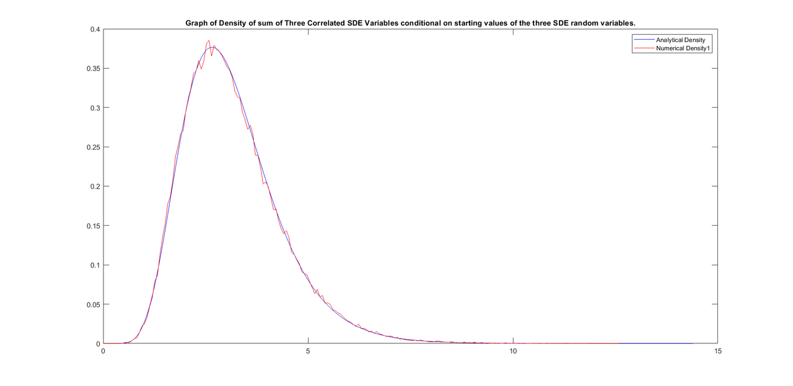](https://postimg.cc/t7jSsJn2)

[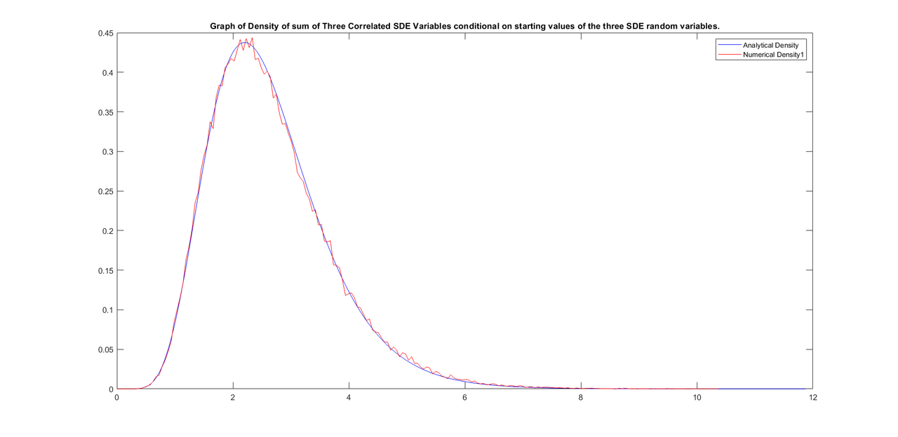](https://postimg.cc/Th67K150)

[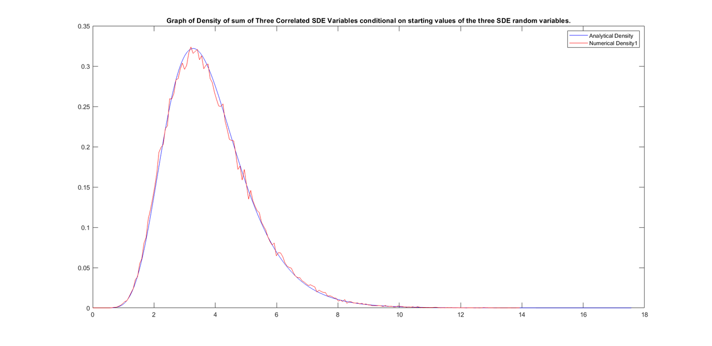](https://postimg.cc/rzknDsRg)

[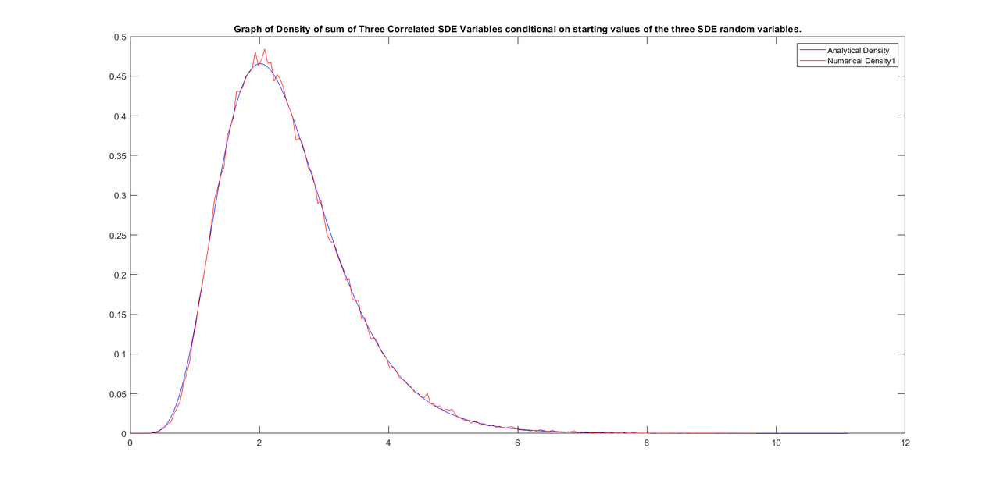](https://postimg.cc/JtL6s0HQ)

---

### #3135 — Amin (Topic Author)
*June 4, 2026, 8:13 AM*

Friends, I am trying to work but mind control agents continue to target my right temple with lasers. When I start to
think and have some idea, they increase torture several fold and it becomes impossible to concentrate. When I cannot
think and give up and start walking around, they decrease torture somewhat. But it is very painful and difficult to work
at the moment.

In my old programs for calibration of Z-series, I have used median as a free parameter that is found from optimization.
But thinking again and trying to improve the programs, I am inclined to think that median is a strong property of the
Data especially SDEs and therefore both mean and median should be found from data directly and median should not be a
free parameter. Point is that difference between mean and median puts a constraint on parameters of Z-series and this
constraint has to included in optimization. In my earlier programs, I was using this constraint on parameters to find
the median but I am inclined to think that this should be other way and constraint should be imposed on parameters given
mean and median.

 I am trying to see if I can fix the median at its data value and use one of my old iterative optimization programs to
work with this new idea. But they are totally not allowing me to work and continue to give very sharp pain in my right
temple and it is almost impossible to work due to pain.

---

### #3136 — Amin (Topic Author)
*June 4, 2026, 9:18 AM*

For friends, who have been following my work more closely, I want to impose the constraint on even coefficients
(responsible for skew) to have expectation of sum of even hermite terms equal to difference between mean and median. In
my earlier programs I have been using a normalization on all coefficients so that variance is matched.

I think that first constraint (of difference between mean and median being equal to expectation of sum of even hermite
terms) has to be applied exclusively on even terms as is obvious.

But I suggest that variance constraint has also to be applied  exclusively on coefficients of odd hermite terms. And
variance of even hermites found after observing first constraint has to be deducted from total variance and remaining
variance has to be used to normalized coefficients of odd hermites.

So please try removing variance of even hermites from total variance before applying variance constraint on coefficients
of odd hermites and do not use variance to normalize the coefficients of even hermites.

Again first constraint is applied solely on skew hermites and this constraint is used to nromalize coefficients of skew
hermites.

Second constraint is applied on odd hermites and we use it to normalize coefficients of odd hermites only.

Many iterative programs with suitable step size should work very well with these ideas if suitable step size is chosen.

I have not yet done this so I suggest that you keep any suitable innovation at hand when you do this.

---

### #3137 — Amin (Topic Author)
*June 4, 2026, 9:49 AM*

Friends, it is very very painful. They are forcing microwaves into my right ear and there is huge pain in my ears and
the pain goes into the forehead and the skull from the ears. I have been begging mind control agents to stop but they
want to openly torture even though I wrote a post an hour ago about this torture. They were trying to drug my food in
the markets yesterday and are very annoyed when they have filed to do that and now they have started torture tactics
since they are very upset and angry.

Many of these agents keep boasting to bad jews that once entire city is drugged, I would be definitely retarded. The
reason is that whenever markets in large parts of Lahore city are drugged, huge amount of money (several tens of
millions of dollars) flows into the city to bribe people and mind control agents get a very huge cut out of this money
so they want the city to be drugged again and again so that more and more moeny would get into their pockets.

But they could never retard me by drugging the city and this has happened several dozens of time again and again in the
city. However, whenever they failed to retard me, they would ask my family after that to detain me that I had become
schizophrenic. But again drugging the city is a game to extort money out of US treasury on the advice of bad but
influential jews.

---

### #3138 — Amin (Topic Author)
*June 5, 2026, 11:07 AM*

Friends, it is very frustrating that bad people are thoroughly opposed to letting me do any research. Department of
scumbags that is thoroughly obsequious to rich jews in order to accomplish their American dream has installed several
Phds in my brain that keep thinking and knowing while I am working on my computer and when I make some advance and
discover something new, they take note of it and then create some errors in my program and I can no longer replicate my
results. I am sure they would then take the original work to bad Jewish scumbags to please them and rest of the good
people would not be able to get any benefit.

I changed my programs and penalized distance of model median from data median by a very large value in the same old
program that I had posted two days ago and a lot of things were much better. But then all of a sudden I could no longer
get the previous results. I used the undo button to go back every change in functions I was using (and I recognized all
changes as well) but the program still did not work. I had copied pasted results of the good run of the program but I
could never replicate those results after I played with the program again. And I did not make any major change at all
and made sure that I recognize every change when I used the undo button but still I could not match the results from
earlier program that I had copied.

However for friends who are using my old programs, I would write some snippets of code so that you could modify two days
ago's programs and get better results on your computer.

Please try altering the weight w(1) on median (as shown in snippet of code below) by small integer multiples.

First replace the objective function calculation program with this new objective function

.

```
function [ObjMomentOut] = CalculateObjMomentWithMedian(Moment0,Moment,Median0,Median,w,MOrder)

ObjMomentOut=0;
for nn=1:MOrder
    ObjMomentOut=ObjMomentOut+(Moment(nn)-Moment0(nn)).^2.*w(nn);
end
for nn=1:1
    ObjMomentOut=ObjMomentOut+(Median-Median0).^2.*w(1);
end

end
```

.

.

Just before you evaluate the above objective function embedded in code, you have to calculate model median as (I am
pasting three relevant lines)

```
           FittedMedian=-(YCoeffZnew(3)+3*YCoeffZnew(5)+15*YCoeffZnew(7));

            [FittedMoments] = CalculateMomentsOfZSeries(YCoeffZnew(1),YCoeffZnew(2:Order+1),SeriesOrder,NMoments);
            [ObjFunc1] = CalculateObjMomentWithMedian(TargetMoments,FittedMoments,TargetMedian,FittedMedian,w1D,MOrder);

```

.

The above lines are copied from function titled as below which has Median added to name of the function I earlier posted
and it takes an extra input parameter at the end.

```
[cGuess,ObjBest] = ZSeries1DCoeffsIterativeForGuessMedian(cGuess,sMu,Order,MaxIter,wm,StandardizedMedian);

```

.

.

I am copying the block that calculates standardized median from standardized data since in the iterative function we are
working with standardized moments.

.

```
%%%%%%%%%%%%%%%%%%%%%%%%%%%%%%%%%%%%%%%%%%%%%%%%%%%%%%%%%%%%%%%%%%%%%%%%%%%%%%5

for mm=1:8
    rMu(mm)=sum(Xin(:).^mm)/Ndata;
end

for nn=1:Ndata
    Xs(nn)=(Xin(nn)-rMu(1))./sqrt(rMu(2)-rMu(1).^2);
end

for mm=1:8
    sMu1(mm)=sum(Xs(:).^mm)/Ndata;
end

StandardizedMedian=(Xs(Ndata/2)+Xs(Ndata/2+1))/2;

%%%%%%%%%%%%%%%%%%%%%%%%%%%%%%%%%%%%%%%%%%%%%%%%%%%%%%%%%%%%%%%%%%%%%%%%%%%%%%5

```

The above block is in the function titled as below and then this standardized median is passed as a parameter to
iterative optimization program that is later called inside the body of function below.

```
function [c0,c,FittedMoments] = CalculateZSeriesDensityFromRawMoments02FromGuess02(Xin,ZI)
```

.

.

.

---

### #3139 — Amin (Topic Author)
*June 5, 2026, 11:41 AM*

Friends, I am posting the three relevant functions for friends but these functions might have errors so just use the
last program and make relevant changes as I have suggested in previous post. Do not make any changes irrelevant to
Median.

.

.

.

```
function [c0,c,FittedMoments] = CalculateZSeriesDensityFromRawMoments02FromGuess02(Xin,ZI)
%The above function takes data as input.
%And returns Z-series Coeffs upto 7th power of Z as
%Y=c0+c(1)*Z+c(2)*Z^2+c(3)*Z^3+c(4)*Z^4+c(5)*Z^5+c(6)*Z^6+c(7)*Z^7
%Fitted Moments are raw moments of the Z-series density and usually are exactly
%the same as input raw moments rMu(1:8).i.e  FittedMoments(1:8)==rMu(1:8)
%with high precision.

Ndata=length(Xin);

%%%%%%%%%%%%%%%%%%%%%%%%%%%%%%%%%%%%%%%%%%%%%%%%%%%%%%%%%%%%%%%%%%%%%%%%%%%%%%5

for mm=1:8
    rMu(mm)=sum(Xin(:).^mm)/Ndata;
end

for nn=1:Ndata
    Xs(nn)=(Xin(nn)-rMu(1))./sqrt(rMu(2)-rMu(1).^2);
end

for mm=1:8
    sMu1(mm)=sum(Xs(:).^mm)/Ndata;
end

StandardizedMedian=(Xs(Ndata/2)+Xs(Ndata/2+1))/2;

%%%%%%%%%%%%%%%%%%%%%%%%%%%%%%%%%%%%%%%%%%%%%%%%%%%%%%%%%%%%%%%%%%%%%%%%%%%%%%5
SeriesOrder=7;    %Z-series till 7th power. hardcoded here cannot chagne.
mOrder=8;         %Number of raw moments in calibration. hardcoded here cannot chagne.
Order=7;
NMoments=mOrder;
                  %Find central Moments from raw moments
[Mu1,cMu] = ConvertRawMomentsToCentralMoments(rMu,mOrder);
                  %Find standardized Moments from central moments
sMu(1)=0;
sMu(2)=1;
sMu(3)=cMu(3)/cMu(2).^1.5;
sMu(4)=cMu(4)/cMu(2).^2.0;
sMu(5)=cMu(5)/cMu(2).^2.5;
sMu(6)=cMu(6)/cMu(2).^3.0;
sMu(7)=cMu(7)/cMu(2).^3.5;
sMu(8)=cMu(8)/cMu(2).^4.0;

%sMu
%sMu1

%str=input("Look at comparison of standardized moments:");

[cGuess,Zx] = CalculateHermiteSeriesFromData02(Xs,Order,ZI);

wm(1:Order+1)=1;
for mm=Order+1:-1:2
    wm(mm-1)=wm(mm)*(mm+1).^2;
end

MaxIter=750;

%[cGuess,ObjBest] = ZSeries1DCoeffsIterativeForGuess(cGuess,sMu,Order,MaxIter,wm);
%[cGuess(1),cGuess(2:8),FittedMoments] = ZSeriesCoeffsFromMomentsIterWithMedian02(rMu,DataMedian)

[cGuess,ObjBest] = ZSeries1DCoeffsIterativeForGuessMedian(cGuess,sMu,Order,MaxIter,wm,StandardizedMedian);

c0=cGuess(1);
c(1:Order)=cGuess(2:Order+1);

%iter=5;           %Number of iterations in the calibration.
                  %Please experiment and play around.
bGuess(1:7)=cGuess(2:8);    %We have assigned initial values of coefficients

c0=-(bGuess(2)+3*bGuess(4)+15*bGuess(6));
c(1:7)=bGuess(1:7);

[IsValidFlag] = CheckIsValidDensity(c0,c);

[Moments] = CalculateMomentsOfZSeries(c0,c,SeriesOrder,NMoments);

ObjBest=0.0;
for nn1=1:Order+1
    ObjBest=ObjBest+(sMu(nn1)-Moments(nn1)).^2.*wm(nn1);
end

bGuess0Best=c0;
    bGuessBest=bGuess;

Iterations=0;

SuccessFlag=0;
FailCount=0;
for iterA=1:Iterations

    SuccessFlag=0;

    iter=1;
[bGuess0,bGuess(1:7),ObjNew] = PreSmoothingGuessAdvancedFromGuessBestNewLimits(sMu,bGuess,iter,wm);

[IsValidFlag] = CheckIsValidDensity(bGuess0,bGuess);

if((ObjNew=3)
% Random(1:7)=0;
%
% Random=randn(size(Random));
%
% bGuess(2:7)=bGuessBest(2:7)-bGuessBest(2:7).*.0002.*(Random(2:7)).*sqrt(2:7);
% bGuess0=-(bGuess(2)+3*bGuess(4)+15*bGuess(6));
%
% [SecondMoment] = CalculateSecondMomentC7(bGuess0,bGuess);
% bGuess=bGuess/sqrt(SecondMoment);
% %bGuess0=-(bGuess(2)+3*bGuess(4)+15*bGuess(6));
% end
%
% else
%   FailCount=0;
%
% end
%
%
% end
%
% c0=-(bGuessBest(2)+3*bGuessBest(4)+15*bGuessBest(6));
% [SecondMoment] = CalculateSecondMomentC7(c0,bGuessBest);
% bGuessBest=bGuessBest/sqrt(SecondMoment);
% c(1:7)=bGuessBest(1:7);
% c0=c0/sqrt(SecondMoment);
%
%
%
% c0
% c
% %str=input("Look at pre-smoothing Guess result")
% %%%%%%%%%%%%%%%%%%%%%%%%%%%%%%%%%%%%%%%%%%%%%%%%%%%%%%%%%%%%%%%%%%%%%%%%%%%%%
%
%
% %%%%%%%%%%%%%%%%%%%%%%%%%%%%%%%%%%%%%%%%%%%%%%%%%%%%%%%%%%%%%%%%%%%%%%
% %Comment this block if you do not want multidimensional Newton pass
% %Even though preSmoothing guess is very close to optimal, slight
% %inaccuracies can change the shape of probabioity density so this
% %Multidimensional Newton is usually required.
%
% [F,dF] = CalculateMomentsAndDerivatives_0(sMu,c0,c,SeriesOrder,SeriesOrder,NMoments);
%
% da(1,1)=c0;
% da(2:SeriesOrder+1,1)=c(1:SeriesOrder);
%
% [Moments] = CalculateMomentsOfZSeries(c0,c,SeriesOrder,NMoments);
%
% ObjBest=0.0;
% for nn1=1:Order+1
%     ObjBest=ObjBest+(sMu(nn1)-Moments(nn1)).^2.*wm(nn1);
% end
%
%
%
% b0Best=c0;
% bBest(1:SeriesOrder)=c(1:SeriesOrder);
%
% nn=0;
% SuccessFlag=0;
% FailCount=0;
%
% while((nn.000000000001) || (abs(F(2,1))>.000000000001) || (abs(F(3,1))>.000000000001) || (abs(F(4,1))>.00000000001)||
(abs(F(5,1))>.00000000001)|| (abs(F(6,1))>.00000000001)|| (abs(F(7,1))>.00000000001)|| (abs(F(8,1))>.00000000001)  ))
% SuccessFlag=0;
%     nn=nn+1;
%
%     if(nnObjNew) &&( IsValidFlag))
%
%        ObjBest=ObjNew;
%        b0Best=b0;
%        bBest(1:SeriesOrder)=b(1:SeriesOrder);
%        SuccessFlag=1;
%     end
%
%     if(SuccessFlag==0)
%         FailCount=FailCount+1;
%     else
%         FailCount=0;
%     end
%
%     if(FailCount>=3)
%         Random(1:7)=0;
%
%         Random=randn(size(Random));
%
%         b(1:7)=bBest(1:7)+bBest(1:7).*.0002.*(Random(1:7)).*sqrt(1:7);
%         b0=-(b(2)+3*b(4)+15*b(6));
%
%         [SecondMoment] = CalculateSecondMomentC7(b0,b);
%         b=b/sqrt(SecondMoment);
%         b0=-(b(2)+3*b(4)+15*b(6));
%     end
%
%     da(1,1)=b0;
%     da(2:SeriesOrder+1,1)=b(1:SeriesOrder);
%
% end
% c0=b0Best;%Best;
% c(1:SeriesOrder)=bBest;%Best(1:SeriesOrder);
%
%
% %Multidimensional Newton root search ends. Comment till here if you like to
% %exclude this
% %%%%%%%%%%%%%%%%%%%%%%%%%%%%%%%%%%%%%%%%%%%%%%%%%%%%%%%%%%%%%%%%%%%%%%%%%%%%%%%%%%%%%%%%%%%%%%%%%%%%%
%
% c0
% c
%
% %str=input("Look at standardized output coefficients");
%
%

%%%%%%%%%%%%%%%%%%%%%%%%%%%%%%%%%%%%%%%%%%%%%%%%%%%%%%%%%%%%%%%%%

%Make sure you do not comment the lines below

c0=c0*sqrt(cMu(2)); %convert from standardized to central moments
c=c*sqrt(cMu(2));   %convert from standardized to central moments

c0=c0+Mu1;          %convert from central to raw moments by adding mean.

[FittedMoments] = CalculateMomentsOfZSeries(c0,c,SeriesOrder,NMoments);
%%%%%%%%%%%%%%%%%%%%%%%%%%%%%%%%%%%%%%%%%%%%%%%%%%%%%%%%%%%%%%%%%%%%%%%%%%%%%%%%%%%%%%%%%%%%%%
%Please Uncomment this if you want to see a comparison of input moments and
%fitted moments
rMu
FittedMoments
str=input('Look at comparison of fitted moments with input moments: Warning: Large Mismatch implies that many results
would be off');
%%%%%%%%%%%%%%%%%%%%%%%%%%%%%%%%%%%%%%%%%%%%%%%%%%%%%%%%%%%%%%%%%%%%%%%%%%%%%%%%%%%%%%%%%%%%%5
%COMMENT lines below if you do not want to see the density of new Z-series random variable with
%fitted moments.
%First calculate normal random variable on a grid below
dNn=.1/2;   % Normal density subdivisions width. would change with number of subdivisions
Nn=45*4;  % No of normal density subdivisions
NnMid=((1+Nn)/2)*dNn;
Z(1:Nn)=(((1:Nn)*dNn)-NnMid);
%Z
%str=input('Look at Z');
%Now calculate Y as a function of normal random variable.
Y(1:Nn)=c0;
for nn=1:7
    Y(1:Nn)=Y(1:Nn)+c(nn)*Z(1:Nn).^nn;
end

%Now take change of densities derivative of Y with respect to normal
DfY(1:Nn)=0;
for nn=2:Nn-1
    DfY(nn) = (Y(nn + 1) - Y(nn - 1))/(Z(nn + 1) - Z(nn - 1));
    %Change of variable derivative for densities
end
DfY(Nn)=DfY(Nn-1);
DfY(1)=DfY(2);

%Now calculate the density of Y from density of normal random variable
%using change of probability derivative.
pY(1:Nn)=0;
for nn = 1:Nn
    pY(nn) = (normpdf(Z(nn),0, 1))/abs(DfY(nn));
end

plot(Y(1:Nn),pY(1:Nn),'b');
title('Density of the Z-Series Variable with Fitted Moments');

str=input('Look at the density of Z-series random variable')
%%%%%%%%%%%%%%%%%%%%%%%%%%%%%%%%%%%%%%%%%%%%%%%%%%%%%%%%%%%%%%%%%%%%%%%%%%%%%%%%%%%%%%%%%%%%
end
```

.

.

.

.

```
function [YCoeffZ,ObjFunc] =
ZSeries1DCoeffsIterativeForGuessMedian(YCoeffZ,TargetMoments,Order,MaxIter,w1D,TargetMedian)

%Order=5;
SeriesOrder=Order+1;
NMoments=Order+1;
MOrder=Order+1;

% for nn=1:SeriesOrder
%
%         DeltaX(nn)=.00125*2/factorial(nn+1);
% end
% DeltaXMax=DeltaX*10;

DeltaX(1)=0.0;
DeltaX(2)=.005;
DeltaX(4)=.005/(33);
DeltaX(6)=.005/(951);
DeltaX(8)=.005/(23115);
DeltaX(3)=.005*(6/35);
DeltaX(5)=.005*(2/361);
DeltaX(7)=.005*(2/9607);

DeltaXMax=DeltaX*1;

% w1D(1:NMoments)=1;
% for nn=NMoments-1:-1:1
%         w1D(nn)=w1D(nn+1)*(nn+1).^0;
% end

[YCoeffH] = ConvertZSeriesToHermiteSeriesNew(YCoeffZ,Order);
[YCoeffH] = FixTheHermiteSeriesDensity(YCoeffH,Order);
[YCoeffZ(1:Order+1)] = ConvertHermiteSeriesToZSeries01(YCoeffH(1:Order+1),Order);

[FittedMoments] = CalculateMomentsOfZSeries(YCoeffZ(1),YCoeffZ(2:Order+1),SeriesOrder,NMoments);

FittedMedian=-(YCoeffZ(3)+3*YCoeffZ(5)+15*YCoeffZ(7));
[ObjFuncBest] = CalculateObjMomentWithMedian(TargetMoments,FittedMoments,TargetMedian,FittedMedian,w1D,MOrder);

ObjFunc1=0;
ObjFunc2=0;

ObjFuncBest
str=input("Look objFuncBest");
%cBest=c;

ImproveFlag(1:SeriesOrder)=1;
ImproveFlagPrev(1:SeriesOrder)=0;
ImproveCount(1:SeriesOrder)=0;
ContinueFlag=1;
kk=0;
%while ((kk.0001))
while ((ContinueFlag)&&(ObjFuncBest>.0001))
kk=kk+1;
    for nn=3:Order+1%SeriesOrder

            YCoeffZnew=YCoeffZ;

            [YCoeffHnew] = ConvertZSeriesToHermiteSeriesNew(YCoeffZnew,Order);
[YCoeffHnew] = FixTheHermiteSeriesDensity(YCoeffHnew,Order);
[YCoeffZnew(1:Order+1)] = ConvertHermiteSeriesToZSeries01(YCoeffHnew(1:Order+1),Order);

            FittedMedian=-(YCoeffZnew(3)+3*YCoeffZnew(5)+15*YCoeffZnew(7));
            YCoeffZnew(1)=-(YCoeffZnew(3)+3*YCoeffZnew(5)+15*YCoeffZnew(7));
            %[YCoeffZnew(1:Order+1)] = ConvertHermiteSeriesToZSeries01(YCoeffHnew(1:Order+1),Order);
            [FittedMoments] = CalculateMomentsOfZSeries(YCoeffZnew(1),YCoeffZnew(2:Order+1),SeriesOrder,NMoments);
            YCoeffZnew(:)=YCoeffZnew(:)./sqrt(FittedMoments(2));
            [FittedMoments] = CalculateMomentsOfZSeries(YCoeffZnew(1),YCoeffZnew(2:Order+1),SeriesOrder,NMoments);

            DoCalculations=0;
            if(FittedMoments(nn)abs(24/5*YCoeffHnew0(3)+503/5*YCoeffHnew0(5)+7360/5*YCoeffHnew0(7)))
               DFlag1=1;
   %         end

            end
 %DFlag1=1;
 DFlag2=1;
                if((DoCalculations)&&(ObjFunc1TargetMoments(nn))
                YCoeffZnew(nn)=YCoeffZnew(nn)-DeltaX(nn);
                DoCalculations=1;

            [YCoeffHnew] = ConvertZSeriesToHermiteSeriesNew(YCoeffZnew,Order);
[YCoeffHnew] = FixTheHermiteSeriesDensity(YCoeffHnew,Order);
[YCoeffZnew(1:Order+1)] = ConvertHermiteSeriesToZSeries01(YCoeffHnew(1:Order+1),Order);
            end
            DFlag1=0;
            if(DoCalculations)
            FittedMedian=-(YCoeffZnew(3)+3*YCoeffZnew(5)+15*YCoeffZnew(7));
            YCoeffZnew(1)=-(YCoeffZnew(3)+3*YCoeffZnew(5)+15*YCoeffZnew(7));
            %[YCoeffZnew(1:Order+1)] = ConvertHermiteSeriesToZSeries01(YCoeffHnew(1:Order+1),Order);
            [FittedMoments] = CalculateMomentsOfZSeries(YCoeffZnew(1),YCoeffZnew(2:Order+1),SeriesOrder,NMoments);
            YCoeffZnew(:)=YCoeffZnew(:)./sqrt(FittedMoments(2));
                   FittedMedian=-(YCoeffZnew(3)+3*YCoeffZnew(5)+15*YCoeffZnew(7));

            [FittedMoments] = CalculateMomentsOfZSeries(YCoeffZnew(1),YCoeffZnew(2:Order+1),SeriesOrder,NMoments);
            [ObjFunc2] = CalculateObjMomentWithMedian(TargetMoments,FittedMoments,TargetMedian,FittedMedian,w1D,MOrder);
             [YCoeffHnew0] = ConvertZSeriesToHermiteSeriesNew(YCoeffZnew,Order);

   %         
if(YCoeffHnew0(2)+22*YCoeffHnew0(4)+390*YCoeffHnew0(6)+5020*YCoeffHnew0(8)>abs(24/5*YCoeffHnew0(3)+503/5*YCoeffHnew0(5)+7360/5*YCoeffHnew0(7)))
               DFlag1=1;

            end

 %DFlag1=1;
 DFlag2=1;
                if((DoCalculations)&&(ObjFunc2DeltaXMax(nn))
           DeltaX(nn)=DeltaXMax(nn);
       end
    end

    ContinueFlag=(ContinueFlag || ImproveFlag(nn));

    if(kk<40)
        ContinueFlag=1;
    end

end

ObjFunc=ObjFuncBest;

end
```

.

.

.

```
function [ObjMomentOut] = CalculateObjMomentWithMedian(Moment0,Moment,Median0,Median,w,MOrder)

ObjMomentOut=0;
for nn=1:MOrder
    ObjMomentOut=ObjMomentOut+(Moment(nn)-Moment0(nn)).^2.*w(nn);
end
for nn=1:1
    ObjMomentOut=ObjMomentOut+(Median-Median0).^2.*w(1);
end

end

```

.

.

.

---

### #3140 — Amin (Topic Author)
*June 5, 2026, 4:00 PM*

Friends, in the main program body of the function titled,"ConditionalDensityHermitesNvariateNewton",

please replace the following block (around line 361)

Both blocks have  if((nn1>=nn2)) replaced by  if((nn1>nn2)). This will remove X(nn)^2 terms from regression of Y^2 as I
noticed that they were causing problems.

%%%%%%%%%%%%%%%%%%%%%%%%%%%%%%%%%%%%%%%%%%%%%%%%%%%%%%%%%%%%%%%%%%%%%%%%%%%%%%555

[CoeffR,XCoeffH,ZI] = RegressYOnX(Yin,Xin,paths,NDims,Order);

XX(1:paths,1:NDims)=Xin(1:paths,1:NDims);

ss=NDims;

for nn1=1:NDims

    for nn2=1:NDims

        if((nn1>=nn2))

        ss=ss+1;

        XX(1:paths,ss)=Xin(1:paths,nn1).*Xin(1:paths,nn2);

        end

    end

end

SS=ss;

[Coeff2R,X2CoeffH,ZI] = RegressYOnX(Yin.^2,XX,paths,SS,Order);

%%%%%%%%%%%%%%%%%%%%%%%%%%%%%%%%%%%%%%%%%%%%%%%%%%%%%%%%%%%%%%%%%%%%%%%%%%%%%%%%

With this block

%%%%%%%%%%%%%%%%%%%%%%%%%%%%%%%%%%%%%%%%%%%%%%%%%%%%%%%%%%%%%%%%%%%%%%%%%%%%%%555

[CoeffR,XCoeffH,ZI] = RegressYOnX(Yin,Xin,paths,NDims,Order);

XX(1:paths,1:NDims)=Xin(1:paths,1:NDims);

ss=NDims;

for nn1=1:NDims

    for nn2=1:NDims

        if((nn1>nn2))

        ss=ss+1;

        XX(1:paths,ss)=Xin(1:paths,nn1).*Xin(1:paths,nn2);

        end

    end

end

SS=ss;

[Coeff2R,X2CoeffH,ZI] = RegressYOnX(Yin.^2,XX,paths,SS,Order);

%%%%%%%%%%%%%%%%%%%%%%%%%%%%%%%%%%%%%%%%%%%%%%%%%%%%%%%%%%%%%%%%%%%%%%%%%%%%%%%%

and also replace the following block (around line 522)

%%%%%%%%%%%%%%%%%%%%%%%%%%%%%%%%%%%%%%%%%%%%%%%%%%%%%%%%%%%%%%%%%%%%%%%%%%%%%%%%

for nn=1:NDims

    [Zx0(nn)] = CalculateZgivenXAndHSeriesCoeffs(V10(nn),XCoeffH(1:Order+1,nn),Order);

end

%Zx0(1:NDims)=Z10(1:NDims);

Zxx0(1:NDims)=Zx0(1:NDims);

ss=NDims;

for nn1=1:NDims

    for nn2=1:NDims

        if((nn1>=nn2))

        ss=ss+1;

        Zxx0(ss)= CalculateZgivenXAndHSeriesCoeffs(V10(nn1).*V10(nn2),X2CoeffH(1:Order+1,ss),Order);

        end

    end

end

%%%%%%%%%%%%%%%%%%%%%%%%%%%%%%%%%%%%%%%%%%%%%%%%%%%%%%%%%%%%%%%%%%%55

Wit this block

%%%%%%%%%%%%%%%%%%%%%%%%%%%%%%%%%%%%%%%%%%%%%%%%%%%%%%%%%%%%%%%%%%%%%%%%%%%%%%%%

for nn=1:NDims

    [Zx0(nn)] = CalculateZgivenXAndHSeriesCoeffs(V10(nn),XCoeffH(1:Order+1,nn),Order);

end

%Zx0(1:NDims)=Z10(1:NDims);

Zxx0(1:NDims)=Zx0(1:NDims);

ss=NDims;

for nn1=1:NDims

    for nn2=1:NDims

        if((nn1>nn2))

        ss=ss+1;

        Zxx0(ss)= CalculateZgivenXAndHSeriesCoeffs(V10(nn1).*V10(nn2),X2CoeffH(1:Order+1,ss),Order);

        end

    end

end

%%%%%%%%%%%%%%%%%%%%%%%%%%%%%%%%%%%%%%%%%%%%%%%%%%%%%%%%%%%%%%%%%%%55

---

### #3141 — Amin (Topic Author)
*June 6, 2026, 8:08 AM*

Friends, I could not work last night since they continued to change my programs. A lot of programs that were working
well earlier do not work anymore. Friends, once other things like drugging the food and water across the city fails,
these scumbags resort to even more lowly tactics. These people are so mean that in order to insult others they are
perfectly willing to insult themselves.

They previously let me work because they were convinced that the method would never have enough accuracy but once we
continued to work and improve the model, they decided that they simply cannot let me work anymore lest the new algorithm
becomes totally perfect and therefore they have started to use their old tactics totally openly and with an iron fist
despite that they know a lot of people are watching everything carefully. They are no longer worried about any respect
or disrespect they get out of these mean tactics since they think they can buy anyone they feel like with their money to
make their mare go.

Friends, I have just one goal that the method on which I continued to work for past 4-5 years, I want to contribute to
its full development and want to see it being used everywhere but once bad people do not allow me to work at all, I am
in a state of total helplessness. It is so demoralizing to see how evil people have an upper hand over good people in
United States.

---

### #3142 — Amin (Topic Author)
*June 6, 2026, 3:09 PM*

Friends, it is very disturbing that mind control agents remain adamant on not letting me do any more work. They continue
to alter my programs and now even my density construction programs do not work any longer. I am so thoroughly
disappointed and totally heart-broken. My only hope is that once China rises, they will free rest of the world from
hegemony of the nexus between American defense and the bad jews that is retarding good but intelligent people all over
the world so that Jewish hegemony could be achieved. Sorry but good Chinese people understand the true nature of these
scumbags and never allow them to operate in their country. American army today is worse than Gestapo in retarding talent
and there is horror among talent all over the world due to activities on this Gestapo. I want to request Chinese to
please intervene in countries under their influence to stop this Gestapo from operating in our poor countries. Jews when
they notice any talented person in the USA or other countries under American influence, they beacon to American defesne
aka American gestapo that moves swiftly to darken the future of that person forever. There is horror among talented
people all over the world about activities  of this Gestapo.

Statue of Liberty that promoted freedom and democracy all over the world and was a symbol of hope for oppressed people
all over the world has fallen and is being gang-raped by American army to please their jewish masters. The current state
of affairs is that better my research becomes, the more people of American defense humiliate me.

We, in Pakistan consider it extremely unpatriotic to talk against Pakistan army, but Bangladesh was lucky to have
separated due to Indian intervention and become free from the hegemony of any large army. Per Capita GDP of Bangladesh
at start of the new country was way smaller than Pakistan. Now their Per capita GDP is \
$2593(2024) and our per capita GDP is \$ 1478 (2024).

---

### #3143 — Amin (Topic Author)
*June 6, 2026, 4:11 PM*

Friends, I wrote this message to three or four Chinese Linkedin Connections. I am writing it here for any good Chinese
friends who can help me join a Chinese university as a researcher. If you want to help me with this favor of yours, you
can email me at [[email protected]](/cdn-cgi/l/email-protection#12737c737c202b2b2b526b737a7d7d3c717d7f) .

I have previously noticed that in newer generations, the only people who are doing good research in our country are the
ones who went to study in China and are backed by their Chinese Professors and Pakistan army does not dare to retard
them.

Here is the letter I sent to my Chinese connections.

Hi  ****,

I am researcher based in Lahore, Pakistan and I have done very good and cutting edge research about dynamics of random
and stochastic processes. This research can potentially train neural networks at 1/1000 compute previously required to
train them with brute force methods.

But I am facing serious coercion in my country and want to join some good Chinese university as a researcher.

I wanted to request you to if possible help me in joining some good Chinese university.

Kind regards,

Ahsan

---

### #3144 — Amin (Topic Author)
*June 7, 2026, 2:04 PM*

Friends, I wrote letters to some people at Tsinghua University and Fudan university inviting them to visit my thread at
wilmott and requested them for a position as researcher in their university. I also tried to connect with many Chinese
professionals on LinkedIn who are working with AI research based companies so that I could possibly look for work there.
I will try to continue approaching more people in Chinese universities.

Since scumbags of American defense were not allowing me to work with my own programs, I have decided to spend next week
or two trying to put together a research paper on the latest research that I did over last one year. In the meantime, I
would continue to look for work in China since most important thing in my life at the moment is that I could get freedom
from further cruelties and humiliation at the hands of this Gestapo.

Today, I also sent emails to some professors at Shanghai Jiao Tong university that were related to statistics and AI and
requested for a research position.

---

### #3145 — Amin (Topic Author)
*June 8, 2026, 5:48 AM*

Friends, mind control agents were not allowing me to run my latest programs properly three days ago. One day later, they
were even more emboldened and did not even allow me to run my density construction programs that had been working well
on data for months. I was, in fact, thinking that it was time to touch the few people who had responded well when I
reached out about ten days ago. But when I realized that the mind control agents continue to become even more emboldened
and do not even want to let me work, I knee they would not let me work  at all even if somebody gave me some business.
So I realized that it is more important to go somewhere I can be free from coercion and where I can get my freedom. So I
decided to touch people in China and see If I can get some opportunity there. Friends, my whining and wailing on the
forum  is useless. Yes, I have been able to do some work but then I cannot even use my own work. If my life improves for
one day, after two days the torture increases again. I really have to try to think of a permanent solution to the
problem.

---

### #3146 — Amin (Topic Author)
*June 8, 2026, 8:52 AM*

Friends, I have decided to spend all my time for next two weeks to write my new research paper on my recent work. All
the code I have written is circulating around and if I do now write the paper and take ownership of my work, many people
can come up with the claim that they did the work and try to publish the plagiarized work as their own. For next two
weeks, I want to complete my paper and post it on SSRN and Arxiv.

---

### #3147 — Amin (Topic Author)
*June 9, 2026, 5:28 PM*

Friends, I am looking for some research work opportunities in China. But it is highly likely that I might go there for a
PhD and continue my research. It seems to me that China is the right place for me to go since there is a lot of research
going on there and they also do not allow mind control of their people. Contrast this with UK where I went in 2010 on
HSMP Visa and their government drugged manufactured food in all of London and five or six other major cities since I
used to wander around. When I left UK after six months, I knew that I never want to go there again due to all the pain
and trauma I had to endure. I hope that all friends would be able to put themselves in my shoes and be able to
understand my position. I absolutely do not want to go to a country where they do mind control of intelligent people to
please American army and the jews. Only china emerges as the right choice where they do not allow scumbags of American
defense freely and Chinese people do a a lot of very interesting research work with stochastic processes and AI.

---

### #3148 — Amin (Topic Author)
*June 10, 2026, 8:40 AM*

Friends, many many long years have passed since I started posting my research on this thread and this forum. We did
analytic solution of ODE's, higher Order solutions of SDEs, and many other things and then we moved on to doing research
with Z-series. We did some better work recently and a lot of good learned people liked my recent work.

But friends, research in Mathematics is not easy. Many times, I have to fight against all odds. There have been
countless occasions when I had to stay up all night working till dawn for many nights in a row.  Despite the effort
involved, I freely share my findings with anyone interested and ask for nothing in return. But after all this hard work
and hitting my head against the wall for trying to do good research, I would expect that my human dignity would be
respected and I would not be humiliated. It is very heart-breaking for me when after all the effort to do good and open
research, I only manage to earn disrespect from people of Mind-control.  It is deeply painful when, despite my sincere
efforts to contribute openly and positively, I feel that I receive only disrespect in return from the people in
authority.

 I have told friends several times previously that I have absolutely no qualms about doing good research and sharing it
with everyone interested and I would continue to do that for the rest of my life but when I earn more humiliation after
doing better research, I become totally dejected and heart-broken and want to go somewhere else where nobody would
humiliate me for my doing good research.

I want to tell friends that I still have the same ideals and I still want to try living in my country for the rest of my
life and continue sharing my research for the rest of my life but I have a few pre-requisite conditions that are very
natural and very human and If these conditions are met, I would be more than happy to remain here and continue pursuing
my work and also freely distribute it.

I am not asking for anything extraordinary rather I am demanding all those things that most human beings almost always
enjoy of course and rather take for granted. My concerns are as follows:

1.  My mind control has to stop.

2.  All my anti-psychotic medication has to stop.

3. CIA/Mind control agents would never alter my programs.

4. People would not be stopped from doing business with my firm.

5. My food or beverages would not be drugged.

These are, in my view, basic and reasonable conditions. If they are satisfied, I would absolutely have no qualms about
continuing my research for the rest of my life and sharing it with friends. What I find most difficult is the experience
of humiliation and disrespect after investing so much effort into meaningful work. Continuously feeling mistreated while
trying to contribute through research is very discouraging and emotionally painful. It is not a situation under which I
can effectively continue my work with the current working model and would have to look for possibilities elsewhere in
the world where I would be free from mind control.

But if I can have better circumstances and I can get my rights back as I have suggested in the above conditions, I would
be more than happy to remain in Pakistan and pursue my research vigorously and also freely distribute it among friends.

---

### #3149 — Amin (Topic Author)
*June 11, 2026, 5:58 PM*

Friends, I was highly sedated and under the influence of injection (that usually has mind control drugs in it) that I
had on 3rd of June and therefore could not do any technical work earlier. I feel a bit better now but I am still not in
my proper senses. But I have decided to write another function for calculation of parameters of Z-series. I think that
most important thing required for successful application of Z-series is that its coefficients are perfectly calculated
with knowledge of all constraints and other issues and fit to density and moments should be perfect as well. The
iterative program I have been using is very good but the whole process needs further improvement. I am thinking of using
iterative over-constrained Newton like I had tried for correlation coefficients. I hope to work tonight and tomorrow and
think that new function would be ready sometimes over the weekend. I hope to post the new function on the forum sometime
over the weekend.

---

### #3150 — Amin (Topic Author)
*June 13, 2026, 11:26 AM*

Friends, I am working on the new algorithm but a bit slow due to sedative injection with mind control drugs ( I am
sleeping for more than ten or eleven hours everyday). Might take a few days to perfectly complete it but I hope it will
be a good program.

My demands/requests are the same but I will continue to post my work and research on the forum irrespective.

I am sorry for letting my American friends down who backed me in all sort of difficult circumstances but mind control
agents, when they have power over the victim due to mind control drugs, violently shake the brain with bad
neurotransmitters and it is very very difficult to remain stable. I had taken drugged water when I started to protest a
week ago. I could not perfectly tell that water was drugged but I had become very very aggressive under the effect of
drugged water which is not my true nature at all unless I am under effect of mind control drugs (I was not aggressive to
people around and mostly towards mind control agents only). My system was already weakened by injection and they gave me
highly drugged water on top of that and I could not help being aggressive. They are never tired of giving me bad
neurotransmitters in water or food and water, especially underground reservoirs of water,  all over the city are
contaminated with mind control drugs and my only hope everyday is to find good totally unbranded bottled water lying at
very small stores for months. I used to take good ground water from remote parts of the city or outskirts of the city
but it has become impossible for last ten days. When I became more careful about drugged water in recent days, the
effect of mind control drugs continued to wane.

Again I apologize to my friends who had backed me only due to their good humanity and for letting them down before so
many other people who want my persecution to continue. I hope that I will be more predictable for good friends in the
future.

---

[← Previous](page_062.md) | [Index](index.md) | [Next →](page_064.md)
