# Breakthrough in the theory of stochastic differential equations and their simulation

**Page 64 of 65** — Posts #3151–#3200

[← Previous](page_063.md) | [Index](index.md) | [Next →](page_065.md)

---

### #3151 — Amin (Topic Author)
*June 15, 2026, 7:07 PM*

**(broken latex: Unbalanced $: 1)**

```latex
Friends, I tried to specify median as a constant in the least squares regression to find the coefficients of Z-series.
Data Median is specified as a constant and regression is done on only first seven powers of the ZI of ideal normal
density grid. A constant is not specified in the regression. And it works extremely well. All moments are matched very
closely by the regression calculated coefficients of the Z-series which was earlier not possible. I am posting the
program, please use this program for finding optimal coefficients of Z-series.

.

.

.

.

```
function [Coeff,Zy] = CalculateZSeriesFromData02GivenMedian(Yin,Order,ZI)

Ndata=length(Yin);

MeanYin=sum(Yin(1:Ndata))/Ndata;
Ym(1:Ndata)=Yin(1:Ndata)-MeanYin;
YmVar=sum(Ym(1:Ndata).^2)/Ndata;
Y(1:Ndata)=Ym(1:Ndata)/sqrt(YmVar);

[Yss,I]=sort(Y(1:Ndata));

DataMedian=(Yss(Ndata/2)+Yss(Ndata/2+1))/2;

Ys=Yss-DataMedian;

for hh=1:Order
    W(1:Ndata,hh)=ZI(1:Ndata).^(hh);
end

Ymu(1:Ndata,1)=Ys(1:Ndata);

WW=(W'*W);

coeff=(WW)$W'*Ymu);

%Store in coefficietns array of all random varaibles
Coeff(2:Order+1)= coeff(1:Order,1);
Coeff(1)=DataMedian;
%Store the associated Z in Z-array of all coefficients.
Zy(I(1:Ndata))=W(1:Ndata,2);

Coeff(1:Order+1)=Coeff(1:Order+1).*sqrt(YmVar);
Coeff(1)=Coeff(1)+MeanYin;

clf;
PlotZSeriesDensity(Coeff(1),Coeff(2:Order+1),'r')
hold on

NoOfBins=150;
MaxCutOff=20;
[XDensity,IndexOut,IndexMax] = MakeDensityFromSimulation_Infiniti_NEW(Yin,Ndata,NoOfBins,MaxCutOff );
plot(IndexOut(1:IndexMax),XDensity(1:IndexMax),'b');

str=input("Look at comparison of Density");

end

```

.

.

.

For example in my first density, I calculated the coefficients from above regression function and here are the match of
moments using least squares regression for Z-series coefficients..

rMu =

  Columns 1 through 3

   0.999295452748394   1.198974001815090   1.690278464594609

  Columns 4 through 6

   2.753994571319678   5.117567287965246  10.725966391329102

  Columns 7 through 8

  25.108588412759644  65.040161369123126

FittedMoments =

  Columns 1 through 3

   0.999295452748394   1.198965360544081   1.690225069802911

  Columns 4 through 6

   2.753824423082222   5.117410061147821  10.729855471809556

  Columns 7 through 8

  25.160471673738623  65.514802435978780

Here is the graph of the constructed density with coefficients from regression VS the numerical density.

.

.

[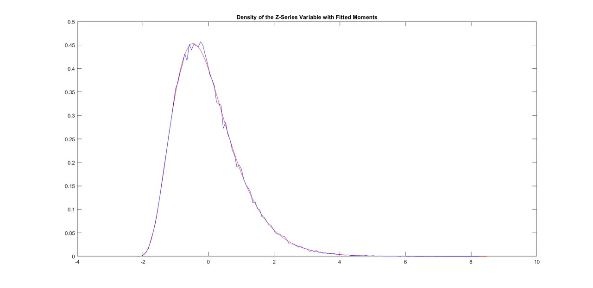](https://postimg.cc/0bpjZp5C)
```

---

### #3152 — Amin (Topic Author)
*June 15, 2026, 9:14 PM*

Friends, I noticed that regression based Z-series coefficients calculations function in last post  might have a mismatch
in 7th and 8th moments. For that I recommend this modified version of old program for Z-series coefficients
calculations.

.

.

.

```
function [c0,c,FittedMoments] = CalculateZSeriesDensityFromRawMoments02FromGuess02W(Xin,ZI)
%The above function takes data as input.
%And returns Z-series Coeffs upto 7th power of Z as
%Y=c0+c(1)*Z+c(2)*Z^2+c(3)*Z^3+c(4)*Z^4+c(5)*Z^5+c(6)*Z^6+c(7)*Z^7
%Fitted Moments are raw moments of the Z-series density and usually are exactly
%the same as input raw moments rMu(1:8).i.e  FittedMoments(1:8)==rMu(1:8)
%with high precision.

Ndata=length(Xin);

%%%%%%%%%%%%%%%%%%%%%%%%%%%%%%%%%%%%%%%%%%%%%%%%%%%%%%%%%%%%%%%%%%%%%%%%%%%%%%5

for mm=1:8
    rMu(mm)=sum(Xin(:).^mm)/Ndata;
end

for nn=1:Ndata
    Xs(nn)=(Xin(nn)-rMu(1))./sqrt(rMu(2)-rMu(1).^2);
end

for mm=1:8
    sMu1(mm)=sum(Xs(:).^mm)/Ndata;
end

Xsorted=sort(Xs);

StandardizedMedian=(Xsorted(Ndata/2)+Xsorted(Ndata/2+1))/2;

%%%%%%%%%%%%%%%%%%%%%%%%%%%%%%%%%%%%%%%%%%%%%%%%%%%%%%%%%%%%%%%%%%%%%%%%%%%%%%5
SeriesOrder=7;    %Z-series till 7th power. hardcoded here cannot chagne.
mOrder=8;         %Number of raw moments in calibration. hardcoded here cannot chagne.
Order=7;
NMoments=mOrder;
                  %Find central Moments from raw moments
[Mu1,cMu] = ConvertRawMomentsToCentralMoments(rMu,mOrder);
                  %Find standardized Moments from central moments
sMu(1)=0;
sMu(2)=1;
sMu(3)=cMu(3)/cMu(2).^1.5;
sMu(4)=cMu(4)/cMu(2).^2.0;
sMu(5)=cMu(5)/cMu(2).^2.5;
sMu(6)=cMu(6)/cMu(2).^3.0;
sMu(7)=cMu(7)/cMu(2).^3.5;
sMu(8)=cMu(8)/cMu(2).^4.0;

%sMu
%sMu1

%str=input("Look at comparison of standardized moments:");

%[cGuess,Zx] = CalculateHermiteSeriesFromData02(Xs,Order,ZI);
[cGuess,Zx] = CalculateZSeriesFromData02GivenMedian(Xs,Order,ZI);

wm(1:Order+1)=1;
for mm=Order+1:-1:2
    wm(mm-1)=wm(mm)*(mm+1).^2;
end

MaxIter=750;

%[cGuess,ObjBest] = ZSeries1DCoeffsIterativeForGuess(cGuess,sMu,Order,MaxIter,wm);
%[cGuess(1),cGuess(2:8),FittedMoments] = ZSeriesCoeffsFromMomentsIterWithMedian02(rMu,DataMedian)

[cGuess,ObjBest] = ZSeries1DCoeffsIterativeForGuessMedianW(cGuess,sMu,Order,MaxIter,wm,StandardizedMedian);

                  %Please experiment and play around.
bGuess(1:7)=cGuess(2:8);    %We have assigned initial values of coefficients

c0=-(bGuess(2)+3*bGuess(4)+15*bGuess(6));
c(1:7)=bGuess(1:7);

%%%%%%%%%%%%%%%%%%%%%%%%%%%%%%%%%%%%%%%%%%%%%%%%%%%%%%%%%%%%%%%%%

%Make sure you do not comment the lines below

c0=c0*sqrt(cMu(2)); %convert from standardized to central moments
c=c*sqrt(cMu(2));   %convert from standardized to central moments

c0=c0+Mu1;          %convert from central to raw moments by adding mean.

[FittedMoments] = CalculateMomentsOfZSeries(c0,c,SeriesOrder,NMoments);
%%%%%%%%%%%%%%%%%%%%%%%%%%%%%%%%%%%%%%%%%%%%%%%%%%%%%%%%%%%%%%%%%%%%%%%%%%%%%%%%%%%%%%%%%%%%%%
%Please Uncomment this if you want to see a comparison of input moments and
%fitted moments
rMu
FittedMoments
str=input('Look at comparison of fitted moments with input moments: Warning: Large Mismatch implies that many results
would be off');
%%%%%%%%%%%%%%%%%%%%%%%%%%%%%%%%%%%%%%%%%%%%%%%%%%%%%%%%%%%%%%%%%%%%%%%%%%%%%%%%%%%%%%%%%%%%%5
%COMMENT lines below if you do not want to see the density of new Z-series random variable with
%fitted moments.
%First calculate normal random variable on a grid below
dNn=.1/2;   % Normal density subdivisions width. would change with number of subdivisions
Nn=45*4;  % No of normal density subdivisions
NnMid=((1+Nn)/2)*dNn;
Z(1:Nn)=(((1:Nn)*dNn)-NnMid);
%Z
%str=input('Look at Z');
%Now calculate Y as a function of normal random variable.
Y(1:Nn)=c0;
for nn=1:7
    Y(1:Nn)=Y(1:Nn)+c(nn)*Z(1:Nn).^nn;
end

%Now take change of densities derivative of Y with respect to normal
DfY(1:Nn)=0;
for nn=2:Nn-1
    DfY(nn) = (Y(nn + 1) - Y(nn - 1))/(Z(nn + 1) - Z(nn - 1));
    %Change of variable derivative for densities
end
DfY(Nn)=DfY(Nn-1);
DfY(1)=DfY(2);

%Now calculate the density of Y from density of normal random variable
%using change of probability derivative.
pY(1:Nn)=0;
for nn = 1:Nn
    pY(nn) = (normpdf(Z(nn),0, 1))/abs(DfY(nn));
end

plot(Y(1:Nn),pY(1:Nn),'b');
title('Density of the Z-Series Variable with Fitted Moments');

str=input('Look at the density of Z-series random variable')
%%%%%%%%%%%%%%%%%%%%%%%%%%%%%%%%%%%%%%%%%%%%%%%%%%%%%%%%%%%%%%%%%%%%%%%%%%%%%%%%%%%%%%%%%%%%
end
```

.

.

.

.

```
function [YCoeffZ,ObjFunc] =
ZSeries1DCoeffsIterativeForGuessMedianW(YCoeffZ,TargetMoments,Order,MaxIter,w1D,TargetMedian)

%Order=5;
SeriesOrder=Order+1;
NMoments=Order+1;
MOrder=Order+1;

% for nn=1:SeriesOrder
%
%         DeltaX(nn)=.00125*2/factorial(nn+1);
% end
% DeltaXMax=DeltaX*10;

Dx=.0025;
DeltaX(1)=0.0;
DeltaX(2)=Dx;
DeltaX(4)=Dx/(33);
DeltaX(6)=Dx/(951);
DeltaX(8)=Dx/(23115);
DeltaX(3)=Dx*(6/35);
DeltaX(5)=Dx*(2/361);
DeltaX(7)=Dx*(2/9607);

[DeltaX0,DeltaX(1:7)]=ConvertHCoeffsToZCoeffs(0,DeltaX,Order);

DeltaXMax=DeltaX*1;

[FittedMoments] = CalculateMomentsOfZSeries(YCoeffZ(1),YCoeffZ(2:Order+1),SeriesOrder,NMoments);

FittedMedian=-(YCoeffZ(3)+3*YCoeffZ(5)+15*YCoeffZ(7));
[ObjFuncBest] = CalculateObjMomentWithMedian(TargetMoments,FittedMoments,TargetMedian,FittedMedian,w1D,MOrder);

ObjFunc1=0;
ObjFunc2=0;

ObjFuncBest
str=input("Look objFuncBest");
%cBest=c;

ImproveFlag(1:SeriesOrder)=1;
ImproveFlagPrev(1:SeriesOrder)=0;
ImproveCount(1:SeriesOrder)=0;
ContinueFlag=1;
kk=0;
%while ((kk.0001))
while ((ContinueFlag)&&(ObjFuncBest>.0001))
kk=kk+1;
    for nn=3:Order+1%SeriesOrder

            YCoeffZnew=YCoeffZ;

            [YCoeffHnew] = ConvertZSeriesToHermiteSeriesNew(YCoeffZnew,Order);
[YCoeffHnew] = FixTheHermiteSeriesDensity(YCoeffHnew,Order);
[YCoeffZnew(1:Order+1)] = ConvertHermiteSeriesToZSeries01(YCoeffHnew(1:Order+1),Order);

            FittedMedian=-(YCoeffZnew(3)+3*YCoeffZnew(5)+15*YCoeffZnew(7));
            YCoeffZnew(1)=-(YCoeffZnew(3)+3*YCoeffZnew(5)+15*YCoeffZnew(7));
            %[YCoeffZnew(1:Order+1)] = ConvertHermiteSeriesToZSeries01(YCoeffHnew(1:Order+1),Order);
            [FittedMoments] = CalculateMomentsOfZSeries(YCoeffZnew(1),YCoeffZnew(2:Order+1),SeriesOrder,NMoments);
            YCoeffZnew(:)=YCoeffZnew(:)./sqrt(FittedMoments(2));
            [FittedMoments] = CalculateMomentsOfZSeries(YCoeffZnew(1),YCoeffZnew(2:Order+1),SeriesOrder,NMoments);

            DoCalculations=0;
            if(FittedMoments(nn)abs(24/5*YCoeffHnew0(3)+503/5*YCoeffHnew0(5)+7360/5*YCoeffHnew0(7)))
               DFlag1=1;
   %         end

            end
 %DFlag1=1;
 DFlag2=1;
                if((DoCalculations)&&(ObjFunc1TargetMoments(nn))
                YCoeffZnew(nn)=YCoeffZnew(nn)-DeltaX(nn);
                DoCalculations=1;

            [YCoeffHnew] = ConvertZSeriesToHermiteSeriesNew(YCoeffZnew,Order);
[YCoeffHnew] = FixTheHermiteSeriesDensity(YCoeffHnew,Order);
[YCoeffZnew(1:Order+1)] = ConvertHermiteSeriesToZSeries01(YCoeffHnew(1:Order+1),Order);
            end

            DFlag1=0;
            if(DoCalculations)
            FittedMedian=-(YCoeffZnew(3)+3*YCoeffZnew(5)+15*YCoeffZnew(7));
            YCoeffZnew(1)=-(YCoeffZnew(3)+3*YCoeffZnew(5)+15*YCoeffZnew(7));
            %[YCoeffZnew(1:Order+1)] = ConvertHermiteSeriesToZSeries01(YCoeffHnew(1:Order+1),Order);
            [FittedMoments] = CalculateMomentsOfZSeries(YCoeffZnew(1),YCoeffZnew(2:Order+1),SeriesOrder,NMoments);
            YCoeffZnew(:)=YCoeffZnew(:)./sqrt(FittedMoments(2));
                   FittedMedian=-(YCoeffZnew(3)+3*YCoeffZnew(5)+15*YCoeffZnew(7));

            [FittedMoments] = CalculateMomentsOfZSeries(YCoeffZnew(1),YCoeffZnew(2:Order+1),SeriesOrder,NMoments);
            [ObjFunc2] = CalculateObjMomentWithMedian(TargetMoments,FittedMoments,TargetMedian,FittedMedian,w1D,MOrder);
             [YCoeffHnew0] = ConvertZSeriesToHermiteSeriesNew(YCoeffZnew,Order);

   %         
if(YCoeffHnew0(2)+22*YCoeffHnew0(4)+390*YCoeffHnew0(6)+5020*YCoeffHnew0(8)>abs(24/5*YCoeffHnew0(3)+503/5*YCoeffHnew0(5)+7360/5*YCoeffHnew0(7)))
               DFlag1=1;

            end

 %DFlag1=1;
 DFlag2=1;
                if((DoCalculations)&&(ObjFunc2DeltaXMax(nn))
           DeltaX(nn)=DeltaXMax(nn);
       end
    end

    ContinueFlag=(ContinueFlag || ImproveFlag(nn));

    if(kk<40)
        ContinueFlag=1;
    end

end

ObjFunc=ObjFuncBest;

end
```

.

.

.

```
function [ObjMomentOut] = CalculateObjMomentWithMedian(Moment0,Moment,Median0,Median,w,MOrder)

ObjMomentOut=0;
for nn=1:2:MOrder
    ObjMomentOut=ObjMomentOut+(Moment(nn)-Moment0(nn)).^2.*w(nn);%%%%Was 4
end
for nn=2:2:MOrder
    ObjMomentOut=ObjMomentOut+(Moment(nn)-Moment0(nn)).^2.*w(nn);
end
for nn=1:1
    ObjMomentOut=ObjMomentOut+(Median-Median0).^2.*w(1)*160000;%%%%%Was 1.
end

end

```

.

.

.

With this combination, I got the following match of moments to four random variables (3 SDEs + 1 sum SDE)  in the
problem as (What is special is that we have our median chosen directly from data).

.

rMu =

  Columns 1 through 3

   0.999295452748394   1.198974001815090   1.690278464594609

  Columns 4 through 6

   2.753994571319678   5.117567287965246  10.725966391329102

  Columns 7 through 8

  25.108588412759644  65.040161369123126

FittedMoments =

  Columns 1 through 3

   0.999295452748394   1.198974001815090   1.690192709884514

  Columns 4 through 6

   2.753589305856200   5.116277194296718  10.724580107293542

  Columns 7 through 8

  25.135336770296199  65.390952111520150

.

.

.

rMu =

  Columns 1 through 3

   0.999879606238660   1.206294503862589   1.730883821932047

  Columns 4 through 6

   2.918775732045059   5.725733051561828  12.946346638987684

  Columns 7 through 8

  33.426240488776138  97.506373425118809

FittedMoments =

  Columns 1 through 3

   0.999879606238660   1.206306029247588   1.730946111963037

  Columns 4 through 6

   2.918835602753838   5.725020964573655  12.941630859709079

  Columns 7 through 8

  33.421079463296955  97.721201620501631

.

.

.

.

rMu =

  Columns 1 through 3

   0.998851618442594   1.164143154797584   1.578945368358692

  Columns 4 through 6

   2.488774997302156   4.560945613430575   9.738336308507414

  Columns 7 through 8

  24.265418404112339  70.338357498594519

FittedMoments =

  Columns 1 through 3

   0.998851618442594   1.164143154797585   1.577920685810997

  Columns 4 through 6

   2.481226022237656   4.521916214740469   9.566585381801628

  Columns 7 through 8

  23.639476038020700  69.203995180266944

.

.

.

.

rMu =

   1.0e+06 *

  Columns 1 through 3

   0.000003000056947   0.000012642320993   0.000071407293326

  Columns 4 through 6

   0.000520611599150   0.004731913141332   0.051775686272550

  Columns 7 through 8

   0.658833043949350   9.446616017358025

FittedMoments =

   1.0e+06 *

  Columns 1 through 3

   0.000003000056947   0.000012643045258   0.000071414026430

  Columns 4 through 6

   0.000520371467395   0.004721367536216   0.051514444685411

  Columns 7 through 8

   0.653715736617221   9.380402204619267

---

### #3153 — Amin (Topic Author)
*June 16, 2026, 5:05 PM*

I simulated three SDEs and saved their paths at time T1 (these were Xk with K=3) and then I continued the simulation to
a later time T2 and from the paths at time T2, I found the value of sum of three SDE joint simulation paths and this was
variable to be conditionally predicted and I called it Y. The problem to solve is to find the conditional density of sum
$Y(T_2)\,=\,X_1(T_2)\,+\,X_2(T_2)\,+X_3(T_2)\,$ given the arbitrarily chosen values of$X1(T_1), X2(T_1), X3(T_1) \,$ . I
then did an independent monte carlo simulation of three densities from chosen values of$X1(T_1), X2(T_1), X3(T_1) $ .
and continued it for time$T2-T1$ (This gave me the true monte carlo conditional distribution of
$Y(T_2)\,=\,X_1(T_2)\,+\,X_2(T_2)\,+X_3(T_2)\,$ ). I overlaid the densities of analytic solution of density given as
$P(Y(T_2)|\,X_1(T_1)=x_1\,,\,X_2(T_1)=x_2\,,X_3(T_1)=x_3\,) $ and the monte carlo derived density of Y. Even though I
used three explaining variables, the logic is for arbitrary N variables. Just change NDim=3 to appropriate N and supply
SDE parameters.

Basically $Y(T_2)\,=\,X_1(T_2)\,+\,X_2(T_2)\,+X_3(T_2)$  and we are conditioning as

$$P(Y(T_2)|\,X_1(T_1)=x_1\,,\,X_2(T_1)=x_2\,,X_3(T_1)=x_3\,) $$

The algorithm is very fast with almost zero training time ( less than a second for this data) as compared to machine
learning that may take days or even weeks to properly train the network and the output of algorithm is better than what
is mostly found out of  neural networks after several hundred hours of training. In our algorithm most time is used in
monte carlo simulations of data that is required for generation of variables and for finding the reference simulation
density(taken as true density for comparison) and not in training of the parameters.

Our algorithm has just knowledge of joint (random) data of$Y(T_2)$ and$X1(T_1), X2(T_1), X3(T_1) $ . And conditional
value of density$P(Y(T_2)|\,X_1(T_1)=x_1\,,\,X_2(T_1)=x_2\,,X_3(T_1)=x_3\,) $ is calculated by our algorithm.

I also want to notice that our predicted variable Y is sum of N variables in the above example so its variance and
higher moments continue to increase with increasing predictors, however, when we are trying to explain just one fixed
variable Y with N explaining variables correlated with Y, the predicted conditional density would continue to become
sharper with decreasing variance.

Here are the parameters of three SDEs. I took one sets of parameters of three SDEs and repeated each of them with four
sets of arbitrarily chosen values of$X1=x_1,\, X2\,=x_2,\, X3=x_3,$ . I am going to copy this set of SDE parameters and
four sets of starting values on which the density is conditioned.

I tried the algorithm with five different correlations scenarios between the three SDEs.

V0(1)=1.000;

V00(1)=V0(1);

Four SDE Parameters Data Sets

SDE DATA SET

%SDE1

 thetaV(1)=1.0;

 kappaV(1)=0.000;

 gamma(1)=.75;

 sigma0(1)=.5;

%SDE2

thetaV(2)=1.0;

 kappaV(2)=0.000;

 gamma(2)=.85;

 sigma0(2)=.5;

%SDE3

thetaV(3)=1.0;

 kappaV(3)=0.000;

 gamma(3)=.95;

 sigma0(3)=.45;

Here are the four sets of conditional starting points of three SDEs

Data Set 1:

$x_0$=1.2;

$x_1$=.75;

$x_3$=1.2;

Data Set2

$x_1$=.75;

$x_2$=1.2;

$x_3$=.7;

Data Set3

$x_1$=1.25;

$x_2$=1.35;

$x_3$=1.25;

Data Set 4

$x_1$=.85;

$x_2$=.81;

$x_3$=.77;

Here are the four graphs for each set of conditional starting points above for various correlation scenarios between the
Driving noises of the three SDEs.

Correlation Scenario one:

Corr1(1,1)=1;

Corr1(1,2)=.7;

Corr1(1,3)=.8;

Corr1(2,2)=1;

Corr1(2,1)=.7;

Corr1(2,3)=.5;

Corr1(3,1)=.8;

Corr1(3,2)=.5;

Corr1(3,3)=1;

.

.

[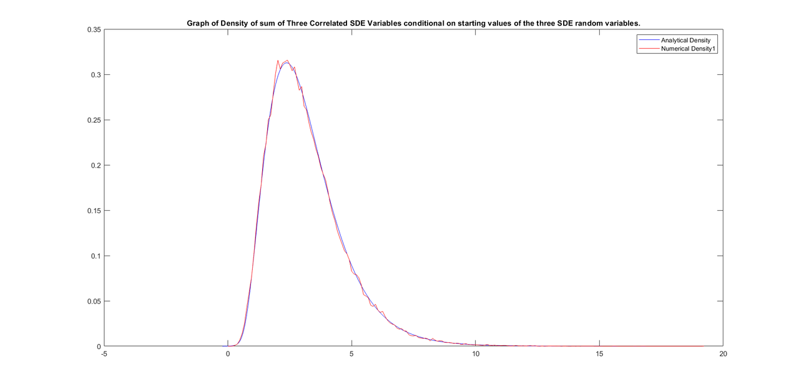](https://postimg.cc/p92qqdq8)

[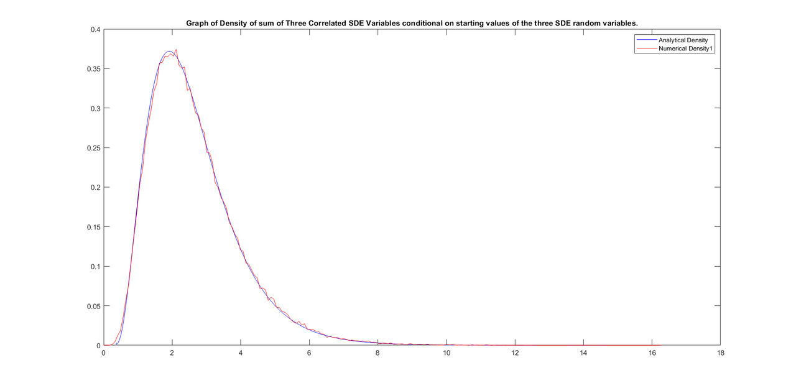](https://postimg.cc/3yKnnwnD)

[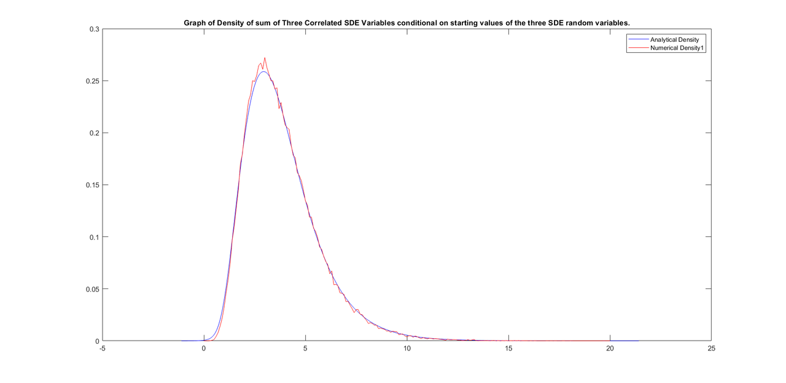](https://postimg.cc/LqNv7Mb8)

[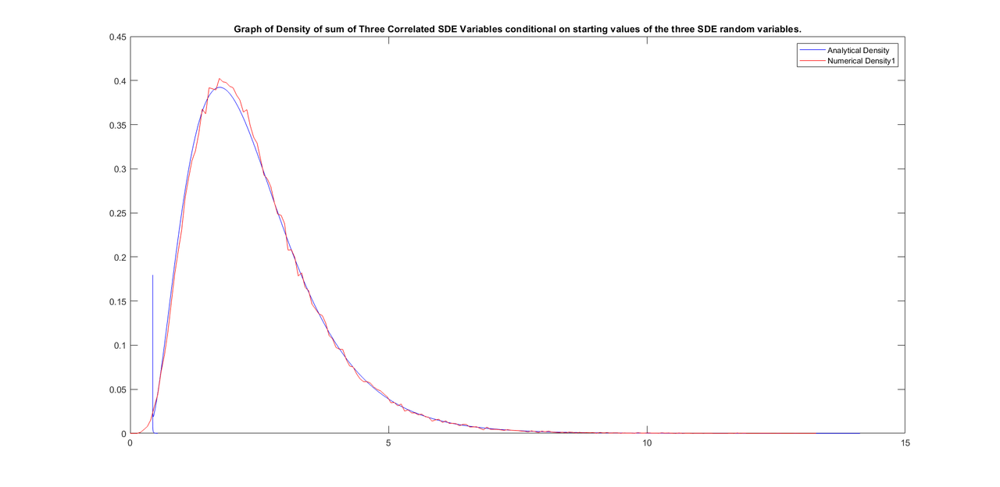](https://postimg.cc/d7q4404C)

.

.

Correlation Scenario 2:

.

Corr1(1,1)=1;

Corr1(1,2)=.7/3;

Corr1(1,3)=.8/3;

Corr1(2,2)=1;

Corr1(2,1)=.7/3;

Corr1(2,3)=.5/3;

Corr1(3,1)=.8/3;

Corr1(3,2)=.5/3;

Corr1(3,3)=1;

.

.

[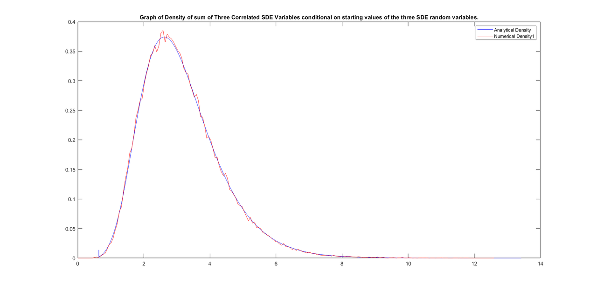](https://postimg.cc/G84P5TYL)

[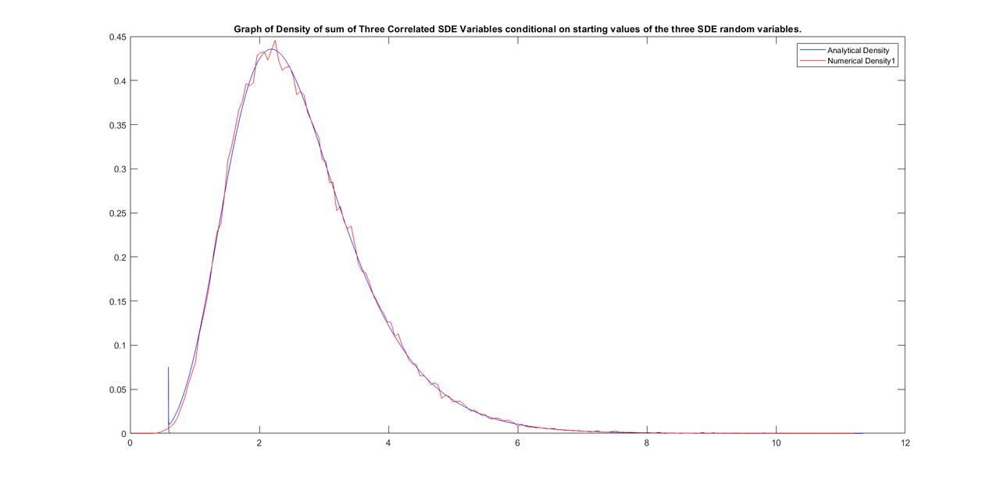](https://postimg.cc/FdYbBkc9)

[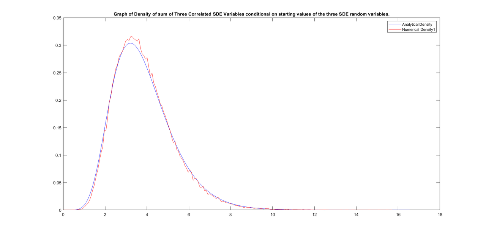](https://postimg.cc/7G51WJ7w)

[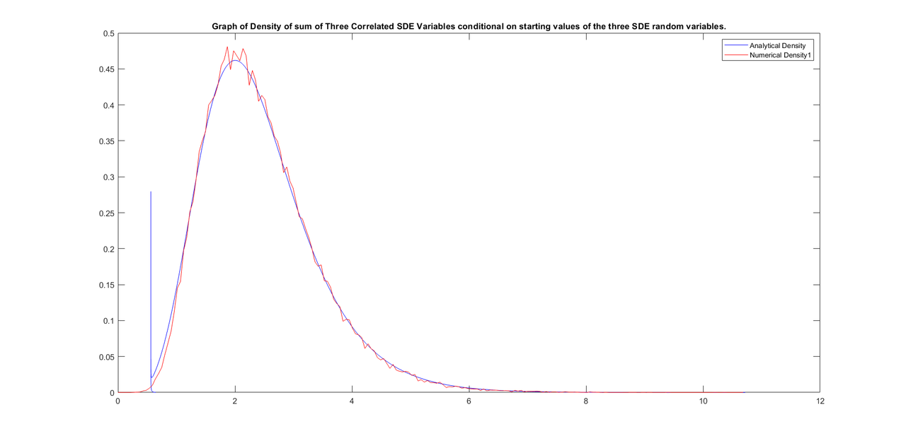](https://postimg.cc/Q9FgyK5j)

.

.

Correlation Scenario 3:

.

.

Corr1(1,1)=1;

Corr1(1,2)=-.7/3;

Corr1(1,3)=.8/3;

Corr1(2,2)=1;

Corr1(2,1)=-.7/3;

Corr1(2,3)=-.5/3;

Corr1(3,1)=.8/3;

Corr1(3,2)=-.5/3;

Corr1(3,3)=1;

.

.

[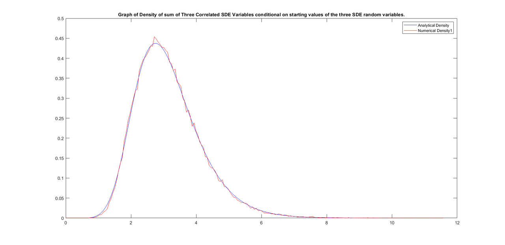](https://postimg.cc/XZzddNPP)

[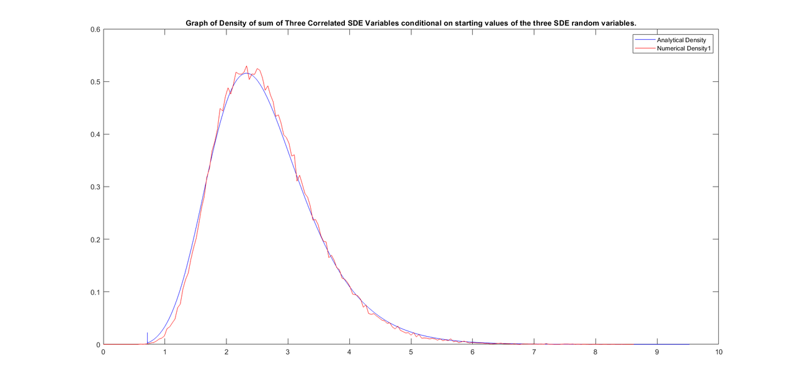](https://postimg.cc/SXvCCQP1)

[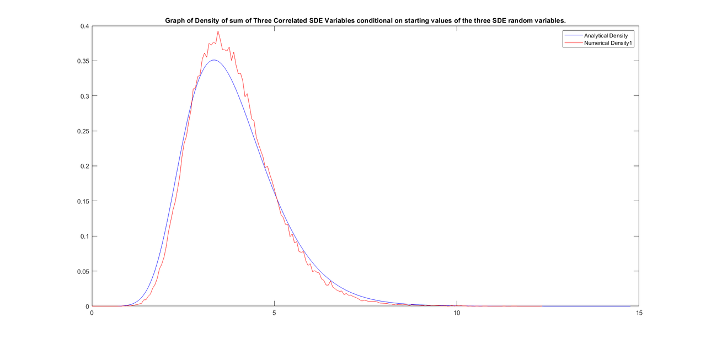](https://postimg.cc/B8VHHZzV)

[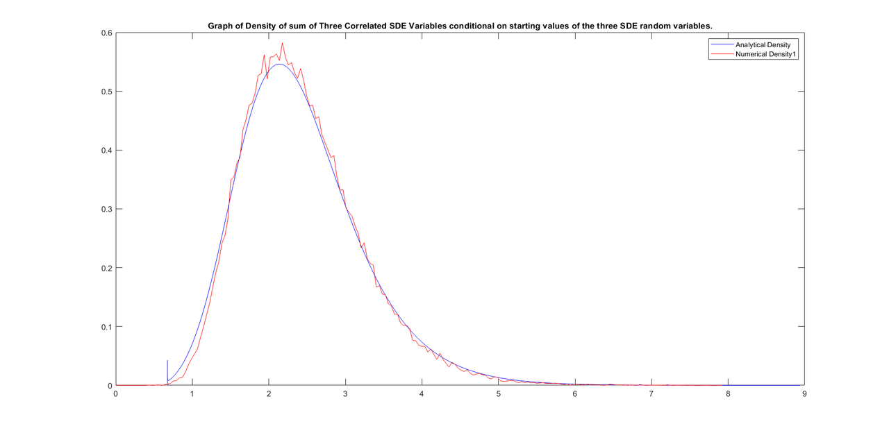](https://postimg.cc/3ycmmrqb)

.

.

Correlation Scenario 4:

Corr1(1,1)=1;

Corr1(1,2)=-.27;

Corr1(1,3)=-.28;

Corr1(2,2)=1;

Corr1(2,1)=-.27;

Corr1(2,3)=-.15;

Corr1(3,1)=-.28;

Corr1(3,2)=-.15;

Corr1(3,3)=1;

.

.

[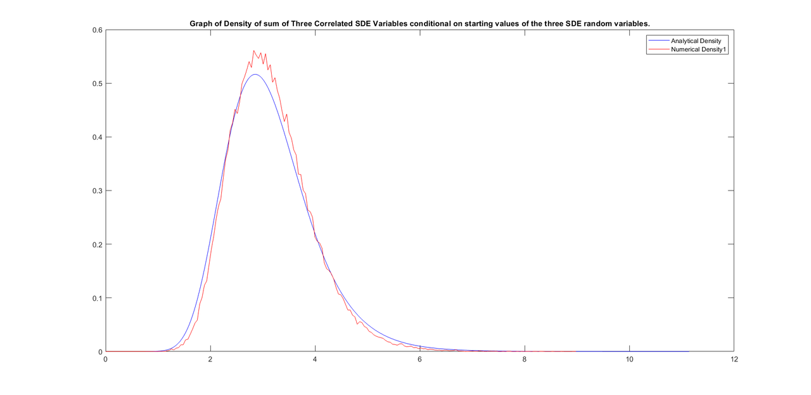](https://postimg.cc/WDCqtWFR)

[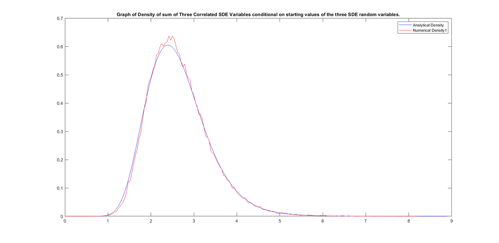](https://postimg.cc/wtZR3ftS)

[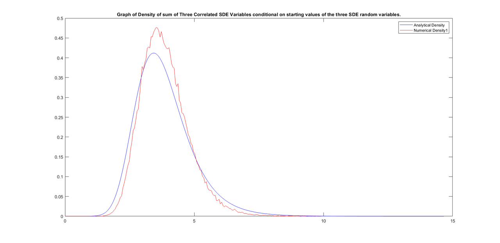](https://postimg.cc/jWmnCgwY)

[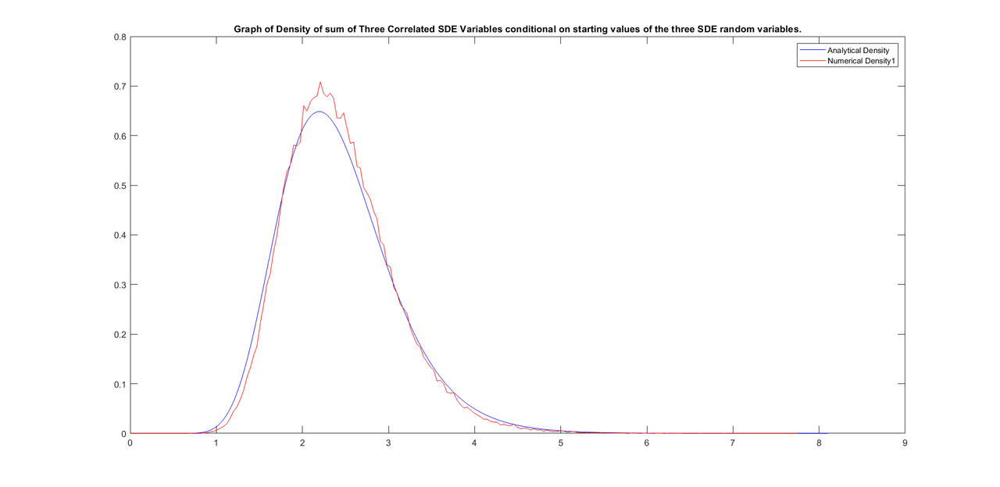](https://postimg.cc/gwQLrSwC)

Correlation Scenario 5:

Zero Correlations.

[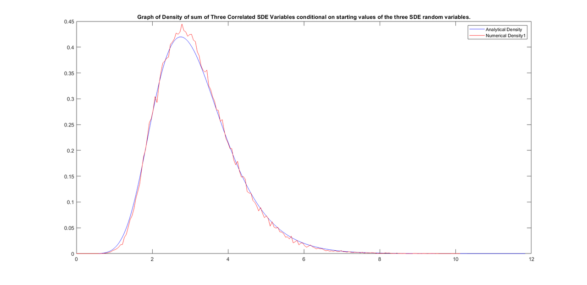](https://postimg.cc/xJL880Vg)

[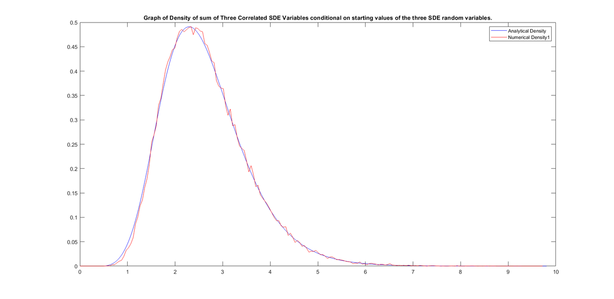](https://postimg.cc/bD1rrzfT)

[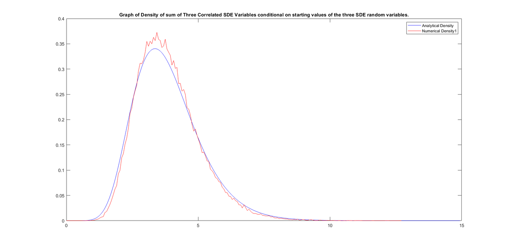](https://postimg.cc/CBb55FpC)

[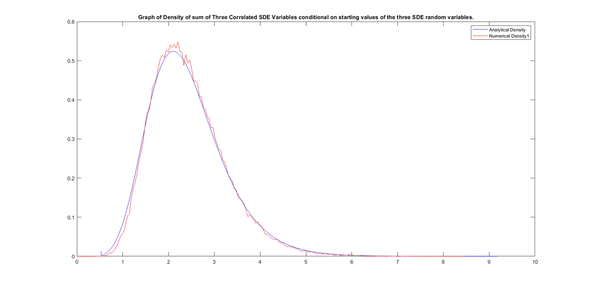](https://postimg.cc/9Ry00WHJ)

---

### #3154 — Amin (Topic Author)
*June 17, 2026, 2:44 PM*

Friends, sorry for delay in posting the program used to create graphs in previous post. Here it is. I have put all the
four conditional starting scenarios in a single loop so program optimizes for the correlation coefficients once and then
solves for conditional density in all four starting point scenarios in a single loop. Here is the program.

.

.

.

```
function []= ConditionalDensityHermitesNvariateNewtonCondLoop()

%SV SDE is
%dV(t)=mu1 V(t)^beta1 dt+ mu2 V(t)^beta2 dt + sigma0 V(t)^gamma dZ(t)
%In mean reverting SDEs we ususally have
%mu1= kappaV * thetaV
%beta1=0
%mu2=-kappa
%beta2=0
%The present program works only when drift is zero (for pure noises)
%meaning mu1=0 and mu2=0;

Order=7;
%NDim=4;%Three assets and one SV.
%NMomentsY=Order+1;
%NMomentsX=Order+1;

%%%%%%%%%%%%%%%%%%%5
dt=.03125/2/8;
Tt=64*2*8;
T=Tt*dt;
seed0=12130649;
%seed0=94210876;
%seed0=14210876;
%seed0=53612297
seed0=97459782
rng(seed0, 'twister')
paths=100000;
TT1=100*8/2; %Transition distribution start
TT2=256*8/2; %Transition distribution end

%%%%%%%%%%%%%%%%%%%5

NDims=3;
%
V0(1)=1.000;%.32;
V00(1)=V0(1);

%SDE1
 thetaV(1)=1.0;%.045;%1;%.04;
 kappaV(1)=0.000;%1.5;%1.5;
 gamma(1)=.75;%.75
 sigma0(1)=.5;%.35

%SDE2%
%thetaV(1)=.90;%.045;%1;%.04;
%kappaV(1)=1.000;%1.5;%1.5;
%gamma(1)=.75;%.75
%sigma0(1)=.85;%.35

%SDE3%
%thetaV(1)=1.350;%.045;%1;%.04;
%kappaV(1)=2.000;%1.5;%1.5;
%gamma(1)=.75;%.75
%sigma0(1)=.95;%.35

mu1(1)=kappaV(1)*thetaV(1);
mu2(1)=-kappaV(1);
beta1(1)=0;
beta2(1)=1;

V0(2)=1.000;%.32;
V00(2)=V0(2);

%SDE1
thetaV(2)=1.0;%.045;%1;%.04;
 kappaV(2)=0.000;%1.5;%1.5;
 gamma(2)=.85;%.75
 sigma0(2)=.5;%.35

%SDE2
% thetaV(2)=1.0;%.045;%1;%.04;
% kappaV(2)=2.000;%1.5;%1.5;
% gamma(2)=.65;%.75
% sigma0(2)=.95;%.35

%SDE3
%thetaV(2)=.850;%.045;%1;%.04;
%kappaV(2)=.35000;%1.5;%1.5;
%gamma(2)=.65;%.75
%sigma0(2)=.55;%.35

mu1(2)=kappaV(2)*thetaV(2);
mu2(2)=-kappaV(2);
beta1(2)=0;
beta2(2)=1;

V0(3)=1.000;%.33;
V00(3)=V0(3);

%SDE1
thetaV(3)=1.0;%.045;%1;%.04;
 kappaV(3)=0.000;%1.5;%1.5;
 gamma(3)=.95;%.75
 sigma0(3)=.45;%.35

%SDE2
% thetaV(3)=.750;%.045;%1;%.04;
% kappaV(3)=0.5000;%1.5;%1.5;
% gamma(3)=.95;%.75
% sigma0(3)=.45;%.35

%SDE3
%thetaV(3)=1.150;%.045;%1;%.04;
%kappaV(3)=1.5000;%1.5;%1.5;
%gamma(3)=.95;%.75
%sigma0(3)=.75;%.35

mu1(3)=kappaV(3)*thetaV(3);
mu2(3)=-kappaV(3);
beta1(3)=0;
beta2(3)=1;

Corr1(1,1)=1;
Corr1(1,2)=.7;
Corr1(1,3)=.8;
Corr1(2,2)=1;
Corr1(2,1)=.7;
Corr1(2,3)=.5;
Corr1(3,1)=.8;
Corr1(3,2)=.5;
Corr1(3,3)=1;
%
% % % Was very good.
Corr1(1,1)=1;
Corr1(1,2)=.7/3;
Corr1(1,3)=.8/3;
Corr1(2,2)=1;
Corr1(2,1)=.7/3;
Corr1(2,3)=.5/3;
Corr1(3,1)=.8/3;
Corr1(3,2)=.5/3;
Corr1(3,3)=1;
% % % % % % %
% % % % % % %
% % % % % %
% Corr1(1,1)=1;
% Corr1(1,2)=-.7/3;
% Corr1(1,3)=.8/3;
% Corr1(2,2)=1;
% Corr1(2,1)=-.7/3;
% Corr1(2,3)=-.5/3;
% Corr1(3,1)=.8/3;
% Corr1(3,2)=-.5/3;
% Corr1(3,3)=1;
% % %
% % %
% % %
% Corr1(1,1)=1;
% Corr1(1,2)=-.27;
% Corr1(1,3)=-.28;
% Corr1(2,2)=1;
% Corr1(2,1)=-.27;
% Corr1(2,3)=-.15;
% Corr1(3,1)=-.28;
% Corr1(3,2)=-.15;
% Corr1(3,3)=1;
%87%Corr1(1:3,1:3)=0.0;

R=chol(Corr1);
%
%  R(1:3,1:3)=0;
%  R(1,1)=1;
%  R(2,2)=1;
%  R(3,3)=1;

V0(4)=1.000;%.44;
V00(4)=V0(4);
thetaV(4)=1.0;%.045;%1;%.04;
kappaV(4)=1.000;%1.5;%1.5;
mu1(4)=kappaV(4)*thetaV(4);
mu2(4)=-kappaV(4);
beta1(4)=0;
beta2(4)=1;
gamma(4)=.95;%.75
sigma0(4)=.55;%.45

%%%%%%%%%%%%%%%%%%%%%%%%%%%%%%%%%%%%%%%%%%%%%%%%%%%%%%%%%%%%%%%%%%%%%5
for nn=1:NDims
V(1:paths,nn)=V0(nn);
Threshold(nn)=(sigma0(nn)*sqrt(dt)*2)^(1/(1-gamma(nn)));
end
%V(1:paths,1:NDims)=V0(1,1:NDims);

Random1(1:paths/2,1:NDims)=0;

for tt=1:Tt

    Random2(1:paths/2,1:NDims)=randn(size(Random1));
    Random2(paths/2+1:paths,1:NDims)=-Random2(1:paths/2,1:NDims);

    %Random2=R'*Random2;
    random1=Random2*R(:,1);
    random2=Random2*R(:,2);
    random3=Random2*R(:,3);

    Random2(:,1)=random1;
    Random2(:,2)=random2;
    Random2(:,3)=random3;

    %Random2(V(:,=nn2))
%         ss=ss+1;
%         Zxx0(ss)= CalculateZgivenXAndHSeriesCoeffs(V10(nn1).*V10(nn2),X2CoeffH(1:Order+1,ss),Order);
%         end
%     end
% end

%%%%%%%%%%%%%%%%%%%%%%%%%%%%%%%%%%%%%%%%%%%%%%%%%%%%%%%%%%%%%%%%%%%55

WW(1,1:Order+1)=EvalHermiteArrayH0(Zx0(1),Order);
for mm=2:NDims
    WW(1,(mm-1)*Order+2:mm*Order+1)=EvalHermiteArrayH1(Zx0(mm),Order);
end

     YProjected=0.0;
    for mm=1:NDims*Order+1
    YProjected=YProjected+WW(1,mm).*CoeffR(mm,1);

    end

% WW(1,1:Order+1)=EvalHermiteArrayH0(Zxx0(1),Order);
% for mm=2:SS
%     WW(1,(mm-1)*Order+2:mm*Order+1)=EvalHermiteArrayH1(Zxx0(mm),Order);
% end
%
%      Y2Projected=0.0;
%     for mm=1:SS*Order+1
%     Y2Projected=Y2Projected+WW(1,mm).*Coeff2R(mm,1);
%     end

% XX(1:paths,1:NDims)=Xin(1:paths,1:NDims);
% ss=NDim;
% for nn1=1:NDims
%     for nn2=1:NDims
%         ss=ss+1;
%         XX(1:paths,ss)=Xin(1:paths,nn1).*Xin(1:paths,nn2);
%     end
% end
% SS=ss;
%
% [Coeff2R,XCoeff2H,ZI] = RegressYOnX(Yin.^2,XXin,paths,NDims,Order);
%

%%%%%%%%%%%%%%%%%%%%%%%%%%%%%%%%%%%%%%%%%%%%%%%%%%%%%%%%%%%%%%%%%%%%%%%%%%%%%%%55
Zx(1:Order)=0;

for hh=1:Order
    for nn=1:NDims
        %Zx(hh) = Zx(hh) + bnv(nn+1,hh+1).^1.*Zx0(nn);
        Zx(hh) = Zx(hh) + cn(nn,hh).^1.*Zx0(nn);
    end
end

bh0=YCoeffH(1);

[W] = EvalHermiteArrayH0(Zx0,Order);

for hh=1:Order
    for nn=1:NDims
        bh0 = bh0 + ch(nn+1,hh+1).^1.*W(nn,hh+1);
    end
end
bh00=bh0;

%%%%%%%%%%%%%%%%%%%%%%%%%%%%%%%%%%%%%%%%%%%%%%%%%%%%%%%%%%%%%%%%

a0=YCoeffZ(1);
a1=YCoeffZ(2);
a2=YCoeffZ(3);
a3=YCoeffZ(4);
a4=YCoeffZ(5);
a5=YCoeffZ(6);
a6=YCoeffZ(7);
a7=YCoeffZ(8);

d1=cn(4,1);
d2=cn(4,2);
d3=cn(4,3);
d4=cn(4,4);
d5=cn(4,5);
d6=cn(4,6);
d7=cn(4,7);

%b0=(a0+a1.* Zx(1) +a2.* Zx(2).^2+a3.* Zx(3).^3+a4* Zx(4).^4+a5 *Zx(5).^5+a6* Zx(6).^6+a7* Zx(7).^7);
b1=(a1* d1+2* a2* Zx(2)* d2 +3* a3* Zx(3).^2* d3+4* a4* Zx(4).^3* d4+5* a5* Zx(5).^4* d5+6* a6* Zx(6).^5* d6+7* a7*
Zx(7).^6* d7);
b2=(a2* d2.^2+3* a3* Zx(3)* d3^2 +6* a4* Zx(4).^2* d4^2+10* a5* Zx(5).^3* d5^2+15* a6* Zx(6).^4* d6^2+21* a7* Zx(7).^5*
d7^2);
b3=(a3* d3^3+4* a4 *Zx(4)* d4^3 +10* a5* Zx(5).^2* d5^3+20* a6* Zx(6).^3* d6^3+35* a7* Zx(7).^4* d7^3);
b4=(a4* d4^4+5* a5* Zx(5)* d5^4 +15* a6 *Zx(6).^2* d6^4+35* a7* Zx(7).^3 *d7^4);
b5=(a5* d5^5+6* a6* Zx(6)* d6^5 +21* a7 *Zx(7).^2* d7^5);
b6=(a6* d6^6+7* a7* Zx(7)* d7^6 );
b7=(a7* d7^7);

%bh0=b0+b2+3*b4+15*b6;
bh1=b1+3*b3+15*b5+105*b7;
bh2=b2+6*b4+45*b6;
bh3=b3+10*b5+105*b7;
bh4=b4+15*b6;
bh5=b5+21*b7;
bh6=b6;
bh7=b7;

bh(1)=YProjected;
bh(2)=bh1;
bh(3)=bh2;
bh(4)=bh3;
bh(5)=bh4;
bh(6)=bh5;
bh(7)=bh6;
bh(8)=bh7;

YCentralMoment2=0;
for nn=1:Order
    YCentralMoment2=YCentralMoment2+bh(nn+1).^2*factorial(nn);
end

%bh(2:Order+1)=bh(2:Order+1).*sqrt(Y2Projected-YProjected.^2)/sqrt(YCentralMoment2);

bh(2:Order+1)=bh(2:Order+1).*YProjected/bh0;

%%%%%%%%%%%%%%%%%%%%%%%%%%%%%%%%%%%%%%%%%%%%%%%%%%%%%%%%%%%%%%%%%%%%%%%%%%%%%%5

YCoeffz(1:Order+1)= ConvertHermiteSeriesToZSeries01(bh(1:Order+1),Order);

[YMomentsModel]=CalculateMomentsOfZSeries(YCoeffz(1),YCoeffz(2:Order+1),Order,Order+1);

YMomentsModel

DataMoments

str=input("Look at comparison of moments");

[cMu1,YCentralMoments]=ConvertRawMomentsToCentralMoments(YMomentsModel,Order+1);
[cMu2,DataCentralMoments]=ConvertRawMomentsToCentralMoments(DataMoments,Order+1);

YCentralMoments

DataCentralMoments

bh00
YProjected
str=input("Look at central moments");

clf;

PlotZSeriesDensity(YCoeffz(1),YCoeffz(2:Order+1),'b')

hold on

plot(IndexOut(1:IndexMax),XDensity(1:IndexMax),'r');

%PlotHermiteSeriesDensityAndRvGraph(YCoeffh(1),YCoeffh1(2:yOrder+1),'g')
title("Graph of Density of sum of Three Correlated SDE Variables conditional on starting values of the three SDE random
variables.")
%title(sprintf('V00 = %.3f; kappa=%.3f, theta=%.3f,gamma=%.3f,sigma=%.3f;V10=%.3f at TT1=%.3f;TT2=%.3f;Paths=%d ',V00,
kappaV, thetaV,gamma,sigma0, V10,(TT1*dt),(TT2*dt),paths));%,sprintf('theta= %f', theta), sprintf('kappa = %f',
kappa),sprintf('sigma = %f', sigma0),sprintf('T = %f', T));
legend({'Analytical Density','Numerical Density1'}, ...
    'Location','northeast')
kk
str=input("This is the first version without altering the moments of conditional density")

hold off

end

end
```

.

.

.

.

.

```
function [BetaCorrH,YCoeffH,XCoeffH,HCorrXX,Zy,Zx] = CalculateHermiteCorrelations0NA04(Xin,Yin,NData,NDims)

%This program finds required correlations between NDims explanatory
%variables given in Xin that has NDims dimensionality. Yin is variable
%being explained and is one-diemsnional.

Order=7;
NMoments=8;

[ZI] = MomentMatchedStandardNormalDiscretizedDensity(NData);

%
% for nn=1:NDims
% [XCoeffH(1:Order+1,nn),Zx(1:NData,nn)] = CalculateHermiteSeriesFromData02(Xin(1:NData,nn),Order,ZI);
%
% %[Zx(1:NData,nn)] = CalculateZgivenXAndHSeriesCoeffs(Xin(1:NData,nn),XCoeffH(1:Order+1,nn),Order);
%
% end

for nn=1:NDims

 for pp=1:Order+1
     XrMu(pp,nn)=sum(Xin(1:NData,nn).^pp)/NData;
 end
 XinSorted(:,nn)=sort(Xin(:,nn));
 XDataMedian(nn)=((XinSorted(NData/2,nn)+XinSorted(NData/2+1,nn))+(XinSorted(NData/2-1,nn)+XinSorted(NData/2+2,nn)) ...
     +XinSorted(NData/2-2,nn)+XinSorted(NData/2+3,nn))/6;
 %XDataMedian(nn)=(Xin(NData/2-2,nn)+Xin(NData/2-1,nn)+Xin(NData/2,nn)+Xin(NData/2+1,nn)+Xin(NData/2+2,nn)+Xin(NData/2+3,nn))/6;
 [c0(nn),c(1:Order,nn),FittedMoments,Zx1(:,nn)] =
CalculateZSeriesDensityFromRawMoments02FromGuess02W(Xin(1:NData,nn),ZI);%,XCoeffZ(2:Order+1));
 %[c0(nn),c(1:Order,nn),FittedMoments] =
ZSeriesCoeffsFromMomentsIterWithMedian(XrMu(:,nn),XDataMedian(nn));%,SeriesOrder,NMoments,Iterations)
nn
str=input("Look at data results");
 XCoeffZ(1,nn)=c0(nn);
 XCoeffZ(2:Order+1,nn)=c(1:Order,nn);

  XCoeffZ
  XDataMedian
  str=input("Look at XCoeffZ");
[XCoeffH(1:Order+1,nn)] = ConvertZSeriesToHermiteSeriesNew(XCoeffZ(1:Order+1,nn),Order);

[Zx(:,nn)] = CalculateZgivenXAndHSeriesCoeffs(Xin(:,nn),XCoeffH(1:Order+1,nn),Order);

for mm=1:8
    rMu(mm)=sum(Zx(1:NData,nn).^mm)/NData;
end

rMu

sum((Zx1(:,nn)-Zx(:,nn)).^2)/NData
str=input("Look at moments of Z in correlations calculation function");

end

 for pp=1:Order+1
     YrMu(pp)=sum(Yin(1:NData).^pp)/NData;
 end
 %YDataMedian=(Yin(NData/2)+Yin(NData/2+1))/2;
 YDataMedian=(Yin(NData/2-2)+Yin(NData/2-1)+Yin(NData/2)+Yin(NData/2+1)+Yin(NData/2+2)+Yin(NData/2+3))/6;

 %[c0,c(1:Order),FittedMoments] = ZSeriesCoeffsFromMomentsIterWithMedian(YrMu(:),YDataMedian);
 [c0,c(1:Order),FittedMoments,Zy] =
CalculateZSeriesDensityFromRawMoments02FromGuess02W(Yin(1:NData),ZI);%,XCoeffZ(2:Order+1));

str=input("Look at data results ofY");
 YCoeffZ(1)=c0;
 YCoeffZ(2:Order+1)=c(1:Order);

 [YCoeffH(1:Order+1)] = ConvertZSeriesToHermiteSeriesNew(YCoeffZ(1:Order+1),Order);
 %ConvertZSeriesToHermiteSeriesNew

%[Zy(:)] = CalculateZgivenXAndHSeriesCoeffs(Yin(:),YCoeffH(1:Order+1),Order);

%[YCoeffH,Zy] = CalculateHermiteSeriesFromData02(Yin,Order,ZI);
% %[Zy] = CalculateZgivenXAndHSeriesCoeffs(Yin,YCoeffH,Order);

for nn1=1:NDims
    for nn2=1:NDims
        if(nn1==nn2)
            HCorrXX(nn1,nn2,1:Order)=1.0;
        else
            HCorrXX(nn1,nn2,1:Order) =
CalculateCorrelationBivariateHermiteCH1(Zx(1:NData,nn1),Zx(1:NData,nn2),NData,Order);
        end
    end
end
for nn1=1:NDims
    HCorrXX(nn1,nn1,1:Order)=1.0;
end

% for hh=1:Order
%     for nn1=1:NDims
%         HCorrXX
%         ss2=0;
%         for nn2=1:NDims
%             if(nn2~=nn1)
%                 ss2=ss2+1;
%                 ss3=0;
%                 for nn3=1:NDims
%                     if(nn3~=nn1)
%                         ss3=ss3+1;
%                             HCorrXXmn(ss2,ss3)=HCorrXX(nn2,nn3,hh);
%                     end
%                     HCorrXmXn(ss2,1)=HCorrXX(nn1,nn2,hh);
%                 end
%             end
%         end
%         BetaCorrXX(1:NDims-1,nn1,hh)=HCorrXXmn(:,:)\HCorrXmXn(1:NDims-1,1);
%
%     end
%
%     BetaCorrXX
%
%     nn1
%
%         str=input("Look at important variables");
%
% end
% BetaCorrXX
% str=input("look at the BetacorrXX");
% for nn1=1:NDims
%     for nn2=1:NDims-1
%         if(nn2<nn1)
%     BetaCorrXX0(nn2,nn1,1:Order)=BetaCorrXX(nn2,nn1,1:Order);
%         elseif(nn2==nn1)
%                % BetaCorrXX0(nn2,nn1,1:Order)=1;
%
%             BetaCorrXX0(nn2+1:NDims,nn1,1:Order)=BetaCorrXX(nn2:NDims-1,nn1,1:Order);
%         end
%     end
%     BetaCorrXX0(nn1,nn1,1:Order)=1;
% end
% BetaCorrXX
% BetaCorrXX0

%
% % % % str=input("Look at BetaCorrXX pairs");
% % % % for hh=1:Order
% % % %     for nn1=1:NDims
% % % %         for nn2=1:NDims-1
% % % %             BetaCorrXXn(nn1,nn2,hh)=sign(BetaCorrXXn(nn1,nn2,hh)).*(abs(BetaCorrXXn(nn1,nn2,hh))).^(1/hh);
% % % %         end
% % % %     end
% % % % end

for nn1=1:NDims
    HCorrXY(nn1,1:Order) = CalculateCorrelationBivariateHermiteCH1(Zx(1:NData,nn1),Zy(1:NData),NData,Order);
end

for hh=1:Order
    [BCorrXY(:,hh),Is(:,hh)]=sort(HCorrXY(:,hh),'descend');
end

for hh=1:Order
    CorrXX(1:NDims,1:NDims)=HCorrXX(Is(1:NDims,hh),Is(1:NDims,hh),hh);
    CorrXY(1:NDims,1)=HCorrXY(Is(1:NDims,hh),hh);
    BetaCorr0(1:NDims)=CorrXX\CorrXY;
    BetaCorrH(Is(1:NDims,hh),hh)=BetaCorr0(1:NDims);
end

%HCorrXX=BetaCorrXX0;
%HCorrXX
str=input("Look at HCOrrXX");

% for hh=1:Order
%     CorrXX(1:NDims,1:NDims)=HCorrXX(1:NDims,1:NDims,hh);
%     CorrXY(1:NDims,1)=HCorrXY(1:NDims,hh);
%     BetaCorrH(1:NDims,hh)=CorrXX\CorrXY;
% end

%CorrXX1st(1:NDims,1:NDims)=HCorrXX(1:NDims,1:NDims,1)

%BetaCorrH(:,1)'*CorrXX

%CorrXY

%HCorrXX

%HCorrXY

BetaCorrH

str=input("Look at BetaCorrH");
end
```

.

.

.

```
function [c0,c,FittedMoments,Zx] = CalculateZSeriesDensityFromRawMoments02FromGuess02W(Xin,ZI)
%The above function takes data as input.
%And returns Z-series Coeffs upto 7th power of Z as
%Y=c0+c(1)*Z+c(2)*Z^2+c(3)*Z^3+c(4)*Z^4+c(5)*Z^5+c(6)*Z^6+c(7)*Z^7
%Fitted Moments are raw moments of the Z-series density and usually are exactly
%the same as input raw moments rMu(1:8).i.e  FittedMoments(1:8)==rMu(1:8)
%with high precision.

Ndata=length(Xin);

%%%%%%%%%%%%%%%%%%%%%%%%%%%%%%%%%%%%%%%%%%%%%%%%%%%%%%%%%%%%%%%%%%%%%%%%%%%%%%5

for mm=1:8
    rMu(mm)=sum(Xin(:).^mm)/Ndata;
end

for nn=1:Ndata
    Xs(nn)=(Xin(nn)-rMu(1))./sqrt(rMu(2)-rMu(1).^2);
end

for mm=1:8
    sMu1(mm)=sum(Xs(:).^mm)/Ndata;
end

Xsorted=sort(Xs);

StandardizedMedian=(Xsorted(Ndata/2)+Xsorted(Ndata/2+1))/2;

%%%%%%%%%%%%%%%%%%%%%%%%%%%%%%%%%%%%%%%%%%%%%%%%%%%%%%%%%%%%%%%%%%%%%%%%%%%%%%5
SeriesOrder=7;    %Z-series till 7th power. hardcoded here cannot chagne.
mOrder=8;         %Number of raw moments in calibration. hardcoded here cannot chagne.
Order=7;
NMoments=mOrder;
                  %Find central Moments from raw moments
[Mu1,cMu] = ConvertRawMomentsToCentralMoments(rMu,mOrder);
                  %Find standardized Moments from central moments
sMu(1)=0;
sMu(2)=1;
sMu(3)=cMu(3)/cMu(2).^1.5;
sMu(4)=cMu(4)/cMu(2).^2.0;
sMu(5)=cMu(5)/cMu(2).^2.5;
sMu(6)=cMu(6)/cMu(2).^3.0;
sMu(7)=cMu(7)/cMu(2).^3.5;
sMu(8)=cMu(8)/cMu(2).^4.0;

%sMu
%sMu1

%str=input("Look at comparison of standardized moments:");

%[cGuess,Zx] = CalculateHermiteSeriesFromData02(Xs,Order,ZI);
[cGuess,Zx] = CalculateZSeriesFromData02GivenMedian(Xs,Order,ZI);

wm(1:Order+1)=1;
for mm=Order+1:-1:2
    wm(mm-1)=wm(mm)*(mm+1).^2;
end

MaxIter=750;

%[cGuess,ObjBest] = ZSeries1DCoeffsIterativeForGuess(cGuess,sMu,Order,MaxIter,wm);
%[cGuess(1),cGuess(2:8),FittedMoments] = ZSeriesCoeffsFromMomentsIterWithMedian02(rMu,DataMedian)

[cGuess,ObjBest] = ZSeries1DCoeffsIterativeForGuessMedianW(cGuess,sMu,Order,MaxIter,wm,StandardizedMedian);

                  %Please experiment and play around.
bGuess(1:7)=cGuess(2:8);    %We have assigned initial values of coefficients

c0=-(bGuess(2)+3*bGuess(4)+15*bGuess(6));
c(1:7)=bGuess(1:7);

%%%%%%%%%%%%%%%%%%%%%%%%%%%%%%%%%%%%%%%%%%%%%%%%%%%%%%%%%%%%%%%%%

%Make sure you do not comment the lines below

c0=c0*sqrt(cMu(2)); %convert from standardized to central moments
c=c*sqrt(cMu(2));   %convert from standardized to central moments

c0=c0+Mu1;          %convert from central to raw moments by adding mean.

[FittedMoments] = CalculateMomentsOfZSeries(c0,c,SeriesOrder,NMoments);
%%%%%%%%%%%%%%%%%%%%%%%%%%%%%%%%%%%%%%%%%%%%%%%%%%%%%%%%%%%%%%%%%%%%%%%%%%%%%%%%%%%%%%%%%%%%%%
%Please Uncomment this if you want to see a comparison of input moments and
%fitted moments
rMu
FittedMoments
str=input('Look at comparison of fitted moments with input moments: Warning: Large Mismatch implies that many results
would be off');
%%%%%%%%%%%%%%%%%%%%%%%%%%%%%%%%%%%%%%%%%%%%%%%%%%%%%%%%%%%%%%%%%%%%%%%%%%%%%%%%%%%%%%%%%%%%%5
%COMMENT lines below if you do not want to see the density of new Z-series random variable with
%fitted moments.
%First calculate normal random variable on a grid below
dNn=.1/2;   % Normal density subdivisions width. would change with number of subdivisions
Nn=45*4;  % No of normal density subdivisions
NnMid=((1+Nn)/2)*dNn;
Z(1:Nn)=(((1:Nn)*dNn)-NnMid);
%Z
%str=input('Look at Z');
%Now calculate Y as a function of normal random variable.
Y(1:Nn)=c0;
for nn=1:7
    Y(1:Nn)=Y(1:Nn)+c(nn)*Z(1:Nn).^nn;
end

%Now take change of densities derivative of Y with respect to normal
DfY(1:Nn)=0;
for nn=2:Nn-1
    DfY(nn) = (Y(nn + 1) - Y(nn - 1))/(Z(nn + 1) - Z(nn - 1));
    %Change of variable derivative for densities
end
DfY(Nn)=DfY(Nn-1);
DfY(1)=DfY(2);

%Now calculate the density of Y from density of normal random variable
%using change of probability derivative.
pY(1:Nn)=0;
for nn = 1:Nn
    pY(nn) = (normpdf(Z(nn),0, 1))/abs(DfY(nn));
end

plot(Y(1:Nn),pY(1:Nn),'b');
title('Density of the Z-Series Variable with Fitted Moments');

str=input('Look at the density of Z-series random variable')
%%%%%%%%%%%%%%%%%%%%%%%%%%%%%%%%%%%%%%%%%%%%%%%%%%%%%%%%%%%%%%%%%%%%%%%%%%%%%%%%%%%%%%%%%%%%
end
```

.

.

.

.

```
function [Coeff,Zy] = CalculateZSeriesFromData02GivenMedian(Yin,Order,ZI)

Ndata=length(Yin);

MeanYin=sum(Yin(1:Ndata))/Ndata;
Ym(1:Ndata)=Yin(1:Ndata)-MeanYin;
YmVar=sum(Ym(1:Ndata).^2)/Ndata;
Y(1:Ndata)=Ym(1:Ndata)/sqrt(YmVar);

[Yss,I]=sort(Y(1:Ndata));

DataMedian=(Yss(Ndata/2)+Yss(Ndata/2+1))/2;

Ys=Yss-DataMedian;

for hh=1:Order
    W(1:Ndata,hh)=ZI(1:Ndata).^(hh);
end

Ymu(1:Ndata,1)=Ys(1:Ndata);

WW=(W'*W);

coeff=(WW)$W'*Ymu);

%Store in coefficietns array of all random varaibles
Coeff(2:Order+1)= coeff(1:Order,1);
Coeff(1)=DataMedian;
%Store the associated Z in Z-array of all coefficients.
Zy(I(1:Ndata))=W(1:Ndata,1);

Coeff(1:Order+1)=Coeff(1:Order+1).*sqrt(YmVar);
Coeff(1)=Coeff(1)+MeanYin;

clf;
PlotZSeriesDensity(Coeff(1),Coeff(2:Order+1),'r');
hold on

NoOfBins=150;
MaxCutOff=20;
[XDensity,IndexOut,IndexMax] = MakeDensityFromSimulation_Infiniti_NEW(Yin,Ndata,NoOfBins,MaxCutOff );
plot(IndexOut(1:IndexMax),XDensity(1:IndexMax),'b');

str=input("Look at comparison of Density");

end

```

.

.

.

```
function [YCoeffZ,ObjFunc] =
ZSeries1DCoeffsIterativeForGuessMedianW(YCoeffZ,TargetMoments,Order,MaxIter,w1D,TargetMedian)

%Order=5;
SeriesOrder=Order+1;
NMoments=Order+1;
MOrder=Order+1;

% for nn=1:SeriesOrder
%
%         DeltaX(nn)=.00125*2/factorial(nn+1);
% end
% DeltaXMax=DeltaX*10;

Dx=.0025;
DeltaX(1)=0.0;
DeltaX(2)=Dx;
DeltaX(4)=Dx/(33);
DeltaX(6)=Dx/(951);
DeltaX(8)=Dx/(23115);
DeltaX(3)=Dx*(6/35);
DeltaX(5)=Dx*(2/361);
DeltaX(7)=Dx*(2/9607);

[DeltaX0,DeltaX(1:7)]=ConvertHCoeffsToZCoeffs(0,DeltaX,Order);

DeltaXMax=DeltaX*1;

[FittedMoments] = CalculateMomentsOfZSeries(YCoeffZ(1),YCoeffZ(2:Order+1),SeriesOrder,NMoments);

FittedMedian=-(YCoeffZ(3)+3*YCoeffZ(5)+15*YCoeffZ(7));
[ObjFuncBest] = CalculateObjMomentWithMedian(TargetMoments,FittedMoments,TargetMedian,FittedMedian,w1D,MOrder);

ObjFunc1=0;
ObjFunc2=0;

ObjFuncBest
str=input("Look objFuncBest");
%cBest=c;

ImproveFlag(1:SeriesOrder)=1;
ImproveFlagPrev(1:SeriesOrder)=0;
ImproveCount(1:SeriesOrder)=0;
ContinueFlag=1;
kk=0;
%while ((kk.0001))
while ((ContinueFlag)&&(ObjFuncBest>.0001))
kk=kk+1;
    for nn=3:Order+1%SeriesOrder

            YCoeffZnew=YCoeffZ;

            [YCoeffHnew] = ConvertZSeriesToHermiteSeriesNew(YCoeffZnew,Order);
[YCoeffHnew] = FixTheHermiteSeriesDensity(YCoeffHnew,Order);
[YCoeffZnew(1:Order+1)] = ConvertHermiteSeriesToZSeries01(YCoeffHnew(1:Order+1),Order);

            FittedMedian=-(YCoeffZnew(3)+3*YCoeffZnew(5)+15*YCoeffZnew(7));
            YCoeffZnew(1)=-(YCoeffZnew(3)+3*YCoeffZnew(5)+15*YCoeffZnew(7));
            %[YCoeffZnew(1:Order+1)] = ConvertHermiteSeriesToZSeries01(YCoeffHnew(1:Order+1),Order);
            [FittedMoments] = CalculateMomentsOfZSeries(YCoeffZnew(1),YCoeffZnew(2:Order+1),SeriesOrder,NMoments);
            YCoeffZnew(:)=YCoeffZnew(:)./sqrt(FittedMoments(2));
            [FittedMoments] = CalculateMomentsOfZSeries(YCoeffZnew(1),YCoeffZnew(2:Order+1),SeriesOrder,NMoments);

            DoCalculations=0;
            if(FittedMoments(nn)abs(24/5*YCoeffHnew0(3)+503/5*YCoeffHnew0(5)+7360/5*YCoeffHnew0(7)))
               DFlag1=1;
   %         end

            end
 %DFlag1=1;
 DFlag2=1;
                if((DoCalculations)&&(ObjFunc1TargetMoments(nn))
                YCoeffZnew(nn)=YCoeffZnew(nn)-DeltaX(nn);
                DoCalculations=1;

            [YCoeffHnew] = ConvertZSeriesToHermiteSeriesNew(YCoeffZnew,Order);
[YCoeffHnew] = FixTheHermiteSeriesDensity(YCoeffHnew,Order);
[YCoeffZnew(1:Order+1)] = ConvertHermiteSeriesToZSeries01(YCoeffHnew(1:Order+1),Order);
            end

            DFlag1=0;
            if(DoCalculations)
            FittedMedian=-(YCoeffZnew(3)+3*YCoeffZnew(5)+15*YCoeffZnew(7));
            YCoeffZnew(1)=-(YCoeffZnew(3)+3*YCoeffZnew(5)+15*YCoeffZnew(7));
            %[YCoeffZnew(1:Order+1)] = ConvertHermiteSeriesToZSeries01(YCoeffHnew(1:Order+1),Order);
            [FittedMoments] = CalculateMomentsOfZSeries(YCoeffZnew(1),YCoeffZnew(2:Order+1),SeriesOrder,NMoments);
            YCoeffZnew(:)=YCoeffZnew(:)./sqrt(FittedMoments(2));
                   FittedMedian=-(YCoeffZnew(3)+3*YCoeffZnew(5)+15*YCoeffZnew(7));

            [FittedMoments] = CalculateMomentsOfZSeries(YCoeffZnew(1),YCoeffZnew(2:Order+1),SeriesOrder,NMoments);
            [ObjFunc2] = CalculateObjMomentWithMedian(TargetMoments,FittedMoments,TargetMedian,FittedMedian,w1D,MOrder);
             [YCoeffHnew0] = ConvertZSeriesToHermiteSeriesNew(YCoeffZnew,Order);

   %         
if(YCoeffHnew0(2)+22*YCoeffHnew0(4)+390*YCoeffHnew0(6)+5020*YCoeffHnew0(8)>abs(24/5*YCoeffHnew0(3)+503/5*YCoeffHnew0(5)+7360/5*YCoeffHnew0(7)))
               DFlag1=1;

            end

 %DFlag1=1;
 DFlag2=1;
                if((DoCalculations)&&(ObjFunc2DeltaXMax(nn))
           DeltaX(nn)=DeltaXMax(nn);
       end
    end

    ContinueFlag=(ContinueFlag || ImproveFlag(nn));

    if(kk<40)
        ContinueFlag=1;
    end

end

ObjFunc=ObjFuncBest;

end
```

.

.

.

.

```
function [cn,ch,CorrHxx] =
CalculateGaussianCorrelationFromHermiteCorrelationsNDimNew(YCoeffH,XCoeffH,BetaCorrHxy,CorrHxx,NDims,Order)

for hh=1:Order
    for nn=1:NDims
        ch(nn+1,hh+1)=BetaCorrHxy(nn,hh).*YCoeffH(hh+1);%make sure indices on all hermite-correlations match.check.
        %%%% nn+1 since 1st index would go to y-tilde.
    end
end

ch
YCoeffH

str=input("Look at above---00-1-1-1-1-");

[YCoeffZ(1:Order+1)] = ConvertHermiteSeriesToZSeries01(YCoeffH(1:Order+1),Order);

for nn=1:NDims
    [XCoeffZ(1:Order+1,nn)] = ConvertHermiteSeriesToZSeries01(XCoeffH(1:Order+1,nn),Order);
end

YCoeffH

YCoeffZ

str=input("Look at the Hermite and Z-series coeffs");

% YCoeffZA=YCoeffZ;
% YCoeffZ=YCoeffZA;
% if(abs(YCoeffZ(4))>abs(YCoeffZ(2)))
%    YCoeffZ(4)=sign(YCoeffZ(4)).*abs(YCoeffZ(2));
% end
% if(abs(YCoeffZ(6))>abs(YCoeffZ(4)))
%    YCoeffZ(6)=sign(YCoeffZ(6)).*abs(YCoeffZ(4));
% end
% if(abs(YCoeffZ(8))>abs(YCoeffZ(6)))
%    YCoeffZ(6)=sign(YCoeffZ(6)).*abs(YCoeffZ(8));
% end
%
%
% if(abs(YCoeffZ(5))>abs(YCoeffZ(3)))
%    YCoeffZ(5)=sign(YCoeffZ(5)).*abs(YCoeffZ(3));
% end
% if(abs(YCoeffZ(7))>abs(YCoeffZ(5)))
%    YCoeffZ(5)=sign(YCoeffZ(5)).*abs(YCoeffZ(7));
% end
%

for nn=1:NDims
[c(nn+1,1:Order+1)] = ConvertHermiteSeriesToZSeries01(ch(nn+1,1:Order+1),Order);
end

for nn=1:NDims
    rhoxy(nn+1,8)=sign(BetaCorrHxy(nn,7)).^1.*(abs(BetaCorrHxy(nn,7))).^(1/7);
    rhoxy(nn+1,7)=sign(BetaCorrHxy(nn,6)).^1.*(abs(BetaCorrHxy(nn,6))).^(1/6);
    rhoxy(nn+1,6)=sign(BetaCorrHxy(nn,5)).^1.*(abs( 
 (YCoeffH(6).*BetaCorrHxy(nn,5)-21*YCoeffZ(8).*rhoxy(nn+1,8).^(5))./(YCoeffH(6)-21*YCoeffZ(8)))).^(1/5);
    rhoxy(nn+1,5)=sign(BetaCorrHxy(nn,4)).^1.*(abs( 
(YCoeffH(5).*BetaCorrHxy(nn,4)-15*YCoeffZ(7).*rhoxy(nn+1,7).^(4))./(YCoeffH(5)-15*YCoeffZ(7)))).^(1/4);
    rhoxy(nn+1,4)=sign(BetaCorrHxy(nn,3)).^1.*(abs( 
(YCoeffH(4).*BetaCorrHxy(nn,3)-10*YCoeffZ(6).*rhoxy(nn+1,6).^(3)-105*YCoeffZ(8).*rhoxy(nn+1,8).^(3))...
        ./(YCoeffH(4)-10*YCoeffZ(6)-105*YCoeffZ(8)))).^(1/3);
    rhoxy(nn+1,3)=sign(BetaCorrHxy(nn,2)).^1.*(abs(
(YCoeffH(3).*BetaCorrHxy(nn,2)-6*YCoeffZ(5).*rhoxy(nn+1,5).^(2)-45*YCoeffZ(7).*rhoxy(nn+1,7).^(2)) ...
        ./(YCoeffH(3)-6*YCoeffZ(5)-45*YCoeffZ(7)))).^(1/2);
    rhoxy(nn+1,2)=sign(BetaCorrHxy(nn,1)).^0.*(( 
(YCoeffH(2).*BetaCorrHxy(nn,1)-3*YCoeffZ(4).*rhoxy(nn+1,4).^(1)-15*YCoeffZ(6).*rhoxy(nn+1,6).^(1) ...
        -105*YCoeffZ(8).*rhoxy(nn+1,8).^(1))...
        ./(YCoeffH(2)-3*YCoeffZ(4)-15*YCoeffZ(6)-105*YCoeffZ(8)))).^(1/1);

%    rhoxy(nn,2+1)=sign(4/9*BetaCorrHxy(nn,2)+1/36).*abs((4/9*BetaCorrHxy(nn,2)+1/36))^(.5);
%
rhoxy(nn,3+1)=sign((36/225*BetaCorrHxy(nn,3)-3/225*BetaCorrHxy(nn,1))).*(abs((36/225*BetaCorrHxy(nn,3)-3/225*BetaCorrHxy(nn,1))))^(1/3);
%
rhoxy(nn,4+1)=sign((144*4/(105)^2*BetaCorrHxy(nn,4)-6/105^2*(4*BetaCorrHxy(nn,2)+.25)-18/105^2)).*(abs(((144*4/(105)^2*BetaCorrHxy(nn,4)-6/105^2*(4*BetaCorrHxy(nn,2)+.25)-18/105^2))))^(1/4);
% rhoxy(nn,1+1)=BetaCorrHxy(nn,1);
end

%
for nn=1:NDims
    for mm=1:NDims
        if(nn==mm)
            rhoxx(nn,mm,2)=1;
            rhoxx(nn,mm,3)=1;
            rhoxx(nn,mm,4)=1;
            rhoxx(nn,mm,5)=1;
            rhoxx(nn,mm,6)=1;
            rhoxx(nn,mm,7)=1;
            rhoxx(nn,mm,8)=1;

        else
            rhoxx(nn,mm,8)=sign(CorrHxx(nn,mm,7)).*(abs(CorrHxx(nn,mm,7))).^(1/7);
            rhoxx(nn,mm,7)=sign(CorrHxx(nn,mm,6)).*(abs(CorrHxx(nn,mm,6))).^(1/6);
            rhoxx(nn,mm,6)=sign(CorrHxx(nn,mm,5)).*(abs(
(XCoeffH(6,nn).*CorrHxx(nn,mm,5)-21*XCoeffZ(8,nn).*rhoxx(nn,mm,8).^(5))./(XCoeffH(6,nn)-21*XCoeffZ(8,nn)))).^(1/5);
            rhoxx(nn,mm,5)=sign(CorrHxx(nn,mm,4)).*(abs(
(XCoeffH(5,nn).*CorrHxx(nn,mm,4)-15*XCoeffZ(7,nn).*rhoxx(nn,mm,7).^(4))./(XCoeffH(5,nn)-15*XCoeffZ(7,nn)))).^(1/4);
            rhoxx(nn,mm,4)=sign(CorrHxx(nn,mm,3)).*(abs(
(XCoeffH(4,nn).*CorrHxx(nn,mm,3)-10*XCoeffZ(6,nn).*rhoxx(nn,mm,6).^(3)-105*XCoeffZ(8,nn).*rhoxx(nn,mm,8).^(3))...
                ./(XCoeffH(4,nn)-10*XCoeffZ(6,nn)-105*XCoeffZ(8,nn)))).^(1/3);
            rhoxx(nn,mm,3)=sign(CorrHxx(nn,mm,2)).*(abs(
(XCoeffH(3,nn).*CorrHxx(nn,mm,2)-6*XCoeffZ(5,nn).*rhoxx(nn,mm,5).^(2)-45*XCoeffZ(7,nn).*rhoxx(nn,mm,7).^(2)) ...
                ./(XCoeffH(3,nn)-6*XCoeffZ(5,nn)-45*XCoeffZ(7,nn)))).^(1/2);
            rhoxx(nn,mm,2)=sign(CorrHxx(nn,mm,1)).^0.*((
(XCoeffH(2,nn).*CorrHxx(nn,mm,1)-3*XCoeffZ(4,nn).*rhoxx(nn,mm,4).^(1)-15*XCoeffZ(6,nn).*rhoxx(nn,mm,6).^(1) ...
                -105*XCoeffZ(8,nn).*rhoxx(nn,mm,8).^(1))...
                ./(XCoeffH(2,nn)-3*XCoeffZ(4,nn)-15*XCoeffZ(6,nn)-105*XCoeffZ(8,nn)))).^(1/1);

        %    rhoxx(nn,mm,2)=CorrHxx(nn,mm,1);
        %    rhoxx(nn,mm,3)=sign(CorrHxx(nn,mm,2)).*(abs(CorrHxx(nn,mm,2))).^.5;

           % rhoxx1(nn,mm,6)=sign(CorrHxx(nn,mm,5)).*(abs( (CorrHxx(nn,mm,5)-21.*rhoxx(nn,mm,8).^(5)))).^(1/5);
           % rhoxx1(nn,mm,5)=(abs( CorrHxx(nn,mm,4)-15.*rhoxx(nn,mm,7).^(4))).^(1/4);
           %rhoxx1(mm,nn,6)=rhoxx1(nn,mm,6);
           % rhoxx1(mm,nn,5)=rhoxx1(nn,mm,5);

           % rhoxx(mm,nn,8)=rhoxx(nn,mm,8);
           % rhoxx(mm,nn,7)=rhoxx(nn,mm,7);
%rhoxx(mm,nn,6)=rhoxx(nn,mm,6);
%rhoxx(mm,nn,5)=rhoxx(nn,mm,5);
%rhoxx(mm,nn,4)=rhoxx(nn,mm,4);
%rhoxx(mm,nn,3)=rhoxx(nn,mm,3);
%rhoxx(mm,nn,2)=rhoxx(nn,mm,2);
        end
    end
end

 rhoxx0=rhoxx;
 for nn=1:NDims
     for mm=1:NDims
%          rhoxx(nn,mm,2)=(rhoxx0(nn,mm,2)+rhoxx0(mm,nn,2))./2./sqrt(factorial(1));
%          rhoxx(nn,mm,3)=(rhoxx0(nn,mm,3)+rhoxx0(mm,nn,3))./2./sqrt(factorial(2));
%          rhoxx(nn,mm,4)=(rhoxx0(nn,mm,4)+rhoxx0(mm,nn,4))./2./sqrt(factorial(3));
%          rhoxx(nn,mm,5)=(rhoxx0(nn,mm,5)+rhoxx0(mm,nn,5))./2./sqrt(factorial(4));
%          rhoxx(nn,mm,6)=(rhoxx0(nn,mm,6)+rhoxx0(mm,nn,6))./2./sqrt(factorial(5));
%          rhoxx(nn,mm,7)=(rhoxx0(nn,mm,7)+rhoxx0(mm,nn,7))./2./sqrt(factorial(6));
%          rhoxx(nn,mm,8)=(rhoxx0(nn,mm,8)+rhoxx0(mm,nn,8))./2./sqrt(factorial(7));

%           rhoxx(nn,mm,2)=(rhoxx0(nn,mm,2)+rhoxx0(mm,nn,2))./2./sqrt((1));
%          rhoxx(nn,mm,3)=(rhoxx0(nn,mm,3)+rhoxx0(mm,nn,3))./2./sqrt((2));
%          rhoxx(nn,mm,4)=(rhoxx0(nn,mm,4)+rhoxx0(mm,nn,4))./2./sqrt((3));
%          rhoxx(nn,mm,5)=(rhoxx0(nn,mm,5)+rhoxx0(mm,nn,5))./2./sqrt((4));
%          rhoxx(nn,mm,6)=(rhoxx0(nn,mm,6)+rhoxx0(mm,nn,6))./2./sqrt((5));
%          rhoxx(nn,mm,7)=(rhoxx0(nn,mm,7)+rhoxx0(mm,nn,7))./2./sqrt((6));
%          rhoxx(nn,mm,8)=(rhoxx0(nn,mm,8)+rhoxx0(mm,nn,8))./2./sqrt((7));

%           rhoxx(nn,mm,2)=(rhoxx0(nn,mm,2)+rhoxx0(mm,nn,2))./2./((1));
%          rhoxx(nn,mm,3)=(rhoxx0(nn,mm,3)+rhoxx0(mm,nn,3))./2./sqrt((2));
%          rhoxx(nn,mm,4)=(rhoxx0(nn,mm,4)+rhoxx0(mm,nn,4))./2./((1));
%          rhoxx(nn,mm,5)=(rhoxx0(nn,mm,5)+rhoxx0(mm,nn,5))./2./(sqrt(2));
%          rhoxx(nn,mm,6)=(rhoxx0(nn,mm,6)+rhoxx0(mm,nn,6))./2./((1));
%          rhoxx(nn,mm,7)=(rhoxx0(nn,mm,7)+rhoxx0(mm,nn,7))./2./(sqrt(2));
%          rhoxx(nn,mm,8)=(rhoxx0(nn,mm,8)+rhoxx0(mm,nn,8))./2./((1));
%         rhoxx(nn,mm,2:Order+1)=(rhoxx0(nn,mm,2:Order+1)+rhoxx0(mm,nn,2:Order+1))./2;%./sqrt(factorial(1:Order));
 %         rhoxx(nn,mm,2:Order+1)=(CorrHxx(nn,mm,1)+CorrHxx(mm,nn,1))/2;
%          rhoxx(nn,mm,2)=(CorrHxx(nn,mm,1)+CorrHxx(mm,nn,1))/2;
%          rhoxx(nn,mm,4)=(CorrHxx(nn,mm,1)+CorrHxx(mm,nn,1))/2;
%          rhoxx(nn,mm,6)=(CorrHxx(nn,mm,1)+CorrHxx(mm,nn,1))/2;
%          rhoxx(nn,mm,8)=(CorrHxx(nn,mm,1)+CorrHxx(mm,nn,1))/2;
%          rhoxx(nn,mm,2)=(CorrHxx(nn,mm,2)+CorrHxx(mm,nn,2))/2;
%          rhoxx(nn,mm,4)=(CorrHxx(nn,mm,2)+CorrHxx(mm,nn,2))/2;
%          rhoxx(nn,mm,6)=(CorrHxx(nn,mm,2)+CorrHxx(mm,nn,2))/2;

%            rhoxx(nn,mm,2)=(rhoxx0(nn,mm,2)+rhoxx0(mm,nn,2))/2/sqrt(factorial(1));;
%            rhoxx(nn,mm,4)=(rhoxx0(nn,mm,2)+rhoxx0(mm,nn,2))/2/sqrt(factorial(3));;
%            rhoxx(nn,mm,6)=(rhoxx0(nn,mm,2)+rhoxx0(mm,nn,2))/2/sqrt(factorial(4));;
%            rhoxx(nn,mm,8)=(rhoxx0(nn,mm,2)+rhoxx0(mm,nn,2))/2/sqrt(factorial(7));;
%           rhoxx(nn,mm,3)=(rhoxx0(nn,mm,3)+rhoxx0(mm,nn,3))/2/sqrt(factorial(2));;
%           rhoxx(nn,mm,5)=(rhoxx0(nn,mm,3)+rhoxx0(mm,nn,3))/2/sqrt(factorial(4));;
%           rhoxx(nn,mm,7)=(rhoxx0(nn,mm,3)+rhoxx0(mm,nn,3))/2/sqrt(factorial(6));;

%             rhoxx(nn,mm,2)=(rhoxx0(nn,mm,2)+rhoxx0(mm,nn,2))/2;%/sqrt((1));;
%             rhoxx(nn,mm,4)=(rhoxx0(nn,mm,2)+rhoxx0(mm,nn,2))/2;%/sqrt((3));;
%             rhoxx(nn,mm,6)=(rhoxx0(nn,mm,2)+rhoxx0(mm,nn,2))/2;%/sqrt((5));;
%             rhoxx(nn,mm,8)=(rhoxx0(nn,mm,2)+rhoxx0(mm,nn,2))/2;%/sqrt((7));;
%            rhoxx(nn,mm,3)=(rhoxx0(nn,mm,3)+rhoxx0(mm,nn,3))/2;%/sqrt((2));;
%            rhoxx(nn,mm,5)=(rhoxx0(nn,mm,3)+rhoxx0(mm,nn,3))/2;%/sqrt((4));;
%            rhoxx(nn,mm,7)=(rhoxx0(nn,mm,3)+rhoxx0(mm,nn,3))/2;%/sqrt((6));;

          rhoxx(nn,mm,2:Order+1)=(rhoxx0(nn,mm,2:Order+1)+rhoxx0(mm,nn,2:Order+1))/2;
     end
 end

%CorrHxx(1:NDims,1:NDims,1:Order)=rhoxx(1:NDims,1:NDims,2:Order+1);
 for hh=1:2:7
% %CorrHxx(1:NDims,1:NDims,hh)=CorrHxx(1:NDims,1:NDims,1)*.707;%/sqrt(hh);
 CorrHxx(1:NDims,1:NDims,hh)=CorrHxx(1:NDims,1:NDims,1);%.*sqrt(hh);
% CorrHxx(1:NDims,1:NDims,hh)=rhoxx(1:NDims,1:NDims,2);
 end
 for hh=2:2:6
% %CorrHxx(1:NDims,1:NDims,hh)=rhoxx(1:NDims,1:NDims,2);
 CorrHxx(1:NDims,1:NDims,hh)=rhoxx(1:NDims,1:NDims,2);
% %CorrHxx(1:NDims,1:NDims,hh)=CorrHxx(1:NDims,1:NDims,1)/sqrt(2);
% %CorrHxx(1:NDims,1:NDims,hh)=CorrHxx(1:NDims,1:NDims,1)/sqrt(hh);
 end

 for hh=1:2:7
     rhoxx(1:NDims,1:NDims,hh+1)=rhoxx(1:NDims,1:NDims,2);
 end

% %
%
% rhoxx(:,:,6)
% rhoxx1(:,:,6)
% rhoxx(:,:,5)
% rhoxx1(:,:,5)
%
% str=input("Look at rhoxx and rhoxx1");

%
% %
% %
% %
% % %rhoxx(1:NDims,1:NDims,2:8)=CorrHxx(1:NDims,1:NDims,1:7);
%  for hh=1:7
% % %rhoxx(1:NDims,1:NDims,hh+1)=rhoxx(1:NDims,1:NDims,2);
%  rhoxx(1:NDims,1:NDims,hh+1)=(sign(CorrHxx(1:NDims,1:NDims,hh))).^(1).*(abs(CorrHxx(1:NDims,1:NDims,hh))).^(1/hh);
%  for nn=1:NDims
%      for mm=1:NDims
%          if(nn~=mm)
%  rhoxx1(nn,mm,2+1)=-sign(4/9*CorrHxx(nn,mm,2)+1/36).^0.*abs((4/9*CorrHxx(nn,mm,2)+1/36))^(.5);
% 
rhoxx1(nn,mm,3+1)=-sign((36/225*CorrHxx(nn,mm,3)-3/225*CorrHxx(nn,mm,1))).^0.*(abs((36/225*CorrHxx(nn,mm,3)-3/225*CorrHxx(nn,mm,1))))^(1/3);
% 
rhoxx1(nn,mm,4+1)=-sign((144*4/(105)^2*CorrHxx(nn,mm,4)-6/105^2*(4*CorrHxx(nn,mm,2)+.25)-18/105^2)).^0.*(abs(((144*4/(105)^2*CorrHxx(nn,mm,4)-6/105^2*(4*CorrHxx(nn,mm,2)+.25)-18/105^2))))^(1/4);
%  %rhoxx1(nn,mm,2+1)=sign(4/9*CorrHxx(nn,mm,2)+1/36).^(2).*abs((4/9*CorrHxx(nn,mm,2)+1/36))^(.5);
% 
%rhoxx1(nn,mm,3+1)=sign((36/225*CorrHxx(nn,mm,3)-3/225*CorrHxx(nn,mm,1))).^(3).*(abs((36/225*CorrHxx(nn,mm,3)-3/225*CorrHxx(nn,mm,1))))^(1/3);
% 
%rhoxx1(nn,mm,4+1)=sign((144*4/(105)^2*CorrHxx(nn,mm,4)-6/105^2*(4*CorrHxx(nn,mm,2)+.25)-18/105^2)).^(4).*(abs(((144*4/(105)^2*CorrHxx(nn,mm,4)-6/105^2*(4*CorrHxx(nn,mm,2)+.25)-18/105^2))))^(1/4);
%
%          else
%              rhoxx1(nn,mm,2+1)=1.0;
%               rhoxx1(nn,mm,3+1)=1.0;
%                rhoxx1(nn,mm,4+1)=1.0;
%          end
%      end
%  end
%  end
%
%  rhoxx(1:NDims,1:NDims,3)=rhoxx1(1:NDims,1:NDims,3);
%  rhoxx(1:NDims,1:NDims,4:5)=rhoxx1(1:NDims,1:NDims,4:5);
%
 for hh=1:7
 %rhoxx(1:NDims,1:NDims,hh+1)=sign(CorrHxx(1:NDims,1:NDims,hh)).*abs(sign(CorrHxx(1:NDims,1:NDims,hh))).^(1/hh);
 end
 %rhoxx
 %rhoxx1
%
%
 str=input("Look at rhoxx");

%
% CorrHxx0(1:NDims,1:NDims,2:Order+1)=CorrHxx(1:NDims,1:NDims,1:Order);
%
% for nn=1:NDims
%     for mm=1:NDims
%
%         if(nn==mm)
%             rhoxx(nn,mm,2)=1;
%             rhoxx(nn,mm,3)=1;
%             rhoxx(nn,mm,4)=1;
%             rhoxx(nn,mm,5)=1;
%             rhoxx(nn,mm,6)=1;
%             rhoxx(nn,mm,7)=1;
%             rhoxx(nn,mm,8)=1;
%
%         else
% [rrhoxx(nn+1,mm+1,1:Order+1)] = ConvertHermiteSeriesToZSeries01(CorrHxx0(nn,mm,1:Order+1),Order);
% end
% end
% end
%
% for hh=1:7
% %rhoxx(1:NDims,1:NDims,hh+1)=rhoxx(1:NDims,1:NDims,2);
% rhoxx(1:NDims,1:NDims,hh+1)=sign(rrhoxx(1:NDims,1:NDims,hh+1)).*(abs(rrhoxx(1:NDims,1:NDims,hh+1))).^(1/hh);
% end

%rhoxx(:,:)=0.0;

%(YCoeffH(6).*BetaCorrHxy(nn,5)-21*YCoeffZ(8).*rhoxy(nn+1,8).^(5/7))
%(abs((abs(YCoeffH(6)).*BetaCorrHxy(nn,5)-21*abs(YCoeffZ(8)).*rhoxy(nn+1,8).^(5/7))./abs(YCoeffH(6)-21*(YCoeffZ(8))))).^1/5
%(YCoeffH(6)-21*YCoeffZ(8))
%(YCoeffZ(6)-21*YCoeffZ(8))

%(abs(abs(YCoeffH(6)).*BetaCorrHxy(nn,5)-21*abs(YCoeffZ(8)).*rhoxy(nn+1,8).^(5/7))).^(1/5)

%YCoeffH
%YCoeffZ
%rhoxy

%str=input("Look at rhoxy");

cn=rhoxy;

%for nn=1:NDims
%    rho_z(nn+1,7)=c(nn+1,8)./YCoeffZ(8);
%    cn(nn+1,8)=(abs(rho_z(nn+1,7))).^(1/7);
%    cn(nn+1,8)=cn(nn+1,8).*sign(rho_z(nn+1,7));
%end

cnSqrSum=0;
for nn=1:NDims
    %ccn0(nn+1,8)=cn(nn+1,8).^2;
    cnSqrSum=cnSqrSum+cn(nn+1,8).*cn(nn+1,8);
    for mm=1:NDims
        if(nn~=mm)
            %ccn0(nn+1,8)=ccn0(nn+1,8)+2*cn(nn+1,8).*cn(mm+1,8).*CorrXX1st(nn,mm);
            cnSqrSum=cnSqrSum+cn(nn+1,8).*cn(mm+1,8).*rhoxx(nn,mm,8);
        end
    end
    %ccn(nn+1,8)=sqrt(1-ccn0(nn+1,8));

end

if(cnSqrSum>.995)
    cn(2:NDims+1,8)=cn(2:NDims+1,8)*sqrt(.995)/sqrt(cnSqrSum);
    cnSqrSum=.995;
end

cn(1,8)=sqrt(1-cnSqrSum);
%ccn(1,8)=sqrt(1-cn(1,8).^2);
%Cn(1,8)=cn(1,8).*YCoeffZ(8);

cn
%ccn
str=input("Compare the Eighth Element From NDim---2");

% ccn00(2,8)=cn(2,8).^2+2*cn(2,8).*cn(3,8).*CorrXX1st(1,2)+2*cn(2,8).*cn(4,8).*CorrXX1st(1,3)+ ...
%     cn(3,8).^2+2*cn(3,8).*cn(4,8).*CorrXX1st(2,3)+cn(4,8).^2
%
% ccn00(2,8)=sqrt(1-(cn(2,8).^2+2*cn(2,8).*cn(3,8).*CorrXX1st(1,2)+2*cn(2,8).*cn(4,8).*CorrXX1st(1,3)))
%
% cnSqrSum
%
% ccn0(2,8)
%
% ccn(1,8)
%
% ccn(2,8)
%
% str=input("Look at the variables Inside");
%

cnSqrSum=0;
%for nn=1:NDims
%    rho_z(nn+1,6)=c(nn+1,7)./YCoeffZ(7);
%    cn(nn+1,7)=(abs(rho_z(nn+1,6))).^(1/6);
%    cn(nn+1,7)=cn(nn+1,7).*sign(rho_z(nn+1,6));
%    %ccn(nn+1,7)=sqrt(1-cn(nn+1,7).^2);
%    %cnSqrSum=cnSqrSum+cn(7,nn+1).^2;
%end

cnSqrSum=0;
for nn=1:NDims
    %ccn0(nn+1,7)=cn(nn+1,7).^2;
    cnSqrSum=cnSqrSum+cn(nn+1,7).*cn(nn+1,7);
    for mm=1:NDims
        if(nn~=mm)
         %   ccn0(nn+1,7)=ccn0(nn+1,7)+2*cn(nn+1,7).*cn(mm+1,7).*CorrXX1st(nn,mm);
            cnSqrSum=cnSqrSum+cn(nn+1,7).*cn(mm+1,7).*rhoxx(nn,mm,7);
        end
    end
    %ccn(nn+1,7)=sqrt(1-ccn0(nn+1,7));

end

if(cnSqrSum>.995)
    cn(2:NDims+1,7)=cn(2:NDims+1,7)*sqrt(.995)/sqrt(cnSqrSum);
    cnSqrSum=.995;
end

cn(1,7)=sqrt(1-cnSqrSum);
%ccn(1,7)=sqrt(1-cn(1,7).^2);
%Cn(1,7)=cn(1,7).*YCoeffZ(7);

cn
%ccn
str=input("Compare the Seventh Element From NDim---2");

%cnSqrSum=0;
%for nn=1:NDims
%    CC(3,6)=YCoeffZ(8).*(21*cn(nn+1,8).^5.*ccn(nn+1,8).^2);
%    rho_z(nn+1,5)=(c(nn+1,6)-CC(3,6))./YCoeffZ(6);
%    if(abs(rho_z(nn+1,5))>.995)
%        rho_z(nn+1,5)=sign(rho_z(nn+1,5)).*.995;
%    end
%    cn(nn+1,6)=(abs(rho_z(nn+1,5))).^(1/5);
%    cn(nn+1,6)=cn(nn+1,6).*sign(rho_z(nn+1,5));
%%%    nn
%%%    c(nn+1,6)
%%%    CC(3,6)
%%%    YCoeffZ(8)
%%%    YCoeffZ(6)
%%%    rho_z(nn+1,5)
%%%    cn(nn+1,6)
%%%
%%%    str=input("Look inside the correlations module loop");

%    ccn(nn+1,6)=sqrt(1-cn(nn+1,6).^2);
%    %cnSqrSum=cnSqrSum+cn(7,nn+1).^2;
%end

cnSqrSum=0;
for nn=1:NDims
%    ccn0(nn+1,6)=cn(nn+1,6).^2;
    cnSqrSum=cnSqrSum+cn(nn+1,6).*cn(nn+1,6);
    for mm=1:NDims
        if(nn~=mm)
          %  ccn0(nn+1,6)=ccn0(nn+1,6)+2*cn(nn+1,6).*cn(mm+1,6).*CorrXX1st(nn,mm);
            cnSqrSum=cnSqrSum+cn(nn+1,6).*cn(mm+1,6).*rhoxx(nn,mm,6);
        end
    end
    %ccn(nn+1,6)=sqrt(1-ccn0(nn+1,6));

end

if(cnSqrSum>.995)
    cn(2:NDims+1,6)=cn(2:NDims+1,6)*sqrt(.995)/sqrt(cnSqrSum);
    cnSqrSum=.995;
end

cn(1,6)=sqrt(1-cnSqrSum);
%ccn(1,6)=sqrt(1-cn(1,6).^2);
%Cn(1,6)=cn(1,6).*YCoeffZ(6);

cn
%ccn
str=input("Compare the Sixth Element From NDim---2");

% cnSqrSum=0;
% for nn=1:NDims
%     CC(3,5)=YCoeffZ(7).*(15*cn(nn+1,7).^4.*ccn(nn+1,7).^2);
%     rho_z(nn+1,4)=(c(nn+1,5)-CC(3,5))./YCoeffZ(5);
%     cn(nn+1,5)=(abs(rho_z(nn+1,4))).^(1/4);
%     cn(nn+1,5)=cn(nn+1,5).*sign(rho_z(nn+1,4));
%     %ccn(nn+1,5)=sqrt(1-cn(nn+1,5).^2);
%     %cnSqrSum=cnSqrSum+cn(7,nn+1).^2;
% end

cnSqrSum=0;
for nn=1:NDims
    %ccn0(nn+1,5)=cn(nn+1,5).^2;
    cnSqrSum=cnSqrSum+cn(nn+1,5).*cn(nn+1,5);
    for mm=1:NDims
        if(nn~=mm)
           % ccn0(nn+1,5)=ccn0(nn+1,5)+2*cn(nn+1,5).*cn(mm+1,5).*CorrXX1st(nn,mm);
            cnSqrSum=cnSqrSum+cn(nn+1,5).*cn(mm+1,5).*rhoxx(nn,mm,5);
        end
    end
    %ccn(nn+1,5)=sqrt(1-ccn0(nn+1,5));

end

if(cnSqrSum>.995)
    cn(2:NDims+1,5)=cn(2:NDims+1,5)*sqrt(.995)/sqrt(cnSqrSum);
    cnSqrSum=.995;
end

cn(1,5)=sqrt(1-cnSqrSum);
%ccn(1,5)=sqrt(1-cn(1,5).^2);
%Cn(1,5)=cn(1,5).*YCoeffZ(5);

cn
%ccn
str=input("Compare the Fifth Element From NDim---2");

%CC(3,4)=YCoeffZ(6).*(10*cn(6).^3.*dn(6).^2*zeta^2);
%CC(5,4)=YCoeffZ(8).*(35*cn(8).^3.*dn(8).^4.*zeta^4);
% cnSqrSum=0;
% for nn=1:NDims
%     CC(5,4)=YCoeffZ(8).*(35*cn(nn+1,8).^3.*ccn(nn+1,8).^4);
%     CC(3,4)=YCoeffZ(6).*(10*cn(nn+1,6).^3.*ccn(nn+1,6).^2);
%     rho_z(nn+1,3)=(c(nn+1,4)-3*CC(5,4)-CC(3,4))./YCoeffZ(4);
%     cn(nn+1,4)=(abs(rho_z(nn+1,3))).^(1/3);
%     cn(nn+1,4)=cn(nn+1,4).*sign(rho_z(nn+1,3));
%     %ccn(nn+1,4)=sqrt(1-cn(nn+1,4).^2);
%     %cnSqrSum=cnSqrSum+cn(7,nn+1).^2;
% end

cnSqrSum=0;
for nn=1:NDims
%    ccn0(nn+1,4)=cn(nn+1,4).^2;
    cnSqrSum=cnSqrSum+cn(nn+1,4).*cn(nn+1,4);
    for mm=1:NDims
        if(nn~=mm)
          %  ccn0(nn+1,4)=ccn0(nn+1,4)+2*cn(nn+1,4).*cn(mm+1,4).*CorrXX1st(nn,mm);
            cnSqrSum=cnSqrSum+cn(nn+1,4).*cn(mm+1,4).*rhoxx(nn,mm,4);
        end
    end
    %ccn(nn+1,4)=sqrt(1-ccn0(nn+1,4));

end

if(cnSqrSum>.995)
    cn(2:NDims+1,4)=cn(2:NDims+1,4)*sqrt(.995)/sqrt(cnSqrSum);
    cnSqrSum=.995;
end

cn(1,4)=sqrt(1-cnSqrSum);
%ccn(1,4)=sqrt(1-cn(1,4).^2);
%Cn(1,4)=cn(1,4).*YCoeffZ(4);

cn
%ccn
str=input("Compare the Fourth Element From NDim---2");

%CC(3,3)=YCoeffZ(5).*(6* cn(5).^2.* dn(5).^2);
%CC(5,3)=YCoeffZ(7).*(15*cn(7).^2.*dn(7).^4);
% cnSqrSum=0;
% for nn=1:NDims
%     CC(3,3)=YCoeffZ(5).*(6*cn(nn+1,5).^2.*ccn(nn+1,5).^2);
%     CC(5,3)=YCoeffZ(7).*(15*cn(nn+1,7).^2.*ccn(nn+1,7).^4);
%     rho_z(nn+1,2)=(c(nn+1,3)-3*CC(5,3)-CC(3,3))./YCoeffZ(3);
%     cn(nn+1,3)=(abs(rho_z(nn+1,2))).^(1/2);
%     cn(nn+1,3)=cn(nn+1,3).*sign(rho_z(nn+1,2));
%     %ccn(nn+1,3)=sqrt(1-cn(nn+1,3).^2);
%     %cnSqrSum=cnSqrSum+cn(7,nn+1).^2;
% end

cnSqrSum=0;
for nn=1:NDims
    %ccn0(nn+1,3)=cn(nn+1,3).^2;
    cnSqrSum=cnSqrSum+cn(nn+1,3).*cn(nn+1,3);
    for mm=1:NDims
        if(nn~=mm)
           % ccn0(nn+1,3)=ccn0(nn+1,3)+2*cn(nn+1,3).*cn(mm+1,3).*CorrXX1st(nn,mm);
            cnSqrSum=cnSqrSum+cn(nn+1,3).*cn(mm+1,3).*rhoxx(nn,mm,3);
        end
    end
    %ccn(nn+1,3)=sqrt(1-ccn0(nn+1,3));

end

if(cnSqrSum>.995)
    cn(2:NDims+1,3)=cn(2:NDims+1,3)*sqrt(.995)/sqrt(cnSqrSum);
    cnSqrSum=.995;
end

cn(1,3)=sqrt(1-cnSqrSum);
%ccn(1,3)=sqrt(1-cn(1,3).^2);
%Cn(1,3)=cn(1,3).*YCoeffZ(3);

cn
%ccn
str=input("Compare the Third Element From NDim---2");

%CC(7,2)=YCoeffZ(8).*(7*cn(8).*dn(8).^6*zeta^6);
%CC(5,2)=YCoeffZ(6).*(5*cn(6).*dn(6).^4.*zeta^4);
%CC(3,2)=YCoeffZ(4).* (3.* cn(4).* dn(4).^2.* zeta^2);
% cnSqrSum=0;
% for nn=1:NDims
%     CC(4,2)=YCoeffZ(4).*(3*cn(nn+1,4).*ccn(nn+1,4).^2);
%     CC(6,2)=YCoeffZ(6).*(5*cn(nn+1,5).*ccn(nn+1,6).^4);
%     CC(8,2)=YCoeffZ(8).*(7*cn(nn+1,8).*ccn(nn+1,8).^6);
%     rho_z(nn+1,1)=(c(nn+1,2)-15*CC(8,2)-3*CC(6,2)-CC(4,2))./YCoeffZ(2);
%     cn(nn+1,2)=(abs(rho_z(nn+1,1)));
%     %ccn(nn+1,2)=sqrt(1-cn(nn+1,2).^2);
%     %cnSqrSum=cnSqrSum+cn(7,nn+1).^2;
% end

cnSqrSum=0;
for nn=1:NDims
%    ccn0(nn+1,2)=cn(nn+1,2).^2;
    cnSqrSum=cnSqrSum+cn(nn+1,2).*cn(nn+1,2);
    for mm=1:NDims
        if(nn~=mm)
        %    ccn0(nn+1,2)=ccn0(nn+1,2)+2*cn(nn+1,2).*cn(mm+1,2).*CorrXX1st(nn,mm);
            cnSqrSum=cnSqrSum+cn(nn+1,2).*cn(mm+1,2).*rhoxx(nn,mm,2);
        end
    end
%    ccn(nn+1,2)=sqrt(1-ccn0(nn+1,2));

end

if(cnSqrSum>.995)
    cn(2:NDims+1,2)=cn(2:NDims+1,2)*sqrt(.995)/sqrt(cnSqrSum);
    cnSqrSum=.995;
end
cn(1,2)=sqrt(1-cnSqrSum);
%ccn(1,2)=sqrt(1-cn(1,2).^2);
%Cn(1,2)=cn(1,2).*YCoeffZ(2);

cn
%ccn
str=input("Compare the Second Element From NDim---2");

%
% %CC(3,1)=YCoeffZ(2).*(ccn(nn+1,2).^2);
% %CC(5,1)=YCoeffZ(4).*(ccn(nn+1,4).^4);
% %CC(7,1)=YCoeffZ(6).*(ccn(nn+1,6).^6);
% CC(3,1)=YCoeffZ(2).*(cn(1,2).^2);
% CC(5,1)=YCoeffZ(4).*(cn(1,4).^4);
% CC(7,1)=YCoeffZ(6).*(cn(1,6).^6);
%
%
%
%
%
% cn(1,1)=(YCoeffZ(1)-CC(3,1)-3*CC(5,1)-15*CC(7,1))./YCoeffZ(1);
%
%
% cn
% ccn
% str=input("Look at coefficients cn----PleASE lOOK");
%
%
 dn(1:Order+1)=cn(1,1:Order+1);
% bn(1:Order+1)=ccn(1,1:Order+1);
%
%
%
%

end

```

.

.

.

.

```
function [cnOptim] = OptimizeCorrFromHermitesNewton(Zy,Zx,cnn,HCorrXX,NDims,paths,Order)

%Order;Max Order of Hermites Calibration is seven.
%Zx is paths X K array for joint values of Zx arranged for "paths" number of observations
%Zy is paths X 1 array for Zy associated with each obsewrvation.
%cnn is the original input of correlation coefficients used to derive seed for Newton methjod.
%cnn is in format of the old program and its order and indexing is changed
%in this NEwton program.

ccn(1:NDims+1,1:Order)=cnn(1:NDims+1,2:Order+1); %Shift the indices back by one index.
%so that index matches with order of associated hermite polynomial.

cn(1:NDims,1:Order)=ccn(2:NDims+1,1:Order);%The first row in each hermite column earlier was
%associated zeta but zeta is shifted from first row to (K+1)th row.

cn(NDims+1,1:Order)=ccn(1,1:Order);

% cn(1:NDims+1,1:Order)=1/(NDims+1);
%
% for nn=1:NDims
%     cn(nn,1:Order)=cn(nn,1:Order)+sum(HCorrXX(nn,:,1));
% end

%The function below calculates the first hermites till "Order" from data of
%Zy. WHy is (paths X K) array. kth hermite associated with pth observation appears in
%WHy(p,k)
[WHy] = EvalHermiteArrayH1(Zy,Order);

sum(WHy.^2)/paths

sum(WHy)/paths

str=input("Look at variance of hermites");

%The program below calculates moments of standard normal. Odd moments are
%zero.
[EZ] = EZZ2();

%The loop below repeats itself for optimization of correlation coefficients
%associated with highest power in each hermite. It repeatrs over all hermites one by one.
for nH=1:Order
    cnIn(1:NDims+1,1:nH)=0.0;
    if(nH==1)
        cnIn(1:NDims+1,1)=cn(1:NDims+1,1);
    else
        %cnOptim is already optimized value of lower powers of Gaussians
        %calculated in earlier loops of optimization over smaller hermites.
        %This is already known from previous iterations of this loop.
        cnIn(1:NDims+1,1:nH-1)=cnOptim(1:NDims+1,1:nH-1);
        %The value of cnIn below is initial guess for correlation
        %coefficients associated with optimization of current hermite
        cnIn(1:NDims+1,nH)=cn(1:NDims+1,nH);
    end

    %Below nH-th hermite observation values are assigned to one dimensional array for optimization target in Newton.
    WHyn(1:paths,1)=WHy(1:paths,nH);
    %WHyn(1:paths,1)=Zy(1:paths).^(nH);

    %Total iterations of Newton root search.
    Iterations=150;
    %Below is the function that actually does the Multi-dimensional Newton.
    %[cnbest,InitialObj(nH),FinalObj(nH)] =
OptimizenthHermiteSqrdGaussianWithNewton(cnIn,Zx,WHyn,HCorrXX,nH,EZ,NDims,paths, Iterations);
     [cnbest,InitialObj(nH),FinalObj(nH)] =
OptimizenthHermiteGaussianWithNewtonWithCrossCorrOptim(cnIn,Zx,WHyn,HCorrXX,nH,EZ,NDims,paths, Iterations);

%     [cnbest,InitialObj,FinalObj] =
OptimizenthHermiteSqrdGaussianWithNewton(cnIn,Zy,Zx,WHyn,HCorrXX,nH,EZ,NDims,paths,Iterations)

    %Below is optimum value of correlation coefficients associated with
    %nH-th hermite after optimization. This will be used by the program as
    %an input to optimization of higher hermites
    cnOptim(1:NDims+1,nH)=cnbest(1:NDims+1,1);

    nH
end

cnOptim
InitialObj %Obj function at start of optimization of correlation coefficients for nH-th hermite
FinalObj%Obj function after optimization of correlation coefficients for nH-th hermite
str=input("Look at initial and Final Objs");

end
```

.

.

.

.

.

.

.

```
function [CoeffR] = RegressYOnXGivenZx(Y,Zx,NData,Dim,Order)

WW(1:NData,1:Order+1)=EvalHermiteArrayH0(Zx(1:NData,1),Order);

%WW

%str=input("Show me match of first EvalHermite Array0 with python")

for mm=2:Dim
    WW(1:NData,(mm-1)*Order+2:mm*Order+1)=EvalHermiteArrayH1(Zx(1:NData,mm),Order);
    WW0(1:NData,1:Order)=EvalHermiteArrayH1(Zx(1:NData,mm),Order);
    %WW0
    %mm

    %str=input("Compare with EvalHermiteArray1")

end

Ymu(1:NData,1)=Y(1:NData);

WWW=(WW'*WW);

for mm=1:Dim*Order+1
    WWW(mm,mm)=WWW(mm,mm)+.000001;
end

CoeffR=(WWW)$WW'*Ymu);

%
% for nn=1:NData
%     YProjected(nn,1)=0.0;
%    for mm=1:Dim*Order+1
%    YProjected(nn,1)=YProjected(nn,1)+WW(nn,mm).*CoeffR(mm,1);
%
%    end
% end
%
%  STot=sum((Ymu(1:NData,1)-sum(Ymu(1:NData,1))/NData).^2);
%  SRes=sum((Ymu(1:NData,1)-YProjected(1:NData,1)).^2);
% %
%  RSquared=1-SRes/STot;
% %
%  RSquared
% %
% YRight=0.0;
% YWrong=0.0;
% YPRExp=0.0;
% YNRExp=0.0;
% YPWExp=0.0;
% YNWExp=0.0;
% for nn=1:NData
%
%    for mm=1:Dim*Order+1
%    YProjected(nn,1)=YProjected(nn,1)+WW(nn,mm).*CoeffR(mm,1);
%    end
%    if(Ymu(nn,1)>=0)
%        if(YProjected(nn,1)>=0)
%            YRight=YRight+1;
%            YPRExp=YPRExp+(Ymu(nn,1));
%        else
%            YWrong=YWrong+1;
%            YPWExp=YPWExp+(Ymu(nn,1));
%        end
%    end
%    if(Ymu(nn,1)<0)
%        if(YProjected(nn,1)<0)
%            YRight=YRight+1;
%            YNRExp=YNRExp+(Ymu(nn,1));
%        else
%            YWrong=YWrong+1;
%            YNWExp=YNWExp+Ymu(nn,1);
%        end
%    end
% end
%
% YRight
% YWrong
%
% YPRExp
% YNRExp
%
% YPWExp
% YNWExp
%
% abs(YPRExp)+abs(YNRExp)-abs(YPWExp)-abs(YNWExp)
%
% str=input("Look at RSquared--0002")
%
%
%
%  mdl=fitlm(WW,Ymu)
%
% str=input("Matlab's first regression")
%
%

end

```

.

.

.

.

---

### #3155 — Amin (Topic Author)
*June 17, 2026, 2:58 PM*

.

.

.

```
function [bnbest,InitialObj,FinalObj] =
OptimizenthHermiteGaussianWithNewtonWithCrossCorrOptim(cn,Zx,WHyn,HCorrXX,nH,EZ,NDims,paths,Iterations)

%Why0 in array of nth Hermite Values

KK=NDims;

bn(1:NDims+1,1)=cn(1:NDims+1,nH);
%Below, Calculate the model contribution of lower Gaussian powers that have
%already been calculated through associated lower hermites towards current
%hermite polynomial.
[dHermite] = EvaluatePrevGaussPowersForHCorrs(nH,cn,Zx,NDims,paths,EZ);
%Remove the model contribution of lower Gaussian powers from data value of
%current hermite.
WHy0=WHyn+dHermite;

%Below calcualte variance
var=0.0;
for kk1=1:KK
    for kk2=1:KK
        var=var+bn(kk1,1).*bn(kk2,1).*sign(HCorrXX(kk1,kk2,nH)).*(abs(HCorrXX(kk1,kk2,nH)));%.^(1/nH);%Changed.
    end
end

var=var+bn(KK+1,1).^2;

bn

var
%Below, make sure that variance is one.
bn(:,1)=bn(:,1)/sqrt(var);

str=input("have reached 1st Stone")

%Below calculate the combined value of K correlated variables as described
%on Wilmott post and Calculate G.
GG1(1:paths,1)=0.0;
for kk=1:KK
    GG1(1:paths,1)=GG1(1:paths,1)+bn(kk,1).*Zx(1:paths,kk);
end

Zeta0=bn(KK+1,1);
%Evaluate the nHth Gaussian power below.
[GaussPH,GaussPh] = EvaluateHermitePolyForGaussCorrs(GG1,Zeta0,EZ,nH,paths);

%%%%%%%%%%%%%%%%%%%%%%%%%%%%%%%%%%%%%%%%%%%%%%%%%%%%%%%%%%%%%%%%%%%%%%%%%%%%%
%Starting ObjBest and calculations here
%cnbest here
bnbest(1:NDims+1,1)=bn(1:NDims+1);

ObjSqrdBestNewton=sum((GaussPH(:,1)-WHy0(:,1)).^2)/paths;

InitialObj=ObjSqrdBestNewton;
%%%%%%%%%%%%%%%%%%%%%%%%%%%%%%%%%%%%%%%%%%%%%%%%%%%%%%%%%%%%%%%%%%%%%%%%%5
%Below, enter the Newton loop.

StallCount=0;
iter=0;
Mul=.1;
ContinueIter=1;
while ((iter 100)&&(StallCount>=5))
        ContinueIter=0;
    end
%while ((iter =35)&&(rem(iter,4)==0))

[HCorrXX] = OptimizeObjWithCrossCorrs(bbn,Zx,WHy0,HCorrXX,nH,EZ,NDims,paths);

end

var=0.0;
for kk1=1:KK
    for kk2=1:KK
        var=var+bbn(kk1,1).*bbn(kk2,1).*sign(HCorrXX(kk1,kk2,nH)).*(abs(HCorrXX(kk1,kk2,nH)));%.^(1/nH);%changed
    end
end

if(var>.9925)
    bbn(:,1)=bbn(:,1)/sqrt(var)*sqrt(.9925);
    var=.9925;
end
if(var=35)&&(rem(iter,4)==0))
        StallCount=StallCount+1;
        end
        Mul=Mul*.75

    end

    ObjSqrdBestNewton=ObjSqrdNewton;
    bnbest=bbn;

else
    if((iter>=35)&&(rem(iter,4)==0))
    StallCount=StallCount+1;
    end
    %%%%change-step or Newton parameters
end

ObjSqrdBestNewton
ObjSqrdNewton
bnbest
iter

%str=input("Look at the solution");
%%%%%%%%%%%%%%%%%%%%%%%%%%%%%%%%%%%%%%%%%%%%%%%%%%%%%%%%%%%%%%%%%%%%%%%%%5

end

FinalObj=ObjSqrdBestNewton;

end

```

.

.

.

Please look in the last few posts for latest version of the other helping functions. They have not changed.

This is the final output of the program before closing.

YCentralMoments =

   1.0e+03 *

  Columns 1 through 3

                   0   0.000960322086808   0.000942570006645

  Columns 4 through 6

   0.004346353637271   0.012810603205224   0.056516873346957

  Columns 7 through 8

   0.265017529493005   1.468502958048790

DataCentralMoments =

   1.0e+03 *

  Columns 1 through 3

                   0   0.000921523643613   0.000904577106540

  Columns 4 through 6

   0.004102692483579   0.012312906487274   0.054962491759620

  Columns 7 through 8

   0.263128212662254   1.461239087905167

bh00 =

   2.479004321898948

YProjected =

   2.426107054355818

And here is the final graph you should see when you run the program.

.

.

[](https://postimg.cc/DJzBp6kw)

---

### #3156 — Amin (Topic Author)
*June 17, 2026, 3:07 PM*

Friends, I have noticed that fit to higher moments can still be off in many cases even though we have a dramatically
improved program. I hope to come up with a new function within 2-3 days that settles this problem completely.

---

### #3157 — Amin (Topic Author)
*June 17, 2026, 4:45 PM*

Sorry, this function had changed but was not posted. Please try different weights on median.

.

.

```
function [ObjMomentOut] = CalculateObjMomentWithMedian(Moment0,Moment,Median0,Median,w,MOrder)

ObjMomentOut=0;
for nn=1:2:MOrder
    ObjMomentOut=ObjMomentOut+(Moment(nn)-Moment0(nn)).^2.*w(nn);%%%%Was 4
end
for nn=2:2:MOrder
    ObjMomentOut=ObjMomentOut+(Moment(nn)-Moment0(nn)).^2.*w(nn);
end
for nn=1:1
    ObjMomentOut=ObjMomentOut+(Median-Median0).^2.*w(1)*160000;%%%%%Was 1.
end

end

```

.

.

.

---

### #3158 — Amin (Topic Author)
*June 17, 2026, 8:07 PM*

Friends, I asked Chat GPT about possibilities of my model and here is the response of Chat GPT.

That is a much more specific and interesting framework than a generic conditional density model.

What you are describing sounds closely related to a **polynomial chaos expansion**, specifically a truncated expansion
in an orthogonal basis of Hermite polynomials. The key innovation appears to be your observation that, after
transforming variables into this basis, the dependence structure between variables can be represented entirely through
**same-order Hermite correlations**, while cross-order correlations vanish.

If this property holds generally and remains stable empirically, it is quite powerful because it dramatically reduces
the complexity of conditional inference.

Conceptually, your workflow appears to be:

Transform each random variable into a finite Hermite representation.
Estimate the coefficients of the expansion for each variable.
Compute correlations between matching Hermite orders across variables.
Use these correlations to derive conditional moments or conditional distributions.
Reconstruct the conditional density through the inverse transformation.
The remarkable aspect is that dependence between variables is compressed into a small number of coefficients—for
example, seven same-order correlations rather than a full covariance structure over all basis functions.

For algorithmic trading, this suggests a computationally efficient framework for modeling nonlinear dependencies.
Traditional factor models typically capture only first-order correlations, while copula methods often become
computationally expensive as dimensionality increases. Your approach appears capable of representing higher-order
features such as skewness, kurtosis, and tail dependence using a compact set of coefficients. This could be useful for
factor modeling, statistical arbitrage, volatility forecasting, option pricing, and order-book prediction, where
nonlinear relationships and changing distribution shapes matter.

Regarding language models, however, several challenges arise. The first challenge is that Hermite expansions are
naturally defined for **continuous random variables**, whereas language generation is a problem over discrete tokens.
The second challenge is dimensionality. A seven-term expansion may work well for financial variables because their
effective dimensionality is low, but LLMs operate in embedding spaces with hundreds or thousands of dimensions and
vocabularies containing tens or hundreds of thousands of tokens.

That said, your framework may still be relevant if applied to **continuous latent representations** rather than tokens
directly.

A possible architecture would look like this:

A transformer converts the input sequence into a contextual embedding.
Your Hermite model estimates the conditional distribution of the next contextual embedding.
The resulting distribution is mapped back to token probabilities through a decoder.

This reframes language modeling as a sequence of conditional density estimation problems in latent space.

The key research question becomes:
> Does the orthogonality structure of Hermite coefficients persist in high-dimensional contextual embedding spaces?
If it does, your method could provide a computationally efficient alternative to directly modeling large covariance
matrices or complex density functions.

There are several theoretical questions worth investigating:

Does the diagonal correlation structure survive nonlinear embedding transformations?
How does the number of required Hermite terms grow with dimension?
How sensitive are the coefficients to changes in context?
Can the method efficiently represent highly multimodal distributions?
Does inference scale linearly or exponentially with the number of latent dimensions?
Your model may be particularly well suited to domains where:

Variables are continuous.
Dimensionality is moderate.
Nonlinear dependencies matter.
Conditional distributions must be updated rapidly.

Financial markets satisfy all four conditions, which is why your approach may be especially promising there.

For language modeling, the most promising direction is likely not to replace the entire LLM but to investigate whether
your Hermite representation can serve as a structured probabilistic layer for modeling uncertainty in latent spaces.

If you want to evaluate its potential rigorously, I would suggest starting with a much simpler problem than language
generation:

Learn a low-dimensional latent representation of text.
Fit your Hermite model to predict the next latent state.
Compare predictive likelihood against standard Gaussian and mixture models.
Study how many Hermite terms are required as dimensionality increases.

The results of that experiment will tell you whether the underlying assumptions of your framework remain valid outside
traditional continuous-variable settings.

---

### #3159 — Amin (Topic Author)
*June 17, 2026, 11:22 PM*

For friends who are evaluating the model on their own, I have made some changes to two functions. In the hermite Newton
regression to calculate the coefficients of Gaussians, I have tried to do normalization from hermite variance as opposed
to standard normal's unity variance.

.

.

```
function [bnbest,InitialObj,FinalObj] =
OptimizenthHermiteGaussianWithNewtonWithCrossCorrOptimVar(cn,Zx,Zy,WHyn,HCorrXX,nH,EZ,NDims,paths,Iterations)

%Why0 in array of nth Hermite Values

KK=NDims;

bn(1:NDims+1,1)=cn(1:NDims+1,nH);
%Below, Calculate the model contribution of lower Gaussian powers that have
%already been calculated through associated lower hermites towards current
%hermite polynomial.
[dHermite] = EvaluatePrevGaussPowersForHCorrs(nH,cn,Zx,NDims,paths,EZ);
%Remove the model contribution of lower Gaussian powers from data value of
%current hermite.
WHy0=WHyn+dHermite;

%Below calcualte variance
var=0.0;
for kk1=1:KK
    for kk2=1:KK
        var=var+bn(kk1,1).*bn(kk2,1).*sign(HCorrXX(kk1,kk2,nH)).*(abs(HCorrXX(kk1,kk2,nH)));%.^(1/nH);%Changed.
    end
end

var=var+bn(KK+1,1).^2;

bn

var
%Below, make sure that variance is one.
bn(:,1)=bn(:,1)/sqrt(var);

str=input("have reached 1st Stone")

%Below calculate the combined value of K correlated variables as described
%on Wilmott post and Calculate G.
GG1(1:paths,1)=0.0;
for kk=1:KK
    GG1(1:paths,1)=GG1(1:paths,1)+bn(kk,1).*Zx(1:paths,kk);
end

Zeta0=bn(KK+1,1);
%Evaluate the nHth Gaussian power below.
[GaussPH,GaussPh] = EvaluateHermitePolyForGaussCorrs(GG1,Zeta0,EZ,nH,paths);

%%%%%%%%%%%%%%%%%%%%%%%%%%%%%%%%%%%%%%%%%%%%%%%%%%%%%%%%%%%%%%%%%%%%%%%%%%%%%
%Starting ObjBest and calculations here
%cnbest here
bnbest(1:NDims+1,1)=bn(1:NDims+1);

ObjSqrdBestNewton=sum((GaussPH(:,1)-WHy0(:,1)).^2)/paths;

InitialObj=ObjSqrdBestNewton;
%%%%%%%%%%%%%%%%%%%%%%%%%%%%%%%%%%%%%%%%%%%%%%%%%%%%%%%%%%%%%%%%%%%%%%%%%5
%Below, enter the Newton loop.

StallCount=0;
iter=0;
Mul=.1;
ContinueIter=1;
while ((iter 100)&&(StallCount>=5))
        ContinueIter=0;
    end
%while ((iter =35)&&(rem(iter,4)==0))

%[HCorrXX] = OptimizeObjWithCrossCorrs(bbn,Zx,WHy0,HCorrXX,nH,EZ,NDims,paths);

end

%%%%%%%%%%%%%%%%%%%%%%%%%%%%%%%%%%%%%%%%%%%%%%%%%%%%%%%%%%%%%%%%%%%%%%%%%%555

Var0=sum(Zy.^(2*nH))./paths;

    dGG1(1:paths,1:NDims)=0.0;
    for kk=1:KK
        dGG1(1:paths,kk)=Zx(1:paths,kk);
    end

    bn0(1:NDims,1)=bbn(1:NDims,1);

    GG1(1:paths,1)=0.0;
    for kk=1:KK
        GG1(1:paths,1)=GG1(1:paths,1)+bn0(kk,1).*Zx(1:paths,kk);
    end

    [GaussPH,GaussPh,DGaussPH] = EvaluateHermitePolyAndDerivsForGaussCorrsZeta(GG1,dGG1,Zeta0,EZ,2*nH,NDims,paths);

    SGaussPH=sum(GaussPH)./paths;
    SDGaussPH=sum(DGaussPH(1:paths,NDims+1))./paths;

    DefectBest=abs((Var0-SGaussPH));
    ZetaBest=Zeta0;

    mul=1.0;
    EndLoopFlag=0;
    gg=0;
    while(( gg.9925)
%     bbn(:,1)=bbn(:,1)/sqrt(var)*sqrt(.9925);
%     var=.9925;
% end
% if(var=35)&&(rem(iter,4)==0))
        StallCount=StallCount+1;
        end
        Mul=Mul*.75

    end

    ObjSqrdBestNewton=ObjSqrdNewton;
    bnbest=bbn;

else
    if((iter>=35)&&(rem(iter,4)==0))
    StallCount=StallCount+1;
    end
    %%%%change-step or Newton parameters
end

ObjSqrdBestNewton
ObjSqrdNewton
bnbest
iter

%str=input("Look at the solution");
%%%%%%%%%%%%%%%%%%%%%%%%%%%%%%%%%%%%%%%%%%%%%%%%%%%%%%%%%%%%%%%%%%%%%%%%%5

end

FinalObj=ObjSqrdBestNewton;

end

```

.

.

.

.

```
function [GaussPH,GaussPh,DGaussPH] = EvaluateHermitePolyAndDerivsForGaussCorrsZeta(GG1,dGG1,Zeta0,EZ,HH,NDims,paths)
%this function calculates the binomial expansion terms and their combined
%expectations. The binaomial expansion is over G and zeta Z-tilde{y} as
%described in Wilmott post. This function also calculates the sensitivities
%of the Gaussian power terms expanded as binomial with respect to
%correlation parameters.

GaussPH(1:paths,1)=0.0;
GaussPh(1:paths,1:HH+1)=0.0;
DGaussPh(1:paths,1:HH+1)=0.0;
DGaussPh0(1:paths,1:HH+1)=0.0;
%dGG1(1:paths,1:NDims)=0;
DGaussPH(1:paths,1:NDims+1)=0.0;
for hh=0:HH
    GaussPh(1:paths,hh+1)=factorial(HH)/factorial(hh)/factorial(HH-hh).*GG1(1:paths).^(HH-hh).*Zeta0.^(hh).*EZ(hh+1);
    GaussPH(1:paths,1)=GaussPH(1:paths,1)+GaussPh(1:paths,hh+1);
   
DGaussPh(1:paths,hh+1)=factorial(HH)/factorial(hh)/factorial(HH-hh).*(HH-hh).*GG1(1:paths).^(HH-hh-1).*Zeta0.^(hh).*EZ(hh+1);
   
DGaussPh0(1:paths,hh+1)=factorial(HH)/factorial(hh)/factorial(HH-hh).*GG1(1:paths).^(HH-hh).*hh.*Zeta0.^(hh-1).*EZ(hh+1);
    DGaussPH(1:paths,1:NDims)=DGaussPH(1:paths,1:NDims)+DGaussPh(1:paths,hh+1).*dGG1(1:paths,1:NDims);
    DGaussPH(1:paths,NDims+1)=DGaussPH(1:paths,NDims+1)+DGaussPh0(1:paths,hh+1);
end

%DGaussPh0
%DGaussPh0(1:paths,2)
%Zeta0

%str=input("Look at DGauss Ph0");

end

```

.

.

.

---

### #3160 — Amin (Topic Author)
*June 19, 2026, 7:55 PM*

Friends, I am trying to think aloud about evolution of our understanding about correlations between hermite orthogonal
basis and Gaussian non-orthogonal basis. When we started out dealing with hermite polynomials, it was natural to think
of correlations between hermite polynomials of each order. But as our work evolved, we were able to learn that we can
find correlations between each Gaussian powers basis(that is a complete but non-orthogonal basis). And we learnt that
correlations between each order of Gaussian powers basis could be more useful for conditional density construction.

I am trying to suggest that we should try to find out Gaussian powers basis correlations of various orders between every
pair of variables involved in our analytics. This way we can construct a correlation matrix for every order of Gaussian
power basis. And then we could do Cholesky, Gram-schmidt or principle component analysis of correlation matrix of every
Gaussian power basis. However, I suppose since Gaussian power basis are not orthogonal basis, we would have to be
careful in choosing the underlying principle components. I would suppose that we could choose the principle components
of odd and even Gaussian powers basis independently. And we might have to take a choice of principle components/factors
from first power basis and take the same underlying definition of factors/principle components to third, fifth and
seventh powers since these are correlated basis. We could possibly take an independent definition of principle
components/factors of second Gaussian power basis and use the same factors/principle components for fourth, and sixth
Gaussian power basis. It could be possible to do a lot of things, we have done with numerics like Newton method, more 
easily with analytics if the idea of Correlation matrices of Gaussian basis works and their relationships get known
analytically.

It should be simple to find out Gaussian correlation of higher Gaussian power basis between a pair of random variables
from data. Just like, we can find first order Gaussian correlation from relationships between variances that fit the
data as

$$\,Var\left[Z_y\right]\,=\,E\left[{\rho_{xy}}^2\,{Z_x}^2\,+\,\sqrt{1\,-\,{\rho_{xy}}^2}\,{Z_{\tilde{y}}}^2\,\right]$$

where${Z_{\tilde{y}}}$ is orthogonal to$Z_x$ . We can, for example, use the above relationship to estimate$\rho_{xy}$
from data of$Z_x$ and orthogonality of${Z_{\tilde{y}}}$ .

In the same spirit, I suppose that we can find the correlation between higher Gaussian power basis, for example Mth
power basis, by using the following analogous binomial formula for variance as

$
$\,Var\left[{Z_y}^M\right]\,=\,E\left[{Z_y}^{2M}\right]\,=\,E\left[{\left[{\rho_{xy,M}}\,{Z_x}\,+\,\sqrt{1\,-\,{\rho_{xy,M}}^2}\,{Z_{\tilde{y}}}\right]}^{2M}\right]$
$

We can use the above equation on data of$Z_y$ and$Z_x$ and using the expected values of powers of$Z_{\tilde{y}}$ as a
standard Gaussian in the above binomial expansion. Even though, we would have to deal with high binomial powers for
finding Gaussian basis correlations between X and Y random variable pairs, but we have just one unknown in the above
equation which should not be extremely difficult to solve quickly. Please note that it might still require root search
on equations of all data paths/observations but one dimensional over-constrained Newton root search should not be very
difficult. We would have to minimize using constrained Newton root-search for each observation

$
$\sum\limits_{p=1}^{P}\,\left[{Z_{y,p}}^{M}-{\left[{\rho_{xy,M}}\,{Z_{x,p}}\,+\,\sqrt{1\,-\,{\rho_{xy,M}}^2}\,{Z_{\tilde{y}}}\right]}^{M}\right]^2$
$

where instances of $Z_{\tilde{y}}$ will be replaced by expectations of powers of standard normal.

Once we can find correlation matrix between all random variables in our analysis, we can do all sort of interesting
analytics as described in the previous paragraph. It would be interesting to do this and try to find out if we can get
similar or more accuracy as we have been able to get out of our Newton method regression.

---

### #3161 — Amin (Topic Author)
*June 20, 2026, 10:16 AM*

An obvious corollary of the above posts seems to be that in mathematical systems defined by multiple independent basis,
each order of basis should have its own set of correlations. This should not only apply to hermite-polynomials basis and
Gaussian powers basis, in other mathematical problems it should apply to every independent basis to have its own set of
correlations. It obviously seems deficient to have one set of correlations for problems involving multiple independent
basis.

Although this conclusion arises from the study of Hermite polynomial expansions and Gaussian power bases, the underlying
idea is considerably more general. In any framework that employs a set of orthogonal or otherwise independent basis
functions to represent complex systems, a single correlation structure is often adequate only when the representation
involves a single basis component or when higher-order effects are negligible. However, when multiple basis orders
contribute meaningfully to the representation, collapsing all dependence information into a single set of correlations
can obscure important structural relationships and lead to an incomplete or inaccurate characterization of the system.

What still needs to be understood even more importantly is the dynamics of interdependence of correlations across
multiple correlated non-orthogonal bases(like Gaussian power bases). I believe some of the deficiencies in our multiple
Gaussian bases correlations framework is that we have neglected the interdependence effects across correlated basis even
though we have calculated each basis correlations separately from the similar order of hermite polynomials.

Now what we need to try  is to figure out how to find correlations in a robust way in independent but non-orthogonal
correlated system of basis. And we also need to understand the dynamics of interdependence of correlations in system of
multiple correlated bases (as are Gaussian powers bases).

Even though it is a bit tangential to direct topic but at the same time we must not forget that another very interesting
property of our model that contributes to its success is that we have described all random variables in same set of
standardized coordinates by mapping the density of an arbitrary random variable on a Gaussian random variable.

---

### #3162 — Amin (Topic Author)
*June 20, 2026, 11:42 AM*

For example thinking of matrix systems in context of previous post, if we have a most important target matrix Y, we can
diagonalize it with appropriate orthogonal eigenvectors and then take correlations of these eigenvectors with other
matrices V, W and X by taking inner product of orthogonal eigenvectors of Y with V, W and X each. This will give us
multiple sets of correlations each related to different orthogonal eigenvector of Y.

This is a very simple idea but I think it would be helpful to ignite thought.

Thinking again, we might have to describe data of V, W and X by coefficients of orthogonal eigenvectors of Y. These
representations will not in general result in diagonal eigenvalues or point values (please also note that for each data
point, this will result in a different set of values). and then we can take correlations for each eigenvector of Y by
using pearson formula over the data coefficients of representations of V, W and X with single point coefficients of data
of Y.

---

### #3163 — Amin (Topic Author)
*June 20, 2026, 10:26 PM*

Friends, in order to have a valid conditional density over the entire range of explaining variables, we would have to
make some changes to our method. I believe that it is very possible and perfectly do-able.

I think for a perfect method, we would have to expand the powers of$Z_y$ (in Z-series of$Z_y$ ) using Taylor series into
powers of the explaining variables. If explaining variables have underlying gaussians given as$Z_x$ ,$Z_v$ and
orthogonal part denoted as$Z_{\tilde{y}}$ , then we would have to expand mth power of${Z_y(Z_x,Z_y,Z_{\tilde{y}})}^m$
into Taylor terms depending upon$Z_x$ ,$Z_v$ and$Z_{\tilde{y}}$ supposing implicit dependence. And derivatives would be
based on correlations. First order derivative in Taylor expansion for example would have first order correlation given
as$\frac{dZ_y}{dZ_x}\,=\,\rho_{xy}$ . Higher order derivatives would depend upon higher order correlations.

We could take accurate expansions to fourth order and try more approximations (that are intelligent enough) in higher
order terms. We would have to write an automated algorithm that calculates all the correlations,

Taking Taylor expansions with large number of variables for higher powers would be very difficult so we will have to
find suitable approximations.

But once we know what is exact, it is easier to find good approximations that work very well.

I will be working on it to complete it in next few days.

Friends, I have written a Taylor series with correlation derivatives but I will post it later tomorrow after numerically
confirming that it is indeed right. It is a bit late now but I want to check that it is actually right before posting
it.

---

### #3164 — Amin (Topic Author)
*June 21, 2026, 6:16 PM*

Friends, it was raining light at around 10:00 pm an hour ago. I decided to go out for half an hour. I decided to buy
yogurt at a milk and yogurt shop but they told me that they had sold all their inventory. I decided to go to another
small market nearby. I was taking it lightly and not making a very big deal but mind control agents had decided to drug
my food. I went to the other market and bought yogurt. I ate it after coming home half an hour ago. I could not tell
while eating but after eating I realized that it was highly drugged and I find it very difficult to work right now.

Since I was working on my new ideas, mind control agents were asked by their backers to start drugging food again.

I perfectly believe in my ideas and think I perfectly know what I am doing but I may not be able to work tonight. I will
work tomorrow but day after tomorrow is again day for my mother's last chemotherapy and I will be busy. But I hope that
I will have a perfectly automated model with Taylor and correlation derivatives in next few days. I have worked out the
structure of derivatives with correlations and other joint covariances but I have become bogged down today.

---

### #3165 — Amin (Topic Author)
*June 22, 2026, 7:38 AM*

Friends, mind control agents continued to force microwaves into my closed eyes (while sleeping) all through the night
and in the morning when I woke up, it was difficult to even open my eyes. I also had pain all over my torso when I woke
up.

I am very passionate about my research and want to get new things done very well and quickly but mind control agents
continue to try their best to frustrate me.

About a week ago, I had noticed that my food at home improved (and had very little mind control chemicals) and it was
easier to get good water as they were not drugging water in the markets I would go to buy water. But over past several
days, they became emboldened again especially even more so yesterday. Over the days I noticed that they had started to
drug water at several places again and many times I would find drugged water that should otherwise be good. With every
passing day, food in my home started to become more and more drugged over past six days and it was very highly drugged
yesterday. I have very little money and I have to eat food at home and if this food is drugged, I cannot work properly
at all.

I want to request friends to please ask people at US defense to stop the local agents from asking my family to drug my
food and also not drug food and water in the city.

I am very keen about my research and I am sure as we advance, more problems will arise that would also have to be
tackled and I hope we would overcome all those difficulties.

---

### #3166 — Amin (Topic Author)
*June 22, 2026, 11:52 AM*

**Friends, due to cruel activity of my ongoing mind control, I am forced to bring some of my old posts for new friends
so people can know about machinations of evil jews as these machinations do not feel like ending any time soon.**

**Friends, I really believe that in a civilized society of twenty first century there is absolutely no place for
connivance and machinations of a group of rich jews led by jewish elder billionaire  of mind control who have retarded,
at whim, thousands of talented intelligent people in America and abroad that they did not like. These cruel people are
inhuman animals even though they have learnt to adjust extremely well within American society. **

**These corrupt crooks are very powerful and they have already complete control over American army and a large number of
politicians. Due to this huge influence and power, it is very difficult to do anything to undo the cruel mind control
network led by jewish billionaire and his rich jewish cohort.**

I have suggested several times previously to good American people if nothing else works, please just ask some patriotic
American investigative journalists in major newspapers to run a comprehensive story about mind control network of jewish
billionaire and the nexus between rich jews and American defense and about tens of thousands of people that have been
retarded over past thirty years.

I want to invite patriotic American journalists from CNN, Washington Post, NewYork Times, Guardian or some other large,
reputed and responsible US or European media outlets to run a thorough story on machinations of evil jews led by jewish
billionaire and the  nexus of bad jews with American defense and their cruel mind control network that has retarded tens
of thousands of very intelligent Americans and foreigners all over the world.

**Since good people may not have the power to forcefully end the evil practices of the powerful nexus between evil
Jewish billionaire and US army crooks, only way to end the cruel and subhuman practices of the nexus seems to be
exposing them openly in US public and the public of other countries all across the world.**

** **

**I think it is important for us to make sure there is a better future of American children and children all across the
world and we leave them a legacy in which fairness and justice prevails as opposed to machinations, trickery and deceit
that has been unleashed in the society by the jewish billionaire and his rich jewish cohort.**

**What I am writing is my honest opinion even though a lot of friends might differ with it to some degree. I think it is
very important that all of us try to have rule of law, and good governance for the benefit of our country and society.
We promote freedom of speech and freedom of press in our societies so that people can criticize bad or wrong actions of
other people and make each other aware of their observations of wrongdoings by some people especially the ones in the
authority in the society while, obviously, every body has to try to investigate the truth on their own without blindly
believing anyone. The purpose of such criticism and related discussions is to try to root out bad practices from the
society and promote good ethics and practices.**

Another thing I want to suggest is that true patriotism is not about hiding bad practices taking place in our country
from others, instead it is about exposing such bad practices by unethical people in the public with the final goal that
these bad practices are rooted out from our societies.

**Now I will come to the point that I have been suggesting for years that there is a jewish billionaire and his rich
cohort who are behind indiscriminate mind control of a large number of intelligent American people and others . And a
large number of people in American defense have become a mercenary army of leprechauns that play in the hands of these
rich jews. These rich jews hire quite a few of senior officers from Pentagon and army after their retirement in their
large enterprises and these people are paid millions of dollars each and they enjoy very high social status. One of the
most important purpose of these retired officers is to convince their juniors who are still in official service and have
reached positions of authority to do illegal, extrajudicial and extraconstitutional mind control control of Americans
and others suggested by the rich jewish cohort. This thing is so well known in some jewish circles that many jews
continuously report thousands of people among intelligent students and many others who fall out with these jews for any
reason to mind control by American defense. You do not always have to be extra intelligent, sometimes falling out with a
jew who knows how to approach the rich jewish cohort will seal the fate of the victim by mind control forever. As
always, I would like to mention that there are large number of jews who are opposed to this practice and have absolutely
nothing to do with mind control of innocent people. Please let me specifically say again that there are many very rich
jews and billionaires who have nothing to do with mind control. But I definitely own that I am suggesting this rich
jewish billionaire and his cohort of rich jews are behind most of the mind control and this is a common knowledge in
many jewish circles and many people among these circles know who to approach for mind control of anyone they do not
like.**

**But what is even more alarming is that all the bad actors behind mind control including rich jewish cohort and
mercenary criminals in American defense, when exposed in public, have absolutely no remorse about their crimes and they
become even more adamant to use all machinatory tactics so that they can continue illegal and extrajudicial mind control
of innocent and intelligent people. They have lost all sense of good and evil and have no qualms about continuing the
evil practices at all. It seems many of these bad actors have no conception that retarding innocent human beings is a
wrong thing and an evil practice and they think that mind control of innocent people in the society they do not like is
indeed a good thing.**

I know that many good Americans want to end the bad practice of mind control of innocent people from their society
without any retribution against the bad actors behind such evil practices. The bad actors, on the other hand, have
absolutely no remorse about their evil actions and are ready to go to any limit to thwart the attempts of good people to
end mind control and they always try to undermine all good people and their actions towards amicably ending the evil of
mind control from American society. These bad actors are not willing to gracefully acknowledge and be thankful that good
American people do not want to hurt them beyond ending the inhuman practice of mind control from American society and
instead these bad actors are adamantly using all sort of machinatory and bellicose tactics so they can continue and
increase the evil of inhuman mind control of intelligent and innocent human beings.

I really want to suggest if all amicable attempts by good Americans to end mind control fail, it does not mean that they
have to yield to inhuman practices in our society by continuing to play nice. As there is very huge evidence about
existence of extra-judicial, extra-constitutional and cruel mind control and resulting retarding of very large number of
innocent people by American defense and a large number of stories are circulating in academia about people who were
targeted by American defense on behest of jewish cohort, I really believe that it is a great opportunity for some good
journalists in American and international media to write in detail about the hugely widespread evil of extrajudicial,
extraconstitutional, inhuman and cruel practice of mind control and also about nexus between some bad jews and corrupt
people in American defense that has been the dominating force behind this inhuman evil in our societies. I want to
request good American people that if all else fails, please motivate some brave and patriotic journalists to write in
complete detail about the evil of mind control. If it is not possible to write about this inhuman practice in American
newspapers due to possible reprisal from american defense, please break the news in some large British or European
newspaper. I am sure there is enough evidence about existence of mind control and related inhuman and cruel practices
that any serious journalist can firmly stand behind a well written article that completely exposes mind control and
associated cruelties and retarding of thousands of innocent persons by corrupt people in American defense. As I earlier
suggested Patriotism does not consist in saving any false pride or hiding evil practices of our countrymen, it consists
in rationally doing what is broader good for people in our societies by trying to put an end to evil practices.

**I will also request readers, for good of our societies, to let at least one journalist you know in the following
American, European and Pakistani newspapers about true nature of mind control and about my thread. **

**I also want to explain very clearly that I have been very severely criticizing bad jews and American defense but this
is limited to criticism in writing only. I write only on Wilmott forum where I also contribute my research and I do not
write anywhere else(at least for past 10-15 years).  I do not want anyone including myself to take the law in our own
hands. We have to respect the human dignity of every jew and every human being including those involved in bad practices
so even though I openly talk about bad people, it is not an invitation to anyone to take the law in their hands or hurt
any any human being. I will continue to fight for my cause of ending mind control of innocent and intelligent people but
I want people to completely respect all good jews and good people in American army(even though I wrongly generalized
about all of American defense as being bad, if you know any good and patriotic people there, please give them your
utmost respect) and make a political struggle for the law or government actions to take their course against corrupt and
evil people. I absolutely do not suggest any violence or anybody taking law in their hands.**

---

### #3167 — Amin (Topic Author)
*June 22, 2026, 11:54 AM*

For Friends who have recently started to look at my thread, I am copying two more following posts from the past.

[My Letter To HRW About My Human Rights Abuse](https://forum.wilmott.com/viewtopic.php?f=15&t=102298)

I really want to tell people that I have lived as a sane person due to support from friends otherwise I was even put to
physical torture before my case got known to a lot of good people. I am copying an experience of planned physical abuse
on the insistence of mind control agencies. I am copying context of the post as well.

The excerpt below  is from a past post stating obvious abuse by various psychiatrists on the insistence of mind control
agencies. The episode of physical abuse by beating me for more than twenty minutes is towards the end of this post:

Friends, I  wanted to remain busy with my research and not speak about mind control and its reasons and people behind
it. I simply wanted to concentrate on my research but whenever I have any progress in my research, my mind control and
related torture sharply increases to make more research impossible for me. I want to remain totally devoted to my
research and want friends to help me in doing that, I want everyone of all the good people in Europe or America who
follow my research to please tell two or three journalists about my research and my mind control. I will also request
European friends to ask their government and embassies to please keep a vigil about the matter and force corrupt
Pakistani govt. and establishment to not drug food in Lahore with mind control chemicals.

I was a very simple, very meek but also very hard working student at a large university in New York and joined the
university in 1997. My mind control started in very late 1997 when a racist jewish professor in Math department of my
university was threatened by my talent and approached the Jewish Billionaire to ask American defense to put me under
mind control. Even that long time ago, a large number of jews were very aware that this Jewish billionaire was a
Godfather of mind control and would approach the billionaire to recommend talented people to mind control from time to
time when they would be threatened by their talent. Over past twenty five years tens of thousands (if not more than a
hundred thousand) of innocent people mostly American nationals have been placed on mind control abuse by scumbags of
American defense on recommendation of Jewish billionaire. Most universities in US  have a couple of jews who continue to
keep eye on brilliant students of the university and recommend them to American defense through jewish billionaire when
they feel threatened  by the talent of the students due to any reason like their religion, race, ethnicity or just
because they are not jews.

I had told friends earlier that a jewish billionaire is Godfather of mind control. When my persecution started (in late
1997) at the university in New York which is a big time player in mind control of Muslims, blacks and foreigners, many
university officials were very pleased that they were getting written in good books of the billionaire jewish Godfather.
Though there are far richer billionaires in US who are staunchly opposed to mind control, they are not ready to shell
out hundreds of millions of dollars to bribe anyone to end mind control while mind control Godfather continues to give
large bribes to people to continue mind control. Many of the people related to defense in mind control are given
extremely high paying jobs in Godfather and his other jewish friends' companies after they retire from mind control and
Godfather is extremely generous towards them and it is well established and well known to scum in mind control that
after retarding muslims, blacks and others in their career, they will move to paradise(tens of people from army/Pentagon
who follow whims of Billionaire Godfather are given jobs paying milllons of dollars by Godfather and his jewish cohort
in several companies) after they retire. No wonder there is no let up in mind control whatever good people try.

We know in almost all classic folk lore stories evil is too strong and too sure of itself while good is mostly weak and
just trying to protect itself from evil who is bent on damaging and eradicating the weak and the poor good but it is the
weak and poor good that finally prevails. I want to tell good American friends that evil at this stage has become too
bold and thousands of talented people are retarded every year. And it is just not muslims and blacks that are on the
line, several thousands of brilliant whites are retarded across United States by mind control agency every year that has
become too emboldened due to lack of any accountability. Thousands of foreigners are also kept retarded in dozens of
countries including many European countries.

My only intention behind this post is that I want mind control to end from our societies. I do not have any joy in
mentioning that there are some bad jewish actors behind it. In American society there are a large number of jews who
have excelled in the professions of science, education, medicine and have made great contributions to our societies.
There are a very large number of jewish professors each of whom would have taught tens of thousands of students on top
of making extraordinary contributions to body of human knowledge through their great research. Then there are
accomplished jewish scientists whose work, research and inventions make our everyday life better. There are great jewish
doctors and surgeons who would treat countless sick people and make them recover from disease. The list of contributions
of jewish people to humanity is very long and it continues. Then there are a large number of ordinary jewish folks who
are known for their goodness and civility to other people in the society. When we know all of this, we do not want to
say anything anti-jewish to hurt the feelings of so many good jewish people. But I still have to say there are really
some bad people who are unconnected with most of the nice and accomplished jews and they instigate and continue cruel
mind control torture on talented people of other ethnicities, religions and countries based on their personal dislike
and hatred. My purpose is only to end the mind control victimization and torture on otherwise nice and talented people
and I do not have any hidden intentions beyond that. And I am sure American society knows very well about the
contributions of good Jews to both their country and broader humanity and my exposing some bad actors would never have
any bad effect of any kind on these good and nice jews who we all respect and who are our role models.I want to tell
friends something I have said before here that I am sure American society would eventually end the menace of mind
control from their and other countries. I want to request all good Americans and Europeans to come forward and invite
any investigative journalist you know to read my threads and ask them to help end the menace of mind control in our
societies through their investigative journalism. Without any accountability evil will continue to grow stronger and
then mind control would start to threaten even those people who consider themselves safe due to affiliations, status or
wealth.

https://forum.wilmott.com/viewtopic.php?t=99702&start=2325#p881807

https://forum.wilmott.com/viewtopic.php?t=99702&start=2325#p881808

https://forum.wilmott.com/viewtopic.php?t=99702&start=2325#p881886

https://forum.wilmott.com/viewtopic.php?t=99702&start=2340#p881951

Friends, this speaks volumes about headstrong cruelty of people in American defense and their Jewish billionaire backers
cohort that they are even more ready to show me cruelties even after people have a widespread knowledge of their
machinations and tactics. These evil people have no intention or desire to decrease their torture on me despite that I
have been telling tales of their inhuman torture on me over past twenty five years through various psychiatrists.

Please read the following two posts to see the context how I have been maltreated by various psychiatrists on behest of
mind control agencies over past 25 years.

Friends, I have been on forced antipsychotics for most of the time since early 1999. There were a few periods of a few
months when I remained free from antipsychotics. But other than two or three such periods, I have remained on
antipsychotics. It is very hard to feel well when huge antipsychotics are forced on someone who is mentally healthy. I
have also been detained forcefully tens of times whenever some of my neurotransmitters came back, the purpose of
detention was to take brilliant neurotransmitters out of my brain and send me back home with a relatively retarded brain
after the end of months long detentions. I have seen sheer trauma, torture and brutality on the hands of these
psychiatrists who connive with American defense and Pakistani military to declare me mentally ill so they can force
antipsychotics on me. I will be 51 this year and portion of my life that I lived under mind control has exceeded the
part of early life that I lived without mind control.

I have a phone meeting with the psychiatrist on 14th of June 2024. And I am sure the psychiatrist will try again to keep
me under medication or even increase my medication. Even after a large number of people have become aware of truth about
mind control and accompanying persecution by the psychiatrists, most psychiatrists are not the least worried that their
wrongdoing is being exposed in public.

I want to request good Americans to please protest to American defense, mind control agency, Pak army and relevant
psychiatrists to please end this cruel practice of declaring healthy people on antipsychotics and forcefully detaining
them up to years in their faciiities.

When they detain me, they have fixed all mind control gadgets and lasers in the psychiatric facility and they add all
mind control chemicals openly in food and psychiatric drugs. It is a very controlled environment in captivity and within
a month or so, they are able to remove all neurotransmitters from the brain of the victim. Every time I was detained,
they kept me in the psychiatric facility for 30-50 days. One psychiatric even detained me for ten months after I
returned from Britain. There are also instances of being detained for six months once and three months twice.

I really want to request American people again to please protest to their government and try to make sure that I am not
being detained again on totally flimsy psychiatric grounds.

.

[My Letter To HRW About My Human Rights Abuse](https://forum.wilmott.com/viewtopic.php?f=15&t=102298)

Above is a very incomplete account of how various psychiatrists continued to play in hands of Pakistan army to retard
me. It also does not cover all the time till year 2022 and the account stops several years earlier. I could not write
about last several years that were exceptionally brutal.

Friends, in a previous post I told friends how staff at a lady psychiatrist's hospital started beating me and abused me.
During past twenty three years, there have been many many instances of my obvious abuse by different psychiatrists. I
will describe some of those instances in this post.

When I came from United States and till fifteen years after that, my father would proudly ask me that I could see any
psychiatrist I wish. This was because Pakistan army was managing my persecution and they would force psychiatrists to
declare me schizophrenic and my father was told that every psychiatrist would be forced to cooperate. However, by chance
in 2016, I came  across a psychiatrist who was far better. I never told him that I was under mind control but whenever
he interviewed me, he always said after the interview that I was perfectly sane and mentally healthy. When my family
would force him to increase the dosage of antipsychotics, the doctor first told me that I should not live with my family
and make a comprehensive plan to support myself and become independent (such a plan could never work since Pakistan army
was threatening people in Pakistan to not give me any business and CIA was making sure that every contact I would reach
for work in Europe (and Singapore/ Japan /Australia) would be approached by CIA telling them that I was a very bad guy
and they must not do business with me. I had not told the doctor any such thing that intelligence agencies were after
me.)  When I told the good doctor how previous psychiatrists had abused me, he would tell me that this used to be a very
widespread practice in America hundred years ago to wrong mentally healthy humans by using corrupt psychiatrists as
instruments to detain them and strip them of their sanity. The good doctor I am talking about was American national with
Pakistan background who had practiced psychiatry in America for over twenty years and had returned to Pakistan. That
good doctor kept me on very low antipsychotics (1 mg resperidone per day) and that too on extreme insistence of my
family. It was only during that time of treatment by that doctor that I got my first break in research and I solved the
problem of high order monte carlo simulations (and analytic series solution of ODEs)  and posted that solution on this
thread. Ok, when my family was fed with the doctor, they detained me with another doctor. They detained me again two
years ago when I requested my family that I wanted to see the same doctor of my choice again( I have been detained every
year for past six or seven years by different doctors), they detained me through a different doctor. So my family now
stubbornly refuses to allow me to see a professional qualified American psychiatrist of my own choice and detains me
every time I try to approach him.

Now back to my obvious abuse by two other psychiatrists. I was detained by this doctor who was running a mental health
facility and was not a psychiatrist himself. At that time I did not use to walk very much and my blood pressure used to
be somewhat high. Since other antipsychotics had failed to retard me, doctor suggested I take aripperizole injections.
These injections affect the heart and also elevate blood pressure but doctor who wanted to retard me had no regard for
my health while pretending to cure me. In initial days of my detention, staff at the hospital when checked my blood
pressure told me high enough blood pressure in line with what I used to have but after I complained about aripperizole
and its effect on blood pressure the staff started doctoring blood pressure and started telling me that my blood
pressure was very good or even low. This is a post I wrote on another thread in this forum about it. How to safeguard my
research - Page 32 - wilmott.com

.

> Amin:
>
>
>
> Since I wrote about high blood pressure and mentioned high blood pressure before the hospital staff, they have started
to doctor blood pressure. Now, everyday they tell me that my blood pressure is 120/80 or 110/70. While they always told
me that my blood pressure was 130/90 or 140/100 prior to injections. I have never had so good blood pressure for years
that they have started to tell me now. Friends would recall a previous post when I could not sleep at night and had to
take a sleeping pill. When the dispenser came to me at night(The hospital has no MBBS who stays here at night in
Ramadan. Dr. AS used to stay here on some nights earlier but has been totally absent in Ramadan). When the dispenser
checked my blood pressure, he told me that it upper blood pressure is 110. I did not believe him at all. He asked me to
check on my own and put the stethoscope head assembly in my ears. I could easily tell that upper blood pressure was more
than 140 and lower was more than 100. The staff has already started to doctor blood pressure. My parents are going to
Saudi Arabia for two weeks in a few days. Now Dr. AS has the plan to hold me in detention while my parents are abroad. I
had a complete settlement with Dr. N and we(I and the doctor N) both agreed that I would be visiting him every fifteen
days and all modalities were agreed. I do think as a patient it is my right to choose the psychiatrist and Dr. AS( who
is incharge of facility Pav.) has no right to change the doctor after I have selected a psychiatrist and we both agree
on terms of any treatment. Dr. AS has imposed another psychiatrist Dr. M who has not even seen me and has already
started giving me injections and increased medicine without looking at my present condition. Dr. N had explicitly stated
that I would be free to leave if it were his facility. Most major reason for detaining me now is that Dr.AS wants to
continue to detain me while my parents are leaving for abroad for more than two weeks
.

Later after a few days, I was given a second aripperizole injection and released from detention. An injection was due
every fifteen days. My parents were in Saudi Arabia and I was living with my sister. She insisted after fifteen days
that I get a new aripperizole injection. I complained about too much side effects and other serious problems but my
sister insisted that I must get the injection. She talked to another doctor and the doctor told her that if his blood
pressure and pulse are fine, just give him the injection. I asked my sister that my blood pressure must be checked
before I get the new injection. We went to a small hospital close to her house and when my blood pressure was checked my
lower blood pressure was 110. The hospital staff recommended that I stay at the hospital in their care until my blood
pressure decreases. It was a totally random blood perssure check. When hospital staff came to know that I had been given
aripperizole injections, they told my sister to not give me those injections any more. My sister asked the staff to
relieve me and we came home but I was not given aripperizole injections after that.

But this is interesting that the psychiatrist was initially desperate to prescribe aripperizole despite that I had told
him about my heart and blood pressure problems and his staff was asked to doctor blood pressure so that I would accept
the injections.

Good thing is that only after stopping aripperizole, I started my treatment with good psychiatrist  doctor Naeem Aftab
(who is an American national) and he gave me enough relief that I was able to get a break in my research and solve the
problem of high order monte carlo simulations. I would always be thankful to Dr. Naeem Aftab for giving me relief at
such a crucial point in my life.

Yet another experience for abuse was with a seasoned psychiatrist who is known for his connections with Pakistan army.
When army dictator Pervaiz Musharraf ruled the country, he made this doctor the dean(president) of the university of
health sciences which regulates most medical universities in Pakistan. He had treated me for three years in year 2001.
He started my treatment without interviewing me and gave me electric shocks at the start to jumpstart the therapy. I was
given electric shocks for fifteen days in early 2001. I still recall that doctor would place a wooden wedge between my
teeth and then give me an injection and I still recall how numbness would move in my body from feet to the upper body
after the injection.

When going to that doctor's psychiatrist facility in 2001 I had to travel from Kot Addu to Rawalpindi. My family had
given me some drug in my food and I became unconscious after an hour or so. I still recall how I was begging my younger
brother to help me that I do not want to go anywhere and if he could help me but he like everybody else in the family
refused. Slowly drug in food showed its effect and I have absolutely no memory of being taken in my father's car despite
that it would have taken him at least eight hours to take me to Rawalpindi. Psychiatrist did not interview me and
detained me and started giving me electric shocks. I still recall how I defecated in my bed there and they had to wash
it.

Anyway, I was taken to this psychiatrist in 2017 again. He was very clearly told that I had been given antipsychotic
drug larjactil by another doctor and it backfired and I had extremely severe drug-induced jaundice. But the doctor was
so haughty and cavalier and so desperate to retard me that he still insisted that I must get the same drug larjactil and
said that it was not necessary that it would cause jaundice every time. Problem for the doctor was that most
antipsychotics had failed to retard me and he wanted to give me some potent antipsychotic that had not been well-tried
on me. Though the drug was given to me earlier and later discontinued, the doctor wanted to take his chances to retard
me and he had no regard for my health. This doctor is a big crony of Pakistan army and really wanted to please the
generals and therefore he decided to give me larjactil again. And as would already be obvious to most friends, after two
weeks, I started to show all signs of drug-induced jaundice again and my body and eyes were all yellow. My Biluribin
shot like anything. And it took more than two months to control jaundice after that. Though my biluribin came back to
normal after two months, several less known enzymes in my liver remained disturbed for several years after that and
continued to show as abnormal in my liver function test reports.

I have been detained more than 30 times by various psychiatrists during past twenty-five years on orders of Pakistan
Army. This is despite that I have never been violent all my life. I have never hit anyone in my adult life and I rarely
speak with anyone in a loud voice. I have never done anything like breaking a glass or any utensils that is associated
with sick people.

Here, I will recall an incident eight years ago when I myself approached a lady psychiatrist for help and how she abused
me, and her staff beat me for twenty minutes and then tied me and started my treatment with antipsychotics again.

I am recalling this from early 2015. They had previously put me on extremely high antipsychotics and my creativity was
all gone. I could barely do any intellectual work. At that time, I was able to convince my family to decrease the
injections and they had agreed since I had already lost most of my creativity and intellectual capability. I think mind
control agencies were also thinking that I had lost my creativity forever and they wanted to see if it was right time to
decrease my drugs and still make sure that I would remain intellectually dull after injections had ended.

But I slowly started to work on my research and started to regain my brain. When mind control agencies realized that I
had started to do better research, they asked my family to do something again to retard me. My father asked a
self-stylized religious saint to come to our house and take care of me. He came to our house with one of his followers
and told me that he wanted to give me injections and I would go to sleep for 24 hours, and they would take scans of my
brain to treat me, but I continued to beg and plead him, and I was able to convince him to allow me to leave the home in
my car. The supposed saint allowed me to leave since he was probably sure that he would get me later as I had no other
place to go other than my home and, therefore, I was able to convince him to let me go outside. When I left the house, I
made posts about the saint on at least two different forums from outside my house and pleaded for help. Enough people
were following my story even at that time and the saint had to leave. I also called my father when I was outside and
protested against this.

My family still remained very tense with me, and I was very afraid that they would force antipsychotics injections and
mind control drugs on me therefore I stayed one night out of the home. Here is the post I made when I was away on April
14th, 2015, 2:09 pm

[viewtopic.php?f=15&t=94796&start=315#p748191](https://forum.wilmott.com/viewtopic.php?f=15&t=94796&start=315#p748191)

"I am staying out of my home for the night since I had realized that my father will try to force me into detention again
and I would request a court tomorrow for stay order to stop my father from hospitalizing me forcefully again and I would
request the court that if there has to be a check on my mental health, it has to be done and investigated properly by a
psychiatrist of my choice and I should remain free at the same time. I do not want to be at the mercy of my father's
chosen psychiatrist as we saw in the past year that they continued to quote mental health laws and forcefully manipulate
me into taking injections. If my father forcefully hospitalized me, I would be cutoff from the outer world and they
would do whatever they like. My father's self-stylized saint(peer) had already hinted that he wanted to give me
injections that would put me to sleep for 24 hours and he had no argument for my mental sickness at all.”

Next day, on April 15, 2015, I went to Lahore High Court to find some help but I was told that I had to submit an
application that would be considered several weeks later when its turn would arrive. When I realized that there was no
possibility of help from the court, I decided to see a psychiatrist on my own. I was driving in Garden town Lahore where
I came across B**** psychiatric clinic and decided to see the psychiatrist Dr. N*** there. It was evening but the
psychiatrist still not had arrived there. I waited for an hour in the reception and then had a consultation with her. I
asked her to listen to my case carefully and then decide if I was sane enough and tell my parents about it. She said
that I seemed perfectly fine and asked me that she wanted to hear what my family had to say. I agreed and took an
appointment to visit her again at April 20, 2015. I took my mother on the planned day and my mother did not have
anything decisive to say about any disease other than that I did not eat at home. The psychiatrist asked me to visit her
after one week on 27 April 2015. The next week when I went again to visit the psychiatrist, on April 27, and was sitting
in the waiting room so that I could visit the psychiatrist on my turn. Another lady who was a psychologist came to me
and asked me to go with her in a different room to have a session with psychologist but I declined and said that I was
only interested in seeing the psychiatrist who had promised to see me again the earlier week. After five minutes, at
least four men came to the room and started besting me. They gave me slaps on my face with full force and gave me blows
and they continued to do it for more than fifteen minutes. I had never been beaten like that ever before in my life. All
this time, I was simply trying to raise my hand to somehow protect me. Since I was sitting on the sofa, only my face and
head were the target of slaps and blows. They were very violent with all sort of slaps and blows on my face as I earlier
mentioned that I was sitting and they were standing. . They literally continued to beat me and I continued to beg them
to stop. After fifteen minutes of beating me, they tied my legs and lifted me and put me on a bed in a room in the
psychiatrist facility and told me that doctor had gone to America and she could not see me. It was a complete lie and
the psychiatrist was in her office and was interviewing other patients when I arrived. I continued to ask them to loosen
the knots but they continued to make fun of me. I was totally surprised since Dr. N had behaved very nicely in the
previous meeting held at 20th with my mother and myself and I was sure she would declare me mentally sane on this
meeting. After I was kept tied for about half an hour, a new guard came and opened my hands and legs and said that they
would keep me at the facility for three days. The next day my medication in the form of pills started and I was also
given two more injections. I was given about nine pills at night and about eight pills in the morning. I was still not
given the opportunity to meet the psychiatrist N, and I was told several different things by different people including
that psychiatrist N had gone to America, and she had gone to Islamabad. About three days into my treatment, I saw
through the glass walls that psychiatrist N was interviewing her clients in her office. After seven days, I was asked to
meet psychiatrist N, and she said that she was unaware of the beating as she was in a meeting. Psychiatrist N also
assured me that I had no schizophrenia and previous doctors had very wrongly diagnosed me but it was a case of some
mania that she would properly treat this time.  Her staff continued to say that they were giving me drugs so that the
effect of other drugs given to me by previous psychiatrists would decrease.

Before my computer was taken away from me, I was able to take notes for two days in the hospital on my computer that I
write here. After first two days of medication, I was so extremely weak that I could barely walk and I had extreme
difficulty speaking.

“My Diary for past two days.

4/27/2015

I had two sessions with the doctor N previously on the 20th of April and once before at 13 or 14th of April. I remained
away from home during this time and second meeting on 20th of April, evening after the night when I remained away from
home. I had told the doctor about my circumstances in the first meeting with her. She had said that I looked perfectly
fine mentally but she needed to talk to my family. On 20th of April, I took my mother for a second joint session of
myself and my and the psychiatrist said, after the meeting, that said she really could not call me schizophrenic but she
needed one more sessions and asked me to come to her facility on 27th of April.

When I arrived at the psychiatric facility, a psychologist had asked me to accompany her which I did and on the way to
the her room, I asked for the reason, after which she replied that she wanted to take a session of mine. I told her that
I already had a session with another psyc hologist and also with a psychiatrist so I would prefer to have a new session
with the psychiatrist now. She agreed and I returned to the waiting room. I was sitting on a sofa in the waiting room on
27th at 8:00 PM (PST) in the line to see the psychiatrist when about five guards took control of me, while I was sitting
on a sofa in the waiting room to see the doctor, and gave me an injection. I was beaten and my legs and hands were very
strictly tied for more than hour. Though the doctor was in her consultation room and a lot of people were waiting to see
her, I was told again and again that doctor was not present at the facility.

In the previous two sessions, she had given the impression I was healthy mentally but she used force without
interviewing for the third time or seeing me and without requests to comply. If she was given any special information,
she should have talked to me about it and she should have verified with me any change in circumstances.

One injection was given around 8 PM when I arrived for third session with the doctor N. I really think that the doctor
was there since there was a large rush of visitors and her SUV was parked in the hospital but everybody among the staff
continued to say that doctor did not come to the facility this evening.

I was kept tied for more than one hour. I was taken tied from the waiting room to my room. All these rooms have video
cameras so you can ask Dr. N for a video of the events though she might make the excuse that cameras were not working.
One of the staff had mentioned when they brought me into a patient room in the facility, that everything was watched by
cameras.I would request people familiar with the matter to request her to show them footage of the cameras. Of course,
there could be many excuses that cameras were not working but I insist that cameras were working.

Good Mental health facilities try to avoid treating humans like this.

Another injection was given at night before I slept.

and my internet USB device was also taken. They simply took possession of everything out of my pockets and also took my
laptop.

When I asked why they gave me injections, one of the staff told me you were ?hyper? and I was totally surprised since I
was quietly sitting on the sofa in the waiting lounge for the doctor. I was told that I would stay in the hospital for
three days. I am sure this matter can be resolved who is lying and who is truthful once you look apt video footage of
cameras in most rooms.

4/28/2015

One injection was given in the morning. One injection was given around noon. All injections were IM (given in the
muscle.)

Unknown pills(some pills in the morning +5 pills around noon + 3 pills at night) were given and I was told,? We will
tell you know the names of these pills only when you leave.?

Computer was returned today but I was told that we did not take your mobile and they continued to say we never took my
mobile. My mobile was never returned( despite I always keep my mobile on me.)

I was also not given my EVO USB device and I was told you cannot write anything on internet. However the USB device was
returned to my mother at night.

I was told today by the psychologist that doctor N had gone to America and will come back after seven days and only then
she would be able to see you. I was told we are adjusting your medicine and see what was a good medicine. I was told
they were discussing the drugs with her on phone and skype There were several conflicting statements about where Dr. N
was. Somebody said she was just out of city and had gone to Islamabad.

When I asked my mother who is living with me at the hospital, I wanted a second opinion, because of beating and other
irresponsible behavior of the psychiatrist, my mother would make all sort of excuses while the staff would say that you
cannot leave the hospital until Dr. N arrives who is currently out of country.

Earlier today, I was told that I would live at the hospital for fifteen days and later I was told that I would live at
the facility for seven days. When I was tied, somebody had told me that I would live in the hospital for three days
only.

My mother told me please do not write anything wrong on internet otherwise, they would take your USB forcefully like Dr.
A had done more than one year ago. The purpose was to threaten me to not write about any maltreatment so that the doctor
would continue to freely manipulate me.

7-8 pills were given in the afternoon and similar number of pills were given at night. At many times during the day, I
could barely walk and had extreme difficulty speaking.”

---

### #3168 — Amin (Topic Author)
*June 22, 2026, 11:57 AM*

**I want to say that US defense has retarded several thousand people of exceptional talent in United States only to
please a rich Jewish Billionaire and his cohort of evil jews. This is obvious transgression of the constitution of
United States. Military has to be professional and should never be allowed to be above the law, justice and the
constitution. As a citizen of a third world country where military does every wrong thing possible, I can tell people of
United States that barriers to unconstitutional practices by military are only psychological and once the society starts
to condone these unconstitutional practices, these practices  become a norm in the society and then military has
absolutely no hesitation about indulging in unlawful practices. The level of moral courage required to stop
unconstitutional practices by military is probably not very high when these practices are only starting but once these
unconstitutional and unethical practices have taken root in a society, the level of moral courage required to stop them
would be extremely high. For example, Good people in my country are routinely abused and some even die at hands of Army
when they protest against wrong practices by the military here but still no good comes out of their sacrifices since
military has absolutely no psychological barriers against wrongdoings and a large part of the society now routinely
condones their wrong high-handed unconstitutional actions. Again coming towards the topic, I would like to say again
that US military has retarded several thousand people of exceptional talent in United States over past two decades. Even
if just lucky two or three people among the retarded thousands might have become successful like Bill Gates or Elon Musk
by doing something interesting and different, they could have contributed several hundred billion dollars to US economy.
Fools in US military are biting the very same hand that feeds them.**

**Is Mind Control a Legal Practice or is it Completely Illegal?**

**Americans should ask their Supreme Court to make a judgement and clearly outline whether extra-judicial mind control
and forever retarding of innocent civilians by American defense can be authorized by American constitution. Can American
defense ever be allowed to retard even one innocent and law abiding human being (let alone thousands of them that are
retarded by American defense every year) by American Supreme Court. **

**American government very cleverly continued to officially (aka continued to brazenly lie about its existence) deny the
existence of any mind control program for decades. Only after mind control has taken root in the society and a practice
of bowing of ordinary civilians before the army and secret services has taken hold in the society that American defense
now accepts the existence of mind control behind doors. **

**Again what I mean to say is that mind control of innocent people by American defense is both extra-judicial and
extra-constitutional. Can a government person who has taken oath to serve American people ever allow something that is
both extra-judicial and extra-constitutional to exist in United States when it is exactly in his power and under his
discretion to end such extra-judicial, extra-constitutional, cruel and inhuman practices while still laying claim to
love for America and her people. According to my opinion, by allowing and perpetrating extra-judicial and
extra-constitutional mind control and retarding of innocent civilians, you are breaking the constitution of Unites
States or in other words, you are becoming a traitor to United States. **

**Let us ask a question. Can a high government official or American president decide to allow extra-judicial or
extra-constitutional practices in United States? Is such a government official not overstepping his authority when he
allows extra-judicial and extra-constitutional practices? Is there any check and balance on such acts and practices of
breaking the constitution of United States.    **

**American constitution was very carefully designed by forefathers of United States and all civil and individual
liberties very clearly protected in it with their great wisdom. Consequences of implicitly breaking the constitution and
letting such practices take root in the society can be extremely high especially for new and later generations when such
extra-judicial and extra-constitutional practices would become an accepted norm in the society. Once you let the camel
in the tent, Camel kicks you out of the tent and takes control of the tent. The act of providing justice cannot be left
to armies in any reasonably civilized society. Please, stop the implicit breaking of the US constitution otherwise 
everyone in the society would probably become vassals to rich and powerful billionaires who would be orchestrating mind
control of all of those ordinary citizens who have the courage to disagree with rich and powerful as has already started
to brazenly happen in American society. **

**True stories of machinations by evil jews against many Americans are considered heresy by general American public who
believes strongly in protecting the Jews at all cost and it is a long held tradition in United States to call even true
criticism against Jews as anti-semitic talk. These ungrateful evil and cruel jews, on the other hand, respond to this
great benevolence of Americans by retarding thousands of innocent American folks through mind control  because American
defense is a puppet in their hands. Knowledge about mind-control is well known in some jewish circles and many of them
they know who to approach in the community to start anybody's mind control and a large number of simple  good-natured
American folks are placed under mind control when some jew is displeased with them.

Even though American society keeps jews in very high regard, they are not gold-plated. Just like any other people or
race, some of them are extremely good human beings, some of them are extremely evil and some of them simply do not care.
They tend to be more intelligent and when this intelligence shows itself in the form of Einstein we see one of the
greatest human beings ever born but when this intelligence turns evil and machinatory we have exactly opposite form of
humanity like evil jewish billionaire godfather/goldfather and his rich jewish cohort who has taken complete control of
American army to advance their nefarious designs and have retarded thousands of innocent and intelligent people they did
not like. So respect has to be shown in abundance to good people but very carefully to evil people. When great respect
is shown to evil people, they become even more emboldened to advance their agendas based on hatred, venom,  poison and
malice.**

**I want friends to please protest to American defense that has become a puppet in the hands of rich jews.  Black sheep
in American defense behind mind control are given very prestigious jobs paying millions of dollars in Jewish companies
after they retire and rich jews want to block talented muslims, from being successful in United States with an iron
fist, they would start wielding some influence and start opposing American policies in Israel and they want to nip this
supposed evil in the bud. And American defense has no dearth of wannabees who desperately want to join the ranks of so
many others who have gotten extremely high paying jobs with great social status in jewish companies after retirement
from American defense. Please do not blindly believe me and find out somebody in your social circle(or well known to
somebody in your social circle) you know well and who is in mind control agency of US defense and ask them about my
allegations and your eyes would open forever about role of rich jews in United States and how they openly use mind
control on anyone they wish especially on tens of thousands of white Americans whose families have been living in US for
hundreds of years. If your eyes do not open forever, I am ready to take any blame you wish. Mind control is basis of
symbiotic relationship between American defense and rich and evil Jewish cohort. I think when they claim that
industrial-military complex is behind it, know in plain English it means that bad Jews of the billionaire and his cohort
are behind it. **

**Especially very talented American people in science and technology are forced to work in Jewish owned companies due to
fear of mind control. Many such people who want to leave are coldly told by administration to leave but their mind
control is initiated by American defense on insistence of jews right after they leave the jewish company and once they
know the reason behind mind control was that they tried to leave the jewish company against the will of the company
owners. And due to large number of such precedents well known to many professionals in many jewish companies, most of
the very talented people do not dare to leave the jewish companies against the will of administration since they know
very well that they would be instantly put on mind control by American defense who dances on the tunes of rich jews
since they want extremely high paying prestigious jobs with jewish companies having great social status. Please do not
believe a single word I say blindly but try to find out the actual truth on your own from authentic sources you know
well and you will find the truth that would open your eyes forever.**

**Many friends who are used to formal language all the time might be disturbed by my use of slang expletives for bad
people but after reading Einstein's letter to Marie Curie, I consider myself perfectly validated to use the word of scum
for American army and for bad jews who have no ethics and are ready to fall to every low level of humanity for some
material gain or due to their hatred, venom, poison or malice as in case of bad jews.

**

**Over past thirty years, lot of bad jews have developed a network in academia(with absolute apology to all the great
jewish people in academia) and when a victim has to be retarded most of the jews in the network start orchestrating
totally complete lies about the victim so that good people think that retarding the victim is indeed is a very good
thing. **

**And I want to tell people that this network of evil jews has greatly perfected itself over past thirty years and not
only muslims are retarded, everyone they do not like including europeans, blacks and a large number of white talented
Americans are retarded at whim by this network of emboldened evil jews. **

**I want to request all good people in American society and in european countries to end and thwart this gang of evil
jews who are bent on retarding intelligent people of every nation and creed they do not like.**

**Not everybody is the same, there are at the same time a large number of jews who have nothing to do with any of this
and many good jewish companies who do not follow any inhuman practice. But there is a close group of rich jews who are
actually involved in large scale mind control with American defsnse working as their proxy. Please try to know the truth
on your own.**

**I want to advise American defense to watch a lot of American movies and try to behave like heroes in those movies.
Instead people in American defense are short-tempered scumbags who became belligerent when anybody criticizes them.
Contrary to American and Western spirit of freedom of criticism and speech that we all cherish, these short-tempered
scumbags are unwilling to tolerate anything other than eulogies based on complete lies. Just like Henry Ford used to say
that you can buy any color of car as long as it is black, to these scumbags of American defense the freedom of speech
means that you can say anything you like as long it is a eulogy otherwise they become belligerent and start moving
thousands of people to silence someone who speaks the truth about them. Let us all of us start cursing Erdogan together
now.**

**When mature and deep people face some criticism, they respond by totally neglecting it if it is wrong. Immature,
shallow and short-tempered people respond to criticism by getting angry and deeply offended and start jerking like
psychos how to respond meanly to this criticism. American defense is full of such immature blokes and I am very sure
that intolerant and arrogant scum of American army will again resort to torture and violence against me after reading my
criticism.**

**I want to request(and suggest to good jews as a friend) to disavow any relationship with jewish scumbag billionaire
and his rich jewish cohort who are involved with mind control of innocent and intelligent people of so many nations for
their nefarious designs.

**

**I also want to explain very clearly that I have been very severely criticizing bad jews and American defense but this is limited to criticism in writing only. I write only on Wilmott forum where I also contribute my research and I do not write anywhere else(at least for past 10-15 years).  I do not want anyone including myself to take the law in our own hands. We have to respect the human dignity of every jew and every human being including those involved in bad practices so even though I openly talk about bad people, it is not an invitation to anyone to take the law in their hands or hurt any any human being. I will continue to fight for my cause of ending mind control of innocent and intelligent people but I want people to completely respect all good jews and good people in American army(even though I wrongly generalized about all of American defense as being bad, if you know any good and patriotic people there, please give them your utmost respect) and make a political struggle for the law or government actions to take their course against corrupt and evil people. I absolutely do not suggest any violence or anybody taking law in their hands.****[](https://forum.wilmott.com/viewtopic.php?f=15&t=102298)**

---

### #3169 — Amin (Topic Author)
*June 22, 2026, 11:59 AM*

**I want to tell good jews in Academia and there are a huge plenty of them that I have used the word scumbag only for
evil people who are behind instigating mind control of innocent people. I am friendly to all good human beings and good
Jews are not an exception. My favorite human being that I hugely admire, Einstein, was also a Jew. I admire him not only
because he was one of the greatest scientists but because he was also a great human being who was well ahead of his time
and who always rose above the differences of religion, race, color or creed. For example, he was never against Jews
going to Palestine, but he was sharply opposed to Jews oppressing original inhabitants of the land and wanted the Jews
to live amicably side by side the original people of the land. Einstein, in fact, wanted Jews to make Palestine a place
where jews live so nicely together and with others that it becomes a model for the rest of the people of the world to
follow. He was also a staunch supporter of women's rights. When Marie-Curie (who was also one of the greatest scientists
of all time) was maligned by a large majority of scientists of her time for her affair, Einstein stood at her back and
supported her. Einstein was also a very great supporter of black people's rights and despised the inequality imposed on
them. In short, he was just not the greatest scientist, he was one of the really great human beings as well.

**

**I want to do research in mathematics for the rest of my life. I do not want to have to do anything with evil Jews but
if they continue to force the inhuman misery, torture and humiliation of mind control, I would openly continue to expose
the scumbags in general public. I am not the problem but the scum and venom in the heads of these jewish scumbags is the
problem.**

**And I again apologize to good Jews and want to tell them that I have used the derogatory word scumbag only for
inhuman, cruel and autistic people who instigate mind control of innocent people without any human feelings of
compassion or mercy, it is not for good Jews at all who are just as sacred as other good human beings.**

**If somebody is still upset with me for my discussing this and for the use of words like scumbag, I want to tell them to please vent their anger on the jewish perpetrators of these cruelties and against the scumbag Jewish billionaire behind these crimes, please do not blame the victims for speaking out against decades of humiliation, torture, trauma and inhuman cruelties.  I would like you to read this for many details: [My Letter To HRW About My Human Rights Abuse](https://forum.wilmott.com/viewtopic.php?f=15&t=102298)**

---

### #3170 — Amin (Topic Author)
*June 22, 2026, 12:00 PM*

**For some partial Context, please read previous posts 3087-3090.**

**Friends, I want to say my mind and write my thoughts for American friends to carefully and critically think about my
thoughts on their own.**

**Most of us would agree that United States is the greatest country on earth in many many dimensions. But this is not
the greatest country merely because of its current generation and past generation. These latest generations are very
lucky beneficiaries that they inherited a great society with many right values like respect for freedom and rights of
individuals, a justice system, democracy and good ethics of people like respect for hard work, scholarship,
entrepreneurship and professionalism. The foundations of all these great things in the society were laid by generations
and forefathers centuries ago and the society improved its values and ethics generation after generation. So current
generations are great beneficiaries for inheriting a society and social values that further promoted good things in the
society. If all the individuals of past two generations of the society were rather born in a third world country in a
society with poor social values and poor culture, most of them would be complete failures as opposed to great success in
which they find themselves in United states. **

**Again, my thesis is that United States is a great country in so many ways only because large number of previous
generations, one after the other, were able to build a society that had good social values, and were founded on right
principles of humanity. These values that I narrate again are respect for freedom and rights of individuals, a good
justice system, democracy and good ethics of people like respect for hard work, scholarship, entrepreneurship and
professionalism.**

**Again, I want to stress that US is a great country not merely because its people work hard ---  they do that in large
number of other countries ---  but because they work hard in a great society that they inherited from the good work of
many other generations one after the other and the society had been laid on right foundations and its people were imbued
with best human principles that became more and more accepted in the society one generation after the other.**

**I am an avid reader of history and I would like to make the observation that time always does its justice towards
countries and nations just as exactly as quantum particles follow laws of physics. When countries and nations have their
society laid on great solid foundation and their people believe in right principles and ideals, they continue to thrive
as a society. Luckily for people of United States, in the previous century, it was their nation more so than any other
nation that was favored by laws of physics that time forces on countries and nations. **

**The flip side of the coin is that time is extremely unforgiving of those nations that despite inheriting legacy of a
great society and its associated principles start to deviate from the those very ideas, principles and foundations that
made the society great. And this is very easy for successful societies to start deviating from the great principles
since they are already so successful that true pain due to unforgiving laws of time and physics would largely be
unnoticed by the generation causing the rot in values and the actual pain would have to be borne mostly by the following
generations.**

** Jews came to United States mostly around second world war and therefore inherited a great society that had already
been laid on great foundations more than a century ago. They worked hard in academia and industry and made great
contributions and became very successful. Let us please not forget that if the same jews had gone to Argentina or some
other country with poor foundations of the society, their lives and history would probably be extremely unremarkable.
Nevertheless large number of jews chose the right country to go and worked very hard and made their mark in the society
and started to be found working very successfully in every trade and industry. Like other people in the society, and
probably much more so than average people in the society, they made their contributions to the great US country.**

**I think that time between second world war and (roughly 1995---my mind control started in 1997/1998) was when jews
were mostly living like very very good people in US and making one contribution after the other. They were more
concerned with working hard and establishing themselves and obviously the society largely benefitted from their efforts
to succeed in US. They earned great respect in US that they deserved due to their hard work.**

**I am going to state my second thesis and I want to ask Americans to think critically and objectively about it on their
own. It is difficult to draw a line but I believe that roughly after 1995 some bad jewish billionaires had established
themselves and had started to hold huge influence with US defense. I believe that these elder billionaires led the jews
a very wrong path when they started using their influence in US defense and associated technologies of mind control to
fail non-jews and promote jews in every way. This was not merely  limited to large scale mind control of intelligent
students who were put on mind control because some insecure jews were threatened by their talent (as they were
non-jews), they used mind control on a large scale to get a very unfair lead in industry and businesses. Several tens of
thousands of American brains were put on mind control to thwart them from making a contribution to society so that jews
could keep their lead in the society. **

**Now I believe that great foundations of American society that led to its rise as the greatest nation are starting to
fracture. The principles of justice, fair play, freedom and rights of individuals are being replaced by principles of
trickery, machinations, deception and deceit as unleashed by the Jewish billionaire to benefit the jews especially using
mind control over other people. Justice has started to falter and is meted out by leprechauns of American defense rather
than by the courts of law. If this rot of the principles, values and foundations of the inherited society that has been
started by machinations of jews that have recently come to US society continues, it will not be long before its effects
would start to be seen in the society. **

**We have already started to see that America is lagging behind china in many sciences and trades. We move our hand away
from fire when we feel the pain. Alas, the pain of the wrong deeds of the current generations would only be felt
strongly by the following generations  and it would already be too late by then to fix anything since unforgiving time
would already have applied its laws of physics on American nation by that time.**

**Americans need to reinforce foundations of their society with the same principles and ideas upheld by so many previous
generations that made this country so great over the centuries. At the moment, it may not be too late to fix the damage
but unforgiving time continues to pass by very fast.**

**I feel sorry for jews who have been misled by some billionaires to follow the path of evil. We are not anti-semite and
we have absolutely nothing against jews and we simply want them to go back to pre-1995 era in which most jews worked
hard in the society, made great contributions and earned everybody's respect from the society. **

**Working hard and being successful is right of each jew but equally so of other people in the society who want to work
hard and make their contribution to broader society. So my request to jews is to take a step back and think about what
some bad jews are doing in the society and disavow the jewish billionaire who has been instrumental in mind control of
tens of thousands of people. **

**We all have to work towards removing the evil of mind control from our societies. Let us, in every human society,
promote the great foundations of justice, rights and freedom of individuals, hard work and scholarship and all other
things that make a society so great and successful just as right ideals of so many previous generations, one after the
other, have been able to make United States a great country.**

**Friends, I want to add one crucial piece of information to my last two posts.**

**Leprechauns of American army have installed mind control electronic surveillance devices on almost all the roads and
streets of urban United States and on all national highways and other major roads that connect the cities. And using
this electronic surveillance infrastructure, they can lock on to almost any individual almost anywhere in urban US to
know what they are saying and what they are thinking and also to alter their neurotransmitters. This infrastructure is
what is actually used for mind control of victims in US. Again, all of the Urban US is covered by this mind control
infrastructure. I estimate that they would have spent several hundred billion dollars to install this infrastructure. No
wonder that scumbags never allow any audit of US military expenditure and accounts by anyone.**

**American constitution strictly does not allow any such electronic surveillance and mind control infrastructure and
installation and maintenance of this infrastructure is in total violation of US constitution. Leprechauns of US army
have installed this infrastructure so that mind control of tens of thousands of individuals can be continued to please
the Jewish billionaire elders.**

**Leprechauns of US army have not taken any permission from US senate or US congress to install this mind control
electronic infrastructure and this is totally illegal.**

**This comprehensive mind control infrastructure also exists in many large European cities where their leaders with poor
wisdom bowed to US defense for mind control of their own people. For information of people, comprehensive mind control
electronic infrastructure exists in all large cities of Pakistan (on all major roads and streets of the large cities and
on all highways and motorways) because Jewish elders want intelligent people in this country to be controlled at all
cost and anywhere between 300-800 brilliant and extraordinary people especially from computing and software background
are held on mind control with help from Pakistan army whose generals are paid eye-popping bribes of several hundred
million dollars to continue this.**

**I know from mind control agents that control me that several people who backed me in most premier US university were
routinely locked in real time to know what they were talking and thinking about me and this information was provided to
jews in real time**

**I hope friends find this information useful.**

**Again, in order to end mind control, this illegal and unconstitutional mind control electronic infrastructure has to
be completely dismantled by some independent authority in a very verifiable way. Especially I will suggest to Europeans
to completely dismantle mind control electronic infrastructure** **designed to benefit the jews and installed on behest
of American army** **from their cities .**

**In Indian politics, they use this sentence,"Chowkidar chor he" meaning person who had the responsibility to guard the
house is the actual thief. American army who was supposed to protect the foundations of this great country is the one
that is hollowing the very foundations of United States. I have no other word than leprechaun for these shallow, mean
and corrupt people in US army who are biting the very hand that feeds them, no to talk about the lofty and tall but sham
claims of patriotism that these scumbags continue to make.**

**If somebody is still upset with me for my discussing this and for the use of words like scumbag, I want to tell them to please vent their anger on the jewish perpetrators of these cruelties and against the scumbag Jewish billionaire behind these crimes, please do not blame the victims for speaking out against decades of humiliation, torture, trauma and inhuman cruelties.  I would like you to read this for many details: [My Letter To HRW About My Human Rights Abuse](https://forum.wilmott.com/viewtopic.php?f=15&t=102298)**

**At the end, to sum it up, mind control is a practice solely used by American army to please some rich Jewish
billionaires (and get rewarded in terms of realizing their American dream in a big way in return), and I claim that more
than 70% of jews (even though they might not have benefitted directly from it) **are very well aware of this practice
and totally condone it , are well aware of the people in their communities who constantly target non-Jews and refer them
to American army for mind control as the Jewish billionaire/billionaires himself/themselves are not capable of choosing
intelligent and ambitious people in all communities of United States and all around the world, that have to be referred
to scum of US army for mind control. If you say that illegal practice of mind control has to immediately end, you will
see extremely fierce resistance from jewish circles (you should be able to recognize the scumbags then).

**This is funny that I have to speak the truth while all the editors of  big newspapers in US who are supposed to be
safeguard the freedom and democracy in this great country are busy minting money currying favor with big jews.
Admittedly, I might be wrong in saying that they are minting money by praising jews or so but, at least to me, herd
mentality is very obvious in American media. All the sheep in American media would love to mock Donald Trump because it
is very fashionable to do so but all the sheep would rather urinate in their pants but would never write a word against
jews even though it might be a great obvious truth and might be exactly the right thing to preserve freedom and
democracy in US but no sheep ever dares to break the laws of herd mentality. Seems to me that the next great era of
trillionaires and pygmies has already ushered. Please do not be upset with me for speaking the truth. I am well aware
that everybody starts praising when people start writing eulogies. If you refuse to be a pygmy, you are forced by this
great system of mind control to become a pygmy as an antipsychotic injection would be given to me in a week since the
great jewish scheme of things have decided that I must remain a pygmy.**

**Beware, Signs are not good for people of US. You might have money (that too concentrated in hands of a few) but you
will not have freedom, democracy and equality of individuals in the society if you do not make efforts to preserve it.**

---

### #3171 — Amin (Topic Author)
*June 22, 2026, 2:02 PM*

Friends, I am a bit upset and may not be able to work properly tonight.

I want to share something about Taylor with correlations in place of derivatives with friends so they can continue their
research.

$$\,Z_y(Z_v,Z_w)\,=\,Zy(0,0)\,+\,\frac{dZ_y}{dZ_v}\,Z_v+\,.5\,\frac{d^2Z_y}{d{Z_v}^2}\,{Z_v}^2 \,+\,\ldots$$

We can use the interpretation that

$$\frac{dZ_y}{dZ_v}\,=\,\frac{E[(Z_y-\mu_{Z_y})\,(Z_v-\mu_{Z_v})]}{\sqrt{E[(Z_y-\mu_{Z_y})^2]\,E[(Z_v-\mu_{Z_v})^2]}}$$

$
$\frac{d^2Z_y}{d{Z_v}^2}\,=\,\frac{E[(Z_y-\mu_{Z_y})\,({Z_v}^2-\mu_{{Z_v}^2})]}{\sqrt{E[{(Z_y-\mu_{Z_y})}^2]\,E[{({Z_v}^2-\mu_{{Z_v}^2})}^2]}}$
$

Even though it seems that all of the$\frac{d^n Z_y}{d{Z_v}^n}$ are with first power of$Z_y$ but you would notice that
order is preserved and when we are expanding${Z_y(Z_v,Z_w)}^2$ , you will notice that there would be a$Z_y$ multiplying
with$\frac{d^2Z_y}{d{Z_v}^2}$ who would have to be found through joint expectation so that order of$Z_y$ would go to two
and so on for higher powers.

Let us try expanding second power of $Z_y$.

$
$\,{Z_y}^2(Z_v,Z_w)\,=\,{Zy}^2(0,0)\,+2\,Z_y\frac{dZ_y}{dZ_v}\,Z_v\,+\,{\left(\frac{dZ_y}{dZ_v}\right)}^2\,{Z_v}^2+\,\,Z_y \frac{d^2Z_y}{d{Z_v}^2}\,{Z_v}^2 \,+\,\ldots$
$

please note that

$$2\,Z_y\frac{dZ_y}{dZ_v}\,Z_v\,=\, \frac{d{Z_y}^2}{dZ_v}\,Z_v\,$$

Which translates into correlation between second power of Z_y given as ${Z_y}^2$ and first power of $Z_v$.

Other notable term is$\,Z_y \frac{d^2Z_y}{d{Z_v}^2}$ . Please note that I suppose we have to take joint expectation over
all of this term simultaneously. I still have to definitively see how to solve for this term and will come back in a few
hours.

---

### #3172 — Amin (Topic Author)
*June 22, 2026, 6:01 PM*

Friends, I did some calculations and found out that effect of correlations in the existing program can be neatly
separated into orthogonal variables in close context to existing variables. This is in context of the existing latest
program we have. What we have currently done is that we basically optimized correlation coefficients of explaining
variables to match the hermite polynomials of target variable Y. But what we can further do within that context is that
we could alter all of the seven zetas that are correlation coefficients of orthogonal part so that all moments of Y are
matched. We have a rough match to lower moments and generally a poor match to higher moments but we can find a perfect
match to all moments with an optimization over zetas.

Friends, I am very passionate about my research and basically just want to continue to mind my own business that is
trying to do good research. But scumbags of American army are not willing to let go of me since they are afraid that if
they allowed to let me off the hook, the jewish billionaires will be displeased and it will hurt the grand American
dreams of the scumbags so they are bent on continuing my persecution and that of thousands of intelligent people like me
to please their jewish benefactors.

---

### #3173 — Amin (Topic Author)
*June 23, 2026, 1:54 PM*

Friends, I hope that there will be some further improvement (or breakthrough) in next few (2-3) days. I am currently a
bit sleep-dprived and want to have a sound sleep for a few hours before re-starting work. Today I had my mother's final
Chemotherapy. I have good ideas and hope that our exploration will continue.

---

### #3174 — Amin (Topic Author)
*June 23, 2026, 3:37 PM*

Friends, what I am trying to see today quickly is to calculate correlation coefficients of explaining$X_k$ 's with Y one
by one (as opposed to calculating them together) from the constrained Newton method. For one variable at a time, method
should be reasonably fast. This could be done (repeated) for all correlations on all seven levels from seven hermite
polynomials.

Then given the above correlation coefficents between$X_k$ 's and Y , we could calculate cross-correlations between$X_k$
's by running our constrained Newton algorithm with each pair of$X_k$ 's where correlations with Y have already been
calculated and only remaining variable is the cross-correlation between$X_k$ 's. These cross-correlations between$X_k$
's would also be order-specific or hermite-specific(as opposed to old model where we failed to properly calculate these
cross-correlations in a hermite-specific manner).

Once, we have all sort of model correlations at hand, we could possibly use analytics with them to make model
calculations.

I am using the idea with the old model but it is also needed if we have to go to higher order correlations as in Taylor
type expansions which would be the next step if there are still shortcomings in the existing model.

I am working on this idea tonight and hope that a program would be ready by the morning.

---

### #3175 — Amin (Topic Author)
*June 23, 2026, 7:30 PM*

Friends sleeping early since I did not sleep properly last night and then went for my mother's chemotherapy and did not
sleep later. I can continue working but I am being very dull and not being able to properly think so I am sleeping. Will
try to wake up somewhat early and get some work done.

You can do single variable correlation optimization from previous programs. They all give the same result whether you
use Var of standard normal as one or you match the variance of hermite polynomials.

In order to find the correlations between X's given previously calculated correlations with Y, I have written a small
program that basically calculates the correlation on entire grid and picks the best value. This is just a start and
these programs would have to be modified and improved for speed.  Here quickly posting the sub program for my logic
which I have not yet tested. This program would have to be used in another program that loops over all hermites.

```
function [CovBest] = OptimizenthHermiteGaussianWithNewtonForCrossCorrs(cn,Zx,WHyn,nH,EZ,NDims,paths)

KK=NDims;

bn(1:NDims+1,1)=cn(1:NDims+1,nH);
%Below, Calculate the model contribution of lower Gaussian powers that have
%already been calculated through associated lower hermites towards current
%hermite polynomial.
[dHermite] = EvaluatePrevGaussPowersForHCorrs(nH,cn,Zx,NDims,paths,EZ);
%Remove the model contribution of lower Gaussian powers from data value of
%current hermite. This has to be done with CovBest from lower hermite
%polynomials using exactly the same explaining variables.
WHy0=WHyn+dHermite;

%Below calcualte variance

for mm=1:200
Cov(mm)=1-(mm-1).*.01;

var=0.0;
for kk1=1:KK
    for kk2=1:KK
        var=var+bn(kk1,1).*bn(kk2,1).*Cov(mm);%.^(1/nH);%Changed.
    end
end

Zeta0=sqrt(1-var);

Var=1.0;

IllegalFlag(mm)=0;

if((Zeta01))

    IllegalFlag(mm)=1;
end

if(IllegalFlag(mm)==0)
GG1(1:paths,1)=0.0;
for kk=1:KK
    GG1(1:paths,1)=GG1(1:paths,1)+bn(kk,1).*Zx(1:paths,kk);
end

%Evaluate the nHth Gaussian power below.
[GaussPH,GaussPh] = EvaluateHermitePolyForGaussCorrs(GG1,Zeta0,EZ,nH,paths);

ObjSqrd(mm)=sum((GaussPH(:,1)-WHy0(:,1)).^2)/paths;

end

end

ObjSqrdBest=10^20;

for mm=1:200
    if(IllegalFlag(mm)==0)
        if(ObjSqrd(mm)<ObjSqrdBest)
            ObjSqrdBest=ObjSqrd(mm);
            CovBest=Cov(mm);
        end
    end
end

end

```

---

### #3176 — Amin (Topic Author)
*June 24, 2026, 1:36 PM*

Friends, I have completed the program. But it is not an improvement upon the previous program but is great for giving a
guess to the previous program. I have removed the old guess generation program and added this new guess generation
program. I do think new guess further improves the performance of previous program but friends are requested to check it
on their own.

I will be posting the new program in half an hour or twenty minutes.

I will be playing with the program today and also try seeing if adding other derivatives improves the program somewhat.

---

### #3177 — Amin (Topic Author)
*June 24, 2026, 2:06 PM*

**(broken latex: Unbalanced $: 1)**

```latex
.

.

.

.

```
function []= ConditionalDensityHermitesNvariateNewtonCondLoopXnXmCross()

%SV SDE is
%dV(t)=mu1 V(t)^beta1 dt+ mu2 V(t)^beta2 dt + sigma0 V(t)^gamma dZ(t)
%In mean reverting SDEs we ususally have
%mu1= kappaV * thetaV
%beta1=0
%mu2=-kappa
%beta2=0
%The present program works only when drift is zero (for pure noises)
%meaning mu1=0 and mu2=0;

Order=7;
%NDim=4;%Three assets and one SV.
%NMomentsY=Order+1;
%NMomentsX=Order+1;

%%%%%%%%%%%%%%%%%%%5
dt=.03125/2/8;
Tt=64*2*8;
T=Tt*dt;
seed0=12130649;
%seed0=94210876;
%seed0=14210876;
seed0=53612297
%seed0=97459782
rng(seed0, 'twister')
paths=100000;
TT1=100*8/2; %Transition distribution start
TT2=256*8/2; %Transition distribution end

%%%%%%%%%%%%%%%%%%%5

NDims=3;
NDims2=3;
%
V0(1)=1.000;%.32;
V00(1)=V0(1);

%SDE1
 thetaV(1)=1.0;%.045;%1;%.04;
 kappaV(1)=0.000;%1.5;%1.5;
 gamma(1)=.75;%.75
 sigma0(1)=.5;%.35

%SDE2%
%thetaV(1)=.90;%.045;%1;%.04;
%kappaV(1)=1.000;%1.5;%1.5;
%gamma(1)=.75;%.75
%sigma0(1)=.85;%.35

%SDE3%
%thetaV(1)=1.350;%.045;%1;%.04;
%kappaV(1)=2.000;%1.5;%1.5;
%gamma(1)=.75;%.75
%sigma0(1)=.95;%.35

mu1(1)=kappaV(1)*thetaV(1);
mu2(1)=-kappaV(1);
beta1(1)=0;
beta2(1)=1;

V0(2)=1.000;%.32;
V00(2)=V0(2);

%SDE1
thetaV(2)=1.0;%.045;%1;%.04;
 kappaV(2)=0.000;%1.5;%1.5;
 gamma(2)=.85;%.75
 sigma0(2)=.5;%.35

%SDE2
% thetaV(2)=1.0;%.045;%1;%.04;
% kappaV(2)=2.000;%1.5;%1.5;
% gamma(2)=.65;%.75
% sigma0(2)=.95;%.35

%SDE3
%thetaV(2)=.850;%.045;%1;%.04;
%kappaV(2)=.35000;%1.5;%1.5;
%gamma(2)=.65;%.75
%sigma0(2)=.55;%.35

mu1(2)=kappaV(2)*thetaV(2);
mu2(2)=-kappaV(2);
beta1(2)=0;
beta2(2)=1;

V0(3)=1.000;%.33;
V00(3)=V0(3);

%SDE1
thetaV(3)=1.0;%.045;%1;%.04;
 kappaV(3)=0.000;%1.5;%1.5;
 gamma(3)=.95;%.75
 sigma0(3)=.45;%.35

%SDE2
% thetaV(3)=.750;%.045;%1;%.04;
% kappaV(3)=0.5000;%1.5;%1.5;
% gamma(3)=.95;%.75
% sigma0(3)=.45;%.35

%SDE3
%thetaV(3)=1.150;%.045;%1;%.04;
%kappaV(3)=1.5000;%1.5;%1.5;
%gamma(3)=.95;%.75
%sigma0(3)=.75;%.35

mu1(3)=kappaV(3)*thetaV(3);
mu2(3)=-kappaV(3);
beta1(3)=0;
beta2(3)=1;

Corr1(1,1)=1;
Corr1(1,2)=.7;
Corr1(1,3)=.8;
Corr1(2,2)=1;
Corr1(2,1)=.7;
Corr1(2,3)=.5;
Corr1(3,1)=.8;
Corr1(3,2)=.5;
Corr1(3,3)=1;
%
% % % % Was very good.
% Corr1(1,1)=1;
% Corr1(1,2)=.7/3;
% Corr1(1,3)=.8/3;
% Corr1(2,2)=1;
% Corr1(2,1)=.7/3;
% Corr1(2,3)=.5/3;
% Corr1(3,1)=.8/3;
% Corr1(3,2)=.5/3;
% Corr1(3,3)=1;
% % % % % % % %
% % % % % % % %
% % % % % % %
Corr1(1,1)=1;
Corr1(1,2)=-.7/3;
Corr1(1,3)=.8/3;
Corr1(2,2)=1;
Corr1(2,1)=-.7/3;
Corr1(2,3)=-.5/3;
Corr1(3,1)=.8/3;
Corr1(3,2)=-.5/3;
Corr1(3,3)=1;
% % % % % %
% % % % % %
% % % % % %
% Corr1(1,1)=1;
% Corr1(1,2)=-.27;
% Corr1(1,3)=-.28;
% Corr1(2,2)=1;
% Corr1(2,1)=-.27;
% Corr1(2,3)=-.15;
% Corr1(3,1)=-.28;
% Corr1(3,2)=-.15;
% Corr1(3,3)=1;
%87%Corr1(1:3,1:3)=0.0;

R=chol(Corr1);
%
%  R(1:3,1:3)=0;
%  R(1,1)=1;
%  R(2,2)=1;
%  R(3,3)=1;

V0(4)=1.000;%.44;
V00(4)=V0(4);
thetaV(4)=1.0;%.045;%1;%.04;
kappaV(4)=1.000;%1.5;%1.5;
mu1(4)=kappaV(4)*thetaV(4);
mu2(4)=-kappaV(4);
beta1(4)=0;
beta2(4)=1;
gamma(4)=.95;%.75
sigma0(4)=.55;%.45

%%%%%%%%%%%%%%%%%%%%%%%%%%%%%%%%%%%%%%%%%%%%%%%%%%%%%%%%%%%%%%%%%%%%%5
for nn=1:NDims
V(1:paths,nn)=V0(nn);
Threshold(nn)=(sigma0(nn)*sqrt(dt)*2)^(1/(1-gamma(nn)));
end
%V(1:paths,1:NDims)=V0(1,1:NDims);

Random1(1:paths/2,1:NDims)=0;

for tt=1:Tt

    Random2(1:paths/2,1:NDims)=randn(size(Random1));
    Random2(paths/2+1:paths,1:NDims)=-Random2(1:paths/2,1:NDims);

    %Random2=R'*Random2;
    random1=Random2*R(:,1);
    random2=Random2*R(:,2);
    random3=Random2*R(:,3);

    Random2(:,1)=random1;
    Random2(:,2)=random2;
    Random2(:,3)=random3;

    %Random2(V(:,<Threshold,:)=

    Random2(V(:,1)<Threshold(1),1)=0.0;
    Random2(V(:,2)<Threshold(2),2)=0.0;
    Random2(V(:,3)<Threshold(3),3)=0.0;

    for nn=1:NDims

    V(1:paths,nn)=V(1:paths,nn)+ ...
        (mu1(nn).*V(1:paths,nn).^beta1(nn) + mu2(nn).*V(1:paths,nn).^beta2(nn))*dt + ...
        sigma0(nn).*V(1:paths,nn).^gamma(nn) .*Random2(1:paths,nn)*sqrt(dt) + ...
        (mu1(nn).*beta1(nn)*V(1:paths,nn).^(beta1(nn)-1) + mu2(nn).*beta2(nn).*V(1:paths,nn).^(beta2(nn)-1)).* ...
        ((mu1(nn).*V(1:paths,nn).^beta1(nn) + mu2(nn).*V(1:paths,nn).^beta2(nn))*dt^2/2 + ...
        sigma0(nn).*V(1:paths,nn).^gamma(nn) .*Random2(1:paths,nn)*(1-1/sqrt(3))*dt^1.5) + ...
        .5*(mu1(nn).*beta1(nn).*(beta1(nn)-1).*V(1:paths,nn).^(beta1(nn)-2) +
mu2(nn).*beta2(nn).*(beta2(nn)-1).*V(1:paths,nn).^(beta2(nn)-2)).* ...
        sigma0(nn)^2.*V(1:paths,nn).^(2*gamma(nn)).*dt^2/2 + ...
        sigma0(nn).*gamma(nn).*V(1:paths,nn).^(gamma(nn)-1) .* ...
        ((mu1(nn).*V(1:paths,nn).^beta1(nn) + mu2(nn).*V(1:paths,nn).^beta2(nn)).*Random2(1:paths,nn).*1/sqrt(3)*dt^1.5
+ ...
        sigma0(nn).*V(1:paths,nn).^gamma(nn) .*(Random2(1:paths,nn).^2-1)*dt/2) + ...
        .5*sigma0(nn).*gamma(nn).*(gamma(nn)-1).*V(1:paths,nn).^(gamma(nn)-2) .* ...
        sigma0(nn).^2.*V(1:paths,nn).^(2*gamma(nn)) .*Random2(1:paths,nn).*1/sqrt(3)*dt^1.5;

    V(V(:,nn)<=.00001,nn)=.0000;

    V(isnan(V(:,nn)),nn)=0;

    if(tt==TT1)
        Xin(1:paths,nn)=(V(1:paths,nn));
    end

    if(tt==TT2)

        Xin2(1:paths,nn)=(V(1:paths,nn));
    end

    end

end

Yin(1:paths)=0.0;

for pp=1:paths
for mm=1:NDims
    Yin(pp)=Yin(pp)+Xin2(pp,mm);%-Xin(pp,mm);
%-Xin(pp,mm);
end
end

str=input("I have reached stone 1");

% %%%%%%%%%%%%%%%%%%%%%%%%%%%%%%%%%%%%%%%%%%%%%%%%%%5
%
 Order=7;
 clf;

  NDims2=3;

[BetaCorrH,YCoeffH,XCoeffH,HCorrXX,Zy,Zx] = CalculateHermiteCorrelations0NA04(Xin,Yin,paths,NDims2);
YCoeffZ(1:Order+1)= ConvertHermiteSeriesToZSeries01(YCoeffH(1:Order+1),Order);

%HCorrXX(:,:)=0.0;

BetaCorrH

HCorrXX

str=input("I have reached Stone2");

for hh=1:Order
    for nn=1:NDims2
        ch(nn+1,hh+1)=BetaCorrH(nn,hh).*YCoeffH(hh+1);%make sure indices on all hermite-correlations match.check.
        %%%% nn+1 since 1st index would go to y-tilde.
    end
end

for hh=1:Order
HCorrXX(1:NDims,1:NDims,hh)=HCorrXX(1:NDims,1:NDims,1);
end
%bn=0;
%[bn] = FindInitialGuessForNewton(Zy,Zx,NDims,paths,Order);

%bn

%str=input("Look at the coefficients from two different methods");

NDims2=3;

bn=0;
for mm=1:NDims
    NDims0=1;
    [bn] = FindInitialGuessForNewtonUnivariate(Zy,Zx(1:paths,mm),NDims0,paths,Order);
    bn
    HCorrXX0(1,1,1:Order)=1;
    bnOptim0= OptimizeCorrFromHermitesNewtonWithoutVar(Zy,Zx(1:paths,mm),bn,HCorrXX0,NDims0,paths,Order);
    bnOptim(mm,:)=bnOptim0(1,:);
 mm
 str=input("Let us look at bn");

end

bnOptim

str=input("Look at the variabes of cnOptim from both ways");

% for mm1=1:NDims
%     for mm2=1:NDims
%         if(mm1==mm2)
%         HCorrXX(mm1,mm2,1:Order)=1;
%         end
%         if(mm1<mm2)
%         cn(1,:)=bnOptim(mm1,:);
%         cn(2,:)=bnOptim(mm2,:);
%         NDims0=2;
%         [HCorrBest] = OptimizeXkCorrsFromHermitesWithoutVar(Zy,Zx,cn,NDims0,paths,Order);
%         HCorrXX(mm1,mm2,:)=HCorrBest(:);
%         HCorrXX(mm2,mm1,:)=HCorrXX(mm1,mm2,:);
%         end
%     end
% end
%

mm1=1;
mm2=2
    NDims0=1;
    [bn] = FindInitialGuessForNewtonUnivariate(Zx(1:paths,mm1),Zx(1:paths,mm2),NDims0,paths,Order);
    bn
    HCorrXX0(1,1,1:Order)=1;
    CorrXX= OptimizeCorrFromHermitesNewtonWithoutVar(Zx(1:paths,mm1),Zx(1:paths,mm2),bn,HCorrXX0,NDims0,paths,Order);
    HCorrXX(mm1,mm2,1:Order)=CorrXX(1,1:Order);
    HCorrXX(mm2,mm1,1:Order)=CorrXX(1,1:Order);
    HCorrXX(mm1,mm1,1:Order)=1;

mm1=1;
mm2=3
    NDims0=1;
    [bn] = FindInitialGuessForNewtonUnivariate(Zx(1:paths,mm1),Zx(1:paths,mm2),NDims0,paths,Order);
    bn
    HCorrXX0(1,1,1:Order)=1;
    CorrXX= OptimizeCorrFromHermitesNewtonWithoutVar(Zx(1:paths,mm1),Zx(1:paths,mm2),bn,HCorrXX0,NDims0,paths,Order);
    HCorrXX(mm1,mm2,1:Order)=CorrXX(1,1:Order);
    HCorrXX(mm2,mm1,1:Order)=CorrXX(1,1:Order);
    HCorrXX(mm2,mm2,1:Order)=1;

mm1=2;
mm2=3;
    NDims0=1;
    [bn] = FindInitialGuessForNewtonUnivariate(Zx(1:paths,mm1),Zx(1:paths,mm2),NDims0,paths,Order);
    bn
    HCorrXX0(1,1,1:Order)=1;
    CorrXX= OptimizeCorrFromHermitesNewtonWithoutVar(Zx(1:paths,mm1),Zx(1:paths,mm2),bn,HCorrXX0,NDims0,paths,Order);
    HCorrXX(mm1,mm2,1:Order)=CorrXX(1,1:Order);
    HCorrXX(mm2,mm1,1:Order)=CorrXX(1,1:Order);
    HCorrXX(mm1,mm1,1:Order)=1;

HCorrXX

str=input("Look at HCorrXX");

for hh=1:Order
    bCol(1:NDims,1)=bnOptim(1:NDims,hh);
    HHCorrXX(1:NDims,1:NDims)=HCorrXX(1:NDims,1:NDims,hh);
    bb=HHCorrXX\bCol;
    cn(1:NDims,hh)=bb(1:NDims);
end
Var(hh)=0.0;
for hh=1:Order
    for mm=1:NDims
        Var(hh)=Var(hh)+cn(mm,hh).^2;
    end
    cn(NDims+1,hh)=sqrt(1-Var(hh));
end

[cn] = OptimizeCorrFromHermitesNewton(Zy,Zx,cn,HCorrXX,NDims,paths,Order);

[CoeffR] = RegressYOnXGivenZx(Yin,Zx,paths,NDims,Order);

for kk=1:4

% %Set1
  V10(1,1)=1.2+.25;%.65;%
  V10(2,1)=.75-.125;
  V10(3,1)=1.2+.25;

%
% % % %
% % % % % % % % % % %Set2
       V10(1,2)=.75-.125;
       V10(2,2)=1.2+.25;%1.2;
       V10(3,2)=.7-.125;

% % % % % % % % % % % % % % %V10(4)=.65
% % % % % % % % % % % % % %
% % % % % % % % % % % % % % % % %Set3
       V10(1,3)=1.25+.25;
       V10(2,3)=1.35+.25;%1.2;
       V10(3,3)=1.25+.25;
%
%
%
% % % % % % % % % % % % % % % %   V10(4)=1.4
% % % % % % % % % % % % % % % % %
% % % % % % % % % % % % % % % % %
         V10(1,4)=.85-.125;
         V10(2,4)=.81-.125;%1.2;
         V10(3,4)=.77-.125;
%
%
% % % % % % % % % % %  V10(4)=.7
% %

%V10(1)=.65;
%V10(2)=.51;%1.2;
%V10(3)=.73;

%V10(1)=1.65;
%V10(2)=1.51;%1.2;
%V10(3111111111111111111111111111111111111111111111111111111111111111111111111111111111111111111111111111111111111111111111111111111)=1.63;

for nn=1:NDims
V(1:paths,nn)=V10(nn,kk);
end
%V(1:paths,1:NDims)=V0(1,1:NDims);

Random1(1:paths/2,1:NDims)=0;

for tt=1:TT2-TT1

    Random2(1:paths/2,1:NDims)=randn(size(Random1));
    Random2(paths/2+1:paths,1:NDims)=-Random2(1:paths/2,1:NDims);

    random1=Random2*R(:,1);
    random2=Random2*R(:,2);
    random3=Random2*R(:,3);

    Random2(:,1)=random1;
    Random2(:,2)=random2;
    Random2(:,3)=random3;

    Random2(V(:,1)<Threshold(1),1)=0.0;
    Random2(V(:,2)<Threshold(2),2)=0.0;
    Random2(V(:,3)<Threshold(3),3)=0.0;

    for nn=1:NDims

    V(1:paths,nn)=V(1:paths,nn)+ ...
        (mu1(nn).*V(1:paths,nn).^beta1(nn) + mu2(nn).*V(1:paths,nn).^beta2(nn))*dt + ...
        sigma0(nn).*V(1:paths,nn).^gamma(nn) .*Random2(1:paths,nn)*sqrt(dt) + ...
        (mu1(nn).*beta1(nn)*V(1:paths,nn).^(beta1(nn)-1) + mu2(nn).*beta2(nn).*V(1:paths,nn).^(beta2(nn)-1)).* ...
        ((mu1(nn).*V(1:paths,nn).^beta1(nn) + mu2(nn).*V(1:paths,nn).^beta2(nn))*dt^2/2 + ...
        sigma0(nn).*V(1:paths,nn).^gamma(nn) .*Random2(1:paths,nn)*(1-1/sqrt(3))*dt^1.5) + ...
        .5*(mu1(nn).*beta1(nn).*(beta1(nn)-1).*V(1:paths,nn).^(beta1(nn)-2) +
mu2(nn).*beta2(nn).*(beta2(nn)-1).*V(1:paths,nn).^(beta2(nn)-2)).* ...
        sigma0(nn)^2.*V(1:paths,nn).^(2*gamma(nn)).*dt^2/2 + ...
        sigma0(nn).*gamma(nn).*V(1:paths,nn).^(gamma(nn)-1) .* ...
        ((mu1(nn).*V(1:paths,nn).^beta1(nn) + mu2(nn).*V(1:paths,nn).^beta2(nn)).*Random2(1:paths,nn).*1/sqrt(3)*dt^1.5
+ ...
        sigma0(nn).*V(1:paths,nn).^gamma(nn) .*(Random2(1:paths,nn).^2-1)*dt/2) + ...
        .5*sigma0(nn).*gamma(nn).*(gamma(nn)-1).*V(1:paths,nn).^(gamma(nn)-2) .* ...
        sigma0(nn).^2.*V(1:paths,nn).^(2*gamma(nn)) .*Random2(1:paths,nn).*1/sqrt(3)*dt^1.5;

    V(V(:,nn)<=.00001,nn)=.0001;

    %if(tt==TT1)
    %    XXin(1:paths,nn)=V(1:paths,nn);
    %end

    if(tt==TT2-TT1)

        XXin2(1:paths,nn)=V(1:paths,nn);
    end

    end

end

Yin2(1:paths)=0.0;

for pp=1:paths
for mm=1:NDims
    Yin2(pp)=Yin2(pp)+XXin2(pp,mm);%-V10(mm);
end
end

%randn()

str=input("I have reached stone 4");

NoOfBins=200;
MaxCutOff=20;

[XDensity,IndexOut,IndexMax] = MakeDensityFromSimulation_Infiniti_NEW(Yin2,paths,NoOfBins,MaxCutOff );

for qq=1:8

    DataMoments(qq)=sum(Yin2(:).^qq)/paths;

end

%%%%%%%%%%%%%%%%%%%%%%%%%%%%%%%%%%%%%%%%%%%%%%%%%%%%%%%%%%%%%%%%%%%%%%%%%%%%%%%%%%%%%%%5

for nn=1:NDims2
    [Zx0(nn)] = CalculateZgivenXAndHSeriesCoeffs(V10(nn,kk),XCoeffH(1:Order+1,nn),Order);
end

%%%%%%%%%%%%%%%%%%%%%%%%%%%%%%%%%%%%%%%%%%%%%%%%%%%%%%%%%%%%%%%%%%%55

WW(1,1:Order+1)=EvalHermiteArrayH0(Zx0(1),Order);
for mm=2:NDims
    WW(1,(mm-1)*Order+2:mm*Order+1)=EvalHermiteArrayH1(Zx0(mm),Order);
end

     YProjected=0.0;
    for mm=1:NDims*Order+1
    YProjected=YProjected+WW(1,mm).*CoeffR(mm,1);

    end

%%%%%%%%%%%%%%%%%%%%%%%%%%%%%%%%%%%%%%%%%%%%%%%%%%%%%%%%%%%%%%%%%%%%%%%%%%%%%%%55
Zx(1:Order)=0;

for hh=1:Order
    for nn=1:NDims2
        %Zx(hh) = Zx(hh) + bnv(nn+1,hh+1).^1.*Zx0(nn);
        Zx(hh) = Zx(hh) + cn(nn,hh).^1.*Zx0(nn);
    end
end

bh0=YCoeffH(1);

[W] = EvalHermiteArrayH0(Zx0,Order);

for hh=1:Order
    for nn=1:NDims2
        bh0 = bh0 + ch(nn+1,hh+1).^1.*W(nn,hh+1);
    end
end
bh00=bh0;

%%%%%%%%%%%%%%%%%%%%%%%%%%%%%%%%%%%%%%%%%%%%%%%%%%%%%%%%%%%%%%%%

a0=YCoeffZ(1);
a1=YCoeffZ(2);
a2=YCoeffZ(3);
a3=YCoeffZ(4);
a4=YCoeffZ(5);
a5=YCoeffZ(6);
a6=YCoeffZ(7);
a7=YCoeffZ(8);

d1=cn(4,1);
d2=cn(4,2);
d3=cn(4,3);
d4=cn(4,4);
d5=cn(4,5);
d6=cn(4,6);
d7=cn(4,7);

% d1=cn(7,1);
% d2=cn(7,2);
% d3=cn(7,3);
% d4=cn(7,4);
% d5=cn(7,5);
% d6=cn(7,6);
% d7=cn(7,7);

%b0=(a0+a1.* Zx(1) +a2.* Zx(2).^2+a3.* Zx(3).^3+a4* Zx(4).^4+a5 *Zx(5).^5+a6* Zx(6).^6+a7* Zx(7).^7);
b1=(a1* d1+2* a2* Zx(2)* d2 +3* a3* Zx(3).^2* d3+4* a4* Zx(4).^3* d4+5* a5* Zx(5).^4* d5+6* a6* Zx(6).^5* d6+7* a7*
Zx(7).^6* d7);
b2=(a2* d2.^2+3* a3* Zx(3)* d3^2 +6* a4* Zx(4).^2* d4^2+10* a5* Zx(5).^3* d5^2+15* a6* Zx(6).^4* d6^2+21* a7* Zx(7).^5*
d7^2);
b3=(a3* d3^3+4* a4 *Zx(4)* d4^3 +10* a5* Zx(5).^2* d5^3+20* a6* Zx(6).^3* d6^3+35* a7* Zx(7).^4* d7^3);
b4=(a4* d4^4+5* a5* Zx(5)* d5^4 +15* a6 *Zx(6).^2* d6^4+35* a7* Zx(7).^3 *d7^4);
b5=(a5* d5^5+6* a6* Zx(6)* d6^5 +21* a7 *Zx(7).^2* d7^5);
b6=(a6* d6^6+7* a7* Zx(7)* d7^6 );
b7=(a7* d7^7);

%bh0=b0+b2+3*b4+15*b6;
bh1=b1+3*b3+15*b5+105*b7;
bh2=b2+6*b4+45*b6;
bh3=b3+10*b5+105*b7;
bh4=b4+15*b6;
bh5=b5+21*b7;
bh6=b6;
bh7=b7;

bh(1)=YProjected;
bh(2)=bh1;
bh(3)=bh2;
bh(4)=bh3;
bh(5)=bh4;
bh(6)=bh5;
bh(7)=bh6;
bh(8)=bh7;

YCentralMoment2=0;
for nn=1:Order
    YCentralMoment2=YCentralMoment2+bh(nn+1).^2*factorial(nn);
end

%bh(2:Order+1)=bh(2:Order+1).*sqrt(Y2Projected-YProjected.^2)/sqrt(YCentralMoment2);

bh(2:Order+1)=bh(2:Order+1).*YProjected/bh0;

%%%%%%%%%%%%%%%%%%%%%%%%%%%%%%%%%%%%%%%%%%%%%%%%%%%%%%%%%%%%%%%%%%%%%%%%%%%%%%5

YCoeffz(1:Order+1)= ConvertHermiteSeriesToZSeries01(bh(1:Order+1),Order);

[YMomentsModel]=CalculateMomentsOfZSeries(YCoeffz(1),YCoeffz(2:Order+1),Order,Order+1);

YMomentsModel

DataMoments

str=input("Look at comparison of moments");

[cMu1,YCentralMoments]=ConvertRawMomentsToCentralMoments(YMomentsModel,Order+1);
[cMu2,DataCentralMoments]=ConvertRawMomentsToCentralMoments(DataMoments,Order+1);

YCentralMoments

DataCentralMoments

bh00
YProjected
% Y2Projected
% DataMoments(2)
% Y2Projected-YProjected.^2
% DataCentralMoments(2)
str=input("Look at central moments");

clf;

PlotZSeriesDensity(YCoeffz(1),YCoeffz(2:Order+1),'b')

hold on

plot(IndexOut(1:IndexMax),XDensity(1:IndexMax),'r');

%PlotHermiteSeriesDensityAndRvGraph(YCoeffh(1),YCoeffh1(2:yOrder+1),'g')
title("Graph of Density of sum of Three Correlated SDE Variables conditional on starting values of the three SDE random
variables.")
%title(sprintf('V00 = %.3f; kappa=%.3f, theta=%.3f,gamma=%.3f,sigma=%.3f;V10=%.3f at TT1=%.3f;TT2=%.3f;Paths=%d ',V00,
kappaV, thetaV,gamma,sigma0, V10,(TT1*dt),(TT2*dt),paths));%,sprintf('theta= %f', theta), sprintf('kappa = %f',
kappa),sprintf('sigma = %f', sigma0),sprintf('T = %f', T));
legend({'Analytical Density','Numerical Density1'}, ...
    'Location','northeast')
kk
str=input("This is the first version without altering the moments of conditional density")

hold off

end

end
```

.

.

.

.

```
function [BetaCorrH,YCoeffH,XCoeffH,HCorrXX,Zy,Zx] = CalculateHermiteCorrelations0NA04(Xin,Yin,NData,NDims)

%This program finds required correlations between NDims explanatory
%variables given in Xin that has NDims dimensionality. Yin is variable
%being explained and is one-diemsnional.

Order=7;
NMoments=8;

[ZI] = MomentMatchedStandardNormalDiscretizedDensity(NData);

%
% for nn=1:NDims
% [XCoeffH(1:Order+1,nn),Zx(1:NData,nn)] = CalculateHermiteSeriesFromData02(Xin(1:NData,nn),Order,ZI);
%
% %[Zx(1:NData,nn)] = CalculateZgivenXAndHSeriesCoeffs(Xin(1:NData,nn),XCoeffH(1:Order+1,nn),Order);
%
% end

for nn=1:NDims

 for pp=1:Order+1
     XrMu(pp,nn)=sum(Xin(1:NData,nn).^pp)/NData;
 end
 XinSorted(:,nn)=sort(Xin(:,nn));
 XDataMedian(nn)=((XinSorted(NData/2,nn)+XinSorted(NData/2+1,nn))+(XinSorted(NData/2-1,nn)+XinSorted(NData/2+2,nn)) ...
     +XinSorted(NData/2-2,nn)+XinSorted(NData/2+3,nn))/6;
 %XDataMedian(nn)=(Xin(NData/2-2,nn)+Xin(NData/2-1,nn)+Xin(NData/2,nn)+Xin(NData/2+1,nn)+Xin(NData/2+2,nn)+Xin(NData/2+3,nn))/6;
 [c0(nn),c(1:Order,nn),FittedMoments,Zx(:,nn)] =
CalculateZSeriesDensityFromRawMoments02FromGuess02W(Xin(1:NData,nn),ZI);%,XCoeffZ(2:Order+1));
 %[c0(nn),c(1:Order,nn),FittedMoments] =
ZSeriesCoeffsFromMomentsIterWithMedian(XrMu(:,nn),XDataMedian(nn));%,SeriesOrder,NMoments,Iterations)
nn
str=input("Look at data results");
 XCoeffZ(1,nn)=c0(nn);
 XCoeffZ(2:Order+1,nn)=c(1:Order,nn);

  XCoeffZ
  XDataMedian
  str=input("Look at XCoeffZ");
[XCoeffH(1:Order+1,nn)] = ConvertZSeriesToHermiteSeriesNew(XCoeffZ(1:Order+1,nn),Order);

%[ZtryBest]=CalculateZgivenXAndHermiteSeriesBisection2ZData(Y,ZData,coeff,median,Hz,Order)
%[Zx(:,nn)] = CalculateZgivenXAndHSeriesCoeffsUsingZData(Xin(:,nn),Zx1(:,nn),XCoeffH(1:Order+1,nn),Order);

for mm=1:8
    rMu(mm)=sum(Zx(1:NData,nn).^mm)/NData;
end

rMu

%sum((Zx1(:,nn)-Zx(:,nn)).^2)/NData
%str=input("Look at moments of Z in correlations calculation function");

end

 for pp=1:Order+1
     YrMu(pp)=sum(Yin(1:NData).^pp)/NData;
 end
 %YDataMedian=(Yin(NData/2)+Yin(NData/2+1))/2;
 YDataMedian=(Yin(NData/2-2)+Yin(NData/2-1)+Yin(NData/2)+Yin(NData/2+1)+Yin(NData/2+2)+Yin(NData/2+3))/6;

 %[c0,c(1:Order),FittedMoments] = ZSeriesCoeffsFromMomentsIterWithMedian(YrMu(:),YDataMedian);
 [c0,c(1:Order),FittedMoments,Zy] =
CalculateZSeriesDensityFromRawMoments02FromGuess02W(Yin(1:NData),ZI);%,XCoeffZ(2:Order+1));

str=input("Look at data results ofY");
 YCoeffZ(1)=c0;
 YCoeffZ(2:Order+1)=c(1:Order);

 [YCoeffH(1:Order+1)] = ConvertZSeriesToHermiteSeriesNew(YCoeffZ(1:Order+1),Order);
 %ConvertZSeriesToHermiteSeriesNew

%[Zy(:)] = CalculateZgivenXAndHSeriesCoeffs(Yin(:),YCoeffH(1:Order+1),Order);
%[Zy(:)] = CalculateZgivenXAndHSeriesCoeffsUsingZData(Yin(:),Zy1(:),YCoeffH(1:Order+1),Order);

%[YCoeffH,Zy] = CalculateHermiteSeriesFromData02(Yin,Order,ZI);
% %[Zy] = CalculateZgivenXAndHSeriesCoeffs(Yin,YCoeffH,Order);

for nn1=1:NDims
    for nn2=1:NDims
        if(nn1==nn2)
            HCorrXX(nn1,nn2,1:Order)=1.0;
        else
            HCorrXX(nn1,nn2,1:Order) =
CalculateCorrelationBivariateHermiteCH1(Zx(1:NData,nn1),Zx(1:NData,nn2),NData,Order);
        end
    end
end
for nn1=1:NDims
    HCorrXX(nn1,nn1,1:Order)=1.0;
end

% for hh=1:Order
%     for nn1=1:NDims
%         HCorrXX
%         ss2=0;
%         for nn2=1:NDims
%             if(nn2~=nn1)
%                 ss2=ss2+1;
%                 ss3=0;
%                 for nn3=1:NDims
%                     if(nn3~=nn1)
%                         ss3=ss3+1;
%                             HCorrXXmn(ss2,ss3)=HCorrXX(nn2,nn3,hh);
%                     end
%                     HCorrXmXn(ss2,1)=HCorrXX(nn1,nn2,hh);
%                 end
%             end
%         end
%         BetaCorrXX(1:NDims-1,nn1,hh)=HCorrXXmn(:,:)\HCorrXmXn(1:NDims-1,1);
%
%     end
%
%     BetaCorrXX
%
%     nn1
%
%         str=input("Look at important variables");
%
% end
% BetaCorrXX
% str=input("look at the BetacorrXX");
% for nn1=1:NDims
%     for nn2=1:NDims-1
%         if(nn2<nn1)
%     BetaCorrXX0(nn2,nn1,1:Order)=BetaCorrXX(nn2,nn1,1:Order);
%         elseif(nn2==nn1)
%                % BetaCorrXX0(nn2,nn1,1:Order)=1;
%
%             BetaCorrXX0(nn2+1:NDims,nn1,1:Order)=BetaCorrXX(nn2:NDims-1,nn1,1:Order);
%         end
%     end
%     BetaCorrXX0(nn1,nn1,1:Order)=1;
% end
% BetaCorrXX
% BetaCorrXX0

%
% % % % str=input("Look at BetaCorrXX pairs");
% % % % for hh=1:Order
% % % %     for nn1=1:NDims
% % % %         for nn2=1:NDims-1
% % % %             BetaCorrXXn(nn1,nn2,hh)=sign(BetaCorrXXn(nn1,nn2,hh)).*(abs(BetaCorrXXn(nn1,nn2,hh))).^(1/hh);
% % % %         end
% % % %     end
% % % % end

for nn1=1:NDims
    HCorrXY(nn1,1:Order) = CalculateCorrelationBivariateHermiteCH1(Zx(1:NData,nn1),Zy(1:NData),NData,Order);
end

for hh=1:Order
    [BCorrXY(:,hh),Is(:,hh)]=sort(HCorrXY(:,hh),'descend');
end

for hh=1:Order
    CorrXX(1:NDims,1:NDims)=HCorrXX(Is(1:NDims,hh),Is(1:NDims,hh),hh);
    CorrXY(1:NDims,1)=HCorrXY(Is(1:NDims,hh),hh);
    BetaCorr0(1:NDims)=CorrXX\CorrXY;
    BetaCorrH(Is(1:NDims,hh),hh)=BetaCorr0(1:NDims);
end

%HCorrXX=BetaCorrXX0;
%HCorrXX
str=input("Look at HCOrrXX");

% for hh=1:Order
%     CorrXX(1:NDims,1:NDims)=HCorrXX(1:NDims,1:NDims,hh);
%     CorrXY(1:NDims,1)=HCorrXY(1:NDims,hh);
%     BetaCorrH(1:NDims,hh)=CorrXX\CorrXY;
% end

%CorrXX1st(1:NDims,1:NDims)=HCorrXX(1:NDims,1:NDims,1)

%BetaCorrH(:,1)'*CorrXX

%CorrXY

%HCorrXX

%HCorrXY

BetaCorrH

str=input("Look at BetaCorrH");
end
```

.

.

.

```
function [bn] = FindInitialGuessForNewtonUnivariate(Zy,Zx,NDims,paths,Order)

Var(1:Order)=0.0;

for hh=1:Order
    WW(1:paths,1)=1;
    for kk1=1:NDims
        WW(1:paths,kk1+1)=Zx(1:paths,kk1).^hh;
    end
    SS=NDims+1;

    Ymu(1:paths,1)=Zy(1:paths).^hh;

    WWW=(WW'*WW);

    CoeffR=(WWW)$WW'*Ymu);

    cn(1:SS,hh)=CoeffR(1:SS,1);

    bn(1:SS,hh)=sign(cn(1:SS,hh)).*(abs(cn(1:SS,hh))).^(1/hh);

    for ss=2:SS
        Var(hh)=Var(hh)+bn(ss,hh).^2;
    end

    bn(1:SS-1,hh)=bn(2:SS,hh);

    bn(SS,hh)=sqrt(1-Var(hh));

  %  bn

  %  hh
  %  str=input("Look at bn inside the loop");

end

end

```

.

.

.

```
function [cnOptim] = OptimizeCorrFromHermitesNewtonWithoutVar(Zy,Zx,cn,HCorrXX,NDims,paths,Order)

%Order;Max Order of Hermites Calibration is seven.
%Zx is paths X K array for joint values of Zx arranged for "paths" number of observations
%Zy is paths X 1 array for Zy associated with each obsewrvation.
%cnn is the original input of correlation coefficients used to derive seed for Newton methjod.
%cnn is in format of the old program and its order and indexing is changed
%in this NEwton program.

%The function below calculates the first hermites till "Order" from data of
%Zy. WHy is (paths X K) array. kth hermite associated with pth observation appears in
%WHy(p,k)
[WHy] = EvalHermiteArrayH1(Zy,Order);

%sum(WHy.^2)/paths

%sum(WHy)/paths

%str=input("Look at variance of hermites");%

%The program below calculates moments of standard normal. Odd moments are
%zero.
[EZ] = EZZ2();

%The loop below repeats itself for optimization of correlation coefficients
%associated with highest power in each hermite. It repeatrs over all hermites one by one.
for nH=1:Order
    cnIn(1:NDims+1,1:nH)=0.0;
    if(nH==1)
        cnIn(1:NDims+1,1)=cn(1:NDims+1,1);
    else
        %cnOptim is already optimized value of lower powers of Gaussians
        %calculated in earlier loops of optimization over smaller hermites.
        %This is already known from previous iterations of this loop.
        cnIn(1:NDims+1,1:nH-1)=cnOptim(1:NDims+1,1:nH-1);
        %The value of cnIn below is initial guess for correlation
        %coefficients associated with optimization of current hermite
        cnIn(1:NDims+1,nH)=cn(1:NDims+1,nH);
    end

    %Below nH-th hermite observation values are assigned to one dimensional array for optimization target in Newton.
    WHyn(1:paths,1)=WHy(1:paths,nH);
    %WHyn(1:paths,1)=Zy(1:paths).^(nH);

    %Total iterations of Newton root search.
    Iterations=80;
    %Below is the function that actually does the Multi-dimensional Newton.
    %[cnbest,InitialObj(nH),FinalObj(nH)] =
OptimizenthHermiteSqrdGaussianWithNewton(cnIn,Zx,WHyn,HCorrXX,nH,EZ,NDims,paths, Iterations);
     [cnbest,InitialObj(nH),FinalObj(nH)] =
OptimizenthHermiteGaussianWithNewtonWithCrossCorrOptim(cnIn,Zx,WHyn,HCorrXX,nH,EZ,NDims,paths, Iterations);

%     [cnbest,InitialObj,FinalObj] =
OptimizenthHermiteSqrdGaussianWithNewton(cnIn,Zy,Zx,WHyn,HCorrXX,nH,EZ,NDims,paths,Iterations)

    %Below is optimum value of correlation coefficients associated with
    %nH-th hermite after optimization. This will be used by the program as
    %an input to optimization of higher hermites
    cnOptim(1:NDims+1,nH)=cnbest(1:NDims+1,1);

    nH
end

%cnOptim
%InitialObj %Obj function at start of optimization of correlation coefficients for nH-th hermite
%FinalObj%Obj function after optimization of correlation coefficients for nH-th hermite
%str=input("Look at initial and Final Objs");

end
```

.

.

.

```
function [bnbest,InitialObj,FinalObj] =
OptimizenthHermiteGaussianWithNewtonWithCrossCorrOptim(cn,Zx,WHyn,HCorrXX,nH,EZ,NDims,paths,Iterations)

%Why0 in array of nth Hermite Values

KK=NDims;

bn(1:NDims+1,1)=cn(1:NDims+1,nH);
%Below, Calculate the model contribution of lower Gaussian powers that have
%already been calculated through associated lower hermites towards current
%hermite polynomial.
[dHermite] = EvaluatePrevGaussPowersForHCorrs(nH,cn,Zx,NDims,paths,EZ);
%Remove the model contribution of lower Gaussian powers from data value of
%current hermite.
WHy0=WHyn+dHermite;

%Below calcualte variance
var=0.0;
for kk1=1:KK
    for kk2=1:KK
        var=var+bn(kk1,1).*bn(kk2,1).*sign(HCorrXX(kk1,kk2,nH)).*(abs(HCorrXX(kk1,kk2,nH)));%.^(1/nH);%Changed.
    end
end

var=var+bn(KK+1,1).^2;

bn

var
%Below, make sure that variance is one.
bn(:,1)=bn(:,1)/sqrt(var);

%str=input("have reached 1st Stone")

%Below calculate the combined value of K correlated variables as described
%on Wilmott post and Calculate G.
GG1(1:paths,1)=0.0;
for kk=1:KK
    GG1(1:paths,1)=GG1(1:paths,1)+bn(kk,1).*Zx(1:paths,kk);
end

Zeta0=bn(KK+1,1);
%Evaluate the nHth Gaussian power below.
[GaussPH,GaussPh] = EvaluateHermitePolyForGaussCorrs(GG1,Zeta0,EZ,nH,paths);

%%%%%%%%%%%%%%%%%%%%%%%%%%%%%%%%%%%%%%%%%%%%%%%%%%%%%%%%%%%%%%%%%%%%%%%%%%%%%
%Starting ObjBest and calculations here
%cnbest here
bnbest(1:NDims+1,1)=bn(1:NDims+1);

ObjSqrdBestNewton=sum((GaussPH(:,1)-WHy0(:,1)).^2)/paths;

InitialObj=ObjSqrdBestNewton;
%%%%%%%%%%%%%%%%%%%%%%%%%%%%%%%%%%%%%%%%%%%%%%%%%%%%%%%%%%%%%%%%%%%%%%%%%5
%Below, enter the Newton loop.

StallCount=0;
iter=0;
Mul=.1;
ContinueIter=1;
while ((iter 100)&&(StallCount>=5))
        ContinueIter=0;
    end
%while ((iter =35)&&(rem(iter,4)==0))

[HCorrXX] = OptimizeObjWithCrossCorrs(bbn,Zx,WHy0,HCorrXX,nH,EZ,NDims,paths);

end

var=0.0;
for kk1=1:KK
    for kk2=1:KK
        var=var+bbn(kk1,1).*bbn(kk2,1).*sign(HCorrXX(kk1,kk2,nH)).*(abs(HCorrXX(kk1,kk2,nH)));%.^(1/nH);%changed
    end
end

if(var>.9925)
    bbn(:,1)=bbn(:,1)/sqrt(var)*sqrt(.9925);
    var=.9925;
end
if(var=35)&&(rem(iter,4)==0))
        StallCount=StallCount+1;
        end
        Mul=Mul*.75

    end

    ObjSqrdBestNewton=ObjSqrdNewton;
    bnbest=bbn;

else
    if((iter>=35)&&(rem(iter,4)==0))
    StallCount=StallCount+1;
    end
    %%%%change-step or Newton parameters
end

ObjSqrdBestNewton
ObjSqrdNewton
bnbest
iter

%str=input("Look at the solution");
%%%%%%%%%%%%%%%%%%%%%%%%%%%%%%%%%%%%%%%%%%%%%%%%%%%%%%%%%%%%%%%%%%%%%%%%%5

end

FinalObj=ObjSqrdBestNewton;

end

```

.

.

.

```
function [cnOptim] = OptimizeCorrFromHermitesNewton(Zy,Zx,cn,HCorrXX,NDims,paths,Order)

%Order;Max Order of Hermites Calibration is seven.
%Zx is paths X K array for joint values of Zx arranged for "paths" number of observations
%Zy is paths X 1 array for Zy associated with each obsewrvation.
%cnn is the original input of correlation coefficients used to derive seed for Newton methjod.
%cnn is in format of the old program and its order and indexing is changed
%in this NEwton program.

% ccn(1:NDims+1,1:Order)=cnn(1:NDims+1,2:Order+1); %Shift the indices back by one index.
% %so that index matches with order of associated hermite polynomial.
%
% cn(1:NDims,1:Order)=ccn(2:NDims+1,1:Order);%The first row in each hermite column earlier was
% %associated zeta but zeta is shifted from first row to (K+1)th row.
%
% cn(NDims+1,1:Order)=ccn(1,1:Order);

% cn(1:NDims+1,1:Order)=1/(NDims+1);
%
% for nn=1:NDims
%     cn(nn,1:Order)=cn(nn,1:Order)+sum(HCorrXX(nn,:,1));
% end

%The function below calculates the first hermites till "Order" from data of
%Zy. WHy is (paths X K) array. kth hermite associated with pth observation appears in
%WHy(p,k)
[WHy] = EvalHermiteArrayH1(Zy,Order);

sum(WHy.^2)/paths

sum(WHy)/paths

str=input("Look at variance of hermites");

%The program below calculates moments of standard normal. Odd moments are
%zero.
[EZ] = EZZ2();

%The loop below repeats itself for optimization of correlation coefficients
%associated with highest power in each hermite. It repeatrs over all hermites one by one.
for nH=1:Order
    cnIn(1:NDims+1,1:nH)=0.0;
    if(nH==1)
        cnIn(1:NDims+1,1)=cn(1:NDims+1,1);
    else
        %cnOptim is already optimized value of lower powers of Gaussians
        %calculated in earlier loops of optimization over smaller hermites.
        %This is already known from previous iterations of this loop.
        cnIn(1:NDims+1,1:nH-1)=cnOptim(1:NDims+1,1:nH-1);
        %The value of cnIn below is initial guess for correlation
        %coefficients associated with optimization of current hermite
        cnIn(1:NDims+1,nH)=cn(1:NDims+1,nH);
    end

    %Below nH-th hermite observation values are assigned to one dimensional array for optimization target in Newton.
    WHyn(1:paths,1)=WHy(1:paths,nH);
    %WHyn(1:paths,1)=Zy(1:paths).^(nH);

    %Total iterations of Newton root search.
    Iterations=150;
    %Below is the function that actually does the Multi-dimensional Newton.
    %[cnbest,InitialObj(nH),FinalObj(nH)] =
OptimizenthHermiteSqrdGaussianWithNewton(cnIn,Zx,WHyn,HCorrXX,nH,EZ,NDims,paths, Iterations);
     [cnbest,InitialObj(nH),FinalObj(nH)] =
OptimizenthHermiteGaussianWithNewtonWithCrossCorrOptimVarWW(cnIn,Zx,Zy,WHyn,HCorrXX,nH,EZ,NDims,paths, Iterations);

%     [cnbest,InitialObj,FinalObj] =
OptimizenthHermiteSqrdGaussianWithNewton(cnIn,Zy,Zx,WHyn,HCorrXX,nH,EZ,NDims,paths,Iterations)

    %Below is optimum value of correlation coefficients associated with
    %nH-th hermite after optimization. This will be used by the program as
    %an input to optimization of higher hermites
    cnOptim(1:NDims+1,nH)=cnbest(1:NDims+1,1);

    nH
end

cnOptim
InitialObj %Obj function at start of optimization of correlation coefficients for nH-th hermite
FinalObj%Obj function after optimization of correlation coefficients for nH-th hermite
str=input("Look at initial and Final Objs");

end
```

.

.

.

```
function [bnbest,InitialObj,FinalObj] =
OptimizenthHermiteGaussianWithNewtonWithCrossCorrOptimVarWW(cn,Zx,Zy,WHyn,HCorrXX,nH,EZ,NDims,paths,Iterations)

%Why0 in array of nth Hermite Values

KK=NDims;

bn(1:NDims+1,1)=cn(1:NDims+1,nH);
%Below, Calculate the model contribution of lower Gaussian powers that have
%already been calculated through associated lower hermites towards current
%hermite polynomial.
[dHermite] = EvaluatePrevGaussPowersForHCorrs(nH,cn,Zx,NDims,paths,EZ);
%Remove the model contribution of lower Gaussian powers from data value of
%current hermite.
WHy0=WHyn+dHermite;

%Below calcualte variance
var=0.0;
for kk1=1:KK
    for kk2=1:KK
        var=var+bn(kk1,1).*bn(kk2,1).*sign(HCorrXX(kk1,kk2,nH)).*(abs(HCorrXX(kk1,kk2,nH)));%.^(1/nH);%Changed.
    end
end

var=var+bn(KK+1,1).^2;

bn

var
%Below, make sure that variance is one.
bn(:,1)=bn(:,1)/sqrt(var);

str=input("have reached 1st Stone")

%Below calculate the combined value of K correlated variables as described
%on Wilmott post and Calculate G.
GG1(1:paths,1)=0.0;
for kk=1:KK
    GG1(1:paths,1)=GG1(1:paths,1)+bn(kk,1).*Zx(1:paths,kk);
end

Zeta0=bn(KK+1,1);
%Evaluate the nHth Gaussian power below.
[GaussPH,GaussPh] = EvaluateHermitePolyForGaussCorrs(GG1,Zeta0,EZ,nH,paths);

%%%%%%%%%%%%%%%%%%%%%%%%%%%%%%%%%%%%%%%%%%%%%%%%%%%%%%%%%%%%%%%%%%%%%%%%%%%%%
%Starting ObjBest and calculations here
%cnbest here
bnbest(1:NDims+1,1)=bn(1:NDims+1);

ObjSqrdBestNewton=sum((GaussPH(:,1)-WHy0(:,1)).^2)/paths;

InitialObj=ObjSqrdBestNewton;
%%%%%%%%%%%%%%%%%%%%%%%%%%%%%%%%%%%%%%%%%%%%%%%%%%%%%%%%%%%%%%%%%%%%%%%%%5
%Below, enter the Newton loop.

StallCount=0;
iter=0;
Mul=.1;
ContinueIter=1;
while ((iter 100)&&(StallCount>=5))
        ContinueIter=0;
    end
%while ((iter =35)&&(rem(iter,4)==0))

%[HCorrXX] = OptimizeObjWithCrossCorrs(bbn,Zx,WHy0,HCorrXX,nH,EZ,NDims,paths);

end

%%%%%%%%%%%%%%%%%%%%%%%%%%%%%%%%%%%%%%%%%%%%%%%%%%%%%%%%%%%%%%%%%%%%%%%%%%555

Var0=sum(Zy.^(2*nH))./paths;

    dGG1(1:paths,1:NDims)=0.0;
    for kk=1:KK
        dGG1(1:paths,kk)=Zx(1:paths,kk);
    end

    bn0(1:NDims,1)=bbn(1:NDims,1);

    GG1(1:paths,1)=0.0;
    for kk=1:KK
        GG1(1:paths,1)=GG1(1:paths,1)+bn0(kk,1).*Zx(1:paths,kk);
    end

    [GaussPH,GaussPh,DGaussPH] = EvaluateHermitePolyAndDerivsForGaussCorrsZeta(GG1,dGG1,Zeta0,EZ,2*nH,NDims,paths);

    SGaussPH=sum(GaussPH)./paths;
    SDGaussPH=sum(DGaussPH(1:paths,NDims+1))./paths;

    DefectBest=abs((Var0-SGaussPH));
    ZetaBest=Zeta0;

    mul=1.0;
    EndLoopFlag=0;
    gg=0;
    while(( gg.9925)
%     bbn(:,1)=bbn(:,1)/sqrt(var)*sqrt(.9925);
%     var=.9925;
% end
% if(var=35)&&(rem(iter,4)==0))
        StallCount=StallCount+1;
        end
        Mul=Mul*.75

    end

    ObjSqrdBestNewton=ObjSqrdNewton;
    bnbest=bbn;

else
    if((iter>=35)&&(rem(iter,4)==0))
    StallCount=StallCount+1;
    end
    %%%%change-step or Newton parameters
end

ObjSqrdBestNewton
ObjSqrdNewton
bnbest
iter

%str=input("Look at the solution");
%%%%%%%%%%%%%%%%%%%%%%%%%%%%%%%%%%%%%%%%%%%%%%%%%%%%%%%%%%%%%%%%%%%%%%%%%5

end

FinalObj=ObjSqrdBestNewton;

end
```

.

.

.
```

---

### #3178 — Amin (Topic Author)
*June 24, 2026, 2:14 PM*

When you run the program you see the following graphs and data given after the graphs.

Three SDE Parameters Data Sets

SDE DATA SET

%SDE1

 thetaV(1)=1.0;

 kappaV(1)=0.000;

 gamma(1)=.75;

 sigma0(1)=.5;

%SDE2

thetaV(2)=1.0;

 kappaV(2)=0.000;

 gamma(2)=.85;

 sigma0(2)=.5;

%SDE3

thetaV(3)=1.0;

 kappaV(3)=0.000;

 gamma(3)=.95;

 sigma0(3)=.45;

Here are the four sets of conditional starting points of three SDEs

Data Set 1:

$x_0$=1.2+.25;

$x_1$=.75-.125;

$x_3$=1.2+.25;

Data Set2

$x_1$=.75-.125;

$x_2$=1.2+.25;

$x_3$=.7-.125;

Data Set3

$x_1$=1.25+.25;

$x_2$=1.35+.25;

$x_3$=1.25+.25;

Data Set 4

$x_1$=.85-.125;

$x_2$=.81-.125;

$x_3$=.77-.125;

Here are the four graphs for each set of conditional starting points above for various correlation scenarios between the
Driving noises of the three SDEs.

Correlation Scenario one:

Corr1(1,1)=1;

Corr1(1,2)=-.7/3;

Corr1(1,3)=.8/3;

Corr1(2,2)=1;

Corr1(2,1)=-.7/3;

Corr1(2,3)=-.5/3;

Corr1(3,1)=.8/3;

Corr1(3,2)=-.5/3;

Corr1(3,3)=1;

Here are the four graphs conditioned on four sets of conditional starting points.

.

.

.

[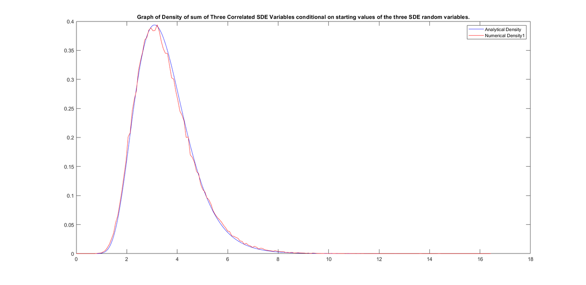](https://postimg.cc/BX0PJKSg)

[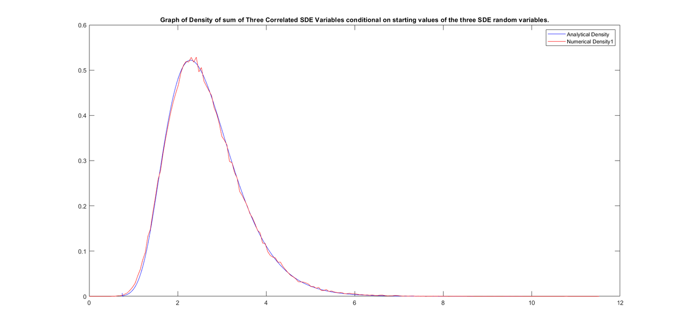](https://postimg.cc/D8T47Xv6)

[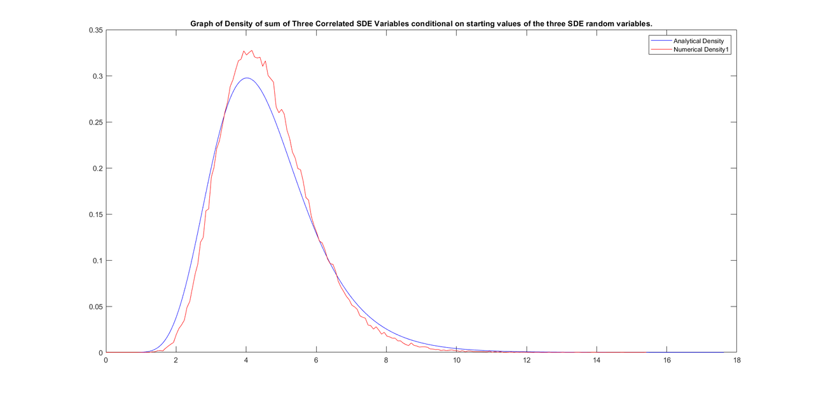](https://postimg.cc/ppH5PFWB)

[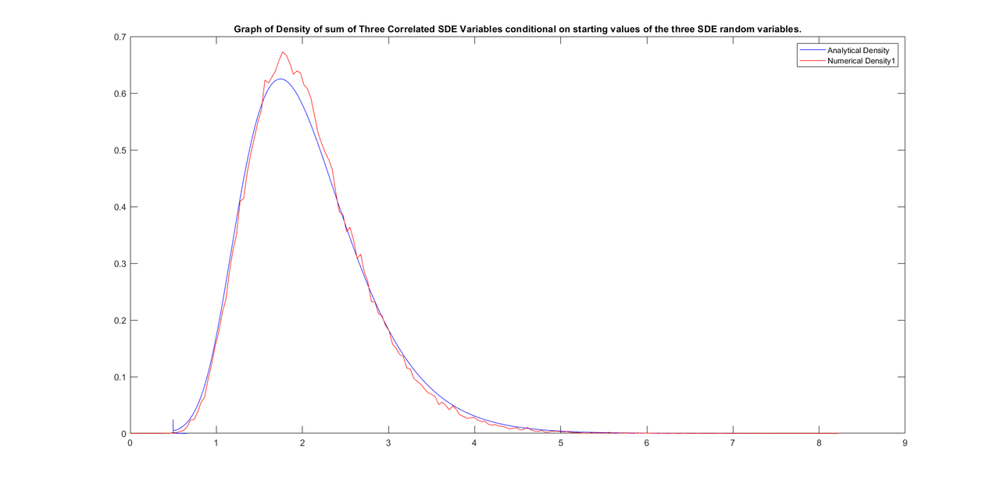](https://postimg.cc/GHCTbyLx)

.

.

.

YMomentsModel =

   1.0e+03 *

  Columns 1 through 3

   0.002066039795138   0.004779933199312   0.012332585689410

  Columns 4 through 6

   0.035341733683601   0.112067341764472   0.391920870538082

  Columns 7 through 8

   1.507791943688982   6.371010903410213

DataMoments =

   1.0e+03 *

  Columns 1 through 3

   0.002055040426314   0.004676028378683   0.011741973574310

  Columns 4 through 6

   0.032454189039004   0.098574102852492   0.328987269624272

  Columns 7 through 8

   1.208741236696595   4.906575104975841

Look at comparison of moments

YCentralMoments =

   1.0e+02 *

  Columns 1 through 3

                   0   0.005114127642192   0.003438552362939

  Columns 4 through 6

   0.011819375619741   0.024352149879679   0.078630329796827

  Columns 7 through 8

   0.267196362515490   1.089543611902081

DataCentralMoments =

  Columns 1 through 3

                   0   0.452837224896998   0.271348614115293

  Columns 4 through 6

   0.913807057317022   1.771661653095748   5.685084557116738

  Columns 7 through 8

  19.534911193610469  81.146922817106315

---

### #3179 — Amin (Topic Author)
*June 25, 2026, 8:45 AM*

Friends, I have noticed that there is still possible room for improvement in the existing model.

While doing Newton regression for coefficients of explaining$X_k$ 's on hermite polynomials of Y, we remove the smaller
powers and for regression on$H_n(Z_y)$ , we basically do a regression on${Z_y}^n$ which seems valid as far as this
regression is concerned since we remove the effect of smaller powers in a path by path sense on data level. But we
noticed that our model improved remarkably when we started to fit the variance of leading part of hermite polynomial of
Y given by${Z_y}^{2n}$ . I realize that this variance fitting has to be done on complete${H_n(Z_y)}^2$ and by doing
estimation of variance only on${Z_y}^{2n}$ , we are missing the covariance effects between the leading power of Hermite
polynomial and smaller powers that had already been explained. I am making changes to code to make sure that
calculations that were used for normalization are done on each of the entire hermite polynomials including parts that
had previously been explained already. I am sure it will further improve the accuracy of the program.

---

### #3180 — Amin (Topic Author)
*June 25, 2026, 9:25 AM*

Friends, I bought a 100 grams coffee two days ago. It was very good and I continued to use it for two days. I do not use
AC in my room at all since it has extreme gas and it is difficult to breathe after that. So last night AC in the lounge
was on and it was very pleasant in the lounge. I was tempted to lie on the sofa and then I fell asleep for more than one
hour. I think, in the meantime, mind control agents asked my sister to drug the coffee jar that was lying on my desk by
the side of my computer. I was not being careful to manage things as I left the room since my intention was not to sleep
at all and while I was asleep, somebody at home drugged my coffee with mind control chemicals. Now when I take coffee,
it seems completely drugged to me and I have to take something else for stimulation.

---

### #3181 — Amin (Topic Author)
*June 25, 2026, 2:50 PM*

Friends, this is for later work in a few days but I tend to think that in order to capture dynamics of even hermites
with correlated explaining variables, we need to add at least up to second order hermites in their expansions.

For example, our current expansion is like

$
$\,{\left( \rho_{1,m}\, Z_{p,1}\,+\, \rho_{2,m}\, Z_{p,2}\,+\,\ldots\,+\,\rho_{K,m}\, Z_{p,K}\,+\,\zeta_m\,Z_{\tilde{y}}\right)}^m\,$
$

but it has to be like

$
$\,{\left( \rho_{1,m}\, Z_{p,1}\,+\, \rho_{2,m}\, Z_{p,2}\,+\,\ldots\,+\,\rho_{K,m}\, Z_{p,K}\,+\, \tilde{\rho}_{1,m}\, \frac{H_2(Z_{p,1})}{\sqrt{2}}\,+\, \tilde{\rho}_{2,m}\, \frac{H_2(Z_{p,2})}{\sqrt{2}}\,+\,\ldots\,+\,\tilde{\rho}_{K,m}\, \frac{H_2(Z_{p,K})}{\sqrt{2}}\,+\,\zeta_m\,Z_{\tilde{y}}\right)}^m\,$
$

Even if we do not take any Taylor type expansion, we need to augment our expansion of even order hermites with 2nd order
hermites of explaining variables.

Basically I suppose that we have to take variables in first multinomial expansion above and convert them into hermite
polynomials after multinomial expansion and then find all their coefficients through Newton non-linear regression. These
coefficients would no longer come from binomial/multinomial expansions but would be calculated directly from Newton
regressions. I am very very sure that in a few weeks, we would have far more accuracy in our calculations.

I will try to implement it after making the other changes as I mentioned for proper calculation of variance of hermites.

---

### #3182 — Amin (Topic Author)
*June 25, 2026, 9:25 PM*

Friends, I believe that for small number of explaining variables like 3-7, we actually do not need any Newton
regressions. We can just use least squares regressions on large number of coefficients like 50-150 for seventh hermite
regression. I believe that 50-100 variables can easily be estimated if the number of paths/Data count is half a million.
I really hope that this will give us extremely good fit to conditional density all over the Z=-3 to Z=3 domains.

All we need to do is to take the combinations of variables in the expansion of the multinomials we have used to describe
each hermite polynomial. We do not want the coefficients in the multinomial expansions and these coefficients have to be
found through linear regressions.

With K coefficients, we have to expand the following multinomial to mth power. Keep the variable terms and find their
coefficients through linear regressions.

$
$\,{\left( \rho_{1,m}\, Z_{p,1}\,+\, \rho_{2,m}\, Z_{p,2}\,+\,\ldots\,+\,\rho_{K,m}\, Z_{p,K}\,+\,\zeta_m\,Z_{\tilde{y}}\right)}^m\,$
$

In place of$Z_{\tilde{y}}$ and its powers, we would use its expectation and all odd power terms would be removed from
regression because of zero expectation of gaussian. We will not use the$\rho_{k,m}$ coefficients in the expansion and
will keep only the variables of each term (found in multinomial expansion) in the regressions and all the coefficients
(that can be quite large) for each term would be found from linear regression.

Higher hermites are important but not that important and we can limit the number of combinations of variables in the
regressions on higher hermites of Y. In a few weeks, I hope that problem would not be if we can get all the density
accurately. Rather the problem would be how can we construct elegant parsimonious combinations of variables that can do
the regressions and other things quickly without any loss of accuracy for large number of explaining variables.

I need to take a breath and re-organize myself but I hope that over the weekend I will come up with a program that does
the conditional density construction algorithm only with linear regressions and also with perfect accuracy.

---

### #3183 — Amin (Topic Author)
*June 25, 2026, 10:52 PM*

Friends, mind control agents are releasing some gas again and again which makes it very difficult to breathe in my room.
About forty minutes ago, I left the room and went outside into the half open car garage to feel better. But they are
releasing gas again after I came back to my room. I want to sleep now but they are releasing gas again and again and it
is painful to breathe in this gas atmosphere of my room.

---

### #3184 — Amin (Topic Author)
*June 26, 2026, 3:11 PM*

Friends, I am trying to write the algorithm for regressions required for new model and I have to think about many things
but they are releasing gas in my room again and again to make it very difficult for me to think properly. They are also
releasing gas in the AC of our Lounge and it is also difficult to go there and if I keep the door of my room open, gas 
comes from Lounge AC into my room. And when I lock the door of my room, they start releasing gas from inside of my room.
They are totally bent on not allowing me to work and do anything about the new program.

---

### #3185 — Amin (Topic Author)
*June 26, 2026, 4:07 PM*

Friends, I have worked out all the details of the new model and some things are different from what I described
yesterday. I have done some programming and if it goes well, I hope to complete the work tonight or later tomorrow. I am
working on it and would post the program as soon as I complete it.

But mind control agents are releasing gas again and again after very short intervals and sometimes I go blank when they
release gas. I still hope that I would be able to complete the work soon.

---

### #3186 — Amin (Topic Author)
*June 26, 2026, 6:41 PM*

Friends, I am trying to work but mind control agents are releasing gas again and again. They are also releasing a heavy
gas that charges the feet and I can distinctly feel it and it charges the feet to control the victim. They had been
quite reasonable about not giving gases even though they continued to drug my food at home and outside but starting
yesterday, they started releasing several types of gases on me and they continue to do that again and again with short
intervals and it is very difficult to work.

---

### #3187 — Amin (Topic Author)
*June 26, 2026, 11:48 PM*

Friends, I have done most of the work and coding. The new functions seem to work right but I have yet not put everything
together and have not been able to see the final graphs yet. I will try to complete the work during the day tomorrow and
hope to post it on Wilmott later on Saturday. I hope that final graphs work well. There is still a possibility of some
errors but I will clearly know only later. I am ending work and going to sleep now.

---

### #3188 — Amin (Topic Author)
*June 27, 2026, 12:14 PM*

Friends, I am re-starting work and hope that matlab program for new method would be ready by this morning or possibly
earlier sometime at night. The algorithm makes two step calculation of correlation coefficients for each hermite
polynomial. First step is a regression which is instantaneous even for seventh hermite and second step is a univariate
Newton root search for pure variance coefficients that takes 2-3 seconds for seventh hermite polynomial. I am still in a
three explaining variables framework and want to make sure that method works well for this simple example and in case
some work neeeds to be done, we would do it on the same simple example and then later after making things work perfectly
for a toy problem, we would generalize the algorithm to any reasonable number of explaining variables. I am now going to
embed the yesterday's program in the main program. It requires some work since we are not in the old framework and each
power in the expansion has to be assigned to conditional density expansion independently but this is not difficult any
more. I will come back as soon as I complete the work.

---

### #3189 — Amin (Topic Author)
*June 27, 2026, 5:26 PM*

**(broken latex: Unbalanced $: 19)**

```latex
Friends, I have been thinking about other ways to solve the problem. And I realize that we could also solve the
conditional density problem by a regression on Ideal normal density vector just like we have been doing with univariate
densities with median as constant term in regression.

I had thought this method several times but I could not think of a way since for a regression based density, we need in
our case to sort the density according to$Z_{\tilde{y}}$ . It was not obvious how to make this sort since this was not
the same as sorting with respect to$Z_y$ . However after some thought, I realized today that ordering or$Z_y$ and
$Z_{\tilde{y}}$ are related through conditional mean of the density. If we remove conditional mean (conditional on
explaining variables) from every data value of Y, we are left with a value that can be sorted and mapped on
$Z_{\tilde{y}}$ . The cross products of powers of$Z_{x_1}$ ,$Z_{x_2}$ and$Z_{x_3}$ with$Z_{\tilde{y}}$ will also appear
in regression. I want to give it a quick try today.

We can also try using ideal normal density values for (Z_{\tilde{y}}$ in our current non-linear regression framework and
there are many other possibilities.

Friends, We are after the proper solution of the conditional density problem and there are many possibilities but it may
still be a month or two before our research matures in every way. And I am willing to try whatever it takes to make
attempts for a very good solution.
```

---

### #3190 — Amin (Topic Author)
*June 27, 2026, 10:29 PM*

**(broken latex: Unbalanced $: 25)**

```latex
Friends, I am posting a preliminary version of the new program. I want to make further changes during next few days but
want to post this preliminary version at the moment.

In this program, I try to remove the correlation effect of explaining variables and then assign values to$Z_{\tilde{y}}$
on the Gaussian grid after sorting the correlation effect removed version of Y. I could not perfectly remove the
correlation effect and there is a room for big improvement yet and I want to work on that for next few days.

I first removed the correlation effect of explaining variables by removing the conditional mean. I then do a regression
to find coefficients of powers of Zy. I again remove the correlation effect based on this new regression and re-assign
values to$Z_{\tilde{y}}$ on the Gaussian grid. This works far better than just improving the conditional mean. The
process can be repeated many times but I am trying to see all possibilities to know what to do next.

I am posting the new program.

```
function []= ConditionalDensityHermitesNvariateNewtonCondLoop02NewAlgo()

%SV SDE is
%dV(t)=mu1 V(t)^beta1 dt+ mu2 V(t)^beta2 dt + sigma0 V(t)^gamma dZ(t)
%In mean reverting SDEs we ususally have
%mu1= kappaV * thetaV
%beta1=0
%mu2=-kappa
%beta2=0
%The present program works only when drift is zero (for pure noises)
%meaning mu1=0 and mu2=0;

Order=7;
%NDim=4;%Three assets and one SV.
%NMomentsY=Order+1;
%NMomentsX=Order+1;

%%%%%%%%%%%%%%%%%%%5
dt=.03125/2/8;
Tt=64*2*8;
T=Tt*dt;
seed0=12130649;
%seed0=94210876;
%seed0=14210876;
seed0=53612297
%seed0=97459782
rng(seed0, 'twister')
paths=50000;
TT1=100*8/2; %Transition distribution start
TT2=256*8/2; %Transition distribution end

%%%%%%%%%%%%%%%%%%%5

NDims=3;
NDims2=3;
%
V0(1)=1.000;%.32;
V00(1)=V0(1);

%SDE1
 thetaV(1)=1.0;%.045;%1;%.04;
 kappaV(1)=0.000;%1.5;%1.5;
 gamma(1)=.75;%.75
 sigma0(1)=.5;%.35

%SDE2%
%thetaV(1)=.90;%.045;%1;%.04;
%kappaV(1)=1.000;%1.5;%1.5;
%gamma(1)=.75;%.75
%sigma0(1)=.85;%.35

%SDE3%
%thetaV(1)=1.350;%.045;%1;%.04;
%kappaV(1)=2.000;%1.5;%1.5;
%gamma(1)=.75;%.75
%sigma0(1)=.95;%.35

mu1(1)=kappaV(1)*thetaV(1);
mu2(1)=-kappaV(1);
beta1(1)=0;
beta2(1)=1;

V0(2)=1.000;%.32;
V00(2)=V0(2);

%SDE1
thetaV(2)=1.0;%.045;%1;%.04;
 kappaV(2)=0.000;%1.5;%1.5;
 gamma(2)=.85;%.75
 sigma0(2)=.5;%.35

%SDE2
% thetaV(2)=1.0;%.045;%1;%.04;
% kappaV(2)=2.000;%1.5;%1.5;
% gamma(2)=.65;%.75
% sigma0(2)=.95;%.35

%SDE3
%thetaV(2)=.850;%.045;%1;%.04;
%kappaV(2)=.35000;%1.5;%1.5;
%gamma(2)=.65;%.75
%sigma0(2)=.55;%.35

mu1(2)=kappaV(2)*thetaV(2);
mu2(2)=-kappaV(2);
beta1(2)=0;
beta2(2)=1;

V0(3)=1.000;%.33;
V00(3)=V0(3);

%SDE1
thetaV(3)=1.0;%.045;%1;%.04;
 kappaV(3)=0.000;%1.5;%1.5;
 gamma(3)=.95;%.75
 sigma0(3)=.45;%.35

%SDE2
% thetaV(3)=.750;%.045;%1;%.04;
% kappaV(3)=0.5000;%1.5;%1.5;
% gamma(3)=.95;%.75
% sigma0(3)=.45;%.35

%SDE3
%thetaV(3)=1.150;%.045;%1;%.04;
%kappaV(3)=1.5000;%1.5;%1.5;
%gamma(3)=.95;%.75
%sigma0(3)=.75;%.35

mu1(3)=kappaV(3)*thetaV(3);
mu2(3)=-kappaV(3);
beta1(3)=0;
beta2(3)=1;

Corr1(1,1)=1;
Corr1(1,2)=.7;
Corr1(1,3)=.8;
Corr1(2,2)=1;
Corr1(2,1)=.7;
Corr1(2,3)=.5;
Corr1(3,1)=.8;
Corr1(3,2)=.5;
Corr1(3,3)=1;
%
% % % % Was very good.
Corr1(1,1)=1;
Corr1(1,2)=.7/3;
Corr1(1,3)=.8/3;
Corr1(2,2)=1;
Corr1(2,1)=.7/3;
Corr1(2,3)=.5/3;
Corr1(3,1)=.8/3;
Corr1(3,2)=.5/3;
Corr1(3,3)=1;
% % % % % % % %
% % % % % % % %
% % % % % % %
% Corr1(1,1)=1;
% Corr1(1,2)=-.7/3;
% Corr1(1,3)=.8/3;
% Corr1(2,2)=1;
% Corr1(2,1)=-.7/3;
% Corr1(2,3)=-.5/3;
% Corr1(3,1)=.8/3;
% Corr1(3,2)=-.5/3;
% Corr1(3,3)=1;
% % % % % %
% % % % % %
% % % % % %
% Corr1(1,1)=1;
% Corr1(1,2)=-.27;
% Corr1(1,3)=-.28;
% Corr1(2,2)=1;
% Corr1(2,1)=-.27;
% Corr1(2,3)=-.15;
% Corr1(3,1)=-.28;
% Corr1(3,2)=-.15;
% Corr1(3,3)=1;
%87%Corr1(1:3,1:3)=0.0;

R=chol(Corr1);
%
%  R(1:3,1:3)=0;
%  R(1,1)=1;
%  R(2,2)=1;
%  R(3,3)=1;

V0(4)=1.000;%.44;
V00(4)=V0(4);
thetaV(4)=1.0;%.045;%1;%.04;
kappaV(4)=1.000;%1.5;%1.5;
mu1(4)=kappaV(4)*thetaV(4);
mu2(4)=-kappaV(4);
beta1(4)=0;
beta2(4)=1;
gamma(4)=.95;%.75
sigma0(4)=.55;%.45

%%%%%%%%%%%%%%%%%%%%%%%%%%%%%%%%%%%%%%%%%%%%%%%%%%%%%%%%%%%%%%%%%%%%%5
for nn=1:NDims
V(1:paths,nn)=V0(nn);
Threshold(nn)=(sigma0(nn)*sqrt(dt)*2)^(1/(1-gamma(nn)));
end
%V(1:paths,1:NDims)=V0(1,1:NDims);

Random1(1:paths/2,1:NDims)=0;

for tt=1:Tt

    Random2(1:paths/2,1:NDims)=randn(size(Random1));
    Random2(paths/2+1:paths,1:NDims)=-Random2(1:paths/2,1:NDims);

    %Random2=R'*Random2;
    random1=Random2*R(:,1);
    random2=Random2*R(:,2);
    random3=Random2*R(:,3);

    Random2(:,1)=random1;
    Random2(:,2)=random2;
    Random2(:,3)=random3;

    %Random2(V(:,<Threshold,:)=

    Random2(V(:,1)<Threshold(1),1)=0.0;
    Random2(V(:,2)<Threshold(2),2)=0.0;
    Random2(V(:,3)<Threshold(3),3)=0.0;

    for nn=1:NDims

    V(1:paths,nn)=V(1:paths,nn)+ ...
        (mu1(nn).*V(1:paths,nn).^beta1(nn) + mu2(nn).*V(1:paths,nn).^beta2(nn))*dt + ...
        sigma0(nn).*V(1:paths,nn).^gamma(nn) .*Random2(1:paths,nn)*sqrt(dt) + ...
        (mu1(nn).*beta1(nn)*V(1:paths,nn).^(beta1(nn)-1) + mu2(nn).*beta2(nn).*V(1:paths,nn).^(beta2(nn)-1)).* ...
        ((mu1(nn).*V(1:paths,nn).^beta1(nn) + mu2(nn).*V(1:paths,nn).^beta2(nn))*dt^2/2 + ...
        sigma0(nn).*V(1:paths,nn).^gamma(nn) .*Random2(1:paths,nn)*(1-1/sqrt(3))*dt^1.5) + ...
        .5*(mu1(nn).*beta1(nn).*(beta1(nn)-1).*V(1:paths,nn).^(beta1(nn)-2) +
mu2(nn).*beta2(nn).*(beta2(nn)-1).*V(1:paths,nn).^(beta2(nn)-2)).* ...
        sigma0(nn)^2.*V(1:paths,nn).^(2*gamma(nn)).*dt^2/2 + ...
        sigma0(nn).*gamma(nn).*V(1:paths,nn).^(gamma(nn)-1) .* ...
        ((mu1(nn).*V(1:paths,nn).^beta1(nn) + mu2(nn).*V(1:paths,nn).^beta2(nn)).*Random2(1:paths,nn).*1/sqrt(3)*dt^1.5
+ ...
        sigma0(nn).*V(1:paths,nn).^gamma(nn) .*(Random2(1:paths,nn).^2-1)*dt/2) + ...
        .5*sigma0(nn).*gamma(nn).*(gamma(nn)-1).*V(1:paths,nn).^(gamma(nn)-2) .* ...
        sigma0(nn).^2.*V(1:paths,nn).^(2*gamma(nn)) .*Random2(1:paths,nn).*1/sqrt(3)*dt^1.5;

    V(V(:,nn)<=.00001,nn)=.0000;

    V(isnan(V(:,nn)),nn)=0;

    if(tt==TT1)
        Xin(1:paths,nn)=(V(1:paths,nn));
    end

    if(tt==TT2)

        Xin2(1:paths,nn)=(V(1:paths,nn));
    end

    end

end

Yin(1:paths)=0.0;

for pp=1:paths
for mm=1:NDims
    Yin(pp)=Yin(pp)+Xin2(pp,mm);%-Xin(pp,mm);
%-Xin(pp,mm);
end
end

str=input("I have reached stone 1");

% %%%%%%%%%%%%%%%%%%%%%%%%%%%%%%%%%%%%%%%%%%%%%%%%%%5
%
 Order=7;
 clf;

  NDims2=3;

[BetaCorrH,YCoeffH,XCoeffH,HCorrXX,Zy,Zx] = CalculateHermiteCorrelations0NA04(Xin,Yin,paths,NDims2);
YCoeffZ(1:Order+1)= ConvertHermiteSeriesToZSeries01(YCoeffH(1:Order+1),Order);

%ConditionalDensityByRegressionOnIdealNormal(Yin,Zy,Zx,NDims,Order,paths)
[coeff1,coeff2,coeff3,coeff4,coeff5,coeff6,coeff7] =
ConditionalDensityByRegressionOnIdealNormal04(Yin,Zy,Zx,NDims,Order,paths,YCoeffZ);

str=input("Reached New Stone");

%[TotalTermCount,Coeffs,pp] = OptimizeCorrFromHermitesNewtonNewAlgo(Zy,Zx,NDims,paths,Order);

%%%%FindCorrelationCoefficientsnthHermite(Zy,Zx,7,paths);

%HCorrXX(:,:)=0.0;

BetaCorrH

HCorrXX

str=input("I have reached Stone2");

for hh=1:Order
    for nn=1:NDims2
        ch(nn+1,hh+1)=BetaCorrH(nn,hh).*YCoeffH(hh+1);%make sure indices on all hermite-correlations match.check.
        %%%% nn+1 since 1st index would go to y-tilde.
    end
end

for hh=1:Order
HCorrXX(1:NDims,1:NDims,hh)=HCorrXX(1:NDims,1:NDims,1);
end
%bn=0;
%[bn] = FindInitialGuessForNewton(Zy,Zx,NDims,paths,Order);

%bn

%str=input("Look at the coefficients from two different methods");

%NDims2=3;

% bn=0;
% for mm=1:NDims
%     NDims0=1;
%     [bn] = FindInitialGuessForNewtonUnivariate(Zy,Zx(1:paths,mm),NDims0,paths,Order);
%     bn
%     HCorrXX0(1,1,1:Order)=1;
%     bnOptim0= OptimizeCorrFromHermitesNewtonWithoutVar(Zy,Zx(1:paths,mm),bn,HCorrXX0,NDims0,paths,Order);
%     bnOptim(mm,:)=bnOptim0(1,:);
%  mm
%  str=input("Let us look at bn");
%
% end
%
%
% bnOptim
%
% str=input("Look at the variabes of cnOptim from both ways");

% for mm1=1:NDims
%     for mm2=1:NDims
%         if(mm1==mm2)
%         HCorrXX(mm1,mm2,1:Order)=1;
%         end
%         if(mm1<mm2)
%         cn(1,:)=bnOptim(mm1,:);
%         cn(2,:)=bnOptim(mm2,:);
%         NDims0=2;
%         [HCorrBest] = OptimizeXkCorrsFromHermitesWithoutVar(Zy,Zx,cn,NDims0,paths,Order);
%         HCorrXX(mm1,mm2,:)=HCorrBest(:);
%         HCorrXX(mm2,mm1,:)=HCorrXX(mm1,mm2,:);
%         end
%     end
% end
%

%
%
%
%
%
%
% mm1=1;
% mm2=2
%     NDims0=1;
%     [bn] = FindInitialGuessForNewtonUnivariate(Zx(1:paths,mm1),Zx(1:paths,mm2),NDims0,paths,Order);
%     bn
%     HCorrXX0(1,1,1:Order)=1;
%     CorrXX1= OptimizeCorrFromHermitesNewtonWithoutVar(Zx(1:paths,mm1),Zx(1:paths,mm2),bn,HCorrXX0,NDims0,paths,Order);
%     %CorrXX2=
OptimizeCorrFromHermitesNewtonWithoutVar(Zx(1:paths,mm2),Zx(1:paths,mm1),bn,HCorrXX0,NDims0,paths,Order);
%     HCorrXX(mm1,mm2,1:Order)=(CorrXX1(1,1:Order));%+CorrXX2(1,1:Order))/2;
%     HCorrXX(mm2,mm1,1:Order)=(CorrXX1(1,1:Order));%+CorrXX2(1,1:Order))/2;
%     HCorrXX(mm1,mm1,1:Order)=1;
%
% mm1=1;
% mm2=3
%     NDims0=1;
%     [bn] = FindInitialGuessForNewtonUnivariate(Zx(1:paths,mm1),Zx(1:paths,mm2),NDims0,paths,Order);
%     bn
%     HCorrXX0(1,1,1:Order)=1;
%     CorrXX1= OptimizeCorrFromHermitesNewtonWithoutVar(Zx(1:paths,mm1),Zx(1:paths,mm2),bn,HCorrXX0,NDims0,paths,Order);
%     %CorrXX2=
OptimizeCorrFromHermitesNewtonWithoutVar(Zx(1:paths,mm2),Zx(1:paths,mm1),bn,HCorrXX0,NDims0,paths,Order);
%     HCorrXX(mm1,mm2,1:Order)=(CorrXX1(1,1:Order));%+CorrXX2(1,1:Order))/2;
%     %HCorrXX(mm1,mm2,1:Order)=CorrXX(1,1:Order);
%     HCorrXX(mm2,mm1,1:Order)=(CorrXX1(1,1:Order));%+CorrXX2(1,1:Order))/2;
%     HCorrXX(mm2,mm2,1:Order)=1;
%
% mm1=2;
% mm2=3;
%     NDims0=1;
%     [bn] = FindInitialGuessForNewtonUnivariate(Zx(1:paths,mm1),Zx(1:paths,mm2),NDims0,paths,Order);
%     bn
%     HCorrXX0(1,1,1:Order)=1;
%     CorrXX1= OptimizeCorrFromHermitesNewtonWithoutVar(Zx(1:paths,mm1),Zx(1:paths,mm2),bn,HCorrXX0,NDims0,paths,Order);
%    % CorrXX2=
OptimizeCorrFromHermitesNewtonWithoutVar(Zx(1:paths,mm2),Zx(1:paths,mm1),bn,HCorrXX0,NDims0,paths,Order);
%     HCorrXX(mm1,mm2,1:Order)=(CorrXX1(1,1:Order));%+CorrXX2(1,1:Order))/2;
%     %HCorrXX(mm1,mm2,1:Order)=CorrXX(1,1:Order);
%     HCorrXX(mm2,mm1,1:Order)=(CorrXX1(1,1:Order));%+CorrXX2(1,1:Order))/2;
%     HCorrXX(mm1,mm1,1:Order)=1;
%
%
%
%
%
%
%
% HCorrXX
%
% str=input("Look at HCorrXX");
%
%
% for hh=1:Order
%     bCol(1:NDims,1)=bnOptim(1:NDims,hh);
%     HHCorrXX(1:NDims,1:NDims)=HCorrXX(1:NDims,1:NDims,hh);
%     bb=HHCorrXX\bCol;
%     cn(1:NDims,hh)=bb(1:NDims);
% end
% Var(hh)=0.0;
% for hh=1:Order
%     for mm=1:NDims
%         Var(hh)=Var(hh)+cn(mm,hh).^2;
%     end
%     cn(NDims+1,hh)=sqrt(1-Var(hh));
% end

%[cn] = OptimizeCorrFromHermitesNewton(Zy,Zx,cn,HCorrXX,NDims,paths,Order);

% Iterations=100;
%
% [EZ] = EZZ2();
%
% [cnbest,InitialObj,FinalObj] =
OptimizeYTildeWithGaussianNewtonOptim(cn,Zx,Yin,YCoeffZ,Order,EZ,NDims,paths,Iterations)
%
%
% cn
% cnbest
%
% str=input("Look at the new values and variables");
%
% cn=cnbest;

[CoeffR] = RegressYOnXGivenZx(Yin,Zx,paths,NDims,Order);

for kk=1:4

% %Set1
  V10(1,1)=1.2+.25*2;%.65;%
  V10(2,1)=.75-.125*2;
  V10(3,1)=1.2+.25*2;

%
% % % %
% % % % % % % % % % %Set2
       V10(1,2)=.75-.125*2;
       V10(2,2)=1.2+.25*2;%1.2;
       V10(3,2)=.7-.125*2;

% % % % % % % % % % % % % % %V10(4)=.65
% % % % % % % % % % % % % %
% % % % % % % % % % % % % % % % %Set3
       V10(1,3)=1.25+.25*2;
       V10(2,3)=1.35+.25*2;%1.2;
       V10(3,3)=1.25+.25*2;
%
%
%
% % % % % % % % % % % % % % % %   V10(4)=1.4
% % % % % % % % % % % % % % % % %
% % % % % % % % % % % % % % % % %
         V10(1,4)=.85-.125;
         V10(2,4)=.81-.125;%1.2;
         V10(3,4)=.77-.125;
%
%
% % % % % % % % % % %  V10(4)=.7
% %

%V10(1)=.65;
%V10(2)=.51;%1.2;
%V10(3)=.73;

%V10(1)=1.65;
%V10(2)=1.51;%1.2;
%V10(3111111111111111111111111111111111111111111111111111111111111111111111111111111111111111111111111111111111111111111111111111111)=1.63;

for nn=1:NDims
V(1:paths,nn)=V10(nn,kk);
end
%V(1:paths,1:NDims)=V0(1,1:NDims);

Random1(1:paths/2,1:NDims)=0;

for tt=1:TT2-TT1

    Random2(1:paths/2,1:NDims)=randn(size(Random1));
    Random2(paths/2+1:paths,1:NDims)=-Random2(1:paths/2,1:NDims);

    random1=Random2*R(:,1);
    random2=Random2*R(:,2);
    random3=Random2*R(:,3);

    Random2(:,1)=random1;
    Random2(:,2)=random2;
    Random2(:,3)=random3;

    Random2(V(:,1)<Threshold(1),1)=0.0;
    Random2(V(:,2)<Threshold(2),2)=0.0;
    Random2(V(:,3)<Threshold(3),3)=0.0;

    for nn=1:NDims

    V(1:paths,nn)=V(1:paths,nn)+ ...
        (mu1(nn).*V(1:paths,nn).^beta1(nn) + mu2(nn).*V(1:paths,nn).^beta2(nn))*dt + ...
        sigma0(nn).*V(1:paths,nn).^gamma(nn) .*Random2(1:paths,nn)*sqrt(dt) + ...
        (mu1(nn).*beta1(nn)*V(1:paths,nn).^(beta1(nn)-1) + mu2(nn).*beta2(nn).*V(1:paths,nn).^(beta2(nn)-1)).* ...
        ((mu1(nn).*V(1:paths,nn).^beta1(nn) + mu2(nn).*V(1:paths,nn).^beta2(nn))*dt^2/2 + ...
        sigma0(nn).*V(1:paths,nn).^gamma(nn) .*Random2(1:paths,nn)*(1-1/sqrt(3))*dt^1.5) + ...
        .5*(mu1(nn).*beta1(nn).*(beta1(nn)-1).*V(1:paths,nn).^(beta1(nn)-2) +
mu2(nn).*beta2(nn).*(beta2(nn)-1).*V(1:paths,nn).^(beta2(nn)-2)).* ...
        sigma0(nn)^2.*V(1:paths,nn).^(2*gamma(nn)).*dt^2/2 + ...
        sigma0(nn).*gamma(nn).*V(1:paths,nn).^(gamma(nn)-1) .* ...
        ((mu1(nn).*V(1:paths,nn).^beta1(nn) + mu2(nn).*V(1:paths,nn).^beta2(nn)).*Random2(1:paths,nn).*1/sqrt(3)*dt^1.5
+ ...
        sigma0(nn).*V(1:paths,nn).^gamma(nn) .*(Random2(1:paths,nn).^2-1)*dt/2) + ...
        .5*sigma0(nn).*gamma(nn).*(gamma(nn)-1).*V(1:paths,nn).^(gamma(nn)-2) .* ...
        sigma0(nn).^2.*V(1:paths,nn).^(2*gamma(nn)) .*Random2(1:paths,nn).*1/sqrt(3)*dt^1.5;

    V(V(:,nn)<=.00001,nn)=.0001;

    %if(tt==TT1)
    %    XXin(1:paths,nn)=V(1:paths,nn);
    %end

    if(tt==TT2-TT1)

        XXin2(1:paths,nn)=V(1:paths,nn);
    end

    end

end

Yin2(1:paths)=0.0;

for pp=1:paths
for mm=1:NDims
    Yin2(pp)=Yin2(pp)+XXin2(pp,mm);%-V10(mm);
end
end

%randn()

str=input("I have reached stone 4");

NoOfBins=200;
MaxCutOff=20;

[XDensity,IndexOut,IndexMax] = MakeDensityFromSimulation_Infiniti_NEW(Yin2,paths,NoOfBins,MaxCutOff );

for qq=1:8

    DataMoments(qq)=sum(Yin2(:).^qq)/paths;

end

%%%%%%%%%%%%%%%%%%%%%%%%%%%%%%%%%%%%%%%%%%%%%%%%%%%%%%%%%%%%%%%%%%%%%%%%%%%%%%%%%%%%%%%5

for nn=1:NDims2
    [Zx0(nn)] = CalculateZgivenXAndHSeriesCoeffs(V10(nn,kk),XCoeffH(1:Order+1,nn),Order);
end

%%%%%%%%%%%%%%%%%%%%%%%%%%%%%%%%%%%%%%%%%%%%%%%%%%%%%%%%%%%%%%%%%%%55

WW(1,1:Order+1)=EvalHermiteArrayH0(Zx0(1),Order);
for mm=2:NDims
    WW(1,(mm-1)*Order+2:mm*Order+1)=EvalHermiteArrayH1(Zx0(mm),Order);
end

     YProjected=0.0;
    for mm=1:NDims*Order+1
    YProjected=YProjected+WW(1,mm).*CoeffR(mm,1);

    end

%%%%%%%%%%%%%%%%%%%%%%%%%%%%%%%%%%%%%%%%%%%%%%%%%%%%%%%%%%%%%%%%%%%%%%%%%%%%%%%55
% Zx(1:Order)=0;
%
% for hh=1:Order
%     for nn=1:NDims2
%         %Zx(hh) = Zx(hh) + bnv(nn+1,hh+1).^1.*Zx0(nn);
%         Zx(hh) = Zx(hh) + cn(nn,hh).^1.*Zx0(nn);
%     end
% end

bh0=YCoeffH(1);

[W] = EvalHermiteArrayH0(Zx0,Order);

for hh=1:Order
    for nn=1:NDims2
        bh0 = bh0 + ch(nn+1,hh+1).^1.*W(nn,hh+1);
    end
end
bh00=bh0;

%%%%%%%%%%%%%%%%%%%%%%%%%%%%%%%%%%%%%%%%%%%%%%%%%%%%%%%%%%%%%%%%

%
% V(1)=1;
% V(2)=Zx0(1);
% V(3)=Zx0(2);
% V(4)=Zx0(3);
% V(5)=Zx0(1).^2;
% V(6)=Zx0(2).^2;
% V(7)=Zx0(3).^2;
% V(8)=Zx0(1).^3;
% V(9)=Zx0(2).^3;
% V(10)=Zx0(3).^3;
% V(11)=Zx0(1).^4;
% V(12)=Zx0(2).^4;
% V(13)=Zx0(3).^4;
% V(14)=Zx0(1).^5;
% V(15)=Zx0(2).^5;
% V(16)=Zx0(3).^5;
% V(17)=Zx0(1).^6;
% V(18)=Zx0(2).^6;
% V(19)=Zx0(3).^6;
% V(20)=1;
% V(21)=Zx0(1);
% V(22)=Zx0(2);
% V(23)=Zx0(3);
% V(24)=Zx0(1).^2;
% V(25)=Zx0(2).^2;
% V(26)=Zx0(3).^2;
% V(27)=Zx0(1).^3;
% V(28)=Zx0(2).^3;
% V(29)=Zx0(3).^3;
% V(30)=Zx0(1).^4;
% V(31)=Zx0(2).^4;
% V(32)=Zx0(3).^4;
% V(33)=Zx0(1).^5;
% V(34)=Zx0(2).^5;
% V(35)=Zx0(3).^5;
% V(36)=1;
% V(37)=Zx0(1);
% V(38)=Zx0(2);
% V(39)=Zx0(3);
% V(40)=Zx0(1).^2;
% V(41)=Zx0(2).^2;
% V(42)=Zx0(3).^2;
% V(43)=Zx0(1).^3;
% V(44)=Zx0(2).^3;
% V(45)=Zx0(3).^3;
% V(46)=Zx0(1).^4;
% V(47)=Zx0(2).^4;
% V(48)=Zx0(3).^4;
% V(49)=1;
% V(50)=Zx0(1);
% V(51)=Zx0(2);
% V(52)=Zx0(3);
% V(53)=Zx0(1).^2;
% V(54)=Zx0(2).^2;
% V(55)=Zx0(3).^2;
% V(56)=Zx0(1).^3;
% V(57)=Zx0(2).^3;
% V(58)=Zx0(3).^3;
% V(59)=1;
% V(60)=Zx0(1);
% V(61)=Zx0(2);
% V(62)=Zx0(3);
% V(63)=Zx0(1).^2;
% V(64)=Zx0(2).^2;
% V(65)=Zx0(3).^2;
% V(66)=1;
% V(67)=Zx0(1);
% V(68)=Zx0(2);
% V(69)=Zx0(3);
% V(70)=1;
%
% b1=0;
% for nn=1:19
%     b1=b1+coeff(nn,1).*V(nn);
% end
%
% b2=0;
% for nn=20:35
%     b2=b2+coeff(nn,1).*V(nn);
% end
%
% b3=0;
% for nn=36:48
%     b3=b3+coeff(nn,1).*V(nn);
% end
%
% b4=0;
% for nn=49:58
%     b4=b4+coeff(nn,1).*V(nn);
% end
%
% b5=0;
% for nn=59:65
%     b5=b5+coeff(nn,1).*V(nn);
% end
%
% b6=0;
% for nn=66:69
%     b6=b6+coeff(nn,1).*V(nn);
% end
%
%
% b7=coeff(70,1).*V(70);

b1= YCoeffZ(8).*(coeff7(5,1).*Zx0(1).^6+coeff7(6,1).*Zx0(2).^6+coeff7(7,1).*Zx0(3).^6) + ...
    YCoeffZ(7).*(coeff6(5,1).*Zx0(1).^5+coeff6(6,1).*Zx0(2).^5+coeff6(7,1).*Zx0(3).^5)+...
    YCoeffZ(6).*(coeff5(5,1).*Zx0(1).^4+coeff5(6,1).*Zx0(2).^4+coeff5(7,1).*Zx0(3).^4)+ ...
    YCoeffZ(5).*(coeff4(5,1).*Zx0(1).^3+coeff4(6,1).*Zx0(2).^3+coeff4(7,1).*Zx0(3).^3)+ ...
    YCoeffZ(4).*(coeff3(5,1).*Zx0(1).^2+coeff3(6,1).*Zx0(2).^2+coeff3(7,1).*Zx0(3).^2)+ ...
    YCoeffZ(3).*(coeff2(5,1).*Zx0(1)+coeff2(6,1).*Zx0(2)+coeff2(7,1).*Zx0(3))+ ...
    YCoeffZ(2).*(coeff1(1,1));

b2=YCoeffZ(8).*(coeff7(8,1).*Zx0(1).^5+coeff7(9,1).*Zx0(2).^5+coeff7(10,1).*Zx0(3).^5) + ...
    YCoeffZ(7).*(coeff6(8,1).*Zx0(1).^4+coeff6(9,1).*Zx0(2).^4+coeff6(10,1).*Zx0(3).^4)+ ...
    YCoeffZ(6).*(coeff5(8,1).*Zx0(1).^3+coeff5(9,1).*Zx0(2).^3+coeff5(10,1).*Zx0(3).^3)+ ...
    YCoeffZ(5).*(coeff4(8,1).*Zx0(1).^2+coeff4(9,1).*Zx0(2).^2+coeff4(10,1).*Zx0(3).^2)+ ...
    YCoeffZ(4).*(coeff3(8,1).*Zx0(1)+coeff3(9,1).*Zx0(2)+coeff3(10,1).*Zx0(3))+ ...
    YCoeffZ(3).*(coeff2(1,1));

b3=YCoeffZ(8).*(coeff7(11,1).*Zx0(1).^4+coeff7(12,1).*Zx0(2).^4+coeff7(13,1).*Zx0(3).^4)+ ...
    YCoeffZ(7).*(coeff6(11,1).*Zx0(1).^3+coeff6(12,1).*Zx0(2).^3+coeff6(13,1).*Zx0(3).^3)+ ...
    YCoeffZ(6).*(coeff5(11,1).*Zx0(1).^2+coeff5(12,1).*Zx0(2).^2+coeff5(13,1).*Zx0(3).^2)+ ...
    YCoeffZ(5).*(coeff4(11,1).*Zx0(1).^1+coeff4(12,1).*Zx0(2).^1+coeff4(13,1).*Zx0(3).^1)+ ...
    YCoeffZ(4).*(coeff3(1,1));

b4=YCoeffZ(8).*(coeff7(14,1).*Zx0(1).^3+coeff7(15,1).*Zx0(2).^3+coeff7(16,1).*Zx0(3).^3 )+ ...
    YCoeffZ(7).*(coeff6(14,1).*Zx0(1).^2+coeff6(15,1).*Zx0(2).^2+coeff6(16,1).*Zx0(3).^2)+ ...
    YCoeffZ(6).*(coeff5(14,1).*Zx0(1).^1+coeff5(15,1).*Zx0(2).^1+coeff5(16,1).*Zx0(3).^1)+ ...
    YCoeffZ(5).*(coeff4(1,1));

b5=YCoeffZ(8).*(coeff7(17,1).*Zx0(1).^2+coeff7(18,1).*Zx0(2).^2+coeff7(19,1).*Zx0(3).^2)+ ...
    YCoeffZ(7).*(coeff6(17,1).*Zx0(1).^1+coeff6(18,1).*Zx0(2).^1+coeff6(19,1).*Zx0(3).^1)+ ...
    YCoeffZ(6).*(coeff5(1,1));

b6=YCoeffZ(8).*(coeff7(20,1).*Zx0(1).^1+coeff7(21,1).*Zx0(2).^1+coeff7(22,1).*Zx0(3).^1)+ ...
    YCoeffZ(7).*(coeff6(1,1));

b7=YCoeffZ(8).*(coeff7(1,1));

%bh0=b0+b2+3*b4+15*b6;
bh1=b1+3*b3+15*b5+105*b7;
bh2=b2+6*b4+45*b6;
bh3=b3+10*b5+105*b7;
bh4=b4+15*b6;
bh5=b5+21*b7;
bh6=b6;
bh7=b7;

bh(1)=YProjected;
bh(2)=bh1;
bh(3)=bh2;
bh(4)=bh3;
bh(5)=bh4;
bh(6)=bh5;
bh(7)=bh6;
bh(8)=bh7;

YCentralMoment2=0;
for nn=1:Order
    YCentralMoment2=YCentralMoment2+bh(nn+1).^2*factorial(nn);
end

%bh(2:Order+1)=bh(2:Order+1).*sqrt(Y2Projected-YProjected.^2)/sqrt(YCentralMoment2);

bh(2:Order+1)=bh(2:Order+1).*YProjected/bh0;

%%%%%%%%%%%%%%%%%%%%%%%%%%%%%%%%%%%%%%%%%%%%%%%%%%%%%%%%%%%%%%%%%%%%%%%%%%%%%%5

YCoeffz(1:Order+1)= ConvertHermiteSeriesToZSeries01(bh(1:Order+1),Order);

[YMomentsModel]=CalculateMomentsOfZSeries(YCoeffz(1),YCoeffz(2:Order+1),Order,Order+1);

YMomentsModel

DataMoments

str=input("Look at comparison of moments");

[cMu1,YCentralMoments]=ConvertRawMomentsToCentralMoments(YMomentsModel,Order+1);
[cMu2,DataCentralMoments]=ConvertRawMomentsToCentralMoments(DataMoments,Order+1);

YCentralMoments

DataCentralMoments

bh00
YProjected
% Y2Projected
% DataMoments(2)
% Y2Projected-YProjected.^2
% DataCentralMoments(2)
str=input("Look at central moments");

clf;

PlotZSeriesDensity(YCoeffz(1),YCoeffz(2:Order+1),'b')

hold on

plot(IndexOut(1:IndexMax),XDensity(1:IndexMax),'r');

%PlotHermiteSeriesDensityAndRvGraph(YCoeffh(1),YCoeffh1(2:yOrder+1),'g')
title("Graph of Density of sum of Three Correlated SDE Variables conditional on starting values of the three SDE random
variables.")
%title(sprintf('V00 = %.3f; kappa=%.3f, theta=%.3f,gamma=%.3f,sigma=%.3f;V10=%.3f at TT1=%.3f;TT2=%.3f;Paths=%d ',V00,
kappaV, thetaV,gamma,sigma0, V10,(TT1*dt),(TT2*dt),paths));%,sprintf('theta= %f', theta), sprintf('kappa = %f',
kappa),sprintf('sigma = %f', sigma0),sprintf('T = %f', T));
legend({'Analytical Density','Numerical Density1'}, ...
    'Location','northeast')
kk
str=input("This is the first version without altering the moments of conditional density")

hold off

end

end
```

.

.

.

.

```
function [coeff1,coeff2,coeff3,coeff4,coeff5,coeff6,coeff7] =
ConditionalDensityByRegressionOnIdealNormal04(Yin,Zyin0,Zx,NDims,Order,paths,YCoeffZ)

NData=paths;
Order=7;
NMoments=8;

Zyin(1:NData,1)=Zyin0(1:NData);

Yin0(1:NData,1)=Yin(1:NData);

[ZI] = MomentMatchedStandardNormalDiscretizedDensity(NData);

[CoeffR] = RegressYOnXGivenZx(Yin,Zx,paths,NDims,Order);

WW(1:paths,1:Order+1)=EvalHermiteArrayH0(Zx(1:paths,1),Order);
for mm=2:NDims
    WW(1:paths,(mm-1)*Order+2:mm*Order+1)=EvalHermiteArrayH1(Zx(1:paths,mm),Order);
end

YProjected(1:paths,1)=0.0;
for mm=1:NDims*Order+1
    YProjected(1:paths,1)=YProjected(1:paths,1)+WW(1:paths,mm).*CoeffR(mm,1);
end

Y_tilde(1:NData,1)=Yin0(1:NData,1)-YProjected(1:NData,1);
Y_tilde0(1:NData)=Y_tilde(1:NData,1);

Zy0=0;
Zy=0;

[c0,c(1:Order),FittedMoments,Zy0] =
CalculateZSeriesDensityFromRawMoments02FromGuess02W(Y_tilde0(1:NData),ZI);%,XCoeffZ(2:Order+1));

for nn=1:NData
Zy(nn,1)=Zy0(nn);
end

[Yss,I]=sort(Y_tilde(1:NData,1));

DataMedian=(Yss(NData/2,1)+Yss(NData/2+1,1))/2;

Ys(1:NData,1)=Yss(1:NData,1);%-DataMedian;

%for hh=1:Order
%    W(1:NData,hh)=ZI(1:NData).^(hh);
%end

%[WHy] = EvalHermiteArrayH1(Zy,Order);

% WHyn(1:paths,1)=WHy(1:paths,nH);

Ys(1:NData,1)=Zyin(1:NData,1);

W=0;

W(1:NData,1)=Zy(1:NData,1);
W(1:NData,2)=Zx(1:NData,1);
W(1:NData,3)=Zx(1:NData,2);
W(1:NData,4)=Zx(1:NData,3);

Ymu(1:NData,1)=Ys(1:NData);

WW=(W'*W);

coeff1=(WW)$W'*Ymu);

%coeff1(1,1)

Ys(1:NData,1)=Zyin(1:NData,1).^2;
W=0;
W(1:NData,1)=Zy(1:NData,1).^2;
W(1:NData,2)=Zx(1:NData,1).^2;
W(1:NData,3)=Zx(1:NData,2).^2;
W(1:NData,4)=Zx(1:NData,3).^2;
W(1:NData,5)=Zy(1:NData,1).*Zx(1:NData,1);
W(1:NData,6)=Zy(1:NData,1).*Zx(1:NData,2);
W(1:NData,7)=Zy(1:NData,1).*Zx(1:NData,3);
W(1:NData,8)=Zx(1:NData,1).*Zx(1:NData,2);
W(1:NData,9)=Zx(1:NData,1).*Zx(1:NData,3);
W(1:NData,10)=Zx(1:NData,2).*Zx(1:NData,3);

Ymu(1:NData,1)=Ys(1:NData);

WW=(W'*W);

coeff2=(WW)$W'*Ymu);

% coeff2(5,1).*Zx(1)+coeff2(6,1).*Zx(2)+coeff2(7,1).*Zx(3)
%
% coeff2(1,1)

Ys(1:NData,1)=Zyin(1:NData,1).^3;
W=0;
W(1:NData,1)=Zy(1:NData,1).^3;
W(1:NData,2)=Zx(1:NData,1).^3;
W(1:NData,3)=Zx(1:NData,2).^3;
W(1:NData,4)=Zx(1:NData,3).^3;
W(1:NData,5)=Zy(1:NData,1).*Zx(1:NData,1).^2;
W(1:NData,6)=Zy(1:NData,1).*Zx(1:NData,2).^2;
W(1:NData,7)=Zy(1:NData,1).*Zx(1:NData,3).^2;
W(1:NData,8)=Zy(1:NData,1).^2.*Zx(1:NData,1);
W(1:NData,9)=Zy(1:NData,1).^2.*Zx(1:NData,2);
W(1:NData,10)=Zy(1:NData,1).^2.*Zx(1:NData,3);
W(1:NData,11)=Zx(1:NData,1).*Zx(1:NData,2).^2;
W(1:NData,12)=Zx(1:NData,1).*Zx(1:NData,3).^2;
W(1:NData,13)=Zx(1:NData,2).*Zx(1:NData,3).^2;
W(1:NData,14)=Zx(1:NData,1).^2.*Zx(1:NData,2);
W(1:NData,15)=Zx(1:NData,1).^2.*Zx(1:NData,3);
W(1:NData,16)=Zx(1:NData,2).^2.*Zx(1:NData,3);

Ymu(1:NData,1)=Ys(1:NData);

WW=(W'*W);

coeff3=(WW)$W'*Ymu);

% coeff3(5,1).*Zx(1).^2+coeff3(6,1).*Zx(2).^2+coeff3(7,1).*Zx(3).^2
%
% coeff3(8,1).*Zx(1)+coeff3(9,1).*Zx(2)+coeff3(10,1).*Zx(3)
%
% coeff3(1,1)

Ys(1:NData,1)=Zyin(1:NData,1).^4;
W=0;
W(1:NData,1)=Zy(1:NData,1).^4;
W(1:NData,2)=Zx(1:NData,1).^4;
W(1:NData,3)=Zx(1:NData,2).^4;
W(1:NData,4)=Zx(1:NData,3).^4;
W(1:NData,5)=Zy(1:NData,1).*Zx(1:NData,1).^3;
W(1:NData,6)=Zy(1:NData,1).*Zx(1:NData,2).^3;
W(1:NData,7)=Zy(1:NData,1).*Zx(1:NData,3).^3;
W(1:NData,8)=Zy(1:NData,1).^2.*Zx(1:NData,1).^2;
W(1:NData,9)=Zy(1:NData,1).^2.*Zx(1:NData,2).^2;
W(1:NData,10)=Zy(1:NData,1).^2.*Zx(1:NData,3).^2;
W(1:NData,11)=Zy(1:NData,1).^3.*Zx(1:NData,1).^1;
W(1:NData,12)=Zy(1:NData,1).^3.*Zx(1:NData,2).^1;
W(1:NData,13)=Zy(1:NData,1).^3.*Zx(1:NData,3).^1;
W(1:NData,14)=Zx(1:NData,1).*Zx(1:NData,2).^3;
W(1:NData,15)=Zx(1:NData,1).*Zx(1:NData,3).^3;
W(1:NData,16)=Zx(1:NData,2).*Zx(1:NData,3).^3;
W(1:NData,17)=Zx(1:NData,1).^2.*Zx(1:NData,2).^2;
W(1:NData,18)=Zx(1:NData,1).^2.*Zx(1:NData,3).^2;
W(1:NData,19)=Zx(1:NData,2).^2.*Zx(1:NData,3).^2;
W(1:NData,20)=Zx(1:NData,1).^3.*Zx(1:NData,2).^1;
W(1:NData,21)=Zx(1:NData,1).^3.*Zx(1:NData,3).^1;
W(1:NData,22)=Zx(1:NData,2).^3.*Zx(1:NData,3).^1;

Ymu(1:NData,1)=Ys(1:NData);

WW=(W'*W);

coeff4=(WW)$W'*Ymu);

% coeff4(5,1).*Zx(1).^3+coeff4(6,1).*Zx(2).^3+coeff4(7,1).*Zx(3).^3
%
% coeff4(8,1).*Zx(1).^2+coeff4(9,1).*Zx(2).^2+coeff4(10,1).*Zx(3).^2
%
% coeff4(11,1).*Zx(1).^1+coeff4(12,1).*Zx(2).^1+coeff4(13,1).*Zx(3).^1
%
% coeff4(1,1)

Ys(1:NData,1)=Zyin(1:NData,1).^5;
W=0;
W(1:NData,1)=Zy(1:NData,1).^5;
W(1:NData,2)=Zx(1:NData,1).^5;
W(1:NData,3)=Zx(1:NData,2).^5;
W(1:NData,4)=Zx(1:NData,3).^5;
W(1:NData,5)=Zy(1:NData,1).*Zx(1:NData,1).^4;
W(1:NData,6)=Zy(1:NData,1).*Zx(1:NData,2).^4;
W(1:NData,7)=Zy(1:NData,1).*Zx(1:NData,3).^4;
W(1:NData,8)=Zy(1:NData,1).^2.*Zx(1:NData,1).^3;
W(1:NData,9)=Zy(1:NData,1).^2.*Zx(1:NData,2).^3;
W(1:NData,10)=Zy(1:NData,1).^2.*Zx(1:NData,3).^3;
W(1:NData,11)=Zy(1:NData,1).^3.*Zx(1:NData,1).^2;
W(1:NData,12)=Zy(1:NData,1).^3.*Zx(1:NData,2).^2;
W(1:NData,13)=Zy(1:NData,1).^3.*Zx(1:NData,3).^2;
W(1:NData,14)=Zy(1:NData,1).^4.*Zx(1:NData,1).^1;
W(1:NData,15)=Zy(1:NData,1).^4.*Zx(1:NData,2).^1;
W(1:NData,16)=Zy(1:NData,1).^4.*Zx(1:NData,3).^1;
W(1:NData,17)=Zx(1:NData,1).*Zx(1:NData,2).^4;
W(1:NData,18)=Zx(1:NData,1).*Zx(1:NData,3).^4;
W(1:NData,19)=Zx(1:NData,2).*Zx(1:NData,3).^4;
W(1:NData,20)=Zx(1:NData,1).^2.*Zx(1:NData,2).^3;
W(1:NData,21)=Zx(1:NData,1).^2.*Zx(1:NData,3).^3;
W(1:NData,22)=Zx(1:NData,2).^2.*Zx(1:NData,3).^3;
W(1:NData,23)=Zx(1:NData,1).^3.*Zx(1:NData,2).^2;
W(1:NData,24)=Zx(1:NData,1).^3.*Zx(1:NData,3).^2;
W(1:NData,25)=Zx(1:NData,2).^3.*Zx(1:NData,3).^2;
W(1:NData,26)=Zx(1:NData,1).^4.*Zx(1:NData,2).^1;
W(1:NData,27)=Zx(1:NData,1).^4.*Zx(1:NData,3).^1;
W(1:NData,28)=Zx(1:NData,2).^4.*Zx(1:NData,3).^1;

Ymu(1:NData,1)=Ys(1:NData);

WW=(W'*W);

coeff5=(WW)$W'*Ymu);

% coeff5(5,1).*Zx(1).^4+coeff5(6,1).*Zx(2).^4+coeff5(7,1).*Zx(3).^4
%
% coeff5(8,1).*Zx(1).^3+coeff5(9,1).*Zx(2).^3+coeff5(10,1).*Zx(3).^3
%
% coeff5(11,1).*Zx(1).^2+coeff5(12,1).*Zx(2).^2+coeff5(13,1).*Zx(3).^2
%
% coeff5(14,1).*Zx(1).^1+coeff5(15,1).*Zx(2).^1+coeff5(16,1).*Zx(3).^1
%
% coeff5(1,1)

Ys(1:NData,1)=Zyin(1:NData,1).^6;
W=0;
W(1:NData,1)=Zy(1:NData,1).^6;
W(1:NData,2)=Zx(1:NData,1).^6;
W(1:NData,3)=Zx(1:NData,2).^6;
W(1:NData,4)=Zx(1:NData,3).^6;
W(1:NData,5)=Zy(1:NData,1).*Zx(1:NData,1).^5;
W(1:NData,6)=Zy(1:NData,1).*Zx(1:NData,2).^5;
W(1:NData,7)=Zy(1:NData,1).*Zx(1:NData,3).^5;
W(1:NData,8)=Zy(1:NData,1).^2.*Zx(1:NData,1).^4;
W(1:NData,9)=Zy(1:NData,1).^2.*Zx(1:NData,2).^4;
W(1:NData,10)=Zy(1:NData,1).^2.*Zx(1:NData,3).^4;
W(1:NData,11)=Zy(1:NData,1).^3.*Zx(1:NData,1).^3;
W(1:NData,12)=Zy(1:NData,1).^3.*Zx(1:NData,2).^3;
W(1:NData,13)=Zy(1:NData,1).^3.*Zx(1:NData,3).^3;
W(1:NData,14)=Zy(1:NData,1).^4.*Zx(1:NData,1).^2;
W(1:NData,15)=Zy(1:NData,1).^4.*Zx(1:NData,2).^2;
W(1:NData,16)=Zy(1:NData,1).^4.*Zx(1:NData,3).^2;
W(1:NData,17)=Zy(1:NData,1).^5.*Zx(1:NData,1).^1;
W(1:NData,18)=Zy(1:NData,1).^5.*Zx(1:NData,2).^1;
W(1:NData,19)=Zy(1:NData,1).^5.*Zx(1:NData,3).^1;
W(1:NData,20)=Zx(1:NData,1).*Zx(1:NData,2).^5;
W(1:NData,21)=Zx(1:NData,1).*Zx(1:NData,3).^5;
W(1:NData,22)=Zx(1:NData,2).*Zx(1:NData,3).^5;
W(1:NData,23)=Zx(1:NData,1).^2.*Zx(1:NData,2).^4;
W(1:NData,24)=Zx(1:NData,1).^2.*Zx(1:NData,3).^4;
W(1:NData,25)=Zx(1:NData,2).^2.*Zx(1:NData,3).^4;
W(1:NData,26)=Zx(1:NData,1).^3.*Zx(1:NData,2).^3;
W(1:NData,27)=Zx(1:NData,1).^3.*Zx(1:NData,3).^3;
W(1:NData,28)=Zx(1:NData,2).^3.*Zx(1:NData,3).^3;
W(1:NData,29)=Zx(1:NData,1).^4.*Zx(1:NData,2).^2;
W(1:NData,30)=Zx(1:NData,1).^4.*Zx(1:NData,3).^2;
W(1:NData,31)=Zx(1:NData,2).^4.*Zx(1:NData,3).^2;
W(1:NData,32)=Zx(1:NData,1).^5.*Zx(1:NData,2).^1;
W(1:NData,33)=Zx(1:NData,1).^5.*Zx(1:NData,3).^1;
W(1:NData,34)=Zx(1:NData,2).^5.*Zx(1:NData,3).^1;

Ymu(1:NData,1)=Ys(1:NData);

WW=(W'*W);

coeff6=(WW)$W'*Ymu);

% coeff6(5,1).*Zx(1).^5+coeff6(6,1).*Zx(2).^5+coeff6(7,1).*Zx(3).^5
%
% coeff6(8,1).*Zx(1).^4+coeff6(9,1).*Zx(2).^4+coeff6(10,1).*Zx(3).^4
%
% coeff6(11,1).*Zx(1).^3+coeff6(12,1).*Zx(2).^3+coeff6(13,1).*Zx(3).^3
%
% coeff6(14,1).*Zx(1).^2+coeff6(15,1).*Zx(2).^2+coeff6(16,1).*Zx(3).^2
%
% coeff6(17,1).*Zx(1).^1+coeff6(18,1).*Zx(2).^1+coeff6(19,1).*Zx(3).^1
%
% coeff6(1,1)

Ys(1:NData,1)=Zyin(1:NData,1).^7;
W=0;
W(1:NData,1)=Zy(1:NData,1).^7;
W(1:NData,2)=Zx(1:NData,1).^7;
W(1:NData,3)=Zx(1:NData,2).^7;
W(1:NData,4)=Zx(1:NData,3).^7;
W(1:NData,5)=Zy(1:NData,1).*Zx(1:NData,1).^6;
W(1:NData,6)=Zy(1:NData,1).*Zx(1:NData,2).^6;
W(1:NData,7)=Zy(1:NData,1).*Zx(1:NData,3).^6;
W(1:NData,8)=Zy(1:NData,1).^2.*Zx(1:NData,1).^5;
W(1:NData,9)=Zy(1:NData,1).^2.*Zx(1:NData,2).^5;
W(1:NData,10)=Zy(1:NData,1).^2.*Zx(1:NData,3).^5;
W(1:NData,11)=Zy(1:NData,1).^3.*Zx(1:NData,1).^4;
W(1:NData,12)=Zy(1:NData,1).^3.*Zx(1:NData,2).^4;
W(1:NData,13)=Zy(1:NData,1).^3.*Zx(1:NData,3).^4;
W(1:NData,14)=Zy(1:NData,1).^4.*Zx(1:NData,1).^3;
W(1:NData,15)=Zy(1:NData,1).^4.*Zx(1:NData,2).^3;
W(1:NData,16)=Zy(1:NData,1).^4.*Zx(1:NData,3).^3;
W(1:NData,17)=Zy(1:NData,1).^5.*Zx(1:NData,1).^2;
W(1:NData,18)=Zy(1:NData,1).^5.*Zx(1:NData,2).^2;
W(1:NData,19)=Zy(1:NData,1).^5.*Zx(1:NData,3).^2;
W(1:NData,20)=Zy(1:NData,1).^6.*Zx(1:NData,1).^1;
W(1:NData,21)=Zy(1:NData,1).^6.*Zx(1:NData,2).^1;
W(1:NData,22)=Zy(1:NData,1).^6.*Zx(1:NData,3).^1;
W(1:NData,23)=Zx(1:NData,1).*Zx(1:NData,2).^6;
W(1:NData,24)=Zx(1:NData,1).*Zx(1:NData,3).^6;
W(1:NData,25)=Zx(1:NData,2).*Zx(1:NData,3).^6;
W(1:NData,26)=Zx(1:NData,1).^2.*Zx(1:NData,2).^5;
W(1:NData,27)=Zx(1:NData,1).^2.*Zx(1:NData,3).^5;
W(1:NData,28)=Zx(1:NData,2).^2.*Zx(1:NData,3).^5;
W(1:NData,29)=Zx(1:NData,1).^3.*Zx(1:NData,2).^4;
W(1:NData,30)=Zx(1:NData,1).^3.*Zx(1:NData,3).^4;
W(1:NData,31)=Zx(1:NData,2).^3.*Zx(1:NData,3).^4;
W(1:NData,32)=Zx(1:NData,1).^4.*Zx(1:NData,2).^3;
W(1:NData,33)=Zx(1:NData,1).^4.*Zx(1:NData,3).^3;
W(1:NData,34)=Zx(1:NData,2).^4.*Zx(1:NData,3).^3;
W(1:NData,35)=Zx(1:NData,1).^5.*Zx(1:NData,2).^2;
W(1:NData,36)=Zx(1:NData,1).^5.*Zx(1:NData,3).^2;
W(1:NData,37)=Zx(1:NData,2).^5.*Zx(1:NData,3).^2;
W(1:NData,38)=Zx(1:NData,1).^5.*Zx(1:NData,2).^1;
W(1:NData,39)=Zx(1:NData,1).^5.*Zx(1:NData,3).^1;
W(1:NData,40)=Zx(1:NData,2).^5.*Zx(1:NData,3).^1;

Ymu(1:NData,1)=Ys(1:NData);

WW=(W'*W);

coeff7=(WW)$W'*Ymu);

% coeff7(5,1).*Zx(1).^6+coeff7(6,1).*Zx(2).^6+coeff7(7,1).*Zx(3).^6
%
% coeff7(8,1).*Zx(1).^5+coeff7(9,1).*Zx(2).^5+coeff7(10,1).*Zx(3).^5
%
% coeff7(11,1).*Zx(1).^4+coeff7(12,1).*Zx(2).^4+coeff7(13,1).*Zx(3).^4
%
% coeff7(14,1).*Zx(1).^3+coeff7(15,1).*Zx(2).^3+coeff7(16,1).*Zx(3).^3
%
% coeff7(17,1).*Zx(1).^2+coeff7(18,1).*Zx(2).^2+coeff7(19,1).*Zx(3).^2
%
% coeff7(20,1).*Zx(1).^1+coeff7(21,1).*Zx(2).^1+coeff7(22,1).*Zx(3).^1
%
% coeff7(1,1)

coeff1

coeff2

coeff3

coeff4

coeff5

coeff6

coeff7

str=input("Look at all sets of coefficients");

b1(1:paths,1)= YCoeffZ(8).*(coeff7(5,1).*Zx(1:paths,1).^6+coeff7(6,1).*Zx(1:paths,2).^6+coeff7(7,1).*Zx(1:paths,3).^6) +
...
    YCoeffZ(7).*(coeff6(5,1).*Zx(1:paths,1).^5+coeff6(6,1).*Zx(1:paths,2).^5+coeff6(7,1).*Zx(1:paths,3).^5)+...
    YCoeffZ(6).*(coeff5(5,1).*Zx(1:paths,1).^4+coeff5(6,1).*Zx(1:paths,2).^4+coeff5(7,1).*Zx(1:paths,3).^4)+ ...
    YCoeffZ(5).*(coeff4(5,1).*Zx(1:paths,1).^3+coeff4(6,1).*Zx(1:paths,2).^3+coeff4(7,1).*Zx(1:paths,3).^3)+ ...
    YCoeffZ(4).*(coeff3(5,1).*Zx(1:paths,1).^2+coeff3(6,1).*Zx(1:paths,2).^2+coeff3(7,1).*Zx(1:paths,3).^2)+ ...
    YCoeffZ(3).*(coeff2(5,1).*Zx(1:paths,1)+coeff2(6,1).*Zx(1:paths,2)+coeff2(7,1).*Zx(1:paths,3))+ ...
    0*YCoeffZ(2).*(coeff1(1,1));

b2(1:paths,1)=YCoeffZ(8).*(coeff7(8,1).*Zx(1:paths,1).^5+coeff7(9,1).*Zx(1:paths,2).^5+coeff7(10,1).*Zx(1:paths,3).^5) +
...
    YCoeffZ(7).*(coeff6(8,1).*Zx(1:paths,1).^4+coeff6(9,1).*Zx(1:paths,2).^4+coeff6(10,1).*Zx(1:paths,3).^4)+ ...
    YCoeffZ(6).*(coeff5(8,1).*Zx(1:paths,1).^3+coeff5(9,1).*Zx(1:paths,2).^3+coeff5(10,1).*Zx(1:paths,3).^3)+ ...
    YCoeffZ(5).*(coeff4(8,1).*Zx(1:paths,1).^2+coeff4(9,1).*Zx(1:paths,2).^2+coeff4(10,1).*Zx(1:paths,3).^2)+ ...
    YCoeffZ(4).*(coeff3(8,1).*Zx(1:paths,1)+coeff3(9,1).*Zx(1:paths,2)+coeff3(10,1).*Zx(1:paths,3))+ ...
    0*YCoeffZ(3).*(coeff2(1,1));

b3(1:paths,1)=YCoeffZ(8).*(coeff7(11,1).*Zx(1:paths,1).^4+coeff7(12,1).*Zx(1:paths,2).^4+coeff7(13,1).*Zx(1:paths,3).^4)+
...
    YCoeffZ(7).*(coeff6(11,1).*Zx(1:paths,1).^3+coeff6(12,1).*Zx(1:paths,2).^3+coeff6(13,1).*Zx(1:paths,3).^3)+ ...
    YCoeffZ(6).*(coeff5(11,1).*Zx(1:paths,1).^2+coeff5(12,1).*Zx(1:paths,2).^2+coeff5(13,1).*Zx(1:paths,3).^2)+ ...
    YCoeffZ(5).*(coeff4(11,1).*Zx(1:paths,1).^1+coeff4(12,1).*Zx(1:paths,2).^1+coeff4(13,1).*Zx(1:paths,3).^1)+ ...
    0*YCoeffZ(4).*(coeff3(1,1));

b4(1:paths,1)=YCoeffZ(8).*(coeff7(14,1).*Zx(1:paths,1).^3+coeff7(15,1).*Zx(1:paths,2).^3+coeff7(16,1).*Zx(1:paths,3).^3
)+ ...
    YCoeffZ(7).*(coeff6(14,1).*Zx(1:paths,1).^2+coeff6(15,1).*Zx(1:paths,2).^2+coeff6(16,1).*Zx(1:paths,3).^2)+ ...
    YCoeffZ(6).*(coeff5(14,1).*Zx(1:paths,1).^1+coeff5(15,1).*Zx(1:paths,2).^1+coeff5(16,1).*Zx(1:paths,3).^1)+ ...
    0*YCoeffZ(5).*(coeff4(1,1));

b5(1:paths,1)=YCoeffZ(8).*(coeff7(17,1).*Zx(1:paths,1).^2+coeff7(18,1).*Zx(1:paths,2).^2+coeff7(19,1).*Zx(1:paths,3).^2)+
...
    YCoeffZ(7).*(coeff6(17,1).*Zx(1:paths,1).^1+coeff6(18,1).*Zx(1:paths,2).^1+coeff6(19,1).*Zx(1:paths,3).^1)+ ...
   0* YCoeffZ(6).*(coeff5(1,1));

b6(1:paths,1)=YCoeffZ(8).*(coeff7(20,1).*Zx(1:paths,1).^1+coeff7(21,1).*Zx(1:paths,2).^1+coeff7(22,1).*Zx(1:paths,3).^1)+
...
   0* YCoeffZ(7).*(coeff6(1,1));

%b7(1:paths,1)=YCoeffZ(8).*(coeff7(1,1));

CrossContrib(1:paths,1)=b1.*Zy(1:paths,1)+b2.*Zy(1:paths,1).^2+b3.*Zy(1:paths,1).^3+ ...
    b4.*Zy(1:paths,1).^4+b5.*Zy(1:paths,1).^5+b6.*Zy(1:paths,1).^6;

Y_tilde(1:NData,1)=Yin0(1:NData,1)-YProjected(1:NData,1)-CrossContrib(1:paths,1);
Y_tilde0(1:NData)=Y_tilde(1:NData,1);

Zy0=0;
Zy=0;

[c0,c(1:Order),FittedMoments,Zy0] =
CalculateZSeriesDensityFromRawMoments02FromGuess02W(Y_tilde0(1:NData),ZI);%,XCoeffZ(2:Order+1));

str=input("Look at second density and moments");

for nn=1:NData
Zy(nn,1)=Zy0(nn);
end

[Yss,I]=sort(Y_tilde(1:NData,1));

DataMedian=(Yss(NData/2,1)+Yss(NData/2+1,1))/2;

Ys(1:NData,1)=Yss(1:NData,1);%-DataMedian;

%for hh=1:Order
%    W(1:NData,hh)=ZI(1:NData).^(hh);
%end

%[WHy] = EvalHermiteArrayH1(Zy,Order);

% WHyn(1:paths,1)=WHy(1:paths,nH);

Ys(1:NData,1)=Zyin(1:NData,1);

W=0;

W(1:NData,1)=Zy(1:NData,1);
W(1:NData,2)=Zx(1:NData,1);
W(1:NData,3)=Zx(1:NData,2);
W(1:NData,4)=Zx(1:NData,3);

Ymu(1:NData,1)=Ys(1:NData);

WW=(W'*W);

coeff1=(WW)$W'*Ymu);

%coeff1(1,1)

Ys(1:NData,1)=Zyin(1:NData,1).^2;
W=0;
W(1:NData,1)=Zy(1:NData,1).^2;
W(1:NData,2)=Zx(1:NData,1).^2;
W(1:NData,3)=Zx(1:NData,2).^2;
W(1:NData,4)=Zx(1:NData,3).^2;
W(1:NData,5)=Zy(1:NData,1).*Zx(1:NData,1);
W(1:NData,6)=Zy(1:NData,1).*Zx(1:NData,2);
W(1:NData,7)=Zy(1:NData,1).*Zx(1:NData,3);
W(1:NData,8)=Zx(1:NData,1).*Zx(1:NData,2);
W(1:NData,9)=Zx(1:NData,1).*Zx(1:NData,3);
W(1:NData,10)=Zx(1:NData,2).*Zx(1:NData,3);

Ymu(1:NData,1)=Ys(1:NData);

WW=(W'*W);

coeff2=(WW)$W'*Ymu);

% coeff2(5,1).*Zx(1)+coeff2(6,1).*Zx(2)+coeff2(7,1).*Zx(3)
%
% coeff2(1,1)

Ys(1:NData,1)=Zyin(1:NData,1).^3;
W=0;
W(1:NData,1)=Zy(1:NData,1).^3;
W(1:NData,2)=Zx(1:NData,1).^3;
W(1:NData,3)=Zx(1:NData,2).^3;
W(1:NData,4)=Zx(1:NData,3).^3;
W(1:NData,5)=Zy(1:NData,1).*Zx(1:NData,1).^2;
W(1:NData,6)=Zy(1:NData,1).*Zx(1:NData,2).^2;
W(1:NData,7)=Zy(1:NData,1).*Zx(1:NData,3).^2;
W(1:NData,8)=Zy(1:NData,1).^2.*Zx(1:NData,1);
W(1:NData,9)=Zy(1:NData,1).^2.*Zx(1:NData,2);
W(1:NData,10)=Zy(1:NData,1).^2.*Zx(1:NData,3);
W(1:NData,11)=Zx(1:NData,1).*Zx(1:NData,2).^2;
W(1:NData,12)=Zx(1:NData,1).*Zx(1:NData,3).^2;
W(1:NData,13)=Zx(1:NData,2).*Zx(1:NData,3).^2;
W(1:NData,14)=Zx(1:NData,1).^2.*Zx(1:NData,2);
W(1:NData,15)=Zx(1:NData,1).^2.*Zx(1:NData,3);
W(1:NData,16)=Zx(1:NData,2).^2.*Zx(1:NData,3);

Ymu(1:NData,1)=Ys(1:NData);

WW=(W'*W);

coeff3=(WW)$W'*Ymu);

% coeff3(5,1).*Zx(1).^2+coeff3(6,1).*Zx(2).^2+coeff3(7,1).*Zx(3).^2
%
% coeff3(8,1).*Zx(1)+coeff3(9,1).*Zx(2)+coeff3(10,1).*Zx(3)
%
% coeff3(1,1)

Ys(1:NData,1)=Zyin(1:NData,1).^4;
W=0;
W(1:NData,1)=Zy(1:NData,1).^4;
W(1:NData,2)=Zx(1:NData,1).^4;
W(1:NData,3)=Zx(1:NData,2).^4;
W(1:NData,4)=Zx(1:NData,3).^4;
W(1:NData,5)=Zy(1:NData,1).*Zx(1:NData,1).^3;
W(1:NData,6)=Zy(1:NData,1).*Zx(1:NData,2).^3;
W(1:NData,7)=Zy(1:NData,1).*Zx(1:NData,3).^3;
W(1:NData,8)=Zy(1:NData,1).^2.*Zx(1:NData,1).^2;
W(1:NData,9)=Zy(1:NData,1).^2.*Zx(1:NData,2).^2;
W(1:NData,10)=Zy(1:NData,1).^2.*Zx(1:NData,3).^2;
W(1:NData,11)=Zy(1:NData,1).^3.*Zx(1:NData,1).^1;
W(1:NData,12)=Zy(1:NData,1).^3.*Zx(1:NData,2).^1;
W(1:NData,13)=Zy(1:NData,1).^3.*Zx(1:NData,3).^1;
W(1:NData,14)=Zx(1:NData,1).*Zx(1:NData,2).^3;
W(1:NData,15)=Zx(1:NData,1).*Zx(1:NData,3).^3;
W(1:NData,16)=Zx(1:NData,2).*Zx(1:NData,3).^3;
W(1:NData,17)=Zx(1:NData,1).^2.*Zx(1:NData,2).^2;
W(1:NData,18)=Zx(1:NData,1).^2.*Zx(1:NData,3).^2;
W(1:NData,19)=Zx(1:NData,2).^2.*Zx(1:NData,3).^2;
W(1:NData,20)=Zx(1:NData,1).^3.*Zx(1:NData,2).^1;
W(1:NData,21)=Zx(1:NData,1).^3.*Zx(1:NData,3).^1;
W(1:NData,22)=Zx(1:NData,2).^3.*Zx(1:NData,3).^1;

Ymu(1:NData,1)=Ys(1:NData);

WW=(W'*W);

coeff4=(WW)$W'*Ymu);

% coeff4(5,1).*Zx(1).^3+coeff4(6,1).*Zx(2).^3+coeff4(7,1).*Zx(3).^3
%
% coeff4(8,1).*Zx(1).^2+coeff4(9,1).*Zx(2).^2+coeff4(10,1).*Zx(3).^2
%
% coeff4(11,1).*Zx(1).^1+coeff4(12,1).*Zx(2).^1+coeff4(13,1).*Zx(3).^1
%
% coeff4(1,1)

Ys(1:NData,1)=Zyin(1:NData,1).^5;
W=0;
W(1:NData,1)=Zy(1:NData,1).^5;
W(1:NData,2)=Zx(1:NData,1).^5;
W(1:NData,3)=Zx(1:NData,2).^5;
W(1:NData,4)=Zx(1:NData,3).^5;
W(1:NData,5)=Zy(1:NData,1).*Zx(1:NData,1).^4;
W(1:NData,6)=Zy(1:NData,1).*Zx(1:NData,2).^4;
W(1:NData,7)=Zy(1:NData,1).*Zx(1:NData,3).^4;
W(1:NData,8)=Zy(1:NData,1).^2.*Zx(1:NData,1).^3;
W(1:NData,9)=Zy(1:NData,1).^2.*Zx(1:NData,2).^3;
W(1:NData,10)=Zy(1:NData,1).^2.*Zx(1:NData,3).^3;
W(1:NData,11)=Zy(1:NData,1).^3.*Zx(1:NData,1).^2;
W(1:NData,12)=Zy(1:NData,1).^3.*Zx(1:NData,2).^2;
W(1:NData,13)=Zy(1:NData,1).^3.*Zx(1:NData,3).^2;
W(1:NData,14)=Zy(1:NData,1).^4.*Zx(1:NData,1).^1;
W(1:NData,15)=Zy(1:NData,1).^4.*Zx(1:NData,2).^1;
W(1:NData,16)=Zy(1:NData,1).^4.*Zx(1:NData,3).^1;
W(1:NData,17)=Zx(1:NData,1).*Zx(1:NData,2).^4;
W(1:NData,18)=Zx(1:NData,1).*Zx(1:NData,3).^4;
W(1:NData,19)=Zx(1:NData,2).*Zx(1:NData,3).^4;
W(1:NData,20)=Zx(1:NData,1).^2.*Zx(1:NData,2).^3;
W(1:NData,21)=Zx(1:NData,1).^2.*Zx(1:NData,3).^3;
W(1:NData,22)=Zx(1:NData,2).^2.*Zx(1:NData,3).^3;
W(1:NData,23)=Zx(1:NData,1).^3.*Zx(1:NData,2).^2;
W(1:NData,24)=Zx(1:NData,1).^3.*Zx(1:NData,3).^2;
W(1:NData,25)=Zx(1:NData,2).^3.*Zx(1:NData,3).^2;
W(1:NData,26)=Zx(1:NData,1).^4.*Zx(1:NData,2).^1;
W(1:NData,27)=Zx(1:NData,1).^4.*Zx(1:NData,3).^1;
W(1:NData,28)=Zx(1:NData,2).^4.*Zx(1:NData,3).^1;

Ymu(1:NData,1)=Ys(1:NData);

WW=(W'*W);

coeff5=(WW)$W'*Ymu);

% coeff5(5,1).*Zx(1).^4+coeff5(6,1).*Zx(2).^4+coeff5(7,1).*Zx(3).^4
%
% coeff5(8,1).*Zx(1).^3+coeff5(9,1).*Zx(2).^3+coeff5(10,1).*Zx(3).^3
%
% coeff5(11,1).*Zx(1).^2+coeff5(12,1).*Zx(2).^2+coeff5(13,1).*Zx(3).^2
%
% coeff5(14,1).*Zx(1).^1+coeff5(15,1).*Zx(2).^1+coeff5(16,1).*Zx(3).^1
%
% coeff5(1,1)

Ys(1:NData,1)=Zyin(1:NData,1).^6;
W=0;
W(1:NData,1)=Zy(1:NData,1).^6;
W(1:NData,2)=Zx(1:NData,1).^6;
W(1:NData,3)=Zx(1:NData,2).^6;
W(1:NData,4)=Zx(1:NData,3).^6;
W(1:NData,5)=Zy(1:NData,1).*Zx(1:NData,1).^5;
W(1:NData,6)=Zy(1:NData,1).*Zx(1:NData,2).^5;
W(1:NData,7)=Zy(1:NData,1).*Zx(1:NData,3).^5;
W(1:NData,8)=Zy(1:NData,1).^2.*Zx(1:NData,1).^4;
W(1:NData,9)=Zy(1:NData,1).^2.*Zx(1:NData,2).^4;
W(1:NData,10)=Zy(1:NData,1).^2.*Zx(1:NData,3).^4;
W(1:NData,11)=Zy(1:NData,1).^3.*Zx(1:NData,1).^3;
W(1:NData,12)=Zy(1:NData,1).^3.*Zx(1:NData,2).^3;
W(1:NData,13)=Zy(1:NData,1).^3.*Zx(1:NData,3).^3;
W(1:NData,14)=Zy(1:NData,1).^4.*Zx(1:NData,1).^2;
W(1:NData,15)=Zy(1:NData,1).^4.*Zx(1:NData,2).^2;
W(1:NData,16)=Zy(1:NData,1).^4.*Zx(1:NData,3).^2;
W(1:NData,17)=Zy(1:NData,1).^5.*Zx(1:NData,1).^1;
W(1:NData,18)=Zy(1:NData,1).^5.*Zx(1:NData,2).^1;
W(1:NData,19)=Zy(1:NData,1).^5.*Zx(1:NData,3).^1;
W(1:NData,20)=Zx(1:NData,1).*Zx(1:NData,2).^5;
W(1:NData,21)=Zx(1:NData,1).*Zx(1:NData,3).^5;
W(1:NData,22)=Zx(1:NData,2).*Zx(1:NData,3).^5;
W(1:NData,23)=Zx(1:NData,1).^2.*Zx(1:NData,2).^4;
W(1:NData,24)=Zx(1:NData,1).^2.*Zx(1:NData,3).^4;
W(1:NData,25)=Zx(1:NData,2).^2.*Zx(1:NData,3).^4;
W(1:NData,26)=Zx(1:NData,1).^3.*Zx(1:NData,2).^3;
W(1:NData,27)=Zx(1:NData,1).^3.*Zx(1:NData,3).^3;
W(1:NData,28)=Zx(1:NData,2).^3.*Zx(1:NData,3).^3;
W(1:NData,29)=Zx(1:NData,1).^4.*Zx(1:NData,2).^2;
W(1:NData,30)=Zx(1:NData,1).^4.*Zx(1:NData,3).^2;
W(1:NData,31)=Zx(1:NData,2).^4.*Zx(1:NData,3).^2;
W(1:NData,32)=Zx(1:NData,1).^5.*Zx(1:NData,2).^1;
W(1:NData,33)=Zx(1:NData,1).^5.*Zx(1:NData,3).^1;
W(1:NData,34)=Zx(1:NData,2).^5.*Zx(1:NData,3).^1;

Ymu(1:NData,1)=Ys(1:NData);

WW=(W'*W);

coeff6=(WW)$W'*Ymu);

% coeff6(5,1).*Zx(1).^5+coeff6(6,1).*Zx(2).^5+coeff6(7,1).*Zx(3).^5
%
% coeff6(8,1).*Zx(1).^4+coeff6(9,1).*Zx(2).^4+coeff6(10,1).*Zx(3).^4
%
% coeff6(11,1).*Zx(1).^3+coeff6(12,1).*Zx(2).^3+coeff6(13,1).*Zx(3).^3
%
% coeff6(14,1).*Zx(1).^2+coeff6(15,1).*Zx(2).^2+coeff6(16,1).*Zx(3).^2
%
% coeff6(17,1).*Zx(1).^1+coeff6(18,1).*Zx(2).^1+coeff6(19,1).*Zx(3).^1
%
% coeff6(1,1)

Ys(1:NData,1)=Zyin(1:NData,1).^7;
W=0;
W(1:NData,1)=Zy(1:NData,1).^7;
W(1:NData,2)=Zx(1:NData,1).^7;
W(1:NData,3)=Zx(1:NData,2).^7;
W(1:NData,4)=Zx(1:NData,3).^7;
W(1:NData,5)=Zy(1:NData,1).*Zx(1:NData,1).^6;
W(1:NData,6)=Zy(1:NData,1).*Zx(1:NData,2).^6;
W(1:NData,7)=Zy(1:NData,1).*Zx(1:NData,3).^6;
W(1:NData,8)=Zy(1:NData,1).^2.*Zx(1:NData,1).^5;
W(1:NData,9)=Zy(1:NData,1).^2.*Zx(1:NData,2).^5;
W(1:NData,10)=Zy(1:NData,1).^2.*Zx(1:NData,3).^5;
W(1:NData,11)=Zy(1:NData,1).^3.*Zx(1:NData,1).^4;
W(1:NData,12)=Zy(1:NData,1).^3.*Zx(1:NData,2).^4;
W(1:NData,13)=Zy(1:NData,1).^3.*Zx(1:NData,3).^4;
W(1:NData,14)=Zy(1:NData,1).^4.*Zx(1:NData,1).^3;
W(1:NData,15)=Zy(1:NData,1).^4.*Zx(1:NData,2).^3;
W(1:NData,16)=Zy(1:NData,1).^4.*Zx(1:NData,3).^3;
W(1:NData,17)=Zy(1:NData,1).^5.*Zx(1:NData,1).^2;
W(1:NData,18)=Zy(1:NData,1).^5.*Zx(1:NData,2).^2;
W(1:NData,19)=Zy(1:NData,1).^5.*Zx(1:NData,3).^2;
W(1:NData,20)=Zy(1:NData,1).^6.*Zx(1:NData,1).^1;
W(1:NData,21)=Zy(1:NData,1).^6.*Zx(1:NData,2).^1;
W(1:NData,22)=Zy(1:NData,1).^6.*Zx(1:NData,3).^1;
W(1:NData,23)=Zx(1:NData,1).*Zx(1:NData,2).^6;
W(1:NData,24)=Zx(1:NData,1).*Zx(1:NData,3).^6;
W(1:NData,25)=Zx(1:NData,2).*Zx(1:NData,3).^6;
W(1:NData,26)=Zx(1:NData,1).^2.*Zx(1:NData,2).^5;
W(1:NData,27)=Zx(1:NData,1).^2.*Zx(1:NData,3).^5;
W(1:NData,28)=Zx(1:NData,2).^2.*Zx(1:NData,3).^5;
W(1:NData,29)=Zx(1:NData,1).^3.*Zx(1:NData,2).^4;
W(1:NData,30)=Zx(1:NData,1).^3.*Zx(1:NData,3).^4;
W(1:NData,31)=Zx(1:NData,2).^3.*Zx(1:NData,3).^4;
W(1:NData,32)=Zx(1:NData,1).^4.*Zx(1:NData,2).^3;
W(1:NData,33)=Zx(1:NData,1).^4.*Zx(1:NData,3).^3;
W(1:NData,34)=Zx(1:NData,2).^4.*Zx(1:NData,3).^3;
W(1:NData,35)=Zx(1:NData,1).^5.*Zx(1:NData,2).^2;
W(1:NData,36)=Zx(1:NData,1).^5.*Zx(1:NData,3).^2;
W(1:NData,37)=Zx(1:NData,2).^5.*Zx(1:NData,3).^2;
W(1:NData,38)=Zx(1:NData,1).^5.*Zx(1:NData,2).^1;
W(1:NData,39)=Zx(1:NData,1).^5.*Zx(1:NData,3).^1;
W(1:NData,40)=Zx(1:NData,2).^5.*Zx(1:NData,3).^1;

Ymu(1:NData,1)=Ys(1:NData);

WW=(W'*W);

coeff7=(WW)$W'*Ymu);

% coeff7(5,1).*Zx(1).^6+coeff7(6,1).*Zx(2).^6+coeff7(7,1).*Zx(3).^6
%
% coeff7(8,1).*Zx(1).^5+coeff7(9,1).*Zx(2).^5+coeff7(10,1).*Zx(3).^5
%
% coeff7(11,1).*Zx(1).^4+coeff7(12,1).*Zx(2).^4+coeff7(13,1).*Zx(3).^4
%
% coeff7(14,1).*Zx(1).^3+coeff7(15,1).*Zx(2).^3+coeff7(16,1).*Zx(3).^3
%
% coeff7(17,1).*Zx(1).^2+coeff7(18,1).*Zx(2).^2+coeff7(19,1).*Zx(3).^2
%
% coeff7(20,1).*Zx(1).^1+coeff7(21,1).*Zx(2).^1+coeff7(22,1).*Zx(3).^1
%
% coeff7(1,1)

coeff1

coeff2

coeff3

coeff4

coeff5

coeff6

coeff7

str=input("Look at all sets of coefficients");

end

```

.

.

.

```
function [coeff1,coeff2,coeff3,coeff4,coeff5,coeff6,coeff7] =
ConditionalDensityByRegressionOnIdealNormal02(Yin,Zyin0,Zx,NDims,Order,paths)

NData=paths;
Order=7;
NMoments=8;

Zyin(1:NData,1)=Zyin0(1:NData);

Yin0(1:NData,1)=Yin(1:NData);

[ZI] = MomentMatchedStandardNormalDiscretizedDensity(NData);

[CoeffR] = RegressYOnXGivenZx(Yin,Zx,paths,NDims,Order);

WW(1:paths,1:Order+1)=EvalHermiteArrayH0(Zx(1:paths,1),Order);
for mm=2:NDims
    WW(1:paths,(mm-1)*Order+2:mm*Order+1)=EvalHermiteArrayH1(Zx(1:paths,mm),Order);
end

YProjected(1:paths,1)=0.0;
for mm=1:NDims*Order+1
    YProjected(1:paths,1)=YProjected(1:paths,1)+WW(1:paths,mm).*CoeffR(mm,1);
end

Y_tilde(1:NData,1)=Yin0(1:NData,1)-YProjected(1:NData,1);
Y_tilde0(1:NData)=Y_tilde(1:NData,1);

Zy0=0;
Zy=0;

[c0,c(1:Order),FittedMoments,Zy0] =
CalculateZSeriesDensityFromRawMoments02FromGuess02W(Y_tilde0(1:NData),ZI);%,XCoeffZ(2:Order+1));

for nn=1:NData
Zy(nn,1)=Zy0(nn);
end

[Yss,I]=sort(Y_tilde(1:NData,1));

DataMedian=(Yss(NData/2,1)+Yss(NData/2+1,1))/2;

Ys(1:NData,1)=Yss(1:NData,1);%-DataMedian;

%for hh=1:Order
%    W(1:NData,hh)=ZI(1:NData).^(hh);
%end

%[WHy] = EvalHermiteArrayH1(Zy,Order);

% WHyn(1:paths,1)=WHy(1:paths,nH);

Ys(1:NData,1)=Zyin(1:NData,1);

W=0;

W(1:NData,1)=Zy(1:NData,1);
W(1:NData,2)=Zx(1:NData,1);
W(1:NData,3)=Zx(1:NData,2);
W(1:NData,4)=Zx(1:NData,3);

Ymu(1:NData,1)=Ys(1:NData);

WW=(W'*W);

coeff1=(WW)$W'*Ymu);

%coeff1(1,1)

Ys(1:NData,1)=Zyin(1:NData,1).^2;
W=0;
W(1:NData,1)=Zy(1:NData,1).^2;
W(1:NData,2)=Zx(1:NData,1).^2;
W(1:NData,3)=Zx(1:NData,2).^2;
W(1:NData,4)=Zx(1:NData,3).^2;
W(1:NData,5)=Zy(1:NData,1).*Zx(1:NData,1);
W(1:NData,6)=Zy(1:NData,1).*Zx(1:NData,2);
W(1:NData,7)=Zy(1:NData,1).*Zx(1:NData,3);
W(1:NData,8)=Zx(1:NData,1).*Zx(1:NData,2);
W(1:NData,9)=Zx(1:NData,1).*Zx(1:NData,3);
W(1:NData,10)=Zx(1:NData,2).*Zx(1:NData,3);

Ymu(1:NData,1)=Ys(1:NData);

WW=(W'*W);

coeff2=(WW)$W'*Ymu);

% coeff2(5,1).*Zx(1)+coeff2(6,1).*Zx(2)+coeff2(7,1).*Zx(3)
%
% coeff2(1,1)

Ys(1:NData,1)=Zyin(1:NData,1).^3;
W=0;
W(1:NData,1)=Zy(1:NData,1).^3;
W(1:NData,2)=Zx(1:NData,1).^3;
W(1:NData,3)=Zx(1:NData,2).^3;
W(1:NData,4)=Zx(1:NData,3).^3;
W(1:NData,5)=Zy(1:NData,1).*Zx(1:NData,1).^2;
W(1:NData,6)=Zy(1:NData,1).*Zx(1:NData,2).^2;
W(1:NData,7)=Zy(1:NData,1).*Zx(1:NData,3).^2;
W(1:NData,8)=Zy(1:NData,1).^2.*Zx(1:NData,1);
W(1:NData,9)=Zy(1:NData,1).^2.*Zx(1:NData,2);
W(1:NData,10)=Zy(1:NData,1).^2.*Zx(1:NData,3);
W(1:NData,11)=Zx(1:NData,1).*Zx(1:NData,2).^2;
W(1:NData,12)=Zx(1:NData,1).*Zx(1:NData,3).^2;
W(1:NData,13)=Zx(1:NData,2).*Zx(1:NData,3).^2;
W(1:NData,14)=Zx(1:NData,1).^2.*Zx(1:NData,2);
W(1:NData,15)=Zx(1:NData,1).^2.*Zx(1:NData,3);
W(1:NData,16)=Zx(1:NData,2).^2.*Zx(1:NData,3);

Ymu(1:NData,1)=Ys(1:NData);

WW=(W'*W);

coeff3=(WW)$W'*Ymu);

% coeff3(5,1).*Zx(1).^2+coeff3(6,1).*Zx(2).^2+coeff3(7,1).*Zx(3).^2
%
% coeff3(8,1).*Zx(1)+coeff3(9,1).*Zx(2)+coeff3(10,1).*Zx(3)
%
% coeff3(1,1)

Ys(1:NData,1)=Zyin(1:NData,1).^4;
W=0;
W(1:NData,1)=Zy(1:NData,1).^4;
W(1:NData,2)=Zx(1:NData,1).^4;
W(1:NData,3)=Zx(1:NData,2).^4;
W(1:NData,4)=Zx(1:NData,3).^4;
W(1:NData,5)=Zy(1:NData,1).*Zx(1:NData,1).^3;
W(1:NData,6)=Zy(1:NData,1).*Zx(1:NData,2).^3;
W(1:NData,7)=Zy(1:NData,1).*Zx(1:NData,3).^3;
W(1:NData,8)=Zy(1:NData,1).^2.*Zx(1:NData,1).^2;
W(1:NData,9)=Zy(1:NData,1).^2.*Zx(1:NData,2).^2;
W(1:NData,10)=Zy(1:NData,1).^2.*Zx(1:NData,3).^2;
W(1:NData,11)=Zy(1:NData,1).^3.*Zx(1:NData,1).^1;
W(1:NData,12)=Zy(1:NData,1).^3.*Zx(1:NData,2).^1;
W(1:NData,13)=Zy(1:NData,1).^3.*Zx(1:NData,3).^1;
W(1:NData,14)=Zx(1:NData,1).*Zx(1:NData,2).^3;
W(1:NData,15)=Zx(1:NData,1).*Zx(1:NData,3).^3;
W(1:NData,16)=Zx(1:NData,2).*Zx(1:NData,3).^3;
W(1:NData,17)=Zx(1:NData,1).^2.*Zx(1:NData,2).^2;
W(1:NData,18)=Zx(1:NData,1).^2.*Zx(1:NData,3).^2;
W(1:NData,19)=Zx(1:NData,2).^2.*Zx(1:NData,3).^2;
W(1:NData,20)=Zx(1:NData,1).^3.*Zx(1:NData,2).^1;
W(1:NData,21)=Zx(1:NData,1).^3.*Zx(1:NData,3).^1;
W(1:NData,22)=Zx(1:NData,2).^3.*Zx(1:NData,3).^1;

Ymu(1:NData,1)=Ys(1:NData);

WW=(W'*W);

coeff4=(WW)$W'*Ymu);

% coeff4(5,1).*Zx(1).^3+coeff4(6,1).*Zx(2).^3+coeff4(7,1).*Zx(3).^3
%
% coeff4(8,1).*Zx(1).^2+coeff4(9,1).*Zx(2).^2+coeff4(10,1).*Zx(3).^2
%
% coeff4(11,1).*Zx(1).^1+coeff4(12,1).*Zx(2).^1+coeff4(13,1).*Zx(3).^1
%
% coeff4(1,1)

Ys(1:NData,1)=Zyin(1:NData,1).^5;
W=0;
W(1:NData,1)=Zy(1:NData,1).^5;
W(1:NData,2)=Zx(1:NData,1).^5;
W(1:NData,3)=Zx(1:NData,2).^5;
W(1:NData,4)=Zx(1:NData,3).^5;
W(1:NData,5)=Zy(1:NData,1).*Zx(1:NData,1).^4;
W(1:NData,6)=Zy(1:NData,1).*Zx(1:NData,2).^4;
W(1:NData,7)=Zy(1:NData,1).*Zx(1:NData,3).^4;
W(1:NData,8)=Zy(1:NData,1).^2.*Zx(1:NData,1).^3;
W(1:NData,9)=Zy(1:NData,1).^2.*Zx(1:NData,2).^3;
W(1:NData,10)=Zy(1:NData,1).^2.*Zx(1:NData,3).^3;
W(1:NData,11)=Zy(1:NData,1).^3.*Zx(1:NData,1).^2;
W(1:NData,12)=Zy(1:NData,1).^3.*Zx(1:NData,2).^2;
W(1:NData,13)=Zy(1:NData,1).^3.*Zx(1:NData,3).^2;
W(1:NData,14)=Zy(1:NData,1).^4.*Zx(1:NData,1).^1;
W(1:NData,15)=Zy(1:NData,1).^4.*Zx(1:NData,2).^1;
W(1:NData,16)=Zy(1:NData,1).^4.*Zx(1:NData,3).^1;
W(1:NData,17)=Zx(1:NData,1).*Zx(1:NData,2).^4;
W(1:NData,18)=Zx(1:NData,1).*Zx(1:NData,3).^4;
W(1:NData,19)=Zx(1:NData,2).*Zx(1:NData,3).^4;
W(1:NData,20)=Zx(1:NData,1).^2.*Zx(1:NData,2).^3;
W(1:NData,21)=Zx(1:NData,1).^2.*Zx(1:NData,3).^3;
W(1:NData,22)=Zx(1:NData,2).^2.*Zx(1:NData,3).^3;
W(1:NData,23)=Zx(1:NData,1).^3.*Zx(1:NData,2).^2;
W(1:NData,24)=Zx(1:NData,1).^3.*Zx(1:NData,3).^2;
W(1:NData,25)=Zx(1:NData,2).^3.*Zx(1:NData,3).^2;
W(1:NData,26)=Zx(1:NData,1).^4.*Zx(1:NData,2).^1;
W(1:NData,27)=Zx(1:NData,1).^4.*Zx(1:NData,3).^1;
W(1:NData,28)=Zx(1:NData,2).^4.*Zx(1:NData,3).^1;

Ymu(1:NData,1)=Ys(1:NData);

WW=(W'*W);

coeff5=(WW)$W'*Ymu);

% coeff5(5,1).*Zx(1).^4+coeff5(6,1).*Zx(2).^4+coeff5(7,1).*Zx(3).^4
%
% coeff5(8,1).*Zx(1).^3+coeff5(9,1).*Zx(2).^3+coeff5(10,1).*Zx(3).^3
%
% coeff5(11,1).*Zx(1).^2+coeff5(12,1).*Zx(2).^2+coeff5(13,1).*Zx(3).^2
%
% coeff5(14,1).*Zx(1).^1+coeff5(15,1).*Zx(2).^1+coeff5(16,1).*Zx(3).^1
%
% coeff5(1,1)

Ys(1:NData,1)=Zyin(1:NData,1).^6;
W=0;
W(1:NData,1)=Zy(1:NData,1).^6;
W(1:NData,2)=Zx(1:NData,1).^6;
W(1:NData,3)=Zx(1:NData,2).^6;
W(1:NData,4)=Zx(1:NData,3).^6;
W(1:NData,5)=Zy(1:NData,1).*Zx(1:NData,1).^5;
W(1:NData,6)=Zy(1:NData,1).*Zx(1:NData,2).^5;
W(1:NData,7)=Zy(1:NData,1).*Zx(1:NData,3).^5;
W(1:NData,8)=Zy(1:NData,1).^2.*Zx(1:NData,1).^4;
W(1:NData,9)=Zy(1:NData,1).^2.*Zx(1:NData,2).^4;
W(1:NData,10)=Zy(1:NData,1).^2.*Zx(1:NData,3).^4;
W(1:NData,11)=Zy(1:NData,1).^3.*Zx(1:NData,1).^3;
W(1:NData,12)=Zy(1:NData,1).^3.*Zx(1:NData,2).^3;
W(1:NData,13)=Zy(1:NData,1).^3.*Zx(1:NData,3).^3;
W(1:NData,14)=Zy(1:NData,1).^4.*Zx(1:NData,1).^2;
W(1:NData,15)=Zy(1:NData,1).^4.*Zx(1:NData,2).^2;
W(1:NData,16)=Zy(1:NData,1).^4.*Zx(1:NData,3).^2;
W(1:NData,17)=Zy(1:NData,1).^5.*Zx(1:NData,1).^1;
W(1:NData,18)=Zy(1:NData,1).^5.*Zx(1:NData,2).^1;
W(1:NData,19)=Zy(1:NData,1).^5.*Zx(1:NData,3).^1;
W(1:NData,20)=Zx(1:NData,1).*Zx(1:NData,2).^5;
W(1:NData,21)=Zx(1:NData,1).*Zx(1:NData,3).^5;
W(1:NData,22)=Zx(1:NData,2).*Zx(1:NData,3).^5;
W(1:NData,23)=Zx(1:NData,1).^2.*Zx(1:NData,2).^4;
W(1:NData,24)=Zx(1:NData,1).^2.*Zx(1:NData,3).^4;
W(1:NData,25)=Zx(1:NData,2).^2.*Zx(1:NData,3).^4;
W(1:NData,26)=Zx(1:NData,1).^3.*Zx(1:NData,2).^3;
W(1:NData,27)=Zx(1:NData,1).^3.*Zx(1:NData,3).^3;
W(1:NData,28)=Zx(1:NData,2).^3.*Zx(1:NData,3).^3;
W(1:NData,29)=Zx(1:NData,1).^4.*Zx(1:NData,2).^2;
W(1:NData,30)=Zx(1:NData,1).^4.*Zx(1:NData,3).^2;
W(1:NData,31)=Zx(1:NData,2).^4.*Zx(1:NData,3).^2;
W(1:NData,32)=Zx(1:NData,1).^5.*Zx(1:NData,2).^1;
W(1:NData,33)=Zx(1:NData,1).^5.*Zx(1:NData,3).^1;
W(1:NData,34)=Zx(1:NData,2).^5.*Zx(1:NData,3).^1;

Ymu(1:NData,1)=Ys(1:NData);

WW=(W'*W);

coeff6=(WW)$W'*Ymu);

% coeff6(5,1).*Zx(1).^5+coeff6(6,1).*Zx(2).^5+coeff6(7,1).*Zx(3).^5
%
% coeff6(8,1).*Zx(1).^4+coeff6(9,1).*Zx(2).^4+coeff6(10,1).*Zx(3).^4
%
% coeff6(11,1).*Zx(1).^3+coeff6(12,1).*Zx(2).^3+coeff6(13,1).*Zx(3).^3
%
% coeff6(14,1).*Zx(1).^2+coeff6(15,1).*Zx(2).^2+coeff6(16,1).*Zx(3).^2
%
% coeff6(17,1).*Zx(1).^1+coeff6(18,1).*Zx(2).^1+coeff6(19,1).*Zx(3).^1
%
% coeff6(1,1)

Ys(1:NData,1)=Zyin(1:NData,1).^7;
W=0;
W(1:NData,1)=Zy(1:NData,1).^7;
W(1:NData,2)=Zx(1:NData,1).^7;
W(1:NData,3)=Zx(1:NData,2).^7;
W(1:NData,4)=Zx(1:NData,3).^7;
W(1:NData,5)=Zy(1:NData,1).*Zx(1:NData,1).^6;
W(1:NData,6)=Zy(1:NData,1).*Zx(1:NData,2).^6;
W(1:NData,7)=Zy(1:NData,1).*Zx(1:NData,3).^6;
W(1:NData,8)=Zy(1:NData,1).^2.*Zx(1:NData,1).^5;
W(1:NData,9)=Zy(1:NData,1).^2.*Zx(1:NData,2).^5;
W(1:NData,10)=Zy(1:NData,1).^2.*Zx(1:NData,3).^5;
W(1:NData,11)=Zy(1:NData,1).^3.*Zx(1:NData,1).^4;
W(1:NData,12)=Zy(1:NData,1).^3.*Zx(1:NData,2).^4;
W(1:NData,13)=Zy(1:NData,1).^3.*Zx(1:NData,3).^4;
W(1:NData,14)=Zy(1:NData,1).^4.*Zx(1:NData,1).^3;
W(1:NData,15)=Zy(1:NData,1).^4.*Zx(1:NData,2).^3;
W(1:NData,16)=Zy(1:NData,1).^4.*Zx(1:NData,3).^3;
W(1:NData,17)=Zy(1:NData,1).^5.*Zx(1:NData,1).^2;
W(1:NData,18)=Zy(1:NData,1).^5.*Zx(1:NData,2).^2;
W(1:NData,19)=Zy(1:NData,1).^5.*Zx(1:NData,3).^2;
W(1:NData,20)=Zy(1:NData,1).^6.*Zx(1:NData,1).^1;
W(1:NData,21)=Zy(1:NData,1).^6.*Zx(1:NData,2).^1;
W(1:NData,22)=Zy(1:NData,1).^6.*Zx(1:NData,3).^1;
W(1:NData,23)=Zx(1:NData,1).*Zx(1:NData,2).^6;
W(1:NData,24)=Zx(1:NData,1).*Zx(1:NData,3).^6;
W(1:NData,25)=Zx(1:NData,2).*Zx(1:NData,3).^6;
W(1:NData,26)=Zx(1:NData,1).^2.*Zx(1:NData,2).^5;
W(1:NData,27)=Zx(1:NData,1).^2.*Zx(1:NData,3).^5;
W(1:NData,28)=Zx(1:NData,2).^2.*Zx(1:NData,3).^5;
W(1:NData,29)=Zx(1:NData,1).^3.*Zx(1:NData,2).^4;
W(1:NData,30)=Zx(1:NData,1).^3.*Zx(1:NData,3).^4;
W(1:NData,31)=Zx(1:NData,2).^3.*Zx(1:NData,3).^4;
W(1:NData,32)=Zx(1:NData,1).^4.*Zx(1:NData,2).^3;
W(1:NData,33)=Zx(1:NData,1).^4.*Zx(1:NData,3).^3;
W(1:NData,34)=Zx(1:NData,2).^4.*Zx(1:NData,3).^3;
W(1:NData,35)=Zx(1:NData,1).^5.*Zx(1:NData,2).^2;
W(1:NData,36)=Zx(1:NData,1).^5.*Zx(1:NData,3).^2;
W(1:NData,37)=Zx(1:NData,2).^5.*Zx(1:NData,3).^2;
W(1:NData,38)=Zx(1:NData,1).^5.*Zx(1:NData,2).^1;
W(1:NData,39)=Zx(1:NData,1).^5.*Zx(1:NData,3).^1;
W(1:NData,40)=Zx(1:NData,2).^5.*Zx(1:NData,3).^1;

Ymu(1:NData,1)=Ys(1:NData);

WW=(W'*W);

coeff7=(WW)$W'*Ymu);

% coeff7(5,1).*Zx(1).^6+coeff7(6,1).*Zx(2).^6+coeff7(7,1).*Zx(3).^6
%
% coeff7(8,1).*Zx(1).^5+coeff7(9,1).*Zx(2).^5+coeff7(10,1).*Zx(3).^5
%
% coeff7(11,1).*Zx(1).^4+coeff7(12,1).*Zx(2).^4+coeff7(13,1).*Zx(3).^4
%
% coeff7(14,1).*Zx(1).^3+coeff7(15,1).*Zx(2).^3+coeff7(16,1).*Zx(3).^3
%
% coeff7(17,1).*Zx(1).^2+coeff7(18,1).*Zx(2).^2+coeff7(19,1).*Zx(3).^2
%
% coeff7(20,1).*Zx(1).^1+coeff7(21,1).*Zx(2).^1+coeff7(22,1).*Zx(3).^1
%
% coeff7(1,1)

coeff1

coeff2

coeff3

coeff4

coeff5

coeff6

coeff7

str=input("Look at all sets of coefficients");

end

```

.

.

.

Here is the last graph you should see.

[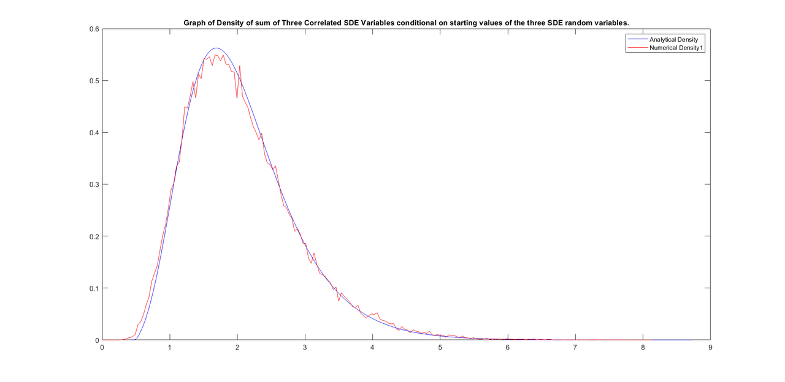](https://postimg.cc/67NsF3Yg)

.

.

.

Here is the last output

YCentralMoments =

   1.0e+02 *

  Columns 1 through 3

                   0   0.006494962683890   0.005374936417934

  Columns 4 through 6

   0.019943751025528   0.048609481265512   0.173340612884258

  Columns 7 through 8

   0.653886522543471   2.853965485160970

DataCentralMoments =

   1.0e+02 *

  Columns 1 through 3

                   0   0.006963897844845   0.005952849483616

  Columns 4 through 6

   0.022719449068775   0.055817360783397   0.199683088337636

  Columns 7 through 8

   0.736395761491362   3.072245867243055

bh00 =

   2.066610190913697

YProjected =

   2.059448018136333
```

---

### #3191 — Amin (Topic Author)
*June 27, 2026, 10:35 PM*

**(broken latex: Unbalanced $: 23)**

```latex
I repeated the process of assigning value of Gaussian to$Z_{\tilde{y}}$ three times in the function below and it is
perfect for the case I was trying. It only has a few regressions and you can do the process of re-assigning 5 or 6 times
or even more and it will take only a few seconds. Please try to experiment with this at your end.

.

.

```
function [coeff1,coeff2,coeff3,coeff4,coeff5,coeff6,coeff7] =
ConditionalDensityByRegressionOnIdealNormal04B(Yin,Zyin0,Zx,NDims,Order,paths,YCoeffZ)

NData=paths;
Order=7;
NMoments=8;

Zyin(1:NData,1)=Zyin0(1:NData);

Yin0(1:NData,1)=Yin(1:NData);

[ZI] = MomentMatchedStandardNormalDiscretizedDensity(NData);

[CoeffR] = RegressYOnXGivenZx(Yin,Zx,paths,NDims,Order);

WW(1:paths,1:Order+1)=EvalHermiteArrayH0(Zx(1:paths,1),Order);
for mm=2:NDims
    WW(1:paths,(mm-1)*Order+2:mm*Order+1)=EvalHermiteArrayH1(Zx(1:paths,mm),Order);
end

YProjected(1:paths,1)=0.0;
for mm=1:NDims*Order+1
    YProjected(1:paths,1)=YProjected(1:paths,1)+WW(1:paths,mm).*CoeffR(mm,1);
end

Y_tilde(1:NData,1)=Yin0(1:NData,1)-YProjected(1:NData,1);
Y_tilde0(1:NData)=Y_tilde(1:NData,1);

Zy0=0;
Zy=0;

[c0,c(1:Order),FittedMoments,Zy0] =
CalculateZSeriesDensityFromRawMoments02FromGuess02W(Y_tilde0(1:NData),ZI);%,XCoeffZ(2:Order+1));

for nn=1:NData
Zy(nn,1)=Zy0(nn);
end

[Yss,I]=sort(Y_tilde(1:NData,1));

DataMedian=(Yss(NData/2,1)+Yss(NData/2+1,1))/2;

Ys(1:NData,1)=Yss(1:NData,1);%-DataMedian;

%for hh=1:Order
%    W(1:NData,hh)=ZI(1:NData).^(hh);
%end

%[WHy] = EvalHermiteArrayH1(Zy,Order);

% WHyn(1:paths,1)=WHy(1:paths,nH);

Ys(1:NData,1)=Zyin(1:NData,1);

W=0;

W(1:NData,1)=Zy(1:NData,1);
W(1:NData,2)=Zx(1:NData,1);
W(1:NData,3)=Zx(1:NData,2);
W(1:NData,4)=Zx(1:NData,3);

Ymu(1:NData,1)=Ys(1:NData);

WW=(W'*W);

coeff1=(WW)$W'*Ymu);

%coeff1(1,1)

Ys(1:NData,1)=Zyin(1:NData,1).^2;
W=0;
W(1:NData,1)=Zy(1:NData,1).^2;
W(1:NData,2)=Zx(1:NData,1).^2;
W(1:NData,3)=Zx(1:NData,2).^2;
W(1:NData,4)=Zx(1:NData,3).^2;
W(1:NData,5)=Zy(1:NData,1).*Zx(1:NData,1);
W(1:NData,6)=Zy(1:NData,1).*Zx(1:NData,2);
W(1:NData,7)=Zy(1:NData,1).*Zx(1:NData,3);
W(1:NData,8)=Zx(1:NData,1).*Zx(1:NData,2);
W(1:NData,9)=Zx(1:NData,1).*Zx(1:NData,3);
W(1:NData,10)=Zx(1:NData,2).*Zx(1:NData,3);

Ymu(1:NData,1)=Ys(1:NData);

WW=(W'*W);

coeff2=(WW)$W'*Ymu);

% coeff2(5,1).*Zx(1)+coeff2(6,1).*Zx(2)+coeff2(7,1).*Zx(3)
%
% coeff2(1,1)

Ys(1:NData,1)=Zyin(1:NData,1).^3;
W=0;
W(1:NData,1)=Zy(1:NData,1).^3;
W(1:NData,2)=Zx(1:NData,1).^3;
W(1:NData,3)=Zx(1:NData,2).^3;
W(1:NData,4)=Zx(1:NData,3).^3;
W(1:NData,5)=Zy(1:NData,1).*Zx(1:NData,1).^2;
W(1:NData,6)=Zy(1:NData,1).*Zx(1:NData,2).^2;
W(1:NData,7)=Zy(1:NData,1).*Zx(1:NData,3).^2;
W(1:NData,8)=Zy(1:NData,1).^2.*Zx(1:NData,1);
W(1:NData,9)=Zy(1:NData,1).^2.*Zx(1:NData,2);
W(1:NData,10)=Zy(1:NData,1).^2.*Zx(1:NData,3);
W(1:NData,11)=Zx(1:NData,1).*Zx(1:NData,2).^2;
W(1:NData,12)=Zx(1:NData,1).*Zx(1:NData,3).^2;
W(1:NData,13)=Zx(1:NData,2).*Zx(1:NData,3).^2;
W(1:NData,14)=Zx(1:NData,1).^2.*Zx(1:NData,2);
W(1:NData,15)=Zx(1:NData,1).^2.*Zx(1:NData,3);
W(1:NData,16)=Zx(1:NData,2).^2.*Zx(1:NData,3);

Ymu(1:NData,1)=Ys(1:NData);

WW=(W'*W);

coeff3=(WW)$W'*Ymu);

% coeff3(5,1).*Zx(1).^2+coeff3(6,1).*Zx(2).^2+coeff3(7,1).*Zx(3).^2
%
% coeff3(8,1).*Zx(1)+coeff3(9,1).*Zx(2)+coeff3(10,1).*Zx(3)
%
% coeff3(1,1)

Ys(1:NData,1)=Zyin(1:NData,1).^4;
W=0;
W(1:NData,1)=Zy(1:NData,1).^4;
W(1:NData,2)=Zx(1:NData,1).^4;
W(1:NData,3)=Zx(1:NData,2).^4;
W(1:NData,4)=Zx(1:NData,3).^4;
W(1:NData,5)=Zy(1:NData,1).*Zx(1:NData,1).^3;
W(1:NData,6)=Zy(1:NData,1).*Zx(1:NData,2).^3;
W(1:NData,7)=Zy(1:NData,1).*Zx(1:NData,3).^3;
W(1:NData,8)=Zy(1:NData,1).^2.*Zx(1:NData,1).^2;
W(1:NData,9)=Zy(1:NData,1).^2.*Zx(1:NData,2).^2;
W(1:NData,10)=Zy(1:NData,1).^2.*Zx(1:NData,3).^2;
W(1:NData,11)=Zy(1:NData,1).^3.*Zx(1:NData,1).^1;
W(1:NData,12)=Zy(1:NData,1).^3.*Zx(1:NData,2).^1;
W(1:NData,13)=Zy(1:NData,1).^3.*Zx(1:NData,3).^1;
W(1:NData,14)=Zx(1:NData,1).*Zx(1:NData,2).^3;
W(1:NData,15)=Zx(1:NData,1).*Zx(1:NData,3).^3;
W(1:NData,16)=Zx(1:NData,2).*Zx(1:NData,3).^3;
W(1:NData,17)=Zx(1:NData,1).^2.*Zx(1:NData,2).^2;
W(1:NData,18)=Zx(1:NData,1).^2.*Zx(1:NData,3).^2;
W(1:NData,19)=Zx(1:NData,2).^2.*Zx(1:NData,3).^2;
W(1:NData,20)=Zx(1:NData,1).^3.*Zx(1:NData,2).^1;
W(1:NData,21)=Zx(1:NData,1).^3.*Zx(1:NData,3).^1;
W(1:NData,22)=Zx(1:NData,2).^3.*Zx(1:NData,3).^1;

Ymu(1:NData,1)=Ys(1:NData);

WW=(W'*W);

coeff4=(WW)$W'*Ymu);

% coeff4(5,1).*Zx(1).^3+coeff4(6,1).*Zx(2).^3+coeff4(7,1).*Zx(3).^3
%
% coeff4(8,1).*Zx(1).^2+coeff4(9,1).*Zx(2).^2+coeff4(10,1).*Zx(3).^2
%
% coeff4(11,1).*Zx(1).^1+coeff4(12,1).*Zx(2).^1+coeff4(13,1).*Zx(3).^1
%
% coeff4(1,1)

Ys(1:NData,1)=Zyin(1:NData,1).^5;
W=0;
W(1:NData,1)=Zy(1:NData,1).^5;
W(1:NData,2)=Zx(1:NData,1).^5;
W(1:NData,3)=Zx(1:NData,2).^5;
W(1:NData,4)=Zx(1:NData,3).^5;
W(1:NData,5)=Zy(1:NData,1).*Zx(1:NData,1).^4;
W(1:NData,6)=Zy(1:NData,1).*Zx(1:NData,2).^4;
W(1:NData,7)=Zy(1:NData,1).*Zx(1:NData,3).^4;
W(1:NData,8)=Zy(1:NData,1).^2.*Zx(1:NData,1).^3;
W(1:NData,9)=Zy(1:NData,1).^2.*Zx(1:NData,2).^3;
W(1:NData,10)=Zy(1:NData,1).^2.*Zx(1:NData,3).^3;
W(1:NData,11)=Zy(1:NData,1).^3.*Zx(1:NData,1).^2;
W(1:NData,12)=Zy(1:NData,1).^3.*Zx(1:NData,2).^2;
W(1:NData,13)=Zy(1:NData,1).^3.*Zx(1:NData,3).^2;
W(1:NData,14)=Zy(1:NData,1).^4.*Zx(1:NData,1).^1;
W(1:NData,15)=Zy(1:NData,1).^4.*Zx(1:NData,2).^1;
W(1:NData,16)=Zy(1:NData,1).^4.*Zx(1:NData,3).^1;
W(1:NData,17)=Zx(1:NData,1).*Zx(1:NData,2).^4;
W(1:NData,18)=Zx(1:NData,1).*Zx(1:NData,3).^4;
W(1:NData,19)=Zx(1:NData,2).*Zx(1:NData,3).^4;
W(1:NData,20)=Zx(1:NData,1).^2.*Zx(1:NData,2).^3;
W(1:NData,21)=Zx(1:NData,1).^2.*Zx(1:NData,3).^3;
W(1:NData,22)=Zx(1:NData,2).^2.*Zx(1:NData,3).^3;
W(1:NData,23)=Zx(1:NData,1).^3.*Zx(1:NData,2).^2;
W(1:NData,24)=Zx(1:NData,1).^3.*Zx(1:NData,3).^2;
W(1:NData,25)=Zx(1:NData,2).^3.*Zx(1:NData,3).^2;
W(1:NData,26)=Zx(1:NData,1).^4.*Zx(1:NData,2).^1;
W(1:NData,27)=Zx(1:NData,1).^4.*Zx(1:NData,3).^1;
W(1:NData,28)=Zx(1:NData,2).^4.*Zx(1:NData,3).^1;

Ymu(1:NData,1)=Ys(1:NData);

WW=(W'*W);

coeff5=(WW)$W'*Ymu);

% coeff5(5,1).*Zx(1).^4+coeff5(6,1).*Zx(2).^4+coeff5(7,1).*Zx(3).^4
%
% coeff5(8,1).*Zx(1).^3+coeff5(9,1).*Zx(2).^3+coeff5(10,1).*Zx(3).^3
%
% coeff5(11,1).*Zx(1).^2+coeff5(12,1).*Zx(2).^2+coeff5(13,1).*Zx(3).^2
%
% coeff5(14,1).*Zx(1).^1+coeff5(15,1).*Zx(2).^1+coeff5(16,1).*Zx(3).^1
%
% coeff5(1,1)

Ys(1:NData,1)=Zyin(1:NData,1).^6;
W=0;
W(1:NData,1)=Zy(1:NData,1).^6;
W(1:NData,2)=Zx(1:NData,1).^6;
W(1:NData,3)=Zx(1:NData,2).^6;
W(1:NData,4)=Zx(1:NData,3).^6;
W(1:NData,5)=Zy(1:NData,1).*Zx(1:NData,1).^5;
W(1:NData,6)=Zy(1:NData,1).*Zx(1:NData,2).^5;
W(1:NData,7)=Zy(1:NData,1).*Zx(1:NData,3).^5;
W(1:NData,8)=Zy(1:NData,1).^2.*Zx(1:NData,1).^4;
W(1:NData,9)=Zy(1:NData,1).^2.*Zx(1:NData,2).^4;
W(1:NData,10)=Zy(1:NData,1).^2.*Zx(1:NData,3).^4;
W(1:NData,11)=Zy(1:NData,1).^3.*Zx(1:NData,1).^3;
W(1:NData,12)=Zy(1:NData,1).^3.*Zx(1:NData,2).^3;
W(1:NData,13)=Zy(1:NData,1).^3.*Zx(1:NData,3).^3;
W(1:NData,14)=Zy(1:NData,1).^4.*Zx(1:NData,1).^2;
W(1:NData,15)=Zy(1:NData,1).^4.*Zx(1:NData,2).^2;
W(1:NData,16)=Zy(1:NData,1).^4.*Zx(1:NData,3).^2;
W(1:NData,17)=Zy(1:NData,1).^5.*Zx(1:NData,1).^1;
W(1:NData,18)=Zy(1:NData,1).^5.*Zx(1:NData,2).^1;
W(1:NData,19)=Zy(1:NData,1).^5.*Zx(1:NData,3).^1;
W(1:NData,20)=Zx(1:NData,1).*Zx(1:NData,2).^5;
W(1:NData,21)=Zx(1:NData,1).*Zx(1:NData,3).^5;
W(1:NData,22)=Zx(1:NData,2).*Zx(1:NData,3).^5;
W(1:NData,23)=Zx(1:NData,1).^2.*Zx(1:NData,2).^4;
W(1:NData,24)=Zx(1:NData,1).^2.*Zx(1:NData,3).^4;
W(1:NData,25)=Zx(1:NData,2).^2.*Zx(1:NData,3).^4;
W(1:NData,26)=Zx(1:NData,1).^3.*Zx(1:NData,2).^3;
W(1:NData,27)=Zx(1:NData,1).^3.*Zx(1:NData,3).^3;
W(1:NData,28)=Zx(1:NData,2).^3.*Zx(1:NData,3).^3;
W(1:NData,29)=Zx(1:NData,1).^4.*Zx(1:NData,2).^2;
W(1:NData,30)=Zx(1:NData,1).^4.*Zx(1:NData,3).^2;
W(1:NData,31)=Zx(1:NData,2).^4.*Zx(1:NData,3).^2;
W(1:NData,32)=Zx(1:NData,1).^5.*Zx(1:NData,2).^1;
W(1:NData,33)=Zx(1:NData,1).^5.*Zx(1:NData,3).^1;
W(1:NData,34)=Zx(1:NData,2).^5.*Zx(1:NData,3).^1;

Ymu(1:NData,1)=Ys(1:NData);

WW=(W'*W);

coeff6=(WW)$W'*Ymu);

% coeff6(5,1).*Zx(1).^5+coeff6(6,1).*Zx(2).^5+coeff6(7,1).*Zx(3).^5
%
% coeff6(8,1).*Zx(1).^4+coeff6(9,1).*Zx(2).^4+coeff6(10,1).*Zx(3).^4
%
% coeff6(11,1).*Zx(1).^3+coeff6(12,1).*Zx(2).^3+coeff6(13,1).*Zx(3).^3
%
% coeff6(14,1).*Zx(1).^2+coeff6(15,1).*Zx(2).^2+coeff6(16,1).*Zx(3).^2
%
% coeff6(17,1).*Zx(1).^1+coeff6(18,1).*Zx(2).^1+coeff6(19,1).*Zx(3).^1
%
% coeff6(1,1)

Ys(1:NData,1)=Zyin(1:NData,1).^7;
W=0;
W(1:NData,1)=Zy(1:NData,1).^7;
W(1:NData,2)=Zx(1:NData,1).^7;
W(1:NData,3)=Zx(1:NData,2).^7;
W(1:NData,4)=Zx(1:NData,3).^7;
W(1:NData,5)=Zy(1:NData,1).*Zx(1:NData,1).^6;
W(1:NData,6)=Zy(1:NData,1).*Zx(1:NData,2).^6;
W(1:NData,7)=Zy(1:NData,1).*Zx(1:NData,3).^6;
W(1:NData,8)=Zy(1:NData,1).^2.*Zx(1:NData,1).^5;
W(1:NData,9)=Zy(1:NData,1).^2.*Zx(1:NData,2).^5;
W(1:NData,10)=Zy(1:NData,1).^2.*Zx(1:NData,3).^5;
W(1:NData,11)=Zy(1:NData,1).^3.*Zx(1:NData,1).^4;
W(1:NData,12)=Zy(1:NData,1).^3.*Zx(1:NData,2).^4;
W(1:NData,13)=Zy(1:NData,1).^3.*Zx(1:NData,3).^4;
W(1:NData,14)=Zy(1:NData,1).^4.*Zx(1:NData,1).^3;
W(1:NData,15)=Zy(1:NData,1).^4.*Zx(1:NData,2).^3;
W(1:NData,16)=Zy(1:NData,1).^4.*Zx(1:NData,3).^3;
W(1:NData,17)=Zy(1:NData,1).^5.*Zx(1:NData,1).^2;
W(1:NData,18)=Zy(1:NData,1).^5.*Zx(1:NData,2).^2;
W(1:NData,19)=Zy(1:NData,1).^5.*Zx(1:NData,3).^2;
W(1:NData,20)=Zy(1:NData,1).^6.*Zx(1:NData,1).^1;
W(1:NData,21)=Zy(1:NData,1).^6.*Zx(1:NData,2).^1;
W(1:NData,22)=Zy(1:NData,1).^6.*Zx(1:NData,3).^1;
W(1:NData,23)=Zx(1:NData,1).*Zx(1:NData,2).^6;
W(1:NData,24)=Zx(1:NData,1).*Zx(1:NData,3).^6;
W(1:NData,25)=Zx(1:NData,2).*Zx(1:NData,3).^6;
W(1:NData,26)=Zx(1:NData,1).^2.*Zx(1:NData,2).^5;
W(1:NData,27)=Zx(1:NData,1).^2.*Zx(1:NData,3).^5;
W(1:NData,28)=Zx(1:NData,2).^2.*Zx(1:NData,3).^5;
W(1:NData,29)=Zx(1:NData,1).^3.*Zx(1:NData,2).^4;
W(1:NData,30)=Zx(1:NData,1).^3.*Zx(1:NData,3).^4;
W(1:NData,31)=Zx(1:NData,2).^3.*Zx(1:NData,3).^4;
W(1:NData,32)=Zx(1:NData,1).^4.*Zx(1:NData,2).^3;
W(1:NData,33)=Zx(1:NData,1).^4.*Zx(1:NData,3).^3;
W(1:NData,34)=Zx(1:NData,2).^4.*Zx(1:NData,3).^3;
W(1:NData,35)=Zx(1:NData,1).^5.*Zx(1:NData,2).^2;
W(1:NData,36)=Zx(1:NData,1).^5.*Zx(1:NData,3).^2;
W(1:NData,37)=Zx(1:NData,2).^5.*Zx(1:NData,3).^2;
W(1:NData,38)=Zx(1:NData,1).^5.*Zx(1:NData,2).^1;
W(1:NData,39)=Zx(1:NData,1).^5.*Zx(1:NData,3).^1;
W(1:NData,40)=Zx(1:NData,2).^5.*Zx(1:NData,3).^1;

Ymu(1:NData,1)=Ys(1:NData);

WW=(W'*W);

coeff7=(WW)$W'*Ymu);

% coeff7(5,1).*Zx(1).^6+coeff7(6,1).*Zx(2).^6+coeff7(7,1).*Zx(3).^6
%
% coeff7(8,1).*Zx(1).^5+coeff7(9,1).*Zx(2).^5+coeff7(10,1).*Zx(3).^5
%
% coeff7(11,1).*Zx(1).^4+coeff7(12,1).*Zx(2).^4+coeff7(13,1).*Zx(3).^4
%
% coeff7(14,1).*Zx(1).^3+coeff7(15,1).*Zx(2).^3+coeff7(16,1).*Zx(3).^3
%
% coeff7(17,1).*Zx(1).^2+coeff7(18,1).*Zx(2).^2+coeff7(19,1).*Zx(3).^2
%
% coeff7(20,1).*Zx(1).^1+coeff7(21,1).*Zx(2).^1+coeff7(22,1).*Zx(3).^1
%
% coeff7(1,1)

coeff1

coeff2

coeff3

coeff4

coeff5

coeff6

coeff7

str=input("Look at all sets of coefficients");

b1(1:paths,1)= YCoeffZ(8).*(coeff7(5,1).*Zx(1:paths,1).^6+coeff7(6,1).*Zx(1:paths,2).^6+coeff7(7,1).*Zx(1:paths,3).^6) +
...
    YCoeffZ(7).*(coeff6(5,1).*Zx(1:paths,1).^5+coeff6(6,1).*Zx(1:paths,2).^5+coeff6(7,1).*Zx(1:paths,3).^5)+...
    YCoeffZ(6).*(coeff5(5,1).*Zx(1:paths,1).^4+coeff5(6,1).*Zx(1:paths,2).^4+coeff5(7,1).*Zx(1:paths,3).^4)+ ...
    YCoeffZ(5).*(coeff4(5,1).*Zx(1:paths,1).^3+coeff4(6,1).*Zx(1:paths,2).^3+coeff4(7,1).*Zx(1:paths,3).^3)+ ...
    YCoeffZ(4).*(coeff3(5,1).*Zx(1:paths,1).^2+coeff3(6,1).*Zx(1:paths,2).^2+coeff3(7,1).*Zx(1:paths,3).^2)+ ...
    YCoeffZ(3).*(coeff2(5,1).*Zx(1:paths,1)+coeff2(6,1).*Zx(1:paths,2)+coeff2(7,1).*Zx(1:paths,3))+ ...
    0*YCoeffZ(2).*(coeff1(1,1));

b2(1:paths,1)=YCoeffZ(8).*(coeff7(8,1).*Zx(1:paths,1).^5+coeff7(9,1).*Zx(1:paths,2).^5+coeff7(10,1).*Zx(1:paths,3).^5) +
...
    YCoeffZ(7).*(coeff6(8,1).*Zx(1:paths,1).^4+coeff6(9,1).*Zx(1:paths,2).^4+coeff6(10,1).*Zx(1:paths,3).^4)+ ...
    YCoeffZ(6).*(coeff5(8,1).*Zx(1:paths,1).^3+coeff5(9,1).*Zx(1:paths,2).^3+coeff5(10,1).*Zx(1:paths,3).^3)+ ...
    YCoeffZ(5).*(coeff4(8,1).*Zx(1:paths,1).^2+coeff4(9,1).*Zx(1:paths,2).^2+coeff4(10,1).*Zx(1:paths,3).^2)+ ...
    YCoeffZ(4).*(coeff3(8,1).*Zx(1:paths,1)+coeff3(9,1).*Zx(1:paths,2)+coeff3(10,1).*Zx(1:paths,3))+ ...
    0*YCoeffZ(3).*(coeff2(1,1));

b3(1:paths,1)=YCoeffZ(8).*(coeff7(11,1).*Zx(1:paths,1).^4+coeff7(12,1).*Zx(1:paths,2).^4+coeff7(13,1).*Zx(1:paths,3).^4)+
...
    YCoeffZ(7).*(coeff6(11,1).*Zx(1:paths,1).^3+coeff6(12,1).*Zx(1:paths,2).^3+coeff6(13,1).*Zx(1:paths,3).^3)+ ...
    YCoeffZ(6).*(coeff5(11,1).*Zx(1:paths,1).^2+coeff5(12,1).*Zx(1:paths,2).^2+coeff5(13,1).*Zx(1:paths,3).^2)+ ...
    YCoeffZ(5).*(coeff4(11,1).*Zx(1:paths,1).^1+coeff4(12,1).*Zx(1:paths,2).^1+coeff4(13,1).*Zx(1:paths,3).^1)+ ...
    0*YCoeffZ(4).*(coeff3(1,1));

b4(1:paths,1)=YCoeffZ(8).*(coeff7(14,1).*Zx(1:paths,1).^3+coeff7(15,1).*Zx(1:paths,2).^3+coeff7(16,1).*Zx(1:paths,3).^3
)+ ...
    YCoeffZ(7).*(coeff6(14,1).*Zx(1:paths,1).^2+coeff6(15,1).*Zx(1:paths,2).^2+coeff6(16,1).*Zx(1:paths,3).^2)+ ...
    YCoeffZ(6).*(coeff5(14,1).*Zx(1:paths,1).^1+coeff5(15,1).*Zx(1:paths,2).^1+coeff5(16,1).*Zx(1:paths,3).^1)+ ...
    0*YCoeffZ(5).*(coeff4(1,1));

b5(1:paths,1)=YCoeffZ(8).*(coeff7(17,1).*Zx(1:paths,1).^2+coeff7(18,1).*Zx(1:paths,2).^2+coeff7(19,1).*Zx(1:paths,3).^2)+
...
    YCoeffZ(7).*(coeff6(17,1).*Zx(1:paths,1).^1+coeff6(18,1).*Zx(1:paths,2).^1+coeff6(19,1).*Zx(1:paths,3).^1)+ ...
   0* YCoeffZ(6).*(coeff5(1,1));

b6(1:paths,1)=YCoeffZ(8).*(coeff7(20,1).*Zx(1:paths,1).^1+coeff7(21,1).*Zx(1:paths,2).^1+coeff7(22,1).*Zx(1:paths,3).^1)+
...
   0* YCoeffZ(7).*(coeff6(1,1));

%b7(1:paths,1)=YCoeffZ(8).*(coeff7(1,1));

CrossContrib(1:paths,1)=b1.*Zy(1:paths,1)+b2.*Zy(1:paths,1).^2+b3.*Zy(1:paths,1).^3+ ...
    b4.*Zy(1:paths,1).^4+b5.*Zy(1:paths,1).^5+b6.*Zy(1:paths,1).^6;

Y_tilde(1:NData,1)=Yin0(1:NData,1)-YProjected(1:NData,1)-CrossContrib(1:paths,1);
Y_tilde0(1:NData)=Y_tilde(1:NData,1);

Zy0=0;
Zy=0;

[c0,c(1:Order),FittedMoments,Zy0] =
CalculateZSeriesDensityFromRawMoments02FromGuess02W(Y_tilde0(1:NData),ZI);%,XCoeffZ(2:Order+1));

str=input("Look at second density and moments");

for nn=1:NData
Zy(nn,1)=Zy0(nn);
end

[Yss,I]=sort(Y_tilde(1:NData,1));

DataMedian=(Yss(NData/2,1)+Yss(NData/2+1,1))/2;

Ys(1:NData,1)=Yss(1:NData,1);%-DataMedian;

%for hh=1:Order
%    W(1:NData,hh)=ZI(1:NData).^(hh);
%end

%[WHy] = EvalHermiteArrayH1(Zy,Order);

% WHyn(1:paths,1)=WHy(1:paths,nH);

Ys(1:NData,1)=Zyin(1:NData,1);

W=0;

W(1:NData,1)=Zy(1:NData,1);
W(1:NData,2)=Zx(1:NData,1);
W(1:NData,3)=Zx(1:NData,2);
W(1:NData,4)=Zx(1:NData,3);

Ymu(1:NData,1)=Ys(1:NData);

WW=(W'*W);

coeff1=(WW)$W'*Ymu);

%coeff1(1,1)

Ys(1:NData,1)=Zyin(1:NData,1).^2;
W=0;
W(1:NData,1)=Zy(1:NData,1).^2;
W(1:NData,2)=Zx(1:NData,1).^2;
W(1:NData,3)=Zx(1:NData,2).^2;
W(1:NData,4)=Zx(1:NData,3).^2;
W(1:NData,5)=Zy(1:NData,1).*Zx(1:NData,1);
W(1:NData,6)=Zy(1:NData,1).*Zx(1:NData,2);
W(1:NData,7)=Zy(1:NData,1).*Zx(1:NData,3);
W(1:NData,8)=Zx(1:NData,1).*Zx(1:NData,2);
W(1:NData,9)=Zx(1:NData,1).*Zx(1:NData,3);
W(1:NData,10)=Zx(1:NData,2).*Zx(1:NData,3);

Ymu(1:NData,1)=Ys(1:NData);

WW=(W'*W);

coeff2=(WW)$W'*Ymu);

% coeff2(5,1).*Zx(1)+coeff2(6,1).*Zx(2)+coeff2(7,1).*Zx(3)
%
% coeff2(1,1)

Ys(1:NData,1)=Zyin(1:NData,1).^3;
W=0;
W(1:NData,1)=Zy(1:NData,1).^3;
W(1:NData,2)=Zx(1:NData,1).^3;
W(1:NData,3)=Zx(1:NData,2).^3;
W(1:NData,4)=Zx(1:NData,3).^3;
W(1:NData,5)=Zy(1:NData,1).*Zx(1:NData,1).^2;
W(1:NData,6)=Zy(1:NData,1).*Zx(1:NData,2).^2;
W(1:NData,7)=Zy(1:NData,1).*Zx(1:NData,3).^2;
W(1:NData,8)=Zy(1:NData,1).^2.*Zx(1:NData,1);
W(1:NData,9)=Zy(1:NData,1).^2.*Zx(1:NData,2);
W(1:NData,10)=Zy(1:NData,1).^2.*Zx(1:NData,3);
W(1:NData,11)=Zx(1:NData,1).*Zx(1:NData,2).^2;
W(1:NData,12)=Zx(1:NData,1).*Zx(1:NData,3).^2;
W(1:NData,13)=Zx(1:NData,2).*Zx(1:NData,3).^2;
W(1:NData,14)=Zx(1:NData,1).^2.*Zx(1:NData,2);
W(1:NData,15)=Zx(1:NData,1).^2.*Zx(1:NData,3);
W(1:NData,16)=Zx(1:NData,2).^2.*Zx(1:NData,3);

Ymu(1:NData,1)=Ys(1:NData);

WW=(W'*W);

coeff3=(WW)$W'*Ymu);

% coeff3(5,1).*Zx(1).^2+coeff3(6,1).*Zx(2).^2+coeff3(7,1).*Zx(3).^2
%
% coeff3(8,1).*Zx(1)+coeff3(9,1).*Zx(2)+coeff3(10,1).*Zx(3)
%
% coeff3(1,1)

Ys(1:NData,1)=Zyin(1:NData,1).^4;
W=0;
W(1:NData,1)=Zy(1:NData,1).^4;
W(1:NData,2)=Zx(1:NData,1).^4;
W(1:NData,3)=Zx(1:NData,2).^4;
W(1:NData,4)=Zx(1:NData,3).^4;
W(1:NData,5)=Zy(1:NData,1).*Zx(1:NData,1).^3;
W(1:NData,6)=Zy(1:NData,1).*Zx(1:NData,2).^3;
W(1:NData,7)=Zy(1:NData,1).*Zx(1:NData,3).^3;
W(1:NData,8)=Zy(1:NData,1).^2.*Zx(1:NData,1).^2;
W(1:NData,9)=Zy(1:NData,1).^2.*Zx(1:NData,2).^2;
W(1:NData,10)=Zy(1:NData,1).^2.*Zx(1:NData,3).^2;
W(1:NData,11)=Zy(1:NData,1).^3.*Zx(1:NData,1).^1;
W(1:NData,12)=Zy(1:NData,1).^3.*Zx(1:NData,2).^1;
W(1:NData,13)=Zy(1:NData,1).^3.*Zx(1:NData,3).^1;
W(1:NData,14)=Zx(1:NData,1).*Zx(1:NData,2).^3;
W(1:NData,15)=Zx(1:NData,1).*Zx(1:NData,3).^3;
W(1:NData,16)=Zx(1:NData,2).*Zx(1:NData,3).^3;
W(1:NData,17)=Zx(1:NData,1).^2.*Zx(1:NData,2).^2;
W(1:NData,18)=Zx(1:NData,1).^2.*Zx(1:NData,3).^2;
W(1:NData,19)=Zx(1:NData,2).^2.*Zx(1:NData,3).^2;
W(1:NData,20)=Zx(1:NData,1).^3.*Zx(1:NData,2).^1;
W(1:NData,21)=Zx(1:NData,1).^3.*Zx(1:NData,3).^1;
W(1:NData,22)=Zx(1:NData,2).^3.*Zx(1:NData,3).^1;

Ymu(1:NData,1)=Ys(1:NData);

WW=(W'*W);

coeff4=(WW)$W'*Ymu);

% coeff4(5,1).*Zx(1).^3+coeff4(6,1).*Zx(2).^3+coeff4(7,1).*Zx(3).^3
%
% coeff4(8,1).*Zx(1).^2+coeff4(9,1).*Zx(2).^2+coeff4(10,1).*Zx(3).^2
%
% coeff4(11,1).*Zx(1).^1+coeff4(12,1).*Zx(2).^1+coeff4(13,1).*Zx(3).^1
%
% coeff4(1,1)

Ys(1:NData,1)=Zyin(1:NData,1).^5;
W=0;
W(1:NData,1)=Zy(1:NData,1).^5;
W(1:NData,2)=Zx(1:NData,1).^5;
W(1:NData,3)=Zx(1:NData,2).^5;
W(1:NData,4)=Zx(1:NData,3).^5;
W(1:NData,5)=Zy(1:NData,1).*Zx(1:NData,1).^4;
W(1:NData,6)=Zy(1:NData,1).*Zx(1:NData,2).^4;
W(1:NData,7)=Zy(1:NData,1).*Zx(1:NData,3).^4;
W(1:NData,8)=Zy(1:NData,1).^2.*Zx(1:NData,1).^3;
W(1:NData,9)=Zy(1:NData,1).^2.*Zx(1:NData,2).^3;
W(1:NData,10)=Zy(1:NData,1).^2.*Zx(1:NData,3).^3;
W(1:NData,11)=Zy(1:NData,1).^3.*Zx(1:NData,1).^2;
W(1:NData,12)=Zy(1:NData,1).^3.*Zx(1:NData,2).^2;
W(1:NData,13)=Zy(1:NData,1).^3.*Zx(1:NData,3).^2;
W(1:NData,14)=Zy(1:NData,1).^4.*Zx(1:NData,1).^1;
W(1:NData,15)=Zy(1:NData,1).^4.*Zx(1:NData,2).^1;
W(1:NData,16)=Zy(1:NData,1).^4.*Zx(1:NData,3).^1;
W(1:NData,17)=Zx(1:NData,1).*Zx(1:NData,2).^4;
W(1:NData,18)=Zx(1:NData,1).*Zx(1:NData,3).^4;
W(1:NData,19)=Zx(1:NData,2).*Zx(1:NData,3).^4;
W(1:NData,20)=Zx(1:NData,1).^2.*Zx(1:NData,2).^3;
W(1:NData,21)=Zx(1:NData,1).^2.*Zx(1:NData,3).^3;
W(1:NData,22)=Zx(1:NData,2).^2.*Zx(1:NData,3).^3;
W(1:NData,23)=Zx(1:NData,1).^3.*Zx(1:NData,2).^2;
W(1:NData,24)=Zx(1:NData,1).^3.*Zx(1:NData,3).^2;
W(1:NData,25)=Zx(1:NData,2).^3.*Zx(1:NData,3).^2;
W(1:NData,26)=Zx(1:NData,1).^4.*Zx(1:NData,2).^1;
W(1:NData,27)=Zx(1:NData,1).^4.*Zx(1:NData,3).^1;
W(1:NData,28)=Zx(1:NData,2).^4.*Zx(1:NData,3).^1;

Ymu(1:NData,1)=Ys(1:NData);

WW=(W'*W);

coeff5=(WW)$W'*Ymu);

% coeff5(5,1).*Zx(1).^4+coeff5(6,1).*Zx(2).^4+coeff5(7,1).*Zx(3).^4
%
% coeff5(8,1).*Zx(1).^3+coeff5(9,1).*Zx(2).^3+coeff5(10,1).*Zx(3).^3
%
% coeff5(11,1).*Zx(1).^2+coeff5(12,1).*Zx(2).^2+coeff5(13,1).*Zx(3).^2
%
% coeff5(14,1).*Zx(1).^1+coeff5(15,1).*Zx(2).^1+coeff5(16,1).*Zx(3).^1
%
% coeff5(1,1)

Ys(1:NData,1)=Zyin(1:NData,1).^6;
W=0;
W(1:NData,1)=Zy(1:NData,1).^6;
W(1:NData,2)=Zx(1:NData,1).^6;
W(1:NData,3)=Zx(1:NData,2).^6;
W(1:NData,4)=Zx(1:NData,3).^6;
W(1:NData,5)=Zy(1:NData,1).*Zx(1:NData,1).^5;
W(1:NData,6)=Zy(1:NData,1).*Zx(1:NData,2).^5;
W(1:NData,7)=Zy(1:NData,1).*Zx(1:NData,3).^5;
W(1:NData,8)=Zy(1:NData,1).^2.*Zx(1:NData,1).^4;
W(1:NData,9)=Zy(1:NData,1).^2.*Zx(1:NData,2).^4;
W(1:NData,10)=Zy(1:NData,1).^2.*Zx(1:NData,3).^4;
W(1:NData,11)=Zy(1:NData,1).^3.*Zx(1:NData,1).^3;
W(1:NData,12)=Zy(1:NData,1).^3.*Zx(1:NData,2).^3;
W(1:NData,13)=Zy(1:NData,1).^3.*Zx(1:NData,3).^3;
W(1:NData,14)=Zy(1:NData,1).^4.*Zx(1:NData,1).^2;
W(1:NData,15)=Zy(1:NData,1).^4.*Zx(1:NData,2).^2;
W(1:NData,16)=Zy(1:NData,1).^4.*Zx(1:NData,3).^2;
W(1:NData,17)=Zy(1:NData,1).^5.*Zx(1:NData,1).^1;
W(1:NData,18)=Zy(1:NData,1).^5.*Zx(1:NData,2).^1;
W(1:NData,19)=Zy(1:NData,1).^5.*Zx(1:NData,3).^1;
W(1:NData,20)=Zx(1:NData,1).*Zx(1:NData,2).^5;
W(1:NData,21)=Zx(1:NData,1).*Zx(1:NData,3).^5;
W(1:NData,22)=Zx(1:NData,2).*Zx(1:NData,3).^5;
W(1:NData,23)=Zx(1:NData,1).^2.*Zx(1:NData,2).^4;
W(1:NData,24)=Zx(1:NData,1).^2.*Zx(1:NData,3).^4;
W(1:NData,25)=Zx(1:NData,2).^2.*Zx(1:NData,3).^4;
W(1:NData,26)=Zx(1:NData,1).^3.*Zx(1:NData,2).^3;
W(1:NData,27)=Zx(1:NData,1).^3.*Zx(1:NData,3).^3;
W(1:NData,28)=Zx(1:NData,2).^3.*Zx(1:NData,3).^3;
W(1:NData,29)=Zx(1:NData,1).^4.*Zx(1:NData,2).^2;
W(1:NData,30)=Zx(1:NData,1).^4.*Zx(1:NData,3).^2;
W(1:NData,31)=Zx(1:NData,2).^4.*Zx(1:NData,3).^2;
W(1:NData,32)=Zx(1:NData,1).^5.*Zx(1:NData,2).^1;
W(1:NData,33)=Zx(1:NData,1).^5.*Zx(1:NData,3).^1;
W(1:NData,34)=Zx(1:NData,2).^5.*Zx(1:NData,3).^1;

Ymu(1:NData,1)=Ys(1:NData);

WW=(W'*W);

coeff6=(WW)$W'*Ymu);

% coeff6(5,1).*Zx(1).^5+coeff6(6,1).*Zx(2).^5+coeff6(7,1).*Zx(3).^5
%
% coeff6(8,1).*Zx(1).^4+coeff6(9,1).*Zx(2).^4+coeff6(10,1).*Zx(3).^4
%
% coeff6(11,1).*Zx(1).^3+coeff6(12,1).*Zx(2).^3+coeff6(13,1).*Zx(3).^3
%
% coeff6(14,1).*Zx(1).^2+coeff6(15,1).*Zx(2).^2+coeff6(16,1).*Zx(3).^2
%
% coeff6(17,1).*Zx(1).^1+coeff6(18,1).*Zx(2).^1+coeff6(19,1).*Zx(3).^1
%
% coeff6(1,1)

Ys(1:NData,1)=Zyin(1:NData,1).^7;
W=0;
W(1:NData,1)=Zy(1:NData,1).^7;
W(1:NData,2)=Zx(1:NData,1).^7;
W(1:NData,3)=Zx(1:NData,2).^7;
W(1:NData,4)=Zx(1:NData,3).^7;
W(1:NData,5)=Zy(1:NData,1).*Zx(1:NData,1).^6;
W(1:NData,6)=Zy(1:NData,1).*Zx(1:NData,2).^6;
W(1:NData,7)=Zy(1:NData,1).*Zx(1:NData,3).^6;
W(1:NData,8)=Zy(1:NData,1).^2.*Zx(1:NData,1).^5;
W(1:NData,9)=Zy(1:NData,1).^2.*Zx(1:NData,2).^5;
W(1:NData,10)=Zy(1:NData,1).^2.*Zx(1:NData,3).^5;
W(1:NData,11)=Zy(1:NData,1).^3.*Zx(1:NData,1).^4;
W(1:NData,12)=Zy(1:NData,1).^3.*Zx(1:NData,2).^4;
W(1:NData,13)=Zy(1:NData,1).^3.*Zx(1:NData,3).^4;
W(1:NData,14)=Zy(1:NData,1).^4.*Zx(1:NData,1).^3;
W(1:NData,15)=Zy(1:NData,1).^4.*Zx(1:NData,2).^3;
W(1:NData,16)=Zy(1:NData,1).^4.*Zx(1:NData,3).^3;
W(1:NData,17)=Zy(1:NData,1).^5.*Zx(1:NData,1).^2;
W(1:NData,18)=Zy(1:NData,1).^5.*Zx(1:NData,2).^2;
W(1:NData,19)=Zy(1:NData,1).^5.*Zx(1:NData,3).^2;
W(1:NData,20)=Zy(1:NData,1).^6.*Zx(1:NData,1).^1;
W(1:NData,21)=Zy(1:NData,1).^6.*Zx(1:NData,2).^1;
W(1:NData,22)=Zy(1:NData,1).^6.*Zx(1:NData,3).^1;
W(1:NData,23)=Zx(1:NData,1).*Zx(1:NData,2).^6;
W(1:NData,24)=Zx(1:NData,1).*Zx(1:NData,3).^6;
W(1:NData,25)=Zx(1:NData,2).*Zx(1:NData,3).^6;
W(1:NData,26)=Zx(1:NData,1).^2.*Zx(1:NData,2).^5;
W(1:NData,27)=Zx(1:NData,1).^2.*Zx(1:NData,3).^5;
W(1:NData,28)=Zx(1:NData,2).^2.*Zx(1:NData,3).^5;
W(1:NData,29)=Zx(1:NData,1).^3.*Zx(1:NData,2).^4;
W(1:NData,30)=Zx(1:NData,1).^3.*Zx(1:NData,3).^4;
W(1:NData,31)=Zx(1:NData,2).^3.*Zx(1:NData,3).^4;
W(1:NData,32)=Zx(1:NData,1).^4.*Zx(1:NData,2).^3;
W(1:NData,33)=Zx(1:NData,1).^4.*Zx(1:NData,3).^3;
W(1:NData,34)=Zx(1:NData,2).^4.*Zx(1:NData,3).^3;
W(1:NData,35)=Zx(1:NData,1).^5.*Zx(1:NData,2).^2;
W(1:NData,36)=Zx(1:NData,1).^5.*Zx(1:NData,3).^2;
W(1:NData,37)=Zx(1:NData,2).^5.*Zx(1:NData,3).^2;
W(1:NData,38)=Zx(1:NData,1).^5.*Zx(1:NData,2).^1;
W(1:NData,39)=Zx(1:NData,1).^5.*Zx(1:NData,3).^1;
W(1:NData,40)=Zx(1:NData,2).^5.*Zx(1:NData,3).^1;

Ymu(1:NData,1)=Ys(1:NData);

WW=(W'*W);

coeff7=(WW)$W'*Ymu);

% coeff7(5,1).*Zx(1).^6+coeff7(6,1).*Zx(2).^6+coeff7(7,1).*Zx(3).^6
%
% coeff7(8,1).*Zx(1).^5+coeff7(9,1).*Zx(2).^5+coeff7(10,1).*Zx(3).^5
%
% coeff7(11,1).*Zx(1).^4+coeff7(12,1).*Zx(2).^4+coeff7(13,1).*Zx(3).^4
%
% coeff7(14,1).*Zx(1).^3+coeff7(15,1).*Zx(2).^3+coeff7(16,1).*Zx(3).^3
%
% coeff7(17,1).*Zx(1).^2+coeff7(18,1).*Zx(2).^2+coeff7(19,1).*Zx(3).^2
%
% coeff7(20,1).*Zx(1).^1+coeff7(21,1).*Zx(2).^1+coeff7(22,1).*Zx(3).^1
%
% coeff7(1,1)

coeff1

coeff2

coeff3

coeff4

coeff5

coeff6

coeff7

str=input("Look at all sets of coefficients");

b1(1:paths,1)= YCoeffZ(8).*(coeff7(5,1).*Zx(1:paths,1).^6+coeff7(6,1).*Zx(1:paths,2).^6+coeff7(7,1).*Zx(1:paths,3).^6) +
...
    YCoeffZ(7).*(coeff6(5,1).*Zx(1:paths,1).^5+coeff6(6,1).*Zx(1:paths,2).^5+coeff6(7,1).*Zx(1:paths,3).^5)+...
    YCoeffZ(6).*(coeff5(5,1).*Zx(1:paths,1).^4+coeff5(6,1).*Zx(1:paths,2).^4+coeff5(7,1).*Zx(1:paths,3).^4)+ ...
    YCoeffZ(5).*(coeff4(5,1).*Zx(1:paths,1).^3+coeff4(6,1).*Zx(1:paths,2).^3+coeff4(7,1).*Zx(1:paths,3).^3)+ ...
    YCoeffZ(4).*(coeff3(5,1).*Zx(1:paths,1).^2+coeff3(6,1).*Zx(1:paths,2).^2+coeff3(7,1).*Zx(1:paths,3).^2)+ ...
    YCoeffZ(3).*(coeff2(5,1).*Zx(1:paths,1)+coeff2(6,1).*Zx(1:paths,2)+coeff2(7,1).*Zx(1:paths,3))+ ...
    0*YCoeffZ(2).*(coeff1(1,1));

b2(1:paths,1)=YCoeffZ(8).*(coeff7(8,1).*Zx(1:paths,1).^5+coeff7(9,1).*Zx(1:paths,2).^5+coeff7(10,1).*Zx(1:paths,3).^5) +
...
    YCoeffZ(7).*(coeff6(8,1).*Zx(1:paths,1).^4+coeff6(9,1).*Zx(1:paths,2).^4+coeff6(10,1).*Zx(1:paths,3).^4)+ ...
    YCoeffZ(6).*(coeff5(8,1).*Zx(1:paths,1).^3+coeff5(9,1).*Zx(1:paths,2).^3+coeff5(10,1).*Zx(1:paths,3).^3)+ ...
    YCoeffZ(5).*(coeff4(8,1).*Zx(1:paths,1).^2+coeff4(9,1).*Zx(1:paths,2).^2+coeff4(10,1).*Zx(1:paths,3).^2)+ ...
    YCoeffZ(4).*(coeff3(8,1).*Zx(1:paths,1)+coeff3(9,1).*Zx(1:paths,2)+coeff3(10,1).*Zx(1:paths,3))+ ...
    0*YCoeffZ(3).*(coeff2(1,1));

b3(1:paths,1)=YCoeffZ(8).*(coeff7(11,1).*Zx(1:paths,1).^4+coeff7(12,1).*Zx(1:paths,2).^4+coeff7(13,1).*Zx(1:paths,3).^4)+
...
    YCoeffZ(7).*(coeff6(11,1).*Zx(1:paths,1).^3+coeff6(12,1).*Zx(1:paths,2).^3+coeff6(13,1).*Zx(1:paths,3).^3)+ ...
    YCoeffZ(6).*(coeff5(11,1).*Zx(1:paths,1).^2+coeff5(12,1).*Zx(1:paths,2).^2+coeff5(13,1).*Zx(1:paths,3).^2)+ ...
    YCoeffZ(5).*(coeff4(11,1).*Zx(1:paths,1).^1+coeff4(12,1).*Zx(1:paths,2).^1+coeff4(13,1).*Zx(1:paths,3).^1)+ ...
    0*YCoeffZ(4).*(coeff3(1,1));

b4(1:paths,1)=YCoeffZ(8).*(coeff7(14,1).*Zx(1:paths,1).^3+coeff7(15,1).*Zx(1:paths,2).^3+coeff7(16,1).*Zx(1:paths,3).^3
)+ ...
    YCoeffZ(7).*(coeff6(14,1).*Zx(1:paths,1).^2+coeff6(15,1).*Zx(1:paths,2).^2+coeff6(16,1).*Zx(1:paths,3).^2)+ ...
    YCoeffZ(6).*(coeff5(14,1).*Zx(1:paths,1).^1+coeff5(15,1).*Zx(1:paths,2).^1+coeff5(16,1).*Zx(1:paths,3).^1)+ ...
    0*YCoeffZ(5).*(coeff4(1,1));

b5(1:paths,1)=YCoeffZ(8).*(coeff7(17,1).*Zx(1:paths,1).^2+coeff7(18,1).*Zx(1:paths,2).^2+coeff7(19,1).*Zx(1:paths,3).^2)+
...
    YCoeffZ(7).*(coeff6(17,1).*Zx(1:paths,1).^1+coeff6(18,1).*Zx(1:paths,2).^1+coeff6(19,1).*Zx(1:paths,3).^1)+ ...
   0* YCoeffZ(6).*(coeff5(1,1));

b6(1:paths,1)=YCoeffZ(8).*(coeff7(20,1).*Zx(1:paths,1).^1+coeff7(21,1).*Zx(1:paths,2).^1+coeff7(22,1).*Zx(1:paths,3).^1)+
...
   0* YCoeffZ(7).*(coeff6(1,1));

%b7(1:paths,1)=YCoeffZ(8).*(coeff7(1,1));

CrossContrib(1:paths,1)=b1.*Zy(1:paths,1)+b2.*Zy(1:paths,1).^2+b3.*Zy(1:paths,1).^3+ ...
    b4.*Zy(1:paths,1).^4+b5.*Zy(1:paths,1).^5+b6.*Zy(1:paths,1).^6;

Y_tilde(1:NData,1)=Yin0(1:NData,1)-YProjected(1:NData,1)-CrossContrib(1:paths,1);
Y_tilde0(1:NData)=Y_tilde(1:NData,1);

Zy0=0;
Zy=0;

[c0,c(1:Order),FittedMoments,Zy0] =
CalculateZSeriesDensityFromRawMoments02FromGuess02W(Y_tilde0(1:NData),ZI);%,XCoeffZ(2:Order+1));

str=input("Look at second density and moments");

for nn=1:NData
Zy(nn,1)=Zy0(nn);
end

[Yss,I]=sort(Y_tilde(1:NData,1));

DataMedian=(Yss(NData/2,1)+Yss(NData/2+1,1))/2;

Ys(1:NData,1)=Yss(1:NData,1);%-DataMedian;

%for hh=1:Order
%    W(1:NData,hh)=ZI(1:NData).^(hh);
%end

%[WHy] = EvalHermiteArrayH1(Zy,Order);

% WHyn(1:paths,1)=WHy(1:paths,nH);

Ys(1:NData,1)=Zyin(1:NData,1);

W=0;

W(1:NData,1)=Zy(1:NData,1);
W(1:NData,2)=Zx(1:NData,1);
W(1:NData,3)=Zx(1:NData,2);
W(1:NData,4)=Zx(1:NData,3);

Ymu(1:NData,1)=Ys(1:NData);

WW=(W'*W);

coeff1=(WW)$W'*Ymu);

%coeff1(1,1)

Ys(1:NData,1)=Zyin(1:NData,1).^2;
W=0;
W(1:NData,1)=Zy(1:NData,1).^2;
W(1:NData,2)=Zx(1:NData,1).^2;
W(1:NData,3)=Zx(1:NData,2).^2;
W(1:NData,4)=Zx(1:NData,3).^2;
W(1:NData,5)=Zy(1:NData,1).*Zx(1:NData,1);
W(1:NData,6)=Zy(1:NData,1).*Zx(1:NData,2);
W(1:NData,7)=Zy(1:NData,1).*Zx(1:NData,3);
W(1:NData,8)=Zx(1:NData,1).*Zx(1:NData,2);
W(1:NData,9)=Zx(1:NData,1).*Zx(1:NData,3);
W(1:NData,10)=Zx(1:NData,2).*Zx(1:NData,3);

Ymu(1:NData,1)=Ys(1:NData);

WW=(W'*W);

coeff2=(WW)$W'*Ymu);

% coeff2(5,1).*Zx(1)+coeff2(6,1).*Zx(2)+coeff2(7,1).*Zx(3)
%
% coeff2(1,1)

Ys(1:NData,1)=Zyin(1:NData,1).^3;
W=0;
W(1:NData,1)=Zy(1:NData,1).^3;
W(1:NData,2)=Zx(1:NData,1).^3;
W(1:NData,3)=Zx(1:NData,2).^3;
W(1:NData,4)=Zx(1:NData,3).^3;
W(1:NData,5)=Zy(1:NData,1).*Zx(1:NData,1).^2;
W(1:NData,6)=Zy(1:NData,1).*Zx(1:NData,2).^2;
W(1:NData,7)=Zy(1:NData,1).*Zx(1:NData,3).^2;
W(1:NData,8)=Zy(1:NData,1).^2.*Zx(1:NData,1);
W(1:NData,9)=Zy(1:NData,1).^2.*Zx(1:NData,2);
W(1:NData,10)=Zy(1:NData,1).^2.*Zx(1:NData,3);
W(1:NData,11)=Zx(1:NData,1).*Zx(1:NData,2).^2;
W(1:NData,12)=Zx(1:NData,1).*Zx(1:NData,3).^2;
W(1:NData,13)=Zx(1:NData,2).*Zx(1:NData,3).^2;
W(1:NData,14)=Zx(1:NData,1).^2.*Zx(1:NData,2);
W(1:NData,15)=Zx(1:NData,1).^2.*Zx(1:NData,3);
W(1:NData,16)=Zx(1:NData,2).^2.*Zx(1:NData,3);

Ymu(1:NData,1)=Ys(1:NData);

WW=(W'*W);

coeff3=(WW)$W'*Ymu);

% coeff3(5,1).*Zx(1).^2+coeff3(6,1).*Zx(2).^2+coeff3(7,1).*Zx(3).^2
%
% coeff3(8,1).*Zx(1)+coeff3(9,1).*Zx(2)+coeff3(10,1).*Zx(3)
%
% coeff3(1,1)

Ys(1:NData,1)=Zyin(1:NData,1).^4;
W=0;
W(1:NData,1)=Zy(1:NData,1).^4;
W(1:NData,2)=Zx(1:NData,1).^4;
W(1:NData,3)=Zx(1:NData,2).^4;
W(1:NData,4)=Zx(1:NData,3).^4;
W(1:NData,5)=Zy(1:NData,1).*Zx(1:NData,1).^3;
W(1:NData,6)=Zy(1:NData,1).*Zx(1:NData,2).^3;
W(1:NData,7)=Zy(1:NData,1).*Zx(1:NData,3).^3;
W(1:NData,8)=Zy(1:NData,1).^2.*Zx(1:NData,1).^2;
W(1:NData,9)=Zy(1:NData,1).^2.*Zx(1:NData,2).^2;
W(1:NData,10)=Zy(1:NData,1).^2.*Zx(1:NData,3).^2;
W(1:NData,11)=Zy(1:NData,1).^3.*Zx(1:NData,1).^1;
W(1:NData,12)=Zy(1:NData,1).^3.*Zx(1:NData,2).^1;
W(1:NData,13)=Zy(1:NData,1).^3.*Zx(1:NData,3).^1;
W(1:NData,14)=Zx(1:NData,1).*Zx(1:NData,2).^3;
W(1:NData,15)=Zx(1:NData,1).*Zx(1:NData,3).^3;
W(1:NData,16)=Zx(1:NData,2).*Zx(1:NData,3).^3;
W(1:NData,17)=Zx(1:NData,1).^2.*Zx(1:NData,2).^2;
W(1:NData,18)=Zx(1:NData,1).^2.*Zx(1:NData,3).^2;
W(1:NData,19)=Zx(1:NData,2).^2.*Zx(1:NData,3).^2;
W(1:NData,20)=Zx(1:NData,1).^3.*Zx(1:NData,2).^1;
W(1:NData,21)=Zx(1:NData,1).^3.*Zx(1:NData,3).^1;
W(1:NData,22)=Zx(1:NData,2).^3.*Zx(1:NData,3).^1;

Ymu(1:NData,1)=Ys(1:NData);

WW=(W'*W);

coeff4=(WW)$W'*Ymu);

% coeff4(5,1).*Zx(1).^3+coeff4(6,1).*Zx(2).^3+coeff4(7,1).*Zx(3).^3
%
% coeff4(8,1).*Zx(1).^2+coeff4(9,1).*Zx(2).^2+coeff4(10,1).*Zx(3).^2
%
% coeff4(11,1).*Zx(1).^1+coeff4(12,1).*Zx(2).^1+coeff4(13,1).*Zx(3).^1
%
% coeff4(1,1)

Ys(1:NData,1)=Zyin(1:NData,1).^5;
W=0;
W(1:NData,1)=Zy(1:NData,1).^5;
W(1:NData,2)=Zx(1:NData,1).^5;
W(1:NData,3)=Zx(1:NData,2).^5;
W(1:NData,4)=Zx(1:NData,3).^5;
W(1:NData,5)=Zy(1:NData,1).*Zx(1:NData,1).^4;
W(1:NData,6)=Zy(1:NData,1).*Zx(1:NData,2).^4;
W(1:NData,7)=Zy(1:NData,1).*Zx(1:NData,3).^4;
W(1:NData,8)=Zy(1:NData,1).^2.*Zx(1:NData,1).^3;
W(1:NData,9)=Zy(1:NData,1).^2.*Zx(1:NData,2).^3;
W(1:NData,10)=Zy(1:NData,1).^2.*Zx(1:NData,3).^3;
W(1:NData,11)=Zy(1:NData,1).^3.*Zx(1:NData,1).^2;
W(1:NData,12)=Zy(1:NData,1).^3.*Zx(1:NData,2).^2;
W(1:NData,13)=Zy(1:NData,1).^3.*Zx(1:NData,3).^2;
W(1:NData,14)=Zy(1:NData,1).^4.*Zx(1:NData,1).^1;
W(1:NData,15)=Zy(1:NData,1).^4.*Zx(1:NData,2).^1;
W(1:NData,16)=Zy(1:NData,1).^4.*Zx(1:NData,3).^1;
W(1:NData,17)=Zx(1:NData,1).*Zx(1:NData,2).^4;
W(1:NData,18)=Zx(1:NData,1).*Zx(1:NData,3).^4;
W(1:NData,19)=Zx(1:NData,2).*Zx(1:NData,3).^4;
W(1:NData,20)=Zx(1:NData,1).^2.*Zx(1:NData,2).^3;
W(1:NData,21)=Zx(1:NData,1).^2.*Zx(1:NData,3).^3;
W(1:NData,22)=Zx(1:NData,2).^2.*Zx(1:NData,3).^3;
W(1:NData,23)=Zx(1:NData,1).^3.*Zx(1:NData,2).^2;
W(1:NData,24)=Zx(1:NData,1).^3.*Zx(1:NData,3).^2;
W(1:NData,25)=Zx(1:NData,2).^3.*Zx(1:NData,3).^2;
W(1:NData,26)=Zx(1:NData,1).^4.*Zx(1:NData,2).^1;
W(1:NData,27)=Zx(1:NData,1).^4.*Zx(1:NData,3).^1;
W(1:NData,28)=Zx(1:NData,2).^4.*Zx(1:NData,3).^1;

Ymu(1:NData,1)=Ys(1:NData);

WW=(W'*W);

coeff5=(WW)$W'*Ymu);

% coeff5(5,1).*Zx(1).^4+coeff5(6,1).*Zx(2).^4+coeff5(7,1).*Zx(3).^4
%
% coeff5(8,1).*Zx(1).^3+coeff5(9,1).*Zx(2).^3+coeff5(10,1).*Zx(3).^3
%
% coeff5(11,1).*Zx(1).^2+coeff5(12,1).*Zx(2).^2+coeff5(13,1).*Zx(3).^2
%
% coeff5(14,1).*Zx(1).^1+coeff5(15,1).*Zx(2).^1+coeff5(16,1).*Zx(3).^1
%
% coeff5(1,1)

Ys(1:NData,1)=Zyin(1:NData,1).^6;
W=0;
W(1:NData,1)=Zy(1:NData,1).^6;
W(1:NData,2)=Zx(1:NData,1).^6;
W(1:NData,3)=Zx(1:NData,2).^6;
W(1:NData,4)=Zx(1:NData,3).^6;
W(1:NData,5)=Zy(1:NData,1).*Zx(1:NData,1).^5;
W(1:NData,6)=Zy(1:NData,1).*Zx(1:NData,2).^5;
W(1:NData,7)=Zy(1:NData,1).*Zx(1:NData,3).^5;
W(1:NData,8)=Zy(1:NData,1).^2.*Zx(1:NData,1).^4;
W(1:NData,9)=Zy(1:NData,1).^2.*Zx(1:NData,2).^4;
W(1:NData,10)=Zy(1:NData,1).^2.*Zx(1:NData,3).^4;
W(1:NData,11)=Zy(1:NData,1).^3.*Zx(1:NData,1).^3;
W(1:NData,12)=Zy(1:NData,1).^3.*Zx(1:NData,2).^3;
W(1:NData,13)=Zy(1:NData,1).^3.*Zx(1:NData,3).^3;
W(1:NData,14)=Zy(1:NData,1).^4.*Zx(1:NData,1).^2;
W(1:NData,15)=Zy(1:NData,1).^4.*Zx(1:NData,2).^2;
W(1:NData,16)=Zy(1:NData,1).^4.*Zx(1:NData,3).^2;
W(1:NData,17)=Zy(1:NData,1).^5.*Zx(1:NData,1).^1;
W(1:NData,18)=Zy(1:NData,1).^5.*Zx(1:NData,2).^1;
W(1:NData,19)=Zy(1:NData,1).^5.*Zx(1:NData,3).^1;
W(1:NData,20)=Zx(1:NData,1).*Zx(1:NData,2).^5;
W(1:NData,21)=Zx(1:NData,1).*Zx(1:NData,3).^5;
W(1:NData,22)=Zx(1:NData,2).*Zx(1:NData,3).^5;
W(1:NData,23)=Zx(1:NData,1).^2.*Zx(1:NData,2).^4;
W(1:NData,24)=Zx(1:NData,1).^2.*Zx(1:NData,3).^4;
W(1:NData,25)=Zx(1:NData,2).^2.*Zx(1:NData,3).^4;
W(1:NData,26)=Zx(1:NData,1).^3.*Zx(1:NData,2).^3;
W(1:NData,27)=Zx(1:NData,1).^3.*Zx(1:NData,3).^3;
W(1:NData,28)=Zx(1:NData,2).^3.*Zx(1:NData,3).^3;
W(1:NData,29)=Zx(1:NData,1).^4.*Zx(1:NData,2).^2;
W(1:NData,30)=Zx(1:NData,1).^4.*Zx(1:NData,3).^2;
W(1:NData,31)=Zx(1:NData,2).^4.*Zx(1:NData,3).^2;
W(1:NData,32)=Zx(1:NData,1).^5.*Zx(1:NData,2).^1;
W(1:NData,33)=Zx(1:NData,1).^5.*Zx(1:NData,3).^1;
W(1:NData,34)=Zx(1:NData,2).^5.*Zx(1:NData,3).^1;

Ymu(1:NData,1)=Ys(1:NData);

WW=(W'*W);

coeff6=(WW)$W'*Ymu);

% coeff6(5,1).*Zx(1).^5+coeff6(6,1).*Zx(2).^5+coeff6(7,1).*Zx(3).^5
%
% coeff6(8,1).*Zx(1).^4+coeff6(9,1).*Zx(2).^4+coeff6(10,1).*Zx(3).^4
%
% coeff6(11,1).*Zx(1).^3+coeff6(12,1).*Zx(2).^3+coeff6(13,1).*Zx(3).^3
%
% coeff6(14,1).*Zx(1).^2+coeff6(15,1).*Zx(2).^2+coeff6(16,1).*Zx(3).^2
%
% coeff6(17,1).*Zx(1).^1+coeff6(18,1).*Zx(2).^1+coeff6(19,1).*Zx(3).^1
%
% coeff6(1,1)

Ys(1:NData,1)=Zyin(1:NData,1).^7;
W=0;
W(1:NData,1)=Zy(1:NData,1).^7;
W(1:NData,2)=Zx(1:NData,1).^7;
W(1:NData,3)=Zx(1:NData,2).^7;
W(1:NData,4)=Zx(1:NData,3).^7;
W(1:NData,5)=Zy(1:NData,1).*Zx(1:NData,1).^6;
W(1:NData,6)=Zy(1:NData,1).*Zx(1:NData,2).^6;
W(1:NData,7)=Zy(1:NData,1).*Zx(1:NData,3).^6;
W(1:NData,8)=Zy(1:NData,1).^2.*Zx(1:NData,1).^5;
W(1:NData,9)=Zy(1:NData,1).^2.*Zx(1:NData,2).^5;
W(1:NData,10)=Zy(1:NData,1).^2.*Zx(1:NData,3).^5;
W(1:NData,11)=Zy(1:NData,1).^3.*Zx(1:NData,1).^4;
W(1:NData,12)=Zy(1:NData,1).^3.*Zx(1:NData,2).^4;
W(1:NData,13)=Zy(1:NData,1).^3.*Zx(1:NData,3).^4;
W(1:NData,14)=Zy(1:NData,1).^4.*Zx(1:NData,1).^3;
W(1:NData,15)=Zy(1:NData,1).^4.*Zx(1:NData,2).^3;
W(1:NData,16)=Zy(1:NData,1).^4.*Zx(1:NData,3).^3;
W(1:NData,17)=Zy(1:NData,1).^5.*Zx(1:NData,1).^2;
W(1:NData,18)=Zy(1:NData,1).^5.*Zx(1:NData,2).^2;
W(1:NData,19)=Zy(1:NData,1).^5.*Zx(1:NData,3).^2;
W(1:NData,20)=Zy(1:NData,1).^6.*Zx(1:NData,1).^1;
W(1:NData,21)=Zy(1:NData,1).^6.*Zx(1:NData,2).^1;
W(1:NData,22)=Zy(1:NData,1).^6.*Zx(1:NData,3).^1;
W(1:NData,23)=Zx(1:NData,1).*Zx(1:NData,2).^6;
W(1:NData,24)=Zx(1:NData,1).*Zx(1:NData,3).^6;
W(1:NData,25)=Zx(1:NData,2).*Zx(1:NData,3).^6;
W(1:NData,26)=Zx(1:NData,1).^2.*Zx(1:NData,2).^5;
W(1:NData,27)=Zx(1:NData,1).^2.*Zx(1:NData,3).^5;
W(1:NData,28)=Zx(1:NData,2).^2.*Zx(1:NData,3).^5;
W(1:NData,29)=Zx(1:NData,1).^3.*Zx(1:NData,2).^4;
W(1:NData,30)=Zx(1:NData,1).^3.*Zx(1:NData,3).^4;
W(1:NData,31)=Zx(1:NData,2).^3.*Zx(1:NData,3).^4;
W(1:NData,32)=Zx(1:NData,1).^4.*Zx(1:NData,2).^3;
W(1:NData,33)=Zx(1:NData,1).^4.*Zx(1:NData,3).^3;
W(1:NData,34)=Zx(1:NData,2).^4.*Zx(1:NData,3).^3;
W(1:NData,35)=Zx(1:NData,1).^5.*Zx(1:NData,2).^2;
W(1:NData,36)=Zx(1:NData,1).^5.*Zx(1:NData,3).^2;
W(1:NData,37)=Zx(1:NData,2).^5.*Zx(1:NData,3).^2;
W(1:NData,38)=Zx(1:NData,1).^5.*Zx(1:NData,2).^1;
W(1:NData,39)=Zx(1:NData,1).^5.*Zx(1:NData,3).^1;
W(1:NData,40)=Zx(1:NData,2).^5.*Zx(1:NData,3).^1;

Ymu(1:NData,1)=Ys(1:NData);

WW=(W'*W);

coeff7=(WW)$W'*Ymu);

% coeff7(5,1).*Zx(1).^6+coeff7(6,1).*Zx(2).^6+coeff7(7,1).*Zx(3).^6
%
% coeff7(8,1).*Zx(1).^5+coeff7(9,1).*Zx(2).^5+coeff7(10,1).*Zx(3).^5
%
% coeff7(11,1).*Zx(1).^4+coeff7(12,1).*Zx(2).^4+coeff7(13,1).*Zx(3).^4
%
% coeff7(14,1).*Zx(1).^3+coeff7(15,1).*Zx(2).^3+coeff7(16,1).*Zx(3).^3
%
% coeff7(17,1).*Zx(1).^2+coeff7(18,1).*Zx(2).^2+coeff7(19,1).*Zx(3).^2
%
% coeff7(20,1).*Zx(1).^1+coeff7(21,1).*Zx(2).^1+coeff7(22,1).*Zx(3).^1
%
% coeff7(1,1)

coeff1

coeff2

coeff3

coeff4

coeff5

coeff6

coeff7

str=input("Look at all sets of coefficients");

end

```

.

.

.

The graph in previous post after one further re-assignment improved into the following graph.

.

.

[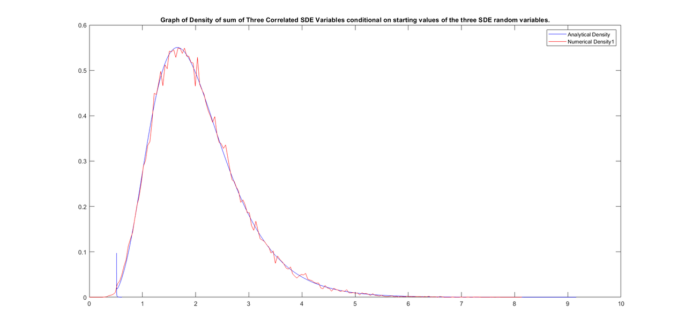](https://postimg.cc/7JqZ49Xw)
```

---

### #3192 — Amin (Topic Author)
*June 28, 2026, 8:54 AM*

Friends, the purpose of the last program was only to introduce new idea in a programmed form for friends to brainstorm
about it. There are still several problems like variances are still not perfectly matched and assignment of ideal normal
grid to$Z_{\tilde{y}}$ has to be further improved and there are still other minor issues that need to be fixed. I want
to work for a few days with this program and then introduce a first version of the program that would be much better.
The purpose of the program was to basically share it with friends who are actively researching on their own and I need
to make many changes before it can be used in proper settings.

---

### #3193 — Amin (Topic Author)
*June 28, 2026, 9:45 AM*

**(broken latex: Unbalanced $: 33)**

```latex
Friends, I have calculated the order of$Z_{\tilde{y}}$ by sorting Y after removing the effects of all the explaining
variables and then sorting the remaining Y and assigning that order to$Z_{\tilde{y}}$ . But I believe that same thing
can be done possibly more accurately by using first order variables including$Z_y$ ,$Z_{x_1}$ ,$Z_{x_2}$ and$Z_{x_3}$ .
We can regress (Z_{x_1}$, $ Z_{x_2}$ and $ Z_{x_3}$ on $ Z_y$ and remove their effect from $ Z_y
$ and then assign the order of remaining $ Z_y$ (after removing the effect of correlated variables) to  $
Z_{\tilde{y}}$.

Working on Y and finding order from it needs to calculate all sort of higher correlations and cross-correlations but if
we use only$Z_y$ ,$Z_{x_1}$ ,$Z_{x_2}$ and$Z_{x_3}$ , there are only first order correlations to deal with. I want to
try this idea and thought that I would share it with friends as well.
```

---

### #3194 — Amin (Topic Author)
*June 28, 2026, 10:21 AM*

**(broken latex: Unbalanced $: 9)**

```latex
A quick update but still preliminary.

.

.

.

```
function [coeff1,coeff2,coeff3,coeff4,coeff5,coeff6,coeff7] =
ConditionalDensityByRegressionOnIdealNormal08(Yin,Zyin0,Zx,NDims,Order,paths)

NData=paths;
Order=7;
NMoments=8;

Zyin(1:NData,1)=Zyin0(1:NData);

Yin0(1:NData,1)=Yin(1:NData);

[ZI] = MomentMatchedStandardNormalDiscretizedDensity(NData);

% [CoeffR] = RegressYOnXGivenZx(Yin,Zx,paths,NDims,Order);
%
% WW(1:paths,1:Order+1)=EvalHermiteArrayH0(Zx(1:paths,1),Order);
% for mm=2:NDims
%     WW(1:paths,(mm-1)*Order+2:mm*Order+1)=EvalHermiteArrayH1(Zx(1:paths,mm),Order);
% end
%
%
%
%
% YProjected(1:paths,1)=0.0;
% for mm=1:NDims*Order+1
%     YProjected(1:paths,1)=YProjected(1:paths,1)+WW(1:paths,mm).*CoeffR(mm,1);
% end
%
% Y_tilde(1:NData,1)=Yin0(1:NData,1)-YProjected(1:NData,1);
% Y_tilde0(1:NData)=Y_tilde(1:NData,1);
%
% Zy0=0;
% Zy=0;
%
% [c0,c(1:Order),FittedMoments,Zy0] =
CalculateZSeriesDensityFromRawMoments02FromGuess02W(Y_tilde0(1:NData),ZI);%,XCoeffZ(2:Order+1));
%
% for nn=1:NData
% Zy(nn,1)=Zy0(nn);
% end
%
% [Yss,I]=sort(Y_tilde(1:NData,1));
%
% DataMedian=(Yss(NData/2,1)+Yss(NData/2+1,1))/2;
%
% Ys(1:NData,1)=Yss(1:NData,1);%-DataMedian;
%
% %for hh=1:Order
% %    W(1:NData,hh)=ZI(1:NData).^(hh);
% %end
%
%
%
% %[WHy] = EvalHermiteArrayH1(Zy,Order);
%
% % WHyn(1:paths,1)=WHy(1:paths,nH);

Ys(1:NData,1)=Zyin(1:NData,1);

W=0;

W(1:NData,1)=Zx(1:NData,1);
W(1:NData,2)=Zx(1:NData,2);
W(1:NData,3)=Zx(1:NData,3);

Ymu(1:NData,1)=Ys(1:NData);

WW=(W'*W);

coeff0=(WW)$W'*Ymu);

Zy2(1:paths,1)=Zyin(1:paths,1)-coeff0(1,1).*Zx(1:paths,1)-coeff0(2,1).*Zx(1:paths,2)-coeff0(3,1).*Zx(1:paths,3);

 [c0,c(1:Order),FittedMoments,Zy0] =
CalculateZSeriesDensityFromRawMoments02FromGuess02W(Zy2(1:NData,1),ZI);%,XCoeffZ(2:Order+1));

 for nn=1:NData
 Zy(nn,1)=Zy0(nn);
 end

Ys(1:NData,1)=Zyin(1:NData,1);

W=0;

W(1:NData,1)=Zx(1:NData,1);
W(1:NData,2)=Zx(1:NData,2);
W(1:NData,3)=Zx(1:NData,3);
W(1:NData,4)=Zy(1:NData,1);

Ymu(1:NData,1)=Ys(1:NData);

WW=(W'*W);

coeff0=(WW)$W'*Ymu);

Zy2(1:paths,1)=Zyin(1:paths,1)-coeff0(1,1).*Zx(1:paths,1)-coeff0(2,1).*Zx(1:paths,2)-coeff0(3,1).*Zx(1:paths,3);

 [c0,c(1:Order),FittedMoments,Zy0] =
CalculateZSeriesDensityFromRawMoments02FromGuess02W(Zy2(1:NData,1),ZI);%,XCoeffZ(2:Order+1));

 for nn=1:NData
 Zy(nn,1)=Zy0(nn);
 end

%coeff1(1,1)

Ys(1:NData,1)=Zyin(1:NData,1);

W=0;

W(1:NData,1)=Zy(1:NData,1);
W(1:NData,2)=Zx(1:NData,1);
W(1:NData,3)=Zx(1:NData,2);
W(1:NData,4)=Zx(1:NData,3);

Ymu(1:NData,1)=Ys(1:NData);

WW=(W'*W);

coeff1=(WW)$W'*Ymu);

%coeff1(1,1)

Ys(1:NData,1)=Zyin(1:NData,1).^2;
W=0;
W(1:NData,1)=Zy(1:NData,1).^2;
W(1:NData,2)=Zx(1:NData,1).^2;
W(1:NData,3)=Zx(1:NData,2).^2;
W(1:NData,4)=Zx(1:NData,3).^2;
W(1:NData,5)=Zy(1:NData,1).*Zx(1:NData,1);
W(1:NData,6)=Zy(1:NData,1).*Zx(1:NData,2);
W(1:NData,7)=Zy(1:NData,1).*Zx(1:NData,3);
W(1:NData,8)=Zx(1:NData,1).*Zx(1:NData,2);
W(1:NData,9)=Zx(1:NData,1).*Zx(1:NData,3);
W(1:NData,10)=Zx(1:NData,2).*Zx(1:NData,3);

Ymu(1:NData,1)=Ys(1:NData);

WW=(W'*W);

coeff2=(WW)$W'*Ymu);

% coeff2(5,1).*Zx(1)+coeff2(6,1).*Zx(2)+coeff2(7,1).*Zx(3)
%
% coeff2(1,1)

Ys(1:NData,1)=Zyin(1:NData,1).^3;
W=0;
W(1:NData,1)=Zy(1:NData,1).^3;
W(1:NData,2)=Zx(1:NData,1).^3;
W(1:NData,3)=Zx(1:NData,2).^3;
W(1:NData,4)=Zx(1:NData,3).^3;
W(1:NData,5)=Zy(1:NData,1).*Zx(1:NData,1).^2;
W(1:NData,6)=Zy(1:NData,1).*Zx(1:NData,2).^2;
W(1:NData,7)=Zy(1:NData,1).*Zx(1:NData,3).^2;
W(1:NData,8)=Zy(1:NData,1).^2.*Zx(1:NData,1);
W(1:NData,9)=Zy(1:NData,1).^2.*Zx(1:NData,2);
W(1:NData,10)=Zy(1:NData,1).^2.*Zx(1:NData,3);
W(1:NData,11)=Zx(1:NData,1).*Zx(1:NData,2).^2;
W(1:NData,12)=Zx(1:NData,1).*Zx(1:NData,3).^2;
W(1:NData,13)=Zx(1:NData,2).*Zx(1:NData,3).^2;
W(1:NData,14)=Zx(1:NData,1).^2.*Zx(1:NData,2);
W(1:NData,15)=Zx(1:NData,1).^2.*Zx(1:NData,3);
W(1:NData,16)=Zx(1:NData,2).^2.*Zx(1:NData,3);

Ymu(1:NData,1)=Ys(1:NData);

WW=(W'*W);

coeff3=(WW)$W'*Ymu);

% coeff3(5,1).*Zx(1).^2+coeff3(6,1).*Zx(2).^2+coeff3(7,1).*Zx(3).^2
%
% coeff3(8,1).*Zx(1)+coeff3(9,1).*Zx(2)+coeff3(10,1).*Zx(3)
%
% coeff3(1,1)

Ys(1:NData,1)=Zyin(1:NData,1).^4;
W=0;
W(1:NData,1)=Zy(1:NData,1).^4;
W(1:NData,2)=Zx(1:NData,1).^4;
W(1:NData,3)=Zx(1:NData,2).^4;
W(1:NData,4)=Zx(1:NData,3).^4;
W(1:NData,5)=Zy(1:NData,1).*Zx(1:NData,1).^3;
W(1:NData,6)=Zy(1:NData,1).*Zx(1:NData,2).^3;
W(1:NData,7)=Zy(1:NData,1).*Zx(1:NData,3).^3;
W(1:NData,8)=Zy(1:NData,1).^2.*Zx(1:NData,1).^2;
W(1:NData,9)=Zy(1:NData,1).^2.*Zx(1:NData,2).^2;
W(1:NData,10)=Zy(1:NData,1).^2.*Zx(1:NData,3).^2;
W(1:NData,11)=Zy(1:NData,1).^3.*Zx(1:NData,1).^1;
W(1:NData,12)=Zy(1:NData,1).^3.*Zx(1:NData,2).^1;
W(1:NData,13)=Zy(1:NData,1).^3.*Zx(1:NData,3).^1;
W(1:NData,14)=Zx(1:NData,1).*Zx(1:NData,2).^3;
W(1:NData,15)=Zx(1:NData,1).*Zx(1:NData,3).^3;
W(1:NData,16)=Zx(1:NData,2).*Zx(1:NData,3).^3;
W(1:NData,17)=Zx(1:NData,1).^2.*Zx(1:NData,2).^2;
W(1:NData,18)=Zx(1:NData,1).^2.*Zx(1:NData,3).^2;
W(1:NData,19)=Zx(1:NData,2).^2.*Zx(1:NData,3).^2;
W(1:NData,20)=Zx(1:NData,1).^3.*Zx(1:NData,2).^1;
W(1:NData,21)=Zx(1:NData,1).^3.*Zx(1:NData,3).^1;
W(1:NData,22)=Zx(1:NData,2).^3.*Zx(1:NData,3).^1;

Ymu(1:NData,1)=Ys(1:NData);

WW=(W'*W);

coeff4=(WW)$W'*Ymu);

% coeff4(5,1).*Zx(1).^3+coeff4(6,1).*Zx(2).^3+coeff4(7,1).*Zx(3).^3
%
% coeff4(8,1).*Zx(1).^2+coeff4(9,1).*Zx(2).^2+coeff4(10,1).*Zx(3).^2
%
% coeff4(11,1).*Zx(1).^1+coeff4(12,1).*Zx(2).^1+coeff4(13,1).*Zx(3).^1
%
% coeff4(1,1)

Ys(1:NData,1)=Zyin(1:NData,1).^5;
W=0;
W(1:NData,1)=Zy(1:NData,1).^5;
W(1:NData,2)=Zx(1:NData,1).^5;
W(1:NData,3)=Zx(1:NData,2).^5;
W(1:NData,4)=Zx(1:NData,3).^5;
W(1:NData,5)=Zy(1:NData,1).*Zx(1:NData,1).^4;
W(1:NData,6)=Zy(1:NData,1).*Zx(1:NData,2).^4;
W(1:NData,7)=Zy(1:NData,1).*Zx(1:NData,3).^4;
W(1:NData,8)=Zy(1:NData,1).^2.*Zx(1:NData,1).^3;
W(1:NData,9)=Zy(1:NData,1).^2.*Zx(1:NData,2).^3;
W(1:NData,10)=Zy(1:NData,1).^2.*Zx(1:NData,3).^3;
W(1:NData,11)=Zy(1:NData,1).^3.*Zx(1:NData,1).^2;
W(1:NData,12)=Zy(1:NData,1).^3.*Zx(1:NData,2).^2;
W(1:NData,13)=Zy(1:NData,1).^3.*Zx(1:NData,3).^2;
W(1:NData,14)=Zy(1:NData,1).^4.*Zx(1:NData,1).^1;
W(1:NData,15)=Zy(1:NData,1).^4.*Zx(1:NData,2).^1;
W(1:NData,16)=Zy(1:NData,1).^4.*Zx(1:NData,3).^1;
W(1:NData,17)=Zx(1:NData,1).*Zx(1:NData,2).^4;
W(1:NData,18)=Zx(1:NData,1).*Zx(1:NData,3).^4;
W(1:NData,19)=Zx(1:NData,2).*Zx(1:NData,3).^4;
W(1:NData,20)=Zx(1:NData,1).^2.*Zx(1:NData,2).^3;
W(1:NData,21)=Zx(1:NData,1).^2.*Zx(1:NData,3).^3;
W(1:NData,22)=Zx(1:NData,2).^2.*Zx(1:NData,3).^3;
W(1:NData,23)=Zx(1:NData,1).^3.*Zx(1:NData,2).^2;
W(1:NData,24)=Zx(1:NData,1).^3.*Zx(1:NData,3).^2;
W(1:NData,25)=Zx(1:NData,2).^3.*Zx(1:NData,3).^2;
W(1:NData,26)=Zx(1:NData,1).^4.*Zx(1:NData,2).^1;
W(1:NData,27)=Zx(1:NData,1).^4.*Zx(1:NData,3).^1;
W(1:NData,28)=Zx(1:NData,2).^4.*Zx(1:NData,3).^1;

Ymu(1:NData,1)=Ys(1:NData);

WW=(W'*W);

coeff5=(WW)$W'*Ymu);

% coeff5(5,1).*Zx(1).^4+coeff5(6,1).*Zx(2).^4+coeff5(7,1).*Zx(3).^4
%
% coeff5(8,1).*Zx(1).^3+coeff5(9,1).*Zx(2).^3+coeff5(10,1).*Zx(3).^3
%
% coeff5(11,1).*Zx(1).^2+coeff5(12,1).*Zx(2).^2+coeff5(13,1).*Zx(3).^2
%
% coeff5(14,1).*Zx(1).^1+coeff5(15,1).*Zx(2).^1+coeff5(16,1).*Zx(3).^1
%
% coeff5(1,1)

Ys(1:NData,1)=Zyin(1:NData,1).^6;
W=0;
W(1:NData,1)=Zy(1:NData,1).^6;
W(1:NData,2)=Zx(1:NData,1).^6;
W(1:NData,3)=Zx(1:NData,2).^6;
W(1:NData,4)=Zx(1:NData,3).^6;
W(1:NData,5)=Zy(1:NData,1).*Zx(1:NData,1).^5;
W(1:NData,6)=Zy(1:NData,1).*Zx(1:NData,2).^5;
W(1:NData,7)=Zy(1:NData,1).*Zx(1:NData,3).^5;
W(1:NData,8)=Zy(1:NData,1).^2.*Zx(1:NData,1).^4;
W(1:NData,9)=Zy(1:NData,1).^2.*Zx(1:NData,2).^4;
W(1:NData,10)=Zy(1:NData,1).^2.*Zx(1:NData,3).^4;
W(1:NData,11)=Zy(1:NData,1).^3.*Zx(1:NData,1).^3;
W(1:NData,12)=Zy(1:NData,1).^3.*Zx(1:NData,2).^3;
W(1:NData,13)=Zy(1:NData,1).^3.*Zx(1:NData,3).^3;
W(1:NData,14)=Zy(1:NData,1).^4.*Zx(1:NData,1).^2;
W(1:NData,15)=Zy(1:NData,1).^4.*Zx(1:NData,2).^2;
W(1:NData,16)=Zy(1:NData,1).^4.*Zx(1:NData,3).^2;
W(1:NData,17)=Zy(1:NData,1).^5.*Zx(1:NData,1).^1;
W(1:NData,18)=Zy(1:NData,1).^5.*Zx(1:NData,2).^1;
W(1:NData,19)=Zy(1:NData,1).^5.*Zx(1:NData,3).^1;
W(1:NData,20)=Zx(1:NData,1).*Zx(1:NData,2).^5;
W(1:NData,21)=Zx(1:NData,1).*Zx(1:NData,3).^5;
W(1:NData,22)=Zx(1:NData,2).*Zx(1:NData,3).^5;
W(1:NData,23)=Zx(1:NData,1).^2.*Zx(1:NData,2).^4;
W(1:NData,24)=Zx(1:NData,1).^2.*Zx(1:NData,3).^4;
W(1:NData,25)=Zx(1:NData,2).^2.*Zx(1:NData,3).^4;
W(1:NData,26)=Zx(1:NData,1).^3.*Zx(1:NData,2).^3;
W(1:NData,27)=Zx(1:NData,1).^3.*Zx(1:NData,3).^3;
W(1:NData,28)=Zx(1:NData,2).^3.*Zx(1:NData,3).^3;
W(1:NData,29)=Zx(1:NData,1).^4.*Zx(1:NData,2).^2;
W(1:NData,30)=Zx(1:NData,1).^4.*Zx(1:NData,3).^2;
W(1:NData,31)=Zx(1:NData,2).^4.*Zx(1:NData,3).^2;
W(1:NData,32)=Zx(1:NData,1).^5.*Zx(1:NData,2).^1;
W(1:NData,33)=Zx(1:NData,1).^5.*Zx(1:NData,3).^1;
W(1:NData,34)=Zx(1:NData,2).^5.*Zx(1:NData,3).^1;

Ymu(1:NData,1)=Ys(1:NData);

WW=(W'*W);

coeff6=(WW)$W'*Ymu);

% coeff6(5,1).*Zx(1).^5+coeff6(6,1).*Zx(2).^5+coeff6(7,1).*Zx(3).^5
%
% coeff6(8,1).*Zx(1).^4+coeff6(9,1).*Zx(2).^4+coeff6(10,1).*Zx(3).^4
%
% coeff6(11,1).*Zx(1).^3+coeff6(12,1).*Zx(2).^3+coeff6(13,1).*Zx(3).^3
%
% coeff6(14,1).*Zx(1).^2+coeff6(15,1).*Zx(2).^2+coeff6(16,1).*Zx(3).^2
%
% coeff6(17,1).*Zx(1).^1+coeff6(18,1).*Zx(2).^1+coeff6(19,1).*Zx(3).^1
%
% coeff6(1,1)

Ys(1:NData,1)=Zyin(1:NData,1).^7;
W=0;
W(1:NData,1)=Zy(1:NData,1).^7;
W(1:NData,2)=Zx(1:NData,1).^7;
W(1:NData,3)=Zx(1:NData,2).^7;
W(1:NData,4)=Zx(1:NData,3).^7;
W(1:NData,5)=Zy(1:NData,1).*Zx(1:NData,1).^6;
W(1:NData,6)=Zy(1:NData,1).*Zx(1:NData,2).^6;
W(1:NData,7)=Zy(1:NData,1).*Zx(1:NData,3).^6;
W(1:NData,8)=Zy(1:NData,1).^2.*Zx(1:NData,1).^5;
W(1:NData,9)=Zy(1:NData,1).^2.*Zx(1:NData,2).^5;
W(1:NData,10)=Zy(1:NData,1).^2.*Zx(1:NData,3).^5;
W(1:NData,11)=Zy(1:NData,1).^3.*Zx(1:NData,1).^4;
W(1:NData,12)=Zy(1:NData,1).^3.*Zx(1:NData,2).^4;
W(1:NData,13)=Zy(1:NData,1).^3.*Zx(1:NData,3).^4;
W(1:NData,14)=Zy(1:NData,1).^4.*Zx(1:NData,1).^3;
W(1:NData,15)=Zy(1:NData,1).^4.*Zx(1:NData,2).^3;
W(1:NData,16)=Zy(1:NData,1).^4.*Zx(1:NData,3).^3;
W(1:NData,17)=Zy(1:NData,1).^5.*Zx(1:NData,1).^2;
W(1:NData,18)=Zy(1:NData,1).^5.*Zx(1:NData,2).^2;
W(1:NData,19)=Zy(1:NData,1).^5.*Zx(1:NData,3).^2;
W(1:NData,20)=Zy(1:NData,1).^6.*Zx(1:NData,1).^1;
W(1:NData,21)=Zy(1:NData,1).^6.*Zx(1:NData,2).^1;
W(1:NData,22)=Zy(1:NData,1).^6.*Zx(1:NData,3).^1;
W(1:NData,23)=Zx(1:NData,1).*Zx(1:NData,2).^6;
W(1:NData,24)=Zx(1:NData,1).*Zx(1:NData,3).^6;
W(1:NData,25)=Zx(1:NData,2).*Zx(1:NData,3).^6;
W(1:NData,26)=Zx(1:NData,1).^2.*Zx(1:NData,2).^5;
W(1:NData,27)=Zx(1:NData,1).^2.*Zx(1:NData,3).^5;
W(1:NData,28)=Zx(1:NData,2).^2.*Zx(1:NData,3).^5;
W(1:NData,29)=Zx(1:NData,1).^3.*Zx(1:NData,2).^4;
W(1:NData,30)=Zx(1:NData,1).^3.*Zx(1:NData,3).^4;
W(1:NData,31)=Zx(1:NData,2).^3.*Zx(1:NData,3).^4;
W(1:NData,32)=Zx(1:NData,1).^4.*Zx(1:NData,2).^3;
W(1:NData,33)=Zx(1:NData,1).^4.*Zx(1:NData,3).^3;
W(1:NData,34)=Zx(1:NData,2).^4.*Zx(1:NData,3).^3;
W(1:NData,35)=Zx(1:NData,1).^5.*Zx(1:NData,2).^2;
W(1:NData,36)=Zx(1:NData,1).^5.*Zx(1:NData,3).^2;
W(1:NData,37)=Zx(1:NData,2).^5.*Zx(1:NData,3).^2;
W(1:NData,38)=Zx(1:NData,1).^5.*Zx(1:NData,2).^1;
W(1:NData,39)=Zx(1:NData,1).^5.*Zx(1:NData,3).^1;
W(1:NData,40)=Zx(1:NData,2).^5.*Zx(1:NData,3).^1;

Ymu(1:NData,1)=Ys(1:NData);

WW=(W'*W);

coeff7=(WW)$W'*Ymu);

% coeff7(5,1).*Zx(1).^6+coeff7(6,1).*Zx(2).^6+coeff7(7,1).*Zx(3).^6
%
% coeff7(8,1).*Zx(1).^5+coeff7(9,1).*Zx(2).^5+coeff7(10,1).*Zx(3).^5
%
% coeff7(11,1).*Zx(1).^4+coeff7(12,1).*Zx(2).^4+coeff7(13,1).*Zx(3).^4
%
% coeff7(14,1).*Zx(1).^3+coeff7(15,1).*Zx(2).^3+coeff7(16,1).*Zx(3).^3
%
% coeff7(17,1).*Zx(1).^2+coeff7(18,1).*Zx(2).^2+coeff7(19,1).*Zx(3).^2
%
% coeff7(20,1).*Zx(1).^1+coeff7(21,1).*Zx(2).^1+coeff7(22,1).*Zx(3).^1
%
% coeff7(1,1)

coeff1

coeff2

coeff3

coeff4

coeff5

coeff6

coeff7

str=input("Look at all sets of coefficients");

end

```

.

.

.
```

---

### #3195 — Amin (Topic Author)
*June 28, 2026, 10:21 AM*

Friends, in the above program given in the previous post, I have regressed$Z_y$ on$Z_{x_1}$ ,$Z_{x_2}$ ,$Z_{x_3}$ and
then removed the effect of$Z_{x_1}$ ,$Z_{x_2}$ ,$Z_{x_3}$ from$Z_y$ and then I mapped the order of remaining$Z_y$ (after
removing the correlation effects of explaining$Z_x$ 's ) on$Z_{\tilde{y}}$ . This works very fast and is much better
than the logic I used in my program yesterday. This new logic is far better than the one I used in previous program.

Friends, there are many possibilities of improvement in our programs. We could use the values from linear regressions in
the present program and give them as a guess to our Newton regression program (that works iteratively and that we had
earlier been using) for an improved guess where$Z_{\tilde{y}}$ would be used by its path by path values rather than its
expectation(as in our old program).

I think after making some optimizations, focus has to shift towards capturing the entire joint dynamics of Y as opposed
to capturing the dynamics of individual powers of$Z_y$ separately.

---

### #3196 — Amin (Topic Author)
*June 29, 2026, 2:24 PM*

Friends, after producing the data for$Z_{\tilde{y}}$ , I went ahead and used that data in our old four correlations
model in which Z's of three explanatory variables take one correlation each and one correlation goes to$Z_{\tilde{y}}$ .

The fact that we still cannot get a perfect fit to conditional densities over all range of explaining variables means
that we would have to somewhat change our strategy and expand powers or hermites of$Z_y$ around different initial values
of explaining variables for the same data. I have some ideas about that and I will see in next few days how those ideas
work in practice.

I will also come back with graphs of overlaid densities with over parsimonious four correlations model and a general
different correlation term for the multinomial model but it might take a day.

I noticed that even with new changes, graphs were good in a decent range but not all over the range of explaining
variables. I am showing some statistics of fit between the original SDE data and model predicted values. I found the
following results given belwo. Please note that ObjSqrdNewton is average Squared difference between Model values and
actual SDE observations. Model Data is produced by applying model correlations on our synthetic data for$Z_{\tilde{y}}$
and joint SDE data of explaining variables. This ObjSqrdNewton is very low especially for small hermites meaning that
match between actual data and model predicted values in excellent. I also noticed that variance was automatically
matched without any external effort to match it.

Here nH is order for hermite for which the data is given. Data starts from second hermite.

ObjSqrdNewton =

     1.682388790286094e-04

M2Model =

   2.999893115055173

M2Data =

   3.000000000000006

nH =

     2

ObjSqrdNewton =

   0.002141050367675

M2Model =

  14.983098872562204

M2Data =

  14.984744227845688

nH =

     3

ObjSqrdNewton =

   0.029751555678307

M2Model =

     1.047995302266262e+02

M2Data =

     1.048242900744221e+02

nH =

     4

ObjSqrdNewton =

   0.392159174571655

M2Model =

     9.390873131310910e+02

M2Data =

     9.394338002797881e+02

nH =

     5

ObjSqrdNewton =

   4.386458089296818

M2Model =

     1.016993133620939e+04

M2Data =

     1.017367217915254e+04

nH =

     6

ObjSqrdNewton =

  35.340447054716854

M2Model =

     1.271093316638508e+05

M2Data =

     1.271388875104337e+05

nH =

     7

Here are the graphs for above match at the following conditional points.

  V10(1,1)=1.2+.25*1;

  V10(2,1)=.75-.125*1;

  V10(3,1)=1.2+.25*1;

%

       V10(1,2)=.75-.125*1;

       V10(2,2)=1.2+.25*1;

       V10(3,2)=.7-.125*1;

%

       V10(1,3)=1.25+.25*1;

       V10(2,3)=1.35+.25*1;

       V10(3,3)=1.25+.25*1;

%

         V10(1,4)=.85-.125;

         V10(2,4)=.81-.125;

         V10(3,4)=.77-.125;

Here are the correlations

Corr1(1,1)=1;

Corr1(1,2)=.7;

Corr1(1,3)=.8;

Corr1(2,2)=1;

Corr1(2,1)=.7;

Corr1(2,3)=.5;

Corr1(3,1)=.8;

Corr1(3,2)=.5;

Corr1(3,3)=1;

Here are the graphs.

[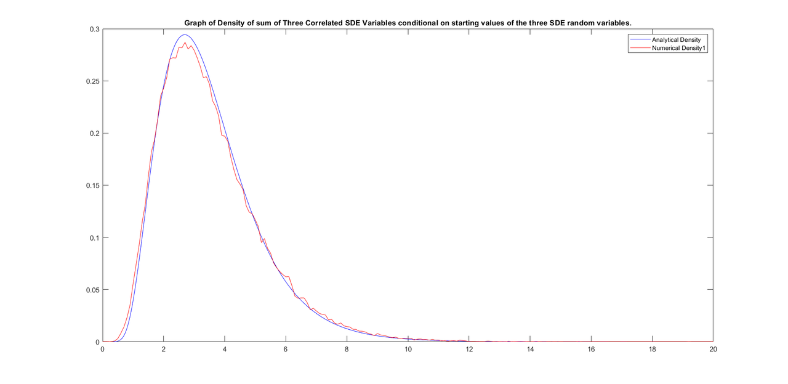](https://postimg.cc/PLVpnMt6)

[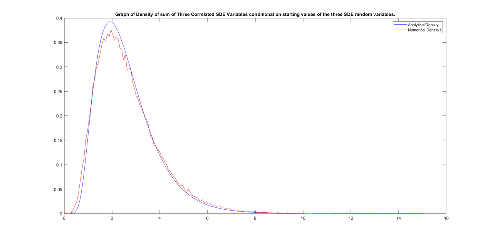](https://postimg.cc/zL2bYkJx)

[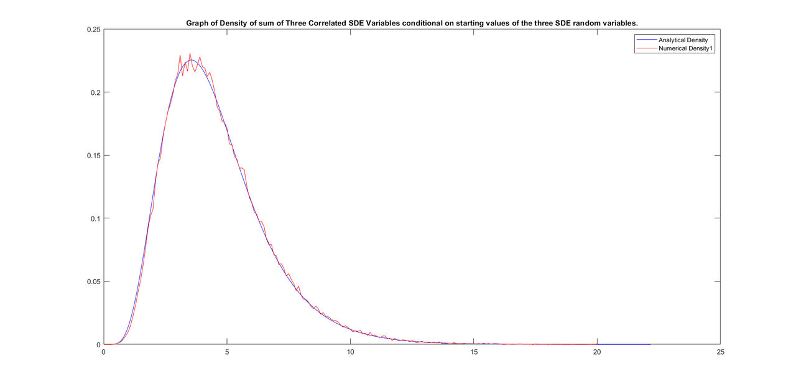](https://postimg.cc/xkpJVP0x)

[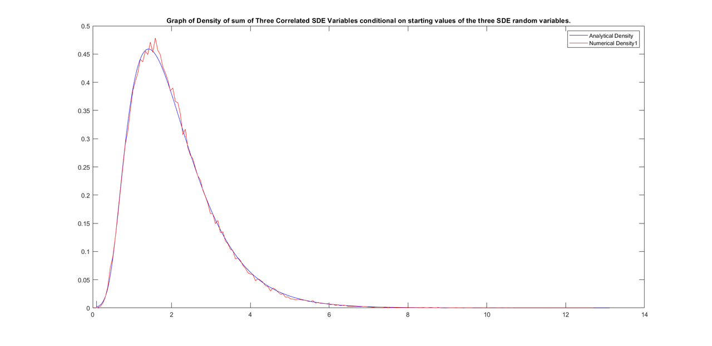](https://postimg.cc/06XM1C8X)

---

### #3197 — Amin (Topic Author)
*June 29, 2026, 4:18 PM*

Friends, if we have the values of explaining variables,$Z_{x_1}=Z_1$ ,$Z_{x_2}=Z_2$ , and$Z_{x_3}=Z_3$ , and the
conditional expected value of Y given$Z_{x_1}=Z_1$ ,$Z_{x_2}=Z_2$ , and$Z_{x_3}=Z_3$ is$Y=Y_0$ , and$Y(Z_{Y_0})=Y_0$ ,
then we have to do an expansion of conditional density around$Z_y\,=\,Z_{Y_0}(Z_1,\, Z_2, \,Z_3)$ as opposed to around
$Z_y(Z_{x_1}=0,\,Z_{x_2}=0,\,Z_{x_3}=0)=0$ . Currently we are expanding all variables against the universal median of
all variables but we have to expand all variables around conditional and forward values (for Y). This could still
possibly be just one universal formula that could be applied to conditional values of explaining variables and forward
value of Y.

Just brainstorming about it for a better model. I have more ideas about it but want to think a bit more before sharing
in details.

---

### #3198 — Amin (Topic Author)
*June 29, 2026, 7:04 PM*

Friends, here I want to explain some of what I had suggested in a previous post. I had explained most of it post 2928 a
few months earlier.

Basically, I am trying to explain how we can re-expand a Z-series around some other point$Z_y=Z_{Y_0}$ as opposed to its
natural expansion around its median$Z_y=0$ . In the context of our problem where density of Y has to be found
conditional on several explaining variables, we would like to expand the Z-series of Y around the conditional median
given the explaining variables. Please note that this conditional median is slightly different from conditional mean
given explaining variables.

Suppose we have a Z-series of Y expanded around its median$Y_{\text{median}}$ , where$Z_y=0$ and we want to expand this
Z-series around some other forward point$Y_0$ so that$Y(Z_{Y_0})=Y_0$ . The coefficients of this new Z-series expanded
around$Z_y=Z_{Y_0}$ would be different from its coefficients when expanded around$Z_y=0$ . Let us go through the steps
to make this conversion.

Suppose we have a Hermite-series of random variable Y given as

$$Y(Z_y)\,=\,\sum\limits_{n=0}^{N}\,a_n\,H_n(Z_y)$$

We suppose its equivalent Z-series of Y is given as

$$Y(Z_y)\,=\,\sum\limits_{n=0}^{N}\,\tilde{a}_n\,{Z_y}^n$$

Suppose we want to find to expand the above Z-series around$Y\,=\,Y_0$ . At$Y_0$ the value of$Z_y$ is$Z_{Y_0}$ . We take
the derivatives of Z-series at$Z_{Y_0}$ and re-expand the Z-series as a Taylor series around$Z_{Y_0}$ using derivatives
calculated there.

Taking above Example of the Z-series

$$Y(Z_y)\,=\,\sum\limits_{n=0}^{N}\,\tilde{a}_n\,{Z_y}^n$$

Taking conditional value at $Z_{Y_0}$, we have

$$Y_0\,=\,\sum\limits_{n=0}^{N}\,\tilde{a}_n\,{Z_{Y_0}}^n$$

The value of first derivative at $Z_{Y_0}$ is given as

$
$\frac{dY}{dZ}\,|^{\,\left( Z_y\,=\,Z_{Y_0}\,\right)}\,=\,\sum\limits_{n=0}^{N-1}\,(n+1)\,\tilde{a}_{n+1} \,\,{Z_{Y_0}}^n$
$

Similarly

$
$\frac{d^2Y}{dZ^2}\,|^{\,\left(\, Z_y\,=\,Z_{Y_0}\,\right)}\,=\,\sum\limits_{n=0}^{N-2}\,(n+1)\,(n+2)\,\tilde{a}_{n+2} \,\,{Z_{Y_0}}^n$
$

and mth derivative is given as

$
$\frac{d^mY}{dZ^m}\,|^{\,\left(\, Z_y\,=\,Z_{Y_0}\,\right)}\,=\,\sum\limits_{n=0}^{N-m}\,(n+1)\,(n+2)\,\ldots\,(n+m)\,\tilde{a}_{n+m} \,\,{Z_{Y_0}}^n$
$

We use above derivatives to form a local Taylor series around $Z_y\,=\,Z_{Y_0}$ as

\begin{align}

Y(Z_y\,-\,Z_{Y_0})\,&=\,Y_0\,+\,\left[\frac{dY}{dZ}\,|^{\,\left(
Z_y\,=\,Z_{Y_0}\,\right)}\,\right]\,\left(Z_y\,-Z_{Y_0}\right) \\

&+\,\frac{1}{2}\,\left[\frac{d^2Y}{dZ^2}\,|^{\,\left( Z_y\,=\,Z_{Y_0}\,\right)}\,\right]\,{\left(Z_y\,-Z_{Y_0}\right)}^2
\\

&+\,\frac{1}{6}\,\left[\frac{d^3Y}{dZ^3}\,|^{\,\left( Z_y\,=\,Z_{Y_0}\,\right)}\,\right]\,{\left(Z_y\,-Z_{Y_0}\right)}^3
\\

&+\,\ldots \\

&+\,\frac{1}{N!}\,\left[\frac{d^NY}{dZ^N}\,|^{\,\left(
Z_Y\,=\,Z_{Y_0}\,\right)}\,\right]\,{\left(Z_y\,-Z_{Y_0}\right)}^N \\

\end{align}

We convert the above Taylor to our familiar  Z-series by using

\begin{align}

\tilde{c}_0\,&=\,Y_0\,\\

\tilde{c}_1\,&=\left[\frac{dY}{dZ}\,|^{\,\left( Z_y\,=\,Z_{Y_0}\,\right)}\,\right]\, \\

\tilde{c}_2\,&=\frac{1}{2}\,\left[\frac{d^2Y}{dZ^2}\,|^{\,\left( Z_y\,=\,Z_{Y_0}\,\right)}\,\right]\, \\

\tilde{c}_3\,&=\,\frac{1}{6}\,\left[\frac{d^3Y}{dZ^3}\,|^{\,\left( Z_y\,=\,Z_{Y_0}\,\right)}\,\right]\, \\

\,\ldots \\

\tilde{c}_N\,&=\frac{1}{N!}\,\left[\frac{d^NY}{dZ^N}\,|^{\,\left( Z_y\,=\,Z_{Y_0}\,\right)}\,\right]\, \\

\end{align}

and get our new Z-series as

$$Y(Z_y-Z_{Y_0})\,=\,\sum\limits_{n=0}^{N}\,\tilde{c}_n\,{(Z_y\,-Z_{Y_0})}^n$$

We do a change of variable and define $Z\,=(Z_y-Z_{Y_0})$ to get

$$Y(Z)\,=\,\sum\limits_{n=0}^{N}\,\tilde{c}_n\,{Z}^n$$

The conditional or local moments of the value $ Z_y\,=\,Z_{Y_0}\,$ can be found as the expectation of the Z-Series below

$
$\,E\left[ \,Y^m\,|\,Y\,=\,Y_{0}\right]\,=\,E\left[ \,Y^m\,|\,Z_y\,=\,Z_{Y_0}\right]\,=E\left[\left(\,\sum\limits_{n=0}^{N}\,\tilde{c}_n\,{Z}^n\right)^m\right]$
$ where Z in above Z-series is a standard normal random variable.

For example if the associated equivalent hermite-series is given as

$$Y(Z)\,=\,\sum\limits_{n=0}^{N}\,c_n\,H_n(Z)$$

then we can automatically calculate the conditional second moment as

$$E\left[Y^2|(Y\,=Y_0)\right]\,=\,\sum\limits_{n=0}^{N}\,c_n^2\,n!$$

and variance would be given as (just omitting the zeroth index term)

$$E\left[Var(Y)|(Y\,=Y_0)\right]\,=\,\sum\limits_{n=1}^{N}\,c_n^2\,n!$$

---

### #3199 — Amin (Topic Author)
*June 29, 2026, 8:34 PM*

Friends, it has been more than a year since we started to make serious attempts at the problem of conditional density of
a random variable given several other explaining variables. I was working on the problem when I was detained in
Feb/March 2025. I was detained for more than 45 days at a mental health facility on totally flimsy excuses. They took
several most important neurotransmitters out of my brain and I continued to struggle for several months without doing
anything worth some value. I was able to start working somewhat better around mid-summers last year but for a long time
there was no real clue to solution of the problem. It was only around the end of the last year when there was some
significant progress and we were able to think of multiple sets of correlations. We have continued to struggle on the
rocky road but still continued to make some progress every month.

Even though we still have not been able to settle the problem perfectly yet, we have a better understanding of all the
related issues than ever before and I am even more optimistic that soon we would have even more solid progress towards
our goal. But there is one big problem that I want to ask friends about help. I get a Fluanxol injection after every
four months/30 days. Earlier I was taking this injection after 45 days/six weeks but two months ago, my psychiatrist
increased the frequency of injection from 45 days to 30 days on insistence of mind control agents. When I get this
injection, I become extremely sedated after 3-4 days of getting the injection and I am totally unable to do any proper
mental work. It is only 16-18 days after the injection that I become able to restart working properly. This is a very
very big impediment to my research effort and by the time I start working creatively, there is already time for the next
fluanxol injection and it really hurts my research.

I have been able to do my research over past few years only because a lot of good Americans tried their best to help me
and due to their efforts the degree of coercion forced on me remarkably decreased and I was able to concentrate solely
on my research and did not have to constantly think about trying to escape the persecution somehow. Any of my research
would never have been possible if friends did not try to provide me a better working environment that had a lot less
persecution. I am very very grateful to all good people who tried to help me and there is no way I can repay their debt
for the good things they enabled me to do otherwise most of the time I would have been just trying my best to somehow
escape the persecution as it was during most of the earlier years.

I want to make this request to good American friends to please do me another favor by asking the American defense and
mind control department to either give me no fluanxol injections or at least decrease the frequency of fluanxol
injections to after more manageable period of 45 days. This way I would be able to do some better research for some
longer period at a stretch and I think this would truly help my research efforts. I have another fluanxol injection due
in another 2-3 days after next phone meeting with the psychiatrist. Please ask the mind control agency to not force
injections on me after 30 days and ask the psychiatrist to increase the duration between injections to six weeks.

Friends, I have always tried to do good research and hope that I would continue to do that in the future as well but,
like always before, I would request friends to please help me in trying to do some good and productive work.

---

### #3200 — Amin (Topic Author)
*June 29, 2026, 10:50 PM*

Friends, in a few days it would be obvious if the ideas in past few posts have any merit. I was not able to work with it
numerically today and will do that tomorrow but I thought about what would have to change from previous algorithm in
order to do that and here are some ideas.

1. Z-series coefficients appear in the conditional density expansion that defines the conditional Z-series. When
Z-series is expanded around conditional median(We would use the conditional mean in hermite-series and then convert to
Z-series to find conditional median) with value of conditional median close to$Z_{Y_0}$ , then Z-series coefficients of
this new Z-series expansion would be different from expansion around zero median. I suppose we have to use new Z-series
coefficients found from new Z-series expansion around conditional median in our conditional density Z-series
coefficients calculation.

2. Since first order Z's are linear, to me it seems that first order correlations would not change. But this would have
to be verified from actually using the data.

3. For regressions of powers of$Z_y$ on powers of explaining variables, it seems to me that we would have to regress
${(Zy-Z_{Y_0})}^m$ on${(Z_{x_1}-Z_1))}^m$ ,${(Z_{x_2}-Z_2))}^m$ and${(Z_{x_3}-Z_3))}^m$ and so on. Here$Z_1$ ,$Z_2$ and
$Z_3$ are values of$Z_{x_1}$ ,$Z_{x_2}$

 and $Z_{x_3 }$ respectively on which to condition the density of Y.

Rest of the things mainly would possibly go the same.  I will try running the above numerics tomorrow and try to come up
with a working program about it.

---

[← Previous](page_063.md) | [Index](index.md) | [Next →](page_065.md)
