# Breakthrough in the theory of stochastic differential equations and their simulation

**Page 65 of 65** — Posts #3201–#3227

[← Previous](page_064.md) | [Index](index.md)

---

### #3201 — Amin (Topic Author)
*July 1, 2026, 7:19 PM*

Friends, our current working example under research is about finding the conditional density of sum of a number (in our
case three) of SDE random variables. When I started out on work, I was thinking more of correlated random variables like
they appear in finance. But SDEs were a simple way to find conditional density through transition densities. Then myself
and a lot of friends also realized that summation of random variables and finding the conditional density of sum was a
very interesting example and many new ideas in stochastics would possibly open later if we could do this example right.

However, we continued with the earlier infrastructure of correlated variables but now I think that if mathematical
structure of correlated variables is known, it has to be used and information has to be extracted out of it.

Again coming to our sum of SDE random variables set up, in our example, we suppose that there are three correlated SDE
variables,$X_1$ ,$X_2$ and$X_3$ . We suppose that we have joint data of values of$X_1(t_1)$ ,$X_2(t_1)$ and$X_3(t_1)$ is
known at a certain forward time$t_1>0$ . We also suppose that we also have have joint data of values of$X_1(t_2)$ ,
$X_2(t_2)$ and$X_3(t_2)$ at another forward time$t_2>t_1>0$ . this data is in form of path by path realizations as it
appears usually in monte carlo simulations of SDEs of$X_1$ ,$X_2$ and$X_3$ . We suppose that $
$Y(t_2)\,=\,X_1(t_2)\,+\,X_2(t_2)\,+\,X_3(t_2)$ $

Our task is to find given above data, the conditional density of$Y(t_2)$ given arbitrary starting values of correlated
random variables$X_1(t_1)$ ,$X_2(t_1)$ and$X_3(t_1)$ . We write the conditional density by the follwing notation

$$P(Y(t_2)| (X_1(t_1)=x_1, X_2(t_1)=x_2, X_3(t_1)=x_3)$$

This was the context. I want to say that we have taken forward our work from correlation problem but in the current
example we possibly should exploit the structure of the problem.

We have that

$$Y(t_2)\,=\,X_1(t_2)\,+\,X_2(t_2)\,+\,X_3(t_2)$$

I want to write

$$V(t_2)\,=\,Y(t_2)\,-\left[X_1(t_1)\,+\,X_2(t_1)\,+\,X_3(t_1)\right]$$

since the value of$X_1(t_1)\,+\,X_2(t_1)\,+\,X_3(t_1)$ is known directly from the conditioning variables, I suppose that
working with the analytics of$V(t_2)$ should be enough to reconstruct the density of$Y(t_2)$ .

Instead of expanding the density of Y as a function of$Z_{x_1},\,\,Z_{x_2},\,\,Z_{x_3},\,\text{and}\, Z_{\tilde{y}}$ , I
suppose we should try to expand V as a function of$Z_y,\,\,Z_{x_1},\,\,Z_{x_2},\,\,Z_{x_3},\,\text{and}\, Z_{\tilde{v}}$
.

We were expanding

$${Z_y}^m\,=\,{(\rho_{m,1}\,Z_{x_1}\,+\,\rho_{m,2}\,Z_{x_2}\,+\,\rho_{m,3}\,Z_{x_3}\,+\,\zeta_{m}\,Z_{\tilde{y}})}^m$$

where values of$Z_{x_1}$ .$Z_{x_2}$ and$Z_{x_3}$ are all known and density expansion is done in$Z_{\tilde{y}}$ . But I
suppose we should expand as

$
${Z_v}^m\,=\,{(\rho_{m,1}\,Z_{x_1}\,+\,\rho_{m,2}\,Z_{x_2}\,+\,\rho_{m,3}\,Z_{x_3}\,+\,\rho_{m,4}\,Z_{y}\,+\,\,\zeta_{m}\,Z_{\tilde{v}}\, )}^m$
$

where$Z_{y}$ in above equation is calculated/backed out after finding the conditional expected value Y from a linear
regression. So values of$Z_{x_1}$ .$Z_{x_2}$ ,$Z_{x_3}$ and$Z_y$ are all known and density expansion is done in
$Z_{\tilde{v}}$

I want to try this and see how it goes and will come back with results hopefully tomorrow.

---

### #3202 — Amin (Topic Author)
*July 1, 2026, 9:33 PM*

Friends, I am still brainstorming. Some ideas. We know our variable $Y(t_2)$ which is defined as

$$Y(t_2)\,=\,X_1(t_2)\,+\,X_2(t_2)\,+\,X_3(t_2)$$

Let us define the conditional expected value of $Y(t_2)$ as $\bar{Y}(t_2)$ defined as

$$\bar{Y}(t_2)\,=\,E\left[Y\,|\,X_1(t_1)\,=x_1,\,X_2(t_1)\,=x_2,\,X_3(t_1)=x_3\right]$$

For all joint observations of$X_1(t_1)\,$ ,$\,X_2(t_1)\,$ and$\,X_3(t_1)$ , we can find the respective value of
$\bar{Y}(t_2)\,$ simply by a regression. We expand$\bar{Y}(t_2)\,$ as a Z-series in$Z_{\bar{y}}$ (this is bar
$Z_{\bar{y}}$ as opposed to tilde$Z_{\tilde{y}}$ that is different)

Then we can expand

$
${Z_y}^m\,=\,{(\rho_{m,1}\,Z_{x_1}\,+\,\rho_{m,2}\,Z_{x_2}\,+\,\rho_{m,3}\,Z_{x_3}\,+\,\rho_{m,4} \, Z_{\bar{y}}\,+\,\zeta_{m}\,Z_{\tilde{y}})}^m$
$

Our expansion of V could possibly also go with $Z_{\bar{y}}$ as

$
${Z_v}^m\,=\,{(\rho_{m,1}\,Z_{x_1}\,+\,\rho_{m,2}\,Z_{x_2}\,+\,\rho_{m,3}\,Z_{x_3}\,+\,\rho_{m,4}\,Z_{\bar{y}}\,+\,\,\zeta_{m}\,Z_{\tilde{v}}\, )}^m$
$

I want to try the case of expansions of${Z_y}^m$ first and if it does not work properly, then move on to expansions of
${Z_v}^m$

---

### #3203 — Amin (Topic Author)
*July 2, 2026, 8:07 AM*

>
> Friends, it has been more than a year since we started to make serious attempts at the problem of conditional density
of a random variable given several other explaining variables. I was working on the problem when I was detained in
Feb/March 2025. I was detained for more than 45 days at a mental health facility on totally flimsy excuses. They took
several most important neurotransmitters out of my brain and I continued to struggle for several months without doing
anything worth some value. I was able to start working somewhat better around mid-summers last year but for a long time
there was no real clue to solution of the problem. It was only around the end of the last year when there was some
significant progress and we were able to think of multiple sets of correlations. We have continued to struggle on the
rocky road but still continued to make some progress every month.
>
>
>
> Even though we still have not been able to settle the problem perfectly yet, we have a better understanding of all the
related issues than ever before and I am even more optimistic that soon we would have even more solid progress towards
our goal. But there is one big problem that I want to ask friends about help. I get a Fluanxol injection after every
four months/30 days. Earlier I was taking this injection after 45 days/six weeks but two months ago, my psychiatrist
increased the frequency of injection from 45 days to 30 days on insistence of mind control agents. When I get this
injection, I become extremely sedated after 3-4 days of getting the injection and I am totally unable to do any proper
mental work. It is only 16-18 days after the injection that I become able to restart working properly. This is a very
very big impediment to my research effort and by the time I start working creatively, there is already time for the next
fluanxol injection and it really hurts my research.
>
>
>
> I have been able to do my research over past few years only because a lot of good Americans tried their best to help
me and due to their efforts the degree of coercion forced on me remarkably decreased and I was able to concentrate
solely on my research and did not have to constantly think about trying to escape the persecution somehow. Any of my
research would never have been possible if friends did not try to provide me a better working environment that had a lot
less persecution. I am very very grateful to all good people who tried to help me and there is no way I can repay their
debt for the good things they enabled me to do otherwise most of the time I would have been just trying my best to
somehow escape the persecution as it was during most of the earlier years.
>
>
>
> I want to make this request to good American friends to please do me another favor by asking the American defense and
mind control department to either give me no fluanxol injections or at least decrease the frequency of fluanxol
injections to after more manageable period of 45 days. This way I would be able to do some better research for some
longer period at a stretch and I think this would truly help my research efforts. I have another fluanxol injection due
in another 2-3 days after next phone meeting with the psychiatrist. Please ask the mind control agency to not force
injections on me after 30 days and ask the psychiatrist to increase the duration between injections to six weeks.
>
>
>
> Friends, I have always tried to do good research and hope that I would continue to do that in the future as well but,
like always before, I would request friends to please help me in trying to do some good and productive work.
>
.

.

Friends, I am supposed to talk to my psychiatrist over phone tomorrow around 12:00  and if he does not decrease the
injection frequency, I would get injection most possibly tomorrow sometime after the phone meeting. I am writing this to
request friends to please insist on people of defense to let the doctor decrease the injection frequency to six weeks.
This way I would truly be able to do better research and make a positive contribution. I truly hope that good people
would try to help me and my injection frequency would decrease somewhat. Please help me if you can do that.

---

### #3204 — Amin (Topic Author)
*July 2, 2026, 4:06 PM*

Friends, I slept yesterday after writing the last technical post. And started working in the evening now. I have been
able to make changes to my matlab program that reflect the new understanding about my research. The new program is
several orders of magnitude improvement on the old program. I want to make small changes and post the preliminary code
in about an hour. I will post the final version later in two to three days over the weekend. But preliminary version I
will post in a bit today. I hope friends would like this new program.

---

### #3205 — tradeslayer
*July 2, 2026, 5:05 PM*

bro you ok?

in your Z-series re-expansion around the conditional median ZY0, when you compute the new coefficients c̃n using Taylor
derivatives at ZY0 — do you find that the first-order correlation terms ρm,1, ρm,2, ρm,3 remain stable across different
conditioning points, or do they shift meaningfully? I'm trying to understand if the correlation structure is truly
invariant to the expansion point or if that's an assumption that needs numerical verification

---

### #3206 — Amin (Topic Author)
*July 2, 2026, 6:19 PM*

**(broken latex: Unbalanced $: 5)**

```latex
Hello Tradeslayer, thank you very much for your question. Please give me a minute. I come back to explaining your
question carefully. I am posting the program and you can run the program for various conditional starting points to get
the numerical verification to your question. But I will come back to answering your question in more detail in next post
later today.

Here is the new program for friends.

.

.

```
function []= ConditionalDensityHermitesNvariateNewtonWithZyBar02()

%SV SDE is
%dV(t)=mu1 V(t)^beta1 dt+ mu2 V(t)^beta2 dt + sigma0 V(t)^gamma dZ(t)
%In mean reverting SDEs we ususally have
%mu1= kappaV * thetaV
%beta1=0
%mu2=-kappa
%beta2=0
%The present program works only when drift is zero (for pure noises)
%meaning mu1=0 and mu2=0;

Order=7;
%NDim=4;%Three assets and one SV.
%NMomentsY=Order+1;
%NMomentsX=Order+1;

%%%%%%%%%%%%%%%%%%%5
dt=.03125/2/8;
Tt=64*2*8;
T=Tt*dt;
seed0=12130649;
%seed0=94210876;
%seed0=14210876;
seed0=53612297
%seed0=97459782
rng(seed0, 'twister')
paths=25000;
TT1=100*8/2; %Transition distribution start
TT2=256*8/2; %Transition distribution end

%%%%%%%%%%%%%%%%%%%5

NDims=3;
NDims2=3;
%
V0(1)=1.000;%.32;
V00(1)=V0(1);

%SDE1
 thetaV(1)=1.0;%.045;%1;%.04;
 kappaV(1)=0.000;%1.5;%1.5;
 gamma(1)=.75;%.75
 sigma0(1)=.5;%.35

%SDE2%
%thetaV(1)=.90;%.045;%1;%.04;
%kappaV(1)=1.000;%1.5;%1.5;
%gamma(1)=.75;%.75
%sigma0(1)=.85;%.35

%SDE3%
%thetaV(1)=1.350;%.045;%1;%.04;
%kappaV(1)=2.000;%1.5;%1.5;
%gamma(1)=.75;%.75
%sigma0(1)=.95;%.35

mu1(1)=kappaV(1)*thetaV(1);
mu2(1)=-kappaV(1);
beta1(1)=0;
beta2(1)=1;

V0(2)=1.000;%.32;
V00(2)=V0(2);

%SDE1
thetaV(2)=1.0;%.045;%1;%.04;
 kappaV(2)=0.000;%1.5;%1.5;
 gamma(2)=.85;%.75
 sigma0(2)=.5;%.35

%SDE2
% thetaV(2)=1.0;%.045;%1;%.04;
% kappaV(2)=2.000;%1.5;%1.5;
% gamma(2)=.65;%.75
% sigma0(2)=.95;%.35

%SDE3
%thetaV(2)=.850;%.045;%1;%.04;
%kappaV(2)=.35000;%1.5;%1.5;
%gamma(2)=.65;%.75
%sigma0(2)=.55;%.35

mu1(2)=kappaV(2)*thetaV(2);
mu2(2)=-kappaV(2);
beta1(2)=0;
beta2(2)=1;

V0(3)=1.000;%.33;
V00(3)=V0(3);

%SDE1
thetaV(3)=1.0;%.045;%1;%.04;
 kappaV(3)=0.000;%1.5;%1.5;
 gamma(3)=.95;%.75
 sigma0(3)=.45;%.35

%SDE2
% thetaV(3)=.750;%.045;%1;%.04;
% kappaV(3)=0.5000;%1.5;%1.5;
% gamma(3)=.95;%.75
% sigma0(3)=.45;%.35

%SDE3
%thetaV(3)=1.150;%.045;%1;%.04;
%kappaV(3)=1.5000;%1.5;%1.5;
%gamma(3)=.95;%.75
%sigma0(3)=.75;%.35

mu1(3)=kappaV(3)*thetaV(3);
mu2(3)=-kappaV(3);
beta1(3)=0;
beta2(3)=1;

Corr1(1,1)=1;
Corr1(1,2)=.7;
Corr1(1,3)=.8;
Corr1(2,2)=1;
Corr1(2,1)=.7;
Corr1(2,3)=.5;
Corr1(3,1)=.8;
Corr1(3,2)=.5;
Corr1(3,3)=1;
%
% % % % Was very good.
Corr1(1,1)=1;
Corr1(1,2)=.7/3;
Corr1(1,3)=.8/3;
Corr1(2,2)=1;
Corr1(2,1)=.7/3;
Corr1(2,3)=.5/3;
Corr1(3,1)=.8/3;
Corr1(3,2)=.5/3;
Corr1(3,3)=1;
% % % % % % % %
% % % % % % % %
% % % % % % %
% Corr1(1,1)=1;
% Corr1(1,2)=-.7/3;
% Corr1(1,3)=.8/3;
% Corr1(2,2)=1;
% Corr1(2,1)=-.7/3;
% Corr1(2,3)=-.5/3;
% Corr1(3,1)=.8/3;
% Corr1(3,2)=-.5/3;
% Corr1(3,3)=1;
% % % % % %
% % % % % %

R=chol(Corr1);
%
%  R(1:3,1:3)=0;
%  R(1,1)=1;
%  R(2,2)=1;
%  R(3,3)=1;

V0(4)=1.000;%.44;
V00(4)=V0(4);
thetaV(4)=1.0;%.045;%1;%.04;
kappaV(4)=1.000;%1.5;%1.5;
mu1(4)=kappaV(4)*thetaV(4);
mu2(4)=-kappaV(4);
beta1(4)=0;
beta2(4)=1;
gamma(4)=.95;%.75
sigma0(4)=.55;%.45

%%%%%%%%%%%%%%%%%%%%%%%%%%%%%%%%%%%%%%%%%%%%%%%%%%%%%%%%%%%%%%%%%%%%%5
for nn=1:NDims
V(1:paths,nn)=V0(nn);
Threshold(nn)=(sigma0(nn)*sqrt(dt)*2)^(1/(1-gamma(nn)));
end
%V(1:paths,1:NDims)=V0(1,1:NDims);

Random1(1:paths/2,1:NDims)=0;

for tt=1:Tt

    Random2(1:paths/2,1:NDims)=randn(size(Random1));
    Random2(paths/2+1:paths,1:NDims)=-Random2(1:paths/2,1:NDims);

    %Random2=R'*Random2;
    random1=Random2*R(:,1);
    random2=Random2*R(:,2);
    random3=Random2*R(:,3);

    Random2(:,1)=random1;
    Random2(:,2)=random2;
    Random2(:,3)=random3;

    %Random2(V(:,<Threshold,:)=

    Random2(V(:,1)<Threshold(1),1)=0.0;
    Random2(V(:,2)<Threshold(2),2)=0.0;
    Random2(V(:,3)<Threshold(3),3)=0.0;

    for nn=1:NDims

    V(1:paths,nn)=V(1:paths,nn)+ ...
        (mu1(nn).*V(1:paths,nn).^beta1(nn) + mu2(nn).*V(1:paths,nn).^beta2(nn))*dt + ...
        sigma0(nn).*V(1:paths,nn).^gamma(nn) .*Random2(1:paths,nn)*sqrt(dt) + ...
        (mu1(nn).*beta1(nn)*V(1:paths,nn).^(beta1(nn)-1) + mu2(nn).*beta2(nn).*V(1:paths,nn).^(beta2(nn)-1)).* ...
        ((mu1(nn).*V(1:paths,nn).^beta1(nn) + mu2(nn).*V(1:paths,nn).^beta2(nn))*dt^2/2 + ...
        sigma0(nn).*V(1:paths,nn).^gamma(nn) .*Random2(1:paths,nn)*(1-1/sqrt(3))*dt^1.5) + ...
        .5*(mu1(nn).*beta1(nn).*(beta1(nn)-1).*V(1:paths,nn).^(beta1(nn)-2) +
mu2(nn).*beta2(nn).*(beta2(nn)-1).*V(1:paths,nn).^(beta2(nn)-2)).* ...
        sigma0(nn)^2.*V(1:paths,nn).^(2*gamma(nn)).*dt^2/2 + ...
        sigma0(nn).*gamma(nn).*V(1:paths,nn).^(gamma(nn)-1) .* ...
        ((mu1(nn).*V(1:paths,nn).^beta1(nn) + mu2(nn).*V(1:paths,nn).^beta2(nn)).*Random2(1:paths,nn).*1/sqrt(3)*dt^1.5
+ ...
        sigma0(nn).*V(1:paths,nn).^gamma(nn) .*(Random2(1:paths,nn).^2-1)*dt/2) + ...
        .5*sigma0(nn).*gamma(nn).*(gamma(nn)-1).*V(1:paths,nn).^(gamma(nn)-2) .* ...
        sigma0(nn).^2.*V(1:paths,nn).^(2*gamma(nn)) .*Random2(1:paths,nn).*1/sqrt(3)*dt^1.5;

    V(V(:,nn)<=.00001,nn)=.0000;

    V(isnan(V(:,nn)),nn)=0;

    if(tt==TT1)
        Xin(1:paths,nn)=(V(1:paths,nn));
    end

    if(tt==TT2)

        Xin2(1:paths,nn)=(V(1:paths,nn));
    end

    end

end

Yin(1:paths)=0.0;

for pp=1:paths
for mm=1:NDims
    %Yin(pp)=Yin(pp)+Xin2(pp,mm);%-Xin(pp,mm);
    Yin(pp)=Yin(pp)+Xin2(pp,mm);
%-Xin(pp,mm);
end
end

str=input("I have reached stone 1");

% %%%%%%%%%%%%%%%%%%%%%%%%%%%%%%%%%%%%%%%%%%%%%%%%%%5
%
 Order=7;
 clf;

  NDims2=3;

%[BetaCorrH,YCoeffH,XCoeffH,HCorrXX,Zy,Zx] = CalculateHermiteCorrelations0NA04WithZyBar(Xin,Yin,paths,NDims2);
%[BetaCorrH,YCoeffH,XCoeffH,Zy,Zx] = CalculateHermiteCorrelations0NA04WithZyBar(Xin,Yin,paths,NDims2);
[YCoeffH,XCoeffH,Zy,Zx] = CalculateHermiteSeries0NA04WithZyBar(Xin,Yin,paths,NDims);
YCoeffZ(1:Order+1)= ConvertHermiteSeriesToZSeries01(YCoeffH(1:Order+1),Order);

NDims2=NDims+1;%Three SDE variables and one YBar.

[cn] = FindInitialGuessForNewtonUnivariate(Zy,Zx,NDims2,paths,Order);

% bn=0;
% for mm=1:NDims2
%     NDims0=1;
%     [bn] = FindInitialGuessForNewtonUnivariate(Zy,Zx(1:paths,mm),NDims0,paths,Order);
%     bn
% %    HCorrXX0(1,1,1:Order)=1;
% %    bnOptim0= OptimizeCorrFromHermitesNewtonWithoutVar(Zy,Zx(1:paths,mm),bn,HCorrXX0,NDims0,paths,Order);
%     bnOptim(mm,:)=bnOptim0(1,:);
%  mm
% % str=input("Let us look at bn");
%
% end
%
%
% bnOptim
%
% str=input("Look at the variabes of cnOptim");
%
%
%
%
% for mm1=1:NDims2
%     for mm2=1:NDims2
%         NDims0=1;
%         [bn] = FindInitialGuessForNewtonUnivariate(Zx(1:paths,mm1),Zx(1:paths,mm2),NDims0,paths,Order);
%         bn
%         HCorrXX0(1,1,1:Order)=1;
%         CorrXX1=
OptimizeCorrFromHermitesNewtonWithoutVar(Zx(1:paths,mm1),Zx(1:paths,mm2),bn,HCorrXX0,NDims0,paths,Order);
%         %CorrXX2=
OptimizeCorrFromHermitesNewtonWithoutVar(Zx(1:paths,mm2),Zx(1:paths,mm1),bn,HCorrXX0,NDims0,paths,Order);
%         HCorrXX(mm1,mm2,1:Order)=(CorrXX1(1,1:Order));%+CorrXX2(1,1:Order))/2;
%         HCorrXX(mm2,mm1,1:Order)=(CorrXX1(1,1:Order));%+CorrXX2(1,1:Order))/2;
%         HCorrXX(mm1,mm1,1:Order)=1;
%     end
% end
%
%
%
%
% for hh=1:Order
%     bCol(1:NDims2,1)=bnOptim(1:NDims2,hh);
%     HHCorrXX(1:NDims2,1:NDims2)=HCorrXX(1:NDims2,1:NDims2,hh);
%     bb=HHCorrXX\bCol;
%     cn(1:NDims2,hh)=bb(1:NDims2);
% end
% Var(hh)=0.0;
% for hh=1:Order
%     for mm=1:NDims2
%         Var(hh)=Var(hh)+cn(mm,hh).^2;
%     end
%     cn(NDims2+1,hh)=abs(sqrt(1-Var(hh)));
% end
%
% cn0=cn;
%
% cn

str=input("Look at cn before input to Newton correlation finding function");
 [cnOptim] = OptimizeCorrFromHermitesNewtonNewAlgoZytilde(Zy,Zx,cn,NDims2,paths,Order);

 cn=cnOptim;

%[CoeffR] = RegressYOnXGivenZx(Yin,Zx,paths,NDims,Order);
%Above function would have to be decommented when SDEs are not martingales.

for kk=1:4%Loop over four conditional starting points of Density.

% %Set1
  V10(1,1)=1.2+.25*2;%.65;%
  V10(2,1)=.75-.125*2;
  V10(3,1)=1.2+.25*2;
  V10(4,1)=V10(1,1)+V10(2,1)+V10(3,1);
%
% % % %
% % % % % % % % % % %Set2
       V10(1,2)=.75-.125*2;
       V10(2,2)=1.2+.25*2;%1.2;
       V10(3,2)=.7-.125*2;
       V10(4,2)=V10(1,2)+V10(2,2)+V10(3,2);

% % % % % % % % % % % % % % %V10(4)=.65
% % % % % % % % % % % % % %
% % % % % % % % % % % % % % % % %Set3
       V10(1,3)=1.25+.25*2;
       V10(2,3)=1.35+.25*2;%1.2;
       V10(3,3)=1.25+.25*2;
       V10(4,3)=V10(1,3)+V10(2,3)+V10(3,3);
%
%
%
% % % % % % % % % % % % % % % %   V10(4)=1.4
% % % % % % % % % % % % % % % % %
% % % % % % % % % % % % % % % % %
         V10(1,4)=.85-.125*2;
         V10(2,4)=.81-.125*2;%1.2;
         V10(3,4)=.77-.125*2;
         V10(4,4)=V10(1,4)+V10(2,4)+V10(3,4);
%
%
% % % % % % % % % % %  V10(4)=.7
% %

for nn=1:NDims
V(1:paths,nn)=V10(nn,kk);
end
%V(1:paths,1:NDims)=V0(1,1:NDims);

Random1(1:paths/2,1:NDims)=0;

for tt=1:TT2-TT1

    Random2(1:paths/2,1:NDims)=randn(size(Random1));
    Random2(paths/2+1:paths,1:NDims)=-Random2(1:paths/2,1:NDims);

    random1=Random2*R(:,1);
    random2=Random2*R(:,2);
    random3=Random2*R(:,3);

    Random2(:,1)=random1;
    Random2(:,2)=random2;
    Random2(:,3)=random3;

    Random2(V(:,1)<Threshold(1),1)=0.0;
    Random2(V(:,2)<Threshold(2),2)=0.0;
    Random2(V(:,3)<Threshold(3),3)=0.0;

    for nn=1:NDims

    V(1:paths,nn)=V(1:paths,nn)+ ...
        (mu1(nn).*V(1:paths,nn).^beta1(nn) + mu2(nn).*V(1:paths,nn).^beta2(nn))*dt + ...
        sigma0(nn).*V(1:paths,nn).^gamma(nn) .*Random2(1:paths,nn)*sqrt(dt) + ...
        (mu1(nn).*beta1(nn)*V(1:paths,nn).^(beta1(nn)-1) + mu2(nn).*beta2(nn).*V(1:paths,nn).^(beta2(nn)-1)).* ...
        ((mu1(nn).*V(1:paths,nn).^beta1(nn) + mu2(nn).*V(1:paths,nn).^beta2(nn))*dt^2/2 + ...
        sigma0(nn).*V(1:paths,nn).^gamma(nn) .*Random2(1:paths,nn)*(1-1/sqrt(3))*dt^1.5) + ...
        .5*(mu1(nn).*beta1(nn).*(beta1(nn)-1).*V(1:paths,nn).^(beta1(nn)-2) +
mu2(nn).*beta2(nn).*(beta2(nn)-1).*V(1:paths,nn).^(beta2(nn)-2)).* ...
        sigma0(nn)^2.*V(1:paths,nn).^(2*gamma(nn)).*dt^2/2 + ...
        sigma0(nn).*gamma(nn).*V(1:paths,nn).^(gamma(nn)-1) .* ...
        ((mu1(nn).*V(1:paths,nn).^beta1(nn) + mu2(nn).*V(1:paths,nn).^beta2(nn)).*Random2(1:paths,nn).*1/sqrt(3)*dt^1.5
+ ...
        sigma0(nn).*V(1:paths,nn).^gamma(nn) .*(Random2(1:paths,nn).^2-1)*dt/2) + ...
        .5*sigma0(nn).*gamma(nn).*(gamma(nn)-1).*V(1:paths,nn).^(gamma(nn)-2) .* ...
        sigma0(nn).^2.*V(1:paths,nn).^(2*gamma(nn)) .*Random2(1:paths,nn).*1/sqrt(3)*dt^1.5;

    V(V(:,nn)<=.00001,nn)=.0001;

    %if(tt==TT1)
    %    XXin(1:paths,nn)=V(1:paths,nn);
    %end

    if(tt==TT2-TT1)

        XXin2(1:paths,nn)=V(1:paths,nn);
    end

    end

end

Yin2(1:paths)=0.0;

for pp=1:paths
for mm=1:NDims
    Yin2(pp)=Yin2(pp)+XXin2(pp,mm);%-V10(mm);
end
end

%randn()

str=input("I have reached stone 4");

NoOfBins=200;
MaxCutOff=20;

[XDensity,IndexOut,IndexMax] = MakeDensityFromSimulation_Infiniti_NEW(Yin2,paths,NoOfBins,MaxCutOff );

for qq=1:8

    DataMoments(qq)=sum(Yin2(:).^qq)/paths;

end

%%%%%%%%%%%%%%%%%%%%%%%%%%%%%%%%%%%%%%%%%%%%%%%%%%%%%%%%%%%%%%%%%%%%%%%%%%%%%%%%%%%%%%%5

for nn=1:NDims2
    [Zx0(nn)] = CalculateZgivenXAndHSeriesCoeffs(V10(nn,kk),XCoeffH(1:Order+1,nn),Order);
end

%%%%%%%%%%%%%%%%%%%%%%%%%%%%%%%%%%%%%%%%%%%%%%%%%%%%%%%%%%%%%%%%%%%55
%
% WW(1,1:Order+1)=EvalHermiteArrayH0(Zx0(1),Order);
% for mm=2:NDims
%     WW(1,(mm-1)*Order+2:mm*Order+1)=EvalHermiteArrayH1(Zx0(mm),Order);
% end
%
%
%
%
%      YProjected=0.0;
%     for mm=1:NDims*Order+1
%     YProjected=YProjected+WW(1,mm).*CoeffR(mm,1);
%
%     end
%

%Above conditional expected value finding function would have to be decommented
%when SDEs are not martingales.

%When SDEs are martingales, use the line below but comment if they are not.
    YProjected=V10(1,kk)+V10(2,kk)+V10(3,kk);

%%%%%%%%%%%%%%%%%%%%%%%%%%%%%%%%%%%%%%%%%%%%%%%%%%%%%%%%%%%%%%%%%%%%%%%%%%%%%%%55
Zx(1:Order)=0;

for hh=1:Order
    for nn=1:NDims2
        %Zx(hh) = Zx(hh) + bnv(nn+1,hh+1).^1.*Zx0(nn);
        Zx(hh) = Zx(hh) + cn(nn,hh).^1.*Zx0(nn);
    end
end

%bh0=YCoeffH(1);

% [W] = EvalHermiteArrayH0(Zx0,Order);
%
% for hh=1:Order
%     for nn=1:NDims2
%         bh0 = bh0 + ch(nn+1,hh+1).^1.*W(nn,hh+1);
%     end
% end
% bh00=bh0;

%%%%%%%%%%%%%%%%%%%%%%%%%%%%%%%%%%%%%%%%%%%%%%%%%%%%%%%%%%%%%%%%

%
a0=YCoeffZ(1);
a1=YCoeffZ(2);
a2=YCoeffZ(3);
a3=YCoeffZ(4);
a4=YCoeffZ(5);
a5=YCoeffZ(6);
a6=YCoeffZ(7);
a7=YCoeffZ(8);

d1=cn(NDims+2,1);
d2=cn(NDims+2,2);
d3=cn(NDims+2,3);
d4=cn(NDims+2,4);
d5=cn(NDims+2,5);
d6=cn(NDims+2,6);
d7=cn(NDims+2,7);

% %b0=(a0+a1.* Zx(1) +a2.* Zx(2).^2+a3.* Zx(3).^3+a4* Zx(4).^4+a5 *Zx(5).^5+a6* Zx(6).^6+a7* Zx(7).^7);
b1=(a1* d1+2* a2* Zx(2)* d2 +3* a3* Zx(3).^2* d3+4* a4* Zx(4).^3* d4+5* a5* Zx(5).^4* d5+6* a6* Zx(6).^5* d6+7* a7*
Zx(7).^6* d7);
b2=(a2* d2.^2+3* a3* Zx(3)* d3^2 +6* a4* Zx(4).^2* d4^2+10* a5* Zx(5).^3* d5^2+15* a6* Zx(6).^4* d6^2+21* a7* Zx(7).^5*
d7^2);
b3=(a3* d3^3+4* a4 *Zx(4)* d4^3 +10* a5* Zx(5).^2* d5^3+20* a6* Zx(6).^3* d6^3+35* a7* Zx(7).^4* d7^3);
b4=(a4* d4^4+5* a5* Zx(5)* d5^4 +15* a6 *Zx(6).^2* d6^4+35* a7* Zx(7).^3 *d7^4);
b5=(a5* d5^5+6* a6* Zx(6)* d6^5 +21* a7 *Zx(7).^2* d7^5);
b6=(a6* d6^6+7* a7* Zx(7)* d7^6 );
b7=(a7* d7^7);

%bh0=b0+b2+3*b4+15*b6;
bh1=b1+3*b3+15*b5+105*b7;
bh2=b2+6*b4+45*b6;
bh3=b3+10*b5+105*b7;
bh4=b4+15*b6;
bh5=b5+21*b7;
bh6=b6;
bh7=b7;

bh(1)=YProjected;
bh(2)=bh1;
bh(3)=bh2;
bh(4)=bh3;
bh(5)=bh4;
bh(6)=bh5;
bh(7)=bh6;
bh(8)=bh7;

% %%%%%%%%%%%%%%%%%%%%%%%%%%%%%%%%%%%%%%%%%%%%%%%%%%%%%%%%%%%%%%%%%%%%%%%%%%%%%%%%%%%%%5

YCentralMoment2=0;
for nn=1:Order
    YCentralMoment2=YCentralMoment2+bh(nn+1).^2*factorial(nn);
end

%%%%%%%%%%%%%%%%%%%%%%%%%%%%%%%%%%%%%%%%%%%%%%%%%%%%%%%%%%%%%%%%%%%%%%%%%%%%%%5

YCoeffz(1:Order+1)= ConvertHermiteSeriesToZSeries01(bh(1:Order+1),Order);

[YMomentsModel]=CalculateMomentsOfZSeries(YCoeffz(1),YCoeffz(2:Order+1),Order,Order+1);

YMomentsModel

DataMoments

str=input("Look at comparison of moments");

[cMu1,YCentralMoments]=ConvertRawMomentsToCentralMoments(YMomentsModel,Order+1);
[cMu2,DataCentralMoments]=ConvertRawMomentsToCentralMoments(DataMoments,Order+1);

YCentralMoments

DataCentralMoments

YProjected
str=input("Look at central moments");

clf;

PlotZSeriesDensity(YCoeffz(1),YCoeffz(2:Order+1),'b')

hold on

plot(IndexOut(1:IndexMax),XDensity(1:IndexMax),'r');

%PlotHermiteSeriesDensityAndRvGraph(YCoeffh(1),YCoeffh1(2:yOrder+1),'g')
title("Graph of Density of sum of Three Correlated SDE Variables conditional on starting values of the three SDE random
variables.")
%title(sprintf('V00 = %.3f; kappa=%.3f, theta=%.3f,gamma=%.3f,sigma=%.3f;V10=%.3f at TT1=%.3f;TT2=%.3f;Paths=%d ',V00,
kappaV, thetaV,gamma,sigma0, V10,(TT1*dt),(TT2*dt),paths));%,sprintf('theta= %f', theta), sprintf('kappa = %f',
kappa),sprintf('sigma = %f', sigma0),sprintf('T = %f', T));
legend({'Analytical Density','Numerical Density1'}, ...
    'Location','northeast')
kk
str=input("This is the first version without altering the moments of conditional density")

hold off

end

end

```

.

.

.

.

```
function [YCoeffH,XCoeffH,Zy,Zx] = CalculateHermiteSeries0NA04WithZyBar(Xin,Yin,NData,NDims)

%function [BetaCorrH,YCoeffH,XCoeffH,HCorrXX,Zy,Zx] = CalculateHermiteCorrelations0NA04WithZyBar(Xin,Yin,NData,NDims)

%This program finds required correlations between NDims explanatory
%variables given in Xin that has NDims dimensionality. Yin is variable
%being explained and is one-diemsnional.

Order=7;
NMoments=8;

[ZI] = MomentMatchedStandardNormalDiscretizedDensity(NData);

for nn=1:NDims

    [c0(nn),c(1:Order,nn),FittedMoments,Zx(:,nn)] =
CalculateZSeriesDensityFromRawMoments02FromGuess02W(Xin(1:NData,nn),ZI);%,XCoeffZ(2:Order+1));

 XCoeffZ(1,nn)=c0(nn);
 XCoeffZ(2:Order+1,nn)=c(1:Order,nn);

[XCoeffH(1:Order+1,nn)] = ConvertZSeriesToHermiteSeriesNew(XCoeffZ(1:Order+1,nn),Order);

% for mm=1:8
%     rMu(mm)=sum(Zx(1:NData,nn).^mm)/NData;
% end

nn
end

%%%%%%%%%%%%%%%%%%%%%%%%%%%%%%%%%%%%%%%%%%%%%%%%%%%%%%%%%%%%%%%%%%%%%%%%%%%%%%%%%%%%%%%%55
[CoeffR] = RegressYOnXGivenZx(Yin,Zx,NData,NDims,Order);

 WW(1:NData,1:Order+1)=EvalHermiteArrayH0(Zx(1:NData,1),Order);
 for mm=2:NDims
     WW(1:NData,(mm-1)*Order+2:mm*Order+1)=EvalHermiteArrayH1(Zx(1:NData,mm),Order);
 end

 YBar(1:NData,1)=0.0;
 for mm=1:NDims*Order+1
    YBar(1:NData,1)=YBar(1:NData,1)+WW(1:NData,mm).*CoeffR(mm,1);
 end

% YBar(1:NData,1)=0.0;
% for nn=1:NDims
%     YBar(1:NData,1)=YBar(1:NData,1)+Xin(1:NData,nn);
% end
% %YBar contains conditional expected value of Y(t2) but
% %the above calculation of conditional value would work only
% %for SDEs that are a martingale. We put conditional expected
% %value equal to sum of starting values of X's.
% %When SDes are not martinglaes, you would have to do a regression here
% %and replace above with regression function.

%YBar is absorbed in X's vector below

Xin(1:NData,NDims+1)=YBar(1:NData,1);

[c0(NDims+1),c(1:Order,NDims+1),FittedMoments,Zx(:,NDims+1)] =
CalculateZSeriesDensityFromRawMoments02FromGuess02W(Xin(1:NData,NDims+1),ZI);%,XCoeffZ(2:Order+1));

 XCoeffZ(1,NDims+1)=c0(NDims+1);
 XCoeffZ(2:Order+1,NDims+1)=c(1:Order,NDims+1);

[XCoeffH(1:Order+1,NDims+1)] = ConvertZSeriesToHermiteSeriesNew(XCoeffZ(1:Order+1,NDims+1),Order);

%%%%%%%%%%%%%%%%%%%%%%%%%%%%%%%%%%%%%%%%%%%%%%%%%%%%%%%%%%%%%%%%%%%%%%%%%%%%%%%%%%%%%%%%%%%%%%%%555

 for pp=1:Order+1
     YrMu(pp)=sum(Yin(1:NData).^pp)/NData;
 end
 %YDataMedian=(Yin(NData/2)+Yin(NData/2+1))/2;
 YDataMedian=(Yin(NData/2-2)+Yin(NData/2-1)+Yin(NData/2)+Yin(NData/2+1)+Yin(NData/2+2)+Yin(NData/2+3))/6;

 %[c0,c(1:Order),FittedMoments] = ZSeriesCoeffsFromMomentsIterWithMedian(YrMu(:),YDataMedian);
 [c0,c(1:Order),FittedMoments,Zy] =
CalculateZSeriesDensityFromRawMoments02FromGuess02W(Yin(1:NData),ZI);%,XCoeffZ(2:Order+1));

str=input("Look at data results ofY");
 YCoeffZ(1)=c0;
 YCoeffZ(2:Order+1)=c(1:Order);

 [YCoeffH(1:Order+1)] = ConvertZSeriesToHermiteSeriesNew(YCoeffZ(1:Order+1),Order);
 %ConvertZSeriesToHermiteSeriesNew

end
```

.

.

.

```
function [c0,c,FittedMoments,Zx] = CalculateZSeriesDensityFromRawMoments02FromGuess02W(Xin,ZI)
%The above function takes data as input.
%And returns Z-series Coeffs upto 7th power of Z as
%Y=c0+c(1)*Z+c(2)*Z^2+c(3)*Z^3+c(4)*Z^4+c(5)*Z^5+c(6)*Z^6+c(7)*Z^7
%Fitted Moments are raw moments of the Z-series density and usually are exactly
%the same as input raw moments rMu(1:8).i.e  FittedMoments(1:8)==rMu(1:8)
%with high precision.

Order=7;

Ndata=length(Xin);

%%%%%%%%%%%%%%%%%%%%%%%%%%%%%%%%%%%%%%%%%%%%%%%%%%%%%%%%%%%%%%%%%%%%%%%%%%%%%%5

for mm=1:Order+1
    rMu(mm)=sum(Xin(:).^mm)/Ndata;
end

for nn=1:Ndata
    Xs(nn)=(Xin(nn)-rMu(1))./sqrt(rMu(2)-rMu(1).^2);
end

for mm=1:Order+1
    sMu1(mm)=sum(Xs(:).^mm)/Ndata;
end

Xsorted=sort(Xs);

StandardizedMedian=(Xsorted(Ndata/2)+Xsorted(Ndata/2+1))/2;

%%%%%%%%%%%%%%%%%%%%%%%%%%%%%%%%%%%%%%%%%%%%%%%%%%%%%%%%%%%%%%%%%%%%%%%%%%%%%%5
SeriesOrder=Order;
%SeriesOrder=7;    %Z-series till 7th power. hardcoded here cannot chagne.
mOrder=Order+1;         %Number of raw moments in calibration. hardcoded here cannot chagne.
%Order=7;
NMoments=mOrder;
                  %Find central Moments from raw moments
[Mu1,cMu] = ConvertRawMomentsToCentralMoments(rMu,mOrder);
                  %Find standardized Moments from central moments
sMu(1)=0;
sMu(2)=1;
sMu(3)=cMu(3)/cMu(2).^1.5;
sMu(4)=cMu(4)/cMu(2).^2.0;
sMu(5)=cMu(5)/cMu(2).^2.5;
sMu(6)=cMu(6)/cMu(2).^3.0;
sMu(7)=cMu(7)/cMu(2).^3.5;
sMu(8)=cMu(8)/cMu(2).^4.0;
% sMu(9)=cMu(9)/cMu(2).^4.50;
% sMu(10)=cMu(10)/cMu(2).^5.0;
% sMu(11)=cMu(11)/cMu(2).^5.50;
% sMu(12)=cMu(12)/cMu(2).^6.0;
% sMu(13)=cMu(13)/cMu(2).^6.50;
% sMu(14)=cMu(14)/cMu(2).^7.0;
% sMu(15)=cMu(15)/cMu(2).^7.50;
% sMu(16)=cMu(16)/cMu(2).^8.0;

%sMu
%sMu1

%str=input("Look at comparison of standardized moments:");

%[cGuess,Zx] = CalculateHermiteSeriesFromData02(Xs,Order,ZI);
[cGuess,Zx] = CalculateZSeriesFromData02GivenMedian(Xs,Order,ZI);

wm(1:Order+1)=1;
for mm=Order+1:-1:2
    wm(mm-1)=wm(mm)*(mm+1).^3;
end

MaxIter=750;

%[cGuess,ObjBest] = ZSeries1DCoeffsIterativeForGuess(cGuess,sMu,Order,MaxIter,wm);
%[cGuess(1),cGuess(2:8),FittedMoments] = ZSeriesCoeffsFromMomentsIterWithMedian02(rMu,DataMedian)

%[cGuess,ObjBest] = ZSeries1DCoeffsIterativeForGuessMedianW(cGuess,sMu,Order,MaxIter,wm,StandardizedMedian);

                  %Please experiment and play around.
bGuess(1:Order)=cGuess(2:Order+1);    %We have assigned initial values of coefficients

if(Order==7)
c0=-(bGuess(2)+3*bGuess(4)+15*bGuess(6));
c(1:7)=bGuess(1:7);

end

% if(Order==15)
% c0=-(bGuess(2)+3*bGuess(4)+15*bGuess(6)+105*bGuess(8)+945*bGuess(10)+945*11*bGuess(12)+945*11*13*bGuess(14));
% c(1:15)=bGuess(1:15);
%
% end
%%%%%%%%%%%%%%%%%%%%%%%%%%%%%%%%%%%%%%%%%%%%%%%%%%%%%%%%%%%%%%%%%

%Make sure you do not comment the lines below

c0=c0*sqrt(cMu(2)); %convert from standardized to central moments
c=c*sqrt(cMu(2));   %convert from standardized to central moments

c0=c0+Mu1;          %convert from central to raw moments by adding mean.

[FittedMoments] = CalculateMomentsOfZSeries(c0,c,SeriesOrder,NMoments);
%%%%%%%%%%%%%%%%%%%%%%%%%%%%%%%%%%%%%%%%%%%%%%%%%%%%%%%%%%%%%%%%%%%%%%%%%%%%%%%%%%%%%%%%%%%%%%
%Please Uncomment this if you want to see a comparison of input moments and
%fitted moments
rMu
FittedMoments
str=input('Look at comparison of fitted moments with input moments: Warning: Large Mismatch implies that many results
would be off');
%%%%%%%%%%%%%%%%%%%%%%%%%%%%%%%%%%%%%%%%%%%%%%%%%%%%%%%%%%%%%%%%%%%%%%%%%%%%%%%%%%%%%%%%%%%%%5
%COMMENT lines below if you do not want to see the density of new Z-series random variable with
%fitted moments.
%First calculate normal random variable on a grid below
dNn=.1/2;   % Normal density subdivisions width. would change with number of subdivisions
Nn=70*4;  % No of normal density subdivisions
NnMid=((1+Nn)/2)*dNn;
Z(1:Nn)=(((1:Nn)*dNn)-NnMid);
%Z
%str=input('Look at Z');
%Now calculate Y as a function of normal random variable.
Y(1:Nn)=c0;
for nn=1:7
    Y(1:Nn)=Y(1:Nn)+c(nn)*Z(1:Nn).^nn;
end

%Now take change of densities derivative of Y with respect to normal
DfY(1:Nn)=0;
for nn=2:Nn-1
    DfY(nn) = (Y(nn + 1) - Y(nn - 1))/(Z(nn + 1) - Z(nn - 1));
    %Change of variable derivative for densities
end
DfY(Nn)=DfY(Nn-1);
DfY(1)=DfY(2);

%Now calculate the density of Y from density of normal random variable
%using change of probability derivative.
pY(1:Nn)=0;
for nn = 1:Nn
    pY(nn) = (normpdf(Z(nn),0, 1))/abs(DfY(nn));
end

plot(Y(1:Nn),pY(1:Nn),'b');
title('Density of the Z-Series Variable with Fitted Moments');

str=input('Look at the density of Z-series random variable')

clf;
plot(Y(1:Nn),pY(1:Nn),'b');

clf;
plot(Z(1:Nn),Y(1:Nn),'b');

str=input('Look at the graph of Z-series random variable Vs Z itself')

%%%%%%%%%%%%%%%%%%%%%%%%%%%%%%%%%%%%%%%%%%%%%%%%%%%%%%%%%%%%%%%%%%%%%%%%%%%%%%%%%%%%%%%%%%%%
end
```

.

.

.

```
function [bn] = FindInitialGuessForNewtonUnivariate(Zy,Zx,NDims,paths,Order)

Var(1:Order)=0.0;

for hh=1:Order
    WW(1:paths,1)=1;
    for kk1=1:NDims
        WW(1:paths,kk1+1)=Zx(1:paths,kk1).^hh;
    end
    SS=NDims+1;

    Ymu(1:paths,1)=Zy(1:paths).^hh;

    WWW=(WW'*WW);

    CoeffR=(WWW)$WW'*Ymu);

    cn(1:SS,hh)=CoeffR(1:SS,1);

    bn(1:SS,hh)=sign(cn(1:SS,hh)).*(abs(cn(1:SS,hh))).^(1/hh);

    for ss=2:SS
        Var(hh)=Var(hh)+bn(ss,hh).^2;
    end

    bn(1:SS-1,hh)=bn(2:SS,hh);

    bn(SS,hh)=abs(sqrt(1-Var(hh)));

  %  bn

  %  hh
  %  str=input("Look at bn inside the loop");

end

end

```

.

.

.

```
function [Coeff,Zy] = CalculateZSeriesFromData02GivenMedian(Yin,Order,ZI)

Ndata=length(Yin);

MeanYin=sum(Yin(1:Ndata))/Ndata;
Ym(1:Ndata)=Yin(1:Ndata)-MeanYin;
YmVar=sum(Ym(1:Ndata).^2)/Ndata;
Y(1:Ndata)=Ym(1:Ndata)/sqrt(YmVar);

[Yss,I]=sort(Y(1:Ndata));

DataMedian=(Yss(Ndata/2)+Yss(Ndata/2+1))/2;

Ys=Yss-DataMedian;

for hh=1:Order
    W(1:Ndata,hh)=ZI(1:Ndata).^(hh);
end

Ymu(1:Ndata,1)=Ys(1:Ndata);

WW=(W'*W);

coeff=(WW)$W'*Ymu);

%Store in coefficietns array of all random varaibles
Coeff(2:Order+1)= coeff(1:Order,1);
Coeff(1)=DataMedian;
%Store the associated Z in Z-array of all coefficients.
Zy(I(1:Ndata))=W(1:Ndata,1);

Coeff(1:Order+1)=Coeff(1:Order+1).*sqrt(YmVar);
Coeff(1)=Coeff(1)+MeanYin;

clf;
PlotZSeriesDensity(Coeff(1),Coeff(2:Order+1),'r');
hold on

NoOfBins=150;
MaxCutOff=20;
[XDensity,IndexOut,IndexMax] = MakeDensityFromSimulation_Infiniti_NEW(Yin,Ndata,NoOfBins,MaxCutOff );
plot(IndexOut(1:IndexMax),XDensity(1:IndexMax),'b');

str=input("Look at comparison of Density");

end

```

.

.

.

```
function [CoeffR] = RegressYOnXGivenZx(Y,Zx,NData,Dim,Order)

WW(1:NData,1:Order+1)=EvalHermiteArrayH0(Zx(1:NData,1),Order);

%WW

%str=input("Show me match of first EvalHermite Array0 with python")

for mm=2:Dim
    WW(1:NData,(mm-1)*Order+2:mm*Order+1)=EvalHermiteArrayH1(Zx(1:NData,mm),Order);
    WW0(1:NData,1:Order)=EvalHermiteArrayH1(Zx(1:NData,mm),Order);
    %WW0
    %mm

    %str=input("Compare with EvalHermiteArray1")

end

Ymu(1:NData,1)=Y(1:NData);

WWW=(WW'*WW);

for mm=1:Dim*Order+1
    WWW(mm,mm)=WWW(mm,mm)+.000001;
end

CoeffR=(WWW)$WW'*Ymu);

WWW;

str=input("Look at WWW--1111---222-3333");

%
% for nn=1:NData
%     YProjected(nn,1)=0.0;
%    for mm=1:Dim*Order+1
%    YProjected(nn,1)=YProjected(nn,1)+WW(nn,mm).*CoeffR(mm,1);
%
%    end
% end
%
%  STot=sum((Ymu(1:NData,1)-sum(Ymu(1:NData,1))/NData).^2);
%  SRes=sum((Ymu(1:NData,1)-YProjected(1:NData,1)).^2);
% %
%  RSquared=1-SRes/STot;
% %
%  RSquared
% %
% YRight=0.0;
% YWrong=0.0;
% YPRExp=0.0;
% YNRExp=0.0;
% YPWExp=0.0;
% YNWExp=0.0;
% for nn=1:NData
%
%    for mm=1:Dim*Order+1
%    YProjected(nn,1)=YProjected(nn,1)+WW(nn,mm).*CoeffR(mm,1);
%    end
%    if(Ymu(nn,1)>=0)
%        if(YProjected(nn,1)>=0)
%            YRight=YRight+1;
%            YPRExp=YPRExp+(Ymu(nn,1));
%        else
%            YWrong=YWrong+1;
%            YPWExp=YPWExp+(Ymu(nn,1));
%        end
%    end
%    if(Ymu(nn,1)<0)
%        if(YProjected(nn,1)<0)
%            YRight=YRight+1;
%            YNRExp=YNRExp+(Ymu(nn,1));
%        else
%            YWrong=YWrong+1;
%            YNWExp=YNWExp+Ymu(nn,1);
%        end
%    end
% end
%
% YRight
% YWrong
%
% YPRExp
% YNRExp
%
% YPWExp
% YNWExp
%
% abs(YPRExp)+abs(YNRExp)-abs(YPWExp)-abs(YNWExp)
%
% str=input("Look at RSquared--0002")
%
%
%
%  mdl=fitlm(WW,Ymu)
%
% str=input("Matlab's first regression")
%
%

end

```

.

.

.

```
function [cnOptim] = OptimizeCorrFromHermitesNewtonNewAlgoZytilde(Zy,Zx,cn,NDims,paths,Order)

NData=paths;

%Order;Max Order of Hermites Calibration is seven.
%Zx is paths X K array for joint values of Zx arranged for "paths" number of observations
%Zy is paths X 1 array for Zy associated with each obsewrvation.

%The function below calculates the first hermites till "Order" from data of
%Zy. WHy is (paths X K) array. kth hermite associated with pth observation appears in
%WHy(p,k)
[WHy] = EvalHermiteArrayH1(Zy,Order);

%The loop below repeats itself for optimization of correlation coefficients
%associated with highest power in each hermite. It repeatrs over all hermites one by one.
for nH=1:Order
    WHyn(1:paths,1)=WHy(1:paths,nH);
    %WHyn(1:paths,1)=Zy(1:paths).^(nH);

    if(nH==1)
        WHy0=WHyn;

        Ymu(1:NData,1)=Zy';

        W=0;

        W(1:NData,1)=Zx(1:NData,1);
        W(1:NData,2)=Zx(1:NData,2);
        W(1:NData,3)=Zx(1:NData,3);
        W(1:NData,4)=Zx(1:NData,4);

        WW=(W'*W);

        coeff0=(WW)$W'*Ymu);

       
Zy2(1:paths,1)=Zy(1:paths)'-coeff0(1,1).*Zx(1:paths,1)-coeff0(2,1).*Zx(1:paths,2)-coeff0(3,1).*Zx(1:paths,3)-coeff0(4,1).*Zx(1:paths,4);

        [ZI] = MomentMatchedStandardNormalDiscretizedDensity(NData);

        [c0,c(1:Order),FittedMoments,Zytilde0] =
CalculateZSeriesDensityFromRawMoments02FromGuess02W(Zy2(1:NData,1),ZI);%,XCoeffZ(2:Order+1));

        Zytilde(1:NData,1)=Zytilde0(1:NData)';

        W=0;

        W(1:NData,1)=Zx(1:NData,1);
        W(1:NData,2)=Zx(1:NData,2);
        W(1:NData,3)=Zx(1:NData,3);
        W(1:NData,4)=Zx(1:NData,4);
        W(1:NData,5)=Zytilde(1:NData,1);

        WW=(W'*W);

        coeff0=(WW)$W'*Ymu);

        cnOptim(1:NDims+1,1)=coeff0(1:NDims+1,1);

    end

    if(nH>=2)

        [dHermite] = EvaluatePrevGaussPowersForHCorrsNew02(nH,cnOptim,Zx,Zytilde,NDims,paths);

        %dHermite

        %str=input

        WHy0=WHyn-dHermite;

        cn(1:NDims+1,1:nH-1)=cnOptim(1:NDims+1,1:nH-1);

        Iterations=100;

        [bnbest,InitialObj,FinalObj] =
OptimizenthHermiteGaussianWithNewtonNew01(cn,Zx,Zytilde,WHy0,nH,NDims,paths,Iterations)

        cnOptim(1:NDims+1,nH)=bnbest(1:NDims+1,1);

        InitialObj
        FinalObj
        str=input("Look at variables");

    end

end

% cnOptim
% InitialObj %Obj function at start of optimization of correlation coefficients for nH-th hermite
% FinalObj%Obj function after optimization of correlation coefficients for nH-th hermite
% str=input("Look at initial and Final Objs");

end
```

.

.

.

```
function [dHermite] = EvaluatePrevGaussPowersForHCorrsNew02(nH,ccn,Zx,Zytilde,NDims,paths)
%OK
%This function clculates the contribution of lower Gaussian powers of sum
%of K correlated Zx's towards the value of higher hermites. Please note
%that sign is reversed so they are basically added in the calling function
%to subtract them.
if(nH==1)
    dHermite(1:paths,1)=0.0;

end

if(nH==2)
    dHermite(1:paths,1)=-1.0;

end

if(nH==3)
    nG1=1;

    [GaussPH1] = EvaluatenthGPowerGaussCorrs(ccn,nG1,Zx,Zytilde,NDims,paths);
    dHermite(1:paths,1)=-3*GaussPH1(1:paths,1);

end

if(nH==4)
     nG1=2;
    [GaussPH1] = EvaluatenthGPowerGaussCorrs(ccn,nG1,Zx,Zytilde,NDims,paths);

    dHermite(1:paths,1)=-6*GaussPH1(1:paths,1)+3;

end

if(nH==5)
    nG1=1;
    [GaussPH1] = EvaluatenthGPowerGaussCorrs(ccn,nG1,Zx,Zytilde,NDims,paths);

    nG2=3;
    [GaussPH2] = EvaluatenthGPowerGaussCorrs(ccn,nG2,Zx,Zytilde,NDims,paths);

    dHermite(1:paths,1)=-10*GaussPH2(1:paths,1)+15*GaussPH1(1:paths,1);

end

if(nH==6)
    nG1=2;
     [GaussPH1] = EvaluatenthGPowerGaussCorrs(ccn,nG1,Zx,Zytilde,NDims,paths);

    nG2=4;
     [GaussPH2] = EvaluatenthGPowerGaussCorrs(ccn,nG2,Zx,Zytilde,NDims,paths);

    dHermite(1:paths,1)=-15*GaussPH2(1:paths,1)+45*GaussPH1(1:paths,1)-15;

end

if(nH==7)
    nG1=1;
     [GaussPH1] = EvaluatenthGPowerGaussCorrs(ccn,nG1,Zx,Zytilde,NDims,paths);

    nG2=3;
     [GaussPH2] = EvaluatenthGPowerGaussCorrs(ccn,nG2,Zx,Zytilde,NDims,paths);

    nG3=5;
     [GaussPH3] = EvaluatenthGPowerGaussCorrs(ccn,nG3,Zx,Zytilde,NDims,paths);

    dHermite(1:paths,1)=-21*GaussPH3(1:paths,1)+105*GaussPH2(1:paths,1)-105*GaussPH1(1:paths,1);

end

end

```

.

.

.

```
function [GaussPH] = EvaluatenthGPowerGaussCorrs(ccn,nH,Zx,Zytilde,NDims,paths)
%OK

%this function calculates the binomial expansion terms and their combined
%expectations. The binaomial expansion is over G and zeta Z-tilde{y} as
%described in Wilmott post. This function also calculates the sensitivities
%of the Gaussian power terms expanded as binomial with respect to
%correlation parameters.

KK=NDims;

GG1(1:paths,1)=0.0;
%Below calculate the binomial expansion related to nH-th power of the sum
%of correlated Gaussians
for kk=1:KK
    GG1(1:paths,1)=GG1(1:paths,1)+ccn(kk,nH).*Zx(1:paths,kk);
end

GG1(1:paths,1)=GG1(1:paths,1)+ccn(KK+1,nH).*Zytilde(1:paths,1);

GaussPH=GG1(1:paths,1).^(nH);

end

```

.

.

.

```
function [bnbest,InitialObj,FinalObj] =
OptimizenthHermiteGaussianWithNewtonNew01(cn,Zx,Zytilde,WHy0,nH,NDims,paths,Iterations)

%Why0 in array of nth Hermite Values

KK=NDims;

bn(1:NDims+1,1)=cn(1:NDims+1,nH);
%Below, Calculate the model contribution of lower Gaussian powers that have
%already been calculated through associated lower hermites towards current
%hermite polynomial.
%[dHermite] = EvaluatePrevGaussPowersForHCorrs(nH,cn,Zx,NDims,paths,EZ);
% [dHermite] = EvaluatePrevGaussPowersForHCorrsNew02(nH,ccn,Zx,Zytilde,NDims,paths);
%
%
% %Remove the model contribution of lower Gaussian powers from data value of
% %current hermite.
% WHy0=WHyn+dHermite;

%Below calculate the combined value of K correlated variables as described
%on Wilmott post and Calculate G.
GG1(1:paths,1)=0.0;
for kk=1:KK
    GG1(1:paths,1)=GG1(1:paths,1)+bn(kk,1).*Zx(1:paths,kk);
end

GG1(1:paths,1)=GG1(1:paths,1)+bn(KK+1,1).*Zytilde(1:paths,1);

GaussPH=GG1(1:paths,1).^(nH);

%%%%%%%%%%%%%%%%%%%%%%%%%%%%%%%%%%%%%%%%%%%%%%%%%%%%%%%%%%%%%%%%%%%%%%%%%%%%%
%Starting ObjBest and calculations here
%cnbest here
bnbest(1:NDims+1,1)=bn(1:NDims+1);

ObjSqrdBestNewton=sum((GaussPH(:,1)-WHy0(:,1)).^2)/paths;

InitialObj=ObjSqrdBestNewton;
%%%%%%%%%%%%%%%%%%%%%%%%%%%%%%%%%%%%%%%%%%%%%%%%%%%%%%%%%%%%%%%%%%%%%%%%%5
%Below, enter the Newton loop.

StallCount=0;
iter=0;
Mul=.25;
ContinueIter=1;
while ((iter 100)&&(StallCount>=5))
        ContinueIter=0;
    end
%while ((iter =35)&&(rem(iter,4)==0))
                StallCount=StallCount+1;
            end
            Mul=Mul*.75

        end

        ObjSqrdBestNewton=ObjSqrdNewton;
        bnbest=bbn;

    else
        if((iter>=35)&&(rem(iter,4)==0))
            StallCount=StallCount+1;
        end
    %%%%change-step or Newton parameters
    end

ObjSqrdBestNewton
ObjSqrdNewton
bnbest
iter

%str=input("Look at the solution");
%%%%%%%%%%%%%%%%%%%%%%%%%%%%%%%%%%%%%%%%%%%%%%%%%%%%%%%%%%%%%%%%%%%%%%%%%5

end

FinalObj=ObjSqrdBestNewton;

    GG1(1:paths,1)=0.0;
    for kk=1:KK
        GG1(1:paths,1)=GG1(1:paths,1)+bnbest(kk,1).*Zx(1:paths,kk);
    end

    GG1(1:paths,1)=GG1(1:paths,1)+bnbest(KK+1,1).*Zytilde(1:paths,1);

    GaussPH=GG1(1:paths,1).^(nH);

    ObjSqrdNewton=sum((GaussPH(:,1)-WHy0(:,1)).^2)/paths;

    %ObjFourNewton=sum((GaussPH(:,1)-WHy0(:,1)).^2)/paths;

    ObjSqrdNewton

    M2Model=sum(GaussPH(:,1).^2)/paths

    M2Gauss=sum(WHy0(:,1).^2)/paths

    nH
    str=input("Look at the difference of second moment on nth hermite");

end

```

.

.

.

```
function [c] = ConvertHermiteSeriesToZSeries01(ch,Order)

c(1:Order+1)=0;
[Hz] = HermitePoly(Order);
for nn=1:Order+1
    for mm=1:Order+1
        c(mm)=c(mm)+ch(nn).*Hz(nn,mm);
    end
end

end

```

.

.

.

```
function [mu1,cMu] = ConvertRawMomentsToCentralMoments(Mu,mOrder)

%cu
%mu
% %mOrder
%str=input('Look at numbers');
mu1=Mu(1);
for mm=2:mOrder
    cMu(mm)=0;
    for jj=0:mm
        if(jj==0)
            cMu(mm)=cMu(mm)+ (-1)^(mm-jj).*factorial(mm)/factorial(jj)/factorial(mm-jj)*1*mu1.^(mm-jj);

        else
            cMu(mm)=cMu(mm)+ (-1)^(mm-jj).*factorial(mm)/factorial(jj)/factorial(mm-jj)*Mu(jj)*mu1.^(mm-jj);

        end
    end
end

```

.

.

.

```
function [ZnNew] = MomentMatchedStandardNormalDiscretizedDensity(Ndata)

[ZnNew] = StandardNormalIdealDesity02(Ndata,1);

if((Ndata=30))
    MOrder=6;

alpha(1) =1.002706567896411;
alpha(3)=-0.001341612601616;
alpha(5)=0.000431803496557;

elseif((Ndata>=250)&&(Ndata=2000)&&(Ndata=50000)&&(Ndata=150000)&&(Ndata=250000))
    MOrder=12;

    alpha(1) =1.000899195470733;
    alpha(3)=-0.000414380757501;
  alpha(5)=0.000161271457889;
  alpha(7)=0.000037987998807;
  alpha(9)=0;%.000016308099635;
  alpha(11)=0.;%000002045556572;                   0
  alpha(13)=0;%.000000157715037;
end

%[ZnNew,alpha,Moment] = MatchMomentParametersOfIdealZhalfNew01(ZnNew,MOrder);

% alpha(1)=0.998665620502348;
% alpha(3)=0.000729818387735;
% alpha(5)=0.000026530286747;
% alpha(7)=0.000021718051556;
% alpha(9)=0.000008734265559;
% alpha(11)=-0.000000362716896;                  0
% alpha(13)=-0.000000010818264;

[ZnNew,alpha] = NewtonRootSearchForMatchingMomentsOfGaussianVariates01(ZnNew,alpha,MOrder);

% alpha
%
% str=input("Look at alpha");

end

```

.

.

.

```
function [ZnNew,alpha] = NewtonRootSearchForMatchingMomentsOfGaussianVariates01(Zn,alpha,MOrder)

Ndata=length(Zn);

 %MOrder=12;
 HOrder=MOrder-2;

 EZ(1)=0;
EZ(2)=1;
for nn=3:MOrder
    if rem(nn,2)==1
        EZ(nn)=0;
    else
        EZ(nn)=EZ(nn-2)*(nn-1);
        %EZ(nn)
    end
end

TMoment(1:MOrder)=EZ(1:MOrder);
 %CalculateMomentsAndDerivativesOfIdealNormalGrid(Zn,alpha,MOrder,HOrder);
 [F,dF] = CalculateMomentsAndDerivativesOfIdealNormalGrid(Zn,alpha,MOrder,HOrder,TMoment);

% F
% dF
% str=input("Look at results");

w(MOrder)=1;
for nn=MOrder-2:-2:2
w(nn)=w(nn+2).*(nn+2)*(nn+1);%*.5;
end
%w(2)=w(2)*1024;
%w(8)=w(8)*2;
%w(10)=w(10)*sqrt(2);
%w
%str=input("Look at weights--12")

[ZnNew] = CalculateZnAfterHermiteSeriesMultiplication(Zn,alpha,MOrder);

for mm=1:MOrder
    Moment(mm)=sum(ZnNew(1:Ndata).^mm)/Ndata;
end

ObjFuncBest=CalculateObjMoment(EZ,Moment,w,MOrder);

ObjFuncBest
%str=input("Look at ObjFuncBest");
%b0Best=c0;
alphaBest(1:HOrder+1)=alpha(1:HOrder+1);

    qq=0;
    for mm=2:2:MOrder
        qq=qq+1;
        da(qq,1)=alpha(mm-1);
    end

nn=0;
while((nn.000000000001) || (abs(F(2,1))>.000000000001) || (abs(F(3,1))>.000000000001)))% ||
(abs(F(4,1))>.00000000001)))%|| (abs(F(5,1))>.00000000001)))%|| (abs(F(6,1))>.00000000001)))%||
(abs(F(7,1))>.00000000001)|| (abs(F(8,1))>.00000000001)  ))

    nn=nn+1;
    %Below Newton matrix equation to improve the Z-series coefficients guess at previous step.
    da=da-dF\F;

    qq=0;
    for mm=2:2:MOrder
        qq=qq+1;
        alpha(mm-1)=da(qq,1);
    end
    %b(1:SeriesOrder)=da(2:SeriesOrder+1,1);

    [ZnNew] = CalculateZnAfterHermiteSeriesMultiplication(Zn,alpha,MOrder);

    for mm=1:MOrder
        Moment(mm)=sum(ZnNew(1:Ndata).^mm)/Ndata;
    end

    ObjFuncNew=CalculateObjMoment(EZ,Moment,w,MOrder);

ObjFuncBest
ObjFuncNew
%str=input("Look at objfunction--11--");

%alpha

%str=input("Look at alpha");

    if(ObjFuncBest>ObjFuncNew)

       ObjFuncBest=ObjFuncNew;
       alphaBest=alpha;
       %bBest(1:SeriesOrder)=b(1:SeriesOrder);
    end

    [F,dF] = CalculateMomentsAndDerivativesOfIdealNormalGrid(Zn,alpha,MOrder,HOrder,TMoment);

    qq=0;
    for mm=2:2:MOrder
        qq=qq+1;
        da(qq,1)=alpha(mm-1);
    end

end
alpha=alphaBest;%Best;

   [ZnNew] = CalculateZnAfterHermiteSeriesMultiplication(Zn,alpha,MOrder);

end
```

.

.

.

```
function [F,dF] = CalculateMomentsAndDerivativesOfIdealNormalGrid(Zn,alpha,MOrder,HOrder,TMoment)

Ndata=length(Zn);

[Hz] = HermitePoly(HOrder);

for nn=1:2:HOrder+1
    ZZ(nn,1:Ndata)=Zn(1:Ndata).^(nn-1);
end

HermiteSeries(1:Ndata)=alpha(1);
HermiteZ(1:Ndata,1:HOrder)=0;
for nn=2:2:HOrder
    %Ndata
    %nn
    HermiteZ(1:Ndata)=0;
    for mm=1:2:(nn+1)
        %HermiteZ(nn,:)=HermiteZ(nn,:)+Hz(nn+1,mm).*ZZ(mm,:);
        HermiteZ(1:Ndata)=HermiteZ(1:Ndata)+Hz(nn+1,mm).*ZZ(mm,1:Ndata);
    end
    HermiteSeries(1:Ndata)=HermiteSeries(1:Ndata)+ alpha(nn+1).*HermiteZ(1:Ndata);
end

ZnNew(1:Ndata)=Zn(1:Ndata).*HermiteSeries(1:Ndata);

for mm=1:MOrder
    Moment(mm)=sum(ZnNew(1:Ndata).^mm)/Ndata;
    for nn=2:2:HOrder
        HermiteZ(1:Ndata)=0;
        for kk=1:2:(nn+1)
            HermiteZ(1:Ndata)=HermiteZ(1:Ndata)+Hz(nn+1,kk).*ZZ(kk,1:Ndata);
        end
        dG(mm,nn)=sum(Zn(1:Ndata).^(mm).*mm.*HermiteSeries(1:Ndata).^(mm-1).*HermiteZ(1:Ndata))/Ndata;

    end

    dG0(mm)=sum(Zn(1:Ndata).^(mm).*mm.*HermiteSeries(1:Ndata).^(mm-1))/Ndata;

    G(mm,1)=Moment(mm)-TMoment(mm);
end

%dG0

%str=input("Look at dG0");
QQ=round(MOrder/2);
qq=0;
for nn=2:2:MOrder
qq=qq+1;
F(qq,1)=G(nn,1);
dF(qq,1)=dG0(nn);
dF(qq,2:QQ)=dG(nn,2:2:(2+(QQ-2)*2));
end

% F(1,1)=G(2,1);
% F(2,1)=G(4,1);
% F(3,1)=G(6,1);
% F(4,1)=G(8,1);
% F(5,1)=G(10,1);
% F(6,1)=G(12,1);
%
% dF(1,1)=dG0(2);
% dF(2,1)=dG0(4);
% dF(3,1)=dG0(6);
% dF(4,1)=dG0(8);
% dF(5,1)=dG0(10);
% dF(6,1)=dG0(12);
%
% dF(1,2)=dG(2,2);
% dF(2,2)=dG(4,2);
% dF(3,2)=dG(6,2);
% dF(4,2)=dG(8,2);
% dF(5,2)=dG(10,2);
% dF(6,2)=dG(12,2);
%
% dF(1,3)=dG(2,4);
% dF(2,3)=dG(4,4);
% dF(3,3)=dG(6,4);
% dF(4,3)=dG(8,4);
% dF(5,3)=dG(10,4);
% dF(6,3)=dG(12,4);
%
% dF(1,4)=dG(2,6);
% dF(2,4)=dG(4,6);
% dF(3,4)=dG(6,6);
% dF(4,4)=dG(8,6);
% dF(5,4)=dG(10,6);
% dF(6,4)=dG(12,6);
%
% dF(1,5)=dG(2,8);
% dF(2,5)=dG(4,8);
% dF(3,5)=dG(6,8);
% dF(4,5)=dG(8,8);
% dF(5,5)=dG(10,8);
% dF(6,5)=dG(12,8);
%
% dF(1,6)=dG(2,10);
% dF(2,6)=dG(4,10);
% dF(3,6)=dG(6,10);
% dF(4,6)=dG(8,10);
% dF(5,6)=dG(10,10);
% dF(6,6)=dG(12,10);
%Moment

%dMoment

% F
% dF
% dG
% Moment
%
% str=input("Look at moments and F");

end

```

.

.

.

```
function [ObjMomentOut] = CalculateObjMoment(Moment0,Moment,w,MOrder)

ObjMomentOut=0;
for nn=1:MOrder
    ObjMomentOut=ObjMomentOut+(Moment(nn)-Moment0(nn)).^2.*w(nn);
end

end

```

.

.

.

```
function [Hz] = HermitePoly(Order)
Hz(1:Order+1,1:Order+1)=0.0;
Hz(1,1)=1.0;
for k=1:Order
    for m=1:k
       Hz(k+1,m+1)=Hz(k,m);
       if (m>1)
            Hz(k+1,m-1)=Hz(k+1,m-1)-(m-1)*Hz(k,m);
       end
    end
end

end

```

.

.

.

```
function [ZnNew] = CalculateZnAfterHermiteSeriesMultiplication(Zn,alpha,MOrder)

HOrder=MOrder-2;

Ndata=length(Zn);

[Hz] = HermitePoly(HOrder);

for nn=1:2:HOrder+1
    ZZ(nn,1:Ndata)=Zn(1:Ndata).^(nn-1);
end

HermiteSeries(1:Ndata)=alpha(1);
HermiteZ(1:Ndata,1:HOrder)=0;
for nn=2:2:HOrder
    Ndata;
    nn;
    HermiteZ(1:Ndata)=0;
    for mm=1:2:(nn+1)
        %HermiteZ(nn,:)=HermiteZ(nn,:)+Hz(nn+1,mm).*ZZ(mm,:);
        HermiteZ(1:Ndata)=HermiteZ(1:Ndata)+Hz(nn+1,mm).*ZZ(mm,1:Ndata);
    end
    HermiteSeries(1:Ndata)=HermiteSeries(1:Ndata)+ alpha(nn+1).*HermiteZ(1:Ndata);
end

ZnNew(1:Ndata)=Zn(1:Ndata).*HermiteSeries(1:Ndata);

% Moment2=sum(ZnNew(1:Ndata).^2)*1/Ndata
% Moment4=sum(ZnNew(1:Ndata).^4)*1/Ndata
% Moment6=sum(ZnNew(1:Ndata).^6)*1/Ndata
% Moment8=sum(ZnNew(1:Ndata).^8)*1/Ndata
% Moment10=sum(ZnNew(1:Ndata).^10)*1/Ndata
% Moment12=sum(ZnNew(1:Ndata).^12)*1/Ndata
% Moment14=sum(ZnNew(1:Ndata).^14)*1/Ndata

plot((1:Ndata),Zn(1:Ndata),'g',(1:Ndata),ZnNew(1:Ndata),'r')

end

```

.

.

.

```
function [XDensity,IndexOut,IndexMax] = MakeDensityFromSimulation_Infiniti_NEW(X,Paths,NoOfBins,MaxCutOff )
%Processes monte carlo paths to return a series Xdensity as a function of IndexOut. IndexMax is the maximum value of
index.
%

Xmin=0;
Xmax=0;
for p=1:Paths
if(X(p)>MaxCutOff)
X(p)=MaxCutOff;
end
%if(X(p)real(X(p)))
Xmin=real(X(p));
end
if(XmaxIndexMax)
index=IndexMax;
end

XDensity(index)=XDensity(index)+1.0/Paths/BinSize;

end

IndexOut(1:IndexMax)=Xmin+(0:(IndexMax-1))*BinSize;

end
```

.

.

.

```
function [Z] = CalculateZgivenXAndHSeriesCoeffs(X,Coeff,Order)

%Finds Z given an array of X-values and Coeffs of hermite series.

Z(1:length(X))=0;
Hz=HermitePoly(Order);
median=0;
for nn=1:Order+1
    median=median+Coeff(nn).*Hz(nn,1);
end

for nn=1:length(X)
    Z(nn)=CalculateZgivenXAndHermiteSeriesBisection2(X(nn),Coeff,median,Hz,Order);
end

end

```

.

.

.

```
function [Z]=CalculateZgivenXAndHermiteSeriesBisection2(Y,coeff,median,Hz,Order)
%[Z]=CalculateZgivenXAndZSeriesBisection2C5(Y,c0,c);

%This program takes a value of Y as input and returns the corresponding
%value of Z given the parameters of the Z-series.
%It first see if the value of Y is greater than median or smaller than
%median. If the value of Y is greater than median Z has to be greater than
%zero and if the value of Y is smaller than median Z has to be negative.
% Once we know whether Z is greater than Z or smaller than Zero, we divide
% the program into two repeated if loops, one for Z greater than zero and
%one for Z smaller than zero.
%If Z is positive, we have to assign it a valid band of upper and
%lower values between which it can be found.
%This is done sequentially by calculating Y(.5) at Z=.5, if Y is smaller
%than Y(.5), we know that true value of Y will lie between 0 and .5
%so we assign a lower band value Za=0 and upper band value Zb=.5
%If however Y is greater than Y(.5), we know that true Z should be larger
%than .5 and we again evaluate Y(1) at Z=1, If Y is smaller than Y(1),
%we know that true value of Z should be between .5 and 1, and we assign a
%lower band value Za=.5 and upper band value of Zb=1. Through repeated
%elseif we continue until we find an appropriate band value of Z.

%Once we have determined the upper band value of Zb and lower band value of
%Za, We find Zmid=(Za+Zb)/2. We then evaluate Y(Zmid) and if Y  Y(Zmid), we assign the lower band value equal to Zmid as
Za=Zmid. In a
% few iterations, this bisection procedure gets extremely close to true
% value of Z for which Y(Z)=Y
%EvalHermiteSeriesH0(Coeff,Z,Order,Hz)
YdefectBest=Y-coeff(1);
%Z=(Y-coeff(1))/coeff(2);
ZtryBest=0.0;
BracketSize=.5;
if(Y>=median)
    Ztry=.5;
    ZtryBefore=0;
    NotBracketed=1;
    while((NotBracketed)&&(Ztry Ymid)
            Za=Zmid;
        end
    Z=.5*Za+.5*Zb; %This can be taken out of the loop and does not
    %necessarily have to be calculated again and again. Has to be
    %calculated at least once after the loop to determine the true value of
    %Z.

    end
    Z=ZtryBest;

end

if(Y=-5))
        [Ytry,dYtrydZ]= EvalHermiteSeriesH0(coeff,Ztry,Order,Hz);
        if((Y>= Ytry))
            Za=Ztry;
            Zb=ZtryBefore;
            NotBracketed=0;
             Ydefect=Y-Ytry;
            if(abs(Ydefect) Ymid)|| (dYmiddZ<0))
            Za=Zmid;
        elseif(Y<  Ymid)
            Zb=Zmid;
        end
    Z=.5*Za+.5*Zb; %This can be taken out of the loop and does not
    %necessarily have to be calculated again and again. Has to be
    %calculated at least once after the loop to determine the true value of
    %Z.

    end
    Z=ZtryBest;
end

end

```

.

.

.

```
function [cH] = ConvertZSeriesToHermiteSeriesNew(c,Order)
%Order is order of highest hermite.
b(1:Order+1)=c(1:Order+1);
[Hz] = HermitePoly(Order);
if(b(Order+1)~= 0)
    for nn=Order+1:-1:1
        cH(nn)=b(nn);
        if((nn-1)>0)
            b(1:nn-1)=b(1:nn-1)-cH(nn).*Hz(nn,1:nn-1);
        end
    end
    bH0=cH(1);
    bH(1:Order)=cH(2:Order+1);
end

end

```

.

.

.

```
function [c] = ConvertHermiteSeriesToZSeries01(ch,Order)

c(1:Order+1)=0;
[Hz] = HermitePoly(Order);
for nn=1:Order+1
    for mm=1:Order+1
        c(mm)=c(mm)+ch(nn).*Hz(nn,mm);
    end
end

end

```

.

.

.

```
function [Wh] = EvalHermiteArrayH0(Z,Order)

%Evaluates first Order-th hermites at the array of Z's. If input array of Z
%has a size of 100 and Order is 4, it will return a 100 X 5 array.

Hz=HermitePoly(Order);

Wh(1:length(Z),1:Order+1)=0;
for nn=1:Order+1
    Wh(:,nn)=0;
    for mm=1:nn
        Wh(:,nn)=Wh(:,nn)+Hz(nn,mm).*Z(:).^(mm-1);
    end
end

end

```

.

.

.

```
function [Wh1] = EvalHermiteArrayH1(Z,Order)

%Evaluates first Order-th hermites at the array of Z's. If input array of Z
%has a size of 100 and Order is 4, it will return a 100 X 4 array without the first constant.

Hz=HermitePoly(Order);

Wh(1:length(Z),1:Order+1)=0;
for nn=1:Order+1
    Wh(:,nn)=0;
    for mm=1:nn
        Wh(:,nn)=Wh(:,nn)+Hz(nn,mm).*Z(:).^(mm-1);
    end
end

Wh1(:,1:Order)=Wh(:,2:Order+1);

end
```

.

.

.

```
function [Moments] = CalculateMomentsOfZSeries(a0,a,SeriesOrder,NMoments)

%aa0=a0;
%a0=0;% ---1

EZ(1)=0;
EZ(2)=1;
%LogEZ(2)=0;
for nn=3:NMoments*SeriesOrder
    if rem(nn,2)==1
        EZ(nn)=0;
    else
        EZ(nn)=EZ(nn-2)*(nn-1);
        %LogEZ(nn)=log(EZ(nn-2))+log(nn-1);
        %EZ(nn);
    end
end
%EZ
%EZ(1:30)
%str=input('Look at numbers')
a(SeriesOrder+1:SeriesOrder*NMoments+1)=0;
b0=a0;
b=a;

for mm=1:NMoments
    if(mm>1)
        %[b0,b] =SeriesProductLogarithmic(a0,a,b0,b,SeriesOrder*mm);

        [b0,b] =SeriesProduct(a0,a,b0,b,SeriesOrder*mm);

        %b0-bb0

        %b-bb

        %str=input('Look at two products')

        b(SeriesOrder*mm+1:SeriesOrder*NMoments+1)=0;
    end
   % Logb=log(abs(b));
   % Signb=sign(b);
    EXZ(mm,1)=b0;
    for pp2=1:SeriesOrder*mm
        if rem(pp2,2)==0
            %EXZ(mm,1)=EXZ(mm,1)+exp(Logb(pp2)+LogEZ(pp2)).*Signb(pp2);
            EXZ(mm,1)=EXZ(mm,1)+b(pp2).*EZ(pp2);
 %           b(pp2).*EZ(pp2)
 %           exp(Logb(pp2)+LogEZ(pp2)).*Signb(pp2)
 %           mm
 %           pp2
            %str=input('Look at moment values')
        end
    end
end

for nn=1:NMoments
    Moments(nn)=EXZ(nn,1);
end

end

```

.

.

.

```
function [c0,c] =SeriesProduct(a0,a,b0,b,SeriesOrder)

c0=a0*b0;
c(1:SeriesOrder)=0.0;
for nn=1:SeriesOrder
    c(nn)=c(nn)+a0*b(nn);
    c(nn)=c(nn)+b0*a(nn);
    for kk=1:nn-1
        c(nn)=c(nn)+a(kk)*b(nn-kk);
    end
end

end
```

.

.

.

```
function [] = PlotZSeriesDensity(c0,c,Color)

Index=length(c);

dNn=.1/2;   % Normal density subdivisions width. would change with number of subdivisions
Nn=45*4;  % No of normal density subdivisions
NnMid=((1+Nn)/2)*dNn;
Z(1:Nn)=(((1:Nn)*dNn)-NnMid);
%Z
%str=input('Look at Z');
%Now calculate Y as a function of normal random variable.
Y(1:Nn)=c0;
for nn=1:Index
    Y(1:Nn)=Y(1:Nn)+c(nn)*Z(1:Nn).^nn;
end

%Now take change of densities derivative of Y with respect to normal
DfY(1:Nn)=0;
for nn=2:Nn-1
    DfY(nn) = (Y(nn + 1) - Y(nn - 1))/(Z(nn + 1) - Z(nn - 1));
    %Change of variable derivative for densities
end
DfY(Nn)=DfY(Nn-1);
DfY(1)=DfY(2);

%Now calculate the density of Y from density of normal random variable
%using change of probability derivative.
pY(1:Nn)=0;
for nn = 1:Nn
    pY(nn) = (normpdf(Z(nn),0, 1))/abs(DfY(nn));
end
Y;
%clf;
plot(Y(1:Nn),pY(1:Nn),Color);
title('Density of the Z-Series Variable with Fitted Moments');
str=input('Look at density');

% %clf;
% plot(Z(1:Nn),Y(1:Nn),Color);
% title('Graph of Z-Series Variable as a function of underlying standard normal');
% str=input('Look at Graph of Z-Series Variable as a function of underlying standard normal');
%

end

```

.

.

.
```

---

### #3207 — Amin (Topic Author)
*July 2, 2026, 6:29 PM*

Friends, I think I have posted all the functions to run the program in previous post but if some function is still not
there, please do a search on the thread since most of the functions have been posted man times before.

Here is the last graphs you see when you run this program. I am using only 25000 paths in these graphs and my
conditional starting points are more extreme.

.

.

[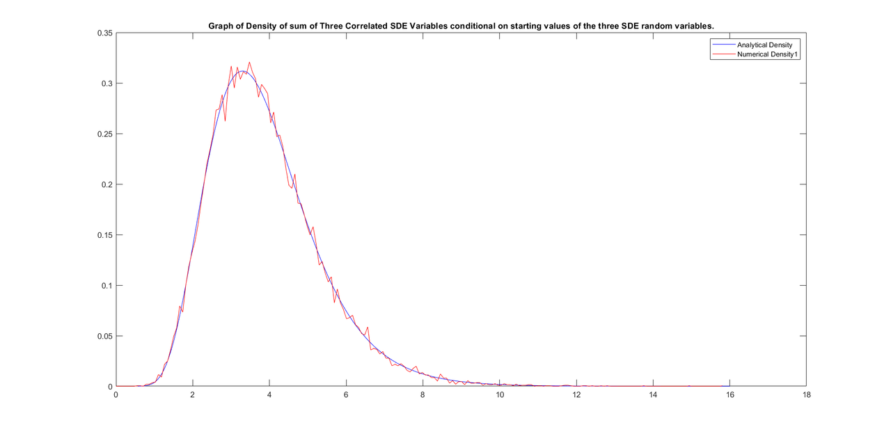](https://postimg.cc/w3BvkWQ9)

[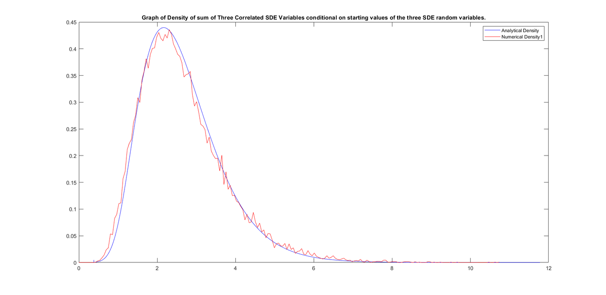](https://postimg.cc/xqdCPs30)

[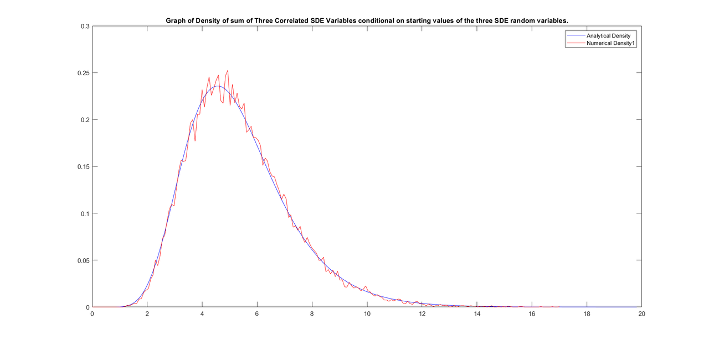](https://postimg.cc/YjS9xXz2)

[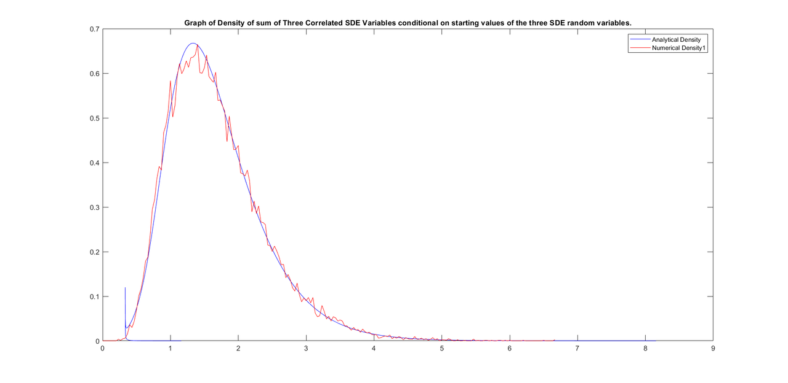](https://postimg.cc/3WwRZLF8)

.

.

Here is the last output you should see when you run this function.

YCentralMoments =

   1.0e+02 *

  Columns 1 through 3

                   0   0.004990653729692   0.003912376115810

  Columns 4 through 6

   0.012813597610393   0.029975159378640   0.101476964215587

  Columns 7 through 8

   0.380204203964578   1.744338164342730

DataCentralMoments =

   1.0e+02 *

  Columns 1 through 3

                   0   0.005081804773888   0.003882200903150

  Columns 4 through 6

   0.012716541702313   0.028754681657088   0.092588360118074

  Columns 7 through 8

   0.313732882683031   1.187286925582098

YProjected =

   1.680000000000000

---

### #3208 — tradeslayer
*July 2, 2026, 8:36 PM*

Your SDE parameters use zero drift (kappaV=0) consistently. Is this a simplification for the current research stage, or
do you believe the core mathematical challenge of conditional density estimation is fundamentally in the diffusion term,
making drift secondary? And separately — do you see applications of this work outside quantitative finance?

---

### #3209 — Amin (Topic Author)
*July 2, 2026, 9:52 PM*

Thank you tradeslayer for pointing this out. I have used zero drift since the cases with drift that I had considered
earlier were too easy compared to pure diffusion SDE models that were far more challenging. That is why I started to
test the pure diffusion models as benchmark. However, at that time, I was using a rather restricted range of conditional
starting values of SDEs. Now I need to run the mixed models with drift again and see how they behave under more extreme
scenarios of conditional starting points. Please feel free to change parameters of SDEs and switch to SDEs with drift
and see how that works.

This is another thing that I want to bring to notice of friends who ae working on the model. I think it is worth trying
to replace one variable of conditional mean of Y with three conditional means for each value of explaining X's. Our
model then would become the following

$
${Z_y}^m\,=\,{(\rho_{m,1}\,Z_{x_1}\,+\,\rho_{m,2}\,Z_{x_2}\,+\,\rho_{m,3}\,Z_{x_3}\,+\,\rho_{m,4}\,Z_{\bar{x}_1}\,+\,\rho_{m,5}\,Z_{\bar{x}_2}\,+\,\rho_{m,6}\,Z_{\bar{x}_3}\,+\,\zeta_{m}\,Z_{\tilde{y}})}^m$
$

Where$Z_{\bar{x}_1}$ is gaussian underlying the expected conditional value of$X_1(t_2)$ and so on for all three X's. I
am curious and want to try to know if this type of model structure has some advantages for correlation structures where
one value of$Z_{\bar{y}}$ mighr not be working well.

---

### #3210 — tradeslayer
*July 2, 2026, 10:30 PM*

This is very insightful — using three separate conditional means Zx̄₁, Zx̄₂, Zx̄₃ instead of one Zȳ makes intuitive
sense because it preserves the individual contribution of each SDE to the higher moments of Y. Did you find in earlier
experiments that the single Zȳ was losing information specifically in the tails of the conditional distribution? And
when you return to drift models — are you thinking of mean-reverting SDEs (kappa > 0) or more general drift structures?

---

### #3211 — Amin (Topic Author)
*July 3, 2026, 7:09 AM*

tradeslayer, thank you for your questions but I will come back to them in the evening to answer them in detail when I
have some more time.

Friends, I just had phone meeting with the psychiatrist and he insisted that I have Fluanxol injection today after
thirty days. I will get the injection in a few hours now.

---

### #3212 — Amin (Topic Author)
*July 3, 2026, 10:14 AM*

tradeslayer, as you pointed out the case for mean-reverting SDEs. I think it is important that whenever we have some
exact information, we use that in analytics. I will soon try to post another slightly modified version of the two or
three functions so that you could accurately do both CEV noises and mean reverting SDEs. I will also post an explanation
of the main ideas and intuition behind the analytics of the program.

---

### #3213 — tradeslayer
*July 3, 2026, 1:19 PM*

hope you're doing well bro

---

### #3214 — Amin (Topic Author)
*July 3, 2026, 5:52 PM*

tradeslayer, I went ahead and made changes to the previous program so we can now also work with any combinations of mean
reverting and CEV noises in the sum of the three SDEs. The algorithm is for N SDEs with any possible N that your
computer can easily handle but it might require some minor changes in the program because I might be using some
variables somewhere in the program specific to three SDEs.

I also have shown to users the value of each conditional starting point, its underlying Z and associated CDF so when you
are conditioning on some points, you will know exactly where they lie on CDF of the density of that random variable.

However, it might take me a day to post explanation of mathematical ideas used in the logic of the program.

Here is the new program. I am posting the only two functions I have changed.

.

.

```
function []= ConditionalDensityHermitesNvariateNewtonWithZyBar02New()

%SV SDE is
%dV(t)=mu1 V(t)^beta1 dt+ mu2 V(t)^beta2 dt + sigma0 V(t)^gamma dZ(t)
%In mean reverting SDEs we ususally have
%mu1= kappaV * thetaV
%beta1=0
%mu2=-kappa
%beta2=0
%The present program works only when drift is zero (for pure noises)
%meaning mu1=0 and mu2=0;

Order=7;
%NDim=4;%Three assets and one SV.
%NMomentsY=Order+1;
%NMomentsX=Order+1;

%%%%%%%%%%%%%%%%%%%5
dt=.03125/2/8;
Tt=64*2*8;
T=Tt*dt;
seed0=12130649;
%seed0=94210876;
%seed0=14210876;
seed0=53612297
%seed0=97459782
rng(seed0, 'twister')
paths=25000;
TT1=100*8/2; %Transition distribution start
TT2=256*8/2; %Transition distribution end

%%%%%%%%%%%%%%%%%%%5

NDims=3;
NDims2=3;
%
V0(1)=1.000;%.32;
V00(1)=V0(1);

%SDE1
 thetaV(1)=1.0;%.045;%1;%.04;
 kappaV(1)=1.000;%1.5;%1.5;
 gamma(1)=.75;%.75
 sigma0(1)=.5;%.35

%SDE2%
%thetaV(1)=.90;%.045;%1;%.04;
%kappaV(1)=1.000;%1.5;%1.5;
%gamma(1)=.75;%.75
%sigma0(1)=.85;%.35

%SDE3%
%thetaV(1)=1.350;%.045;%1;%.04;
%kappaV(1)=2.000;%1.5;%1.5;
%gamma(1)=.75;%.75
%sigma0(1)=.95;%.35

mu1(1)=kappaV(1)*thetaV(1);
mu2(1)=-kappaV(1);
beta1(1)=0;
beta2(1)=1;

V0(2)=1.000;%.32;
V00(2)=V0(2);

%SDE1
thetaV(2)=1.0;%.045;%1;%.04;
 kappaV(2)=0.75000;%1.5;%1.5;
 gamma(2)=.85;%.75
 sigma0(2)=.5;%.35

%SDE2
% thetaV(2)=1.0;%.045;%1;%.04;
% kappaV(2)=2.000;%1.5;%1.5;
% gamma(2)=.65;%.75
% sigma0(2)=.95;%.35

%SDE3
%thetaV(2)=.850;%.045;%1;%.04;
%kappaV(2)=.35000;%1.5;%1.5;
%gamma(2)=.65;%.75
%sigma0(2)=.55;%.35

mu1(2)=kappaV(2)*thetaV(2);
mu2(2)=-kappaV(2);
beta1(2)=0;
beta2(2)=1;

V0(3)=1.000;%.33;
V00(3)=V0(3);

%SDE1
thetaV(3)=1.0;%.045;%1;%.04;
 kappaV(3)=0.50;%00005000;%1.5;%1.5;
 gamma(3)=.95;%.75
 sigma0(3)=.45;%.35

%SDE2
% thetaV(3)=.750;%.045;%1;%.04;
% kappaV(3)=0.5000;%1.5;%1.5;
% gamma(3)=.95;%.75
% sigma0(3)=.45;%.35

%SDE3
%thetaV(3)=1.150;%.045;%1;%.04;
%kappaV(3)=1.5000;%1.5;%1.5;
%gamma(3)=.95;%.75
%sigma0(3)=.75;%.35

mu1(3)=kappaV(3)*thetaV(3);
mu2(3)=-kappaV(3);
beta1(3)=0;
beta2(3)=1;

params(1,1:NDims)=V0(1:NDims);
params(2,1:NDims)=thetaV(1:NDims);
params(3,1:NDims)=kappaV(1:NDims);
%params(4,1:NDims)=gamma(1:NDims);
%params(5,1:NDims)=sigma0(1:NDims);

Corr1(1,1)=1;
Corr1(1,2)=.7;
Corr1(1,3)=.8;
Corr1(2,2)=1;
Corr1(2,1)=.7;
Corr1(2,3)=.5;
Corr1(3,1)=.8;
Corr1(3,2)=.5;
Corr1(3,3)=1;
%
% % % % Was very good.
% Corr1(1,1)=1;
% Corr1(1,2)=.7/3;
% Corr1(1,3)=.8/3;
% Corr1(2,2)=1;
% Corr1(2,1)=.7/3;
% Corr1(2,3)=.5/3;
% Corr1(3,1)=.8/3;
% Corr1(3,2)=.5/3;
% Corr1(3,3)=1;
% % % % % % % %
% % % % % % % %
% % % % % % %
Corr1(1,1)=1;
Corr1(1,2)=-.7/3;
Corr1(1,3)=.8/3;
Corr1(2,2)=1;
Corr1(2,1)=-.7/3;
Corr1(2,3)=-.5/3;
Corr1(3,1)=.8/3;
Corr1(3,2)=-.5/3;
Corr1(3,3)=1;
% % % % % %
% % % % % %

R=chol(Corr1);
%
%  R(1:3,1:3)=0;
%  R(1,1)=1;
%  R(2,2)=1;
%  R(3,3)=1;

V0(4)=1.000;%.44;
V00(4)=V0(4);
thetaV(4)=1.0;%.045;%1;%.04;
kappaV(4)=1.000;%1.5;%1.5;
mu1(4)=kappaV(4)*thetaV(4);
mu2(4)=-kappaV(4);
beta1(4)=0;
beta2(4)=1;
gamma(4)=.95;%.75
sigma0(4)=.55;%.45

%%%%%%%%%%%%%%%%%%%%%%%%%%%%%%%%%%%%%%%%%%%%%%%%%%%%%%%%%%%%%%%%%%%%%5
for nn=1:NDims
V(1:paths,nn)=V0(nn);
Threshold(nn)=(sigma0(nn)*sqrt(dt)*2)^(1/(1-gamma(nn)));
end
%V(1:paths,1:NDims)=V0(1,1:NDims);

Random1(1:paths/2,1:NDims)=0;

for tt=1:Tt

    Random2(1:paths/2,1:NDims)=randn(size(Random1));
    Random2(paths/2+1:paths,1:NDims)=-Random2(1:paths/2,1:NDims);

    %Random2=R'*Random2;
    random1=Random2*R(:,1);
    random2=Random2*R(:,2);
    random3=Random2*R(:,3);

    Random2(:,1)=random1;
    Random2(:,2)=random2;
    Random2(:,3)=random3;

    %Random2(V(:,<Threshold,:)=

    Random2(V(:,1)<Threshold(1),1)=0.0;
    Random2(V(:,2)<Threshold(2),2)=0.0;
    Random2(V(:,3)<Threshold(3),3)=0.0;

    for nn=1:NDims

    V(1:paths,nn)=V(1:paths,nn)+ ...
        (mu1(nn).*V(1:paths,nn).^beta1(nn) + mu2(nn).*V(1:paths,nn).^beta2(nn))*dt + ...
        sigma0(nn).*V(1:paths,nn).^gamma(nn) .*Random2(1:paths,nn)*sqrt(dt) + ...
        (mu1(nn).*beta1(nn)*V(1:paths,nn).^(beta1(nn)-1) + mu2(nn).*beta2(nn).*V(1:paths,nn).^(beta2(nn)-1)).* ...
        ((mu1(nn).*V(1:paths,nn).^beta1(nn) + mu2(nn).*V(1:paths,nn).^beta2(nn))*dt^2/2 + ...
        sigma0(nn).*V(1:paths,nn).^gamma(nn) .*Random2(1:paths,nn)*(1-1/sqrt(3))*dt^1.5) + ...
        .5*(mu1(nn).*beta1(nn).*(beta1(nn)-1).*V(1:paths,nn).^(beta1(nn)-2) +
mu2(nn).*beta2(nn).*(beta2(nn)-1).*V(1:paths,nn).^(beta2(nn)-2)).* ...
        sigma0(nn)^2.*V(1:paths,nn).^(2*gamma(nn)).*dt^2/2 + ...
        sigma0(nn).*gamma(nn).*V(1:paths,nn).^(gamma(nn)-1) .* ...
        ((mu1(nn).*V(1:paths,nn).^beta1(nn) + mu2(nn).*V(1:paths,nn).^beta2(nn)).*Random2(1:paths,nn).*1/sqrt(3)*dt^1.5
+ ...
        sigma0(nn).*V(1:paths,nn).^gamma(nn) .*(Random2(1:paths,nn).^2-1)*dt/2) + ...
        .5*sigma0(nn).*gamma(nn).*(gamma(nn)-1).*V(1:paths,nn).^(gamma(nn)-2) .* ...
        sigma0(nn).^2.*V(1:paths,nn).^(2*gamma(nn)) .*Random2(1:paths,nn).*1/sqrt(3)*dt^1.5;

    V(V(:,nn)<=.00001,nn)=.0000;

    V(isnan(V(:,nn)),nn)=0;

    if(tt==TT1)
        Xin(1:paths,nn)=(V(1:paths,nn));
    end

    if(tt==TT2)

        Xin2(1:paths,nn)=(V(1:paths,nn));
    end

    end

end

Yin(1:paths)=0.0;

for pp=1:paths
for mm=1:NDims
    %Yin(pp)=Yin(pp)+Xin2(pp,mm);%-Xin(pp,mm);
    Yin(pp)=Yin(pp)+Xin2(pp,mm);
%-Xin(pp,mm);
end
end

str=input("I have reached stone 1");

% %%%%%%%%%%%%%%%%%%%%%%%%%%%%%%%%%%%%%%%%%%%%%%%%%%5
%
 Order=7;
 clf;

  NDims2=3;

%[BetaCorrH,YCoeffH,XCoeffH,HCorrXX,Zy,Zx] = CalculateHermiteCorrelations0NA04WithZyBar(Xin,Yin,paths,NDims2);
%[BetaCorrH,YCoeffH,XCoeffH,Zy,Zx] = CalculateHermiteCorrelations0NA04WithZyBar(Xin,Yin,paths,NDims2);
[YCoeffH,XCoeffH,Zy,Zx] = CalculateHermiteSeries0NA04WithZyBarParams(Xin,Yin,params,TT1*dt,TT2*dt,paths,NDims);
YCoeffZ(1:Order+1)= ConvertHermiteSeriesToZSeries01(YCoeffH(1:Order+1),Order);

NDims2=NDims+1;%Three SDE variables and one YBar.

[cn] = FindInitialGuessForNewtonUnivariate(Zy,Zx,NDims2,paths,Order);

% bn=0;
% for mm=1:NDims2
%     NDims0=1;
%     [bn] = FindInitialGuessForNewtonUnivariate(Zy,Zx(1:paths,mm),NDims0,paths,Order);
%     bn
% %    HCorrXX0(1,1,1:Order)=1;
% %    bnOptim0= OptimizeCorrFromHermitesNewtonWithoutVar(Zy,Zx(1:paths,mm),bn,HCorrXX0,NDims0,paths,Order);
%     bnOptim(mm,:)=bnOptim0(1,:);
%  mm
% % str=input("Let us look at bn");
%
% end
%
%
% bnOptim
%
% str=input("Look at the variabes of cnOptim");
%
%
%
%
% for mm1=1:NDims2
%     for mm2=1:NDims2
%         NDims0=1;
%         [bn] = FindInitialGuessForNewtonUnivariate(Zx(1:paths,mm1),Zx(1:paths,mm2),NDims0,paths,Order);
%         bn
%         HCorrXX0(1,1,1:Order)=1;
%         CorrXX1=
OptimizeCorrFromHermitesNewtonWithoutVar(Zx(1:paths,mm1),Zx(1:paths,mm2),bn,HCorrXX0,NDims0,paths,Order);
%         %CorrXX2=
OptimizeCorrFromHermitesNewtonWithoutVar(Zx(1:paths,mm2),Zx(1:paths,mm1),bn,HCorrXX0,NDims0,paths,Order);
%         HCorrXX(mm1,mm2,1:Order)=(CorrXX1(1,1:Order));%+CorrXX2(1,1:Order))/2;
%         HCorrXX(mm2,mm1,1:Order)=(CorrXX1(1,1:Order));%+CorrXX2(1,1:Order))/2;
%         HCorrXX(mm1,mm1,1:Order)=1;
%     end
% end
%
%
%
%
% for hh=1:Order
%     bCol(1:NDims2,1)=bnOptim(1:NDims2,hh);
%     HHCorrXX(1:NDims2,1:NDims2)=HCorrXX(1:NDims2,1:NDims2,hh);
%     bb=HHCorrXX\bCol;
%     cn(1:NDims2,hh)=bb(1:NDims2);
% end
% Var(hh)=0.0;
% for hh=1:Order
%     for mm=1:NDims2
%         Var(hh)=Var(hh)+cn(mm,hh).^2;
%     end
%     cn(NDims2+1,hh)=abs(sqrt(1-Var(hh)));
% end
%
% cn0=cn;
%
% cn

str=input("Look at cn before input to Newton correlation finding function");
 [cnOptim] = OptimizeCorrFromHermitesNewtonNewAlgoZytilde(Zy,Zx,cn,NDims2,paths,Order);

 cn=cnOptim;

%[CoeffR] = RegressYOnXGivenZx(Yin,Zx,paths,NDims,Order);
%Above function would have to be decommented when SDEs are not martingales.

for kk=1:4%Loop over four conditional starting points of Density.

% %Set1
    V10(1,1)=1.2+.25;%.65;%
    V10(2,1)=.75-.125;
    V10(3,1)=1.2+.25;

 %YProjected=YBar;

 % V10(4,1)=V10(1,1)+V10(2,1)+V10(3,1);
%
% % % %
% % % % % % % % % % %Set2
       V10(1,2)=.75-.125;
       V10(2,2)=1.2+.25;%1.2;
       V10(3,2)=.7-.125;
       %V10(4,2)=V10(1,2)+V10(2,2)+V10(3,2);

% % % % % % % % % % % % % % %V10(4)=.65
% % % % % % % % % % % % % %
% % % % % % % % % % % % % % % % %Set3
       V10(1,3)=1.25+.25;
       V10(2,3)=1.35+.25;%1.2;
       V10(3,3)=1.25+.25;
       %V10(4,3)=V10(1,3)+V10(2,3)+V10(3,3);
%
%
%
% % % % % % % % % % % % % % % %   V10(4)=1.4
% % % % % % % % % % % % % % % % %
% % % % % % % % % % % % % % % % %
         V10(1,4)=.85-.125;
         V10(2,4)=.81-.125;%1.2;
         V10(3,4)=.77-.125;
         %V10(4,4)=V10(1,4)+V10(2,4)+V10(3,4);
%
%
% % % % % % % % % % %  V10(4)=.7
% %

YBar=0.0;
for mm=1:NDims
    X0(1,mm)=V10(mm,kk)';
    ZBar(1,mm)=params(2,mm)+(X0(1,mm)-params(2,mm)).*exp(-params(3,mm).*(TT2*dt-TT1*dt));
    YBar=YBar+ZBar(1,mm);
 end

V10(NDims+1,kk)=YBar;
YProjected=YBar;

for nn=1:NDims2
    [Zx0(nn)] = CalculateZgivenXAndHSeriesCoeffs(V10(nn,kk),XCoeffH(1:Order+1,nn),Order);
end

X1=V10(1,kk)
Z1=Zx0(1)
CDF1=normcdf(Zx0(1))

X2=V10(2,kk)
Z2=Zx0(2)
CDF2=normcdf(Zx0(2))

X3=V10(3,kk)
Z3=Zx0(3)
CDF3=normcdf(Zx0(3))

EYSum=V10(4,kk)
EZSum=Zx0(4)
ECDFSum=normcdf(Zx0(4))

str=input("Current Scenario has the following starting points and their CDF values");

for nn=1:NDims
V(1:paths,nn)=V10(nn,kk);
end
%V(1:paths,1:NDims)=V0(1,1:NDims);

Random1(1:paths/2,1:NDims)=0;

for tt=1:TT2-TT1

    Random2(1:paths/2,1:NDims)=randn(size(Random1));
    Random2(paths/2+1:paths,1:NDims)=-Random2(1:paths/2,1:NDims);

    random1=Random2*R(:,1);
    random2=Random2*R(:,2);
    random3=Random2*R(:,3);

    Random2(:,1)=random1;
    Random2(:,2)=random2;
    Random2(:,3)=random3;

    Random2(V(:,1)<Threshold(1),1)=0.0;
    Random2(V(:,2)<Threshold(2),2)=0.0;
    Random2(V(:,3)<Threshold(3),3)=0.0;

    for nn=1:NDims

    V(1:paths,nn)=V(1:paths,nn)+ ...
        (mu1(nn).*V(1:paths,nn).^beta1(nn) + mu2(nn).*V(1:paths,nn).^beta2(nn))*dt + ...
        sigma0(nn).*V(1:paths,nn).^gamma(nn) .*Random2(1:paths,nn)*sqrt(dt) + ...
        (mu1(nn).*beta1(nn)*V(1:paths,nn).^(beta1(nn)-1) + mu2(nn).*beta2(nn).*V(1:paths,nn).^(beta2(nn)-1)).* ...
        ((mu1(nn).*V(1:paths,nn).^beta1(nn) + mu2(nn).*V(1:paths,nn).^beta2(nn))*dt^2/2 + ...
        sigma0(nn).*V(1:paths,nn).^gamma(nn) .*Random2(1:paths,nn)*(1-1/sqrt(3))*dt^1.5) + ...
        .5*(mu1(nn).*beta1(nn).*(beta1(nn)-1).*V(1:paths,nn).^(beta1(nn)-2) +
mu2(nn).*beta2(nn).*(beta2(nn)-1).*V(1:paths,nn).^(beta2(nn)-2)).* ...
        sigma0(nn)^2.*V(1:paths,nn).^(2*gamma(nn)).*dt^2/2 + ...
        sigma0(nn).*gamma(nn).*V(1:paths,nn).^(gamma(nn)-1) .* ...
        ((mu1(nn).*V(1:paths,nn).^beta1(nn) + mu2(nn).*V(1:paths,nn).^beta2(nn)).*Random2(1:paths,nn).*1/sqrt(3)*dt^1.5
+ ...
        sigma0(nn).*V(1:paths,nn).^gamma(nn) .*(Random2(1:paths,nn).^2-1)*dt/2) + ...
        .5*sigma0(nn).*gamma(nn).*(gamma(nn)-1).*V(1:paths,nn).^(gamma(nn)-2) .* ...
        sigma0(nn).^2.*V(1:paths,nn).^(2*gamma(nn)) .*Random2(1:paths,nn).*1/sqrt(3)*dt^1.5;

    V(V(:,nn)<=.00001,nn)=.0001;

    %if(tt==TT1)
    %    XXin(1:paths,nn)=V(1:paths,nn);
    %end

    if(tt==TT2-TT1)

        XXin2(1:paths,nn)=V(1:paths,nn);
    end

    end

end

Yin2(1:paths)=0.0;

for pp=1:paths
for mm=1:NDims
    Yin2(pp)=Yin2(pp)+XXin2(pp,mm);%-V10(mm);
end
end

%randn()

str=input("I have reached stone 4");

NoOfBins=200;
MaxCutOff=20;

[XDensity,IndexOut,IndexMax] = MakeDensityFromSimulation_Infiniti_NEW(Yin2,paths,NoOfBins,MaxCutOff );

for qq=1:8

    DataMoments(qq)=sum(Yin2(:).^qq)/paths;

end

%%%%%%%%%%%%%%%%%%%%%%%%%%%%%%%%%%%%%%%%%%%%%%%%%%%%%%%%%%%%%%%%%%%%%%%%%%%%%%%%%%%%%%%5

%for nn=1:NDims2
%    [Zx0(nn)] = CalculateZgivenXAndHSeriesCoeffs(V10(nn,kk),XCoeffH(1:Order+1,nn),Order);
%end

%%%%%%%%%%%%%%%%%%%%%%%%%%%%%%%%%%%%%%%%%%%%%%%%%%%%%%%%%%%%%%%%%%%55
%
% WW(1,1:Order+1)=EvalHermiteArrayH0(Zx0(1),Order);
% for mm=2:NDims
%     WW(1,(mm-1)*Order+2:mm*Order+1)=EvalHermiteArrayH1(Zx0(mm),Order);
% end

%      YProjected=0.0;
%     for mm=1:NDims*Order+1
%     YProjected=YProjected+WW(1,mm).*CoeffR(mm,1);
%
%     end

%     YBar=0.0;
%  for mm=1:NDims
%      X0(1,mm)=V10(mm,kk)';
%     ZBar(1,mm)=params(2,mm)+(X0(1,mm)-params(2,mm)).*exp(-params(3,mm).*(TT2*dt-TT1*dt));
%     YBar=YBar+ZBar(1,mm);
%  end
%
%  YProjected=YBar;

%Above conditional expected value finding function would have to be decommented
%when SDEs are not martingales.

% %When SDEs are martingales, use the line below but comment if they are not.
%     YProjected=V10(1,kk)+V10(2,kk)+V10(3,kk);

%%%%%%%%%%%%%%%%%%%%%%%%%%%%%%%%%%%%%%%%%%%%%%%%%%%%%%%%%%%%%%%%%%%%%%%%%%%%%%%55
Zx(1:Order)=0;

for hh=1:Order
    for nn=1:NDims2
        %Zx(hh) = Zx(hh) + bnv(nn+1,hh+1).^1.*Zx0(nn);
        Zx(hh) = Zx(hh) + cn(nn,hh).^1.*Zx0(nn);
    end
end

%bh0=YCoeffH(1);

% [W] = EvalHermiteArrayH0(Zx0,Order);
%
% for hh=1:Order
%     for nn=1:NDims2
%         bh0 = bh0 + ch(nn+1,hh+1).^1.*W(nn,hh+1);
%     end
% end
% bh00=bh0;

%%%%%%%%%%%%%%%%%%%%%%%%%%%%%%%%%%%%%%%%%%%%%%%%%%%%%%%%%%%%%%%%

%
a0=YCoeffZ(1);
a1=YCoeffZ(2);
a2=YCoeffZ(3);
a3=YCoeffZ(4);
a4=YCoeffZ(5);
a5=YCoeffZ(6);
a6=YCoeffZ(7);
a7=YCoeffZ(8);

d1=cn(NDims+2,1);
d2=cn(NDims+2,2);
d3=cn(NDims+2,3);
d4=cn(NDims+2,4);
d5=cn(NDims+2,5);
d6=cn(NDims+2,6);
d7=cn(NDims+2,7);

% %b0=(a0+a1.* Zx(1) +a2.* Zx(2).^2+a3.* Zx(3).^3+a4* Zx(4).^4+a5 *Zx(5).^5+a6* Zx(6).^6+a7* Zx(7).^7);
b1=(a1* d1+2* a2* Zx(2)* d2 +3* a3* Zx(3).^2* d3+4* a4* Zx(4).^3* d4+5* a5* Zx(5).^4* d5+6* a6* Zx(6).^5* d6+7* a7*
Zx(7).^6* d7);
b2=(a2* d2.^2+3* a3* Zx(3)* d3^2 +6* a4* Zx(4).^2* d4^2+10* a5* Zx(5).^3* d5^2+15* a6* Zx(6).^4* d6^2+21* a7* Zx(7).^5*
d7^2);
b3=(a3* d3^3+4* a4 *Zx(4)* d4^3 +10* a5* Zx(5).^2* d5^3+20* a6* Zx(6).^3* d6^3+35* a7* Zx(7).^4* d7^3);
b4=(a4* d4^4+5* a5* Zx(5)* d5^4 +15* a6 *Zx(6).^2* d6^4+35* a7* Zx(7).^3 *d7^4);
b5=(a5* d5^5+6* a6* Zx(6)* d6^5 +21* a7 *Zx(7).^2* d7^5);
b6=(a6* d6^6+7* a7* Zx(7)* d7^6 );
b7=(a7* d7^7);

%bh0=b0+b2+3*b4+15*b6;
bh1=b1+3*b3+15*b5+105*b7;
bh2=b2+6*b4+45*b6;
bh3=b3+10*b5+105*b7;
bh4=b4+15*b6;
bh5=b5+21*b7;
bh6=b6;
bh7=b7;

bh(1)=YProjected;
bh(2)=bh1;
bh(3)=bh2;
bh(4)=bh3;
bh(5)=bh4;
bh(6)=bh5;
bh(7)=bh6;
bh(8)=bh7;

% %%%%%%%%%%%%%%%%%%%%%%%%%%%%%%%%%%%%%%%%%%%%%%%%%%%%%%%%%%%%%%%%%%%%%%%%%%%%%%%%%%%%%5

YCentralMoment2=0;
for nn=1:Order
    YCentralMoment2=YCentralMoment2+bh(nn+1).^2*factorial(nn);
end

%%%%%%%%%%%%%%%%%%%%%%%%%%%%%%%%%%%%%%%%%%%%%%%%%%%%%%%%%%%%%%%%%%%%%%%%%%%%%%5

YCoeffz(1:Order+1)= ConvertHermiteSeriesToZSeries01(bh(1:Order+1),Order);

[YMomentsModel]=CalculateMomentsOfZSeries(YCoeffz(1),YCoeffz(2:Order+1),Order,Order+1);

YMomentsModel

DataMoments

str=input("Look at comparison of moments");

[cMu1,YCentralMoments]=ConvertRawMomentsToCentralMoments(YMomentsModel,Order+1);
[cMu2,DataCentralMoments]=ConvertRawMomentsToCentralMoments(DataMoments,Order+1);

YCentralMoments

DataCentralMoments

YProjected
str=input("Look at central moments");

clf;

PlotZSeriesDensity(YCoeffz(1),YCoeffz(2:Order+1),'b')

hold on

plot(IndexOut(1:IndexMax),XDensity(1:IndexMax),'r');

%PlotHermiteSeriesDensityAndRvGraph(YCoeffh(1),YCoeffh1(2:yOrder+1),'g')
title("Graph of Density of sum of Three Correlated SDE Variables conditional on starting values of the three SDE random
variables.")
%title(sprintf('V00 = %.3f; kappa=%.3f, theta=%.3f,gamma=%.3f,sigma=%.3f;V10=%.3f at TT1=%.3f;TT2=%.3f;Paths=%d ',V00,
kappaV, thetaV,gamma,sigma0, V10,(TT1*dt),(TT2*dt),paths));%,sprintf('theta= %f', theta), sprintf('kappa = %f',
kappa),sprintf('sigma = %f', sigma0),sprintf('T = %f', T));
legend({'Analytical Density','Numerical Density1'}, ...
    'Location','northeast')
kk
str=input("This is the first version without altering the moments of conditional density")

hold off

end

end
```

.

.

.

```
function [YCoeffH,XCoeffH,Zy,Zx] = CalculateHermiteSeries0NA04WithZyBarParams(Xin,Yin,params,T1,T2,NData,NDims)

%function [BetaCorrH,YCoeffH,XCoeffH,HCorrXX,Zy,Zx] = CalculateHermiteCorrelations0NA04WithZyBar(Xin,Yin,NData,NDims)

%This program finds required correlations between NDims explanatory
%variables given in Xin that has NDims dimensionality. Yin is variable
%being explained and is one-diemsnional.

Order=7;
NMoments=8;

[ZI] = MomentMatchedStandardNormalDiscretizedDensity(NData);

for nn=1:NDims

    [c0(nn),c(1:Order,nn),FittedMoments,Zx(:,nn)] =
CalculateZSeriesDensityFromRawMoments02FromGuess02W(Xin(1:NData,nn),ZI);%,XCoeffZ(2:Order+1));

 XCoeffZ(1,nn)=c0(nn);
 XCoeffZ(2:Order+1,nn)=c(1:Order,nn);

[XCoeffH(1:Order+1,nn)] = ConvertZSeriesToHermiteSeriesNew(XCoeffZ(1:Order+1,nn),Order);

% for mm=1:8
%     rMu(mm)=sum(Zx(1:NData,nn).^mm)/NData;
% end

nn
end

%%%%%%%%%%%%%%%%%%%%%%%%%%%%%%%%%%%%%%%%%%%%%%%%%%%%%%%%%%%%%%%%%%%%%%%%%%%%%%%%%%%%%%%%55
%[CoeffR] = RegressYOnXGivenZx(Yin,Zx,NData,NDims,Order);

% WW(1:NData,1:Order+1)=EvalHermiteArrayH0(Zx(1:NData,1),Order);
% for mm=2:NDims
%     WW(1:NData,(mm-1)*Order+2:mm*Order+1)=EvalHermiteArrayH1(Zx(1:NData,mm),Order);
% end

 YBar(1:NData,1)=0.0;
 for mm=1:NDims
    ZBar(1:NData,mm)=params(2,mm)+(real(Xin(1:NData,mm))-params(2,mm)).*exp(-params(3,mm).*(T2-T1));
    YBar(1:NData,1)=YBar(1:NData,1)+ZBar(1:NData,mm);
 end

 %ZBar
 %real(Xin(1:NData,mm))

 %str=input("Look at ZBar");

 %5555%
 %YBar

 %str=input("Look at YBar");
%  params(1,1:NDims)=V0(1:NDims);
% params(2,1:NDims)=thetaV(1:NDims);
% params(3,1:NDims)=kappaV(1:NDims);
% params(4,1:NDims)=gamma(1:NDims);
% params(5,1:NDims)=sigma0(1:NDims);

% YBar(1:NData,1)=0.0;
% for nn=1:NDims
%     YBar(1:NData,1)=YBar(1:NData,1)+Xin(1:NData,nn);
% end
% %YBar contains conditional expected value of Y(t2) but
% %the above calculation of conditional value would work only
% %for SDEs that are a martingale. We put conditional expected
% %value equal to sum of starting values of X's.
% %When SDes are not martinglaes, you would have to do a regression here
% %and replace above with regression function.

%YBar is absorbed in X's vector below

Xin(1:NData,NDims+1)=YBar(1:NData,1);

[c0(NDims+1),c(1:Order,NDims+1),FittedMoments,Zx(:,NDims+1)] =
CalculateZSeriesDensityFromRawMoments02FromGuess02W(Xin(1:NData,NDims+1),ZI);%,XCoeffZ(2:Order+1));

 XCoeffZ(1,NDims+1)=c0(NDims+1);
 XCoeffZ(2:Order+1,NDims+1)=c(1:Order,NDims+1);

[XCoeffH(1:Order+1,NDims+1)] = ConvertZSeriesToHermiteSeriesNew(XCoeffZ(1:Order+1,NDims+1),Order);

%XCoeffZ(1:Order+1,NDims+1)
%str=input("Look at the distribution of YBar");

%%%%%%%%%%%%%%%%%%%%%%%%%%%%%%%%%%%%%%%%%%%%%%%%%%%%%%%%%%%%%%%%%%%%%%%%%%%%%%%%%%%%%%%%%%%%%%%%555

 for pp=1:Order+1
     YrMu(pp)=sum(Yin(1:NData).^pp)/NData;
 end
 %YDataMedian=(Yin(NData/2)+Yin(NData/2+1))/2;
 YDataMedian=(Yin(NData/2-2)+Yin(NData/2-1)+Yin(NData/2)+Yin(NData/2+1)+Yin(NData/2+2)+Yin(NData/2+3))/6;

 %[c0,c(1:Order),FittedMoments] = ZSeriesCoeffsFromMomentsIterWithMedian(YrMu(:),YDataMedian);
 [c0,c(1:Order),FittedMoments,Zy] =
CalculateZSeriesDensityFromRawMoments02FromGuess02W(Yin(1:NData),ZI);%,XCoeffZ(2:Order+1));

str=input("Look at data results ofY");
 YCoeffZ(1)=c0;
 YCoeffZ(2:Order+1)=c(1:Order);

 [YCoeffH(1:Order+1)] = ConvertZSeriesToHermiteSeriesNew(YCoeffZ(1:Order+1),Order);
 %ConvertZSeriesToHermiteSeriesNew

end
```

.

.

.

Here are the graph fit to mean reverting SDEs for all four scenarios.

.

.

[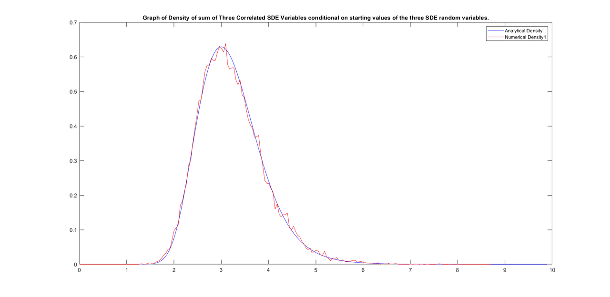](https://postimg.cc/KRKgJbgL)

[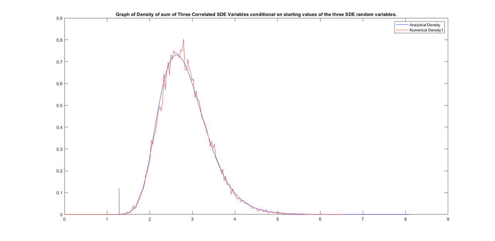](https://postimg.cc/gnw6Np6Z)

[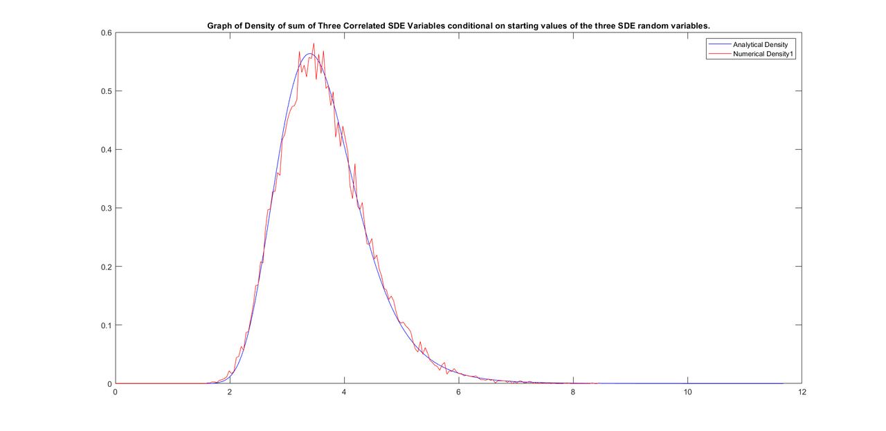](https://postimg.cc/vc163y6n)

[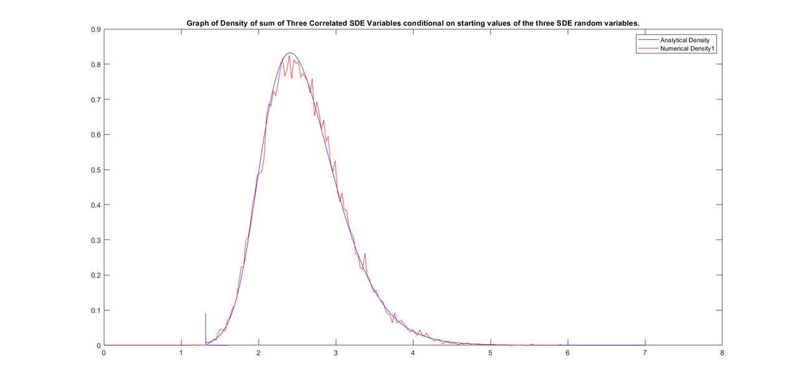](https://postimg.cc/1fgNJSNw)

---

### #3215 — Amin (Topic Author)
*July 3, 2026, 6:40 PM*

Friends, I have had the privilege of working on several challenging problems in stochastic processes and developing
original ideas that have led to meaningful results. Stochastics are one of my deep academic interests, and I genuinely
enjoy tackling difficult problems that require new ways of thinking. If you have an important unsolved problem in
stochastics that is relevant to my research interests and are looking for fresh insights or a possible solution, I would
be pleased to work with you on it as a consulting engagement. I would love to work with any relevant stochastics related
problems that arise from applications in science, engineering, finance, or another field, I would be glad to discuss it
and explore whether I can contribute.

Please approach me at [[email protected]](/cdn-cgi/l/email-protection#18797679762a212121586179707777367b7775) or connect
with me on linkedin. You can also call me at +92-336-2602125 if you like or leave a message at Whatsapp.

Here is a relevant linkedin post I made a few weeks ago. https://www.linkedin.com/pulse/magic-extends-far-beyond-ai-let-us-solve-our-problems-ahsan-amin-xo1ff/

Applied Mathematics Beyond AI: Expanding the Boundaries of Quantitative Intelligence With Magic of Applied Mathematics.

I have always believed that mathematics is the closest thing humanity possesses to true magic — a discipline whose
discoveries have continuously transformed our civilization and expanded the limits of what we consider possible.

Over the past four years, I have been conducting research on developing a probability theory framework based on Z-series
and Hermite-series methods. During this time, I have developed a substantial body of mathematical tools that can now be
successfully applied to practical problems that have remained analytically unsolved.

In brief, Hermite-Series Calculus uses Taylor series framework for random variables, and uses smart change of variables
of the probability distributions and approaches problems in probability theory — such as prediction, conditional density
modelling, and regression — by mapping them onto suitable probability distributions and decomposing them into orthogonal
components using the orthogonal polynomials associated with those distributions. Each orthogonal subproblem
corresponding to a polynomial order is then solved separately while remaining part of the overall problem structure.

Random variables belonging to many of the probability distributions commonly encountered in finance — including gamma,
generalized gamma, central and non-central chi-squared, lognormal, and many others — can be mapped onto the normal
distribution through an appropriate change of variable and represented as expansions in orthogonal Hermite polynomials.
This is a new methodology and should not be confused with traditional Hermite polynomial regression techniques.

The algorithms and techniques I have developed have significant applications in quantitative finance, algorithmic
trading, factor modelling, portfolio management, and option pricing. In particular, they provide powerful tools for
working with implied and projected distributions related to derivatives pricing and for efficiently estimating
conditional distributions, even within Monte Carlo simulations.

A large class of conditional density regression problems arising in mathematical finance, natural sciences, biology, and
medicine — many of which are currently addressed using neural networks and machine learning — can potentially be solved
far more efficiently and reliably using these Z-series/Hermite-series methods. Unlike black-box optimization techniques,
these methods are grounded in rigorous mathematical structure and provide not only point estimates but also accurate
conditional density estimates based on realized values of correlated random variables.

Problems that may currently require weeks of neural-network training and substantial computational resources can, in
many cases, be solved in seconds using appropriately designed Z-series algorithms. The computational cost is extremely
low for medium-sized problems, with most of the effort lying in developing the correct mathematical formulation rather
than expensive compute infrastructure.

You may download MATLAB programs from posts #3057 and #3039 on the Wilmott technical forum thread titled:

“Breakthrough in the Theory of Stochastic Differential Equations and Their Simulation.”

https://forum.wilmott.com/viewtopic.php?t=99702&start=3045#p890034

Here is my research paper introducing the fundamentals of Z-series and Hermite-series:

https://papers.ssrn.com/sol3/papers.cfm?abstract_id=4933283

I have shared many of the foundational algorithms on the Wilmott forum in the form of MATLAB programs. However, each
practical application has its own technical subtleties, and adapting the methods to specific real-world problems often
requires further refinement and problem-specific innovation.

If you believe these methods may be relevant to challenges you are working on, I would be very interested in discussing
them further.

My email address is: [[email protected]](/cdn-cgi/l/email-protection#c2a3aca3acf0fbfbfb82bba3aaadadeca1adaf)

Please feel free to share any comments or questions.

---

### #3216 — Amin (Topic Author)
*July 3, 2026, 7:18 PM*

Friends, I repeated the scenarios given in the above program for mean reverting SDEs with only 2000 paths and got the
following graph results for four scenarios.

.

.

.

[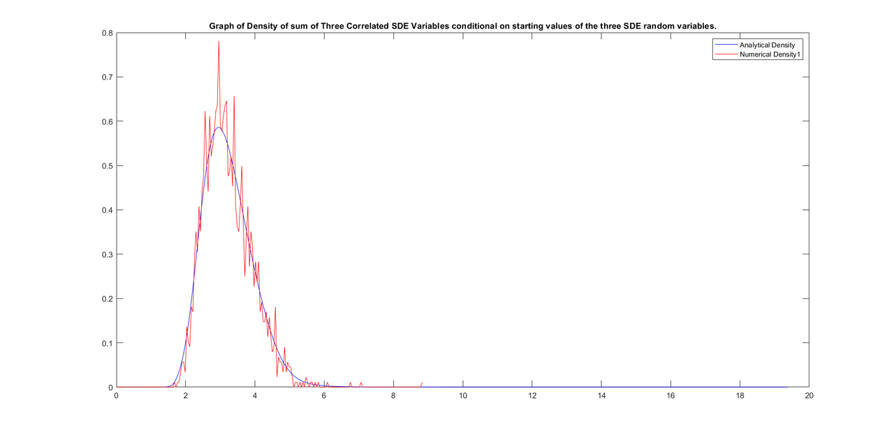](https://postimg.cc/vg5LjRBV)

[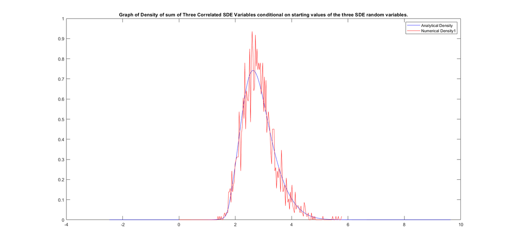](https://postimg.cc/phKY7NT8)

[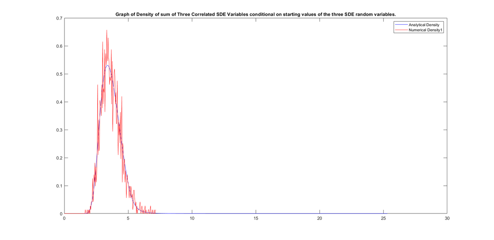](https://postimg.cc/zbTSMmBR)

[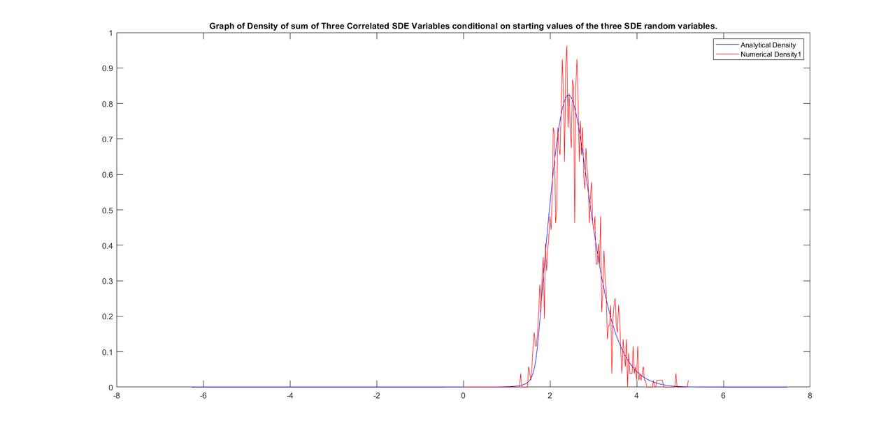](https://postimg.cc/CBbHty18)

---

### #3217 — Amin (Topic Author)
*July 4, 2026, 8:25 AM*

Friends, our research will continue and my thread will move on after the breakthrough into other possibilities and
research problems but, for me, it is time to pause for a bit and acknowledge the debt of all those people who made my
research effort possible. First of all I would like to thank all those great American friends who have tried to help me
since several long years ago when my research was just starting and they recognized potential of my research when most
people dismissed it as totally irrelevant and unimportant. This was the time (before arrival of President Trump) when I
developed most of the basic infrastructure of Z-series and had many interesting ideas about foundations of the model and
its analytics. It took me 2-5 to 3 last years of Biden era to slowly work on the basics of the model. Due to supporting
efforts of many people I had to go through very little antipsychotics (In last years I would get half Fluanxol injection
after 30 days and had no other medication) and I was never detained during this time despite that my family was very
upset with me. This was the longest stretch of time that I was not detained since my persecution in Pakistan started
when I arrived in my country in year 1999. Even though, there were still many problems with drugging of food in the
entire markets and many other issues with gases and other things, I was absolutely not detained and remained on
extremely little medication and therefore I was able to do a lot of foundational work on the model quite well and I had
enough creativity.

Things changed dramatically when administration changed and I still remember the torture with gases and microwaves on
the night of 20th January 2025. Within a month I was detained by my family and had to spend more than 50 days in
detention at a mental health facility on extremely high antipsychotics. My antipsychotics regimen remined extremely high
to this day after I left the detention. Even though many good friends were firm about fully supporting me, they probably
had little connections in the new administration.

However, when I started working on the problem of conditional densities again several months after leaving detention, a
lot friends again supported me and a lot of mind control activity again decreased somewhat and I was again able to work
somewhat better. Though it took a lot of time as research in mathematics is not easy and one has to come up with new
ideas out of nowhere but still my research continued to advance slowly and reasonably steadily and I had several
research breaks that helped advance the model. Again I would not have been able to do anything meaningful late last year
and during this year if many good American friends had not supported me resulting in favorable environment for my
research. If the coercion had not decreased due to pressure of friends, my research was simply not possible.

Last but the most important person I am thankful to is Paul Wilmott himself. We rarely discuss anything on regular basis
and it is only after several months that I have to email him asking about something important but I have true respect
for Paul because even though he may not like many things I write about about bad Jews, he firmly stood behind the
principles of free speech and I have a true respect for lot of good conservatives due to people like Paul. More than
anything, he is a man of his words. My research would absolutely never have been possible if he had not allowed me to
post freely on the forum.(This is no little thing considering places like Amnesty International UK had removed my post
from their forum within a few hours in 2010 even when I had not hinted a word about jews). I am truly indebted to Paul
for all the favors he gave me.

So all heavenly bodies would continue to rotate and we would continue to circle the sun and continue to try doing better
research but I want time to stop for a moment so that I can thank all those good people who made my research possible
and tell them that I am under a huge debt to them that I can never possibly repay.

---

### #3218 — Amin (Topic Author)
*July 4, 2026, 2:58 PM*

Friends, please give me sometime and later tonight, I would explain the ideas behind our correlations and how they
relate different random variables to each other. I will try to explain the basics today and later explain the rest of
the things in more detail with another two or three posts. In a few hours, I will write my first post explaining the
basics.

---

### #3219 — Amin (Topic Author)
*July 5, 2026, 5:52 PM*

Friends, I noticed that after adding$Z_{\bar{y}}$ in our Newton regression for correlation coefficients, coefficients
$\rho_{m,1}$ ,$\rho_{m,2}$ and$\rho_{m,3}$ are very small

$
${Z_y}^m\,=\,{(\rho_{m,1}\,Z_{x_1}\,+\,\rho_{m,2}\,Z_{x_2}\,+\,\rho_{m,3}\,Z_{x_3}\,+\,\rho_{m,4} \, Z_{\bar{y}}\,+\,\zeta_{m}\,Z_{\tilde{y}})}^m$
$

So  we could do a simpler regression for some special cases where speed is a major requirement as

$${Z_y}^m\,=\,{(\,\rho_{m} \, Z_{\bar{y}}\,+\,\zeta_{m}\,Z_{\tilde{y}})}^m$$

and this two parameter regression gives almost exactly the same results as full regression in first equation. This is
worth exploring and I would urge friends to try this simple version above and see how it goes compared to the full
version in first equation. Even if it is slightly inaccurate, this fact (that correlation coefficients$\rho_{m,1}$ ,
$\rho_{m,2}$ and$\rho_{m,3}$ are very small) can be used to give good initial Guess to Newton so it converges very
quickly.

---

### #3220 — Amin (Topic Author)
*July 6, 2026, 3:58 PM*

Friends, I noticed that at very high CDF values in the right tail, our expansion loses some accuracy. I am thinking of
possibilities and I am trying to brainstorm how to tackle this. I have some ideas but I have not tested them at all and
here I am sharing them with friends.

From our previous experiments, we know it is important that we expand$Z_y$ around the expected conditional value
$Z{\bar{y}}$ and this conditional value has to be enforced in this equation. We have to do this by expanding as
(equation 1)

$${Z_y}^m\,=\,{(\,\rho_{m} \, Z_{\bar{y}}\,+\,\zeta_{m}\,Z_{\tilde{y}})}^m$$

However, we notice that$ Z_{\bar{y}}$ is a low dimensional expansion/representation of a variable that is actually three
dimensional. We can possibly expand$ Z_{\bar{y}}$ as (equation 2)

$$Z_{\bar{y}}^m\,=\,{(\rho_{m,1}\,Z_{x_1}\,+\,\rho_{m,2}\,Z_{x_2}\,+\,\rho_{m,3}\,Z_{x_3}\,)}^m$$

in the above regression, all the variables on right side of equation 2 are known. We can substitute the expansion of
$Z_{\bar{y}}$ and its powers from applying this second expansion in equation 2 back into the equation 1 in place of
$Z_{\bar{y}}$ .

There is a possibility that it works well but if it does not work, I am sure that I and many other friends would keep
trying to find a perfect solution. Friends, we are just exploring the uses and applications of Z-series and
Hermite-series but I believe that we have a very long way to go since I can see these new tools in many many
applications of stochastics and probability theory. I believe that currently we are only exploring the tip of the
iceberg and real benefits, uses and applications will continue to follow in coming months and years.

---

### #3221 — tradeslayer
*July 6, 2026, 10:00 PM*

The tail accuracy issue makes sense — Zȳ as a scalar loses the individual curvature of each Xᵢ in the tails. The
substitution of equation 2 back into equation 1 is worth testing. One question: when you compose the two expansions, do
the cross terms (ρᵢρⱼZxᵢZxⱼ) for i≠j contribute meaningfully, or do they cancel due to the correlation structure? That
would tell you if the composition is cleaner than it looks.

---

### #3222 — Amin (Topic Author)
*July 7, 2026, 7:05 PM*

..

.

> One question: when you compose the two expansions, do the cross terms (ρᵢρⱼZxᵢZxⱼ) for i≠j contribute meaningfully, or
do they cancel due to the correlation structure? That would tell you if the composition is cleaner than it looks.
.

Our expansion calculates correlation coefficients by applying highly over-constrained "Newton root search"/"Newton
regression" on the data of the Zxᵢ and Zxⱼ. We do not supply any cross correlations and they are computed by the data of
various variables itself. I doubt that any cross terms cancel.

I have not been able to work properly especially today. I slept at 2:30 am but woke up at around 1:00 pm but I was
highly sedated due to antipsychotic injection and I continued going back to bed and was only able to  leave the bed at
around 5:00 pm. I am not being able to work and I have not coded anything in the new program. Next few days are going to
be worse. Even though I will continue to try, I am afraid that there will not be anything significant in next 7-10 days.

---

### #3223 — Amin (Topic Author)
*July 8, 2026, 5:43 PM*

Friends, today I started work on improving the last program but I could only work slowly and I think it can be only by
the middle of weekend that I would be able to post something new. I really hope it goes well and there is a good
improvement on the last program.

I worked on the program today and gained some intuition and hope that I would be able to improve the last program but it
is only by the mid or end of weekend that we can know for sure.

---

### #3224 — Amin (Topic Author)
*July 10, 2026, 4:20 PM*

Friends, I continued to work till 2:30 am last night but the ideas, I was working on, did not seem to work. I will try
some different ideas today and see how it goes. Even though I can do some work at night, I cannot think deep at all. But
still I want to assure friends that a better model that works well in the tails is only a matter of time now and soon we
will work it out. I will continue to try and in another week I hope that my thinking would start to improve and I will
start to come out of the effects of antipsychotics. I will continue working and try making efforts to improve the model
and gain more insights.

---

### #3225 — Amin (Topic Author)
*July 10, 2026, 6:08 PM*

**(broken latex: Unbalanced $$: 9)**

```latex
**Friends, I had some errors in this last post. Here corrected version.**

I am just brainstorming since I cannot get myself to program today.

Suppose Z-series of Y is given

$$Y(Z_y)\,=\,\sum\limits_{m=0}^{m=7}\,a_m\,{Z_y}^m$$

Suppose, we expand$Z_y$ around the expected conditional value$Z{\bar{y}}$ . We have to do this by expanding as (equation
1)

$${Z_y}^m\,=\,{(\,\rho_{m} \, Z_{\bar{y}}\,+\,\zeta_{m}\,Z_{\tilde{y}})}^m$$

Then

$
$Y\left(Z_{\bar{y}},Z_{\tilde{y}}\right)\,=\,\sum\limits_{m=0}^{m=7}\,a_m\,{\left(\rho_m\, Z_{\bar{y}}\,+\,\zeta_m \,Z_{\tilde{y}}\right) }^m$
$

We then have

$
$Y|\left(\bar{Y}=Y_0\right)\,=\,\sum\limits_{m=0}^{m=7}\,a_m\,{\left(\rho_m\, Z_{Y_0}\,+\,\zeta_m \,Z_{\tilde{y}}\right) }^m$
$

However, it will be interesting if we can have equations like following

$$Y|\left(\bar{Y}>Y_1\right) \wedge \left(\bar{Y}
```

---

### #3226 — Amin (Topic Author)
*July 11, 2026, 3:02 PM*

Friends, I am writing this post to tell friends about how anti-psychotic injection Fluanxol and other medicine are
drugged in Pakistan on the orders of Leprechauns of our army. Two years ago, the Fluanxol injection was so highly
drugged that they would remove all neurotransmitters related to thought from my brain. I would have huge painful aches
all over my body after getting the injection and I would not be able to speak properly as well. I would start stuttering
in my talk and I would not be able to have a proper conversation with anyone. It was a horrifying experience but I had
to go through it every month.

Then, I think, many people complained harshly to army and to Lundbeck (since this happened to a large number of mind
control victims in Pakistan) and drugs were discontinued to be added to Fluanxol injections for several months. But
after a period of six months, Lundbeck again supplied the market with injections that were drugged at source. This time
injections were not so highly drugged but still drugged enough to thoroughly shake the victim and change his conception
of reality and alter his consciousness. Fluanxol injection at most stores in Lahore are now drugged with mind control
chemicals again.

Friends, as I have previously mentioned several times that mind control agents have no qualms about drugging any
medicine and they supply mind control chemicals openly to pharmaceutical companies and ask them to add mind control
chemicals to the drugs they manufacture. I use to take vitamins pills everyday but mind control agents were very
disturbed and till two years ago, there was absolutely no vitamins manufacturing company that did not add mind control
drugs to their vitamin pills. I would try all vitamin brands one by one and found that they were all filled with mind
control chemicals so about two years ago I stopped taking medicine. Condition was worse for calcium tablets and GSK,
Abott and all other large(or small) companies that were manufacturing calcium pills were adding mind control drugs to
their calcium pills.

I had liver problems and some doctor told me that I should have this liver tonic hepa-merz regularly. But they started
adding mind control drugs to hepa-merz as well. I discontinued hepa-merz and did not use it for several years but tried
it again a few months ago and found that it was still drugged with mind control chemicals.

They drug almost all antipsychotics and Risp and many other antipsychotic medicine are drugged with mind control
chemicals.

---

### #3227 — Amin (Topic Author)
*July 11, 2026, 3:04 PM*

**(broken latex: Unbalanced $$: 9)**

```latex
**Here corrected version of Last Technical Post.**

I am just brainstorming since I cannot get myself to program today.

Suppose Z-series of Y is given

$$Y(Z_y)\,=\,\sum\limits_{m=0}^{m=7}\,a_m\,{Z_y}^m$$

Suppose, we expand$Z_y$ around the expected conditional value$Z{\bar{y}}$ . We have to do this by expanding as (equation
1)

$${Z_y}^m\,=\,{(\,\rho_{m} \, Z_{\bar{y}}\,+\,\zeta_{m}\,Z_{\tilde{y}})}^m$$

Then

$
$Y\left(Z_{\bar{y}},Z_{\tilde{y}}\right)\,=\,\sum\limits_{m=0}^{m=7}\,a_m\,{\left(\rho_m\, Z_{\bar{y}}\,+\,\zeta_m \,Z_{\tilde{y}}\right) }^m$
$

We then have

$
$Y|\left(\bar{Y}=Y_0\right)\,=\,\sum\limits_{m=0}^{m=7}\,a_m\,{\left(\rho_m\, Z_{Y_0}\,+\,\zeta_m \,Z_{\tilde{y}}\right) }^m$
$

However, it will be interesting if we can have equations like following

$$Y|\left(\bar{Y}>Y_1\right) \wedge \left(\bar{Y}
```

---

[← Previous](page_064.md) | [Index](index.md)
